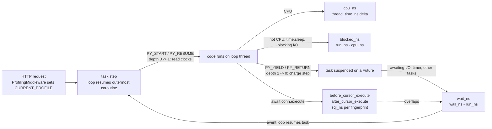

# Profiling Python APIs in Production: sys.monitoring, cProfile vs Wall-Clock Async Profiling, SQLAlchemy Query Attribution, and Memory Flamegraphs

> [!summary] Claim
> A request in an `asyncio` API spends its wall time in four places that no single profiler separates (loop-thread CPU, loop-thread blocking, suspended waiting, and SQL), so profile with a wall-clock view that knows about `await`, split each request's time with `sys.monitoring` task-step accounting plus SQLAlchemy cursor events, and use `tracemalloc` or Memray stacks for memory.

Part of [Observability Profiling and Operations](README.md) in [API Engineering](../README.md).

## TL;DR

- Mechanism: an `asyncio` task runs in steps (resume, run until the outermost coroutine yields), and `sys.monitoring` `PY_START`/`PY_RESUME`/`PY_YIELD`/`PY_RETURN` events mark the step edges, so each step's `perf_counter_ns` and `thread_time_ns` deltas can be charged to the request in a `ContextVar`.
- Contract rule: wall time = CPU on the loop thread + on-loop time that was not CPU (blocking) + suspended time; SQL time is a second, overlapping view taken from `before_cursor_execute` and `after_cursor_execute` on the synchronous engine.
- Trap: `cProfile` times with a wall clock but charges an `await` suspension to the event loop's `select` call, so an async handler that spends 100 ms awaiting shows about 0.04 ms (measured here, CPython 3.14.6, macOS 27.3 arm64), and a sampler that runs inside the loop cannot see a blocked loop at all.
- Portability fact: `sys.monitoring` exists from CPython 3.12, but returning `DISABLE` from `PY_UNWIND`, `RAISE` and the other non-local events raises `ValueError` until 3.15, and `cProfile` owns tool id 2 (`PROFILER_ID`) while enabled.
- When not to use it: do not leave per-event instrumentation on for every request in a hot service (this lab's meter cost between x1.25 and x3.6 on a pure coroutine-switching loop, measured on a saturated machine); sample, or switch it on for a small fraction of requests, and use an external sampler for the rest.

## Mental model



The middleware creates a `RequestProfile` and stores it in a `ContextVar`, so every task spawned for the request sees it.
Each time the event loop resumes one of the request's tasks, the outermost coroutine fires `PY_START` or `PY_RESUME` and the meter reads two clocks; when that coroutine yields to the loop or returns, the meter charges the elapsed wall time to `run_ns` and the elapsed thread CPU time to `cpu_ns`.
What is left of the request's wall time is `wait_ns`: the task was suspended, either on real I/O or because the loop was running someone else.
`run_ns` minus `cpu_ns` is `blocked_ns`, time the loop thread held the task but was not computing, which is the signature of a blocking call in an `async def`.
SQL time is a separate overlapping accounting from the SQLAlchemy events, so a slow query shows up as `sql_ns` inside `wait_ns`, and an N+1 shows up as a query count rather than a duration.

## How it works

### 1. Three clocks, three kinds of time

CPython exposes the clocks a profiler needs, and they answer different questions.
`time.perf_counter()` is a wall clock that includes time elapsed during sleep; on CPython it uses the same clock as `time.monotonic()` since 3.13 (Python 3.15.2 `time` docs).
`time.process_time()` is the sum of system and user CPU time of the whole process, it does not include sleep, and it is process-wide by definition (Python 3.15.2 `time` docs).
`time.thread_time()` is the same for the calling thread only, and its documented availability is Linux, Unix and Windows, on Unix only where `CLOCK_THREAD_CPUTIME_ID` is supported (Python 3.15.2 `time` docs).
Brendan Gregg frames the same split as on-CPU versus off-CPU time: a CPU profiler examines threads only while they are on-CPU, while off-CPU analysis measures time blocked on I/O, locks, timers and paging, and the two are complementary so that 100% of thread time can be understood (Brendan Gregg, "Off-CPU Analysis").

An `asyncio` request adds a wrinkle: one thread runs every task, so "waiting" has two causes.
A task can be suspended because its I/O has not completed, or because the loop thread is busy running another task or blocked in a synchronous call.
The profile therefore needs three buckets on the loop thread (CPU, on-thread-but-not-CPU, suspended) plus CPU burned on other threads, which `thread_time` of the loop thread cannot see.
The lab's `process_cpu_ns` (a `process_time_ns` delta) exposes that last bucket: it includes executor threads and the `aiosqlite` worker thread, but it is also polluted by every concurrent request, so it is only meaningful when you know the process is otherwise idle.

### 2. Deterministic tracing and what it does to coroutines

`cProfile` is a deterministic profiler: it observes every call, return and exception and takes precise timings between them (Python 3.15.2 `profile` docs, "What is deterministic profiling?").
The docs warn that deterministic profilers add overhead to Python code but not to C-level functions, which skews comparisons, and that the profilers are for execution profiles, not benchmarking (Python 3.15.2 `profiling` docs).
Since CPython 3.12 it is built on `sys.monitoring` and claims the predefined profiler slot: profiler initialisation sets `tool_id = PY_MONITORING_PROFILER_ID` (CPython 3.12.0 `Modules/_lsprof.c`, `profiler_init`; CPython 3.14.0 `Modules/_lsprof.c`, `profiler_init_impl`).
Its default timer is a wall clock: `call_timer` calls `PyTime_PerfCounterRaw` when no external timer is set (CPython 3.14.0 `Modules/_lsprof.c`, `call_timer`).
In 3.15 the module is `profiling.tracing` and `cProfile` stays as a backward-compatible alias, while the pure-Python `profile` module is deprecated and slated for removal in 3.17 (Python 3.15.2 `profiling` docs; PEP 799).

Two consequences matter for an async service.
First, a coroutine's resumption is a call: a handler that awaits once is entered twice, and `cProfile` reported `ncalls == 2` for it in this lab.
Second, the time a task spends suspended is not inside any Python function of that task: control returned to the loop, so the clock keeps running in `_run_once` and the selector call.
In this lab a handler that only does `await asyncio.sleep(0.1)` came out under `cProfile` with a cumulative time of 0.03 to 0.04 ms in `handler` (`ncalls=2`) and 101.1 ms in the selector call (`select.kqueue.control` on macOS), out of 101.7 ms wall (three runs of a one-off script, CPython 3.14.6, macOS 27.3 arm64, Apple M3 Pro; the lab test asserts the handler's share is below 25%).
`cProfile` is therefore the right tool for "which synchronous function burns CPU", and the wrong tool for "why is this endpoint slow when it mostly awaits".

### 3. `sys.monitoring`: the event API underneath

PEP 669 added `sys.monitoring` in 3.12 to make monitoring cheap by using the specialising interpreter's quickening (PEP 659) to rewrite only the instrumented bytecode, and it states that events and callbacks are per interpreter, not per thread, unlike `sys.settrace()` (PEP 669, Rationale and Specification).
The API has three parts: tool identifiers, events and callbacks (Python 3.15.2 `sys.monitoring` docs).
- Tool identifiers are integers 0 to 5 chosen with `use_tool_id(tool_id, name)`, which raises `ValueError` when the id is taken; predefined names are `DEBUGGER_ID = 0`, `COVERAGE_ID = 1`, `PROFILER_ID = 2` and `OPTIMIZER_ID = 5`, and ids 3 and 4 have no predefined name.
- `set_events(tool_id, event_set)` activates a bitwise OR of events globally, `set_local_events` does it per code object, and an event fires once even if it is on both globally and locally.
- `register_callback(tool_id, event, func)` installs the callable and returns any previous one; each event is delivered to tools in ascending order of id (PEP 669, "Order of events").
- A callback may return `sys.monitoring.DISABLE`, which turns the event off for that code location only, and `sys.monitoring.restart_events()` re-enables everything that was disabled, for all tools.

The events an async profiler needs are `PY_START` (immediately after a call), `PY_RESUME` (resumption of a generator or coroutine, except via `throw()`), `PY_YIELD`, `PY_RETURN`, `PY_THROW` (resumed by `throw()`) and `PY_UNWIND` (exit during exception unwinding) (Python 3.15.2 `sys.monitoring` docs).
`PY_START`, `PY_RESUME`, `PY_YIELD` and `PY_RETURN` are local events that can be disabled per location; `PY_THROW`, `PY_UNWIND`, `RAISE`, `EXCEPTION_HANDLED` and `RERAISE` are "other events" that cannot be disabled at all before 3.15; from 3.15, returning `DISABLE` from one of them disables that event for the whole code object for the current tool, not for one location (Python 3.15.2 `sys.monitoring` docs: "Changed in version 3.15: Other events can now be turned on and disabled on a per code object basis").
The VM enforces that: a callback that returns `DISABLE` for an event that is not instrumented per location gets `ValueError("Cannot disable %s events. Callback removed.")` and the callback is cleared to prevent an infinite loop (CPython 3.12.0 and 3.14.0 `Python/instrumentation.c`, `call_instrumentation_vector`); in 3.15.2 the same function first routes ungrouped events to `remove_local_tool`, so only the remaining events still raise (CPython 3.15.2 `Python/instrumentation.c`, `call_instrumentation_vector`).
The lab's `test_disable_from_other_events_is_gated_on_cpython_3_15` encodes the version split, and a one-off script re-run in verification gave `ValueError: Cannot disable PY_UNWIND events. Callback removed.` (and the same for `RAISE`) on 3.12.13, 3.13.18, 3.14.6 and 3.14.10, and no error on 3.15.2 and 3.15.0b3 free-threaded.
The 3.14 changes are `clear_tool_id()` (new) and `free_tool_id()` now calling it, where earlier releases left global events, local events and callbacks in place after freeing an id, and the `BRANCH` event being deprecated in favor of `BRANCH_LEFT` and `BRANCH_RIGHT` (Python 3.15.2 `sys.monitoring` docs).

The event order for a nested `await` chain is what makes step accounting possible.
Running `root -> child -> leaf -> asyncio.sleep(0)` under a tracing callback on CPython 3.14.6 gave this order (exploratory script, not part of the lab, re-run in verification with identical output; names filtered to the five coroutines, and `__sleep0` is the `@types.coroutine` generator inside `asyncio.sleep(0)`):

```text
PY_START root, child, leaf, sleep, __sleep0
PY_YIELD __sleep0, sleep, leaf, child, root        <- innermost first, step ends
PY_RESUME root, child, leaf, sleep, __sleep0       <- outermost first, next step
PY_RETURN __sleep0, sleep, leaf, child, root
```

Starts and resumes arrive outermost first, yields and returns innermost first, so a per-thread depth counter that goes 0 -> 1 on the first start or resume and 1 -> 0 on the last yield or return brackets exactly one task step.
Two details keep the counter honest.
`PY_THROW` is the entry and `PY_UNWIND` the exit for a coroutine resumed or left by an exception (`Task.cancel()` delivers `CancelledError` through `throw()`), so the meter counts them too, and the lab test `test_step_depth_returns_to_baseline_after_cancellation` fails if the pairing is broken.
Plain functions are not coroutines, so the `PY_START`/`PY_RETURN` callbacks return `DISABLE` for any code object whose `co_flags` lacks `CO_COROUTINE`, `CO_ITERABLE_COROUTINE` or `CO_ASYNC_GENERATOR`; after the first call each plain-function location costs nothing, which `test_returning_disable_stops_callbacks_for_a_code_location` checks as fewer than 20 callbacks per 200 calls instead of at least 200.

### 4. Attribution through `ContextVar`

Context variables are natively supported in `asyncio` without extra configuration (Python 3.15.2 `contextvars` docs), and in this lab a `ContextVar` set by the middleware was visible in every step of the request and in the tasks it spawned.
That is what lets one global monitoring callback charge the right request without any registry keyed by task: at the step edge it reads `CURRENT_PROFILE.get()` and adds to whatever profile is current.
Two edge cases need explicit handling.
The step in which the middleware itself starts has already been running, so `rebase()` resets the step's clocks to avoid charging earlier code to the request.
The final step ends after the middleware has reset the variable, so `flush(profile)` charges the open step before `CURRENT_PROFILE.reset(token)`.
`test_concurrent_requests_are_not_cross_charged` runs an 80 ms awaiting request and a 30 ms CPU request together and checks that the awaiting request is charged under 15 ms of CPU even though the loop thread burned 30 ms during it.
The same idea scales to the pure-ASGI middleware onion and `ContextVar` isolation covered in [[Pure-ASGI-Middleware-Onion-Architecture-and-Send-Receive-Wrapping]] and [[ASGI-State-Isolation-and-ContextVars-Across-Request-Lifecycle]].

### 5. Wall-clock async profiling: what a suspended task is waiting on

An external or periodic stack sampler sees an idle event loop as one frame, the selector call, which is the same blindness as `cProfile` has.
The fix is to read the await chain of each task: a suspended coroutine's `cr_await` leads to the coroutine it awaits, and so on to the leaf (an `asyncio.sleep` coroutine, then a `FutureIter`).
`await_chain(task)` in the lab walks that chain and returned `outer, inner, sleep, <FutureIter>` for a task suspended in `asyncio.sleep(10)`; the leaf is the C iterator, which hides the future itself.
CPython 3.14 added official call-graph introspection for this: `asyncio.capture_call_graph`, `asyncio.print_call_graph` and `asyncio.format_call_graph` return the call stack of a task or future plus the tasks that await it, and the docs state they can be used by external profilers and debuggers (Python 3.15.2 `asyncio` call graph docs; added in 3.14).
They need cooperation from control-flow structures such as `shield()` and `TaskGroup`, and a hand-written intermediate `Future` must register itself with `future_add_to_awaited_by` and `future_discard_from_awaited_by` or the graph breaks.

Where the sampler runs matters.
A sampler implemented as a task on the loop gets scheduled only when the loop is free, so it records nothing while a handler blocks the loop.
The lab's `test_in_loop_sampler_is_blind_to_blocking_but_thread_sampler_is_not` blocks the loop for 0.2 s: the in-loop sampler's largest gap between samples is at least 0.18 s, while a `ThreadSampler` that reads the loop thread's innermost frame with `sys._current_frames()` from another thread records at least 20 samples inside `blocking_handler`.
`sys._current_frames()` needs no cooperation from the sampled thread, but the docs say the returned frame may bear no relationship to the thread's activity by the time it is examined and that it is for internal and specialized purposes (Python 3.15.2 `sys` docs).
asyncio's own debug mode logs callbacks that run longer than 100 ms, adjustable through `loop.slow_callback_duration` (Python 3.15.2 `asyncio` development docs); loop-lag monitors are the subject of [[Detecting-Event-Loop-Blocking-Loop-Lag-Monitors-and-Debug-Callbacks]].

### 6. Production samplers: what each one actually measures

- py-spy: a Rust sampler that reads another process's memory (`process_vm_readv` on Linux, `vm_read` on macOS, `ReadProcessMemory` on Windows), so it needs no code change and no restart; `record` writes flame graphs, `top` is live, `dump` prints each thread's stack; OSX always needs root, and on Linux attaching to a non-child process usually needs root or `ptrace_scope` relaxed; containers need `SYS_PTRACE`, and Kubernetes drops that capability by default (py-spy README).
  Its idle detection is a heuristic with documented races, `--idle` includes idle threads, and `--gil` keeps only threads holding the GIL, which misses extension code that released it (py-spy README, "How do you detect if a thread is idle or not?" and "How does GIL detection work?").
- Tachyon, `profiling.sampling` (CPython 3.15, PEP 799): `run`, `attach`, `dump` and `replay` subcommands, modes `wall` (default, every sample), `cpu` (only samples where the thread is on a CPU core), `gil` and `exception`, and `--async-aware` with `--async-mode running|all`, which reconstructs stacks across `await` boundaries and marks task boundaries with `<task>` frames; default rate 1 kHz; attach requires the same Python minor version on both sides and does not work between free-threaded and standard builds; on macOS it uses `task_for_pid()` and needs root or the debugger entitlement (Python 3.15.2 `profiling.sampling` docs).
  Async-aware mode is incompatible with `--native`, `--no-gc`, `--all-threads`, `--mode=cpu` and `--mode=gil`, and needs `asyncio` already imported in the target.
  On the macOS 27.3 machine used here, an unprivileged `python3.15 -m profiling.sampling run -d 1` of a two-line script printed `Permission Error: Unable to access process memory on macOS` and exited with status 1 (CPython 3.15.2, re-run in verification), so no Tachyon output is shown in this note.
- pyinstrument: a statistical wall-clock profiler using `PyEval_SetProfile` with readings at most every 1 ms by default; its async mode attaches to the current async context, and when execution leaves the context it attributes the time outside to the `await` that halted it, shown as `[await]` frames in its output; greenlet is "not fully supported" (pyinstrument documentation, "How it works"; `[await]` from the pyinstrument README example output).
- Memray: see section 8.

The docs for Tachyon contradict themselves on the default sampling interval: the option table says 1 kHz (`-r`, default 1 kHz) while the blocking-mode text says "The default 100 microsecond interval" (Python 3.15.2 `profiling.sampling` docs).
The implementation settles it: `python3.15 -m profiling.sampling run --help` on CPython 3.15.2 prints `-r, --sampling-rate RATE ... (default: 1khz)`, a 1000 microsecond interval, so the 100 microsecond sentence in the blocking-mode warning is stale documentation (as of 2026-11).

Python 3.14 also added the safe attach primitive these tools build on: `sys.remote_exec(pid, script)` runs a script in the target's main thread at the next available opportunity, requires the same major and minor version (exact version for pre-releases) (Python 3.15.2 `sys` docs), and can be disabled with `PYTHON_DISABLE_REMOTE_DEBUG`, `-X disable-remote-debug` or the `--without-remote-debug` build flag (PEP 768); on CPython 3.14.10 here, `sys.is_remote_debug_enabled()` returned `True` by default and `False` under either runtime switch.

### 7. SQLAlchemy query attribution

SQLAlchemy exposes the hooks a per-request SQL profiler needs as `ConnectionEvents`: `before_cursor_execute(conn, cursor, statement, parameters, context, executemany)` and `after_cursor_execute` with the same signature, and `DialectEvents.handle_error(exception_context)` (SQLAlchemy 2.1.8 `sqlalchemy/engine/events.py`).
In `Connection._exec_single_context` the before-event runs before the dialect executes the statement, `after_cursor_execute` runs after `self.dialect.do_execute(...)` returns, and any `BaseException` goes to `Connection._handle_dbapi_exception`, which dispatches `handle_error` (SQLAlchemy 2.1.8 `sqlalchemy/engine/base.py`, `_exec_single_context` and `_handle_dbapi_exception`).
A failing statement never reaches `after_cursor_execute`, so a timer started in the before-event must also be closed in `handle_error`; otherwise the stale start leaks into the next statement on that connection.
`test_failed_statement_is_recorded_as_error_and_leaves_no_timer` checks both the error count and that the next query on the same connection is attributed to its own statement.

For `AsyncEngine`, listeners attach to `engine.sync_engine`, because the ORM and Core machinery runs synchronously inside a greenlet and awaits through `await_` (SQLAlchemy 2.1 asyncio docs, "Using events with the asyncio extension", whose examples call `event.listens_for(engine.sync_engine, ...)`).
Two source facts make the timings and the `ContextVar` lookup correct there.
`greenlet_spawn` creates `_AsyncIoGreenlet`, whose `__init__` sets `self.gr_context = driver.gr_context` when greenlet supports it, so the awaiting task's context, including `CURRENT_PROFILE`, is visible in the greenlet that runs the event listeners (SQLAlchemy 2.1.8 `sqlalchemy/util/concurrency.py`, `_AsyncIoGreenlet.__init__` and `greenlet_spawn`).
For a non-server-side cursor `AsyncAdapt_dbapi_cursor._execute_async` awaits `execute` and then `fetchall` inside the same call under the connection's `_execute_mutex` (SQLAlchemy 2.1.8 `sqlalchemy/connectors/asyncio.py`), so `after_cursor_execute` includes row transfer for buffered cursors; for server-side cursors the fetches happen later and are outside the measured interval.
What the interval never includes: waiting for a pooled connection (the checkout happens before the statement), ORM object hydration, and response serialization.
A request whose `wait_ns` is far above its `sql_ns` is therefore a candidate for pool exhaustion or a non-SQL downstream call, which [[Connection-Pooling-Internals-QueuePool-AsyncAdaptedQueuePool-and-Pre-Ping]] and [[Sizing-Connection-Pools-Across-Workers-Pods-and-PgBouncer-Transaction-Mode]] cover.

Statement text is a cardinality hazard, so the lab groups by a fingerprint: string literals and numbers become `?` and runs of placeholders in an `IN` list collapse to `(?+)`, truncated to 200 characters.
The count per fingerprint is the N+1 detector: the `/orders?n=7` request below shows `1 x SELECT id FROM orders LIMIT ?` and `7 x SELECT customer FROM orders WHERE id = ?`.
The remedies are in [[Eliminating-N-Plus-1-Queries-Selectinload-Joinedload-Subqueryload-and-Raiseload]] and the greenlet bridge itself in [[Async-SQLAlchemy-Under-the-Hood-Greenlet-Bridge-and-MissingGreenlet]].

### 8. Memory: tracemalloc and Memray flamegraphs

`tracemalloc` installs hooks on Python's memory allocators and, for each live block, stores a traceback limited to `nframe` frames, 1 by default, set by `start(nframe)`, `PYTHONTRACEMALLOC=NFRAME` or `-X tracemalloc=NFRAME` (Python 3.15.2 `tracemalloc` docs).
It sees only blocks allocated after it started, so enable it at process start to catch import-time allocations, and storing more frames costs memory and CPU, measurable with `get_tracemalloc_memory()` (Python 3.15.2 `tracemalloc` docs).
`Traceback` is a sequence of `Frame` objects sorted from the oldest to the most recent frame since 3.7, and `total_nframe` (3.9) records the original depth so you can tell truncation (Python 3.15.2 `tracemalloc` docs).
A `Frame` has only a filename and a line number, no function name, so a flamegraph built from `tracemalloc` labels its boxes `file:line`.
`folded_allocation_stacks` in the lab renders `snapshot.statistics("traceback")` as folded stacks, `root;...;leaf bytes`, the input that Brendan Gregg's `flamegraph.pl` consumes: "stack frames and sample counts formatted as single lines", each frame "semicolon separated, with a space and count at the end of the line", parsed with `^(.*)\s+?(\d+(?:\.\d*)?)$` (FlameGraph master `41fee1f` `flamegraph.pl`, header comment and input loop); because `Traceback` is already root-first, no reversal is needed, and a file path that contains `;` would split into two frames.
`test_one_frame_tracebacks_lose_the_call_path` shows why `nframe` matters: with `nframe=1` the only frame left is the line that called `bytearray(...)`, with `nframe=8` the call from `leaky_handler` is present.
`reset_peak()` (3.9) sets the recorded peak to the current size without clearing traces, which is how `measure_call` gets a call-local peak; the lab test allocates and frees 4 MiB before the call and then checks that a call that only touches 1 MiB reports a peak between 1 and 2 MiB.
Two snapshots compared with `Snapshot.compare_to(old, "lineno")` find growth over time, which is the usual leak workflow in [[Memory-Leaks-in-Long-Running-Python-API-Workers]].

Memray is the heavier alternative: it "traces every function call so it can accurately represent the call stack, unlike sampling profilers", handles native C and C++ frames, and works with Python and native threads; it supports Linux and macOS only (Memray overview).
Its flame graph "displays the superposition of all stack traces that led to all memory allocations active at a given time (normally the time when the total amount of allocated memory was highest)", so by default it is a picture of the peak, the y-axis is stack depth, width is bytes, and a flame graph "can't tell you how many times a function was called, only how much memory that function allocated" (Memray flame graph reporter docs).
Its overhead has two sources: a C++ profile function called on every Python call and return, and the allocation registering code, which is the main source and gets much worse when `--trace-python-allocators` is on (Memray performance docs; measured by the authors on Python 3.10.9, Memray 1.5.0, pyperformance, a tuned x86_64 Arch Linux machine, so treat the shape, not the numbers, as portable).
`memray attach` records only allocations made after attaching; on Python 3.14 or newer it uses `sys.remote_exec()` and needs the same major and minor version, otherwise a debugger (`gdb` or `lldb`), and it needs root or `CAP_SYS_PTRACE` for other users' processes (Memray attach docs).

## Numbers and limits

| Quantity | Value | Source |
| --- | --- | --- |
| `sys.monitoring` tool ids | 6 (0 to 5); `DEBUGGER_ID=0`, `COVERAGE_ID=1`, `PROFILER_ID=2`, `OPTIMIZER_ID=5` | Python 3.15.2 `sys.monitoring` docs |
| Event scope | per interpreter, not per thread | PEP 669 |
| `cProfile` tool id and timer | `PY_MONITORING_PROFILER_ID`; `PyTime_PerfCounterRaw` wall clock | CPython 3.14.0 `Modules/_lsprof.c` |
| `cProfile` calls for a handler with one `await` | `ncalls == 2` | measured: lab test, CPython 3.12.13 to 3.15.2 |
| `cProfile` cumulative time in a handler that awaits `asyncio.sleep(0.1)` | 0.03 to 0.04 ms of 101.7 ms wall; `select.kqueue.control` 101.1 ms | measured: one-off script, three runs, CPython 3.14.6, macOS 27.3 arm64, Apple M3 Pro (as of 2026-11) |
| `TaskStepMeter` overhead | x1.25 to x3.6 for 20,000 iterations of `main` awaiting `top -> mid -> leaf -> asyncio.sleep(0)`; no stable single figure | measured: one-off script, best of 7 per run, six runs (three wall clock, three `thread_time`), CPython 3.14.6, macOS 27.3 arm64, load average 27 to 133 on 12 cores |
| `cProfile` overhead on the same loop | x1.1 to x5.0; neither the meter nor `cProfile` was consistently cheaper | same six runs |
| Events per iteration of that loop | 22 coroutine events (5 start, 6 yield, 6 resume, 5 return) | counted with a `sys.monitoring` callback filtered by coroutine flags, same script |
| `tracemalloc` slowdown, allocation-only loop of 300,000 `bytes(64)` | x4.3 to x4.9 at `nframe=1`, x10.6 to x12.1 at `nframe=8`, x10.4 to x12.6 at `nframe=25` | measured: one-off script, `thread_time`, best of 7, two runs, same machine |
| `tracemalloc` bookkeeping | 17,989,200 bytes for 300,000 live traced blocks (about 60 bytes per block), identical at `nframe=1`, `8` and `25` because every block shares one call site | measured: same runs, `get_tracemalloc_memory()`, identical in both |
| asyncio slow callback threshold (debug mode) | 100 ms, `loop.slow_callback_duration` | Python 3.15.2 `asyncio` development docs |
| Tachyon default sampling rate | 1 kHz (the blocking-mode text's 100 microseconds is stale, see section 6) | Python 3.15.2 `profiling.sampling` docs; `run --help` on CPython 3.15.2 prints `(default: 1khz)` |
| pyinstrument default interval | 1 ms | pyinstrument "How it works" |
| `reset_peak`, `total_nframe` | added in 3.9 | Python 3.15.2 `tracemalloc` docs |
| `Traceback` frame order | oldest to most recent since 3.7 | Python 3.15.2 `tracemalloc` docs |
| `thread_time` availability | Linux, Unix (with `CLOCK_THREAD_CPUTIME_ID`), Windows | Python 3.15.2 `time` docs |
| Lab suite | 20 tests, 2.06 s on CPython 3.14.6 | measured: `uv run --frozen pytest` below |

The timing rows come from one machine saturated by unrelated jobs, and the overhead ratios moved by a factor of three between runs, so read them as orders of magnitude and re-measure on your own hardware.
The benchmark is a worst case for the meter: it does nothing except switch coroutines, firing 22 Python-level callbacks per iteration, and a real handler spends most of its time in code that fires no coroutine events.

## Portability

| Cell | Result | Proof |
| --- | --- | --- |
| CPython 3.12.13 | 20 passed; `DISABLE` from `PY_UNWIND` raises `ValueError`; `cProfile` clash error text is `Another profiling tool is already active` | `uv run --frozen --python <3.12.13>` pytest; one-off script for the message |
| CPython 3.13.18 | 20 passed; `DISABLE` from `PY_UNWIND` raises; clash text is `tool 2 is already in use` | same method |
| CPython 3.14.6 (workspace interpreter) | 20 passed; clash text is `Another profiling tool is already active` | `uv run --frozen pytest -v` below |
| CPython 3.14.10 | 20 passed; clash text is `tool 2 is already in use` | same method as 3.12 |
| CPython 3.15.2 | 20 passed; `DISABLE` from `PY_UNWIND` and `RAISE` is accepted; `profiling.sampling` imports but needs elevated permissions on macOS | pytest, plus a one-off script and an import check |
| CPython 3.15.0b3 free-threaded (3.15.2t was not available here) | 10 passed, 10 could not run: `greenlet` 3.5.6 segfaults inside `import sqlalchemy.ext.asyncio` at `sqlalchemy/util/concurrency.py` line 85 (`hasattr(getcurrent(), "gr_context")`), so every test that builds the SQLAlchemy engine fails by crashing the interpreter | pytest with `--no-project` and a `-k` filter to exclude the 10 harness tests; the same crash reproduced with the pinned `greenlet==3.5.6` |
| SQLAlchemy 2.1.8 | 20 passed on CPython 3.14.6 | default group |
| SQLAlchemy 2.0.57 | 20 passed on CPython 3.14.6 | `--no-group sqlalchemy21 --group sqlalchemy20` |
| asyncio loop implementation | `uvloop` 0.23.0 gave the same split for every route (for example `/block` blocked 50.6 ms of 50.9 ms wall, `/wait` waited 51.1 ms of 51.4 ms, `/thread` 30.4 ms of process CPU against 0.3 ms on the loop thread) | one-off script through `uvloop.run`, CPython 3.14.6, re-run in verification; not a pytest test |
| Uvicorn 0.54.0, Hypercorn 0.18.0, Granian 2.8.7 | the same split on each: `/block` blocked 55.1, 54.4 and 55.1 ms of about 55 ms wall (CPU 0.6 to 0.9 ms), `/wait` waited 51.1, 51.0 and 51.1 ms of about 52 ms wall with 0.1 ms or less blocked, `/cpu?ms=50` showed 50.4 to 50.8 ms CPU, `/slow-sql?ms=30` waited 32.1, 32.4 and 35.5 ms, and the first `/thread` request blocked the loop 6.4 ms on all three (the GIL switch interval effect described above) | one-off script, not a pytest test: one worker per server started as a subprocess (`python -m uvicorn`, `python -m hypercorn`, `python -m granian --interface asgi --workers 1`), the lab's `build_app` behind a thin lifespan-answering ASGI wrapper, requests from `httpx` 0.28.1 over HTTP/1.1, CPython 3.14.6, macOS 27.3 arm64; the servers' own internals were not read |
| HTTP/1.1, HTTP/2, HTTP/3 | accounting happens at the ASGI `http` scope, below the wire protocol; HTTP/1.1 was exercised by the server run above, HTTP/2 and HTTP/3 over QUIC were not run | HTTP/1.1: the server run above; HTTP/2 and HTTP/3: not run |
| Linux and Alpine musl | not run: macOS arm64 only | `thread_time` availability is sourced from the `time` docs |
| py-spy, Tachyon, Memray | not run here; behavior is quoted from their documentation | sources listed in the front matter |

The error text of the `cProfile` clash differs between patch releases of the same minor (3.14.6 versus 3.14.10) because CPython gh-153068 ("Profiler.enable() clobbers exception from use_tool_id") removed the `PyErr_Format` that replaced the `use_tool_id` error, backported to 3.13 and 3.14 on 2026-07-07: the generic text is in `Modules/_lsprof.c` at v3.12.13, v3.13.0, v3.14.0 and v3.14.6 and absent at v3.13.18, v3.14.10 and v3.15.2, and the 3.15.0b3 free-threaded build here still prints the generic text, so match on the condition, a `ValueError`, not on the message.
`PY_THROW` and `PY_UNWIND` cannot return `DISABLE` below 3.15, so a portable tool must never do it from those events; the lab's meter returns `None` from both.

## Worked example

The implementation is [implementation](../labs/src/api_labs/f18_observability_profiling_and_operations/request_profile.py), with the demo app in `profiled_app.py`, the samplers in `async_sampler.py`, the `cProfile` view in `cprofile_view.py` and the memory helpers in `memory_profile.py` in the same package.
The test is [test](../labs/tests/f18_observability_profiling_and_operations/test_profiling_python_api_services_cpu_wall_clock_async_tasks_and_memory.py).

The core of the meter is the pair of callbacks that find step edges and disable plain functions:

```python
    def _enter(self) -> None:
        state = self._state
        if state.depth == 0:
            state.start_wall_ns = time.perf_counter_ns()
            state.start_cpu_ns = time.thread_time_ns()
        state.depth += 1

    def _exit(self) -> None:
        state = self._state
        if state.depth == 0:
            return
        state.depth -= 1
        if state.depth == 0:
            profile = CURRENT_PROFILE.get()
            if profile is not None:
                self._charge(state, profile)

    def _on_enter(self, code: CodeType, offset: int) -> object:
        if not code.co_flags & _COROUTINE_FLAGS:
            return sys.monitoring.DISABLE
        self._enter()
        return None

    def _on_exit(self, code: CodeType, offset: int, retval: object) -> object:
        if not code.co_flags & _COROUTINE_FLAGS:
            return sys.monitoring.DISABLE
        self._exit()
        return None
```

The SQL side is three listeners on the synchronous engine:

```python
    def _on_before(
        self,
        conn: Connection,
        cursor: object,
        statement: str,
        parameters: object,
        context: object,
        executemany: bool,
    ) -> None:
        conn.info[_STATEMENT_START_KEY] = (time.perf_counter_ns(), statement)

    def _on_after(
        self,
        conn: Connection,
        cursor: object,
        statement: str,
        parameters: object,
        context: object,
        executemany: bool,
    ) -> None:
        self._finish(conn, error=False)

    def _on_error(self, exception_context: ExceptionContext) -> None:
        if exception_context.connection is not None:
            self._finish(exception_context.connection, error=True)

    @staticmethod
    def _finish(conn: Connection, *, error: bool) -> None:
        started: tuple[int, str] | None = conn.info.pop(_STATEMENT_START_KEY, None)
        profile = CURRENT_PROFILE.get()
        if started is None or profile is None:
            return
        start_ns, statement = started
        profile.record_query(fingerprint(statement), time.perf_counter_ns() - start_ns, error=error)
```

The memory helper that makes a call-local peak, and the folded-stack renderer:

```python
def folded_allocation_stacks(snapshot: tracemalloc.Snapshot, *, min_bytes: int = 1) -> list[str]:
    """Render a snapshot as folded stacks (``root;...;leaf bytes``) for flamegraph.pl.

    ``tracemalloc.Frame`` carries only a filename and a line number, so a frame is rendered
    ``file:lineno``.
    ``Traceback`` is oldest frame first, which is already root-first for a flamegraph.
    """
    lines: list[str] = []
    for stat in snapshot.statistics("traceback"):
        if stat.size < min_bytes:
            continue
        stack = ";".join(f"{frame.filename}:{frame.lineno}" for frame in stat.traceback)
        lines.append(f"{stack} {stat.size}")
    return sorted(lines)


def measure_call[T](func: Callable[[], T]) -> tuple[T, int, int]:
    """Run ``func`` and return ``(result, retained_bytes, peak_bytes)`` of traced memory.

    ``reset_peak`` makes the peak local to the call; tracemalloc must already be tracing.
    Both numbers are process-wide, so they are only attributable when nothing else allocates.
    """
    baseline, _ = tracemalloc.get_traced_memory()
    tracemalloc.reset_peak()
    result = func()
    current, peak = tracemalloc.get_traced_memory()
    return result, current - baseline, peak - baseline
```

Running the demo app through the profiler (a one-off script that imports the lab modules, CPython 3.14.6, macOS 27.3 arm64, `httpx.ASGITransport`, in-memory `aiosqlite`; requests `/cpu?ms=30`, `/wait?ms=50`, `/block?ms=50`, `/thread?ms=30`, `/slow-sql?ms=60`, `/orders?n=7`; times in milliseconds, after a warm-up request per route; the third of three runs in verification):

```text
route          wall     cpu  blocked    wait  proc_cpu     sql queries steps
/cpu           30.9    30.3      0.7     0.0      30.3     0.0       0     1
/wait          51.5     0.3      0.1    51.1       0.4     0.0       0     2
/block         55.4     0.3     55.0     0.0       0.3     0.0       0     1
/thread        30.9     0.3      0.0    30.6      30.5     0.0       0     2
/slow-sql      62.5     0.8      0.0    61.7       1.4    61.5       1     8
/orders         5.3     2.7      0.1     2.5       4.9     2.1       8    36
    1 x SELECT id FROM orders LIMIT ?
    7 x SELECT customer FROM orders WHERE id = ?
```

Reading it:

- `/cpu` and `/block` have the same shape on a latency dashboard and opposite causes: 30.3 ms of CPU versus 55.0 ms `blocked` with 0.3 ms of CPU.
- `/wait` and `/thread` both look like waiting, but `/thread` burned 30.5 ms of process CPU on a worker thread that the loop thread's `cpu` column cannot see.
- `/slow-sql` attributes 61.5 of 62.5 ms to one statement.
- `/orders` is fast but issues 8 statements, which is the N+1 shape.
- `blocked` also absorbs involuntary preemption: in the first of the three runs, on a host with load average between 60 and 130 on 12 cores, `/cpu` showed 27.9 ms `blocked` beside 30.5 ms of CPU, so read `blocked` together with host CPU saturation.
- The first `asyncio.to_thread` call blocks the loop for about one GIL switch interval: `Thread.start()` waits for the new worker to signal that it started, the worker takes the GIL and spins, and the loop thread cannot resume until the interpreter forces a GIL handoff.
  Measured on a cold executor (one-off script, four requests per setting): `blocked` about 0.7 ms with `sys.setswitchinterval(0.0005)`, about 6 ms at the default 5 ms, about 24 ms at 20 ms, and 0.0 ms at every setting once the executor's worker existed.
  The lab harness warms `/thread` for this reason.
  The drafter's unexplained 7.5 ms residue was this effect, and it made `test_cpu_in_a_worker_thread_is_invisible_to_loop_thread_cpu` fail (`wait_ns` 23.9 ms against a 25 ms floor) before the warm-up was added.

The pytest command, run from the lab workspace:

```sh
cd 20-API-Engineering/labs
uv run --frozen pytest tests/f18_observability_profiling_and_operations/test_profiling_python_api_services_cpu_wall_clock_async_tasks_and_memory.py -v
```

Captured output, CPython 3.14.6, macOS 27.3 arm64 (path prefix `tests/f18_observability_profiling_and_operations/test_profiling_python_api_services_cpu_wall_clock_async_tasks_and_memory.py::` elided):

```text
test_fingerprint_collapses_literals_and_in_lists PASSED [  5%]
test_cpu_bound_handler_is_charged_to_cpu PASSED [ 10%]
test_awaited_sleep_is_charged_to_wait_not_cpu PASSED [ 15%]
test_blocking_sleep_is_charged_to_blocked_not_wait PASSED [ 20%]
test_cpu_in_a_worker_thread_is_invisible_to_loop_thread_cpu PASSED [ 25%]
test_slow_query_time_is_attributed_to_its_statement PASSED [ 30%]
test_n_plus_one_shows_as_query_count PASSED [ 35%]
test_failed_statement_is_recorded_as_error_and_leaves_no_timer PASSED [ 40%]
test_uninstall_stops_attribution PASSED [ 45%]
test_concurrent_requests_are_not_cross_charged PASSED [ 50%]
test_step_depth_returns_to_baseline_after_cancellation PASSED [ 55%]
test_disable_from_other_events_is_gated_on_cpython_3_15 PASSED [ 60%]
test_returning_disable_stops_callbacks_for_a_code_location PASSED [ 65%]
test_cprofile_cannot_run_while_a_meter_holds_profiler_id_but_can_beside_the_default PASSED [ 70%]
test_cprofile_charges_awaited_wait_to_the_loop_not_the_handler PASSED [ 75%]
test_await_chain_names_what_a_suspended_task_waits_on PASSED [ 80%]
test_in_loop_sampler_is_blind_to_blocking_but_thread_sampler_is_not PASSED [ 85%]
test_folded_stacks_are_root_first_and_keep_the_call_path PASSED [ 90%]
test_one_frame_tracebacks_lose_the_call_path PASSED [ 95%]
test_measure_call_reports_call_local_peak_and_retained PASSED [100%]

============================== 20 passed in 2.06s ==============================
```

In the drafter's matrix run, before the `/thread` warm-up was added, the same file passed 20 of 20 on CPython 3.12.13 (2.41 s), 3.13.18 (2.29 s), 3.14.10 (2.44 s) and 3.15.2 (2.19 s), and on SQLAlchemy 2.0.57 (3.41 s, CPython 3.14.6); on CPython 3.15.0b3 free-threaded 10 of 20 passed and the other 10 could not start (see Portability).
Verification re-ran only the workspace interpreter, because lab matrix runs were paused by instruction on 2026-11-11.
Mutation testing was paused by the same instruction, so the discriminating power of each test is argued from its assertion, not demonstrated by breaking the mechanism.

## Pitfalls

> [!warning] A blocking call inside `async def` looks like CPU or like waiting in every other view
> Trigger: a handler calls `time.sleep`, a synchronous HTTP client or a synchronous database driver on the loop thread.
> Symptom: `cProfile` charges the time to the blocking function with no hint that it stalls everyone, a CPU profiler sees nothing because the thread is off-CPU, and the other requests' `wait_ns` inflates because their tasks could not be resumed.
> In the lab `/block?ms=50` produced `blocked_ns` 52.1 ms with `cpu_ns` 0.4 ms, which is the fingerprint: loop-thread time that is not CPU.
> Fix: move the call to an async client or `asyncio.to_thread`, and alarm on loop lag as in [[Detecting-Event-Loop-Blocking-Loop-Lag-Monitors-and-Debug-Callbacks]].

> [!warning] Reading `cProfile` output for an async handler
> Trigger: `python -m cProfile` or `profiling.tracing` on an `async def` endpoint that mostly awaits.
> Symptom: the handler shows a tiny cumulative time and `ncalls` equal to the number of resumptions, and the real time is under `_run_once` and the selector call.
> Fix: use a wall-clock async-aware view (pyinstrument's async mode, Tachyon `--async-aware`, or task step accounting) for latency questions, and keep `cProfile` for synchronous CPU hot spots.

> [!warning] Two tools on `PROFILER_ID`
> Trigger: your instrumentation or an APM agent holds `sys.monitoring` tool id 2 and someone runs `cProfile`, or the reverse.
> Symptom: `ValueError` from `Profile.enable()`, with text that differs between releases (`Another profiling tool is already active` on 3.12.13 and 3.14.6, `tool 2 is already in use` on 3.13.18, 3.14.10 and 3.15.2, the change made by CPython gh-153068).
> Fix: pick an unassigned id such as 3 or 4 for your own tool, as `METER_TOOL_ID` does, and catch `ValueError` from `use_tool_id`; there are only six ids per interpreter.

> [!warning] Returning `DISABLE` from `PY_UNWIND` or `PY_THROW`
> Trigger: a tool copies the "disable after first hit" pattern from coverage tools to exception events.
> Symptom: `ValueError: Cannot disable PY_UNWIND events. Callback removed.` on CPython 3.12 to 3.14, after which the callback is gone and the depth counter silently stops balancing.
> Fix: return `DISABLE` only from the local events and return `None` from the others until you require 3.15.

> [!warning] A timer that is not closed on error
> Trigger: a `before_cursor_execute` listener stores a start time and no listener closes it when `execute` raises.
> Symptom: the next statement on that connection is charged from the failed statement's start, producing impossible durations that look like a slow query.
> Fix: close the timer in `handle_error`, which `Connection._handle_dbapi_exception` dispatches, as `SqlAttribution` does.

> [!warning] Profiling the wrong thread's CPU
> Trigger: CPU work in `asyncio.to_thread`, a `ThreadPoolExecutor`, or the `aiosqlite` worker thread.
> Symptom: `thread_time` of the loop thread reports almost nothing while the pod is at 100% CPU; the lab's `/thread` endpoint showed `cpu` 0.3 ms against `proc_cpu` 30.5 ms.
> A second symptom on a cold executor: the first `to_thread` call charges about one GIL switch interval (5 ms by default) to the loop thread as `blocked`, because `Thread.start()` waits while the new worker holds the GIL.
> Fix: compare against `process_time` or container CPU metrics, and use `--all-threads` style sampling for thread pools; see [[Offloading-CPU-Bound-Work-ProcessPoolExecutor-vs-Free-Threaded-Python-3-15t]].

> [!warning] `tracemalloc` left on in production with a deep `nframe`
> Trigger: `PYTHONTRACEMALLOC=25` or `tracemalloc.start(25)` in a service that allocates heavily.
> Symptom: the allocation-only loop here ran x10.6 to x12.1 slower at `nframe=8` and x10.4 to x12.6 at `nframe=25`, against x4.3 to x4.9 at `nframe=1`, and every live block carried about 60 bytes of bookkeeping.
> Fix: run with `nframe=1` for a continuous leak watch, start deeper tracing only on one canary worker for a bounded window, and compare two snapshots rather than keeping a single one.

> [!warning] The unprivileged profiler that cannot attach
> Trigger: running py-spy or Tachyon `attach` in a container without `SYS_PTRACE`, on macOS without root, or on Linux with the default Yama `ptrace_scope` of 1.
> Symptom: a permission error; on the macOS machine used for this lab even `python3.15 -m profiling.sampling run` printed `Permission Error: Unable to access process memory on macOS` and exited 1 as a regular user.
> Fix: plan the privilege (a sidecar or debug pod with the capability, or `sys.remote_exec`-based tooling) before the incident, not during it.

## Security and robustness

- Threat model: a profiler is a privileged observer. py-spy and Tachyon read another process's memory, which on Linux needs root, `CAP_SYS_PTRACE` or a relaxed `ptrace_scope` (py-spy README; Python 3.15.2 `profiling.sampling` docs), and Memray's own documentation warns that allowing arbitrary processes to be traced is an easy vector for privilege escalation inside a remote code execution attack (Memray attach docs).
  Grant the capability to a debug container, not to the application pod.
- Remote execution: `sys.remote_exec` runs arbitrary code in the target's main thread, so lock it down where you do not need it with `PYTHON_DISABLE_REMOTE_DEBUG`, `-X disable-remote-debug` or a `--without-remote-debug` build (PEP 768), and check the result with `sys.is_remote_debug_enabled()`.
- Data exposure: stack frames, SQL text and parameters are sensitive.
  The lab fingerprints statements and drops literals before storing them, and records parameter values nowhere; keep it that way, since `before_cursor_execute` receives the bound parameters.
  Flame graphs from `tracemalloc` and Memray name files and lines and can embed secrets in frame arguments if you add locals, so treat profile artifacts like logs.
- Cardinality and cost as an availability risk: a profile keyed by raw statement text or raw URL is an unbounded memory structure.
  The middleware labels by the matched route template and falls back to `<unmatched>`, the same rule as in [[RED-and-USE-Metrics-and-OpenTelemetry-HTTP-Semantic-Conventions]].
- Robustness of the instrumentation: callbacks run on the request path, so an exception in a `sys.monitoring` callback propagates into application code; keep them to clock reads and integer arithmetic, never log or allocate heavily inside them, and never return a value other than `DISABLE` or `None`.
  Re-entrancy is a real memory-safety hazard: a custom `cProfile.Profile(timer=...)` is Python code that the profiler calls on every event, and CPython gh-157639 was a heap use-after-free in `_lsprof` when such a timer re-entered `enable()`; the fix is in `Modules/_lsprof.c` at v3.13.18, v3.14.10 and v3.15.2 and absent at v3.12.13 and v3.14.6, so keep timers trivial and do not ship one on an unfixed patch release.
- Boundary enforcement: a global monitoring tool is per interpreter, so in a multi-tenant process one tenant's request profile must never be readable by another; `CURRENT_PROFILE` is scoped by `ContextVar` to the request and reset in `finally`.
- Defense in depth: bound the sampling window (10 to 30 seconds is the Tachyon docs' suggestion for production starts), bound the number of profiles retained, and make the toggle a kill switch as described in [[Feature-Flags-Dynamic-Configuration-and-Safe-Kill-Switches-in-APIs]].

## The principal's view

The decision is which question each profiler is allowed to answer, and which of them runs continuously.
Fleet-wide and always on belongs to cheap aggregates: RED metrics, latency histograms and the canonical log line, covered in [[RED-and-USE-Metrics-and-OpenTelemetry-HTTP-Semantic-Conventions]], [[Latency-Histograms-Percentiles-DDSketch-and-Why-Averaging-Percentiles-Is-Wrong]] and [[Structured-Logging-with-Structlog-and-Stripe-Canonical-Log-Lines]].
Per-request time splits (CPU, blocked, waiting, SQL) are the bridge between a slow trace and a code change, and they are worth emitting on a sampled subset of requests as extra fields on the canonical log line or span attributes, tied to the trace by [[Distributed-Tracing-W3C-Trace-Context-and-Baggage-Propagation]] and sampled with [[Trace-Sampling-Strategies-Head-Based-vs-Tail-Based-Sampling]].
Stack-level profiles come from an external sampler run on demand against a canary, because a deterministic meter that cost between x1.25 and x3.6 on a switching-only loop is not something to leave on for all traffic and an in-process sampler cannot see a blocked loop.
The organizational trade-off is privilege versus speed: the sampler that needs `SYS_PTRACE` is also the one that gets you an answer in 30 seconds, so decide in advance which pods may host a debug sidecar and who can invoke it.
Memory profiling is the opposite shape: `tracemalloc` at `nframe=1` is cheap enough for a continuous leak watch, while Memray or deep `tracemalloc` belongs in a staging reproduction or a single canary, because the allocation hooks scale with allocation rate.
Choose a different tool when the bottleneck is not Python: if `blocked_ns` is zero and `cpu_ns` is small, a Python profiler has nothing more to say and the answer is in the database, the network or capacity, which is where [[Capacity-Planning-with-Littles-Law-and-the-Universal-Scalability-Law]] and [[The-Sixty-Second-API-Incident-Triage-Playbook]] take over.
Choose native or hybrid tooling (Memray `--native`, py-spy `--native`, Tachyon `--native`) when the time is in an extension such as a JSON or crypto library, and a free-threaded or multi-process design when a single loop thread is saturated.
The findings from profiling should end in a service level objective decision, not a hero optimization, which is the subject of the next note, [[SLIs-SLOs-Error-Budgets-and-Multi-Window-Burn-Rate-Alerting]].

## Interview questions

> [!question] L5: A FastAPI endpoint has p50 60 ms, but `cProfile` shows the handler at 4 ms cumulative.
> Where did the time go?
>
> > [!success]- Answer
> > `cProfile` uses a wall-clock timer but observes call and return events, and an `await` returns control to the event loop.
> > The suspended time is therefore charged to `_run_once` and the selector call, not to the handler, and the handler is "called" once per resumption.
> > In this lab a handler that only awaited `asyncio.sleep(0.1)` showed 0.03 to 0.04 ms cumulative and `ncalls` of 2 against 101.1 ms in the selector call.
> > For latency questions use a wall-clock async-aware profiler or per-request step accounting; for CPU hot spots `cProfile` is fine.
> >
> > Follow-up: how would you tell, from timing alone, whether the 56 ms is I/O or another task hogging the loop?

> [!question] L5: What is the difference between `time.perf_counter`, `time.process_time` and `time.thread_time`, and which one measures an async request's CPU?
>
> > [!success]- Answer
> > `perf_counter` is a monotonic wall clock that includes sleep.
> > `process_time` is user plus system CPU of the whole process and excludes sleep.
> > `thread_time` is the same for the calling thread and is available on Linux, Unix with `CLOCK_THREAD_CPUTIME_ID`, and Windows.
> > On a single-threaded loop `thread_time` deltas across a task step are the request's CPU, but CPU done in `asyncio.to_thread` or a database worker thread is invisible to it and appears only in `process_time`.
> >
> > Follow-up: why is `process_time` unreliable as a per-request number under concurrency?

> [!question] L5: Predict the output on CPython 3.12 through 3.15.
>
> ```python
> import sys
>
> calls = 0
>
>
> def callback(code, offset):
>     global calls
>     calls += 1
>     return sys.monitoring.DISABLE
>
>
> def work():
>     return 1
>
>
> sys.monitoring.use_tool_id(3, "demo")
> sys.monitoring.register_callback(3, sys.monitoring.events.PY_START, callback)
> sys.monitoring.set_events(3, sys.monitoring.events.PY_START)
> for _ in range(1000):
>     work()
> sys.monitoring.set_events(3, 0)
> sys.monitoring.free_tool_id(3)
> print(calls)
> ```
>
> > [!success]- Answer
> > It prints `1`.
> > The callback fires on the first call of `work`, returns `DISABLE`, and `PY_START` is a local event, so that code location stops firing for the remaining 999 calls.
> > Run here on 3.12.13, 3.13.18, 3.14.6, 3.14.10, 3.15.2 and 3.15.0b3 free-threaded, all printed `1` (re-run in verification).
> > If the callback returned `None` the count would be at least 1000.
> >
> > Follow-up: what happens if the same callback is registered for `PY_UNWIND` and returns `DISABLE` on 3.13, and on 3.15?

> [!question] L6: Explain how `TaskStepMeter` attributes CPU time to the right request when 200 requests interleave on one loop.
>
> > [!success]- Answer
> > The loop runs one task step at a time, and a step begins when the outermost coroutine of a task fires `PY_START` or `PY_RESUME` and ends when it yields or returns, with the inner coroutines nesting inside.
> > A per-thread depth counter finds the 0 -> 1 and 1 -> 0 edges, reads `perf_counter_ns` and `thread_time_ns` at the start, and charges the deltas at the end to `CURRENT_PROFILE.get()`.
> > The `ContextVar` is per task context, so the right request is current at each step edge with no registry, and `test_concurrent_requests_are_not_cross_charged` proves a waiting request is not charged for a concurrent request's CPU.
> > `PY_THROW` and `PY_UNWIND` must be paired or cancellation unbalances the counter.
> >
> > Follow-up: which two moments in the middleware need `rebase()` and `flush()`, and what breaks if you skip them?

> [!question] L6: Debug this API.
> The `GET /report` endpoint has p99 900 ms.
> The per-request profile for a slow call reads wall 900, cpu 20, blocked 760, wait 120, sql 90 (milliseconds).
> What is wrong and what do you change?
>
> > [!success]- Answer
> > 760 ms of loop-thread time that was not CPU means a blocking call inside `async def`: a synchronous HTTP client, a blocking driver, `time.sleep` or file I/O.
> > SQL is only 90 ms and CPU only 20 ms, so neither the database nor Python computation explains it.
> > Also expect other endpoints' `wait_ns` to inflate during these calls, because their tasks cannot resume while the loop is blocked.
> > Find the call with a thread sampler or `py-spy dump` (an in-loop sampler would be blind), then switch to an async client or `asyncio.to_thread`, and confirm with `blocked_ns` falling to near zero.
> >
> > Follow-up: how would you alert on this class of bug before users complain?

> [!question] L6: Why does `after_cursor_execute` time under-report what the user waited for on a query-heavy endpoint, and what does it over-report?
>
> > [!success]- Answer
> > The interval covers `dialect.do_execute` and, for buffered async cursors, the `fetchall` inside `_execute_async`, so it excludes waiting for a pooled connection, ORM hydration and serialization.
> > For server-side cursors the later `fetch` calls are also outside it.
> > It can over-attribute when the awaiting task is delayed by loop contention, because the interval is wall time seen by the task, not time inside the database.
> > Compare `wait_ns` with `sql_ns`: a large gap points at pool wait or non-SQL downstream calls.
> >
> > Follow-up: how would you measure pool checkout wait separately?

> [!question] L6: Why can a sampler written as an `asyncio` task not find a blocked event loop, and what do you use instead?
>
> > [!success]- Answer
> > The sampler task only runs when the loop schedules it, so while a handler blocks the loop it gets no turns and records no samples; in the lab its largest gap was at least 0.18 s for a 0.2 s block.
> > Use a separate thread that reads the loop thread's frame with `sys._current_frames()`, or an external sampler such as py-spy or Tachyon, which read the process from outside.
> > Add the task await chain (`cr_await` or `asyncio.capture_call_graph`) to see what suspended tasks are waiting on.
> >
> > Follow-up: what does a thread sampler show for a task that is suspended, and why is that unhelpful on its own?

> [!question] L7+: Design always-on profiling for a fleet of 500 pods running a FastAPI and SQLAlchemy service, with a 1% latency budget for the instrumentation.
>
> > [!success]- Answer
> > Layer it by cost.
> > Always on: RED metrics, histograms and the canonical log line, which cost almost nothing.
> > Sampled: the per-request split (CPU, blocked, wait, SQL, query count) on a small fraction of requests chosen by the same head or tail sampling decision as traces; the meter cost between x1.25 and x3.6 on a loop that does nothing but switch coroutines, so measure on the real handler mix and size the fraction so the fleet-wide cost fits 1%.
> > On demand: an external sampler on a canary through a debug sidecar with `SYS_PTRACE`, started by an incident, with a bounded window and a retention limit.
> > Continuous memory: `tracemalloc` at `nframe=1` only if measured cost is acceptable, deep tracing on one canary.
> > Guard everything with a kill switch and alert on instrumentation exceptions.
> >
> > Follow-up: what evidence would make you abandon the in-process meter in favor of an eBPF-based continuous profiler?

> [!question] L7+: A worker's RSS grows 40 MB per hour.
> Compare `tracemalloc` and Memray for finding it, and say what each cannot see.
>
> > [!success]- Answer
> > `tracemalloc` hooks Python's allocators, tracks only blocks allocated after it started, and costs about x4 to x5 at `nframe=1` and about x11 to x12 at `nframe=8` on an allocation-only loop here; compare two snapshots a few hours apart with `compare_to` to find growth by line.
> > Its frames carry only file and line, and it does not see memory that C extensions allocate outside Python's allocators unless they report it under another domain.
> > Memray traces every function call and allocation including native frames, and its flame graph shows the allocations alive at the peak, so a leak that does not form the peak may not dominate it; it can attach to a running process on 3.14 and newer but sees only allocations after attaching.
> > Also check the gap between traced memory and RSS before blaming the Python heap, because allocator arenas and fragmentation are not in either number.
> >
> > Follow-up: how would you tell a leak from a cache that has not reached steady state?

> [!question] L7+: What does free-threaded CPython change for a `sys.monitoring` meter, and what happened when this lab ran on 3.15.0b3t?
>
> > [!success]- Answer
> > `sys.monitoring` state is per interpreter and callbacks can run concurrently on several threads, so all meter state must be per thread (`threading.local` here) or locked, and the single loop-thread assumption behind "steps are disjoint" holds only per loop.
> > On 3.15.0b3 free-threaded, the 10 tests that never build the SQLAlchemy engine passed (the `TaskStepMeter` registration and `cProfile` clash test, the `DISABLE` semantics, the samplers, `cProfile` and the memory helpers), but any test that imports `sqlalchemy.ext.asyncio` crashed the interpreter with a segfault inside `greenlet` 3.5.6, so the SQL half could not be verified there.
> > The honest portability statement is "unverified for SQL on free-threaded builds", and a production rollout should wait for a greenlet fix or avoid the greenlet-based async driver path.
> >
> > Follow-up: how would you restructure the meter if one process ran several event loops on several threads?

## Related

Prerequisites: [[Capacity-Planning-with-Littles-Law-and-the-Universal-Scalability-Law]]

Next: [[SLIs-SLOs-Error-Budgets-and-Multi-Window-Burn-Rate-Alerting]]

See also: [[02-Programming-Languages/Python/Python-Backend-Interview-Prep/04-FastAPI]], [[02-Programming-Languages/Python/Python-Backend-Interview-Prep/16-Asyncio-Deep-Dive]]

Also see: [[Detecting-Event-Loop-Blocking-Loop-Lag-Monitors-and-Debug-Callbacks]], [[Memory-Leaks-in-Long-Running-Python-API-Workers]], [[Async-SQLAlchemy-Under-the-Hood-Greenlet-Bridge-and-MissingGreenlet]], [[Eliminating-N-Plus-1-Queries-Selectinload-Joinedload-Subqueryload-and-Raiseload]], [[Connection-Pooling-Internals-QueuePool-AsyncAdaptedQueuePool-and-Pre-Ping]], [[Offloading-CPU-Bound-Work-ProcessPoolExecutor-vs-Free-Threaded-Python-3-15t]], [[ASGI-State-Isolation-and-ContextVars-Across-Request-Lifecycle]], [[Pure-ASGI-Middleware-Onion-Architecture-and-Send-Receive-Wrapping]], [[In-Process-Testing-of-ASGI-Apps-with-HTTPX-ASGITransport]], [[Latency-Histograms-Percentiles-DDSketch-and-Why-Averaging-Percentiles-Is-Wrong]], [[Distributed-Tracing-W3C-Trace-Context-and-Baggage-Propagation]], [[Structured-Logging-with-Structlog-and-Stripe-Canonical-Log-Lines]], [[The-Sixty-Second-API-Incident-Triage-Playbook]], [[Health-Check-Engineering-Liveness-Readiness-Startup-and-Cascading-Restarts]], [[Load-Testing-APIs-with-Locust-and-Open-vs-Closed-Workload-Models]]

- Lab: `labs/tests/f18_observability_profiling_and_operations/test_profiling_python_api_services_cpu_wall_clock_async_tasks_and_memory.py`

## Further reading

- [PEP 669 - Low Impact Monitoring for CPython](https://peps.python.org/pep-0669/): why `sys.monitoring` is per interpreter, the event order rules and the `DISABLE` contract.
- [`sys.monitoring` reference](https://docs.python.org/3/library/sys.monitoring.html): tool ids, events, callback signatures and the 3.14 and 3.15 changes.
- [PEP 799 - A dedicated profiling package](https://peps.python.org/pep-0799/): why `profiling.sampling` and `profiling.tracing` exist and how `profile` is deprecated.
- [`profiling.sampling` reference](https://docs.python.org/3/library/profiling.sampling.html): wall, cpu, gil and exception modes, async-aware sampling and the privilege model.
- [PEP 768 - Safe external debugger interface](https://peps.python.org/pep-0768/): the `sys.remote_exec` mechanism that attach-style profilers build on.
- [CPython `Modules/_lsprof.c` at v3.14.0](https://github.com/python/cpython/blob/v3.14.0/Modules/_lsprof.c): the `cProfile` timer and the tool id it takes.
- [CPython `Python/instrumentation.c` at v3.14.0](https://github.com/python/cpython/blob/v3.14.0/Python/instrumentation.c): where the "Cannot disable" rule is enforced.
- [asyncio call graph introspection](https://docs.python.org/3/library/asyncio-graph.html): the official await-graph API for profilers.
- [`tracemalloc` reference](https://docs.python.org/3/library/tracemalloc.html): `start(nframe)`, `Traceback` ordering, `reset_peak` and snapshot comparison.
- [SQLAlchemy `ConnectionEvents` and `DialectEvents`](https://docs.sqlalchemy.org/en/21/core/events.html): the cursor and error hooks used for SQL attribution.
- [SQLAlchemy asyncio extension](https://docs.sqlalchemy.org/en/21/orm/extensions/asyncio.html): why listeners attach to `sync_engine`.
- [py-spy README](https://github.com/benfred/py-spy): idle detection, GIL detection, privileges, Docker and Kubernetes notes.
- [pyinstrument "How it works"](https://pyinstrument.readthedocs.io/en/stable/how-it-works.html): statistical wall-clock sampling and its async mode.
- [Memray documentation](https://bloomberg.github.io/memray/): flame graph semantics, overhead sources and attach requirements.
- [Brendan Gregg, Off-CPU Analysis](https://www.brendangregg.com/offcpuanalysis.html): the methodology that completes an on-CPU profile.
- [Brendan Gregg, Flame Graphs](https://www.brendangregg.com/flamegraphs.html): the visualization, `flamegraph.pl`, and Python folded-stack producers.
