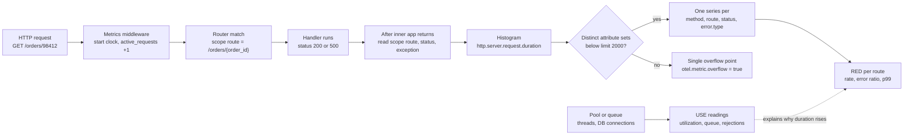

# RED (Rate, Errors, Duration) and USE Metrics for APIs, and OpenTelemetry HTTP Semantic Conventions (http.request.method, http.route, http.response.status_code)

> [!summary] Claim
> One `http.server.request.duration` histogram, labelled with the matched route template (never the raw path), a canonical method, the status code, and `error.type`, answers all three RED questions per route, while USE (utilization, saturation, errors) is the separate checklist for the finite resources behind the route; both stay affordable only because every label has a bounded value set.

Part of [Observability Profiling and Operations](README.md) in [API Engineering](../README.md).

## TL;DR

- Mechanism: a server instrumentation records one histogram per request after the response; the histogram count is Rate, the points carrying `error.type` are Errors, and the bucket distribution is Duration.
- Contract: `http.route` MUST be a low-cardinality template that keeps static segments and replaces dynamic ones with placeholders, MUST NOT be populated when the framework cannot provide it, and the URI path can NOT substitute for it.
- Trap: a raw path, a user id, or an attacker-controlled `Host` or method as a label creates one time series per value; the SDK default limit of 2000 then folds the excess into a single `otel.metric.overflow` point and your per-route data is gone.
- Portability: the stable names (`http.server.request.duration`, unit `s`) are opt-in in `opentelemetry-instrumentation` 0.66b2 via `OTEL_SEMCONV_STABILITY_OPT_IN`; the default still emits the old `http.server.duration` in milliseconds (as of 2026-11).
- When not to use it: batch jobs, offline pipelines, and long-lived streams do not fit a request-duration histogram; use last-success timestamps, queue depth, and connection-lifetime metrics instead.

## Mental model



The middleware must read the route after the inner app has run, because the router only writes `scope["route"]` while it dispatches; reading it before the call yields nothing.
The recorded attributes then pick a series: a bounded set (route template, canonical method, status code, optional `error.type`) stays far below the limit, while a raw path pushes the instrument into the overflow point.
RED is read from that one histogram per route; USE is read from a different set of instruments attached to the resources the request consumes, and a rising queue or utilization there is the cause that a rising duration on the left only hints at.

## How it works

### Lineage and what each method is for

USE is Brendan Gregg's methodology: "For every resource, check utilization, saturation, and errors." (brendangregg.com/usemethod.html, Summary).
The page defines utilization as the average time the resource was busy servicing work, saturation as the degree to which the resource has extra work it cannot service (often queued), and errors as the count of error events.
It carries a second definition of utilization, the proportion of capacity in use, where 100% means no more work can be accepted (same page, footnote 2); pick one and say which, because a pool of 10 with all 10 slots taken at the scrape instant reads 100% under the capacity definition while its busy-time average over the interval may read far less.
It explicitly extends to software resources: thread pools (busy time, queued requests), mutex locks, process and thread capacity, and file descriptor capacity, with the advice "Don't sweat this type. If the metrics work well, use them" (same page, Software Resources).
It warns that a long averaging interval hides bursts, with a customer whose five-minute CPU averages never exceeded 80% while the CPU hit 100% for seconds at a time (same page, "Does Low Utilization Mean No Saturation?").

RED is Tom Wilkie's method, created in 2015 and described in a Grafana Labs post dated 2018-08-03: for every service monitor Rate (requests per second), Errors (the number of those requests that are failing), and Duration (the time those requests take).
The post positions USE as "caring about your machines" and RED as "caring about your users", and recommends using both (grafana.com/blog/the-red-method-how-to-instrument-your-services/).
The Four Golden Signals come from the Google SRE book, chapter 6: latency, traffic, errors, and saturation (sre.google/sre-book/monitoring-distributed-systems/, "The Four Golden Signals").
The same chapter makes two points this note enforces in code: distinguish the latency of successful requests from the latency of failed ones (a fast `500` can flatter the combined distribution, and "a slow error is even worse than a fast error"), and treat a small-window `p99` as an early saturation signal.

| Method | Unit of analysis | Questions | Origin | Instrument shape |
| --- | --- | --- | --- | --- |
| RED | A request-serving service or route | How many, how many fail, how long | Wilkie 2015, Grafana post 2018-08-03 | One histogram with status and error attributes |
| USE | A resource (CPU, pool, queue, fd table) | How busy, how backed up, how many faults | Gregg | Gauge or time-integral, queue length, error counter |
| Four Golden Signals | A user-facing system | Latency, traffic, errors, saturation | Google SRE book ch. 6 | RED plus one saturation measure |

RED has no saturation term, so it cannot tell you why latency rose; USE has no user-visible term, so it cannot tell you whether users hurt.
Latency sibling: [[Latency-Histograms-Percentiles-DDSketch-and-Why-Averaging-Percentiles-Is-Wrong]] owns the percentile mathematics, and [[SLIs-SLOs-Error-Budgets-and-Multi-Window-Burn-Rate-Alerting]] owns how RED turns into SLIs and alerts.

### The stable HTTP server metric

The semantic conventions define `http.server.request.duration` as a `Histogram` with unit `s`, stability stable, requirement level "recommended" (semantic-conventions docs/http/http-metrics.md, "Metric: `http.server.request.duration`").
Two normative sentences shape instrumentation:

- When reported alongside an HTTP server span, the metric value SHOULD be the same as the span duration.
- The instrument SHOULD carry an `ExplicitBucketBoundaries` advisory of `[0.005, 0.01, 0.025, 0.05, 0.075, 0.1, 0.25, 0.5, 0.75, 1, 2.5, 5, 7.5, 10]`.

An advisory is a recommendation that implementations MAY ignore (opentelemetry-specification metrics/api.md, "Instrument advisory parameters").

Attributes and requirement levels on the server duration metric:

| Attribute | Requirement level | Rule that matters |
| --- | --- | --- |
| `http.request.method` | Required | Known value or `_OTHER`; case-sensitive exact match |
| `url.scheme` | Required | Original client scheme (from `Forwarded` or `X-Forwarded-Proto`) when known, else the peer scheme |
| `error.type` | Conditionally required if the request ended with an error | Low cardinality; omit on success |
| `http.response.status_code` | Conditionally required if and only if one was sent | Absent when an exception precedes the response |
| `http.route` | Conditionally required if and only if available | Template, never the URI path |
| `network.protocol.name` | Conditionally required if not `http` and a version is set | Lowercase |
| `network.protocol.version` | Recommended | Negotiated version, for example `1.1`, `2`, `3` |
| `server.address`, `server.port` | Opt-In | Derived from headers; attacker-influenced |

`http.server.active_requests` is an `UpDownCounter` with unit `{request}`, opt-in and development status, with attributes `http.request.method` and `url.scheme` required (same document, "Metric: `http.server.active_requests`").
The Prometheus practices page advises counting a request when it ends, so the count lines up with error and latency statistics (prometheus.io/docs/practices/instrumentation/, "Online-serving systems"); the histogram records at the end, and `http.server.active_requests` is the only signal that sees a request still in flight.

### `http.request.method`: known set, `_OTHER`, and case

By default the "known" methods are the RFC 9110 methods, `PATCH` from RFC 5789, and `QUERY`; any other value MUST be recorded as `_OTHER` (semantic-conventions docs/http/http-metrics.md, note [1] on `http.request.method`).
`QUERY` is now RFC 10008, "The HTTP QUERY Method", Standards Track, June 2026; the v1.45.0 text still cites the httpbis draft, and main cites RFC 10008 (as of 2026-11).
RFC 9110 Section 9.1 says the method token is case-sensitive and that standardized methods are, by convention, all uppercase US-ASCII; the convention text mirrors that: matching MUST be exact.
An instrumentation that can turn a valid method into `_OTHER` MUST offer an override named `OTEL_INSTRUMENTATION_HTTP_KNOWN_METHODS`, a comma-separated list of case-sensitive methods that fully replaces the default list.
The Python contrib 0.66b2 packages do not read that variable: in the installed tree the name appears only in `opentelemetry-semantic-conventions` docstrings, and the contrib escape hatch is `OTEL_PYTHON_INSTRUMENTATION_HTTP_CAPTURE_ALL_METHODS` instead (see below).
Tracing instrumentations that canonicalize case MUST also set `http.request.method_original` to the original value; that attribute is a span attribute, not a metric attribute, which is how the high-cardinality original stays out of the metric.
In the v1.45.0 release `QUERY` has development stability in the well-known value table while the other nine named methods are stable; on the main branch it is marked stable, a change not yet in a release (semantic-conventions v1.45.0 and main docs/http/http-metrics.md, fetched 2026-11-26).
The migration note's mapping table records the earlier count: "Now captures only 9 common HTTP methods by default (configurable) plus `_OTHER`" (docs/non-normative/http-migration.md); `QUERY` makes it ten known methods in the current convention (as of 2026-11).
The installed `sanitize_method` already includes `QUERY` in its list and cites RFC 10008 in a code comment.

The Python contrib helper does not match exactly: `sanitize_method` upper-cases its input before the lookup, so `get` becomes `GET`, and it returns the upper-cased method for any value when `OTEL_PYTHON_INSTRUMENTATION_HTTP_CAPTURE_ALL_METHODS` is set (opentelemetry-util-http 0.66b2 opentelemetry/util/http/__init__.py, `sanitize_method`).
The convention permits canonicalizing "for specific web frameworks that consider HTTP methods to be case insensitive"; the lab's `normalize_method` is deliberately strict, and a test pins both behaviors side by side.

### `error.type` and what counts as an error

If the request fails before a status code was sent, `error.type` SHOULD be the exception type (fully qualified class name where applicable) or a component-specific low-cardinality identifier.
If a status code was sent and it indicates an error under the span status rules, `error.type` SHOULD be the status code as a string, an exception type if one was thrown, or a component-specific identifier.
If the request succeeded, instrumentations SHOULD NOT set `error.type` (same document, note [3]).

The span status rules decide which codes are errors: `1xx`, `2xx`, `3xx` are unset; `4xx` is unset for `SpanKind.SERVER` and `Error` for `SpanKind.CLIENT`; `5xx` and uninterpretable codes SHOULD be `Error` (semantic-conventions docs/http/http-spans.md, "Status").
The same section warns that classification is contextual: a `404` can be an error when the resource was expected and routine when the caller is probing.
The consequence for RED on a server: a `404`, `422`, `401`, or `429` is a successful server operation and adds nothing to the error numerator.
A deployment that breaks authentication so that every request returns `401` shows a server error ratio of zero.
The lab proves the split (`test_only_server_failures_carry_error_type`): `200`, `404`, and `422` carry no `error.type`, and `500` carries `RuntimeError`.
Track the `4xx` classes you care about as separate ratios, and take client-error policy from [[SLIs-SLOs-Error-Budgets-and-Multi-Window-Burn-Rate-Alerting]].

The contrib code agrees: `_set_status` records `error.type` only when the status maps to `StatusCode.ERROR`, using the status code string (opentelemetry-instrumentation 0.66b2 opentelemetry/instrumentation/_semconv.py, `_set_status`).
A negative status code (a non-integer status) also records `error.type` in the new modes.

### `http.route`: the template, and where it comes from

The convention text is categorical: `http.route` "MUST be low-cardinality and include all static path segments, with dynamic path segments represented with placeholders"; it "MUST NOT be populated when this is not supported by the HTTP server framework as the route attribute should have low-cardinality and the URI path can NOT substitute it"; and it SHOULD include the application root if there is one (docs/http/http-metrics.md, note [4]; registry http.md, `http.route`).
Instrumentations SHOULD use the framework's routing information, choose the most precise source, and document the format.
Span names follow: `{method} {target}` with `http.route` as the server target, `{method}` alone when no low-cardinality target exists, and "Instrumentation MUST NOT default to using URI path as a `{target}`" (docs/http/http-spans.md, "Name").

In Starlette the template exists as `path_format`, built by `compile_path` from the route pattern with each parameter rewritten to `{name}` (starlette 1.10.0 starlette/routing.py, `compile_path`), and stored on `Route`, `WebSocketRoute`, and `Mount` objects.
`Router.app` iterates `self.routes`; on `Match.FULL` it sets `scope["route"] = route`, merges the child scope, and awaits `route.handle`; on only a `Match.PARTIAL` (a path match with the wrong method) it sets `scope["route"]` to the partial route and calls its handler, which is how a `405` still carries a route; with no match it either answers a trailing-slash redirect (when `redirect_slashes` finds a route for the other spelling) or calls `self.default`, and in both cases `scope["route"]` is never set (starlette 1.10.0 starlette/routing.py, `Router.app`).
A probe against the lab app confirmed all three: `POST /orders/1` recorded `405` with `http.route` `/orders/{order_id}`, while `GET /orders/1/` (`307`) and `GET /v2/nope/1` (`404`) recorded no `http.route`.
`Mount.matches` extends `root_path` with the matched prefix (starlette 1.10.0 starlette/routing.py, `Mount.matches`), so the full template is `scope["root_path"]` plus the innermost route's `path_format`.
That is exactly what the lab's `route_template` computes, and `test_included_router_and_mounted_app_keep_the_full_template` shows `/users/{user_id}/orders/{order_id}` and `/v2/items/{item_id}` as distinct templates.

Because `scope` is one mutable dict shared by reference down the middleware stack, an outer middleware sees the route only after the inner app has set it; a layer that hands a copy of the scope inward would hide the route from outer layers.
Read after `await self.app(...)`, in a `finally` so a handler exception still records.
Pure-ASGI structure is covered in [[Pure-ASGI-Middleware-Onion-Architecture-and-Send-Receive-Wrapping]] and routing internals in [[Starlette-Routing-Internals-Regex-Compilation-and-Mount-Dispatch]].

The shipped FastAPI instrumentor takes a different route.
It cannot wait for dispatch because it must name the span at start, so `_get_route_details` re-runs `matches(scope)` over `_flatten_routes(app.routes)` (FastAPI's `iter_route_contexts` when available), returns the `path` of the first full match, and otherwise the `path` of the last partial match it saw (opentelemetry-instrumentation-fastapi 0.66b2 opentelemetry/instrumentation/fastapi/__init__.py, `_get_route_details` and `_flatten_routes`; its docstring has a `TODO` that there is no way to retrieve `http.route` from the scope).
One branch contradicts the convention: a fully matched route without a `path` attribute (the code comment names host routing) falls back to `scope.get("path")`, the raw URI path.
The side effect, proven by `test_upstream_fastapi_instrumentor_collapses_a_mounted_app_to_the_mount_prefix`: a request to a sub-application mounted at `/v2` records `http.route` as `/v2`, not `/v2/items/{item_id}`, because the top-level `app.routes` contains only the `Mount`.
That is bounded and safe, but it throws away the per-route resolution you wanted inside the mount.

### Opt-in modes: what a default upgrade does to dashboards

The stability migration defines `OTEL_SEMCONV_STABILITY_OPT_IN` with `http` (stable only), `http/dup` (both), and the default of continuing to emit the previous experimental conventions; `http/dup` takes precedence if both appear, and instrumentations SHOULD maintain the old major version (security patching at a minimum) for at least six months after dual emission starts (docs/non-normative/http-migration.md; docs/http/http-metrics.md, the opening note).
The contrib implementation encodes this as `_report_new(mode)` (`mode != DEFAULT`) and `_report_old(mode)` (`mode not in (HTTP, DATABASE)`), and the ASGI instrumentor creates `duration_histogram_old` and `duration_histogram_new` under those predicates (opentelemetry-instrumentation 0.66b2 opentelemetry/instrumentation/_semconv.py, `_report_new`, `_report_old`; opentelemetry-instrumentation-asgi 0.66b2 opentelemetry/instrumentation/asgi/__init__.py).
`test_opt_in_mode_selects_which_duration_metrics_are_emitted` proves the three emissions on the real FastAPI instrumentor:

| Mode | Duration metrics emitted (measured) | Unit and buckets |
| --- | --- | --- |
| unset (default) | `http.server.duration` | unit `ms`, 15 bounds `0.0, 5.0, ..., 10000.0` |
| `http` | `http.server.request.duration` | unit `s`, the 14 semantic-convention bounds |
| `http/dup` | both | both, so series and storage roughly double |

The test pins the metric names; units and bounds come from a one-off probe of the same FastAPI app under each mode (CPython 3.14.6, macOS 27.3 arm64).
The ASGI instrumentor creates the old histogram with `unit="ms"` and no bucket advisory, so its bounds are the SDK default `_DEFAULT_EXPLICIT_BUCKET_HISTOGRAM_AGGREGATION_BOUNDARIES` (opentelemetry-sdk 1.45.2 opentelemetry/sdk/metrics/_internal/aggregation.py), which happen to equal contrib's `HTTP_DURATION_HISTOGRAM_BUCKETS_OLD`; the new histogram passes `explicit_bucket_boundaries_advisory=HTTP_DURATION_HISTOGRAM_BUCKETS_NEW`.

In the default mode there is no `http.route` attribute at all; the lab observes the template in `http.target` for matched requests and no `http.target` for unmatched ones (`test_default_mode_has_no_http_route_and_puts_the_template_in_http_target`).
The probe's full default-mode attribute set was `http.scheme`, `http.host`, `http.flavor`, `http.method`, `http.server_name`, `http.status_code`, and `http.target`; `http.server_name` is the client's `Host` header joined with `,` (opentelemetry-instrumentation-asgi 0.66b2 opentelemetry/instrumentation/asgi/__init__.py, `collect_request_attributes`), and it is in contrib's `_server_duration_attrs_old`, so the default mode puts a client-controlled value on the duration metric.
Moving a fleet from the default to `http` changes the metric name, unit, and attribute names simultaneously, so every alert and dashboard that references the old name goes silent rather than wrong.
Use `http/dup` for one release, migrate the queries, then switch to `http`.

### SDK aggregation, cardinality limit, and overflow

A time series exists per distinct attribute set.
The metrics SDK specification calls the limit "a hard limit on the number of Metric Points that can be collected during a collection cycle" for one metric, says enforcement SHOULD occur after attribute filtering, and resolves it in order from a view's `aggregation_cardinality_limit`, then the reader's per-instrument default, then a default of 2000 (opentelemetry-specification metrics/sdk.md, "Cardinality limits", "Configuration").
An overflow attribute set `{otel.metric.overflow: true}` aggregates measurements that cannot get their own aggregator; the SDK MUST create its aggregator prior to reaching the limit, MUST guarantee no overflow when distinct non-overflow attribute sets are at most the limit, and MUST NOT drop or double-count a measurement (same section, "Overflow attribute" and "Synchronous instrument cardinality limits").
Cumulative synchronous instruments MUST keep exporting every attribute set observed before overflow began and send later new ones to the overflow point; delta instruments MAY choose an arbitrary subset.

The Python SDK implements this in `_ViewInstrumentMatch._get_or_create_aggregation`: it looks up the attribute key, and if the number of stored aggregations is at least `_cardinality_limit` (default `_DEFAULT_CARDINALITY_LIMIT = 2000`) it swaps in `_OVERFLOW_KEY` with attributes `{"otel.metric.overflow": True}`; the code comment states the overflow point is exported in addition to the limited sets (opentelemetry-sdk 1.45.2 opentelemetry/sdk/metrics/_internal/_view_instrument_match.py, `_get_or_create_aggregation`, `_OVERFLOW_ATTRIBUTES`).
So the Python SDK creates the overflow aggregator lazily, after 2000 sets exist, and exports up to limit plus one points: it honors the no-overflow-at-or-below-the-limit guarantee but not a literal reading of "hard limit on the number of Metric Points".
`View(aggregation_cardinality_limit=...)` validates a positive integer (opentelemetry-sdk 1.45.2 opentelemetry/sdk/metrics/_internal/view.py).
The lab measures the consequence: labelling the duration histogram with the raw path and sending 2100 distinct paths yields 2001 exported points, one of which is the overflow point with `count == 100`, while the point counts still sum to 2100 (`test_raw_path_labels_overflow_at_the_sdk_default_limit_of_2000`).
With the route template, the same 2100 requests are one point with `count == 2100`.
The first 2000 paths keep exact series and the later ones are indistinguishable, so the per-route p99 for everything after the 2000th path is unrecoverable.
With cumulative temporality the specification requires every attribute set observed before overflow to keep being exported, so the 2000 slots fill once and stay full.

### Instrument choice and the series arithmetic

Prometheus guidance is to keep the cardinality of a metric below 10 and to investigate alternatives when it exceeds 100 or may grow that large (prometheus.io/docs/practices/instrumentation/, cardinality guidance); a route-labelled histogram knowingly exceeds that, which is why the label set must be bounded by design, not by hope.
A classic explicit-bucket histogram with 14 bounds has 15 buckets (14 finite plus `+Inf`), which become 15 `_bucket` series plus `_count` and `_sum`: 17 series per distinct attribute set.
Illustrative worst case (arithmetic, not measured): 50 routes x 4 methods x 6 status codes is 1200 attribute sets, under the 2000 limit, and 1200 x 17 = 20400 Prometheus series per instance before `error.type` and any `url.scheme` or `network.protocol.version` split.
Real attribute sets are far sparser than the product because most routes see one method and two or three statuses.

### From OpenTelemetry names to Prometheus names

When the metrics are scraped through a Prometheus exporter, the specification translates names and labels (opentelemetry-specification compatibility/prometheus_and_openmetrics.md, "OTLP Metric points to Prometheus"):

- Discouraged characters in names are replaced with `_`, and runs of `_` collapse to one.
- The UCUM unit becomes a word suffix unless the name already ends with it, and it precedes type suffixes; bracketed portions such as `{request}` are dropped.
- A monotonic cumulative sum gets `_total` unless it already ends with it.
- A cumulative histogram becomes a Prometheus histogram by default.
- Attribute keys are sanitized the same way; when two keys collide after sanitizing, the values are concatenated with `;` in the lexicographic order of the original keys.

So `http.server.request.duration` (unit `s`) maps, by those rules, to `http_server_request_duration_seconds_bucket`, `_count`, and `_sum` with labels `http_request_method`, `http_route`, `http_response_status_code`, `error_type`, and `le`, plus the `otel_scope_name`, `otel_scope_version`, and `otel_scope_schema_url` labels that exporters MUST add by default (same document, "Instrumentation Scope").
I did not run an exporter here, so the exact exposition is derived from the specification, not captured.
The Prometheus naming page prefers base units, a unit suffix in plural form, and `_total` for counters (prometheus.io/docs/practices/naming/), which is why the metric uses seconds, not milliseconds.

### Deriving RED, and why the lab splits latency by outcome

RED from the histogram, in PromQL (illustrative queries, not executed here; they assume the metric reaches Prometheus under the names derived above):

```promql
# Rate: requests per second per route
sum by (http_route) (rate(http_server_request_duration_seconds_count[5m]))

# Errors: failed requests per second per route
sum by (http_route) (rate(http_server_request_duration_seconds_count{error_type!=""}[5m]))

# Duration: p99 over the success population only
histogram_quantile(0.99,
  sum by (http_route, le) (rate(http_server_request_duration_seconds_bucket{error_type=""}[5m])))
```

The lab's `summarize_red` computes the same three numbers from an `InMemoryMetricReader` export and reports duration separately for requests without and with `error.type`.
`test_fast_failures_do_not_hide_slow_successes` sends 50 successes at 0.4 s and 50 failures at 0.001 s on `/pay`: the success quantile is above 0.25 s and the failure quantile is at most 0.005 s, whereas a single combined distribution would put the median in between and hide that the successes are slow.

Quantile estimation from buckets is lossy, and the lab shows how lossy.
`test_summarize_red_reports_rate_errors_and_split_latency` records 90 successes that all took exactly 0.02 s and 10 failures that all took exactly 0.3 s; the estimated `p99` values are 0.02485 s and 0.4975 s, because interpolation assumes a uniform spread inside the `(0.01, 0.025]` and `(0.25, 0.5]` buckets.
The error is bounded by the bucket width, so the buckets near your SLO threshold decide how trustworthy the estimate is.
When the rank falls in the `+Inf` bucket the estimate is capped at the highest finite bound: `test_thirty_second_requests_report_as_ten_seconds` records twenty 30 s requests and the estimate is 10.0 s.
Prometheus applies the same cap and the same assumptions for classic histograms: "If a quantile is located in the highest bucket, the upper bound of the second highest bucket is returned", interpolation assumes a uniform distribution inside a bucket, and the lower limit of the lowest bucket is assumed to be 0 when its upper bound is positive (prometheus.io/docs/prometheus/latest/querying/functions/, `histogram_quantile()`, fetched 2026-11-26); the lab's `histogram_quantile` mirrors those three rules.
Anything slower than the 10 s top bound, including every timeout, is invisible as a magnitude; track a separate timeout counter.

### USE for the resources behind the route

USE applies to the finite resources a request consumes: worker threads, DB connections, file descriptors, event-loop capacity, queue slots.
The semantic conventions already define standard DB pool instruments, all in development status as of the fetched copy: `db.client.connection.count` (an `UpDownCounter` keyed by `db.client.connection.state`), `db.client.connection.limit` (renamed from `db.client.connection.max` in semantic-conventions v1.45.0), `db.client.connection.pending_requests`, `db.client.connection.timeouts`, and `db.client.connection.wait_time` (a `Histogram` in `s`) (docs/db/database-metrics.md; CHANGELOG.md, v1.45.0).
Mapped to USE: utilization is `count{state=used}` over `limit`, saturation is `pending_requests` (and `wait_time`), and errors are `timeouts`.
The system conventions provide `system.cpu.time` (a `Counter` in `s`) and `system.cpu.utilization`, both development status (docs/system/system-metrics.md).
For a pool with no standard instrument, namespace your own (the lab uses `app.pool.*`) and keep the USE triple.

The lab's `UseResource` is a bounded pool with a clock-integrated busy time:

- `_advance` adds `in_use * elapsed` to a busy integral and `queued * elapsed` to a queue integral on every state change.
- `snapshot().utilization` is `busy_integral / (capacity * elapsed)`, and `average_queue` is `queue_integral / elapsed`.
- `acquire` returns `running`, `queued`, or `rejected` when the queue is full, and `rejected` counts the errors.

`test_average_utilization_stays_low_while_a_burst_queues_requests` is Gregg's averaging warning made executable: a pool of 4 is idle for 98 s, then four slots are taken and three requests queue for the last 2 s of a 100 s window; utilization reads `0.02`, average queue `0.06`, yet `peak_queue` is 3 and `queued_now` is 3.
A scrape of the 100 s average would show a healthy pool while users wait.
Two consequences: export the busy-seconds integral as a counter and take `rate()` over a short window instead of exporting a long-run average, and alert on any non-zero queue or on the peak; Gregg's own interpretation is that "any degree of saturation can be a problem (non-zero)" and that utilization measured over multiple seconds or minutes can hide 100% bursts (usemethod.html, Suggested Interpretations).
Note the lab's `snapshot()` integrates since creation, so as an exported gauge it is itself a long-run average and would slowly lose burst sensitivity; the note's worked example demonstrates the mechanism, not the production export shape.

Saturation is also the leading indicator of the Google SRE chapter: "Latency increases are often a leading indicator of saturation", so a small-window `p99` rising while the pool queue grows is the RED-to-USE handoff.
Thread-pool specifics for Python are in [[Async-Def-vs-Def-Endpoints-and-AnyIO-Threadpool-Limiter-Semantics]], and capacity arithmetic is in [[Capacity-Planning-with-Littles-Law-and-the-Universal-Scalability-Law]].

### Client-side RED and the span and trace link

`http.client.request.duration` is the same shape for outgoing calls, and the Prometheus guidance asks for both client and server views because disagreement between them is "very useful information for debugging" ([[Client-Side-Telemetry-Network-Error-Logging-NEL-and-Edge-vs-Origin-Gap]] covers what the origin cannot see).
Because the metric SHOULD equal the span duration, exemplars and trace ids are the bridge from a slow bucket to a trace; propagation is in [[Distributed-Tracing-W3C-Trace-Context-and-Baggage-Propagation]] and keeping the interesting traces is in [[Trace-Sampling-Strategies-Head-Based-vs-Tail-Based-Sampling]].
Per-request detail that must not become a label (user id, order id) belongs in a canonical log line ([[Structured-Logging-with-Structlog-and-Stripe-Canonical-Log-Lines]]).

## Numbers and limits

| Quantity | Value | Source or measurement |
| --- | --- | --- |
| Default histogram bounds for `http.server.request.duration` | 14 bounds, 0.005 s to 10 s | semantic-conventions docs/http/http-metrics.md (as of 2026-11) |
| Buckets per histogram point | 15 (14 plus `+Inf`) | Arithmetic from the bounds; the lab test asserts the bounds tuple |
| Prometheus series per attribute set (classic histogram) | 17 (15 `_bucket`, `_count`, `_sum`) | Arithmetic from the bounds |
| SDK default cardinality limit | 2000 per metric stream per collection (Python: 2000 attribute sets plus 1 overflow point) | opentelemetry-specification metrics/sdk.md; opentelemetry-sdk 1.45.2 `_view_instrument_match.py`, `_DEFAULT_CARDINALITY_LIMIT` |
| Points exported after 2100 distinct raw-path labels | 2001 (2000 plus 1 overflow, overflow `count` 100) | Lab: `test_raw_path_labels_overflow_at_the_sdk_default_limit_of_2000` |
| Points exported after 2100 requests labelled by template | 1, `count` 2100 | Lab: `test_template_labels_stay_one_series_for_the_same_2100_requests` |
| Known HTTP methods | 10: nine stable plus `QUERY` (development in v1.45.0, stable on main) | docs/http/http-metrics.md at v1.45.0 and main (as of 2026-11); `_OTHER` for the rest |
| Distinct unknown methods collapsed in the lab | 100 methods to 1 `_OTHER` point with `count` 100 | Lab: `test_method_is_known_exactly_or_collapses_to_other` |
| Latency estimate for exactly 20 ms requests | `p99` 0.02485 s | Lab: `test_summarize_red_reports_rate_errors_and_split_latency` |
| Latency estimate for 30 s requests | 10.0 s (capped at the top bound, as Prometheus does) | Lab: `test_thirty_second_requests_report_as_ten_seconds`; prometheus.io querying functions |
| Pool of 4, 2 s burst in a 100 s window | utilization 0.02, average queue 0.06, peak queue 3 | Lab: `test_average_utilization_stays_low_while_a_burst_queues_requests` |
| Old major version support after dual emission | at least six months | docs/non-normative/http-migration.md |
| Prometheus cardinality guidance | below 10 per metric; investigate above 100 | prometheus.io/docs/practices/instrumentation/ |
| Gregg utilization caution | beyond 70% averaged over long windows can hide 100% bursts | brendangregg.com/usemethod.html |
| Lab run | 29 passed in 1.09 s (wall time varies run to run) | Re-run by the verifier 2026-11-26: CPython 3.14.6, macOS 27.3 arm64 (Darwin 27.3.0), `uv run --frozen pytest` on this lab file |

## Portability

| Dimension | Result | Evidence |
| --- | --- | --- |
| CPython 3.14.6 | 29 tests passed in 1.09 s | Ran here: `uv run --frozen pytest` on this lab file, macOS 27.3 arm64 |
| CPython 3.12.16, 3.13.18, 3.15.2, 3.15.2t (free-threaded) | Not run | Lab checks were paused by the user's instruction of 2026-11-11, so no cell is claimed |
| Language features used | PEP 695 `type RouteLabeler = ...` needs 3.12 or later | `requires-python = ">=3.12,<3.16"` in `labs/pyproject.toml`; not run on 3.12 |
| Free-threaded builds | Not run; the SDK aggregation path holds `self._lock` when creating aggregations | opentelemetry-sdk 1.45.2 `_view_instrument_match.py`, `_get_or_create_aggregation` docstring and call sites |
| Library releases | Only `opentelemetry-sdk` 1.45.2, contrib 0.66b2, `starlette` 1.10.0, `fastapi` 0.162.0 were exercised | Installed versions in `labs/.venv` (dist-info); other contrib releases were not exercised, and `_flatten_routes` documents a code path that differs for FastAPI before 0.137 |
| Servers (Uvicorn, Hypercorn, Granian) | Not run; the instrumentation reads the ASGI scope, so the server is only the source of `scope["http_version"]` and `scope["scheme"]` | opentelemetry-instrumentation-asgi 0.66b2 `collect_request_attributes`; `_set_http_flavor_version` copies the string verbatim |
| HTTP/1.1 | `network.protocol.version` is `1.1` in the in-process tests | Lab: `test_stable_mode_labels_the_route_template_and_omits_it_when_unmatched` |
| HTTP/2 and HTTP/3 | Not run; the ASGI spec allows `http_version` to be only `"1.0"`, `"1.1"`, `"2"`, or `"3"`, and contrib copies it verbatim, so a conforming server yields the convention's example values `2` and `3` | asgi.readthedocs.io specs/www.html, HTTP Connection Scope; semantic-conventions docs/http/http-metrics.md; no server run |
| Prometheus exposition names | Derived from the specification; not captured from an exporter | opentelemetry-specification compatibility/prometheus_and_openmetrics.md |
| Semantic-convention version | v1.45.0 is the latest release (GitHub releases page, released 02 Nov) and the CHANGELOG top entry; main already differs (`QUERY` stable, RFC 10008 cited) (as of 2026-11) | semantic-conventions CHANGELOG.md; releases page; http-metrics.md at v1.45.0 and main |

## Worked example

Implementation: [implementation](../labs/src/api_labs/f18_observability_profiling_and_operations/red_and_use_metrics.py).
Test: [test](../labs/tests/f18_observability_profiling_and_operations/test_red_and_use_metrics_and_opentelemetry_http_semantic_conventions.py).

The module has four parts: `RedMiddleware` (pure ASGI), `summarize_red` plus `histogram_quantile` (RED from an export), `UseResource` (USE for a bounded pool), and `register_use_gauges` (export of USE as observable instruments).
Simplified excerpt of the middleware (docstrings and the surrounding module removed):

```python
class RedMiddleware:
    def __init__(
        self,
        app: ASGIApp,
        meter: Meter,
        *,
        clock: Callable[[], float] = time.perf_counter,
        route_labeler: RouteLabeler = route_template,
    ) -> None:
        self.app = app
        self._clock = clock
        self._route_labeler = route_labeler
        self._duration = meter.create_histogram(
            DURATION_METRIC,
            unit="s",
            description="Duration of HTTP server requests.",
            explicit_bucket_boundaries_advisory=DURATION_BUCKETS_S,
        )
        self._active = meter.create_up_down_counter(
            ACTIVE_METRIC, unit="{request}", description="Number of active HTTP server requests."
        )

    async def __call__(self, scope: Scope, receive: Receive, send: Send) -> None:
        if scope["type"] != "http":
            await self.app(scope, receive, send)
            return
        active_attrs = {
            "http.request.method": normalize_method(scope["method"]),
            "url.scheme": scope.get("scheme", "http"),
        }
        status: int | None = None
        error_type: str | None = None

        async def recording_send(message: Message) -> None:
            nonlocal status
            if message["type"] == "http.response.start":
                status = int(message["status"])
            await send(message)

        self._active.add(1, active_attrs)
        start = self._clock()
        try:
            await self.app(scope, receive, recording_send)
        except Exception as exc:
            error_type = exception_type_name(exc)
            raise
        finally:
            elapsed = max(self._clock() - start, 0.0)
            attrs: dict[str, str | int] = dict(active_attrs)
            route = self._route_labeler(scope)
            if route is not None:
                attrs["http.route"] = route
            if status is not None:
                attrs["http.response.status_code"] = status
                if status >= 500 and error_type is None:
                    error_type = str(status)
            if error_type is not None:
                attrs["error.type"] = error_type
            self._duration.record(elapsed, attrs)
            self._active.add(-1, active_attrs)
```

The decisions encoded there: the route is read in `finally` after the inner app ran; `error.type` is an exception type when one escaped and the status string for a `5xx` otherwise; `http.response.status_code` is absent when no `http.response.start` was sent; the up-down counter is decremented in `finally` so an exception cannot leak an in-flight request.
`route_template` returns `scope["root_path"]` plus `scope["route"].path_format` and returns `None` when no route was matched, so the unmatched path is never a fallback label.

Simplified excerpt of the USE resource:

```python
    def _advance(self) -> None:
        now = self._clock()
        elapsed = now - self._last
        self._busy_integral += self._in_use * elapsed
        self._queue_integral += self._queued * elapsed
        self._last = now

    def acquire(self) -> Admission:
        self._advance()
        if self._in_use < self._capacity:
            self._in_use += 1
            return "running"
        if self._queued < self._max_queue:
            self._queued += 1
            self._peak_queue = max(self._peak_queue, self._queued)
            return "queued"
        self._rejected += 1
        return "rejected"
```

Excerpt of the discriminating test for the central claim (cardinality overflow), taken from the test file:

```python
@pytest.mark.unit
@pytest.mark.asyncio
async def test_raw_path_labels_overflow_at_the_sdk_default_limit_of_2000() -> None:
    provider, reader = make_provider()
    labeled = RedMiddleware(
        build_app(), provider.get_meter("naive"), route_labeler=raw_path_label_antipattern
    )
    for order_id in range(2100):
        assert await call_raw(labeled, "GET", f"/orders/{order_id}") == 200
    points = duration_points(reader.get_metrics_data())
    overflow = [p for p in points if dict(p.attributes or {}) == {"otel.metric.overflow": True}]
    assert len(points) == 2001
    assert len(overflow) == 1
    assert overflow[0].count == 100
    assert sum(p.count for p in points) == 2100
```

Captured run, from `labs/`, CPython 3.14.6, macOS 27.3 (Darwin 27.3.0 arm64), re-run by the verifier on 2026-11-26:

```text
$ uv run --frozen pytest tests/f18_observability_profiling_and_operations/test_red_and_use_metrics_and_opentelemetry_http_semantic_conventions.py -q
.............................                                            [100%]
29 passed in 1.09s
```

The tests also drive the real `FastAPIInstrumentor` under each `OTEL_SEMCONV_STABILITY_OPT_IN` value through a fixture that resets contrib's once-only initialization, so the upstream behaviors in this note (mode selection, mount collapse to `/v2`, `http.target` in the default mode) are observed, not assumed.
In-process testing technique: [[In-Process-Testing-of-ASGI-Apps-with-HTTPX-ASGITransport]].

## Pitfalls

> [!warning] Raw path as a label
> Trigger: the metric is keyed by `request.url.path`, a `{path}` log field reused as a label, or a user or order id.
> Symptom: series count grows with traffic; after 2000 distinct sets the SDK exports an `otel.metric.overflow` point and everything later is aggregated into it (the lab: 2001 points, 100 counts in the overflow point).
> Fix: label by `http.route`; omit it when the router matched nothing; see the Prometheus instruction "Do not use labels to store dimensions with high cardinality (many different label values), such as user IDs, email addresses" (prometheus.io/docs/practices/naming/, Labels).

> [!warning] Reading the route before dispatch
> Trigger: middleware reads `scope.get("route")` before awaiting the inner app, or labels from `request.url.path` in a `BaseHTTPMiddleware` pre-step.
> Symptom: every point lacks `http.route`, or every point is labelled `None` or `unknown`, and per-route RED collapses into one series.
> Fix: read after the inner app returns, in `finally`; Starlette sets `scope["route"]` inside `Router.app` during dispatch.

> [!warning] Falling back to the path for unmatched requests
> Trigger: "if there is no route, use the path so we still see something".
> Symptom: scanners and `404` floods generate unbounded series; the convention forbids this: `http.route` MUST NOT be populated when unavailable because the URI path can NOT substitute it.
> Fix: leave `http.route` off and keep the status code; the lab asserts no value in the point contains the raw path.

> [!warning] Opting into `server.address` and `server.port` on the server metric
> Trigger: enabling the opt-in `server.address` or `server.port` attributes, which are derived from headers.
> Symptom: a client rotating `Host` values creates series until the limit is hit; the convention itself warns that opting in "may allow an attacker to trigger cardinality limits, degrading the usefulness of the metric".
> The Python contrib default mode does this without any opt-in: `http.server.duration` carries `http.server_name`, copied from the `Host` header (opentelemetry-instrumentation-asgi 0.66b2, `collect_request_attributes`).
> Fix: leave them off for internet-facing services, validate `Host` against an allow-list before it reaches the instrument (at the proxy, or with Starlette `TrustedHostMiddleware` wrapped around the already-instrumented app so rejected hosts never reach the metric), or move to `OTEL_SEMCONV_STABILITY_OPT_IN=http`, whose metric omits server attributes unless opted in.

> [!warning] Upgrading the instrumentation changes names and units
> Trigger: a team sets `OTEL_SEMCONV_STABILITY_OPT_IN=http` without migrating queries, or a later major version drops the opt-in variable and emits only the stable conventions (the migration plan allows that).
> Symptom: queries on the old name (by the translation rules, `http_server_duration_milliseconds`) return nothing while `http_server_request_duration_seconds` appears, and alerts on the old names never fire.
> Fix: run `http/dup` for a release, rewrite dashboards and alert rules, then move to `http`; the lab pins all three emission sets.

> [!warning] Counting `4xx` as errors, or counting none
> Trigger: an error ratio defined as `status >= 400` over the whole population, or as `5xx` only with no separate client-error view.
> Symptom: either client mistakes page the on-call, or a misconfigured authentication layer returning `401` for everyone reports a zero error rate.
> Fix: follow the span status rule (server `4xx` is not an error) for the RED error numerator, and watch `401`, `403`, `429` as explicit ratios.

> [!warning] A combined latency distribution
> Trigger: a single `p99` over successes and failures.
> Symptom: a dependency outage that returns instant `500`s makes latency improve; the SRE book's example is a `500` from a lost database connection served very quickly.
> Fix: split by `error.type` presence (the lab's `p_ok_s` and `p_error_s`), and alert on both.

> [!warning] Quantile estimates beyond the last bucket
> Trigger: timeouts or batch endpoints slower than the 10 s top bound.
> Symptom: the estimated `p99` pins at 10 s whether requests take 11 s or 300 s (the lab: 30 s requests report 10.0 s).
> Fix: add bounds for your real tail (raise the top bound via a view or the advisory) or count timeouts separately.

> [!warning] Long-window averages for USE
> Trigger: alerting on 5-minute average utilization.
> Symptom: a 2 s burst fills the queue while the average stays near zero (the lab: utilization 0.02 with a peak queue of 3); Gregg's CPU example had five-minute averages under 80% with seconds at 100%.
> Fix: export integrals as counters and use short-window `rate()`, and alert on queue length and rejections.

> [!warning] Instrumentation that can break the request
> Trigger: a `route_labeler`, attribute hook, or `record` call raising inside the `finally` block.
> Symptom: the exception replaces the handler's original exception or response and a metrics bug becomes an outage; the lab's middleware does not guard its `finally` body.
> Fix: wrap recording in a narrow `try` that logs and drops the measurement, and test that the labeler cannot raise.

## Security and robustness

- Threat model: the client controls the path, method, `Host`, and header values, so every label derived from them is an attacker-controlled input; the defenses are allow-lists (known methods and `_OTHER`), templates from the router (never the URI), and the SDK cardinality limit as the last backstop (OWASP API4:2023, Unrestricted Resource Consumption, applied to the metrics pipeline).
- Cardinality DoS is also a cost and availability attack on the telemetry backend: unbounded series exhaust Prometheus memory and storage long before the app notices; a view with a lower `aggregation_cardinality_limit` for the request histogram, and a view that drops unneeded attributes (the spec says the limit SHOULD be enforced after filtering, and the Python SDK filters by `attribute_keys` before it looks up the aggregation), are defense in depth.
- A `404` flood against random paths costs at most `methods x status codes` series because no route is recorded; a missing allow-list would cost one series per path.
- Do not put identifiers in labels: user ids, emails, tokens, and order ids both explode cardinality and leak personal data into a system with broader read access than the database; keep them in structured logs with redaction ([[Structured-Log-Redaction-and-Preventing-PII-and-Token-Leaks]]).
- Route templates reveal your API surface to anyone who can read `/metrics`; keep the exposition endpoint on a private interface or behind authentication, not on the public listener ([[OWASP-API-Security-Top-10-2023-Complete-Threat-Model]]).
- The metrics path is part of the request path: keep recording bounded in time and non-raising, and never let a failed exporter block the response; the SDK exports on the reader's schedule, not inside the request.
- USE error counters (rejected admissions, pool timeouts) are signals of resource exhaustion attacks; pair them with [[Unrestricted-Resource-Consumption-API4-2023-Payload-Depth-and-Limit-Guards]] and [[Load-Shedding-Priority-Traffic-Classes-and-LIFO-Queue-Management]].
- Silent failure mode: a middleware placed inside the exception layer sees a different status than the client does; the lab's outermost placement observes both the generated `500` and the escaped exception, which is why `error.type` is the exception name for an unhandled error (see [[Starlette-Exception-Hierarchy-ServerErrorMiddleware-vs-ExceptionMiddleware]]).

## The principal's view

The decision is to make one instrument and one label contract the organization standard, and to treat cardinality as a budget with an owner.
Adopt the semantic-convention names so dashboards, alerts, and SLOs are portable across services and languages, and so a new service gets RED for free from library instrumentation; the cost is following a moving specification, so pin the instrumentation versions and keep the `http/dup` migration playbook ready.
Enforce the cardinality contract in the platform: a default view with a lower limit, a CI check that route labels come from templates, and a per-service series budget reviewed like a latency budget; the downside is that a hard cap can mask a legitimate need for a new dimension, so give teams a request path to raise it deliberately.
Choose the export path on operational grounds: Prometheus pull with `prometheus-client` (pinned in the lab) is simple and robust; OTLP through a collector gives routing and processing at the cost of another component and delta versus cumulative temporality decisions.
Use RED for request-serving surfaces and USE for the resources under them, and wire the handoff explicitly: the RED dashboard links to the USE panel for the pool that owns the route.
Choose differently when the unit of work is not a request: batch jobs track last success time and duration, queue consumers track depth, age, and throughput, long-lived streams (WebSocket, SSE) need connection lifetime and message rates instead of a request histogram, and gRPC should use the RPC conventions.
Metrics tell you that and where; traces tell you which request; logs tell you the details, so budget time for all three rather than stretching one.
Alerting policy on top of these numbers belongs in [[SLIs-SLOs-Error-Budgets-and-Multi-Window-Burn-Rate-Alerting]], and the first-minutes use of them in [[The-Sixty-Second-API-Incident-Triage-Playbook]].
Rollout safety for the changes this tells you about is in [[Zero-Downtime-Blue-Green-Canary-and-Cell-Based-API-Deployments]].

## Interview questions

> [!question] L5: What do R, E, and D stand for, and why is a single histogram enough to produce all three?
>
> > [!success]- Answer
> > Rate is requests per second, Errors is the number of those requests failing, and Duration is how long they take.
> > A histogram with a count, a sum, and bucket counts records every request once, so the count gives Rate, the points that carry `error.type` give Errors, and the buckets give Duration.
> > Per-route splits come from the `http.route` attribute, and per-outcome splits from `error.type` and `http.response.status_code`.
> >
> > Follow-up: Which of the three can the buckets answer only approximately, and what bounds the error?

> [!question] L5: What is the difference between RED and USE, and which one would you use for a connection pool?
>
> > [!success]- Answer
> > RED describes the requests a service handles and USE describes the resources it consumes.
> > A connection pool is a resource, so use USE: utilization is the share of connections in use, saturation is the number of waiters, and errors are checkout timeouts or rejections.
> > RED on the route shows that users hurt and USE on the pool shows why.
> >
> > Follow-up: Where does the Four Golden Signals set differ from RED?

> [!question] L5: Why must `http.route` be `/orders/{order_id}` and not `/orders/98412`?
>
> > [!success]- Answer
> > Every distinct label value is a separate time series, and a path with an id has an unbounded value set.
> > The convention requires a low-cardinality template that keeps static segments and uses placeholders for dynamic ones, and says the URI path cannot substitute for it.
> > The SDK limits an instrument to 2000 distinct attribute sets by default and folds the rest into `otel.metric.overflow`, so a raw path destroys per-route data once the limit is reached.
> >
> > Follow-up: What should `http.route` be for a request that matched no route?

> [!question] L6: Predict the output: how many points does a histogram labelled by raw path export, and what does the overflow point hold, after 2100 requests with distinct `/orders/{n}` paths on default SDK settings?
>
> > [!success]- Answer
> > 2001 points are exported: 2000 individual attribute sets plus one point whose only attribute is `otel.metric.overflow` set to `true`.
> > The overflow point has `count` 100, and the counts of all points sum to 2100, because the SDK must not drop or double-count a measurement.
> > The lab asserts exactly this, and the same 2100 requests labelled by the route template are a single point with `count` 2100.
> >
> > Follow-up: Which setting changes the 2000 limit, and where in the pipeline is it enforced relative to attribute filtering?

> [!question] L6: Debug this API: why is every `http_route` label empty when a team's middleware reads `request.scope.get("route")` before calling the inner app, and what is the fix?
>
> > [!success]- Answer
> > Starlette's `Router.app` assigns `scope["route"]` only when it dispatches to the matching route, which happens inside the inner app call.
> > A read before the call sees no route.
> > Read the scope after `await self.app(...)`, in a `finally` so handler exceptions still record, and join `root_path` with `route.path_format` so included routers and mounts keep their full template.
> >
> > Follow-up: What breaks if a middleware between yours and the router passes a copy of the scope inward?

> [!question] L6: Why does the `p99` improve when a dependency starts returning instant `500` responses, and how do you design the metric so it cannot mislead?
>
> > [!success]- Answer
> > Fast failures were pooled with slow successes, so the combined distribution moved toward the fast failures.
> > The SRE book names this case: a `500` from a lost backend can be served quickly, and it warns to distinguish the latency of successful requests from that of failed requests while still tracking slow errors.
> > Split latency by whether `error.type` is present, report both distributions, and alert on each.
> >
> > Follow-up: Why does the lab report error latency separately rather than filtering errors out entirely?

> [!question] L6: What does USE say to check and export when a pool reads 2% utilization on a 100 second average yet users see timeouts?
>
> > [!success]- Answer
> > The long average hides a short burst: Gregg's example is five-minute CPU averages under 80% while the CPU was at 100% for seconds.
> > Check saturation (queue length and wait time) and errors (rejections, timeouts), because any non-zero saturation can be a problem.
> > Export the busy-time integral as a counter and use a short-window `rate()`, plus queue length and a rejection counter.
> >
> > Follow-up: Why is the lab's since-creation utilization a poor production gauge?

> [!question] L7+: How do you roll a fleet from the old experimental HTTP conventions to the stable ones without breaking alerts, and what are the risks?
>
> > [!success]- Answer
> > Set `OTEL_SEMCONV_STABILITY_OPT_IN=http/dup` first so both `http.server.duration` (milliseconds) and `http.server.request.duration` (seconds) are emitted, rewrite dashboards and alert rules against the new names, units, and attribute names, verify parity, then switch to `http`.
> > The risks are doubled series and storage during the dual period, bucket differences (the old bounds are in milliseconds and include `0.0`), and the default mode having no `http.route` at all.
> > The convention expects the old major version to be maintained at least six months after dual emission begins, which sets the minimum window.
> >
> > Follow-up: How would you detect an alert that still references an old metric name before it silently stops firing?

> [!question] L7+: Design the metrics cardinality governance for 400 services emitting `http.server.request.duration`.
>
> > [!success]- Answer
> > Fix the label contract (canonical method plus `_OTHER`, route template or absent, status code, `error.type`) in a shared middleware or the library instrumentation, and ban header-derived attributes by default.
> > Apply a platform view with a lower `aggregation_cardinality_limit` and attribute filtering, and alert on any `otel.metric.overflow` point as a defect signal.
> > Budget series by service (attribute sets x 17 for a 14-bound classic histogram), review growth like a latency budget, and route high-cardinality detail to logs and traces instead of raising the limit.
> >
> > Follow-up: What do you lose when the overflow point absorbs a legitimate new dimension, and how do you let a team add one safely?

> [!question] L7+: When is RED the wrong tool, and what replaces it?
>
> > [!success]- Answer
> > RED assumes discrete requests with a clear start and end; batch jobs, offline pipelines, and long-lived streams do not fit.
> > The Prometheus guidance gives the alternatives: for batch jobs track the last time it succeeded and stage durations, for offline processing track items in, in progress, last processed time, and a heartbeat, and for thread pools track queued requests, threads in use, and wait time.
> > Use USE for the shared resources underneath and keep RED for the request-serving edge.
> >
> > Follow-up: How would you measure a WebSocket endpoint where a "request" lasts hours?

## Related

Prerequisites: [[Zero-Downtime-Blue-Green-Canary-and-Cell-Based-API-Deployments]]

Next: [[Distributed-Tracing-W3C-Trace-Context-and-Baggage-Propagation]]

See also: [[02-Programming-Languages/Python/Python-Backend-Interview-Prep/08-Microservices-and-Messaging]]

See also: [[Latency-Histograms-Percentiles-DDSketch-and-Why-Averaging-Percentiles-Is-Wrong]], [[SLIs-SLOs-Error-Budgets-and-Multi-Window-Burn-Rate-Alerting]], [[Capacity-Planning-with-Littles-Law-and-the-Universal-Scalability-Law]], [[Structured-Logging-with-Structlog-and-Stripe-Canonical-Log-Lines]], [[Trace-Sampling-Strategies-Head-Based-vs-Tail-Based-Sampling]], [[Client-Side-Telemetry-Network-Error-Logging-NEL-and-Edge-vs-Origin-Gap]], [[The-Sixty-Second-API-Incident-Triage-Playbook]], [[Pure-ASGI-Middleware-Onion-Architecture-and-Send-Receive-Wrapping]], [[Starlette-Routing-Internals-Regex-Compilation-and-Mount-Dispatch]], [[In-Process-Testing-of-ASGI-Apps-with-HTTPX-ASGITransport]], [[Async-Def-vs-Def-Endpoints-and-AnyIO-Threadpool-Limiter-Semantics]], [[Unrestricted-Resource-Consumption-API4-2023-Payload-Depth-and-Limit-Guards]]

- Lab: `labs/tests/f18_observability_profiling_and_operations/test_red_and_use_metrics_and_opentelemetry_http_semantic_conventions.py`

## Further reading

- [The USE Method (Brendan Gregg)](https://www.brendangregg.com/usemethod.html): the definitions, the software-resource extension, and the averaging warning.
- [The RED Method: How to Instrument Your Services (Grafana Labs, 2018-08-03)](https://grafana.com/blog/the-red-method-how-to-instrument-your-services/): the origin of RED and its relationship to USE and the golden signals.
- [Monitoring Distributed Systems, Google SRE book chapter 6](https://sre.google/sre-book/monitoring-distributed-systems/): the four golden signals and the success-versus-error latency point.
- [OpenTelemetry semantic conventions: HTTP metrics](https://github.com/open-telemetry/semantic-conventions/blob/main/docs/http/http-metrics.md): the normative attribute, bucket, and method rules.
- [OpenTelemetry semantic conventions: HTTP spans](https://github.com/open-telemetry/semantic-conventions/blob/main/docs/http/http-spans.md): span status rules that define which statuses are errors.
- [HTTP semantic convention stability migration](https://github.com/open-telemetry/semantic-conventions/blob/main/docs/non-normative/http-migration.md): the opt-in modes and the old-to-stable mapping.
- [OpenTelemetry Metrics SDK specification](https://github.com/open-telemetry/opentelemetry-specification/blob/main/specification/metrics/sdk.md): cardinality limits and the overflow attribute.
- [OpenTelemetry Prometheus and OpenMetrics compatibility](https://github.com/open-telemetry/opentelemetry-specification/blob/main/specification/compatibility/prometheus_and_openmetrics.md): how names, units, and attributes become Prometheus series.
- [Prometheus: instrumentation practices](https://prometheus.io/docs/practices/instrumentation/): cardinality guidance, failure counting, and thread-pool metrics.
- [Prometheus: metric and label naming](https://prometheus.io/docs/practices/naming/): base units, suffixes, and the high-cardinality label warning.
- [RFC 9110, HTTP Semantics](https://www.rfc-editor.org/rfc/rfc9110.html): Section 9.1 on the case-sensitive method token and Section 15 on status codes.
