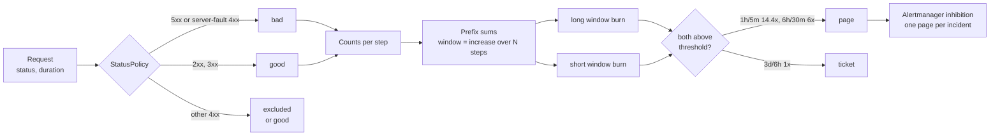

# SLO Engineering for APIs: Availability and Latency SLIs, Excluding Client 4xx Errors, and Multi-Window Multi-Burn-Rate Alerts

> [!summary] Claim
> An API SLO is a target for the ratio of good events to valid events, where `5xx` responses (and only the `4xx` you can prove are your fault) are bad, so the error budget is `1 - SLO` and the right page is not "the error rate is high" but "the budget is burning faster than N times the sustainable rate over a long window and is still burning over a short one", which is the Google SRE multiwindow, multi-burn-rate rule: `1h` and `5m` at `14.4x`, `6h` and `30m` at `6x`, then a `3d` and `6h` ticket at `1x`.

Part of [Observability Profiling and Operations](README.md) in [API Engineering](../README.md).

## TL;DR

Mechanism: an SLI is `good / valid` events, the budget is `1 - SLO`, the burn rate is `error ratio / budget`, and a rule fires only while both its long and short window exceed the same burn threshold, which spends 2 percent of a 30-day budget in `1h`, 5 percent in `6h`, and 10 percent in `3d` (SRE Workbook, "Alerting on SLOs", Table 5-8).
Contract rule: the availability SLI counts `5xx` as bad and treats a client `4xx` as the client's problem, by dropping it from numerator and denominator (this note's default) or counting it good (the Workbook's example); the SLO document must name which, and must list the `4xx` codes that are really yours, such as `429` from your own load shedding.
Trap: a recorder that reads only the status of `http.response.start` never sees an unhandled exception (Starlette's `ServerErrorMiddleware` sends the `500` through its own `send`, outside the recorder) and records a stream that dies after the headers as `200`; a `for:` clause or a single window then pages late, never, or for hours after recovery.
Portability: the lab ran `26 passed` on CPython 3.12.13, 3.13.18, 3.14.6, 3.14.10, 3.15.2, and the 3.15.0b3 free-threaded build, macOS 27.3 arm64; the evaluator is pure Python and the recorder is pure ASGI, so HTTP/1.1, HTTP/2, and HTTP/3 change only where the status code is observed, not how it is counted.
When not to use it: with fewer than a few hundred requests per hour per window a single failure is a page (use synthetic probes, a lower SLO, or a longer window), at `99.999%` a total outage exhausts the budget in 25.92 seconds before any alert can help, and for batch or pipeline work the SLI should be freshness or correctness, not request status.

## Mental model



Every request is classified once, at the edge of your service, into good, bad, or excluded, and only good and bad reach the per-step counters.
The counters are cumulative, so any window is a difference of two prefix sums, which is exactly what `rate(...[window])` computes for a Prometheus counter.
Two windows over the same counters give two burn rates; the long one says "a significant amount of budget has gone" and the short one says "it is still going", and the rule is their conjunction.
A page rule and a ticket rule share the counters but differ in threshold and window, because a `1x` burn that would take the whole 30 days to spend the budget can wait for working hours, while a `14.4x` burn spends it in about two days.
Because one severe outage satisfies every rule within minutes, the notifications need inhibition downstream so that the on-call gets one page, not three.

## How it works

### SLI, SLO, SLA, and the good-events form

An SLI is "a carefully defined quantitative measure of some aspect of the level of service", and an SLO is "a target value or range of values for a service level that is measured by an SLI" (SRE book, "Service Level Objectives").
The same book defines availability as "the fraction of well-formed requests that succeed, sometimes called yield" (SRE book, "Service Level Objectives", Indicators).
The Workbook then recommends one shape for nearly every SLI: "the number of good events divided by the total number of events", which ranges from 0 to 100 percent, makes the budget "100% minus the SLO", and lets alerting, reporting, and budget tooling share the same inputs (SRE Workbook, "Implementing SLOs", What to Measure: Using SLIs).
An SLA adds contractual consequences; the SRE book footnote notes that most people who say "SLA violation" mean a missed SLO.
Everything below, including the lab, is built on `good` and `bad` counts and nothing else.

### Which status codes are bad

`5xx` means "the server is aware that it has erred or is incapable of performing the requested method" (RFC 9110 Section 15.6), and `4xx` means "the client seems to have erred" (RFC 9110 Section 15.5).
Google's example SLO document is explicit: "Any HTTP status other than 500-599 is considered successful", and "We only count HTTP 5XX status messages as error codes; everything else is counted as success" (SRE Workbook, "Example SLO Document", SLIs and SLOs, Clarifications and Caveats).
That keeps `4xx` in the denominator as good events.
This note's lab implements both policies in `StatusPolicy` (`ClientErrors.COUNT_AS_GOOD` is the Workbook's; `ClientErrors.EXCLUDE` is the default) because they differ exactly when `4xx` volume is large:

| Traffic in the window | `COUNT_AS_GOOD` error ratio | `EXCLUDE` error ratio |
|---|---|---|
| 100 `500`, 100 `200`, 800 `404` | 10% (100 of 1000) | 50% (100 of 200) |

A `404` flood from a scanner (or a client with a bug) dilutes a real `5xx` outage by 5x under the first policy, which is why the lab's test is named `test_counting_4xx_as_good_dilutes_a_5xx_outage`.
The cost of `EXCLUDE` is the mirror image: a `4xx` that your own bug produces is dropped from the SLI and the budget stays full while users are failing.
So the policy needs a second input, `server_fault_4xx`, the codes that are yours:

- `429`: "the user has sent too many requests in a given amount of time ("rate limiting")" (RFC 6585 Section 4), and the same section says it "does not define how the origin server identifies the user, nor how it counts requests".
  A per-client quota `429` is the client's problem; a `429` from global load shedding is your capacity failure and belongs in the bad set.
  `503` is the shedding status in the RFC's own terms ("temporary overload or scheduled maintenance", with an optional `Retry-After`, RFC 9110 Section 15.6.4), so it is bad without any policy.
- `401` and `403` when the dependency that makes the decision (the identity provider, the policy service) is what failed.
- `400`, `404`, `415`, and `422` after a deploy that broke routing, content negotiation, or validation for valid clients.
- `408`: "the server did not receive a complete request message within the time that it was prepared to wait" (RFC 9110 Section 15.5.9); usually a slow client, sometimes your own accept backlog.
- `499`: not an RFC status; nginx defines `NGX_HTTP_CLIENT_CLOSED_REQUEST` as `499` (nginx release-1.28.0 `src/http/ngx_http_request.h`, `NGX_HTTP_CLIENT_CLOSED_REQUEST`) for a client that closed the connection first.
  A client that gives up because you were slow is a latency failure that no status code reports; measure it as a latency SLI violation, not by status.

OpenTelemetry encodes the same split for traces: the span status of a server span "MUST be left unset" for `4xx` and "SHOULD be set to Error" for `5xx`, with the explicit note that "the classification of an HTTP status code as an error depends on the context" (OpenTelemetry HTTP semantic conventions, "HTTP Spans", Status).
Using one rule for SLIs and span status means an error-budget graph and a trace search for errors show the same requests; the sibling [[RED-and-USE-Metrics-and-OpenTelemetry-HTTP-Semantic-Conventions]] covers the metric names.

### Where the SLI is measured

The Workbook's example measures at the load balancer and states the cost: it "may fail to accurately measure cases where user requests didn't reach the load balancer" (SRE Workbook, "Example SLO Document", Clarifications and Caveats).
The SRE book adds that some indicators should be collected client-side because server-side metrics miss problems that "affect users but don't affect server-side metrics" (SRE book, "Service Level Objectives", Collecting Indicators).
The origin recorder in this note's lab is therefore the cheapest and the most blind; the edge-versus-origin gap and client-side SLIs are the subject of [[Client-Side-Telemetry-Network-Error-Logging-NEL-and-Edge-vs-Origin-Gap]], the next note.

### Latency SLIs are ratios against a threshold

A latency SLI is "the proportion of requests that were faster than some threshold" (SRE Workbook, "Implementing SLOs", Table 2-1), not a percentile: "90% of requests are faster than 100 ms, and 99% of requests are faster than 400 ms" is the Workbook's example of multiple grades that capture both the typical experience and the long tail (SRE Workbook, "Implementing SLOs", A Worked Example).
Its own SLO document defines `90% of requests < 400 ms` and `99% of requests < 850 ms`, each as `count(duration <= threshold) / count(all)` (SRE Workbook, "Example SLO Document", SLIs and SLOs).
Note that the Workbook's denominator is all requests, so a fast `500` counts as a fast, good latency event and a slow `500` counts as a slow one; `latency_counts` in the lab instead uses only non-failing, non-excluded requests, so a burst of instant `500`s cannot flatter latency, at the price that a failure is counted once (in availability) and never in latency.
Choose deliberately and write it in the SLO document.

The ratio form needs the count of requests under the threshold.
The Workbook says "it is better to count the slow requests than to approximate them with a histogram" and uses the histogram only because the count was unavailable (SRE Workbook, "Implementing SLOs", Measuring the SLIs).
With a classic Prometheus histogram the fraction is `sum(rate(..._bucket{le="0.3"}[5m])) / sum(rate(..._count[5m]))`, and the Prometheus documentation is blunt about the failure mode: "this expression strictly requires a bucket boundary configured at 0.3", and if the boundary is absent "no interpolation is applied", "no result is returned at all", and if only some series have it "an incomplete result is returned, but without any warning" (Prometheus docs, "Histograms and summaries", Bucketing; the page writes it as `sum by (job) (rate(..._bucket{le="0.3"}[5m])) / sum by (job) (rate(..._count[5m]))`).
`prometheus_client.Histogram.DEFAULT_BUCKETS` is `(.005, .01, .025, .05, .075, .1, .25, .5, .75, 1.0, 2.5, 5.0, 7.5, 10.0, INF)` (prometheus-client 0.26.0 `prometheus_client/metrics.py`, `Histogram.DEFAULT_BUCKETS`): it has `0.25` and `0.5` but not `0.3`, so a 300 ms SLO on a default-bucket histogram is silently unmeasurable.
`CumulativeHistogram.good_exact` mirrors that by raising `MissingBucketError`; `good_estimate` does the linear interpolation a native-histogram `histogram_fraction` does, and the lab shows how wrong that can be inside a wide bucket: 100 requests that all took 290 ms are estimated as `0.2` under 300 ms, when the truth is `1.0`.
The fix is to make every SLO threshold a bucket boundary (the SLO is a design input to the instrumentation) and to alert on a missing series as its own failure.
Quantile and aggregation details live in [[Latency-Histograms-Percentiles-DDSketch-and-Why-Averaging-Percentiles-Is-Wrong]].

### The window and the error budget

Rolling windows "are more closely aligned with user experience" and should be an integral number of weeks; calendar windows suit business planning but make mid-period decisions speculative; the Workbook's general-purpose choice is a four-week rolling window (SRE Workbook, "Implementing SLOs", Choosing an Appropriate Time Window).
The lab uses 30 days (`PERIOD_30D`) because every number in the alerting chapter is stated against 30 days; the algebra is identical for 28.
With `slo = 0.999` the budget is `0.001`, so a service with 3,000,000 requests in the window may fail 3,000 of them, and one outage that fails 1,500 costs half the budget (SRE Workbook, "Implementing SLOs", What to Measure: Using SLIs).
The lab's functions are one-line transcriptions of the identities below, each pinned by a test against a Workbook table:

| Quantity | Formula | Lab function |
|---|---|---|
| budget | `1 - SLO` | `error_budget` |
| burn rate | `error_ratio / (1 - SLO)` | `burn_rate` |
| time to exhaustion | `period / burn` | `time_to_exhaustion_s` |
| budget consumed | `burn * window / period` | `budget_consumed` |
| threshold for a budget fraction | `fraction * period / window` | `burn_threshold` |
| burn of a 100% outage | `1 / (1 - SLO)` | `max_burn_rate` |

A burn rate of 1 is "consuming error budget at a rate that leaves you with exactly 0 budget at the end of the SLO's time window" (SRE Workbook, "Alerting on SLOs", Alert on Burn Rate).
The error budget policy is the organizational half: Google's example freezes releases when "the service has exceeded its error budget for the preceding four-week window", requires a postmortem when "a single incident consumes more than 20% of error budget over four weeks", and lets the team keep shipping features after a miss when "the error budget was consumed by users out of scope for the SLO (e.g., load tests or penetration testers)" (SRE Workbook, "Example Error Budget Policy", SLO Miss Policy).
That last item is a technical requirement on the SLI: synthetic and out-of-scope traffic must be separable by a label before it reaches the counters.

### The six alerting strategies and why only the last survives

The Workbook scores alerting by four properties: precision (the share of alerts that were significant), recall (the share of significant events alerted), detection time, and reset time (how long the alert keeps firing after the fix) (SRE Workbook, "Alerting on SLOs", Alerting Considerations).
It then builds six strategies, each fixing the previous one's flaw (SRE Workbook, "Alerting on SLOs", Ways to Alert on Significant Events):

| # | Strategy | What breaks (per the Workbook) |
|---|---|---|
| 1 | error rate over 10 minutes `>=` the SLO error ratio | low precision: a 0.1% error rate for 10 minutes spends 0.02% of the monthly budget, up to 144 alerts per day while meeting the SLO |
| 2 | wider window (36 hours for 5% of budget) | very poor reset time: a 100% outage alerts after 2 minutes and 10 seconds and then fires for 36 hours; costly long-window queries |
| 3 | add a `for:` duration | the duration does not scale with severity (a 100% outage still waits an hour, having spent 140% of the budget), and one dip below the threshold resets the timer |
| 4 | one burn-rate alert (`1h` at `36x`, 5% of budget) | low recall: a `35x` burn never alerts yet spends the whole budget in 20.5 hours; reset still 58 minutes |
| 5 | several burn rates (14.4x/1h, 6x/6h, 1x/3d, Table 5-6) | an even longer reset time from the 3-day window, and one big outage fires all of them unless suppressed |
| 6 | multiwindow, multi-burn-rate | "lots of parameters to specify" |

Strategy 6 adds a short window "to check if the error budget is still being consumed as we trigger the alert", with the guideline that the short window is 1/12 of the long one (SRE Workbook, "Alerting on SLOs", Multiwindow, Multi-Burn-Rate Alerts).
Table 5-8 gives the starting parameters for a 99.9% SLO:

| Severity | Long window | Short window | Burn rate | Budget consumed at trigger |
|---|---|---|---|---|
| page | `1h` | `5m` | 14.4 | 2% |
| page | `6h` | `30m` | 6 | 5% |
| ticket | `3d` | `6h` | 1 | 10% |

The `14.4` comes from `0.02 * 720h / 1h` and the `6` from `0.05 * 720h / 6h`; the lab asserts these (`test_burn_thresholds_follow_from_budget_fraction_and_window`).
As an error ratio against a 99.9% SLO the thresholds are 1.44%, 0.6%, and 0.1%.
The Workbook gives the detection time of a burn-rate alert as `(1 - SLO) / error_ratio * window * burn_rate`, which for the `1h` rule is `0.864 minutes / error_ratio`; the lab's measured detection times match that formula rounded up to a whole evaluation step (see Numbers and limits).

### Why the short window is not optional

With a long window alone, the alert keeps firing until the bad minutes slide out of the window.
The lab replays the Workbook's Figure 5-6 scenario, 15% errors for 10 minutes on steady traffic after two healthy hours:

- with both windows, the alert first fires at step 126 (the 6th error minute, once the `1h` average passes 1.44%) and last fires at step 134, resolving on the fifth minute after the errors stop (9 firing steps in total);
- with the long window only, it first fires at step 126 and last fires at step 184, 54 minutes after the last error minute (59 firing steps).

The Workbook says the long window "drops below the threshold 60 minutes after the errors stop" for this scenario; the lab clears at 55 minutes because the average falls under 1.44% once fewer than 6 of the 10 error minutes remain in the window, so treat the Workbook's figure as the time for the burst to leave the window entirely.
The short window is therefore the reset-time fix, and the conjunction means an alert can fire only while the incident is current.

### Implementing it in Prometheus

The Workbook writes each ratio as a recording rule over a window, then the alert as an `or` of `and` pairs (SRE Workbook, "Alerting on SLOs", strategies 1 and 6).
`render_prometheus_rules` in the lab emits that structure from a rule list; for the default rules it produced 5 recording rules (`5m`, `30m`, `1h`, `6h`, `3d`, since the ticket rule's `6h` short window reuses the page rule's long window) and 3 alerts, and `promtool check rules` (promtool 3.16.0, Homebrew) reported `SUCCESS: 8 rules found`.
A simplified excerpt of the generated file (the `1h` recording rule and the first alert, each verbatim; the other four recording rules and two alerts are omitted):

```yaml
  - record: job:slo_errors_per_request:ratio_rate1h
    expr: |
      sum(rate(http_requests_total{job="api",status=~"5.."}[1h]))
      /
      sum(rate(http_requests_total{job="api",status!~"4.."}[1h]))
  - alert: ErrorBudgetBurnPage1h5m
    expr: |
      job:slo_errors_per_request:ratio_rate1h > (14.4 * 0.001)
      and
      job:slo_errors_per_request:ratio_rate5m > (14.4 * 0.001)
    labels:
      severity: page
```

Four properties of this shape matter:

- The denominator `status!~"4.."` is the `EXCLUDE` policy; with `COUNT_AS_GOOD` the selector is just the job.
- `rate()` is taken first and aggregated second: "always take a rate() first, then aggregate", because otherwise `rate()` cannot detect counter resets when a target restarts (Prometheus docs, "Query functions", `rate()`).
  Ratios are `sum(bad) / sum(total)`, never an average of per-pod ratios.
- `rate()` "extrapolates to the ends of the time range, allowing for missed scrapes or imperfect alignment" (same section), so a Prometheus window is not exactly N steps of increments.
  Range selectors are also "left-open and right-closed" (Prometheus docs, "Querying basics", Range Vector Selectors; new in 3.0 per the 3.0 migration guide), so a `5m` range over 1-minute samples holds 5 samples and 4 increments.
  The lab's cross-check below measured the effect: one evaluation of difference at the reset edge.
- There is no `for:` clause.
  With `for`, Prometheus checks "that the alert continues to be active during each evaluation" for the duration before firing, and an alert that is "active, but not firing yet" is `pending` (Prometheus docs, "Alerting rules"); that is strategy 3, whose timer "resets" if the metric "even momentarily" returns within SLO (SRE Workbook, "Alerting on SLOs", strategy 3).
  `keep_firing_for` is the opposite tool, holding an alert firing "after the firing condition was last met" to stop flapping or false resolutions on data loss (same page); it lengthens reset time and so belongs to the ticket tier, not the page tier.

Prometheus's own guidance agrees on what to page on: "alerting on symptoms that are associated with end-user pain", "allow for slack in alerting to accommodate small blips" (Prometheus docs, "Alerting", What to alert on), and "for error rates, page on user-visible errors" as high up in the stack as possible (same page, Online serving systems).

### Stacking and suppression

A total outage satisfies all three rules within five minutes (lab: first fire at minute 1, 3, and 5), and the Workbook warns that without suppression a single event can send three notifications (SRE Workbook, "Alerting on SLOs", strategy 5).
Alertmanager's inhibition rule "mutes an alert (target) matching a set of matchers when an alert (source) exists that matches another set of matchers", provided both carry the same values for the labels in `equal` (Prometheus docs, "Alertmanager configuration", `inhibit_rule`).
The practical setup is a source matcher of `severity="page"` and a target matcher of `severity="ticket"`, `equal: [job]`, so a firing page silences the ticket for the same job; keep target and source matchers disjoint, as the docs recommend, so no alert matches both sides.

### The recorder: one observation per request

`SliMiddleware` is pure ASGI and wraps `send` to capture the status from the `http.response.start` message.
Its placement is the whole story.
Starlette builds the stack as `ServerErrorMiddleware`, then optional body-size middleware, then user middleware, then `ExceptionMiddleware`, then the router (starlette 1.10.0 `starlette/applications.py`, `Starlette.build_middleware_stack`).
`ExceptionMiddleware` is inside the recorder, so an `HTTPException(404)` is turned into a response that passes through the recorder's `send` and is recorded as `404`.
An unhandled exception is different: `ServerErrorMiddleware.__call__` catches it, builds the `500` response, and sends it with its own `send` (`if not response_started:` followed by `await response(scope, receive, send)`), then re-raises with `raise exc` (starlette 1.10.0 `starlette/middleware/errors.py`, `ServerErrorMiddleware.__call__`).
That `send` is outside the recorder, so a recorder that waits for `http.response.start` records nothing; the lab's recorder catches the exception itself and records `500`.
If `response_started` is already true, `ServerErrorMiddleware` sends nothing and only re-raises, so the client got a `200` header and a truncated body; the lab records that case as `500` with `truncated=True`, and `test_failure_after_headers_is_recorded_bad_and_truncated` shows the client side of the same request: `200` and the body `b"first"`.
The route label is `scope["route"].path`, set by `Router.app` when a route matches (starlette 1.10.0 `starlette/routing.py`, `Router.app`), with `unmatched` as the fallback.
That is deliberate: the OpenTelemetry convention is that instrumentation "MUST NOT default to using URI path as a {target}" (OpenTelemetry HTTP semantic conventions, "HTTP Spans"), and the raw path is client-controlled cardinality.

## Numbers and limits

Lab numbers come from `slo_burn_rate.py` on CPython 3.14.6, macOS 27.3 arm64, with 100,000 requests per one-minute step, 4,400 healthy steps of history, and the error ratio held constant afterward.
"Detect" is the number of minutes after the errors begin at which the rule first fires, from the snippet in the Worked example.

| Quantity | Value | Source |
|---|---|---|
| Budget for a 99.9% SLO over 30 days | 43.2 minutes of total outage | computed: `30 d * 0.001`; Workbook Table 5-4 lists burn 1000 as 43 minutes |
| Budget over 30 days at 99% / 99.5% / 99.95% / 99.99% | 7.2 h / 3.6 h / 21.6 min / 4.32 min | computed: `30 d * (1 - SLO)` |
| Total outage at 99.999% | 25.92 seconds | lab test `test_page_rule_is_unreachable_for_a_90_percent_slo`; Workbook says 26 seconds |
| Burn rate of a total outage at 90% / 99% / 99.9% / 99.99% | 10 / 100 / 1,000 / 10,000 | computed: `1 / (1 - SLO)` |
| Page rule `14.4` on a 90% SLO | unreachable (max burn is 10) | lab `BurnRateRule.reachable`; Workbook states a 100% outage spends only 1.4% in an hour |
| Burn 14.4 / 6 / 1 as error ratio at 99.9% | 1.44% / 0.6% / 0.1% | computed |
| Detect, 100% errors, rules `1h/5m` / `6h/30m` / `3d/6h` | 1 / 3 / 5 min | lab snippet in the Worked example (formula: 0.864 / 2.16 / 4.32 min, rounded up) |
| Detect, 10% errors (burn 100) | 9 / 22 / 44 min | lab |
| Detect, 5% errors (burn 50) | 18 / 44 / 87 min | lab |
| Detect, 2% errors (burn 20) | 44 / 109 / 217 min | lab |
| Detect, 1.51% errors (burn 15.1) | 58 / 144 / 287 min | lab |
| Detect, 1% errors (burn 10) | never / 217 / 433 min | lab: below `14.4`, so the `1h` rule never pages |
| Detect, 0.61% errors (burn 6.1) | never / 355 / 709 min | lab |
| Detect, 0.12% errors (burn 1.2) | never / never / 3,601 min | lab: only the ticket tier sees it, after 2.5 days |
| Reset after a 10-minute 15% burst, `1h/5m` | last firing evaluation is minute 4 after the errors stop (9 firing steps) | lab test `test_short_window_resets_the_alert_five_minutes_after_errors_stop` |
| Same burst, long window only | last firing evaluation is minute 54 after (59 firing steps) | lab, same test |
| Alternating 5-minute 100% spikes and 5-minute pauses for 2 hours | `for: 10m` fires 0 times; budget spent is 139% of 30 days at that traffic | lab test `test_for_clause_never_fires_on_alternating_spikes_that_burn_139_percent`; Workbook: 100% for an hour is 140% |
| 10 requests per hour, one failure | burn 100 on the long window, 13.9% of the monthly budget; 7.2 failures allowed per month | lab test; Workbook states the same 13.9% and seven failures, but calls the burn "1,000x", which contradicts its own 13.9% (`0.1 / 0.001 = 100`, and `100 * 1h / 720h = 13.9%`) |
| Short window / long window ratio | 1/12 | Workbook guideline, strategy 6 text and Table 5-8 |
| Google example API availability SLO | 97%, so 30,000 errors per 1,000,000 requests in 4 weeks | SRE Workbook, "Example SLO Document", Error Budget |
| `prometheus_client` default buckets | 14 finite bounds plus `+Inf`; includes `0.25`, `0.5`, not `0.3` | prometheus-client 0.26.0 `Histogram.DEFAULT_BUCKETS` |
| Histogram estimate for 100 requests at 290 ms, threshold `0.3` | 0.2 estimated, 1.0 true | lab test `test_interpolation_can_be_wildly_wrong_inside_a_wide_bucket` |
| Prometheus cross-check, same 15% x 10 min scenario | first firing evaluation 2h6m, last 2h13m (8 firing evaluations) | `promtool test rules` 3.16.0 on macOS 27.3 arm64, 1-minute samples, one `alert_rule_test` per minute from 118m to 189m; lab: steps 126 and 134 (9) |

The cross-check is worth reading carefully.
The Prometheus evaluation first fired at the same minute as the lab (126) and stopped one evaluation earlier (133 against 134).
The cause is the range boundary: a range selector is "a left-open and right-closed interval" (Prometheus docs, "Querying basics", Range Vector Selectors), so at 2h14m the `5m` range holds the samples at 130 through 134 minutes, whose 4 increments are steps 131 to 134, all error-free, and `rate()` is 0; the lab's window counts 5 step increments, 130 through 134, and step 130 still carries 15% errors.
The first fire agrees because extrapolation scales numerator and denominator alike, and at 2h6m the `1h` range (59 increments, steps 68 to 126) already holds 6 error minutes, a ratio of `90,000 / 5,900,000 = 1.53%`.

## Portability

| Axis | Result | Proof |
|---|---|---|
| CPython 3.12.13 | `26 passed` | `uv run --isolated --no-project --python 3.12` with the pinned test dependencies, run here |
| CPython 3.13.18 | `26 passed` | same, `--python 3.13` |
| CPython 3.14.6 (lab `.venv`) | `26 passed`; ruff, mypy strict, and pyright strict clean on the two lab files | `uv run --frozen pytest`, run here |
| CPython 3.14.10 | `26 passed` | same isolated run with `/opt/homebrew/bin/python3.14` |
| CPython 3.15.2 | `26 passed` | same isolated run with `/opt/homebrew/bin/python3.15` |
| CPython 3.15.0b3 free-threaded (`3.15t`, GIL disabled: `sys._is_gil_enabled()` returned `False`) | `26 passed` | same isolated run with `--python 3.15t`; the 3.15.2 free-threaded build was not available, so this is a beta |
| Library point releases | starlette 1.10.0, httpx 0.28.1, prometheus-client 0.26.0, pytest 9.2.0, pytest-asyncio 1.4.1.post1 | the lab pins in `labs/pyproject.toml`; no other release was run |
| Thread safety | `SliSeries` is not thread-safe (unsynchronized list appends); the tests are single-threaded | design fact; a production counter needs atomic increments or one writer |
| ASGI servers (Uvicorn, Hypercorn, Granian) | not run; the recorder uses only the ASGI `scope`, `receive`, `send` contract | not tested in this lab |
| HTTP/1.1, HTTP/2, HTTP/3 | not run on the wire; the SLI is a status code and status codes are defined once for all versions in RFC 9110 Section 15 | RFC 9110 Section 15 |
| Prometheus | `promtool` 3.16.0: `check rules` passed; one `test rules` scenario compared above | run here, once |
| Debian Trixie and Alpine musl containers | not run (container checks are paused for this job) | none |

## Worked example

The implementation is [implementation](../labs/src/api_labs/f18_observability_profiling_and_operations/slo_burn_rate.py) and the test is [test](../labs/tests/f18_observability_profiling_and_operations/test_slis_slos_error_budgets_and_multi_window_burn_rate_alerting.py).
The excerpts below are copied byte for byte from the implementation.

The status policy:

```python
@dataclass(frozen=True, slots=True)
class StatusPolicy:
    """Maps an HTTP status code to an availability outcome.

    ``server_fault_4xx`` lists client-error codes that are really ours: ``429`` from our own load
    shedding, or ``401`` when the identity provider we depend on is down.
    """

    client_errors: ClientErrors = ClientErrors.EXCLUDE
    server_fault_4xx: frozenset[int] = frozenset()

    def classify(self, status: int) -> Outcome:
        if not 100 <= status <= 599:
            raise ValueError(f"not an HTTP status code: {status}")
        if status >= 500:
            return Outcome.BAD
        if status >= 400:
            if status in self.server_fault_4xx:
                return Outcome.BAD
            if self.client_errors is ClientErrors.EXCLUDE:
                return Outcome.EXCLUDED
        return Outcome.GOOD
```

The rule, the Workbook's three parameter rows, and the prefix-sum series:

```python
@dataclass(frozen=True, slots=True)
class BurnRateRule:
    severity: Severity
    long_window_s: int
    short_window_s: int
    burn_threshold: float
    min_events: int = 0  # long-window traffic floor; 0 disables the low-traffic guard

    def __post_init__(self) -> None:
        if not 0 < self.short_window_s < self.long_window_s:
            raise ValueError("need 0 < short window < long window")
        if self.long_window_s % STEP_SECONDS or self.short_window_s % STEP_SECONDS:
            raise ValueError("windows must be whole evaluation steps")
        if self.burn_threshold <= 0 or self.min_events < 0:
            raise ValueError("burn_threshold must be positive and min_events non-negative")

    def reachable(self, slo: float) -> bool:
        """Can any error ratio ``<= 1`` strictly exceed the threshold?"""
        return self.burn_threshold < max_burn_rate(slo)

    def budget_at_trigger(self, period_s: int = PERIOD_30D) -> float:
        """Budget fraction spent once the long window alone has crossed the threshold."""
        return budget_consumed(self.burn_threshold, self.long_window_s, period_s)
```

```python
# Table 5-8 of the SRE Workbook chapter "Alerting on SLOs", for a 99.9 percent SLO.
GOOGLE_RULES: tuple[BurnRateRule, ...] = (
    BurnRateRule(Severity.PAGE, 3_600, 300, 14.4),
    BurnRateRule(Severity.PAGE, 21_600, 1_800, 6.0),
    BurnRateRule(Severity.TICKET, 259_200, 21_600, 1.0),
)
```

```python
class SliSeries:
    """Per-step counts stored as prefix sums, like ``increase()`` over a counter."""

    def __init__(self) -> None:
        self._bad = [0]
        self._total = [0]

    def __len__(self) -> int:
        return len(self._bad) - 1

    def append(self, counts: Counts) -> None:
        self._bad.append(self._bad[-1] + counts.bad)
        self._total.append(self._total[-1] + counts.total)

    def window(self, window_s: int, *, end: int | None = None) -> Counts:
        """Counts in the ``window_s`` ending at step ``end`` (exclusive; default: the newest)."""
        stop = len(self) if end is None else end
        start = max(0, stop - window_s // STEP_SECONDS)
        bad = self._bad[stop] - self._bad[start]
        total = self._total[stop] - self._total[start]
        return Counts(total - bad, bad)
```

The evaluator is the conjunction of the two windows, strict, and silent when a window has no traffic:

```python
def evaluate_rule(
    series: SliSeries,
    rule: BurnRateRule,
    slo: float,
    *,
    end: int | None = None,
    use_short_window: bool = True,
) -> RuleReading:
    """``long_burn > T and short_burn > T``, strict, and false when a window has no traffic."""
    long_counts = series.window(rule.long_window_s, end=end)
    long_burn = _burn(long_counts, slo)
    short_burn = _burn(series.window(rule.short_window_s, end=end), slo)
    firing = (
        long_burn is not None
        and long_burn > rule.burn_threshold
        and long_counts.total >= rule.min_events
        and (not use_short_window or (short_burn is not None and short_burn > rule.burn_threshold))
    )
    return RuleReading(long_burn, short_burn, firing)
```

The `for:` baseline, so the note can show it failing:

```python
def replay_for_clause(
    steps: Iterable[Counts], slo: float, *, window_s: int, threshold: float, for_s: int
) -> FiringTrace:
    """Approach 3 of the Workbook: ``burn(window) > threshold`` for ``for_s`` (Prometheus ``for``).

    The pending timer restarts whenever one evaluation is below the threshold.
    """
    series = SliSeries()
    out: list[bool] = []
    active_since: int | None = None
    for index, counts in enumerate(steps):
        series.append(counts)
        burn = _burn(series.window(window_s), slo)
        if burn is not None and burn > threshold:
            if active_since is None:
                active_since = index
            out.append((index - active_since) * STEP_SECONDS >= for_s)
        else:
            active_since = None
            out.append(False)
    return FiringTrace(tuple(out))
```

The recorder (note `except Exception` records and re-raises; a status-only recorder would miss it):

```python
class SliMiddleware:
    """Pure ASGI middleware that records exactly one ``Observation`` per HTTP request.

    It must sit INSIDE ``ServerErrorMiddleware`` (Starlette puts user middleware there), so an
    unhandled exception reaches it as an exception, not as a ``500`` response it could read.
    """

    def __init__(
        self,
        app: ASGIApp,
        sink: Callable[[Observation], None],
        clock: Callable[[], float] = time.perf_counter,
    ) -> None:
        self.app = app
        self.sink = sink
        self.clock = clock

    async def __call__(self, scope: Scope, receive: Receive, send: Send) -> None:
        if scope["type"] != "http":
            await self.app(scope, receive, send)
            return
        started = self.clock()
        status: int | None = None

        async def send_wrapper(message: Message) -> None:
            nonlocal status
            if message["type"] == "http.response.start":
                status = int(message["status"])
            await send(message)

        try:
            await self.app(scope, receive, send_wrapper)
        except Exception:
            self._record(scope, 500, started, truncated=status is not None)
            raise
        self._record(scope, status if status is not None else 500, started)

    def _record(
        self, scope: Scope, status: int, started: float, *, truncated: bool = False
    ) -> None:
        route: Any = scope.get("route")
        template = getattr(route, "path", None)
        self.sink(
            Observation(
                template if isinstance(template, str) else "unmatched",
                status,
                self.clock() - started,
                truncated,
            )
        )
```

The reset-time test, which pins the numbers in the Numbers table:

```python
@pytest.mark.unit
def test_short_window_resets_the_alert_five_minutes_after_errors_stop() -> None:
    steps = segments((HEALTHY, PER_STEP, 0.0), (10, PER_STEP, 0.15), (90, PER_STEP, 0.0))
    both = replay(steps, PAGE_1H, SLO)
    long_only = replay(steps, PAGE_1H, SLO, use_short_window=False)
    assert both.first_fire_step == long_only.first_fire_step == HEALTHY + 6
    errors_end = HEALTHY + 10
    assert both.last_fire_step == errors_end + 4  # clear on the 5th minute after
    assert long_only.last_fire_step == errors_end + 54  # 1h window still holds the burst
    assert both.steps_firing == 9
    assert long_only.steps_firing == 59
```

Captured run, command `uv run --frozen pytest tests/f18_observability_profiling_and_operations/test_slis_slos_error_budgets_and_multi_window_burn_rate_alerting.py -q` from `labs/`, CPython 3.14.6, macOS 27.3 arm64:

```text
..........................                                               [100%]
26 passed in 0.89s
```

The detection table in Numbers and limits and the prediction in the interview section come from the next snippet, which is not a lab file: it was saved outside the lab, run from `labs/` with `uv run --frozen python` on the same interpreter exactly as shown (by the drafter and again by the fact-checker on 2026-11-21, with identical output), and then removed.
It is reproducible by pasting it into a Python 3.14 session in the lab environment:

```python
from api_labs.f18_observability_profiling_and_operations.slo_burn_rate import (
    GOOGLE_RULES,
    replay,
    segments,
)

for ratio in (1.0, 0.1, 0.05, 0.02, 0.0151, 0.01, 0.0061, 0.0012):
    row = []
    for rule in GOOGLE_RULES:
        steps = segments((4400, 100_000, 0.0), (5000, 100_000, ratio))
        first = replay(steps, rule, 0.999).first_fire_step
        row.append(None if first is None else first - 4400)
    print(f"{ratio:.4f}", row)

steps = segments((120, 100_000, 0.0), (10, 100_000, 0.15), (90, 100_000, 0.0))
trace = replay(steps, GOOGLE_RULES[0], 0.999)
print(trace.first_fire_step, trace.last_fire_step, trace.steps_firing)
```

```text
1.0000 [1, 3, 5]
0.1000 [9, 22, 44]
0.0500 [18, 44, 87]
0.0200 [44, 109, 217]
0.0151 [58, 144, 287]
0.0100 [None, 217, 433]
0.0061 [None, 355, 709]
0.0012 [None, None, 3601]
126 134 9
```

Per the job brief the mutation checks were not run (paused by the user on 2026-11-11), so the claim that each test is discriminating rests on reading, not on a recorded mutation; see the report.

## Pitfalls

> [!warning] Counting `4xx` as success lets a scanner mask an outage
> Trigger: the SLI keeps every `4xx` in the denominator as good (the Workbook's example) and a client or bot sends a flood of `404` or `401`.
> Symptom: a real `5xx` ratio of 50% among valid requests shows as 10% (lab: 100 `500`, 100 `200`, 800 `404`), so the page threshold is crossed 5x later or never.
> Fix: exclude `4xx` from numerator and denominator, or alert on the ratio over a per-route valid-traffic denominator, and keep a separate `4xx` anomaly alert (not paged) so a bad deploy that turns valid requests into `4xx` is still visible.

> [!warning] Excluding `4xx` hides failures you caused
> Trigger: a deploy breaks routing, content negotiation, schema validation, or the identity provider, and valid requests now return `404`, `415`, `422`, or `401`.
> Symptom: users fail, the SLI stays at 100%, the budget stays full, and the Workbook's policy even lists "miscategorized errors fail to consume budget" as a reason the team must work on reliability (SRE Workbook, "Example Error Budget Policy", SLO Miss Policy).
> Fix: list the server-fault `4xx` codes explicitly (`server_fault_4xx`), run a synthetic prober that sends known-valid requests and counts any non-`2xx` as bad, and alert on a sudden shift in `4xx` share per route.
> This is a design scenario, not a cited incident.

> [!warning] A status-only recorder never sees unhandled exceptions or mid-stream failures
> Trigger: the recorder reads `message["status"]` in a `send` wrapper, and a handler raises, or a streaming body raises after `http.response.start`.
> Symptom: the `500` produced by `ServerErrorMiddleware` goes through a `send` outside the recorder (starlette 1.10.0 `ServerErrorMiddleware.__call__`), and a failed stream was already recorded as `200`; both vanish from the SLI.
> Fix: catch the exception in the recorder and count it bad, flag `truncated` when headers were already sent, and test both paths (`/boom` and `/stream-fail` in the lab).

> [!warning] A `for:` clause or a single window pages late, never, or for hours
> Trigger: the alert is `error_ratio > threshold` with `for: 1h`, or one `36h` window.
> Symptom: lab: alternating 5-minute total outages and 5-minute recoveries reset a `for: 10m` timer every cycle, so it fires 0 times while burning 139% of the monthly budget in two hours at the same traffic; a wide window instead fires for 36 hours after recovery (Workbook strategy 2).
> Fix: multiwindow, multi-burn-rate with no `for:` on the page tier (SRE Workbook, "Alerting on SLOs", strategy 3: "we do not recommend using durations").

> [!warning] Low traffic turns one failure into a page
> Trigger: a route or tenant with about 10 requests per hour on a 99.9% SLO.
> Symptom: one failed request is a 10% ratio, burn 100 on the long window, and 13.9% of the 30-day budget; the lab's `1h/5m` rule pages on it.
> Fix: the Workbook's options are synthetic traffic, combining services that share a failure domain, client retries with backoff and jitter, or a lower SLO or longer window; the lab adds `min_events` as a guard (`BurnRateRule.min_events`), which stops the page but also stops a genuine total outage of a tiny route from paging, so pair it with a prober.

> [!warning] A threshold that is not a bucket boundary produces no number, or a wrong one
> Trigger: a 300 ms SLO on a histogram with the default buckets.
> Symptom: `sum(rate(..._bucket{le="0.3"}))` returns nothing, an SLO dashboard is blank, and a partially configured fleet returns an incomplete ratio without a warning (Prometheus docs, "Histograms and summaries"); interpolating instead can be off by 80 points (lab: 0.2 estimated, 1.0 true).
> Fix: configure a bucket at every SLO threshold, alert on absent series, and see the sibling latency note for native histograms.

> [!warning] The rule is unreachable for the SLO it is attached to
> Trigger: copying Table 5-8 to a service with a 90% SLO, or a 95% one.
> Symptom: the `14.4x` page needs an error ratio above 144% at 90% (max burn is 10), so it can never fire; the Workbook makes the same point for 90% (SRE Workbook, "Alerting on SLOs", Extreme Availability Goals).
> Fix: derive the threshold from a budget fraction with `burn_threshold`, and assert `BurnRateRule.reachable(slo)` in CI for every SLO and rule pair.

> [!warning] Three simultaneous pages for one outage
> Trigger: the page rules and the ticket rule share labels and no inhibition.
> Symptom: a total outage fires all three rules within 5 minutes (lab: 1, 3, 5), as the Workbook warns for strategy 5.
> Fix: Alertmanager `inhibit_rules` from `severity="page"` to `severity="ticket"` with `equal` on the service label.

> [!warning] Averaging ratios or aggregating before `rate()`
> Trigger: `avg(error_ratio_per_pod)`, or `rate(sum(counter)[5m])`.
> Symptom: a small pod's 100% error ratio weighs the same as a large pod's 0%, and a restarted target's counter reset is missed (Prometheus docs, "Query functions", `rate()`).
> Fix: `sum(rate(bad)) / sum(rate(total))`, always `rate()` first.

> [!warning] Zero traffic is not 100% availability
> Trigger: a window with no requests, from a full outage upstream of you, a DNS failure, or a quiet route.
> Symptom: the ratio is undefined; the lab returns `None` and the rule does not fire, so a service that receives no traffic because it is unreachable looks healthy.
> Fix: a separate alert on request rate collapse and an external prober (the next note), and treat "no data" as its own state, not as success.

## Security and robustness

- **Budget exhaustion as a denial of service.** An attacker who can make you return `5xx` can spend the budget and trigger pages and a release freeze without taking the service down.
  Inputs that can reach an unhandled exception must be validated to a `4xx` before they reach it, which also keeps the attack out of the SLI; see OWASP API4:2023 Unrestricted Resource Consumption for the broader class of requests that degrade service (OWASP API Security Top 10 2023, API4).
- **Dilution as evasion.** Under the Workbook's `COUNT_AS_GOOD` policy, an attacker or a buggy client that sends cheap `4xx` traffic hides a real outage (lab: 10% instead of 50%).
  Pick the `EXCLUDE` policy for APIs that face the open internet, or compute the SLI over authenticated, routed traffic only.
- **Label cardinality.** Never label by raw path, user id, or any client-controlled header: the OpenTelemetry rule is that instrumentation must not default to the URI path, and the lab collapses unmatched paths into `unmatched`.
  A path scanner otherwise creates unbounded series, which blows up the monitoring system that the pages depend on.
- **Out-of-scope traffic.** Load tests, penetration testers, and synthetic probes must be labelled and routed to their own SLI; the policy example lets feature work continue after a miss caused by "load tests or penetration testers", which only works if that traffic is identifiable (SRE Workbook, "Example Error Budget Policy", SLO Miss Policy).
  The reverse also holds: successful artificial requests can "hide the real user signal" when an issue affects only real users (SRE Workbook, "Alerting on SLOs", Generating Artificial Traffic).
- **Integrity of the SLO configuration.** Windows, thresholds, the SLO value, and the `4xx` lists are production configuration that decides whether people get paged; review changes like code, and keep `reachable()` assertions in CI.
  A change that lowers an SLO is a product decision, not an on-call tweak: lowering it "also lowers the number of situations to which the SREs will respond; the product manager needs to understand this tradeoff" (SRE Workbook, "Implementing SLOs", Establishing an Error Budget Policy).
- **Per-tenant fairness.** A global SLO can be met while one tenant fails completely; the Workbook notes that per-customer SLO tracking is noisy for low-volume customers ("either 100% availability ... or very low availability") and useful only in aggregate (SRE Workbook, "Implementing SLOs", Grading Interaction Importance), so alert on the global budget and report per-tenant compliance.
- **Failure of the alerting path.** The pages depend on scraping, recording rules, Prometheus, and Alertmanager; Prometheus's guidance is to alert on the monitoring infrastructure itself and to add an external blackbox check (Prometheus docs, "Alerting", Metamonitoring).
  A burn-rate alert on a down Prometheus is silence, not health.
- **Thread and process safety of the recorder.** The lab's `SliSeries` is a single-writer structure; production recorders use atomic counters per worker and aggregate with `sum(rate())`, which also survives worker restarts through counter-reset handling.

## The principal's view

The architectural decision is what the SLO is allowed to mean, because everything else (SLIs, rules, budgets) is arithmetic once that is settled.
The SRE book's first lesson for choosing targets is "don't pick a target based on current performance" (SRE book, "Service Level Objectives", Choosing Targets, headings "Don't pick a target based on current performance" and "Keep it simple"): an SLO copied from today's dashboard locks the team into heroics, and one chosen to be easy removes the budget's power to say no to a risky launch.
The same chapter adds "have as few SLOs as possible", "keep it simple", and "perfection can wait": start with a loose target and tighten it, because an overly strict target has to be relaxed once it proves unattainable.
The Workbook's example API SLO is 97% over a four-week window, and its SLO document admits that "no attempt has yet been made to verify that these numbers correlate strongly with user experience", which is the honest status of most first SLOs (SRE Workbook, "Example SLO Document").

The organizational trade-off is that the error budget is a shared control mechanism between product and reliability engineering.
It has to be agreed in writing (the policy's freeze rule, its postmortem threshold, who arbitrates a dispute over the calculation) before the first miss, because an SLO miss is a request to stop shipping.
Alerts follow from the SLO, not the reverse: page on budget burn, and keep cause-based alerts (CPU, queue depth) as dashboards and tickets.
At scale, do not tune alert parameters per service; the Workbook strongly advises applying one parameter set across services and grouping request classes into a few buckets such as `CRITICAL` (99.99%), `HIGH_FAST` and `HIGH_SLOW` (99.9%), `LOW` (99%), and `NO_SLO` (SRE Workbook, "Alerting on SLOs", Alerting at Scale).

When to choose something else:

- Low-traffic or high-value one-off requests: synthetic probes or a log-based per-request investigation, not burn-rate paging.
- Extremely high targets: at 99.999% a total outage spends the budget in 25.92 seconds; the only defence is design (canarying to 1% of users so the burn is 1% as fast, which the Workbook computes as 43 minutes), not faster alerts.
- Batch and pipeline systems: freshness and correctness SLIs, not request-status SLIs.
- Client-visible reliability that the origin cannot see: client-side telemetry and edge SLIs ([[Client-Side-Telemetry-Network-Error-Logging-NEL-and-Edge-vs-Origin-Gap]]).
- Over-delivering: the SRE book describes Google's Chubby, where, "in any given quarter, if a true failure has not dropped availability below the target, a controlled outage will be synthesized by intentionally taking down the system", because service owners "began to add dependencies to Chubby assuming that it would never go down" (SRE book, "Service Level Objectives", "The Global Chubby Planned Outage").
  An SLO that is routinely beaten by a wide margin is a hidden dependency waiting to surface.

Costs to name: more rules and windows to manage (the Workbook's own listed con), a longer reset time on the ticket tier, and an SLI that is only as good as its measurement point.

## Interview questions

> [!question] L5: Define an SLI, an SLO, an error budget, and a burn rate for an API with a 99.9% availability objective over 30 days.
>
> > [!success]- Answer
> > The SLI is good requests divided by valid requests, for example non-`5xx` responses over all non-`4xx` responses.
> > The SLO is the target for that ratio, here `0.999`.
> > The error budget is `1 - SLO`, so `0.001`, which is 43.2 minutes of total outage in 30 days or 1,000 failed requests per million.
> > A burn rate is the error ratio divided by the budget, so burn 1 spends the budget exactly over the period and burn 1,000 (a total outage) spends it in 43.2 minutes.
> >
> > Follow-up: how many failed requests does a service with 3,000,000 requests in the window get at 99.9%?

> [!question] L5: Should `404` count against the availability SLO?
>
> > [!success]- Answer
> > By default no: `4xx` means the client seems to have erred (`RFC 9110 Section 15.5`), and the Workbook counts only `5xx` as bad.
> > Decide whether `4xx` is excluded from the denominator or counted as good, because a `404` flood dilutes a `5xx` outage under the second choice (10% instead of 50% in the lab).
> > Then list the codes that are your fault: a `404` after a routing regression, a `401` when your identity provider is down, a `429` from your own load shedding.
> >
> > Follow-up: how do you detect a deploy that turns valid requests into `422` if `4xx` is excluded?

> [!question] L6: Why is "page when the error rate is above 0.1% for 10 minutes" a bad alert for a 99.9% SLO?
>
> > [!success]- Answer
> > It has low precision: 10 minutes at 0.1% spends about 0.02% of a 30-day budget, and the service could alert 144 times a day and still meet the SLO.
> > It has no notion of severity, so a total outage and a marginal blip wait on the same window.
> > The fix is to alert on budget consumed, expressed as burn rate over a window sized so the trigger is a fixed share of the budget (`burn = fraction * period / window`).
> >
> > Follow-up: derive `14.4` for 2% of the budget in one hour.

> [!question] L6: What does the short window in a multiwindow burn-rate alert buy you, and how long should it be?
>
> > [!success]- Answer
> > It buys reset time: the alert fires only while the budget is still burning, so it clears shortly after the errors stop instead of when they leave the long window.
> > The guideline is 1/12 of the long window: `5m` for `1h`, `30m` for `6h`, `6h` for `3d`.
> > In the lab, a 10-minute 15% burst fires the `1h/5m` rule for 9 evaluations and resolves on the 5th minute after the errors end, while the long window alone fires for 59 evaluations.
> >
> > Follow-up: why does the lab's long-only alert clear after 54 minutes rather than 60?

> [!question] L6: Predict the output.
> ```python
> steps = segments((120, 100_000, 0.0), (10, 100_000, 0.15), (90, 100_000, 0.0))
> trace = replay(steps, GOOGLE_RULES[0], 0.999)
> print(trace.first_fire_step, trace.last_fire_step, trace.steps_firing)
> ```
>
> > [!success]- Answer
> > `126 134 9`.
> > The errors occupy steps 121 to 130.
> > The 1h average error ratio exceeds 1.44% once the sixth error minute lands (`6 * 15% / 60 = 1.5%`), so the first firing step is 126, and the 5m window is hot at that point.
> > After step 130 the 5m window empties; it still exceeds 1.44% while at least one error minute remains in it (`0.15 / 5 = 3%`), so the last firing step is 134 and 126 through 134 is 9 steps.
> >
> > Follow-up: what changes if `use_short_window=False`?

> [!question] L6: A `99.5%` SLO service wants the page rule `1h` at `14.4`. What is wrong?
>
> > [!success]- Answer
> > Nothing is wrong at 99.5%: the maximum burn is 200, so `14.4` is reachable.
> > The threshold still means 2% of the budget in an hour, because it derives from the budget fraction and not from the SLO; as an error ratio it is `14.4 * 0.005 = 7.2%`.
> > The check that matters is reachability, `14.4 < 1 / (1 - SLO)`, which fails at 90% (maximum burn 10) and makes the page unfireable.
> > Derive thresholds from budget fractions and assert reachability per SLO in CI.
> >
> > Follow-up: what is the maximum burn rate at 99.99%, and how long does a total outage take to exhaust a 30-day budget?

> [!question] L7+: Debug this API: the SLI shows 100% availability during a deploy that returned `500` for about 8% of requests.
> ```python
> class Recorder:
>     def __init__(self, app, record):
>         self.app, self.record = app, record
>
>     async def __call__(self, scope, receive, send):
>         async def wrapped(message):
>             if message["type"] == "http.response.start":
>                 self.record(scope["path"], message["status"])
>             await send(message)
>         await self.app(scope, receive, wrapped)
> ```
>
> > [!success]- Answer
> > Three defects.
> > First, handlers that raise never produce an `http.response.start` through `wrapped`: Starlette's `ServerErrorMiddleware` is outside the recorder and sends the `500` through its own `send`, so those `500`s are never counted.
> > Second, a stream that fails after the headers is recorded as `200`.
> > Third, the label is the raw `scope["path"]`, which is client-controlled cardinality; use the route template from `scope["route"].path` and an `unmatched` bucket.
> > The fix is `try`/`except Exception` around the call that records `500` (with a `truncated` flag if the status was already sent) and re-raises.
> >
> > Follow-up: where in the stack must the recorder sit for `HTTPException` to be recorded with its real status?

> [!question] L7+: Design the SLOs and alerts for an API with a login route (CRITICAL), a bulk export route, and a webhook intake route that gets 5 requests per hour.
>
> > [!success]- Answer
> > Group request classes into a few buckets rather than per-route parameters (Workbook, Alerting at Scale): login at 99.99%, bulk export at 99.9% with a large latency threshold, the interactive routes at 99.9% with `90% < 400 ms` and `99% < 850 ms`.
> > Use one parameter set (`1h/5m/14.4`, `6h/30m/6`, `3d/6h/1`) and verify reachability for each SLO.
> > The webhook route cannot support burn-rate paging: one failure of five per hour is a 20% ratio; combine it with a related route that shares a failure domain, add a prober, and page on the prober.
> > For login at 99.99%, a total outage spends 4.32 minutes of budget, so the design defence is progressive rollout, not faster alerts.
> > Inhibit tickets when a page for the same service fires.
> >
> > Follow-up: what do you do when the SLO is met for six weeks with 99.99% measured against a 99.9% objective?

> [!question] L7+: Your latency SLO is "99% of requests under 300 ms" and the dashboard went empty after you switched to the `prometheus_client` default buckets, so why, and what are the options?
>
> > [!success]- Answer
> > The default buckets have `0.25` and `0.5` but no `0.3`, and `le="0.3"` over `_count` "strictly requires a bucket boundary configured at 0.3"; without it, no result is returned (Prometheus histograms documentation).
> > Options: add a `0.3` bucket to the instrumentation (every SLO threshold must be a boundary), move the SLO to 250 ms, use native histograms and `histogram_fraction` with its interpolation error, or count slow requests directly with a counter keyed on the threshold, which the Workbook prefers.
> > Interpolation is not safe inside a wide bucket: the lab's 100 requests at 290 ms are estimated at 20% under 300 ms.
> >
> > Follow-up: how do you notice that only some pods have the new bucket layout?

## Related

Prerequisites: [[Profiling-Python-API-Services-CPU-Wall-Clock-Async-Tasks-and-Memory]]

Next: [[Client-Side-Telemetry-Network-Error-Logging-NEL-and-Edge-vs-Origin-Gap]]

See also: [[RED-and-USE-Metrics-and-OpenTelemetry-HTTP-Semantic-Conventions]], [[Latency-Histograms-Percentiles-DDSketch-and-Why-Averaging-Percentiles-Is-Wrong]], [[Health-Check-Engineering-Liveness-Readiness-Startup-and-Cascading-Restarts]], [[Trace-Sampling-Strategies-Head-Based-vs-Tail-Based-Sampling]], [[Structured-Logging-with-Structlog-and-Stripe-Canonical-Log-Lines]], [[Load-Testing-APIs-with-Locust-and-Open-vs-Closed-Workload-Models]], [[Capacity-Planning-with-Littles-Law-and-the-Universal-Scalability-Law]], [[The-Sixty-Second-API-Incident-Triage-Playbook]], [[Feature-Flags-Dynamic-Configuration-and-Safe-Kill-Switches-in-APIs]], [[Load-Shedding-Priority-Traffic-Classes-and-LIFO-Queue-Management]], [[Standard-RateLimit-Headers-IETF-Draft-and-429-Retry-After-Semantics]], [[Retry-Budgets-and-Preventing-Cascading-Retry-Amplification-Storms]], [[Case-Study-Cascading-Retry-Storms-and-Metastable-Overload-Collapse]]

- Lab: `labs/tests/f18_observability_profiling_and_operations/test_slis_slos_error_budgets_and_multi_window_burn_rate_alerting.py`

## Further reading

- SRE book, "Service Level Objectives" (https://sre.google/sre-book/service-level-objectives/): the definitions of SLI, SLO, and SLA, the availability definition, and the advice not to pick targets from current performance.
- SRE Workbook, "Implementing SLOs" (https://sre.google/workbook/implementing-slos/): the good-over-total SLI form, the window choice, and the HTTP example that counts only `5xx` as bad.
- SRE Workbook, "Alerting on SLOs" (https://sre.google/workbook/alerting-on-slos/): the six strategies, Table 5-8, low-traffic and extreme-availability sections.
- SRE Workbook, "Example SLO Document" and "Example Error Budget Policy" (https://sre.google/workbook/slo-document/, https://sre.google/workbook/error-budget-policy/): a complete SLO and the policy that makes a budget bind.
- Prometheus, "Histograms and summaries" (https://prometheus.io/docs/practices/histograms/): the exact-boundary requirement for SLO fractions and interpolation error.
- Prometheus, "Alerting rules", "Query functions", and Alertmanager configuration (https://prometheus.io/docs/prometheus/latest/configuration/alerting_rules/, https://prometheus.io/docs/prometheus/latest/querying/functions/, https://prometheus.io/docs/alerting/latest/configuration/): `for`, `keep_firing_for`, `rate()` semantics, and `inhibit_rule`.
- RFC 9110 Sections 15.5 and 15.6 (https://www.rfc-editor.org/rfc/rfc9110.html) and RFC 6585 Section 4 (https://www.rfc-editor.org/rfc/rfc6585.html): what the status classes mean and what `429` and `503` promise.
- OpenTelemetry semantic conventions, HTTP spans (https://opentelemetry.io/docs/specs/semconv/http/http-spans/): the `4xx` versus `5xx` span status rule and the ban on raw paths as route names.
- Starlette 1.10.0 `starlette/middleware/errors.py` (https://raw.githubusercontent.com/encode/starlette/1.10.0/starlette/middleware/errors.py): why an unhandled exception never reaches an inner recorder as a response.
