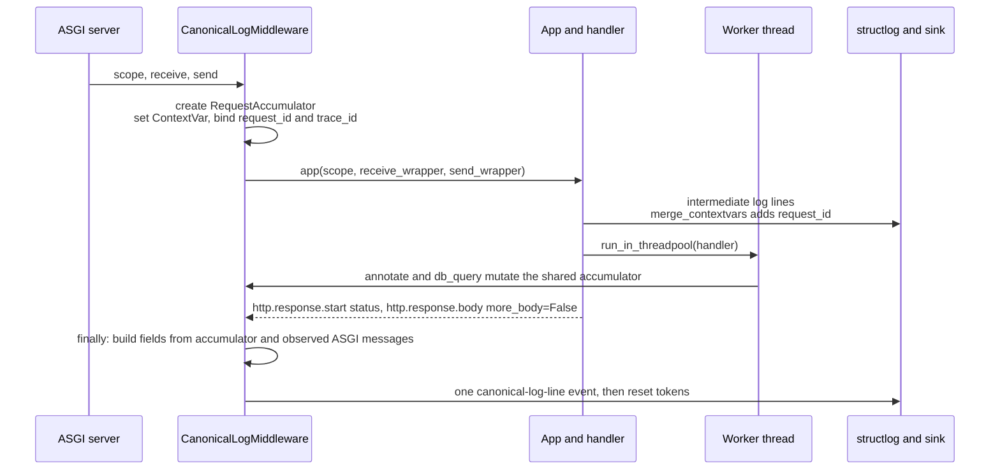

# Structured JSON Logging with structlog (26.1.0) and Canonical Log Lines: Emitting One Rich Summary Event Per HTTP Request

> [!summary] Claim
> Emit exactly one wide JSON event per request from a `finally` block in pure ASGI middleware, accumulate its fields in a mutable object held by one `ContextVar` (never by repeated `ContextVar.set` calls), and the line survives threadpool handlers, exceptions, streaming, and failing log sinks, so any production question becomes one query over one row per request.

Part of [Observability Profiling and Operations](README.md) in [API Engineering](../README.md).

## TL;DR

- Mechanism: pure ASGI middleware creates a `RequestAccumulator`, stores it in one `ContextVar`, binds `request_id` and `trace_id` with `structlog.contextvars`, and emits the canonical event from `finally` after the last response byte or the failure.
- Contract rule: the schema is stable and always present (`db_query_count` is `0`, not absent; `auth_user_id` is `null`, not absent), handlers cannot overwrite middleware-owned keys, and a failing sink must never fail the request.
- Trap: `bind_contextvars` called in a worker thread or a child task is invisible to the request task, so per-request counters kept as context variables silently read zero; mutate a shared object instead.
- Portability fact: the lab ran only on CPython 3.14.6 (37 tests passed); the contextvars semantics it relies on are PEP 567 semantics, and Uvicorn 0.54.0 drops `send` after a disconnect instead of raising `OSError`, so disconnect detection must also read `http.disconnect` from `receive`.
- Do not use it as a metrics system or an audit trail: it is a query tier between metrics and raw traces, lossy under sink failure, and not tamper-evident.

## Mental model



The server hands the middleware `scope`, `receive`, and `send`.
The middleware creates one mutable accumulator, stores it in a single `ContextVar`, and binds the two correlation ids into structlog's own context variables so every intermediate log line carries them.
The app runs behind wrapped `receive` and `send` callables that record status, byte counts, time to first byte, and disconnects without buffering anything.
A threadpool handler runs in a copied `Context`, but the copy still points at the same accumulator object, so its mutations reach the summary.
When the app returns or raises, the `finally` block merges the accumulator with the observed facts, writes one event, and only then resets the context variables.

## How it works

### The idea and what Stripe actually did

A canonical log line is one long line emitted at the end of a unit of work that collects its key telemetry in one place (Stripe blog, "Canonical log lines: one line per request per service").
Stripe's published example carries `alloc_count`, `auth_type`, `database_queries`, `duration`, `http_method`, `http_path`, `http_status`, `key_id`, `permissions_used`, `rate_allowed`, `rate_quota`, `rate_remaining`, `request_id`, `team`, and `user_id` in one `key=value` line (the Stripe post calls such `key=value` pairs "sometimes called logfmt", and Brandur's write-up says the line is "probably in logfmt").
The motivating question is cross-line: "which users are being rate limited the most" needs the rate-limit decision and the user id, which live on different lines in a classic trace, so a query must first collate by request id and scan far more data.
With one line the query is a single filter and group, and the line is cheap for the logging system to retrieve because nothing is joined at query time.

Stripe's implementation is a middleware with a post-request step.
Modules that run during the request decorate the request environment, and the middleware extracts those fields when it finishes.
The hardening they describe is the part most reimplementations forget: the line is logged in a Ruby `ensure` block so it is emitted even when the stack is unwinding from an exception, and the logging statement sits in its own `begin`/`rescue` so a problem building the line never fails a request and notifies someone instead.
They also codified the field names as a protocol buffer, publish the serialized lines to Kafka, batch them to S3, and load them into Presto and Redshift, and the schema stability is why the Developer Dashboard charts can be generated from the same archive.
Brandur's earlier write-up of the same Stripe practice places the line as a middle tier between metrics (fast, fixed questions) and raw traces (flexible, noisy), says the real-time store (Splunk) is expensive enough that operations teams prune raw traces to stay under quota, that warehouse canonical lines are pruned after 90 days, and tags every line with a request id so it can be joined to the raw trace.
The structlog documentation names this pattern in its logging best practices page and says its incremental binding plus context-local loggers can reduce output to a single entry per request (structlog 26.1.0 docs/logging-best-practices.md, "Canonical log lines").

### structlog's event pipeline

A structlog logger is an immutable context carrier plus a processor chain (structlog 26.1.0 structlog/_base.py, `BoundLoggerBase`).
`bind` returns a new logger whose context is a copy extended with the new values.
A log call runs `_process_event`: copy the bound context into a dict, update it with the call's keyword arguments, set `event` to the positional message, then pass the dict through every processor in order (structlog 26.1.0 structlog/_base.py, `BoundLoggerBase._process_event`).
The last processor must return a `str`, `bytes`, `bytearray`, a `(args, kwargs)` tuple, or a `dict`; anything else raises `ValueError`.
The renderer's return value becomes the argument of the wrapped logger's method named after the level (`_proxy_to_logger`), and raising `structlog.DropEvent` anywhere in the chain silently discards the event.

The lab chain is `merge_contextvars`, `add_log_level`, `TimeStamper(fmt="iso", utc=True)`, then `JSONRenderer(sort_keys=True)`.
Order matters because each processor sees the previous one's output.
`TimeStamper` with `fmt="iso"` and `utc=True` calls `datetime.now(tz=utc).isoformat()` and replaces `+00:00` with `Z` (structlog 26.1.0 structlog/processors.py, `_make_stamper`), which is why the lab asserts the timestamp ends in `Z`.
`JSONRenderer` calls `serializer(event_dict, **dumps_kw)` with `json.dumps` as the default serializer and installs `_json_fallback_handler` as `default` unless you pass your own (structlog 26.1.0 structlog/processors.py, `JSONRenderer`).
That fallback tries `obj.__structlog__()` and otherwise returns `repr(obj)`, so a value the JSON encoder cannot handle does not raise, it becomes a string (see Pitfalls).

`make_filtering_bound_logger(min_level)` returns a pre-built class in which every method below `min_level` is a function that only returns `None`; the level cannot change after construction (structlog 26.1.0 structlog/_native.py, `make_filtering_bound_logger` and `_make_filtering_bound_logger`).
Its `exception` method is `error` with `exc_info=True` defaulted.
Its async variants (`ainfo`, `aerror`) capture the calling thread and frame, copy the current context, and run the whole processor chain with `loop.run_in_executor(None, ...)`, so each async log call costs a thread hop (structlog 26.1.0 structlog/_native.py, `ameth`); the performance guide says moving log processing into threads "comes with a performance cost" and that it "might not be worth it" when the processor chain has good, predictable performance without external dependencies (docs/performance.md).
The 26.1.0 release notes add one fix here: `CallsiteParameterAdder` now reports the calling thread's id and name for async methods instead of the executor thread (CHANGELOG 26.1.0, "Fixed").

The output side is `WriteLogger(sink)`.
Its `msg` takes a per-file lock (a `threading.Lock` kept in the module-level `WeakKeyDictionary` `WRITE_LOCKS`), writes `message + "\n"`, and flushes, so structlog output loggers sharing one file object cannot interleave bytes within a line (other writers to the same file, such as `print`, do not take that lock), and every event costs a flush (structlog 26.1.0 structlog/_output.py, `WriteLogger.msg` and `_get_lock_for_file`).
26.1.0 changed the output loggers to hold weak references to their files (CHANGELOG 26.1.0, "Fixed").
`BytesLoggerFactory` exists for serializers that return `bytes`, such as `orjson`, to avoid an encode step (docs/performance.md).

### Context-local binding: what `structlog.contextvars` really stores

Since 21.1.0 each key is its own `ContextVar` named `structlog_<key>` with default `Ellipsis`, kept in a module-level registry `_CONTEXT_VARS`; the module comment cites pull request 302 for isolation (structlog 26.1.0 structlog/contextvars.py, `bind_contextvars`).
`bind_contextvars(**kw)` creates the variable on first use, calls `var.set(v)`, and returns a mapping of `contextvars.Token` objects that `reset_contextvars(**tokens)` can undo.
`merge_contextvars` copies the whole current `Context`, scans every variable in it for the `structlog_` prefix, skips values that are `Ellipsis`, and uses `event_dict.setdefault`, so a value bound on the logger or passed to the call wins over a context variable (structlog 26.1.0 structlog/contextvars.py, `merge_contextvars`).
`clear_contextvars` does not delete anything: it sets every `structlog_` variable in the current context to `Ellipsis`.
`unbind_contextvars` does the same for named keys, and `bound_contextvars` is a context manager that saves previous values, binds, and on exit unbinds and rebinds the saved ones.
Two consequences matter operationally.
First, `merge_contextvars` and `get_contextvars` iterate every context variable in the `Context`, not only structlog's, so their cost grows with whatever else the stack (tracing, auth, locale) has placed in the context; this is read from the code and not measured here.
Second, `_CONTEXT_VARS` only grows: a key name that comes from user input leaks one `ContextVar` per distinct name for the life of the process.

The structlog docs carry an explicit warning: context variables set in a synchronous context do not appear in logs from an async context and vice versa, which bites hybrid Starlette and FastAPI apps (structlog 26.1.0 docs/contextvars.md, warning box).
This is PEP 567 doing its job, not a structlog bug.
`copy_context()` returns a shallow copy of the current `Context`, and `Context.run` makes that copy current, so a `ContextVar.set` inside the run mutates the copy only (PEP 567, Specification).
AnyIO's `run_sync_in_worker_thread` calls `copy_context()` before queueing the function, and the worker thread runs it as `context.run(func, *args)` (anyio 4.16.0 anyio/_backends/_asyncio.py, `AsyncIOBackend.run_sync_in_worker_thread` and `WorkerThread.run`); Starlette's `run_in_threadpool` is `anyio.to_thread.run_sync` on a `functools.partial` (starlette 1.10.0 starlette/concurrency.py, `run_in_threadpool`).
So a synchronous endpoint sees the request's context variables (it reads the copy) but cannot change what the request task sees.
The lab proves the direction that matters: a `bind_contextvars(bound_in_thread=1)` inside `run_in_threadpool` is visible inside the worker and absent from `get_contextvars()` afterwards.

The fix used here is to put one mutable object in the context variable.
A copied `Context` copies references, so the copy and the original point at the same `RequestAccumulator`, and `annotate(...)` from any thread or child task mutates the one that the middleware reads in `finally`.
The accumulator guards its fields with a `threading.Lock` because threadpool handlers mutate it from several OS threads; a read-modify-write such as `+=` is not atomic even under the GIL, and a free-threaded build removes the GIL altogether.

### Where the middleware sits and what it can see

Starlette builds its stack as `ServerErrorMiddleware`, then the optional body-limit middleware, then `user_middleware`, then `ExceptionMiddleware`, then the router (starlette 1.10.0 starlette/applications.py, `Starlette.build_middleware_stack`).
Consequences for the line:

- `HTTPException` and registered exception handlers run in `ExceptionMiddleware`, which is inside user middleware, so a `404` or `422` response passes through the wrapped `send` and its status is observed, not inferred.
- An unhandled `Exception` propagates out through user middleware to `ServerErrorMiddleware`, which builds the `500` response itself, sends it only if no `http.response.start` was sent, and then re-raises (starlette 1.10.0 starlette/middleware/errors.py, `ServerErrorMiddleware.__call__`).
  The user middleware therefore never observes that `500`; the lab records `http_status=500` with `status_inferred=true` and `outcome="exception"`.
- If the exception happens after `http.response.start` (for example a streaming generator that fails), the real status is already on the wire.
  The line keeps the sent status (the lab test sees `200`), sets `status_inferred=false` and `outcome="exception"`, and counts only the bytes actually sent.
  This is the case where a status-code alert reports success while the response was truncated, and the `outcome` field is what exposes it.
- `scope["route"]` is set by the router when a route fully or partially matches (starlette 1.10.0 starlette/routing.py, `Router.app`), and `Route.path` holds the path template.
  Reading it after the app has run gives a low-cardinality `http_route` such as `/echo/{i:int}`, while `http_path` carries the raw path.
  Always group by route, never by path, or every id becomes a series.

Pure ASGI is the right form because `BaseHTTPMiddleware` runs the inner app in a separate task fed through memory streams (starlette 1.10.0 starlette/middleware/base.py, `BaseHTTPMiddleware.__call__`, `call_next`).
The lab confirms the consequence: with a `BaseHTTPMiddleware` inside, a plain `ContextVar.set` in the endpoint was invisible to an outer layer after the call, while with no such layer it was visible, and the accumulator still received the endpoint's `db_query` either way.
See [[Why-BaseHTTPMiddleware-Hurts-Performance-Streaming-and-ContextVars]], [[Pure-ASGI-Middleware-Onion-Architecture-and-Send-Receive-Wrapping]], and [[ASGI-State-Isolation-and-ContextVars-Across-Request-Lifecycle]] for the full mechanics.

### Completion, disconnects, and cancellation

The HTTP ASGI spec defines the response in two message types: `http.response.start` with `status` and `headers`, then `http.response.body` messages whose `more_body` defaults to `False`; the final one with `more_body` false completes the response unless the server is expecting response trailers (ASGI HTTP spec 2.5, "Response Start - send event" and "Response Body - send event").
The wrapped `send` records the status and time to first byte at `http.response.start`, adds `len(body)` of every body message, and marks the response complete only after the final body message was handed to the server without raising.
Duration is measured at the end of the whole call, so for a streaming response `duration_ms` covers the stream while `ttfb_ms` covers only the wait for the first byte; the lab test pins both with an injected clock (`ttfb_ms == 10.0`, `duration_ms == 50.0`).

Client disconnects have three observable forms and none is universal.
The spec says `send()` on a closed connection "should" raise a server-specific `OSError` subclass but not guaranteed, and the behavior was introduced in spec version 2.4 (ASGI HTTP spec, "Disconnected Client - send exception").
The spec's disconnect event, `http.disconnect`, is delivered to `receive()` "if receive is called after a response has been sent or after the HTTP connection has been closed" (ASGI HTTP spec, "Disconnect - receive event"), so an `http.disconnect` after a completed response is what the spec itself prescribes, not a server quirk.
Uvicorn 0.54.0 shows both halves of the caveat in its source: `RequestResponseCycle.send` returns silently when `self.disconnected` is set, in both the h11 and httptools implementations, so the `OSError` path is never taken there; and `RequestResponseCycle.receive` returns `{"type": "http.disconnect"}` when `self.disconnected or self.response_complete` (uvicorn 0.54.0 uvicorn/protocols/http/h11_impl.py and httptools_impl.py, `RequestResponseCycle.send` and `receive`).
So a naive "saw `http.disconnect` therefore the client left" is wrong after a completed response, which is why the lab only counts `http.disconnect` as a client disconnect when the response was not yet complete.
It also means that under Uvicorn a disconnect is only noticed if the app calls `receive` (Starlette's streaming responses do) and that an app that sends into a closed connection produces a normal-looking `completed` line; the `client_disconnected` field is best effort, not a guarantee.

Cancellation raises `asyncio.CancelledError`, a `BaseException`, through the app.
The middleware catches `BaseException`, records it, re-raises, and the `finally` block still emits; the lab classifies it as `outcome="cancelled"` with no `error_class`, because cancellation is the server's mechanism, not an application fault.

### Correlation ids and W3C Trace Context

The middleware binds `request_id` and `trace_id` before the app runs, so intermediate lines and the canonical line share them.
`request_id` is taken from `X-Request-ID` only when exactly one header matches `[A-Za-z0-9._-]{1,64}`; otherwise a fresh one is minted.
`trace_id` comes from `traceparent` under the W3C rules.
Version `00` has the grammar `trace-id "-" parent-id "-" trace-flags` with a 32 lowercase hex `trace-id`, a 16 lowercase hex `parent-id`, and a 2 hex `trace-flags`; all-zero `trace-id` or `parent-id` are invalid and a vendor "MUST ignore the traceparent" (W3C Trace Context Section 3.2.2.2, Section 3.2.2.3, Section 3.2.2.4).
Version `ff` is forbidden (W3C Trace Context Section 3.2.2.1).
For a version above `00` the spec says to try parsing, require a header of at least 55 characters, check the hex fields and the dashes, require that the flags end the string or are followed by `-`, and not assume anything about unknown fields (W3C Trace Context Section 3.2.4).
`parse_traceparent` implements those rules, slightly stricter than Section 3.2.4 asks for higher versions (it requires lowercase hex and rejects all-zero ids in every version), and returns `None`, which restarts the trace with a fresh id.
The lab also ignores the header when it appears more than once; that is a choice of this lab, not a spec citation.
The `sampled` bit is bit 0 of `trace-flags` (W3C Trace Context Section 3.2.2.5.1) and is kept as `trace_sampled`, which tells the on-call engineer whether the trace id will resolve in the tracing backend at all; see [[Trace-Sampling-Strategies-Head-Based-vs-Tail-Based-Sampling]] and [[Distributed-Tracing-W3C-Trace-Context-and-Baggage-Propagation]].
In a service that already runs OpenTelemetry instrumentation, read the active span instead of the header: `opentelemetry.trace.get_current_span().get_span_context().trace_id` formatted with `opentelemetry.trace.span.format_trace_id` is the id the tracing backend knows (opentelemetry-api 1.45.2 opentelemetry/trace/span.py, `format_trace_id`).
That wiring is not exercised by this lab.

### Schema discipline

The value of the line is the query you can write at 03:00, so the schema is an interface.

- Always emit the same keys.
  `db_query_count` and `db_duration_ms` are `0` and `0.0` when no query ran, and `auth_user_id` and `rate_limit_remaining` are `null` when unknown, so `db_query_count > 50` and `auth_user_id is null` are total predicates rather than ones that silently skip rows.
- Reserve middleware-owned keys.
  `RESERVED_KEYS` lists 23 names that handlers cannot set; an attempted write is counted in `fields_dropped`, not applied and not raised, so a buggy handler cannot forge `http_status` or `request_id`, and the counter makes the attempt queryable.
- Bound the line.
  The accumulator caps the number of keys at 64 (including the two built-ins) and each string value at 512 characters, and `user_agent` is cut at 256; excess is counted in `fields_dropped`.
  The cap covers `annotate` only: a key an async handler binds with `bind_contextvars` in the request task is merged into the canonical line by `merge_contextvars` with no cap (a verifier probe binding 100 keys of 1000 characters each produced one 122-key, 101,659-byte line on CPython 3.14.6), so forbid `bind_contextvars` in handlers or add a capping processor.
- Use units in names (`duration_ms`, `response_bytes`) and a fixed type per key.
  A key that is a number in one deploy and a string in the next breaks every typed warehouse column; Stripe's protobuf contract exists for this reason.
- Prefer the route template to the path and never log the query string by default, because it routinely carries tokens (see Security).

### What goes on the canonical line and what does not

One line per request per service is the unit.
Fields that answer incident questions belong: identity (`auth_user_id`), decision outcomes (`rate_limit_remaining`), cost (`db_query_count`, `db_duration_ms`, `response_bytes`), shape (`http_route`, `http_status`, `outcome`), timing (`duration_ms`, `ttfb_ms`), and correlation (`request_id`, `trace_id`, `trace_sampled`).
Full tracebacks do not: put `error_class` and a truncated `error_message` on the canonical line and log the traceback once as its own event with `format_exc_info` or `dict_tracebacks` (structlog 26.1.0 structlog/processors.py, `ExceptionRenderer`, `format_exc_info`, `dict_tracebacks`), joined by `request_id`.
Request and response bodies do not belong, and neither does anything that needs redaction logic to be safe; see [[Structured-Log-Redaction-and-Preventing-PII-and-Token-Leaks]].
Audit records with legal weight are a different artifact with different guarantees; see [[Audit-Logging-for-Regulated-APIs-Tamper-Evident-Hash-Chains-and-Who-Did-What]].

### How the line relates to metrics, traces, and SLOs

Metrics answer pre-registered questions cheaply and are what alerts should page on; the canonical line answers questions you thought of during the incident; traces answer "where did the time go inside this request".
You can compute per-request percentiles from lines, but you must not average per-pod percentiles; see [[Latency-Histograms-Percentiles-DDSketch-and-Why-Averaging-Percentiles-Is-Wrong]].
The RED labels you would put on a counter are exactly the low-cardinality keys of the line (`http_method`, `http_route`, `http_status`); see [[RED-and-USE-Metrics-and-OpenTelemetry-HTTP-Semantic-Conventions]].
An SLI computed from canonical lines needs the exclusion rules of [[SLIs-SLOs-Error-Budgets-and-Multi-Window-Burn-Rate-Alerting]]: client 4xx are not availability failures, and `outcome="client_disconnected"` needs an explicit decision.
During triage the canonical line is the first thing to query; see [[The-Sixty-Second-API-Incident-Triage-Playbook]] and, for CPU attribution that a line cannot give, [[Profiling-Python-API-Services-CPU-Wall-Clock-Async-Tasks-and-Memory]].

## Numbers and limits

| Quantity | Value | Source |
| --- | --- | --- |
| structlog release in the lab | 26.1.0, released 2026-06-06; Python 3.8 and 3.9 dropped; 3.15 support added | structlog CHANGELOG 26.1.0 (as of 2026-11) |
| structlog supported CPython | `Requires-Python: >=3.10`, classifiers 3.10 to 3.15 | installed `structlog-26.1.0.dist-info/METADATA` |
| structlog context variable name | one `ContextVar` per key, prefix `structlog_`, default `Ellipsis` | structlog 26.1.0 `structlog/contextvars.py` |
| `traceparent` version `00` length | 55 characters: 2 + 1 + 32 + 1 + 16 + 1 + 2 | W3C Trace Context Section 3.2.2.2, Section 3.2.4 |
| `trace-id` and `parent-id` | 32 and 16 lowercase hex characters, all zeros invalid | W3C Trace Context Section 3.2.2.3, Section 3.2.2.4 |
| Lab field cap | 64 keys per request, 512 characters per string value, 256 for `user_agent`, 64 for `x-request-id` | `canonical_log_lines.py` constants and defaults |
| Sample canonical line | 23 keys, 592 bytes of JSON plus a newline (varies by a few bytes with the digits of the timing fields; the drafter's run gave 591) | measured: `uv run --frozen pytest ... -q -rP`, CPython 3.14.6, macOS 27.3 arm64 (`uname -r` 27.3.0), 2026-11-21 |
| Lab test run | 37 passed in 0.42 s | same command and machine, verifier rerun |
| Daily volume at 1000 requests per second | 592 B x 1000 x 86400 s = 51,148,800,000 B, about 51 GB per day | arithmetic from the measured line size, not a measured throughput |
| Stripe retention of canonical lines in the warehouse | pruned after 90 days | brandur.org "Using Canonical Log Lines for Online Visibility" (Nov 2016) |

The volume row is the number that decides whether you can keep 100 percent of lines: a 592 byte line at that rate is the size of the retention conversation, and the lab line is typical of a small schema, not an upper bound.
Latency overhead per request was not measured here; do not quote one.
Measure it with the method in [[Profiling-Python-API-Services-CPU-Wall-Clock-Async-Tasks-and-Memory]] before claiming a budget.

## Portability

| Dimension | Cell | Evidence |
| --- | --- | --- |
| CPython 3.14.6 (workspace venv) | 37 passed | ran by drafter and rerun by verifier: `uv run --frozen pytest <test> -q -rP`, macOS 27.3 arm64, 2026-11-21 |
| CPython 3.12.16, 3.13.18, 3.14.10, 3.15.2, 3.15.2t | not run: lab checks were paused by the user's instruction of 2026-11-11 | no claim; structlog 26.1.0 METADATA lists classifiers 3.10 to 3.15 |
| Debian Trixie and Alpine musl containers | not run, same pause | no claim |
| `ContextVar` and `Context.run` semantics | identical contract on every supported CPython | PEP 567 Specification |
| Free-threaded build | not run; the accumulator uses `threading.Lock` for every mutation so counters do not depend on the GIL | design, unproven here |
| structlog 21.1.0 and later | per-key `ContextVar` implementation; 23.3.0 added async callsite collection | docstring of `structlog/contextvars.py` |
| Uvicorn 0.54.0, h11 and httptools | `send` after disconnect returns without raising; `receive` returns `http.disconnect` after disconnect or response completion | source read: `RequestResponseCycle.send` and `receive` |
| Hypercorn 0.18.0 | on `StreamClosed` (also after a normal completion on the h11 path, see below) it puts `{"type": "http.disconnect"}` on the app queue; a later `http.response.body` is not rejected by `HTTPStream.app_send` (the state stays `RESPONSE`), and the transport swallows the write failure, so `send` does not raise `OSError`; the h11 path re-raises only a `LocalProtocolError` raised while the peer is not in the `ERROR` state | source read: hypercorn 0.18.0 `hypercorn/protocol/http_stream.py` (`HTTPStream.handle` line 127, `app_send`), `hypercorn/protocol/h11.py` (`_send_h11_event` line 248), `hypercorn/asyncio/tcp_server.py` (`TCPServer.protocol_send` catches `ConnectionError` and `RuntimeError`); not run |
| Granian 2.8.7 | `receive` returns `http.disconnect` once the request side is closed or the response has finished (it waits on the response-finished or disconnect signal); `send` on a closed body channel logs `ASGI transport error` at info level (suppressed if the disconnect was already seen) and returns an empty future, so no `OSError`; its only `send` errors are `RuntimeError` flow errors such as "Response already started" | source read at tag v2.8.7: `src/asgi/io.rs` (`ASGIHTTPProtocol.receive`, `send_body`) and `src/asgi/errors.rs` (`ASGIFlowError` converts to `PyRuntimeError`); the compiled `_granian` module was not run |
| HTTP/1.1, HTTP/2, HTTP/3 | the middleware sees ASGI messages only, so framing is the server's job; ASGI HTTP spec 2.5 says it transports HTTP/1.1, HTTP/2, and HTTP/3 and defines `http_version` as one of `"1.0"`, `"1.1"`, `"2"`, or `"3"`; Hypercorn runs the same `HTTPStream` class under its h11, h2, and h3 protocol classes | ASGI HTTP spec (fetched 2026-11-21); `hypercorn/protocol/h11.py`, `h2.py`, `h3.py` import `HTTPStream`; no request was run over HTTP/2 or HTTP/3 here |
| Starlette 1.10.0 | `Route.path` template and `scope["route"]` as described; user middleware sits inside `ServerErrorMiddleware` | source read, plus the inferred-500 test on 3.14.6 |

All three servers therefore agree on the fact the lab relies on most, from source and not from a run: `send` into a closed connection does not raise `OSError`.
Uvicorn and Granian also answer `receive` with `http.disconnect` once the response has completed.
Hypercorn's h11 path does the same by a different route: after a normal completion `_send_closed` sends `StreamClosed`, `_maybe_recycle` calls `_close_stream`, and `_close_stream` calls `stream.handle(StreamClosed)`, which pushes `http.disconnect` on the app queue (hypercorn 0.18.0 `hypercorn/protocol/h11.py` lines 271 and 291, `http_stream.py` line 127); the h2 and h3 paths were not traced to that point.

## Worked example

Implementation: [implementation](../labs/src/api_labs/f18_observability_profiling_and_operations/canonical_log_lines.py).
Test: [test](../labs/tests/f18_observability_profiling_and_operations/test_structured_logging_with_structlog_and_stripe_canonical_log_lines.py).

The accumulator and the helpers handlers call (simplified excerpt; docstrings, `snapshot`, `current_accumulator`, and the `truncate` helper trimmed):

```python
class RequestAccumulator:
    def __init__(self, *, max_fields: int = 64, max_value_chars: int = 512) -> None:
        self._lock = threading.Lock()
        self._fields: dict[str, Any] = {"auth_user_id": None, "rate_limit_remaining": None}
        self._db_query_count = 0
        self._db_duration_ms = 0.0
        self._dropped = 0
        self._max_fields = max_fields
        self._max_value_chars = max_value_chars

    def set(self, **fields: Any) -> None:
        with self._lock:
            for key, value in fields.items():
                over_cap = key not in self._fields and len(self._fields) >= self._max_fields
                if key in RESERVED_KEYS or over_cap:
                    self._dropped += 1
                else:
                    self._fields[key] = truncate(value, self._max_value_chars)

    def add_db_query(self, duration_ms: float) -> None:
        with self._lock:
            self._db_query_count += 1
            self._db_duration_ms += duration_ms


_CURRENT: contextvars.ContextVar[RequestAccumulator | None] = contextvars.ContextVar(
    "api_labs_canonical_line", default=None
)


def annotate(**fields: Any) -> None:
    accumulator = _CURRENT.get()
    if accumulator is not None:
        accumulator.set(**fields)
```

The middleware core (simplified excerpt; the `_emit` and `_build_fields` bodies are in the implementation file):

```python
        started = self.clock()
        request_id = self._request_id(scope)
        trace_id, trace_sampled = self._trace_context(scope)
        accumulator = RequestAccumulator()
        state = _RequestState()
        accumulator_token = _CURRENT.set(accumulator)
        log_tokens = bind_contextvars(request_id=request_id, trace_id=trace_id)

        async def receive_wrapper() -> Message:
            message = await receive()
            if message["type"] == "http.request":
                state.request_bytes += len(message.get("body", b""))
            elif message["type"] == "http.disconnect" and not state.response_complete:
                # Servers also report http.disconnect once the response is complete.
                state.client_disconnected = True
            return message

        async def send_wrapper(message: Message) -> None:
            if message["type"] == "http.response.start" and state.status is None:
                state.status = int(message["status"])
                state.ttfb = self.clock() - started
            try:
                await send(message)
            except OSError:
                # ASGI: send() on a closed connection raises an OSError subclass.
                state.client_disconnected = True
                raise
            if message["type"] == "http.response.body":
                state.response_bytes += len(message.get("body", b""))
                if not message.get("more_body", False):
                    state.response_complete = True

        try:
            await self.app(scope, receive_wrapper, send_wrapper)
        except BaseException as exc:
            state.error = exc
            raise
        finally:
            self._emit(
                scope,
                accumulator,
                state,
                request_id=request_id,
                trace_id=trace_id,
                trace_sampled=trace_sampled,
                duration=self.clock() - started,
            )
            reset_contextvars(**log_tokens)
            _CURRENT.reset(accumulator_token)
```

`_emit` wraps the whole build-and-write in `try`/`except Exception`, increments `emit_failures`, and reports through the standard library logger `api_labs.canonical_log_lines`, so a broken sink loses one line and fails no request.
The test file collects 37 test items (parametrized cases counted separately).
The ones that carry the claims of this note:

- `test_one_canonical_line_per_request_with_accumulated_fields`: one intermediate line then exactly one canonical line, both with the same `request_id` and `trace_id`, with `db_query_count == 2`.
- `test_threadpool_handler_mutations_reach_the_line` and `test_structlog_bind_contextvars_in_a_thread_is_invisible_to_the_caller`: the accumulator works from a worker thread, a context-variable bind from the same thread does not.
- `test_concurrent_requests_keep_their_own_fields`: 25 interleaved requests, each line keeps its own `auth_user_id` and query count.
- `test_unhandled_exception_emits_one_inferred_500_line_and_still_raises` and `test_exception_after_response_start_keeps_the_sent_status`: the two exception shapes.
- `test_streaming_line_is_emitted_after_the_last_chunk_with_exact_timings`: an ordered journal shows the log write comes after the final `more_body=False` send, and an injected clock pins `ttfb_ms` and `duration_ms`.
- `test_http_disconnect_only_counts_before_the_response_is_complete`, `test_send_oserror_is_a_client_disconnect_not_a_server_error`, `test_cancellation_emits_one_line_and_reraises`: the disconnect and cancellation classification.
- `test_failing_sink_never_fails_the_request`, `test_handlers_cannot_overwrite_reserved_keys_and_odd_values_are_visible`, `test_accumulator_caps_fields_and_truncates_values`, `test_log_injection_and_secrets_stay_out_of_the_line`: the robustness contract.
- `test_basehttpmiddleware_splits_context_but_the_accumulator_survives`: the `BaseHTTPMiddleware` context split.

Captured run, from `20-API-Engineering/labs/` on macOS 27.3 arm64 with the workspace CPython 3.14.6, 2026-11-21 (the sample line is the `print` in the first test, shown by `-rP`; the traceback section of `test_failing_sink_never_fails_the_request` is elided):

```text
$ uv run --frozen pytest tests/f18_observability_profiling_and_operations/test_structured_logging_with_structlog_and_stripe_canonical_log_lines.py -q -rP
.....................................                                    [100%]
==================================== PASSES ====================================
_________ test_one_canonical_line_per_request_with_accumulated_fields __________
----------------------------- Captured stdout call -----------------------------
{"auth_user_id": "usr_123", "client_disconnected": false, "db_duration_ms": 0.047, "db_query_count": 2, "duration_ms": 0.311, "event": "canonical-log-line", "fields_dropped": 0, "http_method": "GET", "http_path": "/ok", "http_route": "/ok", "http_status": 200, "level": "info", "outcome": "completed", "rate_limit_remaining": 99, "request_bytes": 0, "request_id": "req-abc", "response_bytes": 11, "status_inferred": false, "timestamp": "2026-11-22T02:26:52.584291Z", "trace_id": "0af7651916cd43dd8448eb211c80319c", "trace_sampled": true, "ttfb_ms": 0.304, "user_agent": "python-httpx/0.28.1"}
canonical line bytes: 592
...
37 passed in 0.42s
```

The drafter's first run had one failing test (the `BaseHTTPMiddleware` one) because of a bug in the test, not the library: the direct endpoint runs in the caller's task, so its `ContextVar.set` leaked into the next case; the fix runs each case in its own task.
The run shown above is the verifier's rerun, made after the drafter's final import-order lint fix to the implementation file; the timestamp is UTC.

## Pitfalls

> [!warning] Per-request counters stored with `bind_contextvars` read zero from threads and child tasks
> Trigger: a sync endpoint or a `create_task` child calls `bind_contextvars(db_query_count=...)`, or increments a value read back through `get_contextvars()`.
> Symptom: the canonical line shows `db_query_count: 0` for exactly the endpoints that run in `run_in_threadpool`, while the intermediate log lines from the same handler look fine.
> Fix: bind only the immutable correlation ids with `bind_contextvars`; accumulate counters in a mutable object held by one `ContextVar` set by the middleware.
> The lab test `test_structlog_bind_contextvars_in_a_thread_is_invisible_to_the_caller` demonstrates the cause; the structlog docs carry the same warning for Starlette and FastAPI (docs/contextvars.md).

> [!warning] Emitting after `await self.app(...)` without `finally` drops the lines you need most
> Trigger: `await self.app(scope, receive, send); log(...)`.
> Symptom: error-rate queries over the lines show fewer `5xx` than the load balancer, because an unhandled exception skips the log call; the line also never appears for cancelled requests.
> Fix: emit in `finally`, record the exception in an `except BaseException` that re-raises, and infer `500` when no `http.response.start` was seen, since `ServerErrorMiddleware` sends that response outside your layer.
> Stripe describes the same hardening, using a Ruby `ensure` block (Stripe blog, "Implementation in middleware and beyond").

> [!warning] A logging failure that fails the request
> Trigger: the sink raises (`OSError` on a full disk, a closed pipe, an unserializable value with a custom `default`), and the exception escapes the `finally` block.
> Symptom: user requests turn into `500` and the new exception replaces the handler's original one in the traceback.
> Fix: wrap emission in its own `try`/`except Exception`, count `emit_failures`, and report through a second channel; Stripe wraps the logging statement in its own `begin`/`rescue` and notifies on failure (Stripe blog, same section).
> The lab test `test_failing_sink_never_fails_the_request` asserts a `200`, one counted failure, and one fallback record.

> [!warning] `JSONRenderer` turns unknown types into `repr()` strings
> Trigger: `annotate(amount=Decimal("1.50"))`, a `UUID`, a `datetime`, an enum, or a Pydantic model that is not JSON-native.
> Symptom: the line contains `"amount": "Decimal('1.50')"`; the warehouse column is a string, sums fail, and nothing raised.
> Fix: convert at the call site to JSON-native types, or pass a `serializer` such as `orjson.dumps` that handles the types you use, or define `__structlog__` on your own types; passing your own `default` disables `__structlog__` support (structlog 26.1.0 `JSONRenderer` docstring).
> The lab test `test_handlers_cannot_overwrite_reserved_keys_and_odd_values_are_visible` shows the `Decimal` case.

> [!warning] `http.disconnect` after a completed response is not a client disconnect
> Trigger: counting every `http.disconnect` seen on `receive` as `client_disconnected`.
> Symptom: every request whose app calls `receive` after finishing is flagged as a disconnect, because the ASGI spec says `http.disconnect` is sent once a response has been sent, and Uvicorn does exactly that (uvicorn 0.54.0 uvicorn/protocols/http/h11_impl.py, `RequestResponseCycle.receive`).
> Fix: count it only while the response is incomplete, as the lab does, and document that the field is best effort because Uvicorn drops `send` after a disconnect instead of raising.

> [!warning] Dynamic key names and the context-variable registry
> Trigger: `bind_contextvars(**{user_supplied_name: value})` or per-tenant key names.
> Symptom: memory growth, because structlog creates one `ContextVar` per distinct key and keeps it in `_CONTEXT_VARS` forever (structlog 26.1.0 `structlog/contextvars.py`).
> Fix: use a fixed key set and put variable data in values.

> [!warning] Context variables set by handlers behind `BaseHTTPMiddleware` are invisible outside it
> Trigger: relying on a context variable set by a handler to be visible in a middleware that wraps `BaseHTTPMiddleware`.
> Symptom: the value is missing in the outer layer even though the handler set it, because the inner app ran in a separate task.
> Fix: use the shared accumulator object; the lab test shows it still receives the query count through a `BaseHTTPMiddleware` layer.

> [!warning] Reset order and a mismatched context
> Trigger: `reset_contextvars` or `ContextVar.reset` called from a different `Context` than the one that set the token raises `ValueError` (PEP 567, `ContextVar.reset`).
> Symptom: an exception from the `finally` block, which also skips the remaining resets.
> Fix: keep set and reset in the same coroutine, as the middleware does.
> The lab does not guard the resets against this; a hardened version would wrap them in `contextlib.suppress(ValueError)` and count it.

## Security and robustness

- Log injection (CWE-117, "Improper Output Neutralization for Logs": a log message built from external input without neutralizing special elements, also called log forging): a path or header containing a newline can forge a second line in a line-oriented format.
  JSON encoding escapes control characters, so the lab test with a newline and a forged `{"event": "forged"}` in the path produces exactly one physical line and the path round-trips through `json.loads`.
  If you switch to `logfmt` or `KeyValueRenderer`, you lose that property and must escape.
- Secrets (CWE-532, "Insertion of Sensitive Information into Log File"): the line never records the `Authorization` header, cookies, bodies, or the query string.
  The lab test sends `Bearer EXAMPLE-NOT-A-REAL-TOKEN` and `api_key=EXAMPLE-NOT-A-REAL-KEY` and asserts neither appears in the output.
  Allow-list the fields you log; a deny-list always misses the next secret.
  Redaction mechanics are in [[Structured-Log-Redaction-and-Preventing-PII-and-Token-Leaks]].
- Personal data: `auth_user_id` and any client address are personal data in many jurisdictions, and Stripe-style long retention multiplies that; pick pseudonymous ids and a retention window deliberately.
- Attacker-controlled sizes: every string that came from the request is truncated (`user_agent` at 256, annotated values at 512, `error_message` at 512), the key count is capped at 64, and request ids that do not match `[A-Za-z0-9._-]{1,64}` are replaced, so one request cannot produce an unbounded line through `annotate` or the request metadata.
  Keys bound with `bind_contextvars` inside the request task bypass the cap (see Schema discipline), so that path needs its own rule.
- Trace-context abuse: the W3C spec warns that naively continuing every trace with the sampled flag set on a public API lets an attacker inflate tracing overhead and forge `trace-id` collisions (W3C Trace Context Section 7.2).
  Logging the inbound `trace_id` is not the same as honoring its sampling decision, but treat the id as untrusted in anything security-relevant, and consider restarting traces at the public edge.
- Authorization and API abuse: log the authorization decision outcome (`auth_user_id`, a `permissions_used`-style field) so BOLA and BFLA probing shows up as a query; see [[Defeating-BOLA-API1-2023-Tenant-Scoped-Queries-and-PostgreSQL-RLS]] and [[OWASP-API-Security-Top-10-2023-Complete-Threat-Model]].
- Availability of the logging path: a synchronous `WriteLogger` takes a lock, writes, and flushes per event (structlog 26.1.0 structlog/_output.py, `WriteLogger.msg`), and `pipe(7)` says a `write(2)` to a full pipe blocks until the reader drains it unless `O_NONBLOCK` is set, so a stalled stdout pipe stalls the event loop thread that is emitting; this is a conclusion from those two sources and was not reproduced here.
  Route stdout to a collector with its own buffering, and prefer dropping to blocking if the pipe backs up.
- Failure visibility: `emit_failures` and `fields_dropped` are the two counters that tell you the line is lying by omission; export them as metrics, because a canonical line that fails quietly is the worst case Stripe's "flying blind" remark describes.

## The principal's view

The decision is to make the canonical line the primary request record and to treat its schema as a versioned product interface, not a logging detail.
That means an owner, a protobuf or JSON Schema contract, a change process, and a deprecation window, because dashboards, warehouse tables, SLI queries, and the on-call runbook all depend on field names, exactly as Stripe's Developer Dashboard depends on its protobuf.

Choices and their costs:

- One line per request per service gives a join-free query surface, at the cost of a wide record whose size is bounded only by discipline.
  Enforce the cap in the library, not in code review.
- Emit from one middleware that owns the lifecycle, with a tiny `annotate` API for the rest of the code, rather than letting every module log its own summary.
  The cost is a single module that everyone depends on; the benefit is that the hard parts (exceptions, cancellation, disconnects, sink failure) are solved once.
- Keep 100 percent of canonical lines and sample the verbose intermediate logs, not the reverse; the canonical line is the cheap, high-value one, and a sampled canonical line makes rate and error queries wrong in the same way averaged percentiles are wrong.
  If volume forces a choice, drop by outcome (keep all `5xx`, slow, and rare routes; sample boring `200`s) and record the sample rate on each line so queries can reweight.
- Metrics still page; lines explain.
  Do not build alerting on log queries when a counter would do, because logs depend on a pipeline with ingestion delay and loss modes.
- Choose a different tool when you need per-span timing inside a request (traces), tamper evidence (an audit log with hash chaining), or sub-second aggregation across a fleet (metrics with histograms).
- Organizationally, a shared middleware package pinned by every service, plus a lint that rejects a second `log.info` per request in hot paths, is cheaper than a style guide.
  Standardize the field names across languages first; the Python implementation is the easy part.

## Interview questions

> [!question] L5: What is a canonical log line and why does it beat several log lines per request?
>
> > [!success]- Answer
> > It is one wide event emitted at the end of a request that carries the request's key telemetry (identity, route, status, timing, query counts, rate-limit state, correlation ids).
> > Questions that span facts, such as "which users are rate limited most", become one filter and one group-by instead of a join across lines on a request id.
> > It is cheaper for the log system to retrieve because nothing is collated at query time.
> > The cost is a wide record that needs a stable, bounded schema.
> >
> > Follow-up: What does it not replace?

> [!question] L5: Why does the lab emit the line from a `finally` block instead of after `await self.app(...)`?
>
> > [!success]- Answer
> > An unhandled exception, a cancellation, or a mid-stream failure skips code after the `await`.
> > Those are the requests you most need to see, so the line would be missing exactly when it matters.
> > `finally` also runs on `asyncio.CancelledError`, which is a `BaseException`.
> > The middleware records the error, re-raises it, and emits in `finally`.
> >
> > Follow-up: What status does the line carry when the exception escapes before any `http.response.start`?

> [!question] L5: Predict the output.
> ```python
> async def handler() -> None:
>     def worker() -> None:
>         bind_contextvars(a=1)
>
>     await run_in_threadpool(worker)
>     bind_contextvars(b=2)
>     log.info("x")
> ```
> With `merge_contextvars` first in the chain and a JSON renderer, what keys does the event contain besides `event`?
>
> > [!success]- Answer
> > Only `b`: the event is `{"b": 2, "event": "x"}` plus whatever the other processors add.
> > `run_in_threadpool` copies the current `Context` into the worker thread, so `bind_contextvars(a=1)` mutates the copy and the request task never sees it.
> > The lab test `test_structlog_bind_contextvars_in_a_thread_is_invisible_to_the_caller` checks that `get_contextvars()` is empty afterwards.
> >
> > Follow-up: How would you make a counter incremented in that worker visible to the request?

> [!question] L6: Debug this API: what is wrong and what is the fix?
>
> Error-rate dashboards built from canonical lines show fewer `5xx` than the load balancer, and the missing requests all raised exceptions.
> The middleware body is `await self.app(scope, receive, send)` followed by `self.log(...)`.
>
> > [!success]- Answer
> > An exception raised by the app propagates past the `await`, so the log call never runs for failed requests.
> > Starlette also places `ServerErrorMiddleware` outside user middleware, so the `500` response is produced above this layer and never passes through the wrapped `send`.
> > Fix: emit in `finally`, catch `BaseException` to record `error_class` and re-raise, and infer `http_status=500` with a `status_inferred` flag when no `http.response.start` was observed.
> > Verify with a test that raises in a handler and asserts exactly one line with `outcome="exception"`.
> >
> > Follow-up: What changes if the exception happens halfway through a streaming response?

> [!question] L6: Why store a mutable accumulator in the `ContextVar` instead of calling `ContextVar.set` for each counter?
>
> > [!success]- Answer
> > `ContextVar.set` changes only the current `Context`; threadpool work runs in a copy and child tasks start from a copy, so their `set` calls are invisible to the middleware that emits the line (PEP 567).
> > A copy of a `Context` is shallow, so a mutable object reachable from the variable is shared by every copy.
> > Mutations from any thread or task therefore reach the single object the middleware reads in `finally`.
> > The object needs a lock because worker threads mutate it concurrently, and on a free-threaded build nothing else protects the increments.
> >
> > Follow-up: What breaks if the accumulator is a module-level dict keyed by nothing instead of a `ContextVar`?

> [!question] L6: Where does `scope["route"]` come from and why do you log it instead of the path?
>
> > [!success]- Answer
> > The Starlette router sets `scope["route"]` to the matched route (full or partial match) before handing over to it, and `Route.path` is the template such as `/echo/{i:int}`.
> > The raw path contains ids, so grouping by it creates one series per id; the template has bounded cardinality.
> > Log both: the route for aggregation and the path for finding one request.
> > Read the route after the app has run, because it does not exist when the middleware starts.
> >
> > Follow-up: What do you get for a request that matches no route?

> [!question] L7+: Why does the line say `completed` under Uvicorn, and what would you change?
>
> A client closes the connection while a streaming response is in flight.
>
> > [!success]- Answer
> > The ASGI spec only says `send` "should" raise an `OSError` subclass after a disconnect and that this is not guaranteed.
> > Uvicorn 0.54.0 returns silently from `RequestResponseCycle.send` when `self.disconnected` is set, so the middleware sees no error and every later send "succeeds".
> > Disconnect is only visible through `http.disconnect` on `receive`, which Starlette's streaming responses poll, and Uvicorn also returns that event after a normal completion, so it must be gated on the response not being complete.
> > A more reliable signal is comparing bytes handed to `send` with the declared length, or taking the server's access log as the source of truth for bytes actually written.
> > Treat `client_disconnected` as best effort and say so in the schema documentation.
> > Reading Hypercorn 0.18.0 and Granian 2.8.7 shows the same shape: neither raises `OSError` from `send` into a closed connection, and both deliver `http.disconnect` after a completed response (see Portability).
> >
> > Follow-up: How would you prove Hypercorn and Granian behave this way over a real socket, including HTTP/2?

> [!question] L7+: How do you cut canonical-line volume by 80 percent without breaking rate and error analysis?
>
> > [!success]- Answer
> > Do not sample uniformly: a uniform sample is fine for proportions but wrong for counts unless every line carries its sample rate.
> > Keep every `5xx`, every slow request, every request on rare routes, and every line with a non-`completed` outcome; sample the high-volume boring `200`s.
> > Write the sampling probability on each kept line so queries can reweight counts, and keep the metrics path (counters and histograms) unsampled so alerts do not depend on the log pipeline.
> > Cut width before cutting rows: drop rarely queried fields and cap value sizes, because the roughly 590 byte lab line times 86,400 times the request rate is the real cost driver.
> > Archive the full-fidelity lines cheaply in a warehouse, as Stripe does, and keep only a short window in the expensive real-time store.
> >
> > Follow-up: How does this interact with head-based trace sampling at 1 percent?

> [!question] L7+: Design the contract that lets 40 services in three languages emit comparable canonical lines.
>
> > [!success]- Answer
> > Define the schema once in a neutral IDL (Stripe uses a protocol buffer) with required keys, units in names, fixed types, and a closed set of `outcome` values, and generate per-language bindings.
> > Ship the middleware as a pinned shared package per language so the hard parts (exceptions, cancellation, sink failure, caps) are implemented once.
> > Version the schema with additive-only changes inside a major version, and publish a deprecation window for removals, since dashboards and warehouse tables break on renames.
> > Test the contract in CI by running each service's middleware against a fixture and validating the emitted line against the schema.
> > Export `emit_failures` and `fields_dropped` as metrics per service so a service that silently stopped emitting is visible.
> >
> > Follow-up: Who owns a field that only one team populates?

## Related

Prerequisites: [[Trace-Sampling-Strategies-Head-Based-vs-Tail-Based-Sampling]]

Next: [[Latency-Histograms-Percentiles-DDSketch-and-Why-Averaging-Percentiles-Is-Wrong]]

See also: [[02-Programming-Languages/Python/Python-Backend-Interview-Prep/07-Auth-and-Security]], [[02-Programming-Languages/Python/Python-Backend-Interview-Prep/08-Microservices-and-Messaging]], [[RED-and-USE-Metrics-and-OpenTelemetry-HTTP-Semantic-Conventions]], [[Distributed-Tracing-W3C-Trace-Context-and-Baggage-Propagation]], [[SLIs-SLOs-Error-Budgets-and-Multi-Window-Burn-Rate-Alerting]], [[The-Sixty-Second-API-Incident-Triage-Playbook]], [[Audit-Logging-for-Regulated-APIs-Tamper-Evident-Hash-Chains-and-Who-Did-What]], [[Profiling-Python-API-Services-CPU-Wall-Clock-Async-Tasks-and-Memory]], [[Structured-Log-Redaction-and-Preventing-PII-and-Token-Leaks]], [[Why-BaseHTTPMiddleware-Hurts-Performance-Streaming-and-ContextVars]], [[Pure-ASGI-Middleware-Onion-Architecture-and-Send-Receive-Wrapping]], [[ASGI-State-Isolation-and-ContextVars-Across-Request-Lifecycle]], [[ASGI-HTTP-and-Disconnect-Event-Lifecycle]], [[Starlette-Exception-Hierarchy-ServerErrorMiddleware-vs-ExceptionMiddleware]]

- Lab: `labs/tests/f18_observability_profiling_and_operations/test_structured_logging_with_structlog_and_stripe_canonical_log_lines.py`

## Further reading

- [Stripe, "Canonical log lines: one line per request per service"](https://stripe.com/blog/canonical-log-lines): the fields, the `ensure` hardening, the protobuf contract, and the Kafka to S3 to warehouse path.
- [Brandur Leach, "Using Canonical Log Lines for Online Visibility"](https://brandur.org/canonical-log-lines): the original tiers argument (metrics, canonical lines, traces) and the Splunk versus warehouse trade-off.
- [structlog 26.1.0 CHANGELOG](https://raw.githubusercontent.com/hynek/structlog/26.1.0/CHANGELOG.md): what changed in the pinned release, including the weak file references and the async callsite fix.
- [structlog 26.1.0 docs/contextvars.md](https://raw.githubusercontent.com/hynek/structlog/26.1.0/docs/contextvars.md): the supported flow and the hybrid sync/async isolation warning.
- [structlog 26.1.0 docs/performance.md](https://raw.githubusercontent.com/hynek/structlog/26.1.0/docs/performance.md): the production configuration, `cache_logger_on_first_use` drawbacks, and the async cost.
- [structlog 26.1.0 docs/logging-best-practices.md](https://raw.githubusercontent.com/hynek/structlog/26.1.0/docs/logging-best-practices.md): log to stdout, the canonical log line pointer, and JSON in production.
- [PEP 567, Context Variables](https://peps.python.org/pep-0567/): `copy_context`, `Context.run`, and why a copied context shares object references.
- [ASGI HTTP and WebSocket message format](https://asgi.readthedocs.io/en/latest/specs/www.html): the response events, `http.disconnect`, and the disconnected-client `send` exception.
- [W3C Trace Context Recommendation](https://www.w3.org/TR/trace-context/): `traceparent` grammar, the version rules, and the denial-of-service considerations.
- [CWE-117, Improper Output Neutralization for Logs](https://cwe.mitre.org/data/definitions/117.html): the log forging weakness behind the newline test.
- [CWE-532, Insertion of Sensitive Information into Log File](https://cwe.mitre.org/data/definitions/532.html): the weakness behind the allow-list rule for fields.
- [Granian 2.8.7 src/asgi/io.rs](https://raw.githubusercontent.com/emmett-framework/granian/v2.8.7/src/asgi/io.rs): `receive` and `send_body` disconnect behavior.
- [pipe(7)](https://man7.org/linux/man-pages/man7/pipe.7.html): a write to a full pipe blocks, which is what a synchronous log write inherits.
