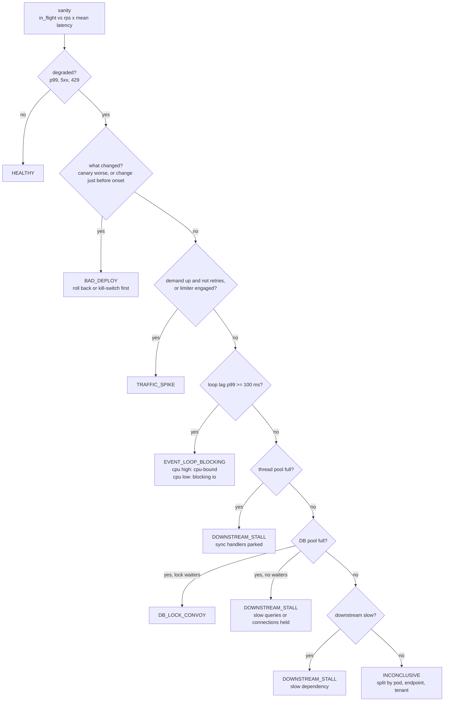

# Sixty-Second API Incident Triage: Differentiating Traffic Spikes, Downstream Stalls, DB Lock Convoys, Event-Loop Blocking, and Bad Deploys

> [!summary] Claim
> Five different failures produce the same page (latency up, errors up), but each leaves a different fingerprint in six numbers you can read in a minute: what changed, whether demand changed, event-loop lag, CPU, which pool is full, and whether the pool is full of waiters or of slow work; asking the questions in that order, cheapest and most reversible first, separates them without a debugger.

Part of [Observability Profiling and Operations](README.md) in [API Engineering](../README.md).

## TL;DR

- Mechanism: latency, errors, and in-flight requests rise in every incident, so they cannot discriminate; the discriminators are the resource that is saturated (event loop, CPU, thread pool, DB pool) and whether work is waiting on a queue or running slowly.
- Contract rule: ask "what changed" and "did demand change" before "what is slow", because a rollback or a shed is reversible in seconds and a root cause is not.
- Trap: low CPU does not clear the process, because blocking I/O on the event loop stalls every request at near-zero CPU, and a lock convoy exhausts the shared connection pool so requests that never touch the locked table fail too.
- Portability fact: the tree reads only quantities that a Python ASGI service on any server can export (loop lag, pool occupancy, `pg_stat_activity` wait events), and the lab ran on CPython 3.14.6 only (as of 2026-11).
- Do not use it when: the symptom is a single tenant, a single pod, or a single endpoint (split the signal first), or when you are past stopping the bleeding and into root cause, where profiling and tracing take over.

## Mental model



The tree runs left to right in order of reversibility and of how much it can mislead later nodes.
A sanity check on Little's law first guards every later number, then "what changed" and "did demand change" can each end the triage with a one-step action (roll back, shed).
The event-loop node precedes every pool and dependency node on purpose: a loop that cannot schedule callbacks inflates every duration measured on it, including the DB and downstream timings that the later nodes read.
The two pool nodes come next because a full pool is a symptom shared by a lock convoy and a slow dependency, and only the waiter count tells them apart.
Anything that survives all nodes is `INCONCLUSIVE`, which is a result, not a failure: it says the cause is local to a slice (a pod, a tenant, an endpoint) that the aggregate hides.

## How it works

### The stance: stop the bleeding, then explain

The Google SRE book's troubleshooting chapter says that in a major outage the first instinct, finding the root cause quickly, should be ignored: "your course of action should be to make the system work as well as it can under the circumstances", for example by diverting traffic, dropping traffic, or disabling subsystems (Google SRE book, Effective Troubleshooting, section Triage).
The same chapter lists "what touched it last" as a productive start because "a working computer system tends to remain in motion until acted upon by an external force, such as a configuration change or a shift in the type of load served" (same chapter, section What touched it last).
The decision tree is those two sentences made executable: nodes 2 and 3 ask about the external force, and nodes 4 to 8 ask where the work is stuck.
The chapter also warns against "hunting down spurious correlations that are actually coincidences or are correlated with shared causes" (same chapter, Common Pitfalls), which is why the deploy node requires either a canary split or a change that precedes the onset by a bounded lead, and why a deploy that merely coincides with a traffic surge does not win.

### The six numbers and why each is cheap

| Question | Number | Where it comes from |
| --- | --- | --- |
| What changed? | `change_age_s`, `onset_age_s`, per-build error and latency split | Deploy and flag-change annotations on the dashboard (see [[Feature-Flags-Dynamic-Configuration-and-Safe-Kill-Switches-in-APIs]]) |
| Did demand change? | `rps` vs baseline, `retry_fraction`, `ratio_429` | Request counters by status code and by retry attempt |
| Is the process stuck? | `loop_lag_p99_s`, `cpu_util` of the loop thread | A lag monitor and process CPU (see [[Detecting-Event-Loop-Blocking-Loop-Lag-Monitors-and-Debug-Callbacks]]) |
| Is a worker pool full? | `threadpool_in_use` / `threadpool_limit` | The anyio default limiter statistics |
| Is the DB pool full of waiters? | `db_pool_in_use` / `db_pool_size`, `db_lock_waiters` | Pool gauges and `pg_stat_activity` |
| Is a dependency slow? | `downstream_p99_s`, `downstream_timeout_ratio` | Client-side spans or histograms (see [[RED-and-USE-Metrics-and-OpenTelemetry-HTTP-Semantic-Conventions]]) |

This is the USE method applied to software resources: for every resource, check utilization, saturation, and errors (Brendan Gregg, The USE Method, Summary).
Gregg's own list of software resources names two of the pools here, "mutex locks" and "thread pools", with saturation defined as threads queued waiting on the lock or requests waiting for the pool (same page, Software Resources).
He also warns that a long averaging interval hides saturation: a customer's CPU "never higher than 80%" in five-minute averages was hitting 100% for seconds at a time (same page, Does Low Utilization Mean No Saturation).
The Google SRE monitoring chapter adds the four golden signals, latency, traffic, errors, and saturation, and the rule to distinguish the latency of successful requests from that of failed ones, because an error served from a lost database connection "might be served very quickly" (Google SRE book, Monitoring Distributed Systems, The Four Golden Signals).
That last point matters in triage: a falling mean latency with rising 5xx is a fail-fast outage, not an improvement.

### Little's law as the sanity node

For a stable service the time-averaged number of requests inside it equals arrival rate times mean time in system, `L = lambda * W` (J. D. C. Little, "A Proof for the Queuing Formula: L = lambda W", Operations Research 9(3), 383-387, June 1961; the bibliographic record was confirmed in the Crossref registry for DOI 10.1287/opre.9.3.383, the publisher page returned `403`, so the paper's text was not read here).
The lab computes `littles_law_gap(snap) = |in_flight - rps * mean_latency| / max(both)` and attaches a warning, without changing the verdict, when it exceeds 0.5.
A large gap means the numbers come from different windows or one instrument is wrong, for example `in_flight` is a point-in-time gauge during a spike while `rps` is a one-minute rate, so re-query before trusting any later node.
In an incident the same identity gives a free inference: if `rps` is flat and `in_flight` has grown tenfold, then `W` has grown tenfold, so the service is slower, not busier (the capacity side is in [[Capacity-Planning-with-Littles-Law-and-the-Universal-Scalability-Law]]).

### Cause 1: traffic spike

Mechanism: when demand exceeds the service rate of the bottleneck resource, queueing delay grows without bound until something sheds.
The SRE cascading-failure chapter describes the CPU case: "typically all requests become slower", "more requests are handled concurrently", and queues saturate, so latency rises and the queue uses more memory (Google SRE book, Addressing Cascading Failures, Resource Exhaustion, CPU).
Signature: `rps` well above baseline, CPU near saturation, loop lag high because the loop is genuinely busy, pool occupancy up as a consequence, dependencies unchanged.
The status codes tell you which layer reacted.
`429 Too Many Requests` means a limiter engaged: "the user has sent too many requests in a given amount of time", with an optional `Retry-After` (RFC 6585 Section 4).
`503 Service Unavailable` means "temporary overload or scheduled maintenance, which will likely be alleviated after some delay", also with an optional `Retry-After`, and the RFC adds that a server need not use it, since "some servers might simply refuse the connection" (RFC 9110 Section 15.6.4, Section 10.2.3).
Uvicorn's `limit_concurrency` setting is one source of such a `503`: when the number of connections or tasks reaches the limit, the HTTP protocol class swaps the app for a fixed `503` response with body `Service Unavailable` and the warning `Exceeded concurrency limit.` (uvicorn 0.54.0 uvicorn/protocols/http/h11_impl.py, `H11Protocol.handle_events`; uvicorn 0.54.0 uvicorn/protocols/http/httptools_impl.py, `HttpToolsProtocol.on_headers_complete`; the response itself is uvicorn 0.54.0 uvicorn/protocols/http/flow_control.py, `service_unavailable`; the default is `None`, no limit, uvicorn 0.54.0 uvicorn/config.py, `Config.__init__`).
The same check is also present in the `zttp` protocol classes that 0.54.0 ships (uvicorn 0.54.0 uvicorn/protocols/http/zttp_impl.py and zttp_h2_impl.py, `handle_events`).
Two traps keep the "traffic" verdict honest.
First, a spike made mostly of retries is a symptom (see cause 2 and the retry amplification pitfall), so the lab refuses to call it a spike when `retry_fraction >= 0.2`.
Second, `ratio_429` alone can be the whole story: one tenant over its quota produces `429`s with total `rps` barely moved, and the action (find the top client) differs from "add capacity".

### Cause 2: downstream stall

Mechanism: a dependency (HTTP service, cache, the database seen as a slow server) answers slowly or not at all, so each request waits longer, `W` grows, and by Little's law `in_flight` grows at flat `rps`.
The process itself is idle while it waits, so CPU is low and the event loop is responsive.
Signature: `in_flight` up, CPU low, loop lag normal, dependency latency or timeout ratio up, `504 Gateway Timeout` ("did not receive a timely response from an upstream server", RFC 9110 Section 15.6.5) or `502 Bad Gateway` (RFC 9110 Section 15.6.3) at a gateway in front.
The timeout you configured becomes the latency ceiling you see: httpx's default is `Timeout(timeout=5.0)` for connect, read, write, and pool, with pool limits `max_connections=100` and `max_keepalive_connections=20` (httpx 0.28.1 httpx/_config.py, `DEFAULT_TIMEOUT_CONFIG`, `DEFAULT_LIMITS`), so a plateau of p99 near a round timeout value is itself evidence.
Retries convert a stall into extra load: in the AWS example of a five-layer stack that retries three times at each layer, "the load on the database will increase 243x" (AWS Builders' Library, Timeouts, retries, and backoff with jitter, section Retries and backoff); 243 is 3^5, so the article's arithmetic counts three calls per layer, which the lab reproduces as `offered_load_multiplier(3, 5) == 243` (counting three retries on top of each first try would give 4^5 = 1024).
A stalled dependency also hurts servers that wait, not just clients: the AWS article on shedding notes that when a client times out "all the progress that the server made so far on that request goes to waste" and that client retries then multiply "the offered load on the system" (AWS Builders' Library, Using load shedding to avoid overload, section Positive feedback loops).
The mechanisms and fixes live in [[Timeout-Taxonomy-Connect-Read-Write-Pool-and-Deadline-Propagation]], [[Retry-Budgets-and-Preventing-Cascading-Retry-Amplification-Storms]], and [[Circuit-Breakers-State-Machines-Half-Open-Probing-and-When-Not-to-Use-Them]].

#### Variant: worker-thread pool saturation

A plain `def` route in Starlette or FastAPI runs through `run_in_threadpool` (starlette 1.10.0 starlette/routing.py, `request_response`; in FastAPI the route handler is async and the sync endpoint is offloaded in fastapi 0.162.0 fastapi/routing.py, `run_endpoint_function`), which calls `anyio.to_thread.run_sync` (starlette 1.10.0 starlette/concurrency.py, `run_in_threadpool`), and the default anyio limiter is a `CapacityLimiter(40)` (anyio 4.16.0 anyio/_backends/_asyncio.py, `AsyncIOBackend.current_default_thread_limiter`).
When 40 handlers are parked on a slow call, the 41st waits for a token, `async def` routes such as `/healthz` stay fast, and the service looks healthy to a shallow probe while every sync route queues.
The lab demonstrates this with 45 gated sync requests: `borrowed_tokens == 40`, `tasks_waiting == 5`, an async `/healthz` returns `200`, and a 46th sync request does not complete (see Worked example).
Signature: loop lag normal, CPU low, `threadpool_in_use / threadpool_limit` at or near 1.
The tree files it under `DOWNSTREAM_STALL` because the threads are parked inside some blocking call; the action is a thread dump (`py-spy dump --pid <pid>` prints the call stack of each Python thread, py-spy README, section dump), not a restart.

### Cause 3: DB lock convoy

Mechanism: a lock request that cannot be granted joins a queue, and every later request whose mode conflicts with a queued request joins the queue behind it even if it conflicts with nothing currently held.
PostgreSQL states this in two places.
The `pg_blocking_pids` documentation defines a hard block (the other session holds a conflicting lock) and a soft block ("is waiting for a lock that would conflict with the blocked process's lock request and is ahead of it in the wait queue") (PostgreSQL documentation, Session Information Functions, `pg_blocking_pids`).
The lock manager code does it: in `LockAcquireExtended`, before checking held locks, "If lock requested conflicts with locks requested by waiters, must join wait queue" via `conflictTab[lockmode] & lock->waitMask` (postgres REL_18_STABLE src/backend/storage/lmgr/lock.c, `LockAcquireExtended`; the same comment is in master, fetched 2026-11-21).
`ACCESS EXCLUSIVE` "conflicts with locks of all modes", while a plain `SELECT` takes `ACCESS SHARE`, which "conflicts with the ACCESS EXCLUSIVE lock mode only" (PostgreSQL documentation, Explicit Locking, Table-Level Locks).
So one long-running reader plus one queued DDL statement that needs `ACCESS EXCLUSIVE` blocks every new reader of that table, although readers do not conflict with each other.
GoCardless published exactly this: a migration that dropped and recreated foreign keys needed `AccessExclusive` on the referenced parent table, "an unfortunately timed, long-running read query on the parent table collided with the migration which added the foreign key constraint", and "read/write queries issued by calls to our API piled up behind it, and clients timed out", "around 15 seconds of unexpected API downtime" for migrations that, re-run against a backup, "went through in a few hundred milliseconds" (GoCardless engineering blog, Zero-downtime Postgres migrations - the hard parts; the post's `ADD CONSTRAINT ... NOT VALID` example is its illustration of the fix, not the statement that caused the incident).
Why the whole API fails, not one table: every request that touches the table holds an application pool connection while it waits, so the pool fills, and requests for unrelated tables cannot get a connection.
The lab model makes the arithmetic explicit: with `pool_size = 20` and one request in ten reading the locked table at 100 requests per second, the pool is exhausted `pool_size / (rate / table_every) = 2 s` after the DDL queues, and in the default run 2436 of the 2706 rejected requests never touched the locked table.
The default SQLAlchemy pool is small: `pool_size=5`, `max_overflow=10`, `timeout=30.0`, and an exhausted pool raises `QueuePool limit of size 5 overflow 10 reached, connection timed out, timeout 30.00` (sqlalchemy 2.1.8 sqlalchemy/pool/impl.py, `QueuePool.__init__`, `QueuePool._do_get`), and `AsyncAdaptedQueuePool` has "otherwise identical" arguments (same file, `AsyncAdaptedQueuePool`); asyncpg's `create_pool` defaults to `min_size=10, max_size=10` (asyncpg 0.32.0 asyncpg/pool.py, `create_pool`).
Signature: CPU low on the app and on the DB, DB pool full, `db_lock_waiters` of at least 2, the waiters' `wait_event_type` is `Lock` (PostgreSQL documentation, pg_stat_activity, Table 27.4, "waiting for a heavyweight lock"), downstream HTTP normal.
The 60-second query is one statement:

```sql
SELECT pid, pg_blocking_pids(pid) AS blocked_by, wait_event, state, now() - xact_start AS xact_age, left(query, 80) AS query
FROM pg_stat_activity
WHERE wait_event_type = 'Lock'
ORDER BY xact_start;
```

`pg_blocking_pids` takes "exclusive access to the lock manager's shared state for a short time", so the documentation warns that frequent calls could affect performance; run it once, not in a polling loop (PostgreSQL documentation, Session Information Functions).
The head of the queue is the blocker that is not itself waiting; ending that session (not the waiters) drains the queue.
Prevention is a migration setting, not an incident setting: `lock_timeout` aborts a statement that waits too long for a lock and defaults to 0, disabled (PostgreSQL documentation, Client Connection Defaults), and GoCardless's advice is "Set lock_timeout in your migration scripts to a pause your app can tolerate".
The lab shows the rule: a `lock_timeout` shorter than the exhaustion time (1 s against 2 s) prevents the outage entirely, while one longer than it (3 s) does not.
`idle_in_transaction_session_timeout` bounds the other half of the convoy, the idle-in-transaction session that holds the first lock (same documentation page).
`log_lock_waits` "controls whether a log message is produced when a session waits longer than deadlock_timeout to acquire a lock", and its default is `on` in the PostgreSQL 19 documentation (PostgreSQL documentation, Error Reporting and Logging, What to Log, as of 2026-11); `deadlock_timeout` defaults to one second (PostgreSQL documentation, Lock Management).
Deep dives: [[Case-Study-Database-Migration-ACCESS-EXCLUSIVE-Lock-Convoy-Taking-Down-an-API]], [[Zero-Downtime-Schema-Migrations-Expand-Contract-and-Lock-Timeouts]], [[Connection-Pooling-Internals-QueuePool-AsyncAdaptedQueuePool-and-Pre-Ping]].

### Cause 4: event-loop blocking

Mechanism: an asyncio event loop runs all tasks in one thread, so a callback that does not yield delays everything else: "if a function performs a CPU-intensive calculation for 1 second, all concurrent asyncio Tasks and IO operations would be delayed by 1 second" (CPython documentation, asyncio Developing with asyncio, Running Blocking Code).
There are two flavors that look different on a CPU graph.
CPU-bound code (a regex, serialization of a huge body, synchronous crypto) shows CPU near 100% on the loop thread.
Blocking I/O (`time.sleep`, a synchronous HTTP or DB driver, `requests`) shows CPU near zero, because the thread is asleep in a system call, yet it stalls the loop just as completely.
Signature: loop lag p99 at or above 100 ms with request rate near baseline; every endpoint slows, including trivial ones; and every duration measured on that loop is inflated, including the DB and downstream timings the later nodes read, because the clock stops being sampled while the loop is stuck.
The lab's tree therefore tests loop lag before the pool and dependency nodes, and a test pins the consequence: the same numbers with a healthy loop point at the dependency instead.
The threshold is not arbitrary: asyncio debug mode logs callbacks that run longer than `loop.slow_callback_duration`, default 100 milliseconds (CPython documentation, asyncio Event Loop, `loop.slow_callback_duration`), and the implementation does it in `_run_once` with the message `Executing %s took %.3f seconds` when `self._debug` is true (CPython 3.14.6 Lib/asyncio/base_events.py, `BaseEventLoop._run_once`).
Debug mode is enabled by `PYTHONASYNCIODEBUG=1`, Python Development Mode, `asyncio.run(debug=True)`, or `loop.set_debug()` (CPython documentation, Developing with asyncio, Debug Mode), which is fine in staging and a decision in production.
Production-safe detection is a lag monitor: schedule a timer, measure how late it fires.
The lab's `LoopLagMonitor` does this on the running loop and, on exit, also records a timer that is overdue but never fired, because a stall that ends without ever yielding to the loop would otherwise leave no sample (the first version of the lab missed exactly this, and the test that caught it is `test_blocking_sleep_in_async_handler_stalls_the_loop_at_low_cpu`).
Two real incidents are the CPU-bound flavor in other runtimes and show the same shape.
Stack Overflow, 2016-07-20: a malformed post made a whitespace-trimming regular expression, `^[\s\u200c]+|[\s\u200c]+$`, consume high CPU on the web servers; the home page was also the load balancer's health check, so the balancer took servers out of rotation and the site was down 34 minutes from 14:44 UTC, with 10 minutes to identify the cause (Stack Exchange Network Status, Outage Postmortem - July 20, 2016, via the Internet Archive snapshot of 2016-07-27).
Cloudflare, 2019-07-02: a WAF rule with a backtracking regular expression exhausted "every CPU core that handles HTTP/HTTPS traffic", and customers saw `502` errors from the front-line servers that "were unable to reach the processes that serve HTTP/HTTPS traffic" (Cloudflare blog, Details of the Cloudflare outage on July 2, 2019).
Neither is a Python loop, so treat them as evidence for the signature (CPU saturation from one code path, shallow health checks that share the fate of the work), not for Python thresholds.
Deep dives: [[Case-Study-Blocking-Call-Inside-Async-Def-Freezing-the-Entire-Worker-Fleet]], [[Offloading-CPU-Bound-Work-ProcessPoolExecutor-vs-Free-Threaded-Python-3-15t]], [[CPython-Asyncio-Event-Loop-Internals-Selectors-Ready-Queue-and-Timers]].

### Cause 5: bad deploy

Mechanism: a new build or a flag flip changes behavior for a large fraction of traffic at once, so the failure starts at the change and affects the new build disproportionately.
Signature: a step change (not a ramp) beginning within minutes after the change; error ratio or latency worse on the new build than the old when two builds serve traffic (a canary split); no change in demand.
The decisive evidence is the split, not the clock.
With a canary the lab blames the deploy only if the new build has an error ratio of at least `max(1%, 3 x old)` or a p99 of at least twice the old; a new build that matches the old one exonerates the deploy even when the clock correlates.
Without a split it falls back to timing: the change must precede the onset by 0 to 300 seconds, and organic traffic must not be elevated, because a change that merely coincides with a surge explains nothing.
Cloudflare's timeline shows how little time a bad global change leaves: the rule deployed at 13:42, the first page (a synthetic WAF test) fired three minutes later, the WAF was identified as the cause at 14:00, the global WAF termination ran at 14:07, traffic and CPU recovered by 14:09, and the post-mortem puts the outage at 27 minutes (Cloudflare blog, Details of the Cloudflare outage on July 2, 2019).
The same post lists the missing safeguards: no staged rollout for that class of change, a rollback plan that "required running the complete WAF build twice taking too long", and an alert for the global traffic drop that "took too long to fire".
The kill switch is the faster rollback for changes that have one (see [[Feature-Flags-Dynamic-Configuration-and-Safe-Kill-Switches-in-APIs]]).

### The sixty seconds as a schedule

| Seconds | Question | Query | Ends the triage when |
| --- | --- | --- | --- |
| 0-10 | What changed? | Deploy and flag annotations over the last 30 minutes; error and p99 split by build | The new build is worse: roll back or flip the switch |
| 10-20 | Did demand change? | `rps` vs same hour last week; share of requests with a retry attempt; `429` ratio; top clients | Organic spike or one tenant: shed or limit, then scale |
| 20-30 | Is the process stuck? | Loop lag p99; CPU of the loop thread; `/healthz` latency | Lag at or above 100 ms: sample the loop thread, find the blocking call |
| 30-45 | Which pool is full? | Thread-pool tokens borrowed; DB pool in use; `pg_stat_activity` waiters on `Lock` | Waiters: end the head blocker. No waiters: go to the slow work |
| 45-60 | Is a dependency slow? | Dependency p99 and timeout ratio; slowest queries | Slow dependency: shorten timeouts, stop retries, break the circuit |

The budget is a discipline, not a promise: each row is one query on one dashboard, and the order is chosen so that the earliest rows end the triage with a reversible action.
The name echoes "Linux Performance Analysis in 60,000 Milliseconds" by the Netflix Performance Engineering team (posted 2015-11-30, read in the PDF copy at brendangregg.com), which lists ten command-line tools for the first minute on one Linux host: `uptime`, `dmesg | tail`, `vmstat 1`, `mpstat -P ALL 1`, `pidstat 1`, `iostat -xz 1`, `free -m`, `sar -n DEV 1`, `sar -n TCP,ETCP 1`, and `top`.
That checklist is host-level; this playbook is its service-level counterpart, and the two meet at the CPU row.

### What the tree cannot see

The tree assumes one dominant cause and one aggregate window.
Real incidents compound: a bad deploy causes errors, clients retry, the retry storm saturates CPU, and the tree stops at the earliest matching node, which is why "what changed" is first and why a retry-dominated surge defers to the later nodes with a warning.
It does not see memory pressure or garbage collection feedback (the SRE cascading chapter describes a "GC death spiral" in a Java frontend), file-descriptor or accept-queue exhaustion, DNS or TLS failures, or a single bad pod hidden inside a healthy average.
When every node is quiet and the verdict is `INCONCLUSIVE`, the next move is to split by pod, endpoint, and tenant, and to check the client side and the edge (see [[Client-Side-Telemetry-Network-Error-Logging-NEL-and-Edge-vs-Origin-Gap]]).

## Numbers and limits

| Quantity | Value | Source or measurement |
| --- | --- | --- |
| asyncio slow-callback threshold in debug mode | 0.1 s | CPython documentation, `loop.slow_callback_duration`; CPython 3.14.6 Lib/asyncio/base_events.py, `BaseEventLoop.__init__` sets `self.slow_callback_duration = 0.1` |
| anyio default worker-thread limit | 40 tokens | anyio 4.16.0 anyio/_backends/_asyncio.py, `current_default_thread_limiter` |
| SQLAlchemy `QueuePool` defaults | `pool_size=5`, `max_overflow=10`, `timeout=30.0` | sqlalchemy 2.1.8 sqlalchemy/pool/impl.py, `QueuePool.__init__` |
| asyncpg `create_pool` defaults | `min_size=10`, `max_size=10` | asyncpg 0.32.0 asyncpg/pool.py, `create_pool` |
| httpx default timeout and limits | 5.0 s each phase; 100 connections, 20 keep-alive | httpx 0.28.1 httpx/_config.py |
| Uvicorn `timeout_keep_alive`, `backlog`, `limit_concurrency` | 5 s, 2048, `None` | uvicorn 0.54.0 uvicorn/config.py, `Config.__init__` |
| `deadlock_timeout` | 1 s default | PostgreSQL documentation, Lock Management (docs for PostgreSQL 19, fetched 2026-11-21) |
| `lock_timeout`, `idle_in_transaction_session_timeout` | 0 (disabled) by default | PostgreSQL documentation, Client Connection Defaults |
| Retry amplification, 3 attempts x 5 layers | 243x | AWS Builders' Library, Timeouts, retries, and backoff with jitter |
| Cloudflare 2019-07-02 | deploy 13:42, first page +3 min, cause found 14:00, WAF off 14:07, recovered 14:09; 27 min | Cloudflare blog post |
| Stack Overflow 2016-07-20 | 34 min; 10 min to identify, 14 to write the fix, 10 to roll out; `\s+$` on 20,000 spaces is quadratic, which the postmortem puts at 199,990,000 checks (the sum 20,000 + 19,999 + ... + 1 it writes is actually 200,010,000) | Stack Exchange postmortem |
| GoCardless migration incident | about 15 s API downtime; migration took a few hundred ms on a backup | GoCardless blog |
| Lab: pool exhaustion after DDL queues (pool 20, 100 rps, 1 in 10 on table) | 3.0 s after start, 2.0 s after the DDL queued | Measured in the lab model, CPython 3.14.6, macOS 27.3 arm64 |
| Lab: requests rejected in that run | 2706 total, 2436 on other tables | Same run |
| Lab: with `lock_timeout` 1 s, 3 s | no exhaustion (0 rejected); exhaustion at 3.0 s, 101 rejected | Same lab, same machine |
| Lab: real loop, 2 requests of 0.4 s, `await asyncio.sleep` | max lag 0.001 s, CPU 0.005 s, wall 0.402 s | Measured 2026-11-21 with the test module's `_run_routes`, CPython 3.14.6, macOS 27.3 arm64, one-minute load average 94 |
| Lab: same, plain `def` with `time.sleep` | max lag 0.001 s, CPU 0.005 s, wall 0.406 s | Same run |
| Lab: same, `async def` with `time.sleep` | max lag 0.798 s, CPU 0.001 s, wall 0.808 s | Same run |
| Lab: same, `async def` burning CPU | max lag 0.852 s, CPU 0.801 s, wall 0.862 s | Same run; wall varies with host contention |
| Lab thresholds (`Thresholds` defaults) | 2x latency, 1% errors, 1.5x traffic, 5% limiter, 20% retries, 100 ms lag, 90% pool | Lab defaults, tune per service, not standards |

The scenario snapshots in the lab are authored to encode the signatures above; they are not measurements of a real service.
The convoy figures come from a deterministic model of the documented queueing rule, not from a PostgreSQL instance: it has three lock modes, a FIFO queue, and a shared pool, and it does not model the lock manager's wake-up order beyond "grant in queue order when compatible".

## Portability

| Axis | Variant | Result | Evidence |
| --- | --- | --- | --- |
| CPython | 3.14.6 on macOS 27.3 arm64 (the lab venv) | 71 passed in 10.81 s at load average 136 | Ran: `uv run --frozen pytest tests/f18_observability_profiling_and_operations/test_the_sixty_second_api_incident_triage_playbook.py -q` |
| CPython | 3.12.13, 3.13.18, 3.14.10, 3.15.2, 3.15.0b3 free-threaded | Not run | Lab checks were paused by the user on 2026-11-11; no result is claimed |
| Event loop | Default asyncio loop | `LoopLagMonitor` measures stalls; debug mode logs slow callbacks | Tests ran; CPython documentation and 3.14.6 source read |
| Event loop | uvloop 0.23.0 | Debug-mode slow-callback warning exists; monitor not run on uvloop | Source read (uvloop 0.23.0 uvloop/loop.pyx, `Loop._on_idle`): with debug on, each ready handle is timed and `Executing %s took %.3f seconds` is logged at WARNING when it exceeds `slow_callback_duration`, which defaults to `0.1`; debug turns on with `PYTHONASYNCIODEBUG` or Python dev mode (`Loop.__init__`); the monitor was not run on uvloop |
| Server | Uvicorn 0.54.0 `limit_concurrency` -> `503` | Same logic in the h11, httptools, zttp, and zttp h2 protocol classes | Source read in all four files |
| Server | Hypercorn 0.18.0 | No concurrency cap that answers `503`; a loaded server queues instead | Source read: no `503` or concurrency limit in hypercorn 0.18.0 hypercorn/; `Config` offers `backlog = 100`, `h2_max_concurrent_streams = 100` (hypercorn/config.py), and `max_requests`, which only terminates the worker after that many requests (hypercorn/asyncio/worker_context.py, `WorkerContext.mark_request`, which sets `terminate` once `requests > max_requests`); a `503` here comes from a proxy or the app |
| Server | Granian 2.8.7 | `--backpressure` queues instead of answering `503` | Docs read at the v2.8.7 tag (README.md, Backpressure): a per-worker limit on concurrently processed connections enforced in the accept loop, excess connections "wait in the worker's socket queue"; default `backlog // workers` with `backlog` 1024 (granian/server/common.py, `Server.__init__`); the cap counts connections, not keep-alive requests; the Rust runtime is compiled, so its source was not read |
| HTTP | `429`, `503`, `504`, `Retry-After` | Defined by HTTP semantics, not by one HTTP version | RFC 6585 Section 4, RFC 9110 Sections 10.2.3 and 15.6.3 to 15.6.5; HTTP/2 and HTTP/3 not run |
| PostgreSQL | Queue-behind-waiter rule | Same comment and check in REL_18_STABLE and master `lock.c` | Source read; older branches not read |
| PostgreSQL | `pg_stat_activity.wait_event_type`, `pg_blocking_pids` | Documented in the PostgreSQL 19 docs fetched 2026-11-21 | Older majors not read |
| SQLAlchemy | 2.1.8 pool defaults | As in the Numbers table | Source read; 2.0.57 not read |

The free-threaded row matters for one reason: `time.process_time()` and `burn_cpu` count CPU across all threads, so a CPU-bound handler on a free-threaded build can show CPU above one core while the loop thread is still stalled, which would break the single-thread reading of `cpu_util`.
`time.process_time` is "process-wide by definition" and returns the sum of system and user CPU time of the current process (Python 3.14 docs, `time.process_time`, fetched 2026-11-21), so the reading follows from the documented definition; the lab did not run on a free-threaded build.

## Worked example

The [implementation](../labs/src/api_labs/f18_observability_profiling_and_operations/incident_triage.py) holds the decision tree and the simulated snapshots, and the companion [probes module](../labs/src/api_labs/f18_observability_profiling_and_operations/incident_probes.py) holds the loop lag monitor, the demo Starlette routes, and the lock-queue model.
The [test](../labs/tests/f18_observability_profiling_and_operations/test_the_sixty_second_api_incident_triage_playbook.py) has 71 cases: the 12 scenarios and their Little consistency, node-order tests meant to fail if two nodes are swapped (mutation checks were not run), deploy-versus-traffic cases, the real-loop and thread-pool tests, and the lock-queue and convoy tests.

The tree, as a simplified excerpt (evidence strings, the sanity node, and the `HEALTHY` and `INCONCLUSIVE` returns are omitted here; the file has them):

```python
def diagnose(snap, base=BASELINE, th=DEFAULT_THRESHOLDS):
    retries_dominate = snap.retry_fraction >= th.retry_fraction
    traffic_elevated = snap.rps >= th.traffic_factor * base.rps
    organic_traffic = traffic_elevated and not retries_dominate
    limiter_engaged = snap.ratio_429 >= th.limiter_ratio

    if snap.canary is not None:                         # what_changed
        if _canary_is_worse(snap.canary, th):
            return BAD_DEPLOY("canary split")
    elif snap.change_age_s is not None and snap.onset_age_s is not None:
        lead = snap.change_age_s - snap.onset_age_s
        if 0.0 <= lead <= th.deploy_lead_s and not organic_traffic:
            return BAD_DEPLOY("time correlation only")

    if (organic_traffic or limiter_engaged) and not retries_dominate:   # traffic
        return TRAFFIC_SPIKE

    if snap.loop_lag_p99_s >= th.loop_lag_s:            # event_loop
        return EVENT_LOOP_BLOCKING(cpu_bound=snap.cpu_util >= th.cpu_bound_util)

    if threadpool_full:                                 # thread_pool
        return DOWNSTREAM_STALL("sync handlers parked on blocking calls")

    pool_full = snap.db_pool_in_use >= th.pool_saturation * snap.db_pool_size   # db_pool
    if pool_full and snap.db_lock_waiters >= th.lock_waiters:
        return DB_LOCK_CONVOY
    if pool_full:
        return DOWNSTREAM_STALL("connections held" if downstream_slow else "slow queries")

    if downstream_slow:                                 # downstream
        return DOWNSTREAM_STALL("slow dependency")
```

The lock queue, as a simplified excerpt; this is the whole mechanism of the convoy:

```python
def request(self, req, now):
    """Grant at once only if nothing queued ahead or held conflicts (lock.c: waitMask first)."""
    blocked = any(conflicts(req.mode, w.mode) for w in self.waiters) or any(
        conflicts(req.mode, h.mode) for h in self.holders
    )
    if blocked:
        self.waiters.append(req)
        return False
    req.granted_s = now
    self.holders.append(req)
    return True
```

Two of the tests: the soft block and the pool arithmetic.

```python
@pytest.mark.unit
def test_readers_share_but_a_queued_exclusive_request_blocks_later_readers() -> None:
    queue = LockQueue()
    long_reader = _req(1, LockMode.ACCESS_SHARE)
    ddl = _req(2, LockMode.ACCESS_EXCLUSIVE)
    late_reader = _req(3, LockMode.ACCESS_SHARE)
    assert queue.request(long_reader, 0.0)
    assert queue.request(_req(4, LockMode.ACCESS_SHARE), 0.0)  # readers share
    assert not queue.request(ddl, 1.0)
    assert not queue.request(late_reader, 1.1)  # compatible with the holders, still queued
    assert queue.blocking_pids(ddl) == (1, 4)
    assert queue.blocking_pids(late_reader) == (2,)  # soft block: only the queued DDL
```

```python
@pytest.mark.unit
@pytest.mark.parametrize("pool_size", [10, 20, 40])
def test_pool_exhaustion_time_is_pool_size_over_blocked_arrival_rate(pool_size: int) -> None:
    result = simulate_convoy(pool_size=pool_size)
    blocked_rate = 100.0 / 10  # every tenth request reads the locked table
    expected = 1.0 + pool_size / blocked_rate
    assert result.pool_exhausted_at_s is not None
    assert result.pool_exhausted_at_s == pytest.approx(expected, abs=0.15)
```

Captured output, re-run by the fact-check on 2026-11-21 on CPython 3.14.6, macOS 27.3 arm64 (`macOS-27.3-arm64-arm-64bit-Mach-O`), run from `labs/` with the pinned workspace; the blocks below come from the test command and from one script that calls `diagnose`, `simulate_convoy`, and the test module's `_run_routes`.
The host was loaded (one-minute load average 94 during the run).

```text
$ uv run --frozen pytest tests/f18_observability_profiling_and_operations/test_the_sixty_second_api_incident_triage_playbook.py -q
.......................................................................  [100%]
71 passed in 8.78s
```

The scenario table, printed from `diagnose(scenario(name))`:

```text
healthy                   healthy              no signal beyond thresholds                    path_end=degraded
traffic_spike             traffic_spike        limiter engaged                                path_end=traffic
rate_limited_tenant       traffic_spike        limiter engaged                                path_end=traffic
downstream_stall          downstream_stall     slow dependency                                path_end=downstream
db_lock_convoy            db_lock_convoy       sessions queued on a lock                      path_end=db_pool
event_loop_cpu            event_loop_blocking  cpu-bound code on the loop                     path_end=event_loop
event_loop_blocking_io    event_loop_blocking  blocking io on the loop                        path_end=event_loop
threadpool_saturation     downstream_stall     sync handlers parked on blocking calls         path_end=thread_pool
bad_deploy_canary         bad_deploy           canary split                                   path_end=what_changed
bad_deploy_full_rollout   bad_deploy           time correlation only                          path_end=what_changed
deploy_during_spike       traffic_spike        demand above capacity                          path_end=traffic
retry_storm_over_stall    downstream_stall     slow dependency                                path_end=downstream
```

The convoy model:

```text
no ALTER                 exhausted_at=None max_waiters=0 rejected=0 other_table=0 longest_wait=0.00 granted=None recovered=None
ALTER, no lock_timeout   exhausted_at=3.0 max_waiters=21 rejected=2706 other_table=2436 longest_wait=28.96 granted=30.0 recovered=30.060000000000002
lock_timeout=1s          exhausted_at=None max_waiters=11 rejected=0 other_table=0 longest_wait=0.91 granted=None recovered=None
lock_timeout=3s          exhausted_at=3.0 max_waiters=21 rejected=101 other_table=91 longest_wait=2.91 granted=None recovered=4.01
```

`max_waiters=21` is the 20 pooled readers plus the DDL statement itself, which waits on a dedicated connection outside the pool.
The convoy ends at 30.0 s only because the 30 s reader finishes; nothing the application does drains it.

The real loop and real Starlette routes, two concurrent requests of 0.4 s per route, measured with the lag monitor and `time.process_time()`:

```text
/awaits         max_loop_lag=0.001s cpu=0.005s wall=0.402s
/sync-blocking  max_loop_lag=0.001s cpu=0.005s wall=0.406s
/blocking-io    max_loop_lag=0.798s cpu=0.001s wall=0.808s
/blocking-cpu   max_loop_lag=0.852s cpu=0.801s wall=0.862s
```

Read the last two lines as the discriminator the tree encodes: both stall the loop for about the sum of the blocking time, one at 0.001 s of CPU and one at 0.801 s.
In this run the `/blocking-cpu` CPU fraction was 0.93 (0.801 s of 0.862 s), but on an oversubscribed host the wall time stretches and the fraction falls while the CPU seconds stay at the work requested, which is why that test compares CPU seconds with the work requested rather than trusting a fraction (see the CPU throttling pitfall).
The non-blocking routes need a warm-up request and the smallest of three runs in the test, because first-request imports and scheduler noise on a busy laptop add lag; a stall adds the same lag every run, so noise cannot hide it.

## Pitfalls

> [!warning] Blaming the deploy that merely coincided
> Trigger: a release went out in the same hour as a traffic surge or a dependency failure.
> Symptom: the team rolls back, nothing improves, and 20 minutes are lost; the Google SRE chapter warns about "spurious correlations that are actually coincidences or are correlated with shared causes".
> Fix: require a canary split showing the new build is worse, or a change that precedes the onset and no organic surge; otherwise treat the deploy as a hypothesis to test by rolling back one slice.

> [!warning] Reading low CPU as "the process is fine"
> Trigger: blocking I/O in an `async def` handler (`time.sleep`, `requests.get`, a synchronous DB call).
> Symptom: CPU near zero, loop lag in the hundreds of milliseconds or more, every endpoint slow, and in the lab's run 0.001 s of CPU across 0.798 s of stall.
> Fix: put loop lag on the first dashboard row and sample the stack (`py-spy dump --pid <pid>`); move the call to a thread or an async client.

> [!warning] A CPU fraction on a contended or throttled host
> Trigger: the host or cgroup gives the process less CPU than it asks for.
> Symptom: a CPU-bound loop stall shows modest utilization, because wall time stretches while CPU seconds stay at the work done; the lab's test guards against this by comparing CPU seconds with the work requested (the fact-check run measured 0.801 s of CPU in 0.862 s of wall, a 0.93 fraction on a less loaded host).
> Fix: compare CPU seconds consumed with work done, or read the throttling counters of the container runtime: in cgroup v2, `cpu.stat` carries `nr_periods`, `nr_throttled`, and `throttled_usec` once the CPU controller is enabled (Linux `Documentation/admin-guide/cgroup-v2.rst`, `cpu.stat`), and the CFS bandwidth document names the same fields with `throttled_time` in nanoseconds (Linux `Documentation/scheduler/sched-bwc.rst`, Statistics); a CPU-bound stall under a quota shows `nr_throttled` rising while process CPU seconds stay flat; never classify on utilization alone.

> [!warning] Trusting downstream timings measured on a stalled loop
> Trigger: a blocked loop delays the callback that records the end of an outbound call.
> Symptom: the dependency's client-side p99 and the DB pool occupancy both look bad, so the incident is filed against the database while the culprit is a regex in your own handler.
> Fix: read loop lag first, and compare the client-side latency with the dependency's server-side latency before filing.

> [!warning] The convoy that takes down tables nobody touched
> Trigger: a migration needing `ACCESS EXCLUSIVE` queues behind one slow read on a hot table.
> Symptom: the pool fills in `pool_size / blocked arrival rate` seconds (2 s in the lab), then requests for every table fail; CPU is low everywhere.
> Fix: set `lock_timeout` below that time in migration scripts, keep transactions short, and find the head blocker with `pg_blocking_pids` (GoCardless and the PostgreSQL documentation above).

> [!warning] Retries that bury the first failure
> Trigger: a dependency stalls and several layers retry independently.
> Symptom: `rps` doubles or triples, the traffic node looks right, and the team scales out while the offered load on the dependency grows (3 attempts at 5 layers is 243x in the AWS article).
> Fix: split `rps` by attempt number first; if retries dominate, the surge is a symptom, so treat the first failing dependency and cap retries (see [[Case-Study-Cascading-Retry-Storms-and-Metastable-Overload-Collapse]]).

> [!warning] A health check that shares fate with the work
> Trigger: the load balancer's health check is a real page or runs on the same stalled resource.
> Symptom: Stack Overflow, 2016: the home page was the health check, so servers were pulled from rotation by the same CPU exhaustion; the site was down 34 minutes.
> Fix: see [[Health-Check-Engineering-Liveness-Readiness-Startup-and-Cascading-Restarts]]; a cheap async `/healthz` that stays green during thread-pool saturation (as the lab shows) is also not a readiness signal, so keep a deeper readiness check separate.

> [!warning] Scaling out during a stall or a convoy
> Trigger: the reflex to add pods when latency rises.
> Symptom: each new pod opens its own pool against the same lock queue or the same slow dependency, so total connections grow as `pods * (pool_size + max_overflow)` while the blocked or slow resource serves no more; PostgreSQL caps the total with `max_connections`, "typically 100" by default (PostgreSQL docs, Connection Settings), so the extra pods can exhaust server slots as well as their own pools; the lab models one pool and does not simulate pod scaling.
> Fix: confirm the bottleneck is local CPU (the traffic node) before adding capacity.

## Security and robustness

- Threat model: an attacker, a buggy client, or a noisy tenant can trigger each cause on purpose.
  One crafted payload that hits a quadratic regex stalls a loop (Stack Overflow 2016 was a malformed post, not an attack, but the mechanism is the same), a burst of cheap requests saturates CPU, and a slow-reading client holds a connection or a worker thread.
- OWASP API Security Top 10 2023, API4 Unrestricted Resource Consumption: an API is vulnerable if limits such as execution timeouts, maximum allocable memory, or the maximum number of file descriptors are missing or set inappropriately, and the prevention list adds container-level limits on memory, CPU, restarts, file descriptors, and processes, plus rate limiting; each turns an incident into a bounded failure (OWASP API Security Top 10 2023, API4:2023, sections Is the API Vulnerable? and How To Prevent).
  The tree's `ratio_429` and `limiter_ratio` nodes are the observability side of the same control.
- Boundary enforcement is what makes triage possible: bounded pools, per-request timeouts, and `limit_concurrency` give saturation a visible, early failure (`503`) instead of an unbounded queue; see [[Load-Shedding-Priority-Traffic-Classes-and-LIFO-Queue-Management]] and [[Bulkhead-Isolation-and-Per-Dependency-Resource-Partitioning]].
- Diagnostics are privileged.
  `py-spy` reads another process's memory and needs `SYS_PTRACE`, which Kubernetes drops by default (py-spy README, sections on Docker and Kubernetes), so decide in advance who may attach to a production pod and record it.
- `pg_stat_activity.query` can contain customer data and credentials in literals; redact it before pasting into a ticket or chat, and truncate it in dashboards (the sample query uses `left(query, 80)` for that reason).
- Ending sessions is destructive: terminating the head blocker rolls back its transaction, so confirm what it is (a migration, a report, an application transaction) before acting.
- Alerts and runbooks should not depend on the failing system: with Cloudflare's own Access service down, its engineers "couldn't authenticate to our internal control panel", and reaching Jira and the build system needed "a bypass mechanism that wasn't frequently used" (Cloudflare blog, July 2 2019).
- Automated remediation should be reversible and rate-limited; a tree that can restart pods on `INCONCLUSIVE` can turn a stall into a restart storm.

## The principal's view

The decision is whether to build triage as people, dashboards, or code, and the answer is all three in a fixed order: a one-page runbook whose rows are the table above, a dashboard whose first screen is exactly those six numbers per service, and only then automation that annotates incidents with the tree's verdict and evidence, not one that acts.
The tree is cheap to run and expensive to trust: thresholds are per service (a 100 ms lag threshold is fine for a 50 ms API and wrong for a batch endpoint), baselines drift, and a verdict that is confidently wrong is worse than `INCONCLUSIVE`.
Treat the verdict as the first hypothesis and the evidence list as the reason, so a human can overrule it in seconds.
The organizational trade-off is ownership of the signals: loop lag, pool occupancy, and lock waiters are not emitted by default, so someone must make them part of the service template, and a platform team that owns the template gets uniform triage while paying for the instrumentation work and the cardinality budget.
Choose a different approach when the failure domain is the client or the network path (use client-side telemetry and synthetic probes), when the system is not a request-response service (a queue consumer needs lag and age, not loop lag and `429`s), or when the runtime has no single scheduler to stall (a thread-per-request or process-per-request server saturates CPU and worker count, so the loop-lag node becomes a run-queue or worker-occupancy node).
Tie the tree to the error budget: a burn-rate alert is what starts the minute (see [[SLIs-SLOs-Error-Budgets-and-Multi-Window-Burn-Rate-Alerting]]), and a postmortem should record which node ended the triage and how long it took, so the nodes can be reordered from data.
Finally, prefer prevention that makes a node unreachable: `lock_timeout` in every migration removes the convoy, a thread-offloaded or process-pool path for CPU work removes the loop stall, staged rollout removes the global bad deploy, and bounded retries remove the amplifier.

## Interview questions

> [!question] L5: An API shows p99 of 8 s, CPU at 6 percent, and flat request rate; why can you not conclude "the database is slow"?
>
> > [!success]- Answer
> > Low CPU with high latency means requests are waiting, but several things wait: a dependency, a DB lock, a full pool, a full thread pool, or an event loop stalled by a blocking call.
> > By Little's law, flat `rps` and a larger `in_flight` mean `W` grew, so the service is slower, not busier.
> > The discriminators are loop lag, which is high only for event-loop blocking, and the pool occupancy and waiter counts, which separate a lock convoy from a slow query.
> >
> > Follow-up: Which single metric would you add first to a service that has none of these?

> [!question] L5: What do `429`, `503`, and `504` each tell you about where an overload is being handled?
>
> > [!success]- Answer
> > `429` means a limiter decided the client sent too many requests, with an optional `Retry-After` (RFC 6585 Section 4).
> > `503` means the server is temporarily unable to handle the request, often overload, with an optional `Retry-After` (RFC 9110 Section 15.6.4).
> > `504` is generated by a gateway that did not get a timely answer from an upstream (RFC 9110 Section 15.6.5), so the problem is behind the gateway, not in it.
> >
> > Follow-up: A service returns fast `500`s and its mean latency falls during an outage; why is that not good news?

> [!question] L5: What does Little's law give you during an incident?
>
> > [!success]- Answer
> > `L = lambda * W` ties in-flight requests, arrival rate, and mean time in system together.
> > If you know two, you can check the third, and a large gap says your windows or instruments disagree, so re-query before trusting the verdict.
> > It also tells you direction: growth in `in_flight` at flat `rps` is a latency problem, growth in `rps` at flat latency is a demand problem.
> >
> > Follow-up: Why is a point-in-time `in_flight` gauge a poor input during a spike?

> [!question] L6: Predict the output: what are `diagnose(scenario("event_loop_cpu")).cause` and the cause and detail after `replace(snap, loop_lag_p99_s=0.004, cpu_util=0.2)`?
>
> > [!success]- Answer
> > The first is `Cause.EVENT_LOOP_BLOCKING` with detail `cpu-bound code on the loop`: lag 1.1 s is above the 0.1 s threshold, and the loop node comes before the pool and dependency nodes.
> > With a healthy loop the same numbers, a full DB pool, no lock waiters, and a slow downstream give `Cause.DOWNSTREAM_STALL` with detail `connections held across a slow outbound call`.
> > The test `test_loop_lag_is_ruled_in_before_slow_dependencies` pins both.
> >
> > Follow-up: Why is the second verdict a stall and not a lock convoy?

> [!question] L6: Debug this API: a FastAPI service has CPU at 5 percent, p99 of 9 s, `/healthz` slow too, and the DB pool shows 20 of 20 in use with no lock waiters; given the handler below, what is wrong and how do you prove it?
>
> ```python
> @app.get("/report")
> async def report(session: AsyncSession = Depends(get_session)):
>     rows = (await session.execute(select(Order))).scalars().all()
>     enriched = requests.get(ENRICH_URL, timeout=30).json()   # blocks the loop
>     return build(rows, enriched)
> ```
>
> > [!success]- Answer
> > `requests.get` is synchronous inside an `async def`, so the loop is blocked for each call, and the session holds a pooled connection for the whole blocked time.
> > Evidence: loop lag in the hundreds of milliseconds at near-zero CPU, a slow `/healthz` (a trivial route), a full pool without lock waiters, and `py-spy dump --pid` showing the main thread inside the socket read.
> > Fix: use an async client such as `httpx.AsyncClient` with explicit timeouts, release the connection before the outbound call, and never block the loop; a plain `def` route would have used a worker thread instead, with a 40-token limit by default.
> >
> > Follow-up: Why does the same bug in a plain `def` route look different on the dashboard?

> [!question] L6: Why does a migration that queues an `ALTER TABLE` behind one slow `SELECT` take down requests that never touch that table?
>
> > [!success]- Answer
> > `ACCESS EXCLUSIVE` conflicts with every mode, so the queued `ALTER` waits for the reader, and later `ACCESS SHARE` requests conflict with the queued request and wait behind it (soft block, `pg_blocking_pids`; `LockAcquireExtended` checks `waitMask` first).
> > Each waiting request holds an application pool connection, so the pool fills in `pool_size / blocked arrival rate` seconds, and requests for other tables then fail to get a connection.
> > In the lab, 2436 of 2706 rejected requests were for other tables.
> >
> > Follow-up: What `lock_timeout` is safe for a pool of 20 with 10 table reads per second?

> [!question] L6: How do you separate blocking I/O on the loop from a slow dependency when both show low CPU?
>
> > [!success]- Answer
> > Loop lag: with a slow dependency the loop is idle, so lag stays near zero and trivial routes stay fast; with blocking I/O the lag approaches the blocking time and every route slows.
> > The lab measured max lag 0.001 s for `await asyncio.sleep` and 0.798 s for `time.sleep` inside `async def`, at 0.005 s and 0.001 s of CPU.
> > Confirm with a stack sample of the loop thread, because dependency timings measured on a stalled loop are inflated too.
> >
> > Follow-up: What does a thread-pool-saturated service show instead?

> [!question] L7: Why is "what changed" the first node even though most incidents are not deploys, and when does it lie?
>
> > [!success]- Answer
> > It is first because the action it unlocks, roll back or flip the switch, is the cheapest reversible step and the Google SRE chapter's first instruction is to stop the bleeding.
> > It lies when a change merely coincides with the onset: a surge, a dependency failure, or a time-based job starting at the same time.
> > The tree guards with a canary split when it exists and an organic-traffic check when it does not, and the cost of a wrong rollback is a few minutes, which is the asymmetry that justifies the order.
> >
> > Follow-up: How would you detect that a rollback did not help and move on without arguing?

> [!question] L7: You are asked to automate this triage; what do you build, what must it never do, and how do you know it is right?
>
> > [!success]- Answer
> > Build a verdict plus evidence annotation on the incident, with `INCONCLUSIVE` as a first-class result, per-service thresholds and baselines, and a log of which node ended each triage.
> > It must not take destructive actions (restarts, session termination, scaling) on its own verdict, because single-cause assumptions and aggregate windows make it wrong in compound incidents.
> > Validate it by replaying past incidents and game days, measure how often a human overrules it, and reorder nodes from that data.
> >
> > Follow-up: Which signals would you need to add before the tree could see a GC-pause incident?

> [!question] L7: A retry storm is in progress and `rps` is 2.6x baseline; walk through how you triage and what you change.
>
> > [!success]- Answer
> > Split `rps` by attempt number first: if retries dominate, the surge is a symptom and the traffic node must not win; look for the first failing dependency, which the lab's later nodes find (`retry_storm_over_stall` gives `DOWNSTREAM_STALL`).
> > Stop the amplification before fixing the cause: cap retries, add budgets or a circuit breaker, and shed.
> > Layered retries multiply (3 attempts at 5 layers is 243x), so retry at one layer only.
> >
> > Follow-up: Why does scaling out the callers make this worse?

## Related

Prerequisites: [[Feature-Flags-Dynamic-Configuration-and-Safe-Kill-Switches-in-APIs]]

Next: [[Protobuf-Wire-Format-TLV-Tags-Varints-and-ZigZag-Encoding]]

See also: [[RED-and-USE-Metrics-and-OpenTelemetry-HTTP-Semantic-Conventions]], [[SLIs-SLOs-Error-Budgets-and-Multi-Window-Burn-Rate-Alerting]], [[Health-Check-Engineering-Liveness-Readiness-Startup-and-Cascading-Restarts]], [[Capacity-Planning-with-Littles-Law-and-the-Universal-Scalability-Law]], [[Latency-Histograms-Percentiles-DDSketch-and-Why-Averaging-Percentiles-Is-Wrong]], [[Profiling-Python-API-Services-CPU-Wall-Clock-Async-Tasks-and-Memory]], [[Distributed-Tracing-W3C-Trace-Context-and-Baggage-Propagation]], [[Structured-Logging-with-Structlog-and-Stripe-Canonical-Log-Lines]], [[Load-Testing-APIs-with-Locust-and-Open-vs-Closed-Workload-Models]], [[Trace-Sampling-Strategies-Head-Based-vs-Tail-Based-Sampling]], [[Client-Side-Telemetry-Network-Error-Logging-NEL-and-Edge-vs-Origin-Gap]], [[Detecting-Event-Loop-Blocking-Loop-Lag-Monitors-and-Debug-Callbacks]], [[Case-Study-Blocking-Call-Inside-Async-Def-Freezing-the-Entire-Worker-Fleet]], [[Case-Study-Database-Migration-ACCESS-EXCLUSIVE-Lock-Convoy-Taking-Down-an-API]], [[Case-Study-Connection-Pool-Exhaustion-from-Holding-DB-Sessions-Across-Slow-Outbound-HTTP-Calls]], [[Case-Study-Cascading-Retry-Storms-and-Metastable-Overload-Collapse]], [[Zero-Downtime-Schema-Migrations-Expand-Contract-and-Lock-Timeouts]], [[Connection-Pooling-Internals-QueuePool-AsyncAdaptedQueuePool-and-Pre-Ping]], [[Timeout-Taxonomy-Connect-Read-Write-Pool-and-Deadline-Propagation]], [[Retry-Budgets-and-Preventing-Cascading-Retry-Amplification-Storms]], [[Circuit-Breakers-State-Machines-Half-Open-Probing-and-When-Not-to-Use-Them]], [[Load-Shedding-Priority-Traffic-Classes-and-LIFO-Queue-Management]], [[Bulkhead-Isolation-and-Per-Dependency-Resource-Partitioning]], [[Offloading-CPU-Bound-Work-ProcessPoolExecutor-vs-Free-Threaded-Python-3-15t]], [[CPython-Asyncio-Event-Loop-Internals-Selectors-Ready-Queue-and-Timers]], [[Debug-This-API-Production-Incident-Exercises-in-FastAPI-and-SQLAlchemy]]

- Lab: `labs/tests/f18_observability_profiling_and_operations/test_the_sixty_second_api_incident_triage_playbook.py`

## Further reading

- [Google SRE book, Effective Troubleshooting](https://sre.google/sre-book/effective-troubleshooting/) - the triage-first stance, "what touched it last", and the correlation warning that order the tree.
- [Google SRE book, Monitoring Distributed Systems](https://sre.google/sre-book/monitoring-distributed-systems/) - the four golden signals and the failed-request latency caveat.
- [Google SRE book, Addressing Cascading Failures](https://sre.google/sre-book/addressing-cascading-failures/) - how CPU, thread, and memory exhaustion feed each other and why overload amplifies.
- [Brendan Gregg, The USE Method](https://www.brendangregg.com/usemethod.html) - utilization, saturation, errors, including software resources such as thread pools and locks.
- [Cloudflare, Details of the Cloudflare outage on July 2, 2019](https://blog.cloudflare.com/details-of-the-cloudflare-outage-on-july-2-2019/) - a timestamped bad-change, CPU-exhaustion incident with the missing safeguards listed.
- [Stack Exchange, Outage Postmortem - July 20, 2016](https://web.archive.org/web/2016/https://stackstatus.tumblr.com/post/147710624694/outage-postmortem-july-20-2016) - CPU exhaustion from one regular expression and a health check that shared its fate (archive copy; the original returned `403`).
- [GoCardless, Zero-downtime Postgres migrations - the hard parts](https://gocardless.com/blog/zero-downtime-postgres-migrations-the-hard-parts/) - a lock-queue incident from a fast `ALTER TABLE`, and the `lock_timeout` fix.
- [AWS Builders' Library, Timeouts, retries, and backoff with jitter](https://aws.amazon.com/builders-library/timeouts-retries-and-backoff-with-jitter/) - retry amplification across layers.
- [AWS Builders' Library, Using load shedding to avoid overload](https://aws.amazon.com/builders-library/using-load-shedding-to-avoid-overload/) - wasted work and the overload feedback loop.
- [RFC 9110, HTTP Semantics](https://www.rfc-editor.org/rfc/rfc9110.html) - Sections 10.2.3 (`Retry-After`), 15.6.3 (`502`), 15.6.4 (`503`), and 15.6.5 (`504`).
- [RFC 6585, Additional HTTP Status Codes](https://www.rfc-editor.org/rfc/rfc6585.html) - Section 4 defines `429 Too Many Requests`.
- [PostgreSQL, Explicit Locking](https://www.postgresql.org/docs/current/explicit-locking.html) - the table-level lock modes and their conflicts.
- [PostgreSQL, Session Information Functions](https://www.postgresql.org/docs/current/functions-info.html) - `pg_blocking_pids` and the hard and soft block definitions.
- [PostgreSQL, The Cumulative Statistics System](https://www.postgresql.org/docs/current/monitoring-stats.html) - `pg_stat_activity`, `wait_event_type`, and the `Lock` wait events.
- [PostgreSQL lock.c, LockAcquireExtended](https://raw.githubusercontent.com/postgres/postgres/REL_18_STABLE/src/backend/storage/lmgr/lock.c) - the "must join wait queue" rule in source.
- [CPython, Developing with asyncio](https://docs.python.org/3/library/asyncio-dev.html) - debug mode, slow callbacks, and running blocking code.
- [CPython, time.process_time](https://docs.python.org/3/library/time.html#time.process_time) - process-wide CPU time, which is why `cpu_util` misreads on a free-threaded build.
- [py-spy README](https://raw.githubusercontent.com/benfred/py-spy/master/README.md) - `dump`, `--nonblocking`, and the `SYS_PTRACE` requirement.
- [Netflix Performance Engineering, Linux Performance Analysis in 60,000 Milliseconds](https://www.brendangregg.com/Articles/Netflix_Linux_Perf_Analysis_60s.pdf) - the ten-command host checklist that the 60-second schedule echoes (PDF copy of the Netflix Tech Blog post).
- [Linux kernel, Control Group v2](https://raw.githubusercontent.com/torvalds/linux/master/Documentation/admin-guide/cgroup-v2.rst) - `cpu.stat` with `nr_throttled` and `throttled_usec`, the counters that expose CPU quota throttling.
- [Linux kernel, CFS Bandwidth Control](https://raw.githubusercontent.com/torvalds/linux/master/Documentation/scheduler/sched-bwc.rst) - the quota and period model behind throttling and its statistics.
- [PostgreSQL, Connection Settings](https://www.postgresql.org/docs/current/runtime-config-connection.html) - `max_connections`, the server-wide cap that scaled-out pools run into.
- [Granian README, Backpressure](https://github.com/emmett-framework/granian/blob/v2.8.7/README.md) - the per-worker concurrency limiter and its queue-not-reject behavior.
- [J. D. C. Little, A Proof for the Queuing Formula L = lambda W (1961)](https://doi.org/10.1287/opre.9.3.383) - the original statement of the identity used as the sanity node.
- [OWASP API Security Top 10 2023, API4 Unrestricted Resource Consumption](https://owasp.org/API-Security/editions/2023/en/0xa4-unrestricted-resource-consumption/) - the resource limits that turn incidents into bounded failures.
