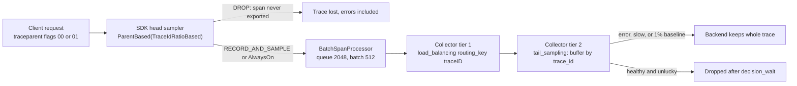

# Trace Sampling at High QPS: ParentBased Head Sampling vs Collector Tail-Based Sampling (Always Keeping 5xx Errors and High-Latency Outliers)

> [!summary] Claim
> A head sampler must decide when the root span starts, before the outcome exists, so at a 1% ratio it keeps about 1% of your `5xx` traces; a tail sampler decides after the trace is complete and can keep 100% of errors and slow outliers, but only if every span of a trace reaches one stateful collector inside a bounded decision window.

Part of [Observability Profiling and Operations](README.md) in [API Engineering](../README.md).

## TL;DR

- Mechanism: head sampling is `Sampler.should_sample` at span creation, propagated to children in the `sampled` bit of `traceparent`; tail sampling buffers all spans by `trace_id` in a collector and applies policies to the finished trace.
- Contract rule: the `sampled` flag and `IsRecording` are different things, and an exporter only receives spans with the flag set, so a span dropped at the head is gone for every later stage.
- Trap: any head sampling in front of a tail tier silently removes errors before the tail tier can see them; the SDK in front of a tail tier must export everything.
- Portability fact: `TraceIdRatioBased` is not defined to agree across SDKs, the Collector `tail_sampling` processor is `beta` and stateful (as of 2026-11), and every lab result here ran on one CPython (3.14.6) only.
- When not to use tail sampling: low QPS (keep 100%), no capacity to run a two-tier stateful collector, or a hard requirement that sampled data never leave the process.

## Mental model



The head sampler on the left is cheap and stateless but irreversible: a `DROP` there removes the trace from every downstream stage, which is why the arrow to the lost-trace node exists.
To keep errors, the SDK must instead send every span (`AlwaysOn`, the SDK default) to a first collector tier whose `load_balancing` exporter hashes the `trace_id` so all spans of one trace land on the same second-tier instance.
That instance holds the spans for `decision_wait` (or less after the root span arrives, but only when `decision_wait_after_root_received` is set; it defaults to `0s`, disabled), evaluates its policies against the whole trace, and either forwards the trace or discards it.
The price is moved from the backend to the pipeline: you ingest, transport, and buffer 100% of spans, and you operate a stateful tier.

## How it works

### The two flags and the decision enum

The tracing SDK specification defines two properties that are easy to conflate (OpenTelemetry specification, `specification/trace/sdk.md`, section "Sampling").
`IsRecording` says whether the span keeps attributes, events, and status, and a `SpanProcessor` receives only spans where it is true.
The `Sampled` flag in `TraceFlags` is propagated to children through `SpanContext`, means "this span will be exported", and `SpanExporter` implementations MUST receive spans where it is set and SHOULD NOT receive the others.
The specification's reaction table allows three combinations: recording and sampled (processor and exporter both see it), recording and not sampled (processor only), and not recording and not sampled (nobody); not recording but sampled is not allowed.

A sampler returns one of three decisions (`opentelemetry-sdk 1.45.2 opentelemetry/sdk/trace/sampling.py, Decision`): `DROP` (`IsRecording` false), `RECORD_ONLY` (recording, `Sampled` flag unset), and `RECORD_AND_SAMPLE` (recording, flag set).
`Tracer.start_span` calls `self.sampler.should_sample(context, trace_id, name, kind, attributes, links)`, sets `TraceFlags.SAMPLED` only when `decision.is_sampled()`, and creates a real `_Span` only when `decision.is_recording()`; otherwise it returns a `NonRecordingSpan` (`opentelemetry-sdk 1.45.2 opentelemetry/sdk/trace/__init__.py, Tracer.start_span`).
Both `SimpleSpanProcessor.on_end` and `BatchSpanProcessor.on_end` begin with `if not (span.context and span.context.trace_flags.sampled):` followed by `return` (`opentelemetry-sdk 1.45.2 opentelemetry/sdk/trace/export/__init__.py, SimpleSpanProcessor.on_end and BatchSpanProcessor.on_end`), so a `RECORD_ONLY` span reaches custom processors but never the exporter.

### W3C Trace Context carries the head decision

The `traceparent` header ends in `trace-flags`; bit `00000001` is the sampled flag and bit `00000010` is the random-trace-id flag (W3C Trace Context Level 2, Section 3.2.2.5).
`traceparent: 00-<32 hex trace-id>-<16 hex parent-id>-01` means the caller sampled the request; `-00` means it did not.
The specification says a component that made a definitive recording decision SHOULD reflect it in the flag, a component that needs a decision SHOULD respect the incoming flag, and a component that deferred its decision should propagate the flag unchanged with 0 as the default for traces it initiates (W3C Trace Context Level 2, Section 3.2.2.5.1).
The sampled flag may only be mutated when `parent-id` is updated, and "A component may also fall back to probability sampling and set the sampled flag to 1 for the subset of requests" (same section).
If the random-trace-id flag is set, at least the right-most 7 bytes of `trace-id` MUST be uniformly random over `[0..2^56-1]` (W3C Trace Context Level 2, Section 3.2.2.5.2), which is what makes ratio samplers on the trace ID well defined.

### ParentBased: the production head sampler

`ParentBased` is a decorator with five branches (OpenTelemetry specification, `specification/trace/sdk.md`, section "ParentBased"; `opentelemetry-sdk 1.45.2 opentelemetry/sdk/trace/sampling.py, ParentBased.should_sample`):

| Parent | `is_remote` | `sampled` | Delegate (default) |
|---|---|---|---|
| absent | n/a | n/a | `root` (required) |
| present | true | true | `remote_parent_sampled` (`ALWAYS_ON`) |
| present | true | false | `remote_parent_not_sampled` (`ALWAYS_OFF`) |
| present | false | true | `local_parent_sampled` (`ALWAYS_ON`) |
| present | false | false | `local_parent_not_sampled` (`ALWAYS_OFF`) |

The default sampler of the SDK is `ParentBased(root=AlwaysOn)`, and `OTEL_TRACES_SAMPLER` defaults to `parentbased_always_on` (`opentelemetry-sdk 1.45.2 opentelemetry/sdk/trace/sampling.py, _get_from_env_or_default`).
`ParentBased(TraceIdRatioBased(0.01))` therefore samples 1% of roots and follows the flag everywhere else, which gives complete traces: either every service records the trace or none does.
In the pinned SDK, `ParentBased.should_sample` forwards `parent_context`, `trace_id`, `name`, `kind`, `attributes`, and `links` to the delegate but not `trace_state`.

The ratio sampler is the part that differs between implementations.
`TraceIdRatioBased` in the Python SDK computes its bound as `round(rate * (cls.TRACE_ID_LIMIT + 1))` with `TRACE_ID_LIMIT = (1 << 64) - 1`, that is `round(rate * 2**64)`, and samples when `trace_id & self.TRACE_ID_LIMIT < self.bound` (`opentelemetry-sdk 1.45.2 opentelemetry/sdk/trace/sampling.py, TraceIdRatioBased.get_bound_for_rate and TraceIdRatioBased.should_sample`).
The specification states that the exact algorithm "was never specified", that it is not defined to be compatible with any other SDK, and recommends it only for root spans under `ParentBased`; it also marks `TraceIdRatioBased` deprecated in favor of `ProbabilitySampler` (status Development), and forbids implementors from removing or changing it before 2027-01-01 (OpenTelemetry specification, `specification/trace/sdk.md`, sections "TraceIdRatioBased", "Compatibility warnings for `TraceIdRatioBased` sampler", and "ProbabilitySampler", as of 2026-11).
The monotonic property is required (section "Requirements for `TraceIdRatioBased` sampler algorithm"): a sampler at probability `p1` must also sample everything sampled at any `p2 < p1`, so a backend can run a higher ratio than a frontend and still see all frontend traces.

`ProbabilitySampler` and the consistent-sampling spec replace the unspecified hash with a rule that every participant can evaluate.
It uses a 56-bit randomness value `R` (the trailing 7 bytes of the trace ID, or an explicit `rv` in the `ot` member of `tracestate`) and a 56-bit rejection threshold `T = (1 - p) * 2^56`, and keeps the span when `R >= T`; the minimum probability is `2^-56`.
A span sampled at 1% carries `ot=th:fd70a4`, because the threshold at 5 hex digits of precision, `0xfd70a400000000`, is written with trailing zeros removed (OpenTelemetry specification, `specification/trace/tracestate-probability-sampling.md`, sections "Rejection Threshold (T)" and "Decision algorithm").
That `th` value is what lets a later stage compute an adjusted count, which matters in the section on bias below.

### Why a head sampler cannot keep errors

At the moment `should_sample` runs, the request has not been routed, executed, or answered, so the sampler cannot condition on the status code or the duration.
The best it can do is condition on inputs available at creation: the trace ID, the span name, the span kind, and the initial attributes.
The probability that a given `5xx` trace is kept therefore equals the root ratio, independent of the error.
Section "Worked example" measures this: 1 of 100 error traces survives a 1% head sampler on 20,000 requests.

### Tail sampling: what the Collector processor does

The `tail_sampling` processor of `opentelemetry-collector-contrib` groups spans by `trace_id` and evaluates policies on the accumulated trace (processor README, as of 2026-11).
Its stability is `beta` for traces, and it carries a Statefulness warning: all spans for a trace MUST reach the same Collector instance.
Decision flow per trace (README, "Policy Decision Flow"): a `drop` decision means not sampled; a `sample` decision means sampled; every other case is not sampled; deprecated "inverted" decisions from `invert_match` are handled separately.
Policies relevant to this note:

| Policy | Semantics from the README |
|---|---|
| `status_code` | sample on span status `OK`, `ERROR`, or `UNSET` |
| `latency` | duration is earliest span start to latest span end, "without taking into consideration what happened in between"; no upper bound means anything above `threshold_ms` |
| `probabilistic` | by default FNV-1a of the trace ID with `hash_salt`; with the `processor.tailsamplingprocessor.usetracestate` feature gate, consumes and rewrites `rv` and `th` |
| `ottl_condition` | boolean OTTL on span or span event, for example `span.attributes["http.response.status_code"] >= 500` |
| `drop` | not sampled even if other policies sampled |
| `and`, `not`, `composite` | combinators; `composite` allocates a share of `max_total_spans_per_second` per sub-policy |
| `rate_limiting`, `bytes_limiting` | token buckets (`golang.org/x/time/rate`) on spans per second or protobuf bytes per second |

The knobs that bound resources (README, defaults as of 2026-11; `decision_wait` and `num_traces` defaults confirmed in `opentelemetry-collector-contrib v0.165.1 processor/tailsamplingprocessor/factory.go, createDefaultConfig`, and `block_on_overflow` exists in `config.go, Config.BlockOnOverflow` at that tag although the README documents it only on `main` after the release): `decision_wait` 30s, `num_traces` 50000, `block_on_overflow` false, `decision_cache.sampled_cache_size` 0 and `non_sampled_cache_size` 0 (cache inactive), `num_shards` 1 with a maximum of 256, `sampling_strategy` `trace-complete` (alternative `span-ingest`, which evaluates each incoming batch immediately and rejects stateful policies), `decision_wait_after_root_received` 0s (disabled), and `maximum_trace_size_bytes` to drop oversized traces.
A circular buffer holds `num_traces` traces; when a new trace arrives at capacity and `block_on_overflow` is false, the oldest trace is evicted before it was sampled, and `otelcol_processor_tail_sampling_sampling_trace_dropped_too_early` counts it (README, "Dropped Traces" and FAQ).
The README lists three late-span scenarios: a late span whose trace decision is still in the buffer inherits it; with no decision cache, once the decision leaves the buffer "it's as if this component has never seen the trace before" and the late span is buffered for `decision_wait` and decided again; with a decision cache a remembered keep decision is reused (README, "Late-Arriving Spans").
The Go source at the latest release (`opentelemetry-collector-contrib v0.165.1 processor/tailsamplingprocessor/processor.go`, as of 2026-11) matches: `processCachedTrace` runs first for every incoming trace batch and forwards it on a `sampledIDCache` hit or discards it on a `nonSampledIDCache` hit, so the non-sampled cache also remembers drops; `processTrace` stores new traces in the `idToTrace` map and appends the ID to the FIFO `deleteTraceQueue`; and when `len(idToTrace) >= NumTraces`, `waitForSpace` drops the front (oldest) trace unless `blockOnOverflow` is set.
Decisions are made on a one-second ticker over `decision_wait` seconds of ID batches (`Start` creates `max(1, DecisionWait.Seconds())` batches); a batch that contains a span with an empty parent span ID moves the trace to an earlier batch only when `DecisionWaitAfterRootReceived > 0` (`processTrace`), so by default the root's arrival does not speed up the decision.

A policy set for the requirement of this note, composed from the README syntax; every key exists as a `mapstructure` tag in `opentelemetry-collector-contrib v0.165.1 processor/tailsamplingprocessor/config.go`, but the file was not run against a real Collector here, so treat the numbers as illustrative:

```yaml
processors:
  tail_sampling:
    decision_wait: 10s
    num_traces: 200000
    expected_new_traces_per_sec: 5000
    decision_cache:
      sampled_cache_size: 500000
      non_sampled_cache_size: 2000000
    policies:
      - name: drop-probes
        type: drop
        drop:
          drop_sub_policy:
            - name: probe-routes
              type: string_attribute
              string_attribute: { key: http.route, values: [/healthz, /readyz] }
      - name: errors
        type: status_code
        status_code: { status_codes: [ERROR] }
      - name: slow
        type: latency
        latency: { threshold_ms: 500 }
      - name: baseline
        type: probabilistic
        probabilistic: { sampling_percentage: 1 }
```

`status_code: ERROR` catches `5xx` only if instrumentation sets the span status; the ASGI instrumentation does for server spans, where `set_status_code` calls `_set_status(..., server_span=True)` and `http_status_to_status_code(status, server_span=True)` maps `500` and above (and anything below `100`) to `ERROR` and leaves `4xx` as `UNSET` (`opentelemetry-instrumentation 0.66b2 opentelemetry/instrumentation/utils.py, http_status_to_status_code`; `opentelemetry-instrumentation 0.66b2 opentelemetry/instrumentation/_semconv.py, _set_status`).

### Getting every span of a trace to one instance

The `load_balancing` exporter exists for this (load balancing exporter README, as of 2026-11).
With no `routing_key` set, traces route by `traceID`; other keys are `service`, `resource`, `attributes`, `metric`, `streamID`, and `randomness`.
Backends come from a `static` list, a `dns` hostname (resolved every `5s` by default, `1s` timeout), a `k8s` service, or `aws_cloud_map`.
The README states that the choice depends only on the key, not on backend load, with a standard deviation under 5% across backends, and that when the backend list changes about R/N of the routes (R routes, N backends) are rerouted.
The mechanism is a consistent hash ring "following Karger et al.": CRC32 of the routing key modulo `maxPositions = 131071`, with `defaultWeight = 200` ring points per endpoint (`opentelemetry-collector-contrib v0.165.1 exporter/loadbalancingexporter/consistent_hashing.go, hashRing.endpointFor`).
By default it does not re-route data to a healthy endpoint on delivery failure because the queue, retry, and timeout settings are disabled by default, and the processor README recommends two collector layers rather than two pipelines in one instance for failure isolation.
So every scale event, deploy, or DNS update opens a window in which spans of one trace can land on two instances, and each instance then decides on a fragment.

## Numbers and limits

| Quantity | Value | Source or how measured |
|---|---|---|
| Default SDK sampler | `ParentBased(root=AlwaysOn)` | spec "Built-in samplers"; `opentelemetry-sdk 1.45.2 sampling.py` (as of 2026-11) |
| `TraceIdRatioBased` bound | `round(rate * 2**64)` on the low 64 bits | `opentelemetry-sdk 1.45.2 sampling.py, TraceIdRatioBased` |
| `ProbabilitySampler` randomness | 56 bits; minimum ratio `2^-56`; 1% is `th:fd70a4` | spec `tracestate-probability-sampling.md` |
| `BatchSpanProcessor` defaults | queue 2048, batch 512, delay 5000 ms, export timeout 30000 ms | `opentelemetry-sdk 1.45.2 export/__init__.py` |
| `tail_sampling` defaults | `decision_wait` 30s, `num_traces` 50000, caches 0, `num_shards` 1 (max 256) | processor README (as of 2026-11) |
| Max new traces per second per instance at defaults | 50000 / 30 s = 1,666 | derived: in-flight traces = arrival rate x `decision_wait` (see [[Capacity-Planning-with-Littles-Law-and-the-Universal-Scalability-Law]]) |
| Kept volume of a tail sampler | `r*(N - E - S) + E + S` for ratio `r`, errors `E`, slow `S` of `N` | arithmetic; measured below |
| Head 1% on 20,000 requests (100 errors, 179 slow) | 181 traces kept; 1 of 100 errors; 1 of 179 slow | lab, `run_pipeline` (ID seed 7, workload seed 11) via a one-off `uv run --frozen python` script from `labs/`, re-run 2026-11-21 by the verifier on macOS 27.3 (Darwin 27.3.0) arm64, CPython 3.14.6 |
| Tail 1% baseline, same workload | 458 traces kept; 100 of 100 errors; 179 of 179 slow | same run |
| Volume cost of the guarantee | 458 / 181 = 2.5x the head-sampled traces | same run, derived |
| Reroute on 4 -> 5 backends, modulo | 79.52% of 20,000 trace IDs moved | lab, `reroute_fraction`, seed 1 |
| Reroute on 4 -> 5 backends, rendezvous | 19.75% moved | same run |

The rendezvous and modulo rows are a model of routing stability, not a measurement of the Collector's own algorithm, which is a CRC32 consistent hash ring (see above) that the README describes as moving "around R/N" of routes; rendezvous hashing has the same expected 1/(N+1) movement on adding one backend, which is why it stands in here.
The measured 2.5x is specific to a workload with 0.5% errors and 0.9% slow requests; at 0.01% outliers the tail volume approaches the baseline, and at 10% errors it approaches 100%.

## Portability

| Cell | Result | Proof |
|---|---|---|
| CPython 3.14.6, macOS 27.3 (Darwin 27.3.0) arm64, `opentelemetry-sdk 1.45.2` | 17 of 17 lab tests pass | ran `uv run --frozen pytest ...` (see Worked example) |
| CPython 3.12, 3.13, 3.15, 3.15 free-threaded | not run | lab checks were paused on 2026-11-11; no result claimed |
| The matrix patch versions in STYLE (3.14.10 and others) | not the interpreter used | this machine's `.venv` is 3.14.6 |
| Free-threaded builds | `TailBufferProcessor` uses unlocked `OrderedDict`s and is not thread-safe | design inspection; the SDK calls `on_end` synchronously on the ending thread (`SpanProcessor.on_end` docstring), so a real processor needs a lock |
| Other language SDKs | `TraceIdRatioBased` results may differ for the same trace ID | spec compatibility warning, `sdk.md` "Compatibility warnings for TraceIdRatioBased" |
| Collector `tail_sampling` | `beta`, stateful | processor README (as of 2026-11); not run here |
| Uvicorn, Hypercorn, Granian | not run | the lab middleware is plain ASGI and was driven only through `httpx.ASGITransport` |
| HTTP/1.1, HTTP/2, HTTP/3 | not exercised | sampling logic does not depend on the HTTP version; the header transport was not tested |
| Status attribute names | `http.status_code` (default) and `http.response.status_code` (opt-in) | `opentelemetry-instrumentation 0.66b2 _semconv.py, _report_old`; the lab policy reads both and the span status |

## Worked example

The implementation is [implementation](../labs/src/api_labs/f18_observability_profiling_and_operations/trace_sampling_strategies.py) and the proof is [test](../labs/tests/f18_observability_profiling_and_operations/test_trace_sampling_strategies_head_based_vs_tail_based_sampling.py).
It models three things on the real SDK: `ParentBased(TraceIdRatioBased)` as the head, `AlwaysRecordSampler` plus an in-process `TailBufferProcessor` as the tail, and consistent routing by trace ID.
The processor is an in-process teaching model of the Collector behavior, so it only sees spans of one process; cross-service completeness needs the collector tier.
It decides the moment the local root span ends, which matches a Collector only with `decision_wait_after_root_received` set; the Collector default waits the full `decision_wait`, which the lab models only for orphan traces through `flush_expired`.

Simplified excerpt of the head and record-all samplers and of the policy evaluation:

```python
def head_sampler(ratio: float) -> Sampler:
    return ParentBased(TraceIdRatioBased(ratio))


def record_all_sampler(ratio: float) -> Sampler:
    return AlwaysRecordSampler(head_sampler(ratio))


def evaluate_trace(spans: Sequence[ReadableSpan], policy: TailPolicy) -> tuple[bool, str]:
    for span in spans:
        if (span.attributes or {}).get(ROUTE_ATTR) in policy.drop_routes:
            return False, "drop"
    if any(_is_error(s, policy) for s in spans):
        return True, "error"
    starts = [s.start_time for s in spans if s.start_time is not None]
    ends = [s.end_time for s in spans if s.end_time is not None]
    if starts and ends and max(ends) - min(starts) > policy.latency_threshold_ns:
        return True, "latency"
    if spans and baseline_keep(trace_id_of(spans[0]), policy.baseline_ratio):
        return True, "baseline"
    return False, "dropped"
```

Simplified excerpt of the buffer (eviction, late spans, decision on local root end):

```python
def on_end(self, span: ReadableSpan) -> None:
    trace_id = trace_id_of(span)
    cached = self._decided.get(trace_id)
    if cached is not None:                      # decision cache hit: late span
        self._decided.move_to_end(trace_id)
        self.stats.late_spans_inherited += 1
        if cached:
            self._exporter.export((span,))
        return
    entry = self._pending.get(trace_id)
    if entry is None:
        if len(self._pending) >= self._num_traces:
            self._pending.popitem(last=False)   # circular buffer: oldest trace evicted
            self.stats.evicted_too_early += 1
        entry = _Pending([], self._clock())
        self._pending[trace_id] = entry
    entry.spans.append(span)
    if span.parent is None or span.parent.is_remote:
        self._decide(trace_id)                  # local root ended
```

Measured output of `run_pipeline` on the same 20,000-request workload (`generate_workload(20_000, seed=11, error_rate=0.005, slow_rate=0.01)`) and of `reroute_fraction` on 20,000 IDs from `random.Random(1)`, captured with a one-off script run by `uv run --frozen python` from `labs/` (macOS 27.3 arm64, CPython 3.14.6, 2026-11-21) and removed afterwards:

```text
RunResult(mode='head', total=20000, total_errors=100, total_slow=179, kept_traces=181, kept_errors=1, kept_slow=1, spans_exported=362)
RunResult(mode='tail', total=20000, total_errors=100, total_slow=179, kept_traces=458, kept_errors=100, kept_slow=179, spans_exported=916)
modulo 4->5 0.7952
hrw 4->5 0.1975
```

Measured output of a one-off probe for the attribute trap described under Pitfalls (`start_span("x", attributes={"a": 1})` then `set_attribute("b", 2)` under `record_all_sampler(0.0)` and `record_all_sampler(1.0)`, then the exact snippet of the L6 predict-the-output question), from the same run:

```text
record_all {'b': 2}
record_all_1.0 {'a': 1, 'b': 2}
{'b': 2} True False
```

The same run drove the stock ASGI instrumentation (`OpenTelemetryMiddleware` over a one-route Starlette app, `AlwaysRecordSampler(ParentBased(TraceIdRatioBased(ratio)))`, one `GET /ok` through `httpx.ASGITransport`) and printed the server span's `sampled` flag and attribute keys:

```text
asgi ratio=0.0 False ['http.flavor', 'http.host', 'http.method', 'http.scheme', 'http.server_name', 'http.status_code', 'http.target', 'http.url', 'http.user_agent', 'net.peer.ip', 'net.peer.port']
asgi ratio=1.0 True ['http.flavor', 'http.host', 'http.method', 'http.scheme', 'http.server_name', 'http.status_code', 'http.target', 'http.url', 'http.user_agent', 'net.peer.ip', 'net.peer.port']
```

What each test pins:

| Test | Claim |
|---|---|
| `test_parentbased_follows_remote_sampled_flag_over_the_ratio` | a remote sampled parent forces `RECORD_AND_SAMPLE` at ratio 0.0; a remote unsampled parent forces `DROP` at ratio 1.0 |
| `test_bare_ratio_sampler_ignores_the_parent_flag` | `TraceIdRatioBased` alone drops a sampled remote parent |
| `test_ratio_sampling_is_monotonic_across_ratios` | the 1% set is a strict subset of the 10% set and its size is in `[100, 300]` of 20,000 |
| `test_record_all_sampler_reaches_processors_but_not_the_exporter` | `RECORD_ONLY`: recording, flag unset, processor sees it, `SimpleSpanProcessor` exports nothing |
| `test_plain_head_sampler_never_records_dropped_spans` | without `AlwaysRecord` a dropped span is not recording and processors never see it |
| `test_head_sampling_loses_errors_while_tail_keeps_every_error_and_slow_trace` | head keeps under 5% of errors; tail keeps 100% of errors and slow traces and under `E+S+2%` of healthy |
| `test_drop_route_overrides_error_retention` | a `500` on `/healthz` is dropped while a `500` on `/orders` is kept |
| `test_latency_uses_earliest_start_to_latest_end_not_span_sum` | two 50 ms spans 700 ms apart make a 750 ms trace and are kept, adjacent ones are not |
| `test_record_only_spans_lose_creation_time_attributes_but_keep_later_ones` | the attribute trap, both at ratio 0.0 and 1.0 |
| `test_buffer_overflow_evicts_oldest_trace_and_a_late_root_is_judged_alone` | eviction count is 2 and the evicted trace's late root is exported without its child |
| `test_late_span_inherits_cached_keep_decision` | with a decision cache the late child is exported with its kept trace |
| `test_late_span_without_cache_is_buffered_and_lost_to_the_baseline` | with no cache the late child is re-buffered and, being a healthy fragment, is dropped |
| `test_decision_wait_decides_orphan_traces_only_after_expiry` | an orphan trace is undecided at `decision_wait - 1 ms` and decided at `decision_wait` |
| `test_unweighted_scale_up_overestimates_while_stratified_estimate_is_close` | `kept / ratio` overshoots by more than 1.5x; the stratified estimate is within 15% |
| `test_rendezvous_hashing_moves_far_fewer_traces_than_modulo_on_scale_out` | modulo moves over 70%, rendezvous 15% to 25% |
| `test_trace_id_routing_keeps_a_trace_on_one_collector_and_span_id_routing_splits_it` | routing by trace ID gives one backend per trace, routing by span ID splits it |
| `test_asgi_tail_keeps_the_500_and_the_slow_request_and_drops_the_fast_200s` | an ASGI `TracingMiddleware` over Starlette keeps `/boom` (status `500`) and `/slow` and drops `/ok` |

Captured on 2026-11-21 by the verifier, from `labs/`, CPython 3.14.6, macOS 27.3 (Darwin 27.3.0) arm64, `pytest 9.2.0`:

```text
$ uv run --frozen pytest tests/f18_observability_profiling_and_operations/test_trace_sampling_strategies_head_based_vs_tail_based_sampling.py -q
.................                                                        [100%]
17 passed in 1.78s
```

Not proven here: the tests were not mutation-tested, and `ruff`, `mypy`, and `pyright` were not re-run by the verifier, because the user paused those lab checks on 2026-11-11.

## Pitfalls

> [!warning] Head sampling in front of the tail tier deletes the errors you wanted
> Trigger: an SDK configured with `ParentBased(TraceIdRatioBased(0.01))` exporting to a Collector that runs `tail_sampling` with an `ERROR` policy.
> Symptom: the tail tier reports a healthy keep rate, yet about 99% of error traces never arrive; the lab shows 1 of 100.
> Cause: `DROP` makes `IsRecording` false and the processors never see the span, and `Simple` and `Batch` processors skip any span whose `sampled` flag is unset (`opentelemetry-sdk 1.45.2 export/__init__.py, on_end`).
> Fix: use `ParentBased(AlwaysOn)` (the default) in the SDK when a tail tier exists, and do the ratio sampling in the tail tier's `probabilistic` policy.

> [!warning] Round-robin in front of the tail tier produces fragments
> Trigger: a plain Kubernetes `Service` or round-robin load balancer between the first and second collector tier, or the `load_balancing` exporter with `routing_key: service`.
> Symptom: error spans appear without their root, a `latency` policy never fires because each instance sees a slice of the trace, and traces in the backend are incomplete.
> Cause: the processor decides per instance on what it received, and the README requires all spans of a trace on the same instance.
> Fix: two tiers, `routing_key: traceID` (the default for traces), and a headless service or the `k8s` resolver; the lab test `test_trace_id_routing_keeps_a_trace_on_one_collector_and_span_id_routing_splits_it` pins the property.

> [!warning] `num_traces` smaller than arrival rate times `decision_wait`
> Trigger: the default `num_traces: 50000` and `decision_wait: 30s` at more than 1,666 new traces per second per instance, or a traffic surge.
> Symptom: `otelcol_processor_tail_sampling_sampling_trace_dropped_too_early` rises, and a trace whose root arrives after eviction is decided on a fragment (the lab exports `r0` without its child).
> Cause: the oldest trace is evicted when the buffer is full and `block_on_overflow` is false.
> Fix: size `num_traces` from Little's Law, watch `sampling_trace_removal_age` against `decision_wait` (the README suggests the p1 of the removal age), and shorten `decision_wait` or set `decision_wait_after_root_received`.

> [!warning] Late spans and the decision cache
> Trigger: async work, queue consumers, or slow downstream spans that end after the root, with `decision_cache` left at its default of 0.
> Symptom: a kept error trace is missing its tail spans, or the late spans appear alone as a separate low-value trace.
> Cause: after the decision leaves the buffer, the processor treats the late span as a new trace and buffers it for `decision_wait` (README scenario 2); the lab test `test_late_span_without_cache_is_buffered_and_lost_to_the_baseline` reproduces it.
> Fix: set `sampled_cache_size` and `non_sampled_cache_size` well above `num_traces`, so decisions outlive span data (the README's own advice); in `v0.165.1` the non-sampled cache also makes late spans of dropped traces get discarded instead of re-buffered (`processor.go, processCachedTrace`).

> [!warning] `RECORD_ONLY` spans lose attributes passed to `start_span`
> Trigger: an in-process tail design that wraps the sampler in `AlwaysRecordSampler` so processors see every span.
> Symptom: policies keyed on creation-time attributes (route, method) never match; attributes set later (status code) do.
> Cause: in `opentelemetry-sdk 1.45.2`, `Tracer.start_span` builds the span's initial attributes from `sampling_result.attributes`, and the stock `StaticSampler` and `TraceIdRatioBased` set `attributes = None` on `DROP`, so `AlwaysRecordSampler` passes on `None`; measured above.
> The stock ASGI instrumentation is not affected: it passes its request attributes to `start_span` (`opentelemetry-instrumentation 0.66b2 opentelemetry/instrumentation/utils.py, _start_internal_or_server_span`), but `OpenTelemetryMiddleware.__call__` then re-applies each one with `set_attribute` when `current_span.is_recording()` (`opentelemetry-instrumentation-asgi 0.66b2 opentelemetry/instrumentation/asgi/__init__.py, OpenTelemetryMiddleware.__call__`), and the probe above shows identical attribute keys at ratio 0.0 and 1.0.
> The trap therefore hits hand-written instrumentation and any other library that relies only on `start_span(attributes=...)`.
> Fix: set attributes after `start_span`, as the ASGI instrumentation and the lab's `emit_request` do, or wrap the sampler in a custom one that returns the attributes with `RECORD_ONLY`.

> [!warning] Status attribute name drift
> Trigger: a policy written against `http.response.status_code` while the instrumentation emits `http.status_code`.
> Symptom: `numeric_attribute` and `ottl_condition` error policies never match.
> Cause: the ASGI instrumentation emits only the old name when `OTEL_SEMCONV_STABILITY_OPT_IN` is unset, only the new name with `http`, and both with `http/dup` (`opentelemetry-instrumentation 0.66b2 opentelemetry/instrumentation/_semconv.py, _report_old, _report_new, and _OpenTelemetrySemanticConventionStability._filter_mode`); the probe above shows `http.status_code` under the default, and the lab's `_is_error` accepts both names for that reason.
> Fix: key the error policy on the span status `ERROR` first (stable across naming), and treat the attribute as a fallback; see [[RED-and-USE-Metrics-and-OpenTelemetry-HTTP-Semantic-Conventions]].

> [!warning] Scale events and deploys split traces
> Trigger: scaling the tail tier, rolling it, or a DNS update with the default 5 s `dns` interval.
> Symptom: a burst of fragment decisions and partial traces for the transition window.
> Cause: roughly R/N of trace routes change on a backend-list change, and the README notes a window where the exporter's view does not match the real topology.
> Fix: change the tail tier slowly, use the `k8s` resolver (which "will update more quickly than `dns`"), keep `decision_wait` short, and alert on `dropped_too_early`.

> [!warning] Metrics computed from sampled data are biased
> Trigger: a `rate()` panel or an SLI built on span counts after the tail tier.
> Symptom: error rate is overstated because errors are kept at 100% and healthy traces at 1%; multiplying the kept count by `1/ratio` overshoots (the lab estimator test shows more than 1.5x).
> Fix: compute RED metrics before sampling, which is the stated purpose of `AlwaysRecord` ("accurate span-to-metrics processing", spec section "AlwaysRecord"), or weight kept traces by stratum (`estimate_total`); see [[Latency-Histograms-Percentiles-DDSketch-and-Why-Averaging-Percentiles-Is-Wrong]] and [[SLIs-SLOs-Error-Budgets-and-Multi-Window-Burn-Rate-Alerting]].

> [!warning] `sample_on_first_match` with `usetracestate`
> Trigger: enabling `processor.tailsamplingprocessor.usetracestate` together with `sample_on_first_match`.
> Symptom: adjusted counts downstream are wrong.
> Cause: stopping at the first match can skip a later policy that would have reported a less strict threshold (README, "Tracestate handling").
> Fix: do not combine them.

## Security and robustness

- Forged sampling flags: the W3C specification warns that naively continuing every trace whose sampled flag is set lets an attacker "overwhelm an application with tracing overhead, forge trace-id collisions", or "run up your tracing bill", and suggests different behavior for authenticated and unauthenticated requests and rate limiters on recording (W3C Trace Context Level 2, Section 7.2).
  At a public edge, configure `ParentBased` with a `remote_parent_sampled` delegate that applies a ratio instead of `ALWAYS_ON`, so callers cannot force recording; the constructor arguments exist in the SDK (`opentelemetry-sdk 1.45.2 sampling.py, ParentBased.__init__`).
  The cost is that a legitimate upstream's decision is no longer honored, so traces crossing that boundary are incomplete.
- Buffer exhaustion: the circular buffer evicts the oldest trace first, so a flood of short-lived unfinished traces can push legitimate error traces out before they are decided; `num_traces`, `maximum_trace_size_bytes`, a `rate_limiting` or `bytes_limiting` policy, and authentication on the OTLP receiver bound this.
- Retained data sensitivity: tail sampling concentrates the traces that carry exception messages, stack traces, and request fragments, so the retained set is richer in sensitive data than a random 1%; scrub attributes before the tail tier or in the backend, and note that `tracestate` "may imply the version of monitoring software used by the caller" (W3C Trace Context Level 2, Section 7.1).
- Trace ID collisions and forged IDs: an attacker who sets a trace ID can place spans into another trace or force a routing key to one backend; the `randomness` routing key is documented as producer-chosen and unbounded per key (load balancing exporter README).
- Defense in depth: head sampling at the edge for unauthenticated traffic, tail sampling for the rest, a `drop` policy for health probes, and alerts on `otelcol_processor_tail_sampling_sampling_trace_dropped_too_early` and `sampling_late_span_age`.
- OWASP API Security: telemetry amplification is an instance of API4:2023 Unrestricted Resource Consumption, whose impacts include "operational costs increase" and whose prevention list includes spending limits and billing alerts for third-party service providers (OWASP API Security Top 10 2023, API4:2023); a tracing vendor bill is such a third-party cost.

## The principal's view

The decision is not "head or tail"; it is where you pay for completeness and who operates the state.
Head sampling moves cost to zero at the price of blindness, tail sampling moves it into a stateful, per-trace-affine tier that your platform team must run like a database.
My default for a service above a few thousand requests per second that must retain every `5xx` and every request over its latency SLO is: SDK `ParentBased(AlwaysOn)`, a stateless agent or gateway tier, a `load_balancing` tier keyed by `traceID`, a `tail_sampling` tier with error, latency, `drop`, and baseline policies, and RED metrics computed upstream of all sampling.
At 20,000 requests per second with the lab's 0.5% errors and 0.9% slow traffic, the derived retained rate is about 2.3% of traces, roughly 460 traces per second, against 200 per second for a plain 1% head sampler; the budget conversation is about that 2.5x multiplier and the pipeline cost of carrying 100% of spans to the tail tier, which the lab does not measure.
The organizational trade-off is on-call: the tail tier needs capacity planning from [[Capacity-Planning-with-Littles-Law-and-the-Universal-Scalability-Law]], its own SLOs, and a deploy discipline that avoids fragment storms.
Choose differently when the pipeline cost of 100% span transport is the constraint: head-sample at a high ratio, keep canonical request logs for every request ([[Structured-Logging-with-Structlog-and-Stripe-Canonical-Log-Lines]]), and use metrics and exemplars for the long tail, accepting that individual error traces are mostly gone.
Choose pure head sampling at 100% below roughly the volume where storage is a rounding error, since the simplest correct system keeps everything.
During an incident, the first question is whether the traces you need survive sampling at all, which is the discipline of [[The-Sixty-Second-API-Incident-Triage-Playbook]].

## Interview questions

> [!question] L5: What is the difference between head-based and tail-based sampling, and why can a head sampler not keep all errors?
>
> > [!success]- Answer
> > A head sampler decides when the root span is created and propagates the decision in the `sampled` flag of `traceparent`.
> > At that moment the response status and duration do not exist, so the probability of keeping an error trace equals the root ratio.
> > A tail sampler buffers spans by trace ID and decides after the trace completes, so it can condition on status and latency.
> >
> > Follow-up: What does the tail approach cost that the head approach does not?

> [!question] L5: What does `ParentBased(TraceIdRatioBased(0.0))` do with an incoming `traceparent` ending in `-01`?
>
> > [!success]- Answer
> > The parent is remote and sampled, so `remote_parent_sampled` runs, which defaults to `ALWAYS_ON`.
> > The result is `RECORD_AND_SAMPLE` even though the root ratio is 0.0; the lab test confirms it.
> > A bare `TraceIdRatioBased(0.0)` would return `DROP` because it ignores the parent flag.
> >
> > Follow-up: Why is honoring the caller's flag a risk at a public edge?

> [!question] L5: Why must the SDK export every span when a Collector tail sampler sits behind it?
>
> > [!success]- Answer
> > `BatchSpanProcessor.on_end` returns early for spans without the `sampled` flag, so they never reach the exporter.
> > A head `DROP` also makes the span non-recording.
> > Anything dropped at the head is invisible to the tail tier, so the SDK must use `ParentBased(AlwaysOn)` and leave ratio sampling to the tail tier.
> >
> > Follow-up: What does `AlwaysRecordSampler` change and what does it not change?

> [!question] L6: Predict the output.
>
> ```python
> p = TracerProvider(sampler=AlwaysRecordSampler(ParentBased(TraceIdRatioBased(0.0))))
> s = p.get_tracer("t").start_span("x", attributes={"a": 1})
> s.set_attribute("b", 2)
> print(dict(s.attributes or {}), s.is_recording(), s.get_span_context().trace_flags.sampled)
> ```
>
> > [!success]- Answer
> > It prints `{'b': 2} True False`.
> > The sampler drops at ratio 0.0, `AlwaysRecordSampler` upgrades `DROP` to `RECORD_ONLY`, and the dropping sampler returns `None` attributes, which replace the creation-time attributes, so `a` is lost.
> > The span records, so `set_attribute` works, but the sampled flag stays unset.
> > All three values were measured by running this exact snippet (see Worked example).
> >
> > Follow-up: How would you make creation-time attributes survive?

> [!question] L6: Debug this API: a tail-sampling tier behind a Kubernetes `ClusterIP` Service shows error spans with no root and the `latency` policy never fires; what is wrong?
>
> > [!success]- Answer
> > The first tier distributes spans round-robin, so the spans of one trace reach different second-tier instances, and each instance decides on a fragment.
> > The processor requires all spans of a trace on the same instance.
> > Use a `load_balancing` exporter with `routing_key: traceID` (the trace default) and a headless service or the `k8s` resolver, and confirm with a test that all spans of one trace resolve to one backend.
> >
> > Follow-up: What still goes wrong during a scale-out even with correct routing?

> [!question] L6: How do you size `num_traces` and `decision_wait`?
>
> > [!success]- Answer
> > In-flight traces equal the arrival rate of new traces times the time each is held, so `num_traces` must be at least rate x `decision_wait` with headroom.
> > With the defaults, 50000 / 30 s is 1,666 new traces per second per instance.
> > Watch `sampling_trace_removal_age` against `decision_wait` and alert on `sampling_trace_dropped_too_early`; trade memory for latency by shortening `decision_wait` or enabling `decision_wait_after_root_received`.
> >
> > Follow-up: What breaks if `block_on_overflow` is enabled?

> [!question] L6: Your dashboard multiplies kept trace counts by 100 for a 1% baseline and the error rate looks far too high; why, and what is the fix?
>
> > [!success]- Answer
> > Errors and slow traces are kept at probability 1 by policy, so only the baseline-selected healthy traces represent 100 traces each.
> > The lab shows `kept / ratio` overshooting by more than 1.5x on a 1% error and 2% slow workload.
> > Compute metrics before sampling, or weight by stratum: count error and latency keeps once and baseline keeps `1/ratio`.
> >
> > Follow-up: How does the `th` value in `tracestate` generalize this weighting?

> [!question] L7+: Design sampling for a 200,000 requests per second multi-tenant API with a hard cost cap, a requirement to keep every `5xx` and every request over 500 ms, and public unauthenticated traffic.
>
> > [!success]- Answer
> > Compute RED metrics and canonical log lines for every request before any sampling.
> > At the public edge use `ParentBased` with a ratio for `remote_parent_sampled` so callers cannot force recording, and keep `AlwaysOn` internally so the Collector sees every span.
> > Run a `load_balancing` tier keyed by `traceID` and a sharded `tail_sampling` tier with `drop` for probes, `status_code` `ERROR`, `latency` 500 ms, and a `probabilistic` baseline, with decision caches larger than `num_traces`.
> > Enforce the cap with `rate_limiting` or `bytes_limiting` as the last policy, accepting that bursts of errors can exceed the cap only up to `burst_capacity`, and alert on `dropped_too_early`.
> > The 100% span transport to the tail tier is the cost that is not measured here and must be priced against the cap.
> >
> > Follow-up: What do you do if transport cost alone exceeds the cap?

> [!question] L7+: What does consistent probability sampling add over independent `TraceIdRatioBased` samplers at each hop?
>
> > [!success]- Answer
> > All participants compare the same 56-bit randomness `R` to their rejection threshold `T` and keep when `R >= T`, so a lower-probability decision implies a keep at every higher-probability sampler.
> > That makes mixed ratios in one pipeline preserve sub-trace completeness, and the `th` value in `tracestate` records the effective threshold so adjusted counts remain correct after several stages.
> > `TraceIdRatioBased` was never specified precisely and may disagree across SDKs, which is why the specification deprecates it in favor of `ProbabilitySampler`, still in Development.
> >
> > Follow-up: Why is the hash-based `probabilistic` policy default in `tail_sampling` not compatible with an SDK's ratio sampler?

## Related

Prerequisites: [[Distributed-Tracing-W3C-Trace-Context-and-Baggage-Propagation]]

Next: [[Structured-Logging-with-Structlog-and-Stripe-Canonical-Log-Lines]]

See also: [[02-Programming-Languages/Python/Python-Backend-Interview-Prep/08-Microservices-and-Messaging]]

Also see: [[RED-and-USE-Metrics-and-OpenTelemetry-HTTP-Semantic-Conventions]], [[Latency-Histograms-Percentiles-DDSketch-and-Why-Averaging-Percentiles-Is-Wrong]], [[Capacity-Planning-with-Littles-Law-and-the-Universal-Scalability-Law]], [[SLIs-SLOs-Error-Budgets-and-Multi-Window-Burn-Rate-Alerting]], [[The-Sixty-Second-API-Incident-Triage-Playbook]]

- Lab: `labs/tests/f18_observability_profiling_and_operations/test_trace_sampling_strategies_head_based_vs_tail_based_sampling.py`

## Further reading

- [OpenTelemetry tracing SDK specification, "Sampling"](https://raw.githubusercontent.com/open-telemetry/opentelemetry-specification/main/specification/trace/sdk.md): `IsRecording` vs `Sampled`, `ParentBased`, `TraceIdRatioBased` deprecation, `AlwaysRecord`.
- [OpenTelemetry "TraceState: Probability Sampling"](https://raw.githubusercontent.com/open-telemetry/opentelemetry-specification/main/specification/trace/tracestate-probability-sampling.md): `R >= T`, 56-bit thresholds, `th` encoding, adjusted counts.
- [Tail Sampling Processor README](https://raw.githubusercontent.com/open-telemetry/opentelemetry-collector-contrib/main/processor/tailsamplingprocessor/README.md): policies, decision flow, buffer and cache knobs, metrics, late spans.
- [Load Balancing Exporter README](https://raw.githubusercontent.com/open-telemetry/opentelemetry-collector-contrib/main/exporter/loadbalancingexporter/README.md): `routing_key`, resolvers, reroute behavior, resilience options.
- [Probabilistic Sampler Processor README](https://raw.githubusercontent.com/open-telemetry/opentelemetry-collector-contrib/main/processor/probabilisticsamplerprocessor/README.md): consistency and completeness guarantees, `hash_seed`, `sampling.priority`.
- [W3C Trace Context Level 2](https://www.w3.org/TR/trace-context-2/): sampled flag (3.2.2.5.1), random flag (3.2.2.5.2), denial of service (7.2).
- [Tail Sampling Processor source at v0.165.1](https://github.com/open-telemetry/opentelemetry-collector-contrib/blob/v0.165.1/processor/tailsamplingprocessor/processor.go): `processTrace`, the FIFO delete queue, and `processCachedTrace`, which the late-span behavior rests on.
- [Load Balancing Exporter hash ring at v0.165.1](https://github.com/open-telemetry/opentelemetry-collector-contrib/blob/v0.165.1/exporter/loadbalancingexporter/consistent_hashing.go): the CRC32 ring with 131071 positions and 200 points per endpoint.
- [OWASP API4:2023 Unrestricted Resource Consumption](https://owasp.org/API-Security/editions/2023/en/0xa4-unrestricted-resource-consumption/): the risk category for telemetry amplification and uncapped tracing bills.
