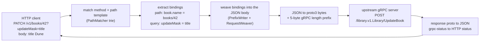

# Serving Both REST/JSON and gRPC from One Protobuf Contract: google.api.http Annotations and Envoy gRPC-JSON Transcoder (AIP-127)

> [!summary] Claim
> A `google.api.http` annotation turns each RPC into a pure function from (HTTP method, path, query, JSON body) to one Protobuf request message, so a gateway can serve REST and gRPC from a single contract, but only if you treat the annotation, the transcoder's lenient defaults, and the error mapping as part of the API surface.

Part of [gRPC and Protocol Buffers](README.md) in [API Engineering](../README.md).

## TL;DR

- Mechanism: `HttpRule` on `MethodOptions` (extension `72295728`) names a method, a path template, and a `body` field; the transcoder matches the request, extracts path and query bindings, weaves them into the JSON body, parses the result with the proto3 JSON mapping, and sends it upstream as `POST /pkg.Service/Method` with `content-type: application/grpc`.
- Contract rule: every request field is carried by exactly one of path, body, or query (AIP-127 and `http.proto` rules 1-3); `GET` and `DELETE` have no `body`, create and update name the resource field as `body`, and custom methods use `POST` with `body: "*"` and a `:verb` suffix.
- Trap: the defaults are permissive and silent - unknown body fields are dropped, a body value beats a path value, `%2F` stays encoded in multi-segment variables, and a bare `PATCH` with no `updateMask` means "update every populated field".
- Portability: Envoy (`envoy.filters.http.grpc_json_transcoder`), grpc-gateway, and Google Cloud Endpoints read the same annotation but differ on `response_body`, error JSON shape, query handling, and mask derivation; AIP-193 error JSON is not what Envoy emits.
- When not to use: bidirectional streaming, large binary payloads without `google.api.HttpBody`, APIs whose REST shape cannot be expressed as resources plus custom methods, and cases where the REST surface deserves its own hand-designed OpenAPI contract.

## Mental model



The client sees a normal REST call.
The transcoder first picks the RPC by method and path template, which also fixes the body field (`book`).
It then collects bindings: path variables first (`book.name = books/42`), then query pairs (`updateMask = title`).
The JSON body is wrapped under the body field name, the bindings are woven into that JSON object stream, and the result is parsed against the request descriptor, so the proto never sees the HTTP framing.
The upstream sees an ordinary unary gRPC call.
On the way back, the response message is rendered as JSON and the trailing `grpc-status` becomes the HTTP status line.

## How it works

### The contract: `HttpRule` on `MethodOptions`

`annotations.proto` declares `extend google.protobuf.MethodOptions { HttpRule http = 72295728; }`, so the annotation is a custom option on the method descriptor and travels in a compiled descriptor set (`google/api/annotations.proto`).
`HttpRule` carries `selector = 1`, a `oneof pattern` (`get = 2`, `put = 3`, `post = 4`, `delete = 5`, `patch = 6`, `custom = 8`), `body = 7`, `response_body = 12`, and `repeated additional_bindings = 11` (`google/api/http.proto`, `HttpRule`).
`additional_bindings` may nest only one level deep.
`selector` exists for the alternative form: the same rules can live in a service-config YAML under `http.rules`, and a service-config rule overrides a matching annotation (`http.proto`, "Using gRPC API Service Configuration").
Envoy reads only the annotation from the descriptor set (or, with `auto_mapping`, synthesizes `post: "/<package>.<service>/<method>"` with `body: "*"` for an unannotated method), so the descriptor must be produced with `protoc --include_imports --include_source_info` and `annotations.proto` on the include path (Envoy `grpc_json_transcoder_filter.rst`, "How to generate proto descriptor set").

The AIPs fix which verb and body each method kind uses: `GET` with no body for get and list (AIP-131, AIP-132), `POST` with the resource field as `body` for create (AIP-133), `PATCH` with the resource field as `body` for update (AIP-134), `DELETE` with no body (AIP-135), and `GET` or `POST` with a `:verb` suffix and `body: "*"` for custom methods (AIP-136).
AIP-127 adds that `put` and `custom` should not be used, exempts bidirectional streaming RPCs from the "must provide HTTP definitions" rule, and says they "should not include a `google.api.http` annotation at all" (AIP-127, "Guidance").
The no-body rule for `GET` and `DELETE` matches HTTP: content in those requests "has no generally defined semantics" (RFC 9110 Section 9.3.1 and Section 9.3.5).

The rules for where each request field goes are three sentences in `http.proto`, "Rules for HTTP mapping":
1. Leaf fields (recursively through nested messages) fall into three classes: fields named by the path template, fields named by `body`, and all others, which become query parameters named by their field path.
2. If `body` is `*`, there are no query parameters, and every field not bound by the path comes from the body.
3. If `body` is omitted, there is no body, and everything not in the path is a query parameter.

Rule 2 is stricter than the implementation: `PathMatcher::Lookup` extracts query bindings regardless of `body`, so a `body: "*"` method still accepts `?reason=q` and weaves it in (grpc-httpjson-transcoding a6e226f9a2 `src/include/grpc_transcoding/path_matcher.h`, `PathMatcher::Lookup`; the lab reproduces this in `test_body_star_maps_the_whole_body_and_still_accepts_query_bindings`).

### Path template grammar and what the parser enforces

```text
Template = "/" Segments [ Verb ] ;
Segments = Segment { "/" Segment } ;
Segment  = "*" | "**" | LITERAL | Variable ;
Variable = "{" FieldPath [ "=" Segments ] "}" ;
FieldPath = IDENT { "." IDENT } ;
Verb     = ":" LITERAL ;
```

(`http.proto`, "Path template syntax".)
`*` matches one segment, `**` matches zero or more and must be last before the verb, `{var}` is shorthand for `{var=*}`, and a variable may not contain another variable.
The reference parser is a recursive-descent `Parser` that rewrites `{var}` to a `*` segment, records each variable as a half-open segment range, and rejects nested variables (grpc-httpjson-transcoding a6e226f9a2 `src/http_template.cc`, `Parser::ParseVariable`, `Parser::StartVariable`).
It deviates from `http.proto` in one place: `ValidateParts` allows literal segments after `**` and rejects only wildcards after it, because the matcher handles `/foo/**/bar` (`http_template.cc`, `Parser::ValidateParts`).
So `/v1/{name=**}/history` registers in Envoy but is not valid per the proto comment; the lab's `parse_template` rejects it by default and accepts it under `literals_after_double_star=True`.

Path variables carry type constraints that the template grammar cannot express: they must refer to non-repeated primitive fields, never repeated or map fields, and must not capture the leading `/` (`http.proto`, "Special notes").
Envoy does not enforce these at config load: `createMethodInfo` resolves only `body` and `response_body`, and a template that parses registers even if its variable names no field or a repeated one (Envoy v1.40.2 `json_transcoder_filter.cc`, `JsonTranscoderConfig::createMethodInfo`).
Path variables are resolved per request, in the same loop as query parameters: `createTranscoder` calls `TypeHelper::ResolveFieldPath` on each binding, and a miss returns `INVALID_ARGUMENT`, which is captured or skipped under `capture_unknown_query_parameters` or `ignore_unknown_query_parameters` and otherwise passed through or rejected like an unknown query parameter (Envoy v1.40.2 `json_transcoder_filter.cc`, `JsonTranscoderConfig::createTranscoder`; grpc-httpjson-transcoding `src/type_helper.cc`, `TypeHelper::ResolveFieldPath`).
`ResolveFieldPath` checks only that each name exists and that every non-final step is a message, so the "non-repeated primitive" rule is not checked there (`type_helper.cc`, `TypeHelper::ResolveFieldPath`); the lab's `Transcoder.register` checks it at registration as a lab choice.
Field-path names resolve by proto name or JSON name, because `FindField` goes through `TypeInfo::FindField`, which maps a camelCase name to the proto name and otherwise uses the name as given, and then retries with a URL-unescaped name (`type_helper.cc`, `TypeHelper::FindField`; proto-converter `src/google/protobuf/util/converter/type_info.cc`, `TypeInfoForTypeResolver::FindField`, main as of 2026-11).

### Matching: parts, verbs, precedence, ambiguity

The request path is converted to parts by `ExtractRequestParts`: strip the query, then treat the text after the last `:` as a custom verb only if that `:` comes after the last `/` and the verb is registered by some template (or `match_unregistered_custom_verb` is set); split on `/`; drop trailing empty parts (`path_matcher.h`, `ExtractRequestParts`).
The comment on that function says it "collapses extra slashes", but the code only removes trailing empty parts, so `/v1//books` keeps an empty middle part.
Splitting happens on the raw, still percent-encoded path, which is why `%2F` cannot create a segment boundary.

The lookup key is `http_method + verb`, so `POST /v1/books/42:archive` and `GET /v1/books/42:archive` are different keys (`path_matcher.h`, `PathMatcherBuilder::Register`, `PathMatcher::Lookup`).
Templates live in a trie of segment strings.
`PathMatcherNode::LookupPath` tries the literal child for the current part first, then `*`, then `**`, with backtracking, which gives the precedence literal over `*` over `**` (`path_matcher_node.cc`, `LookupPath`).
Two registrations with the same method, verb, and segment shape collide even when variable names differ: `InsertTemplate` marks the node `is_multiple`, and `Lookup` returns no method for a node marked that way (`path_matcher_node.cc`, `InsertTemplate`; `path_matcher.h`, `Lookup`).
Envoy `createTranscoder` turns "no method" into `kNotFound`, and `decodeHeaders` passes such a request through untranscoded unless `reject_unknown_method` is set, in which case the response is `404` (Envoy v1.40.2 `transcoder.proto`, `RequestValidationOptions`).
The consequence is that `/v1/{name=books/*}` and `/v1/{parent=books/*}` on two RPCs silently route neither.

The lab approximates the trie order by ranking templates segment-wise (literal 0, `*` 1, `**` 2) and taking the lexicographic minimum; that equals the DFS order for the shapes the lab registers, and it has not been compared with the C++ matcher beyond those shapes.

### Percent decoding

Variables that match exactly one segment are always fully decoded, unless the variable contains `**`, which always counts as multi-segment (`path_matcher.h`, `ExtractBindingsFromPath`, `is_multipart`).
Multi-segment variables follow `UrlUnescapeSpec`: the default `ALL_CHARACTERS_EXCEPT_RESERVED` leaves any `%XX` that decodes to an RFC 6570 reserved character encoded, `ALL_CHARACTERS_EXCEPT_SLASH` leaves only `%2F`, and `ALL_CHARACTERS` decodes everything (`path_matcher.h`, `ExtractBindingsFromPath`; `percent_encoding.h`, `GetEscapedChar`).
The reserved set in `IsReservedChar` is the 18 characters `! # $ & ' ( ) * + , / : ; = ? @ [ ]`, which is `gen-delims / sub-delims` (RFC 3986 Section 2.2; RFC 6570 Section 1.5).
Envoy documents the three modes with one input: `%2f%23/%20%2523` becomes `%2f%23/ %23`, `%2f#/ %23`, and `/#/ %23` respectively (Envoy v1.40.2 `transcoder.proto`, `UrlUnescapeSpec`); the lab test `test_unescape_specs_match_the_envoy_documented_examples` reproduces all three.
The reason for the split is that `http.proto` explicitly refuses RFC 6570 reserved expansion (Section 3.2.3) for multi-segment variables, because reserved expansion would leave `?` and `#` unencoded and produce invalid URLs, so transcoding defines its own encoding (`http.proto`, "Special notes").
Query values are always fully decoded, and `+` becomes a space only if `query_param_unescape_plus` is set (`ExtractBindingsFromQueryParameters`).

### Query binding

`ExtractBindingsFromQueryParameters` splits on `&`, skips any pair with no `=` or an empty name, and splits the name on `.` into a field path (`path_matcher.h`).
A bare `?flag` is therefore dropped silently, and `?pageSize` with no value is not an error either.
Each remaining pair must resolve to a field of the request message.
If it does not, Envoy returns `INVALID_ARGUMENT` from `createTranscoder`, which `decodeHeaders` treats as pass-through unless `reject_unknown_query_parameters` is set; `ignore_unknown_query_parameters`, `capture_unknown_query_parameters`, and `ignored_query_parameters` change that (Envoy v1.40.2 `json_transcoder_filter.cc`, `createTranscoder` and `decodeHeaders`; `transcoder.proto`).
Repeated fields take repeated parameters (`?tag=a&tag=b`), and a message-typed field is addressed by sub-field (`?sub.subfield=foo`); repeated message fields cannot be bound (`http.proto`, rule text and "Special notes").
AIP-127 adds that clients send camelCase names (changelog entry 2022-08-18), while the runtime accepts both spellings.

### Body mapping and weaving

`RequestMessageTranslator` builds a writer pipeline from the inside out: a `ProtoStreamObjectWriter` over the request type, a `RequestWeaver` wrapped around it if there are variable bindings, and a `PrefixWriter` wrapped around that if `body` names a field other than `*` (grpc-httpjson-transcoding `src/request_message_translator.cc`, constructor).
The JSON body enters at the outermost writer, so with `body: "book"` the stream is first wrapped as `{"book": ...}`.
The weaver then injects each binding as a JSON event at the end of the matching object (`RequestWeaver::WeaveTree`).
That is why a path variable `book.name` can coexist with `body: "book"`: the binding is woven into the `book` object the body already opened.

Three behaviors follow from the weaver and the writer options:
- Collision: when the body already contains a non-repeated field that also has a binding, `CollisionCheck` erases the binding, so the body value wins; `reject_binding_body_field_collisions` makes a differing value an `INVALID_ARGUMENT` instead (`request_weaver.cc`, `CollisionCheck`; Envoy v1.40.2 `transcoder.proto`, `RequestValidationOptions.reject_binding_body_field_collisions`).
- Repeated fields: for a repeated field, `CollisionCheck` renders the binding value in addition to the body values.
- Unknown fields: `GetProtoWriterOptions` sets `ignore_unknown_fields = true` "to allow backward and forward compatible APIs", and base64 decoding is relaxed to RFC 2045 (`request_message_translator.cc`, `GetProtoWriterOptions` and constructor).

Finally the serialized message gets the gRPC prefix: one compressed-flag byte of `0` and a 4-byte big-endian length (`request_message_translator.cc`, `SizeToDelimiter`; gRPC `PROTOCOL-HTTP2.md`, "Length-Prefixed-Message").
The framing itself is covered in [[gRPC-Over-HTTP-2-Framing-Length-Prefixed-Messages-and-Trailers]].

There is a defect in the collision comparison.
`isEqual` stores `value_in_binding.ToInt64()` and `ToUint64()` in an `absl::StatusOr<uint32_t>` in the `TYPE_INT64` and `TYPE_UINT64` cases, so the 64-bit binding is truncated to its low 32 bits before the comparison (`request_weaver.cc`, `isEqual`; `ToInt64` returns `absl::StatusOr<int64_t>` in proto-converter `datapiece.h`).
Two consequences follow: a binding that differs from the body only in bits 32 and above compares equal, so `reject_binding_body_field_collisions` misses it, and a negative `int64` equal in both places compares unequal, so the option rejects a request that does not conflict.
A standalone reproduction of those declared types (abseil 20260817.0, Apple clang 21.0.0, macOS 27.3 arm64) printed `same=1` for binding `4294967297` against body `1`, `same=0` for `-1` against `-1`, and `same=0` for `2147483648` against `0`; the library itself was not built, so this proves the type conversion, not an end-to-end Envoy request.

### The Envoy filter lifecycle

On the request path, `decodeHeaders` runs these steps in order (Envoy v1.40.2 `json_transcoder_filter.cc`, `JsonTranscoderFilter::decodeHeaders`):
1. If the route's transcoder config has no services, or the request already has an `application/grpc` content type, pass through untouched.
2. `createTranscoder`; on failure either pass through (`kNotFound`, or `INVALID_ARGUMENT` for unknown query parameters, unless strict validation is on) or send a local reply whose HTTP status is `grpcToHttpStatus` of the error code.
3. Rewrite the headers: remove `content-length`, set `content-type: application/grpc`, save the original path and method in `x-envoy-original-path` and `x-envoy-original-method`, set `:path` to `/<package>.<service>/<method>`, set `:method` to `POST`, set `te: trailers`.
4. Clear the route cache unless `match_incoming_request_route` is set.

Step 4 is why route configuration must match the gRPC path, not the REST path, for the shared listener case (Envoy v1.40.2 `grpc_json_transcoder_filter.rst`, "Route configs for transcoded requests").
It also means any other filter that matches on `:path` sees the REST path only if it runs before the transcoder, and the gRPC path if it runs after.
Two sources give that: `decodeHeaders` mutates the request headers in place (`headers.setEnvoyOriginalPath`, `headers.setPath`, `headers.setReferenceMethod`; Envoy v1.40.2 `json_transcoder_filter.cc`), and the connection manager "will invoke decoder filters in the order" they are configured (Envoy v1.40.2 `docs/root/intro/arch_overview/http/http_filters.rst`, "Filter ordering"), which also advises placing route-dependent authorization filters after filters that mutate route-matching inputs.
No test or run here exercised a two-filter chain.

Body data is buffered: `decodeData` accumulates into the filter's buffer, and when it exceeds `max_request_body_size` (default: the stream buffer limit) the filter answers `413` with `Http::Code::PayloadTooLarge` (`decoderBufferLimitReached`).
The response limit `max_response_body_size` produces a `500` per the field comment (`transcoder.proto`, `max_response_body_size`).
That local reply is where CVE-2021-32781 lived (GHSA-5vhv-gp9v-42qv, high, fixed in Envoy 1.19.1, 1.18.4, 1.17.4, 1.16.5): a local response generated on internal buffer overflow did not fully stop request or response processing in filters that grow bodies, which could access freed memory (denial of service), and the published workaround lists "json-transcoder" among the extensions to disable.

On the response path, `encodeHeaders` passes the response through if it is not an `application/grpc` response, sets `content-type: application/json` (or `text/event-stream` for server streaming in SSE mode), and `doTrailers` converts `grpc-status` into the HTTP status: a missing or invalid code gives `503`, otherwise `grpcToHttpStatus`; unary responses get an exact `content-length`, and the `trailer` header is removed for HTTP/1 downstream clients (`json_transcoder_filter.cc`, `encodeHeaders`, `doTrailers`).
Server-streaming responses are rendered as a JSON array by default, or as newline-delimited JSON or SSE frames with `stream_newline_delimited` or `stream_sse_style_delimited` (Envoy v1.40.2 `grpc_json_transcoder_filter.rst`, "JSON mapping"; `transcoder.proto`, `PrintOptions`).

### Status mapping and error bodies

`grpcToHttpStatus` implements the "HTTP Mapping" comments of `google.rpc.Code` (the numbers below are identical in both files): `OK` `200`, `CANCELLED` `499`, `UNKNOWN` `500`, `INVALID_ARGUMENT` `400`, `DEADLINE_EXCEEDED` `504`, `NOT_FOUND` `404`, `ALREADY_EXISTS` `409`, `PERMISSION_DENIED` `403`, `RESOURCE_EXHAUSTED` `429`, `FAILED_PRECONDITION` `400`, `ABORTED` `409`, `OUT_OF_RANGE` `400`, `UNIMPLEMENTED` `501`, `INTERNAL` `500`, `UNAVAILABLE` `503`, `DATA_LOSS` `500`, `UNAUTHENTICATED` `401` (Envoy v1.40.2 `source/common/grpc/status.cc`, `Utility::grpcToHttpStatus`; `google/rpc/code.proto`).
The reverse table in gRPC's `http-grpc-status-mapping.md` is for clients that received no `grpc-status`, is explicitly "neither symmetric nor 1-to-1", and servers "must not" use it; for example `404` maps to `UNIMPLEMENTED` there while `NOT_FOUND` maps to `404` here.
Details on the codes are in [[gRPC-Status-Codes-and-Google-RPC-Status-Rich-Error-Payloads]].

With `convert_grpc_status: true`, when the trailers indicate an error and no body was sent, Envoy takes `google.rpc.Status` from `grpc-status-details-bin` or builds one from `grpc-status` and the percent-decoded `grpc-message`, and renders it as the JSON body; detail types must be in the descriptor set (`json_transcoder_filter.cc`, `maybeConvertGrpcStatus`; `transcoder.proto`, `convert_grpc_status`).
The documented example is `grpc-status: 5` with details `CAUaMwoq...LTE`, which becomes `404` and `{"code":5,"details":[{"@type":"type.googleapis.com/google.rpc.RequestInfo","requestId":"r-1"}]}`; the lab test `test_status_details_trailer_is_decoded_into_the_envoy_documented_json` feeds that exact header and gets that exact body.
Note the shape: this is the bare `google.rpc.Status`, with `code` equal to the gRPC code `5`.
AIP-193 defines a different HTTP/JSON body: `{"error": {"code": 404, "status": "NOT_FOUND", ...}}`, where `code` is the HTTP status, and it says this "does not map precisely to `google.rpc.Status`" for backward compatibility (AIP-193, "HTTP/1.1+JSON representation").
Two implementations of the same annotation therefore emit incompatible error JSON unless you configure or post-process one of them.

### `FieldMask` over `PATCH`

JSON encodes a `FieldMask` as one string of comma-separated paths in lowerCamelCase, so `updateMask=pageCount,title` becomes `paths: ["page_count", "title"]` (`field_mask.proto`, "JSON Encoding of Field Masks"; ProtoJSON "Non-Round Trippable FieldMasks").
In Envoy that conversion is the well-known-type renderer of the embedded JSON-to-proto writer: `ProtoStreamObjectWriter::RenderFieldMask` rejects a non-string value, splits the compact string with `DecodeCompactFieldMaskPaths`, and snake-cases each path with `ToSnakeCase` (proto-converter 3850764 `src/google/protobuf/util/converter/protostream_objectwriter.cc`, `RenderFieldMask` and `RenderOneFieldPath`, where a TODO admits `ToSnakeCase` "sometimes returns the wrong value" because it uses no descriptor).
Round-tripping is lossy for names such as `x_0` or `foo__bar`, because the conversion cannot consult a schema; Edition 2024 rejects those names in protoc (ProtoJSON, same section).
AIP-134 fixes the contract: `PATCH` with `patch: "/v1/{book.name=publishers/*/books/*}"` and `body: "book"`, an optional `update_mask` of type `google.protobuf.FieldMask`, masks relative to the resource (not `book.title`), an omitted mask meaning "all populated fields", an empty mask meaning no-op, and `*` meaning full replacement (AIP-134, "Guidance", "Request message"; AIP-161, "Guidance").
`update_mask` is not in the path or body, so it falls into the query class and arrives as `?updateMask=...`; this is the seed's example.
The `*` value is an API convention that "standard Protocol Buffer runtime libraries ... do not recognize", so the service must special-case it (AIP-134 changelog 2026-10-08; the lab asserts `IsValidForDescriptor` is false for `*`).
Per `field_mask.proto`, merging a repeated field appends by default, which is not what most `PATCH` callers expect.
`PATCH` itself is "neither safe nor idempotent" (RFC 5789 Section 2), so a retry of the same body is not automatically harmless; AIP-134 therefore offers an `etag` field that fails with `ABORTED` on a mismatch.

grpc-gateway handles one more case: for a `PATCH` binding whose request message has exactly one `FieldMask` and whose `body` is not `*`, it populates the mask from the keys present in the body (grpc-gateway "Patch feature" page).
A case-insensitive `grep -n mask` over Envoy v1.40.2 `json_transcoder_filter.cc` and `json_transcoder_filter.h`, and over grpc-httpjson-transcoding a6e226f9a2 `http_template.cc`, `path_matcher_node.cc`, `request_weaver.cc`, `request_message_translator.cc`, `type_helper.cc`, `json_request_translator.cc`, and `request_stream_translator.cc`, returned no match (run 2026-11-26).
So nothing in the filter or the matcher and weaver derives a mask from the body, and behind Envoy the client must send `?updateMask=` itself or the server sees an omitted mask.
The scope is those files at those revisions; the filter's public documentation was not searched for a mask feature, and this was not run against a live Envoy.

## Numbers and limits

| Quantity | Value | Source or measurement |
|---|---|---|
| Extension number of `google.api.http` on `MethodOptions` | `72295728` | `google/api/annotations.proto` (as of 2026-11) |
| `additional_bindings` nesting depth | 1 | `google/api/http.proto`, `HttpRule.additional_bindings` |
| gRPC message prefix | 5 bytes: 1 flag byte plus a 4-byte big-endian length | gRPC `PROTOCOL-HTTP2.md`, "Length-Prefixed-Message"; `SizeToDelimiter` |
| Transcoded `PATCH` example: message bytes and framed bytes | 27 and 32 | measured: lab, `Transcoder.transcode`, output in "Worked example" |
| RFC 6570 reserved characters left encoded by default in multi-segment variables | 18 | `percent_encoding.h`, `IsReservedChar`; RFC 3986 Section 2.2 |
| `google.rpc.Code` values with an HTTP mapping | 17 (0 through 16) | `google/rpc/code.proto` |
| Status when `grpc-status` is missing or invalid in the transcoded response | `503` | Envoy v1.40.2 `doTrailers` |
| Request body over the buffer or `max_request_body_size` limit | `413` | Envoy v1.40.2 `decoderBufferLimitReached` |
| `max_request_body_size` and `max_response_body_size` | `uint32`, must be greater than 0; default is the stream buffer limit | Envoy v1.40.2 `transcoder.proto` |
| Integer magnitude above which double-precision JSON parsers (including JavaScript) become lossy | 2^53 | ProtoJSON "Strings for int64"; the lab keeps `9007199254740993` exact through the query path |
| Lab suite | 61 tests, 0.22 s (an earlier run the same day, before a one-string lab edit, took 0.40 s) | measured 2026-11-26 by the verifier: macOS 27.3 arm64 (`uname -r` `27.3.0`), CPython 3.14.6, protobuf 7.36.2 (upb), `uv run --frozen pytest ... -q` |
| Latest Envoy release read | `v1.40.2`, published 2026-10-27 | GitHub releases API, fetched 2026-11 |
| grpc-httpjson-transcoding version used by that Envoy | commit `a6e226f9a2`, dated 2025-05-07 | Envoy v1.40.2 `MODULE.bazel` `bazel_dep(name = "grpc-httpjson-transcoding", version = "0.0.0-20250507-a6e226f.envoy")`; `bazel/deps.yaml` `release_date`; commit date from the GitHub API; Envoy's registry patches for that module touch build files, `message_reader.cc`, `request_stream_translator.cc`, and the `absl::MutexLock` constructor calls in `type_helper.cc` (`&mutex_` -> `mutex_`), none of the logic cited here |
| Latest grpc-gateway release seen | `v2.34.0`, published 2026-11-17 | GitHub releases API, fetched 2026-11 |

The only performance claim is the lab's wall time, which measures protobuf-runtime and Python overhead, not Envoy.
I made no latency or throughput measurement of Envoy's transcoder; the filter buffers a whole unary body before it can emit the frame, so memory per in-flight request is bounded by the buffer limits above, not by a streaming window.

## Portability

| Dimension | Cell | Evidence |
|---|---|---|
| CPython 3.14.6 | 61 lab tests pass | ran by the verifier 2026-11-26: `uv run --frozen pytest` in `labs/`, macOS 27.3 arm64 |
| CPython 3.12, 3.13, 3.15, 3.15t | not run | the lab-check pause of 2026-11-11 limited this job to one test run; the code uses `type` aliases and `slots=True`, which need 3.12 or later, but no claim is made beyond that |
| protobuf 7.36.2 runtime | `FieldDescriptor.label` does not exist; `is_repeated` does | ran: attribute access on the upb descriptor; the lab uses `is_repeated` |
| protobuf 7.36.2 JSON parser | `ignore_unknown_fields=True` also swallows an unknown enum name | source: (protobuf 7.36.2 google/protobuf/json_format.py, _Parser._ConvertAndSetScalar), which catches `EnumStringValueParseError` and re-raises only when `ignore_unknown_fields` is false; ran: `test_an_unknown_enum_name_in_the_body_is_silently_dropped_by_the_python_runtime` |
| Envoy `v1.40.2` | `response_body` must be a `google.api.HttpBody` field, or config load fails | source: `createMethodInfo` returns `kUnimplemented`, comment cites Envoy issue 11136 |
| Envoy `main` vs `v1.40.2` | `max_request_body_size` and `max_response_body_size` comments on `main` add "Streamed `HttpBody` requests are exempt" | diff of the two fetched `transcoder.proto` files (as of 2026-11) |
| Envoy reverse transcoder | ignores `additional_bindings` and `response_body`; uses proto field names by default | `grpc_json_reverse_transcoder_filter.rst`; not run |
| grpc-gateway `v2.34.0` | derives `FieldMask` from a `PATCH` body when exactly one mask exists and `body` is not `*`; option `allow_patch_feature=false` disables it | grpc-gateway "Patch feature" page; not run |
| Google APIs, Cloud Endpoints, grpc-gateway, Envoy | all named as supporting gRPC transcoding, and service-config `http.rules` can replace the annotation | `http.proto` header comment, "gRPC Transcoding" and "Using gRPC API Service Configuration"; not run |
| Uvicorn, Hypercorn, Granian | not applicable: the lab gateway is an in-process ASGI app via `httpx.ASGITransport` | `test_gateway_serves_the_patch_example_and_maps_errors_to_http_statuses` |
| HTTP/1.1 downstream | Envoy removes the `trailer` response header | source: `doTrailers`, `protocol() < Http2`; not run |
| HTTP/2 downstream | trailers kept | same source; not run |
| HTTP/3 downstream | trailers kept, as for HTTP/2: the only protocol check is `protocol() < Http2`, and `Http::Protocol` is ordered `Http10, Http11, Http2, Http3` | source: `doTrailers` and `maybeConvertGrpcStatus`; Envoy v1.40.2 `envoy/http/protocol.h`, `enum class Protocol`; not run |
| Debian Trixie and Alpine musl | not run | container legs paused with the lab checks |

## Worked example

Implementation: [implementation](../labs/src/api_labs/f19_grpc_and_protocol_buffers/http_json_to_grpc_transcoding.py).
Test: [test](../labs/tests/f19_grpc_and_protocol_buffers/test_http_json_to_grpc_transcoding_and_google_api_http_annotations_aip_127.py).

The lab builds a `library.v1` contract at runtime with `FileDescriptorProto` (no `protoc`) and models six RPCs.
`googleapis-common-protos` is not pinned in this workspace, so `google.api.http` is a dataclass, `HttpRule`, with the fields of `http.proto`.

```python
LIBRARY_METHODS: Final[tuple[RpcMethod, ...]] = (
    _method("GetBook", "GetBookRequest", "Book", HttpRule("GET", "/v1/{name=books/*}")),
    _method("ListBooks", "ListBooksRequest", "ListBooksResponse",
            HttpRule("GET", "/v1/books", response_body="books")),
    _method("CreateBook", "CreateBookRequest", "Book",
            HttpRule("POST", "/v1/books", body="book",
                     additional_bindings=(HttpRule("POST", "/v1/{parent=publishers/*}/books", body="book"),))),
    _method("UpdateBook", "UpdateBookRequest", "Book",
            HttpRule("PATCH", "/v1/{book.name=books/*}", body="book")),
    _method("ArchiveBook", "ArchiveBookRequest", "Book",
            HttpRule("POST", "/v1/{name=books/*}:archive", body="*")),
    _method("DeleteBook", "DeleteBookRequest", "Book", HttpRule("DELETE", "/v1/{name=books/*}")),
)
```

This is a simplified excerpt (line wrapping condensed) of `LIBRARY_METHODS`.
The core of the mechanism is `weave_bindings`, which merges URL bindings into the JSON object the body produced, as `RequestWeaver` does:

```python
def weave_bindings(request, root, bindings, *, reject_collisions=False,
                   ignore_unknown=False, protected=None) -> None:
    body_keys = protected if protected is not None else set()
    for binding in bindings:
        path = resolve_field_path(request, binding.field_path)   # proto or JSON names
        node = root
        for step in path[:-1]:                                    # descend, creating objects
            key = _json_key(node, step) or step.json_name
            node = node.setdefault(key, {})
        leaf = path[-1]
        value = _leaf_json_value(leaf, binding.value, binding.field_path)
        key = _json_key(node, leaf)
        if leaf.is_repeated:
            node.setdefault(key or leaf.json_name, []).append(value)   # URL value goes after body values
        elif key is None:
            node[leaf.json_name] = value
        elif (id(node), key) in body_keys:                        # the body already set it
            if reject_collisions and not _same_value(leaf, node[key], value):
                raise TranscodingError(INVALID_ARGUMENT, "... conflicting with the value ... in the body.")
        else:
            node[key] = value                                     # lab choice: later binding wins
```

This is a simplified excerpt: unknown-field skipping, error text for non-object intermediates, and the array type check are omitted.
`Transcoder.transcode` wraps the body under the body field, runs `weave_bindings`, and calls `json_format.ParseDict(root, message, ignore_unknown_fields=True)`, which is the same leniency as `GetProtoWriterOptions`.

A short driver, run once against the lab (it is not part of the lab):

```python
tc = build_library_transcoder()
r = tc.transcode("PATCH", "/v1/books/42?updateMask=title", b'{"title": "Dune"}')
```

Captured output (macOS 27.3 arm64, CPython 3.14.6, protobuf 7.36.2; re-run by the verifier on 2026-11-26 with identical output):

```text
/library.v1.Library/UpdateBook
book {
  name: "books/42"
  title: "Dune"
}
update_mask {
  paths: "title"
}
bindings: [('book.name', 'books/42', 'path'), ('updateMask', 'title', 'query')]
wire : 0a100a08626f6f6b732f3432120444756e6512070a057469746c65
frame: 000000001b0a100a08626f6f6b732f3432120444756e6512070a057469746c65
```

The wire bytes decode as: `0a 10` (field 1, `book`, length 16), inside it `0a 08 "books/42"` and `12 04 "Dune"`, then `12 07` (field 2, `update_mask`, length 7) containing `0a 05 "title"`.
The frame adds `00 00 00 00 1b`: flag `0`, length `0x1b` = 27.
The varint and tag layout is explained in [[Protobuf-Wire-Format-TLV-Tags-Varints-and-ZigZag-Encoding]].

The same driver on the defaults that surprise people:

```text
GET /v1/books/a%2Fb -> name: "books/a%2Fb"
PATCH /v1/books/42 -> book { name: "books/7" title: "x" }
GET /v1/books?bogus=1 -> INVALID_ARGUMENT 400 Could not find field "bogus" in the type "library.v1.ListBooksRequest".
GET /v1/books/42/pages -> NOT_FOUND 404 Could not resolve /v1/books/42/pages to a method.
strict -> INVALID_ARGUMENT 400 The binding value books/42 of the field name is conflicting with the value books/7 in the body.
```

The second line used the body `{"name": "books/7", "title": "x"}` against `PATCH /v1/books/42`: the body wins, so the request updates `books/7` although the URL says `books/42`.
The last line is the same request with `reject_binding_body_field_collisions` enabled.
Two more captured runs show how silent loss happens:

```text
{"book": {"title": "x"}} -> book { name: "books/42" } | has update_mask: False
{"title": "x", "updateMask": "title"} -> book { name: "books/42" title: "x" } | has update_mask: False
omitted mask, author cleared in body -> name: "books/42" title: "x" author: "Herbert"
```

The first body is double-wrapped (`body: "book"` already supplies the `book` level), so `book` is an unknown field of `Book` and is dropped, leaving an update that changes nothing.
The second puts `updateMask` in the body, where it is an unknown field of `Book` and is dropped, so the server sees an omitted mask.
The third shows the proto3 implicit-presence limit of the omitted-mask rule: sending `"author": ""` cannot clear `author`, because "populated" means non-default; clearing requires an explicit `updateMask=author`.

The test module has 61 tests; they cover the template grammar (9 malformed forms), percent decoding against Envoy's documented example, verb handling, precedence, ambiguity, registration errors, all weaving rules, type conversion, AIP-127 linting, status tables, `convert_grpc_status` against the documented header, AIP-134 update semantics, and an in-process ASGI gateway.
Captured by the verifier on 2026-11-26 with `uv run --frozen pytest tests/f19_grpc_and_protocol_buffers/test_http_json_to_grpc_transcoding_and_google_api_http_annotations_aip_127.py -q` on macOS 27.3 arm64, CPython 3.14.6:

```text
.............................................................            [100%]
61 passed in 0.22s
```

The ASGI test uses `httpx.AsyncClient(transport=httpx.ASGITransport(app=app), base_url="http://test")` and sends `PATCH /v1/books/42?updateMask=title`, which returns `200` with `application/json`; a handler raising `NOT_FOUND` returns `404` with `{"code": 5, "message": "no such book"}` (Envoy-style bare status, not the AIP-193 `error` envelope); an unmatched path is `404`; an RPC without a handler is `501`.

## Pitfalls

> [!warning] The body overrides the URL, so path-based authorization can be bypassed
> Trigger: an edge policy authorizes `PATCH /v1/books/42` from the URL, and the transcoder runs with the default collision behavior.
> Symptom: the body `{"name": "books/7"}` makes the upstream update `books/7`, because the body value wins over the path binding (Envoy v1.40.2 `transcoder.proto`, `reject_binding_body_field_collisions`; `request_weaver.cc`, `CollisionCheck`).
> Fix: set `reject_binding_body_field_collisions: true`, and authorize on the resource name inside the message in the backend, not on the URL at the edge.

> [!warning] Silent field loss from `ignore_unknown_fields`
> Trigger: a client double-wraps the resource (`{"book": {...}}` under `body: "book"`), misspells a field, or sends `updateMask` in the body.
> Symptom: `200 OK` with an update that changes nothing, or a mask silently treated as omitted, which AIP-134 defines as "update every populated field".
> Fix: contract tests that send the exact JSON the docs promise and assert on the stored result; reject unknown fields in the service for mutating methods; require `updateMask` in your own API wrappers.

> [!warning] `%2F` does not do what a path-variable user expects
> Trigger: a resource ID containing `/` is sent as `%2F` into a `{name=books/*}` variable.
> Symptom: the value arrives as `books/a%2Fb` (still encoded) under the default `ALL_CHARACTERS_EXCEPT_RESERVED`, or as `books/a/b` with `ALL_CHARACTERS`, which changes the resource name (Envoy v1.40.2 `transcoder.proto`, `UrlUnescapeSpec`).
> Fix: forbid `/` in IDs; if you must allow it, pick the unescape mode deliberately and test both the gateway and the direct gRPC path, which never decodes.

> [!warning] Two templates with the same shape route to nothing
> Trigger: `/v1/{name=books/*}` on one RPC and `/v1/{parent=books/*}` on another, same method.
> Symptom: neither request is transcoded; Envoy passes it through and the gRPC upstream resets the connection, which the downstream sees as `503` (Envoy v1.40.2 `transcoder.proto`, `RequestValidationOptions` comment; `path_matcher_node.cc`, `InsertTemplate`).
> Fix: lint for duplicate segment shapes in CI, and enable `reject_unknown_method` so the failure is a `404` with a message.

> [!warning] `response_body` on a message field stops Envoy at config load
> Trigger: `response_body: "books"` on `ListBooks`, copied from `http.proto` or a Google API.
> Symptom: Envoy rejects the config with `Setting "response_body" is not supported yet for non-HttpBody fields` (Envoy v1.40.2 `json_transcoder_filter.cc`, `createMethodInfo`, TODO citing Envoy issue 11136).
> Fix: return the wrapper message (`ListBooksResponse`) as the body, or use another implementation that supports it; do not rely on `response_body` for portability.

> [!warning] Error JSON differs by implementation
> Trigger: clients coded to Google's REST error shape (`{"error": {"code": 404, "status": "NOT_FOUND"}}`, AIP-193) call a service behind Envoy with `convert_grpc_status`.
> Symptom: the body is `{"code": 5, "message": ...}`, with `code` the gRPC value, so `error.status` is undefined and `code == 5` is misread as an HTTP status.
> Fix: pick one error contract per public API and test it through the real gateway; AIP-193 is explicit that its JSON "does not map precisely to `google.rpc.Status`".

> [!warning] Path confusion between the proxy and the backend is a recurring CVE class
> Trigger: a path-based access rule in the proxy sees a different path from the one the backend acts on.
> Symptom: CVE-2026-73553 (GHSA-77x5-xqjg-hprq, high, published 2026-08-26) describes `GET /admin;x` routed to the `/admin` backend while the RBAC `url_path` rule matched the raw path, bypassing authorization, when `ignore_path_parameters_in_path_matching` is enabled; fixes are in Envoy 1.39.1, 1.38.4, 1.37.6, and 1.36.10 per the advisory.
> Fix: transcoding adds one more rewrite (`:path` becomes `/<package>.<service>/<method>`), so authorize on the post-transcoding gRPC method name and message, and keep filter ordering explicit; this advisory is about router and RBAC, not the transcoder, so it is an analogy, not a transcoder bug.

> [!warning] Mask semantics break at the edges
> Trigger: relying on the Protobuf runtime for `update_mask` handling.
> Symptom: `*` is rejected as an invalid path by `IsValidForDescriptor`, repeated fields are appended on merge by default, and an omitted mask cannot clear a proto3 scalar.
> Fix: implement AIP-134 in one shared helper (the lab's `apply_update`), test `*`, empty, omitted, and repeated cases, and document that clearing a field needs an explicit mask.

## Security and robustness

Threat model: the transcoder is a parser at the trust boundary that turns attacker-controlled bytes into a typed internal call, so every leniency is an attack surface.
Map each item to OWASP API Security Top 10 (2023) classes by effect (names checked against the OWASP 2023 edition page):
- Broken object level authorization (API1:2023): the body-over-path default above is a direct object-ID substitution path; enforce authorization on the resource named in the decoded message.
- Broken object property level authorization and mass assignment (API3:2023): `body: "*"` maps every non-path field from the client, including fields the client should not set; use a dedicated request message, or `body: "book"` with `google.api.field_behavior` `OUTPUT_ONLY` handling in the service, and ignore output-only fields as AIP-161 requires.
- Unrestricted resource consumption (API4:2023): Envoy buffers the whole unary body, so set `max_request_body_size` and `max_response_body_size` per route and size them against concurrency; a streamed `HttpBody` is exempt on `main`.
- Security misconfiguration (API8:2023): the default pass-through for unmatched requests sends raw HTTP to a gRPC upstream, which resets the connection; enable `reject_unknown_method` and `reject_unknown_query_parameters` on public listeners.

Input validation edge cases to test through the gateway, not only against the service:
- Percent-decoded values that are invalid UTF-8: the lab returns `INVALID_ARGUMENT`, but the C++ path does not check.
  The weaver renders a binding with `DataPiece(value, true)` straight into the writer (grpc-httpjson-transcoding a6e226f9a2 `request_weaver.cc`, `WeaveTree`), `ProtoWriter` writes a `string` field with `WireFormatLite::WriteString` after `DataPiece::ToString` (proto-converter 3850764 `proto_writer.cc`, `WriteString`; `datapiece.cc`, `ToString`), and `WriteString` only copies the bytes, because UTF-8 verification is a separate function, `WireFormatLite::VerifyUtf8String` (protobuf main `wire_format_lite.cc`, as of 2026-11).
  Only the JSON body parser validates UTF-8 (proto-converter `json_stream_parser.cc`, `utf8_range::SpanStructurallyValid`).
  So by source reading, a path or query value such as `%FF` reaches the upstream as invalid UTF-8 inside a `string` field, and the upstream parser decides what happens; the library was not built or run, and Envoy's pinned protobuf may differ from `main`.
- A `%00` in a path variable, an empty variable value from `{name=**}` matching zero segments, and an empty middle segment (`/v1//books`), which `ExtractRequestParts` keeps.
- 64-bit integers: ProtoJSON emits them as strings so JavaScript clients keep precision (ProtoJSON, "Strings for int64"); the lab keeps `9007199254740993` exact through a query string.
- Enum names: parsers accept names and integers; case-sensitivity is controlled by `case_insensitive_enum_parsing` in Envoy, and the Python runtime drops unknown enum names when told to ignore unknown fields.
- `FieldMask` paths: validate against the resource descriptor, reject indexed repeated paths (`authors.0`) with `INVALID_ARGUMENT` (AIP-161, "Repeated fields"), and bound the number of paths.

Defense in depth: pin the descriptor set to the deployed server's schema version and roll it out with the service, so the gateway cannot map to a field the server dropped; the protocol-level view of that coupling is in [[Protobuf-Schema-Evolution-Invariants-Reserved-Tags-and-Unknown-Fields]].
Run `buf breaking` on the annotations as well as the messages, because changing `get` to `post` or a path template is a breaking change for REST clients even though the gRPC wire is unchanged ([[Protobuf-Governance-Linting-and-Breaking-Change-Gates-with-Buf]]).
Keep the AIP-127 lint (the lab's `lint_rule`) in CI: it flags `body` on `GET` and `DELETE`, nested body fields, a body equal to a URI parameter, a repeated body field, `put` and `custom`, nested `additional_bindings`, differing bodies across bindings, and any annotation on a bidirectional streaming RPC.

## The principal's view

The decision is whether the REST surface is derived or designed.
A derived surface (annotations plus a transcoder) gives one source of truth, one authorization point per RPC, and no second implementation to keep in sync; its cost is that the REST contract is whatever the transcoder and the proto JSON mapping produce, including the error envelope, the `int64`-as-string rule, and the silent leniencies listed above.
A designed surface (a separate REST service or BFF with an OpenAPI contract) lets product teams shape payloads, versioning, and errors for web clients; its cost is a second implementation and a mapping layer that drifts.

My default for a platform with internal gRPC and an external REST audience is derived, with three conditions:
1. Follow the AIP resource pattern (AIP-121 through AIP-136) so the annotations are formulaic and linted, because the transcoder's behavior is easiest to reason about for those shapes.
2. Fix the gateway configuration as part of the contract: strict validation flags, `reject_binding_body_field_collisions`, a pinned unescape spec, a pinned error shape, and body-size limits, all under test in a gateway-level contract suite that talks HTTP.
3. Decide per method whether it belongs on the REST surface at all: bidirectional streaming does not (AIP-127), and large downloads and uploads need `google.api.HttpBody` and different buffering.

Choose a different paradigm when the REST audience needs hypermedia, partial responses and sparse fieldsets beyond field masks, or conditional-request semantics (`ETag`, `If-Match`) that the proto contract does not model; the AIP guidance models `etag` as a body field and returns `ABORTED`, not `412` (AIP-134, "Etags").
Organizationally, the annotation is owned by the API team and the gateway by the platform team; assign a single owner for the pair, because a gateway upgrade that changes a default is an API change.
Related load-balancing and edge topology decisions are in [[gRPC-Load-Balancing-Subchannels-Pick-First-vs-Round-Robin-and-xDS]].

## Interview questions

> [!question] L5: What are the three places a request field can come from under `google.api.http`, and what decides which one it is?
>
> > [!success]- Answer
> > A field is carried by the URL path if the path template names it, by the body if `body` names it (or `body` is `*` and the path does not bind it), and otherwise by a query parameter.
> > The classes are exclusive: a field in the path is not also in the body.
> > With `body` omitted there is no body at all, and with `body: "*"` the spec says there are no query parameters, although the reference library still accepts them.
> > Rules: `http.proto`, "Rules for HTTP mapping".
> >
> > Follow-up: Why must `GET` and `DELETE` not define a `body`?

> [!question] L5: Write the annotation for `UpdateBook` and explain why `update_mask` arrives as `?updateMask=...`.
>
> > [!success]- Answer
> > `patch: "/v1/{book.name=publishers/*/books/*}"` with `body: "book"`, per AIP-134.
> > The path binds `book.name`, the body binds `book`, and `update_mask` is bound by neither, so it falls into the query class, named in camelCase by clients.
> > The JSON form of a `FieldMask` is one comma-separated string of camelCase paths.
> >
> > Follow-up: What does AIP-134 say an omitted mask, an empty mask, and `*` each mean?

> [!question] L6: Predict the output - with the lab's default options, what is `book.name` after transcoding `PATCH /v1/books/42` with body `{"name": "books/7", "title": "x"}`, and what changes with `reject_binding_body_field_collisions` on?
>
> > [!success]- Answer
> > `book.name` is `books/7`, because the body value wins over the path binding by default (lab output: `book { name: "books/7" title: "x" }`).
> > With the option on, the request fails with `INVALID_ARGUMENT` (HTTP `400`): `The binding value books/42 of the field name is conflicting with the value books/7 in the body.`
> > If the body had said `books/42`, both modes would succeed.
> >
> > Follow-up: Why is the default dangerous when authorization is enforced at the edge from the URL?

> [!question] L6: Debug this API - clients report that `PATCH /v1/books/42` with body `{"book": {"title": "x"}}` returns `200 OK` but the title never changes, so what happened?
>
> > [!success]- Answer
> > With `body: "book"` the body is the `Book` itself, so the client double-wrapped it.
> > The transcoder wraps the body under `book` and parses with unknown fields ignored, so the inner `book` key is an unknown field of `Book` and is dropped; the lab output is `book { name: "books/42" }` with no `update_mask`.
> > The omitted mask then means "update populated fields", and only `name` is populated, so the update is a no-op that still succeeds.
> > Fix the client, and make mutating methods reject unknown fields or empty updates.
> >
> > Follow-up: What changes if the client instead puts `"updateMask": "title"` inside the body?

> [!question] L6: Why does `GET /v1/books/a%2Fb` bind `name` to `books/a%2Fb` for `{name=books/*}` but a single-segment `{name}` would bind `a/b`?
>
> > [!success]- Answer
> > Single-segment variables are always fully decoded, so `%2F` becomes `/`.
> > Multi-segment variables use `UrlUnescapeSpec`, whose default leaves RFC 6570 reserved characters (including `/`) encoded, because `http.proto` rejects reserved expansion for multi-segment variables.
> > Matching happens on the raw path before decoding, so the `%2F` never splits a segment in either case.
> > Source: `path_matcher.h`, `ExtractBindingsFromPath`; `percent_encoding.h`.
> >
> > Follow-up: Which unescape mode makes the multi-segment result `books/a/b`, and what does that do to ID validation?

> [!question] L7+: What does Envoy do when two RPCs have `GET /v1/{name=books/*}` and `GET /v1/{parent=books/*}`, and how do you prevent it?
>
> > [!success]- Answer
> > The trie nodes are keyed by segment strings, so both templates insert at the same node; the second insert marks it `is_multiple`, and `Lookup` returns no method for such a node.
> > The request is then not transcoded and, by default, passes through as raw HTTP to the gRPC upstream, which resets the connection and surfaces as `503`.
> > Prevent it with a CI check on duplicate (method, verb, segment shape) tuples, and set `reject_unknown_method` so a miss is a `404` with a message.
> >
> > Follow-up: How does literal-before-wildcard precedence interact with this when one template is `/v1/books/featured`?

> [!question] L7+: Where do the error shapes `{"code": 5, "message": "..."}` from Envoy and `{"error": {"code": 404, "status": "NOT_FOUND"}}` expected by your SDKs each come from, and what do you do about the mismatch?
>
> > [!success]- Answer
> > Envoy `convert_grpc_status` renders the bare `google.rpc.Status`, where `code` is the gRPC enum value, built from `grpc-status-details-bin` or from `grpc-status` and `grpc-message`.
> > AIP-193 defines an `error` envelope whose `code` is the HTTP status and which adds `status` as the enum name; it says the shape does not map exactly to `google.rpc.Status`.
> > Choose one contract per API, then either transform at the gateway or let the service return the AIP-193 body itself, and cover it with a contract test through the gateway.
> >
> > Follow-up: What does Envoy do when the upstream sent a response body with the error?

> [!question] L7+: Should path-based RBAC run before or after the transcoder, and why?
>
> > [!success]- Answer
> > The transcoder rewrites `:path` to `/<package>.<service>/<method>` and `:method` to `POST` in `decodeHeaders`, keeping the original in `x-envoy-original-path` and `x-envoy-original-method`.
> > A filter before it sees the REST path and verb; a filter after it sees the gRPC method.
> > I authorize on the gRPC method and the resource field in the message after transcoding, because that is what the backend executes, and keep any REST-path rules only as coarse edge filters; the ordering follows from the in-place header rewrite and Envoy's documented decoder-filter order (see "The Envoy filter lifecycle").
> > The same disagreement-between-layers class produced CVE-2026-73553 in Envoy's router and RBAC when `ignore_path_parameters_in_path_matching` is enabled.
> >
> > Follow-up: Which collision option do you set, and why is it needed even with post-transcoding authorization?

> [!question] L7+: Why can an omitted `update_mask` not clear a proto3 scalar, and how do you design around it?
>
> > [!success]- Answer
> > AIP-134 says an omitted mask means "all populated fields", and for an implicit-presence scalar, "populated" means non-default, so `""` and `0` are indistinguishable from unset.
> > Sending `"author": ""` without a mask therefore leaves `author` unchanged (lab output: `author: "Herbert"` preserved).
> > Design around it by requiring an explicit `updateMask` for clearing, using explicit-presence fields (`optional`, see [[Protobuf-Editions-2023-2024-vs-Proto2-and-Proto3-Presence-Semantics]]) where "set to empty" matters, and documenting `*` as full replacement.
> >
> > Follow-up: What does the Protobuf runtime do when asked to merge a mask containing `*`?

## Related

Prerequisites: [[gRPC-Load-Balancing-Subchannels-Pick-First-vs-Round-Robin-and-xDS]]

Next: [[gRPC-Health-Checking-Protocol-Server-Reflection-and-Graceful-Stop]]

See also: [[gRPC-and-Protocol-Buffers]], [[gRPC-Over-HTTP-2-Framing-Length-Prefixed-Messages-and-Trailers]], [[gRPC-Status-Codes-and-Google-RPC-Status-Rich-Error-Payloads]], [[Protobuf-Wire-Format-TLV-Tags-Varints-and-ZigZag-Encoding]], [[Protobuf-Editions-2023-2024-vs-Proto2-and-Proto3-Presence-Semantics]], [[Protobuf-Schema-Evolution-Invariants-Reserved-Tags-and-Unknown-Fields]], [[Protobuf-Governance-Linting-and-Breaking-Change-Gates-with-Buf]], [[The-Four-gRPC-Communication-Modes-Unary-Server-Client-and-Bidi-Streaming]], [[gRPC-Deadlines-Timeout-Header-and-Context-Cancellation-Cascade]], [[gRPC-Interceptors-in-AsyncIO-Auth-Logging-Metrics-and-Retries]], [[gRPC-Keepalive-Flow-Control-and-Max-Message-Size-Tuning]]

- Lab: `labs/tests/f19_grpc_and_protocol_buffers/test_http_json_to_grpc_transcoding_and_google_api_http_annotations_aip_127.py`

## Further reading

- [google/api/http.proto](https://github.com/googleapis/googleapis/blob/master/google/api/http.proto): the normative `HttpRule` definition, the three field-mapping rules, and the path template grammar.
- [AIP-127: HTTP and gRPC Transcoding](https://google.aip.dev/127): the "must" and "should not" rules the lab's `lint_rule` checks.
- [AIP-134: Standard methods: Update](https://google.aip.dev/134) and [AIP-161: Field masks](https://google.aip.dev/161): `PATCH`, `update_mask`, `*`, and the runtime limits.
- [AIP-193: Errors](https://google.aip.dev/193): the HTTP/JSON error envelope that differs from `google.rpc.Status`.
- [Envoy gRPC-JSON transcoder](https://www.envoyproxy.io/docs/envoy/latest/configuration/http/http_filters/grpc_json_transcoder_filter): configuration and route behavior.
- [Envoy `json_transcoder_filter.cc` at v1.40.2](https://github.com/envoyproxy/envoy/blob/v1.40.2/source/extensions/filters/http/grpc_json_transcoder/json_transcoder_filter.cc): the header rewrite, buffering, and status conversion code.
- [grpc-httpjson-transcoding](https://github.com/grpc-ecosystem/grpc-httpjson-transcoding): the matcher, template parser, and weaver that Envoy embeds.
- [google/rpc/code.proto](https://github.com/googleapis/googleapis/blob/master/google/rpc/code.proto): the canonical codes and their HTTP mappings.
- [gRPC HTTP to gRPC status mapping](https://github.com/grpc/grpc/blob/master/doc/http-grpc-status-mapping.md): why the client-side table is not the inverse.
- [ProtoJSON format](https://protobuf.dev/programming-guides/json/): the JSON mapping the transcoder must follow, including `int64` strings and `FieldMask`.
- [RFC 6570 Section 3.2.2 and 3.2.3](https://www.rfc-editor.org/rfc/rfc6570.html): simple and reserved expansion, the two models `http.proto` compares against.
- [RFC 5789](https://www.rfc-editor.org/rfc/rfc5789.html): `PATCH` is neither safe nor idempotent, which is why conditional requests matter for updates.
- [grpc-gateway patch feature](https://grpc-ecosystem.github.io/grpc-gateway/docs/mapping/patch_feature/): the alternative implementation's `FieldMask` derivation.
- [GHSA-77x5-xqjg-hprq](https://github.com/envoyproxy/envoy/security/advisories/GHSA-77x5-xqjg-hprq): a current example of proxy and backend path disagreement.
