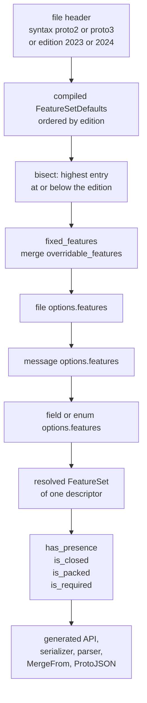

# Protobuf Editions (2023 and 2024) vs proto2 and proto3: Explicit vs Implicit Field Presence, Open vs Closed Enums, and Feature Resolution

> [!summary] Claim
> `syntax = "proto2"` and `syntax = "proto3"` are two frozen bundles of per-feature defaults, and an `edition` is the same bundle made overridable at file, message, enum, and field scope, so the only schema-level choices that change observable behavior are the resolved `field_presence`, `enum_type`, and `repeated_field_encoding` features, and the wire format never changes with them except for the bytes that implicit presence refuses to emit.

Part of [gRPC and Protocol Buffers](README.md) in [API Engineering](../README.md).

## TL;DR

- Mechanism: a file declares `edition = "2023"` or `"2024"`, every descriptor inherits a `FeatureSet` from its parent, and the runtime resolves it by taking the compiled defaults at the closest edition at or below the file's edition and merging explicit settings down the lexical scopes (`(protobuf.dev "Implementing Editions Support", Feature Resolution)`).
- Contract rule: presence is a schema decision with wire consequences, because an explicit-presence field emits `08 00` for a zero and an implicit-presence field emits nothing, so two peers that disagree will silently drop "this was set to zero" on a round trip.
- Trap: migrating a proto3 file by only changing the header flips every plain scalar from implicit to explicit presence (edition defaults are `EXPLICIT`), which changes serialized bytes, `MergeFrom`, and ProtoJSON output without touching the wire grammar.
- Portability: the lab resolves editions on protobuf 7.36.2 (upb backend, CPython 3.14.6), but enum openness is not uniform across languages, and C#, Go, Ruby, and JSPB treat all enums as open (as of 2026-11).
- When not to use it: do not flip `field_presence` or `enum_type` on a published field to "clean up" a schema, and do not adopt a new edition until every code generator in your build declares support for it.

## Mental model



Read the diagram top to bottom.
The edition number picks a row from a table that `protoc` compiled once from the feature definitions in `descriptor.proto` and the language feature files.
That row is the starting `FeatureSet`: fixed features (not overridable in this edition) first, then the overridable defaults.
Each lexical scope on the way down the file, message, and field merges only the features it sets explicitly, so the innermost setting wins and everything unset is inherited.
The final `FeatureSet` of a descriptor is meant to stay internal; it is read through descriptor helpers (the four in the diagram, plus `requires_utf8_validation` and `is_delimited`), and those helpers are what the serializer, parser, merge code, and JSON printer consult.
proto2 and proto3 are not a separate mechanism: they enter the same table as the pseudo-editions `EDITION_PROTO2` (998) and `EDITION_PROTO3` (999), which is why a runtime can implement one code path (`(descriptor.proto v36.2, enum Edition)`).

## How it works

### 1. The file header and the descriptor

A file chooses one of `syntax = "proto2"`, `syntax = "proto3"`, or `edition = "2023"` (or `"2024"`); with none of these, `protoc` assumes proto2 (`(protobuf.dev Language Guide (editions), Defining A Message Type)`).
In the serialized `FileDescriptorProto` an editions file carries `syntax: "editions"` plus the `edition` enum.
`protoc` 36.2 printed this for `edition = "2023"; message M { int32 x = 1; }`:

```text
file {
  name: "c9.proto"
  message_type { name: "M" field { name: "x" number: 1 label: LABEL_OPTIONAL type: TYPE_INT32 json_name: "x" } }
  syntax: "editions"
  edition: EDITION_2023
}
```

The `Edition` enum in `descriptor.proto` v36.2 is `EDITION_LEGACY = 900`, `EDITION_PROTO2 = 998`, `EDITION_PROTO3 = 999`, `EDITION_2023 = 1000`, `EDITION_2024 = 1001`, `EDITION_2026 = 1002`, `EDITION_UNSTABLE = 9999`; the values are documented as arbitrary but time-ordered (`(descriptor.proto v36.2, enum Edition)`).
The pseudo-editions "can't be used to specify the edition of proto files", but feature definitions must supply proto2 and proto3 defaults.
Setting `edition` without `syntax = "editions"` is rejected by the upb pool (observed: `Setting edition requires that syntax="editions", but syntax is ""`), which is the bug the lab's `migrate_to_edition` hit first and fixed.

### 2. What a feature is

A feature is a field of `google.protobuf.FeatureSet` (nine of them in protobuf 7.36.2: `field_presence`, `enum_type`, `repeated_field_encoding`, `utf8_validation`, `message_encoding`, `json_format`, `enforce_naming_style`, `default_symbol_visibility`, `enforce_proto_limits`, read from `FeatureSet.DESCRIPTOR.fields` in the lab).
Each feature declares `targets` (where it may be written), `feature_support` (the edition it was introduced, deprecated, and removed in), and `edition_defaults` (its value per edition).
For example `field_presence` has `targets = TARGET_TYPE_FIELD` and `TARGET_TYPE_FILE`, `edition_introduced: EDITION_2023`, and defaults `EDITION_LEGACY: EXPLICIT`, `EDITION_PROTO3: IMPLICIT`, `EDITION_2023: EXPLICIT`; `enum_type` targets `TARGET_TYPE_ENUM` and file with `EDITION_LEGACY: CLOSED`, `EDITION_PROTO3: OPEN` (`(descriptor.proto v36.2, message FeatureSet)`).
Writing a feature on the wrong target fails at compile time (`protoc` 36.2: ``Option google.protobuf.FeatureSet.enum_type cannot be set on an entity of type `field`.``).
Features are deliberately only booleans and enums, because the lifecycle is "introduce, flip the default in a later edition, deprecate, remove", and an unbounded value space cannot be retired (`(protobuf.dev "Implementing Editions Support", What is a Feature?)`).
The same page states the one rule that matters for wire safety: behavior at a wire boundary must be controlled by global features in `descriptor.proto`, never by language-specific features, because the other end may be another language.

### 3. Feature resolution, step by step

`protoc` compiles the feature definitions into a `FeatureSetDefaults` message: an ordered list (strictly ascending by edition) of `{edition, overridable_features, fixed_features}`, plus `minimum_edition` and `maximum_edition`.
The documented algorithm for a file descriptor at a given edition is:

1. Validate that the edition is in range, rejecting one outside `[minimum_edition, maximum_edition]`.
2. Binary-search the ordered `defaults` for the highest entry less than or equal to the edition.
3. Merge `overridable_features` into `fixed_features` of that entry.
4. Merge the explicit `features` of the file options.

Every other descriptor then starts from its parent's resolved set and merges its own explicit `features`.
Two parent rules are easy to get wrong: an extension's parent is its enclosing scope, not the message it extends, and a oneof is the parent of its fields (`(protobuf.dev "Implementing Editions Support", Feature Resolution)`).
The C++ implementation in `FeatureResolver::MergeFeatures` copies its edition defaults, then merges the parent, then the child, and `FeatureResolver::Create` rejects an edition below the minimum or above the maximum (except `EDITION_UNSTABLE`) and rejects a defaults table that is not strictly increasing (`(protobuf v36.2 src/google/protobuf/feature_resolver.cc, FeatureResolver::Create and FeatureResolver::MergeFeatures)`).
upb applies the same strictly-increasing check when a pool is given a table (`(protobuf v36.2 upb/reflection/def_pool.c, upb_DefPool_SetFeatureSetDefaults)`).

The Python wheel ships its own compiled table (the pure-Python backend reads it, `(protobuf 7.36.2 google/protobuf/descriptor_pool.py, DescriptorPool.__init__)`; upb compiles its own copy, `UPB_INTERNAL_UPB_EDITION_DEFAULTS`, into C and loads it in `(protobuf v36.2 upb/reflection/def_pool.c, upb_DefPool_New)`), so the algorithm can be executed.
Dumping `google.protobuf.internal.python_edition_defaults` in protobuf 7.36.2 gives (the lab asserts this):

| Entry edition | Overridable (user may set) | Fixed (user may not set) |
|---|---|---|
| 900 `EDITION_LEGACY` | none | all nine features at proto2 values |
| 999 `EDITION_PROTO3` | none | all nine at proto3 values |
| 1000 `EDITION_2023` | presence `EXPLICIT`, enum `OPEN`, encoding `PACKED`, utf8 `VERIFY`, message `LENGTH_PREFIXED`, json `ALLOW` | naming `STYLE_LEGACY`, visibility `EXPORT_ALL`, limits `LEGACY_NO_EXPLICIT_LIMITS` |
| 1001 `EDITION_2024` | the six above, plus naming `STYLE2024`, visibility `EXPORT_TOP_LEVEL` | limits `LEGACY_NO_EXPLICIT_LIMITS` |
| 1002 `EDITION_2026` | all nine, with naming `STYLE2026`, visibility `STRICT`, and limits `PROTO_LIMITS2026` | none |

`minimum_edition` is 998 and `maximum_edition` is 1002.
Because 998 has no entry of its own, the bisect lands a proto2 file on the 900 `EDITION_LEGACY` entry, and that is why the table can be this small: only editions whose defaults differ get a row.
"Fixed" is how the table encodes `feature_support`: a feature that does not yet exist in an edition is fixed at its legacy value and cannot be set, which is why `option features.enforce_naming_style = STYLE2024;` in an `edition = "2023"` file fails with `wasn't introduced until edition 2024 and can't be used in edition 2023` (observed, `protoc` 36.2).

Simplified excerpt of the lab's resolver (`resolve_features`; the real function also takes an injectable `defaults` table):

```python
def resolve_features(edition, *levels, defaults=None):
    table = edition_defaults() if defaults is None else defaults
    if not table.minimum_edition <= edition <= table.maximum_edition:
        raise FeatureResolutionError("edition outside the compiled range")
    editions = [entry.edition for entry in table.defaults]
    index = bisect.bisect_right(editions, edition) - 1      # closest entry at or below
    chosen = table.defaults[index]
    resolved = FeatureSet()
    resolved.CopyFrom(chosen.fixed_features)
    resolved.MergeFrom(chosen.overridable_features)
    for level in levels:                                      # file, message, field ...
        if level is None:
            continue
        for field, _ in level.ListFields():
            if chosen.fixed_features.HasField(field.name):
                raise FeatureResolutionError("feature is fixed in this edition")
        resolved.MergeFrom(level)
    return resolved
```

The fixed-feature check is the lab's approximation of `ValidateFeatureLifetimes` in `feature_resolver.cc`; the compiler's real check is driven by `feature_support` and also covers deprecation warnings and removal errors, which this table does not model.

### 4. Presence

Field presence is whether a message tracks that a field was set separately from its value.
The doc's definition of the two disciplines is the one to hold onto: under explicit presence the generated API stores whether the field was set and generates a hazzer (`has_foo`, `HasField`); under implicit presence it stores only the value, "fields with implicit presence are not serialized if they contain their default value" (`(protobuf.dev Application Note: Field Presence, Presence in Tag-value stream (Wire Format) Serialization)`), and "To "clear" a field, it is set to its default value" (`(protobuf.dev Application Note: Field Presence, Semantic Differences)`).

The choice only exists for singular numeric, bool, string, bytes, and enum fields.
Message fields and oneof members always have explicit presence, and repeated fields and maps never do; `protoc` enforces this in editions (observed, 36.2: `Message fields can't specify implicit presence.`, `Repeated fields can't specify field presence.`, `Oneof fields can't specify field presence.`).
The helper the docs prescribe is `FieldDescriptor::has_presence`, and the C++ source is short (`(protobuf v36.2 src/google/protobuf/descriptor.cc, FieldDescriptor::has_presence)`):

```cpp
bool FieldDescriptor::has_presence() const {
  if (is_repeated()) return false;
  return cpp_type() == CPPTYPE_MESSAGE || is_extension() ||
         containing_oneof() ||
         features().field_presence() != FeatureSet::IMPLICIT;
}
```

Note `containing_oneof()`: a proto3 `optional` scalar gets presence because the compiler wraps it in a synthetic oneof, not because of a flag the runtime reads.
`descriptor.proto` documents it: "When proto3_optional is true, this field must belong to a oneof ... this field must be its sole member (each proto3 optional field gets its own synthetic oneof)", existing "in the descriptor only" and "ordered after all "real" oneofs" (`(descriptor.proto v36.2, FieldDescriptorProto.proto3_optional)`); `protoc` 36.2 names it `_<field>` (observed: `optional int32 x` produced `oneof_decl { name: "_x" }`).
Editions delete the whole mechanism: there is no `optional` label (`protoc` 36.2: `Label "optional" is not supported in editions. By default, all singular fields have presence unless features.field_presence is set.`), no synthetic oneof, and `features.field_presence` is the only switch with three values:

| Value | Meaning | proto2 spelling | proto3 spelling |
|---|---|---|---|
| `EXPLICIT` | presence bit, hazzer, explicit defaults allowed | `optional` | `optional` |
| `IMPLICIT` | value only, no hazzer, no explicit default | not expressible | no label |
| `LEGACY_REQUIRED` | explicit plus required on parse and serialize | `required` | not expressible |

The defaults table in the docs is `EXPLICIT` for editions 2023, 2024, 2026 and proto2, and `IMPLICIT` for proto3 unless the field has `optional` (`(protobuf.dev Feature Settings for Editions, features.field_presence)`).
The Protobuf team's position is explicit: implicit presence is "a design decision the Protobuf team regrets", it "was introduced to enable open struct APIs", and explicit presence is "the silent default in Protobuf Editions going forward" (`(protobuf.dev Implicit Presence)`).

What implicit presence changes in behavior, each of which the lab runs against the real runtime:

- Serialization: an explicit zero emits `08 00`; an implicit zero emits zero bytes.
- Parse: the wire cannot say "not present", it can only omit; an implicit field that arrives as `08 00` parses to `0` and re-serializes to nothing (a lossy round trip for any explicit peer).
- `MergeFrom`: a field set to its default is "not present", so it does not overwrite the destination; the docs' `google.protobuf.Timestamp` example merges `{200, 0}` onto `{100, 50}` and gets `{200, 50}`, "a timestamp that appears in neither operand, off by 50 nanoseconds, with no error anywhere".
- Patch semantics: a patch cannot say "set to zero" without an out-of-band `FieldMask`.
- ProtoJSON: a zero implicit field disappears, and the only remedy is a printer option; in Python `always_print_fields_with_no_presence=True` prints it but also prints empty repeated fields (observed: `{"count": 0, "otherCount": 0, "colors": [], "scores": []}`).

The runtime exposes `has_presence` as a read-only descriptor property.
Calling `HasField("count")` on an implicit field raises `ValueError: Field ... does not have presence.` in the upb Python runtime (observed), rather than returning `value != 0`, so a hazzer cannot be mistaken for a default test.
Dart is the exception: it "generates `has_` methods with proto3 proto schema files" (`(protobuf.dev Field Presence, Semantic Differences)`).

The rule that makes presence a contract and not an implementation detail is in the same page: switching a field between explicit and implicit is binary-compatible on the wire, but the serialized form differs, "depending on which version of the message definition was used for serialization".
The doc's A/B scenario (client A with `optional int32 foo`, client B with `int32 foo`) fails an `assert(m_a.has_foo())` after a round trip through B; the lab's `test_implicit_peer_round_trip_erases_presence_of_an_explicit_zero` reproduces it in bytes.

### 5. Open and closed enums

The doc reduces the distinction to one question: what happens when a program parses field 1 with the value 2 and the enum only defines 0 and 1?
An open enum stores 2 in the field, the field reads as set, and the accessor returns 2.
A closed enum stores the value in the message's unknown field set, the accessor reports the field unset and returns the enum's default (`(protobuf.dev Enum Behavior, Definitions)`).
Before proto3 all enums were closed; proto3 and editions default to open "specifically because of the unexpected behavior that closed enums cause" (`Enum Behavior, History`).

The unexpected behavior is the repeated case.
Parsing the values `[0, 2, 1, 2]` into a repeated closed enum yields the list `[0, 1]` with `[2, 2]` in unknown fields, and re-serializing writes `[0, 1, 2, 2]`, so unknown elements lose their position; a map with a closed enum value moves the whole entry (key and value) to unknown fields.
The lab reproduces the doc's example on the wire and shows that the packing of the known part follows the encoding feature (`[0, 1]` re-serializes expanded in proto2 and packed in a closed-enum edition file).

Editions make openness a feature, `features.enum_type`, with scope file and enum: `CLOSED` or `OPEN`, default `OPEN` in 2023, 2024, and 2026 and in proto3, `CLOSED` in proto2 (`(protobuf.dev Feature Settings for Editions, features.enum_type)`).
Two compile-time rules follow from the pairing of openness with zero:

- The language guide says "In edition 2023, the first value defined in an enum definition must have the value zero" (`(protobuf.dev Language Guide (editions), Enum Default Value)`), but `protoc` 36.2 enforces it only for open enums, because proto3 semantics make zero the default of implicit-presence fields; it reports `The first enum value must be zero for open enums.` for `enum E { A = 1; }` in both an edition file and a proto3 file.
  Closed enums have no such restriction, and changing the first value of a closed enum changes the default of every field using it that has no explicit default.
- An implicit-presence field cannot use a closed enum (`protoc` 36.2: `Implicit presence enum fields must always be open.`), and upb's `resolve_default` comment states the invariant that an implicit field's effective default is always 0 (`(protobuf v36.2 upb/reflection/field_def.c, resolve_default)`).

Cross-file rules, which the docs state and `protoc` enforces for the proto3 case: a proto2 file importing a proto2 enum treats it as closed; a proto2 file importing a proto3 enum treats it as open; a proto3 file importing a proto2 enum is an error; an editions file honors the feature on the imported enum (`Enum Behavior, Specification`).
Observed with `protoc` 36.2: a proto3 message using a proto2 enum fails with `Enum type "D.E" is not an open enum, but is used in "M" which is a proto3 message type.`, while an edition 2023 file importing the same proto2 enum compiles.
Runtime conformance is uneven (as of 2026-11, `Enum Behavior, Known Issues`): C++, Java, and Kotlin treat a proto3 enum imported into proto2 as closed, which editions encode as the language features `features.(pb.cpp).legacy_closed_enum` and `features.(pb.java).legacy_closed_enum` (introduced and deprecated in edition 2023, default `true` for proto2 and `false` from proto3 on, `(protobuf v36.2 src/google/protobuf/cpp_features.proto and java/core/src/main/resources/google/protobuf/java_features.proto, legacy_closed_enum)`); C#, Go, JSPB, and Ruby treat every enum as open; Dart treats every enum as closed; PHP and Swift are conformant, and Python and Objective-C are conformant above 4.22.0 and 3.22.0.
In upb, `upb_EnumDef_IsClosed` reads the resolved `enum_type` unless closed-enum checking is disabled for the file (`(protobuf v36.2 upb/reflection/enum_def.c, upb_EnumDef_IsClosed)`).

### 6. The other global features

| Feature | Values | proto2 | proto3 | Edition 2023, 2024 | What it changes on the wire or API |
|---|---|---|---|---|---|
| `repeated_field_encoding` | `PACKED`, `EXPANDED` | `EXPANDED` | `PACKED` | `PACKED` | one LEN record vs one record per element |
| `utf8_validation` | `VERIFY`, `NONE` | `NONE` | `VERIFY` | `VERIFY` | whether a `string` is validated; `NONE` behaves like unverified `bytes` |
| `message_encoding` | `LENGTH_PREFIXED`, `DELIMITED` | `LENGTH_PREFIXED` | same | same | `DELIMITED` is the proto2 group wire form |
| `json_format` | `ALLOW`, `LEGACY_BEST_EFFORT` | `LEGACY_BEST_EFFORT` | `ALLOW` | `ALLOW` | whether proto-level JSON-mapping conflicts are checked |

(`(protobuf.dev Feature Settings for Editions)`, per-feature default tables.)
The parser accepts both repeated encodings whatever the schema says ("Protobuf parsers must be able to parse repeated fields that were compiled as packed as if they were not packed, and vice versa.", `(protobuf.dev Protobuf Encoding, Repeated Elements)`), which is why `repeated_field_encoding` is a serializer-side choice only, and why the lab's encoding test parses the opposite form on every case.
Groups and `required` do not exist as syntax in editions: groups become a message field with `message_encoding = DELIMITED`, and `required` becomes `field_presence = LEGACY_REQUIRED`.
Observed in `protoc` 36.2: `Label "required" is not supported in editions, use features.field_presence = LEGACY_REQUIRED.` and `LEGACY_REQUIRED` on a repeated field is rejected (`Repeated fields can't specify field presence.`).
The runtime still tracks it: `FieldDescriptor.is_required` is true for a `LEGACY_REQUIRED` field, and the Python serializer raises `EncodeError: Message ... is missing required fields: count` while `FromString(b"")` does not raise and `IsInitialized()` returns `False` (observed).
The implementation guide notes that in most languages `TYPE_GROUP` and `LABEL_REQUIRED` are still set on descriptors for downstream migration, but the upb Python descriptors in 7.36.2 have no `label` attribute (observed via `getattr`), matching the "Deprecating FieldDescriptor labels" announcement of 2025-07-14 listed on the news index.

### 7. What edition 2024 changed relative to 2023

Edition 2024 is a delta of defaults and new features, not new wire behavior.
Relative to 2023, the resolved defaults that change are exactly `enforce_naming_style` (`STYLE_LEGACY` to `STYLE2024`) and `default_symbol_visibility` (`EXPORT_ALL` to `EXPORT_TOP_LEVEL`) in the language-neutral table; the lab asserts that these are the only two differences.
Language-specific defaults also move (`(protobuf.dev Feature Settings for Editions)`, and the language feature files at v36.2): C++ `string_type` goes `STRING` to `VIEW` and C++ `enum_name_uses_string_view` goes `false` to `true` (both also in the 2025-06-27 announcement), Go `api_level` goes `API_OPEN` to `API_OPAQUE` (`go_features.proto` stores the pre-2024 default as `API_LEVEL_UNSPECIFIED`, which the features page documents as `API_OPEN` for 2023), and Java `nest_in_file_class` goes `LEGACY` to `NO` (`(protobuf v36.2 java/core/src/main/resources/google/protobuf/java_features.proto, nest_in_file_class)`).
New in 2024: the `export` and `local` keywords for symbol visibility (import control only; the features page says it "has no impact on language-specific generated code"), `import option` for using custom option definitions without making the generated code depend on them, `features.(pb.java).large_enum`, and `features.(pb.go).strip_enum_prefix` (both `edition_introduced: EDITION_2024` in their feature files).
Removed in 2024: `import weak`, the `ctype` field option, and `java_multiple_files` (`(protobuf.dev Editions Overview, Grammar Changes)`).
Observed with `protoc` 36.2 in an `edition = "2024"` file: `weak import is not supported in edition 2024 and above. Consider using option import instead.`, `ctype option is not allowed under edition 2024 and beyond. Use the feature string_type = VIEW|CORD|STRING|... instead.`, and `google.protobuf.FileOptions.java_multiple_files has been removed in edition 2024`, followed by the `removal_error` text from `descriptor.proto`, which names ``features.(pb.java).nest_in_file_class = YES`` as the opt-out; the same `java_multiple_files` line in an edition 2023 file compiled.
`enforce_naming_style = STYLE2024` makes `protoc` reject field names it previously accepted: `bar_1` (`contains style violating underscores`) and `fooBar` (`should be lower_snake_case`), each with the hint `features.enforce_naming_style = STYLE_LEGACY can be used to opt out of this check`; the same names compile under 2023.
Edition 2026 appears in the same tables with defaults `STYLE2026`, `STRICT`, and `PROTO_LIMITS2026` (at most 1500 fields per message, 1000 oneofs per message, 1200 fields per oneof, 1700 values per enum), and `protoc` 36.2 compiles `edition = "2026"` while rejecting `"2025"` as `Unknown edition` (observed); the editions overview still says "The latest released edition is 2024." and the 2026-07-13 announcement, under its "Edition 2026" heading, says "We are planning to release Protobuf Editions to the open source project in 36.x in Q3 2026", so treat 2026 as new (as of 2026-11).
The overview says "Editions are planned to be released roughly once a year" and "Removing a feature will always initiate a major version bump" (`(protobuf.dev Editions Overview, Lifecycle of a Feature)`).

### 8. Migration

The tool for rewriting proto2 and proto3 files is Prototiller, which the features page still describes as not yet released, so migrations today are done by hand or by team tooling (as of 2026-11).
The documented manual recipe for edition 2023 is, for proto3: `option features.field_presence = IMPLICIT;` at file level, each `optional` field becomes a field with `features.field_presence = EXPLICIT` (the `optional` label is deleted), and `[packed = false]` becomes `[features.repeated_field_encoding = EXPANDED]`.
For proto2: `features.enum_type = CLOSED`, `repeated_field_encoding = EXPANDED`, `utf8_validation = NONE`, and `json_format = LEGACY_BEST_EFFORT` at file level, `required` becomes `LEGACY_REQUIRED` at field level, and `[packed = true]` becomes `[features.repeated_field_encoding = PACKED]` (`(protobuf.dev Feature Settings for Editions, Preserving proto2 or proto3 Behavior in Edition 2023 and Caveats and Exceptions)`).
The documented file-level blocks also restate defaults (`field_presence = EXPLICIT` for proto2; `enum_type = OPEN`, `json_format = ALLOW`, `utf8_validation = VERIFY` for proto3) and set `features.(pb.cpp).legacy_closed_enum` and `features.(pb.java).legacy_closed_enum` to `true` for proto2 and `false` for proto3; the lab omits those two because they are C++ and Java features with no effect on the Python runtime.
Going from 2023 to 2024 while preserving behavior means setting `enforce_naming_style = STYLE_LEGACY`, `default_symbol_visibility = EXPORT_ALL`, `(pb.cpp).string_type = STRING`, `(pb.cpp).enum_name_uses_string_view = false`, and `(pb.go).api_level = API_OPEN` at file level, `(pb.java).nest_in_file_class = YES` on each message, and an explicit `java_outer_classname` if code relied on the 2023 default (the page's "Edition 2023 to 2024" block).
Editions "won't break existing binaries and don't change a message's binary, text, or JSON serialization format" (`(protobuf.dev Editions Overview, Migrating to Protobuf Editions)`); read that sentence as "the grammar is unchanged", because the first trap in the Pitfalls section shows how a careless migration changes bytes anyway.
The lab's `migrate_to_edition` implements the recipe on `FileDescriptorProto` for top-level messages and the tests prove wire equality on four sample messages for both dialects.

### 9. What a runtime or code generator must do

The implementation guide asks runtimes to delete direct checks of `syntax` and expose finer helpers on descriptors: `has_presence`, `is_required`, `requires_utf8_validation`, `is_packed`, `is_delimited`, and `is_closed`.
Descriptor APIs that leak syntax (`has_optional_keyword`, `is_synthetic`, `real_oneof`) "should ideally be deprecated and eventually removed, since they leak syntax information", and "feature protos should remain an internal detail of any Protobuf implementation", with one exception: serialized descriptors "should contain unresolved features inside of the options".
Generators must declare `FEATURE_SUPPORTS_EDITIONS` in `CodeGeneratorResponse.supported_features` or `protoc` refuses to send them an editions file, and they advertise a `minimum_edition` and `maximum_edition` window.
"Runtimes without reflection or dynamic messages should not need to do anything"; runtimes with reflection but no dynamic messages may receive resolved features from their generator; "Languages with dynamic messages must fully implement Editions, because they need to be able to build descriptors at runtime", which means reimplementing feature resolution, the code the lab's `resolve_features` mirrors.
"Legacy editions" is the implementation trick that gets early coverage: infer features from proto2 and proto3 (`LABEL_REQUIRED` -> `LEGACY_REQUIRED`, `TYPE_GROUP` -> `DELIMITED`, `packed = true` -> `PACKED`, proto3 `packed = false` -> `EXPANDED`) and let all helpers read features exclusively (`(protobuf.dev "Implementing Editions Support", Legacy Editions)`).

## Numbers and limits

| Quantity | Value | Source or measurement |
|---|---|---|
| Field number range | 1 to 536,870,911; 19,000 to 19,999 reserved | `(protobuf.dev Language Guide (editions), Assigning Field Numbers)` |
| Field numbers costing one tag byte | 1 to 15 (two bytes for 16 to 2047) | same page |
| `Edition` enum values | 900, 998, 999, 1000, 1001, 1002, 9999 | `(descriptor.proto v36.2, enum Edition)` |
| Entries in the Python wheel's `FeatureSetDefaults` | 5 (900, 999, 1000, 1001, 1002); minimum 998, maximum 1002 | lab test, protobuf 7.36.2, CPython 3.14.6, macOS-27.3-arm64 |
| Features in `FeatureSet` | 9 | lab, `FeatureSet.DESCRIPTOR.fields`, protobuf 7.36.2 |
| `count = 0` explicit vs implicit | 2 bytes (`08 00`) vs 0 bytes | lab test, same machine |
| `other_count = 0` in proto3 `optional` | 2 bytes (`30 00`) | lab test |
| `scores = [1, 2]` expanded vs packed | 4 bytes (`28 01 28 02`) vs 4 bytes (`2a 02 01 02`) | lab test |
| `n` one-byte elements, field number <= 15, `n` < 128 | expanded `2n` bytes; packed `n + 2` bytes (for example n = 100: 200 vs 102) | arithmetic from the wire grammar, not a benchmark |
| Edition 2026 structure limits | 1500 fields, 1000 oneofs, 1200 fields per oneof, 1700 enum values | `(protobuf.dev Feature Settings for Editions, features.enforce_proto_limits)` |
| protoc used for compiler outputs | `libprotoc 36.2` | `protoc --version`, run here |
| Edition cadence | roughly once a year | `(protobuf.dev Editions Overview)` |

## Portability

| Dimension | Result | Evidence |
|---|---|---|
| CPython 3.14.6, protobuf 7.36.2 (upb), macOS-27.3-arm64 | all 57 lab tests pass | ran here (see Worked example) |
| CPython 3.12, 3.13, 3.15, 3.15 free-threaded | not run | lab matrix legs were paused by the user's instruction of 2026-11-11 |
| Debian Trixie and Alpine musl containers | not run | same pause |
| Python backend | upb (`api_implementation.Type()` printed `upb`) | observed; the pure-Python backend ships its own `python_edition_defaults.py` table and was not exercised |
| `protoc` 36.2 compile-time rules | the quoted diagnostics reproduce on `libprotoc 36.2` | observed here |
| Enum openness across language runtimes | C#, Go, JSPB, Ruby open; Dart closed; C++, Java, Kotlin closed for a proto3 enum imported into proto2; PHP, Swift, Python (above 4.22.0), Objective-C (above 3.22.0) conformant | `(protobuf.dev Enum Behavior, Known Issues)`, re-read on 2026-11-21; stated by the docs, not run here for Dart, Java, C++, or any non-Python runtime |
| Implicit-presence hazzers | none generated, except Dart | `(protobuf.dev Field Presence, Semantic Differences)` |
| Go generated API | edition 2023 defaults to `API_OPEN`, edition 2024 to `API_OPAQUE` | `(protobuf.dev Feature Settings for Editions, features.(pb.go).api_level)` |
| Servers (Uvicorn, Hypercorn, Granian) and HTTP versions | not applicable: presence and enum semantics are properties of the message, not the transport | see [[gRPC-Over-HTTP-2-Framing-Length-Prefixed-Messages-and-Trailers]] for the transport |

## Worked example

Implementation: [implementation](../labs/src/api_labs/f19_grpc_and_protocol_buffers/editions_presence.py).
Test: [test](../labs/tests/f19_grpc_and_protocol_buffers/test_protobuf_editions_2023_2024_vs_proto2_and_proto3_presence_semantics.py).

The lab builds one `Probe` message from `FileDescriptorProto` objects in four dialects, with fields `count` (int32), `label` (string), `color` (enum `Color`), `colors` (repeated `Color`), `scores` (repeated int32), and `other_count` (int32, a proto3 `optional` in proto3).
No `protoc` is needed: the runtime's own descriptor pool compiles the descriptors, which also means the descriptor-level rules (for example implicit presence plus a default) are checked by upb rather than by `protoc`.
Simplified excerpt of the probe builder (the real function also handles features, enums, and the proto3 synthetic oneof):

```python
def probe_file_proto(dialect, *, file_features=None, field_features=None, enum_features=None):
    file_proto = FileDescriptorProto(name=f"probe_{dialect}.proto", package=f"probe.{dialect}")
    if dialect in ("edition2023", "edition2024"):
        file_proto.syntax = "editions"
        file_proto.edition = DIALECT_EDITION[dialect]
        if file_features is not None:
            file_proto.options.features.CopyFrom(file_features)
    else:
        file_proto.syntax = dialect
    ...  # Color enum, Probe message, per-field features, proto3 optional -> synthetic oneof
    return file_proto
```

The tests that carry the claim (simplified excerpts, bodies shortened), each of which would fail if the mechanism were absent:

```python
def test_explicit_zero_is_serialized_and_implicit_zero_vanishes(dialect, file_features, expected):
    message = build_probe(dialect, file_features=file_features).message_class()
    message.count = 0
    message.other_count = 0
    assert message.SerializeToString() == expected   # proto2: 08 00 30 00, proto3: 30 00, ed2023+IMPLICIT: b""

def test_closed_repeated_enum_moves_unknown_values_to_the_end(dialect, enum_features, values, wire):
    probe = build_probe(dialect, enum_features=enum_features)
    message = probe.message_class.FromString(b"\x20\x00\x20\x05\x20\x01\x20\x05")   # colors = [0, 5, 1, 5]
    assert list(message.colors) == values
    assert message.SerializeToString() == wire

def test_python_resolver_agrees_with_the_runtime_descriptor(dialect, file_features, fields, enum_features):
    ...
    assert runtime["count"].has_presence == has_presence(count)
    assert runtime["scores"].is_packed == is_packed(scores)
    assert enum_is_closed(probe.message_class, "color") == is_closed_enum(color)
```

The last test is the proof that the pure-Python `resolve_features` and the upb runtime resolve the same `FeatureSet` for eight combinations of dialect, file features, field features, and enum features.
The test module has 57 test cases (parametrized) over: the compiled defaults table, the 2023 defaults, the 2023 to 2024 and 2024 to 2026 deltas, proto2 and proto3 as pseudo-editions, lexical scoping, fixed-feature rejection, out-of-range editions, bisect fallback, presence per dialect, `HasField` on implicit fields, zero serialization, empty strings, the implicit-peer round trip, `MergeFrom`, ProtoJSON, the proto3 synthetic oneof, `LEGACY_REQUIRED`, defaults on implicit fields, open and closed enums in seven configurations, closed repeated enums, repeated encodings in six configurations, resolver versus runtime, and proto3 and proto2 migration.

Captured here by the verifier on 2026-11-21, from `labs/` with `uv run --frozen pytest tests/f19_grpc_and_protocol_buffers/test_protobuf_editions_2023_2024_vs_proto2_and_proto3_presence_semantics.py -q` on CPython 3.14.6, macOS-27.3-arm64 (Darwin 27.3.0), protobuf 7.36.2 (upb); the wall time varies run to run and is not a benchmark:

```text
.........................................................                [100%]
57 passed in 2.31s
```

Compiler behavior captured with `libprotoc 36.2`, each snippet compiled with `protoc --descriptor_set_out=/dev/null x.proto`:

| Snippet | Result |
|---|---|
| edition 2023, `optional int32 x = 1;` | `Label "optional" is not supported in editions. By default, all singular fields have presence unless features.field_presence is set.` |
| edition 2023, `required int32 x = 1;` | `Label "required" is not supported in editions, use features.field_presence = LEGACY_REQUIRED.` |
| edition 2023, message field with `field_presence = IMPLICIT` | `Message fields can't specify implicit presence.` |
| edition 2023, `int32 x = 1 [features.field_presence = IMPLICIT, default = 5]` | `Implicit presence fields can't specify defaults.` |
| edition 2023, closed enum used by an `IMPLICIT` field | `Implicit presence enum fields must always be open.` |
| edition 2023, `enum E { A = 1; }` | `The first enum value must be zero for open enums.` |
| edition 2023, `features.enforce_naming_style = STYLE2024` | `wasn't introduced until edition 2024 and can't be used in edition 2023` |
| edition 2024, field `bar_1` | `Field name bar_1 contains style violating underscores (features.enforce_naming_style = STYLE_LEGACY can be used to opt out of this check)` |
| edition `"2025"` | `Unknown edition "2025".` |
| proto3 message using a proto2 enum | `Enum type "D.E" is not an open enum, but is used in "M" which is a proto3 message type.` |

## Pitfalls

> [!warning] Header-only migration of a proto3 file flips presence
> Trigger: change `syntax = "proto3";` to `edition = "2023";` and nothing else.
> Symptom: every plain scalar becomes explicit presence, so `0`, `false`, and `""` now serialize (`08 00`), messages grow, `MergeFrom` starts overwriting with zeros, and ProtoJSON starts printing them; old readers still parse the bytes, so nothing fails.
> Fix: add `option features.field_presence = IMPLICIT;` at file level and mark former `optional` fields `[features.field_presence = EXPLICIT]`, which is what the lab's `migrate_to_edition` does and what `test_migrating_proto3_to_edition_2023_preserves_presence_and_wire_bytes` pins.
> The wire stays parseable in both directions even without this; the damage is behavioral.

> [!warning] Two peers, two presence disciplines
> Trigger: one service publishes `optional int32 foo = 1;`, another consumes `int32 foo = 1;` and echoes the message back.
> Symptom: the first service sees `has_foo()` flip from true to false after a round trip with value zero, with no error (the A/B example in the field presence application note).
> Fix: treat presence as part of the contract and enforce it with a breaking-change gate (see [[Protobuf-Governance-Linting-and-Breaking-Change-Gates-with-Buf]]); never change presence on a published field.

> [!warning] Closed enums reorder and hide values
> Trigger: a proto2 enum (or a `CLOSED` edition enum) gains a value on the producer before the consumer redeploys.
> Symptom: the consumer sees the field unset and the default value; in a repeated field the unknown elements move to the end on re-serialization (`[0, 5, 1, 5]` -> `[0, 1, 5, 5]`), which corrupts positional lists; a map entry with an unknown value disappears from the map into unknown fields.
> Fix: use `OPEN` enums for new schemas and handle the "unknown value" explicitly in code; keep `CLOSED` only for migrated proto2 files.
> Related lifecycle rules are in [[Protobuf-Schema-Evolution-Invariants-Reserved-Tags-and-Unknown-Fields]].

> [!warning] Java open enums throw on `UNRECOGNIZED`
> Trigger: a Java service reads a proto3 or edition open enum, gets `Enum.UNRECOGNIZED` from `getName()`, and passes it back to `setName(...)` (for example when copying a message field by field).
> Symptom: `setName` throws on `Enum.UNRECOGNIZED`, while `getNameValue()` returned the real number (`2`) and `setNameValue(2)` would have accepted it; the parse worked and the copy crashes only when a newer producer sends a value the consumer does not know (the "surprising edge cases" note in `(protobuf.dev Enum Behavior, Known Issues, Java)`, fetched 2026-11-21).
> Fix: copy with the `...Value` accessors, or handle `UNRECOGNIZED` explicitly before calling the typed setter; this is documented upstream behavior, not a lab finding, and the lab (Python) does not exercise Java.

> [!warning] Merge and patch with implicit zeros
> Trigger: a PATCH-like update merges a request message into a stored message with `MergeFrom`, and a field has implicit presence.
> Symptom: setting a quantity or a flag to `0` or `false` is silently ignored; the doc's `Timestamp` merge produces a value in neither operand.
> Fix: use explicit presence (the default in editions), or an explicit `FieldMask`; the doc notes wrapper types are not wire-compatible with the primitive they replace and cost a nested allocation (`(protobuf.dev Implicit Presence, The Escape Hatches Were Worse)`).

> [!warning] Upgrading 2023 to 2024 fails on legacy names and options
> Trigger: bump `edition = "2023"` to `"2024"` in a file with `bar_1`, `fooBar`, `ctype`, `import weak`, or `java_multiple_files`.
> Symptom: `protoc` errors listed in "How it works", section 7.
> Fix: rename, or set `features.enforce_naming_style = STYLE_LEGACY`, replace `ctype` with `features.(pb.cpp).string_type`, `import weak` with `import option`, and `java_multiple_files` with `features.(pb.java).nest_in_file_class`; but renaming a field changes the JSON name, so prefer the legacy override on published schemas.

> [!warning] `LEGACY_REQUIRED` is a one-way door
> Trigger: migrating `required` fields and later wanting to relax them.
> Symptom: serializers refuse to emit a message missing the field (Python `EncodeError`), and C++ `ParseFrom*` calls fail on a message that omits it while only `ParsePartialFrom*` accepts it (`(protobuf v36.2 src/google/protobuf/message_lite.h, MessageLite::ParsePartialFromCodedStream)`); the Python upb `FromString` accepts it and leaves `IsInitialized()` false (observed); the proto2 guide says "Do not delete required fields.
> This is almost impossible to do safely."
> Fix: keep `LEGACY_REQUIRED` unchanged during migration, never add new ones, and enforce required-ness in application validation instead.

> [!warning] Features in the wrong scope or a language feature on a wire boundary
> Trigger: setting `features.enum_type` on a field, or using a language-specific feature to change serialization.
> Symptom: ``Option google.protobuf.FeatureSet.enum_type cannot be set on an entity of type `field`.``; for language features that affect parsing, two languages disagree about the same bytes.
> Fix: check each feature's scope in the features page, and keep wire-affecting behavior in global features only (the implementation guide's rule).

## Security and robustness

- Unknown-value smuggling: an open enum accepts any 32-bit value, so a handler that does `switch` on the generated enum with a default branch must not treat "unrecognized" as "allowed".
  Validate membership (the runtime's `EnumDescriptor.values_by_number`) at the trust boundary, and make the zero value `..._UNSPECIFIED` with no privilege.
- Zero-as-default authorization bugs: with implicit presence, an omitted `role`, `limit`, or `discount` is indistinguishable from an explicit zero.
  An omitted limit that defaults to `0` ("unlimited" in some systems) is an authorization and billing bug class; use explicit presence for any field where absence and zero mean different things, and reject absent values you require.
- Mass-assignment through merge: a field-mask-free merge of client input into a stored resource (OWASP API3:2023 Broken Object Property Level Authorization, which absorbed the former "Mass Assignment" category) lets a client set any field it can encode; combine presence tracking with an allow-list of updatable fields.
- Duplicate fields: the wire allows a singular field to appear more than once and "the parser accepts the last value it sees", with embedded messages merged (`(protobuf.dev Protobuf Encoding, Last One Wins)`).
  A gateway that validates the first occurrence and a backend that uses the last is a parser differential; validate after parsing, on the final message, not on raw bytes.
- Closed enums and unknown fields: unknown values are retained and re-emitted, so a proxy that parses and re-serializes forwards data it does not understand; strip or reject unknown fields at the edge if downstream services would act on them.
- Resource bounds: the edition 2026 limits (1500 fields, 1000 oneofs, 1200 fields per oneof, 1700 enum values) are compile-time schema limits, not input limits; message size and nesting limits belong to the transport, see [[gRPC-Keepalive-Flow-Control-and-Max-Message-Size-Tuning]].
- Feature-resolution inputs: dynamic descriptor loading (reflection, `protoc` plugins, schema registries) accepts `FileDescriptorProto` from outside; treat it as untrusted, require a supported `edition`, and let the pool validate it (the lab shows upb rejecting implicit presence with a default and a missing `syntax = "editions"`).

## The principal's view

- Decision: new schemas use the latest edition the whole toolchain supports, with the edition defaults (explicit presence, open enums, packed repeated, `VERIFY` UTF-8) and no file-level feature overrides; the cost of a feature override is a permanent reviewer question.
- Policy for existing proto2 and proto3 estates: migrate file by file with generated, reviewed diffs that reproduce current behavior (file-level `IMPLICIT` or the proto2 set), land behavior changes as separate reviewed changes, and gate with a wire and source breaking-change check; presence and enum openness changes are breaking for peers even when the wire is unchanged.
- Trade-off: an edition is only as new as the slowest code generator in the build, because a generator that lacks `FEATURE_SUPPORTS_EDITIONS` cannot compile an editions file.
  Pin `protoc` and runtime versions together and treat an edition bump as a build-system migration, not a schema edit.
- Trade-off: explicit presence costs a bit per field in generated messages and a `has_` method in the API; the Protobuf team argues it is not slower in practice and cites hasbit-based batch skipping in C++ (`(protobuf.dev Implicit Presence, It Is Not Faster)`).
  Measure on your own hot messages before disputing it; Go teams on the Open Struct API may still reasonably prefer implicit presence, which the page itself concedes.
- Organizational rule: forbid `LEGACY_REQUIRED` for new fields, forbid `CLOSED` enums for new enums, require a review for any `features.*` override, and require `STYLE2024` or later naming for new files.
- When to choose differently: if consumers are browsers or third parties who need JSON-native `null` semantics, or a partial-update protocol with field masks, decide at the API layer (see [[HTTP-JSON-to-gRPC-Transcoding-and-Google-API-HTTP-Annotations-AIP-127]]) and keep the protobuf contract explicit; if you cannot control all generators, stay on proto3 with `optional` for new scalars, which the field presence note recommends because it "provides a smoother path to editions" (`(protobuf.dev Application Note: Field Presence, Note)`).

## Interview questions

> [!question] L5: In proto3, how do you tell "field not set" from "field set to 0", and what does Editions change?
>
> > [!success]- Answer
> > In proto3 a plain scalar has implicit presence, so `0` and "unset" are the same and nothing is serialized for it.
> > You add the `optional` label, which makes the compiler wrap the field in a synthetic oneof and gives it a hazzer (`HasField` in Python).
> > In Editions there is no `optional` label: singular fields have explicit presence by default, and `features.field_presence = IMPLICIT` is the opt-out.
> >
> > Follow-up: Which field kinds can never have implicit presence in an edition file?

> [!question] L5: What is an open enum and what happens when a parser sees an enum number it does not know?
>
> > [!success]- Answer
> > An open enum stores the unknown number in the field itself, the field reads as set, and the accessor returns the number.
> > A closed enum puts the value in the unknown field set, the field reads as unset, and the accessor returns the default.
> > proto2 enums are closed, proto3 enums are open, and in editions `features.enum_type` chooses, defaulting to `OPEN`.
> >
> > Follow-up: Why must the first value of an open enum be zero?

> [!question] L5: Why is `[packed = true]` gone in editions?
>
> > [!success]- Answer
> > It became the feature `repeated_field_encoding` with values `PACKED` and `EXPANDED`, defaulting to `PACKED` in editions and proto3 and `EXPANDED` in proto2.
> > Parsers accept both forms regardless, so the setting only changes what a serializer emits.
> > Migrating a proto3 `[packed = false]` field means writing `features.repeated_field_encoding = EXPANDED` on it.
> >
> > Follow-up: Does changing the encoding of an existing repeated field break old readers?

> [!question] L6: Predict the output. A proto2 schema has `enum Color { UNSPECIFIED = 0; RED = 1; }` and `repeated Color colors = 4;` (expanded). The bytes `20 00 20 05 20 01 20 05` are parsed and the message is re-serialized. What are `list(m.colors)` and the output bytes?
>
> > [!success]- Answer
> > `list(m.colors)` is `[0, 1]` because the enum is closed and the two `5` values go to the unknown field set.
> > The output is `20 00 20 01 20 05 20 05`: known elements first, then the unknown ones at the end, so the original order `[0, 5, 1, 5]` is lost.
> > The lab asserts exactly this for proto2 and asserts the packed form `22 02 00 01 20 05 20 05` for a closed-enum edition file, where the known part follows `PACKED`.
> > With an open enum (proto3 or the edition default) the list is `[0, 5, 1, 5]` and nothing is lost.
> >
> > Follow-up: What happens to a `map<string, Color>` entry whose value is unknown to a closed enum?

> [!question] L6: Debug this API. A `PATCH /accounts/{id}` handler parses a gRPC request message into `update` and runs `stored.MergeFrom(update)`. Clients report that setting `max_retries` to `0` and `suspended` to `false` never takes effect. The schema is `syntax = "proto3"; message Account { int32 max_retries = 3; bool suspended = 4; }`. What is wrong and how do you fix it without breaking old clients?
>
> > [!success]- Answer
> > Both fields have implicit presence, so a zero or `false` in the request is "not present" and `MergeFrom` skips it, which is the same bug the Protobuf docs demonstrate with `Timestamp`.
> > Fix on the schema side by making them explicit presence (proto3 `optional`, or `features.field_presence = EXPLICIT` in an edition file), which is binary-compatible, and by re-checking every peer that round-trips the message, because an implicit peer will drop the zero again.
> > Fix on the API side by adding a `google.protobuf.FieldMask` of fields to update and applying only those, which also solves the "who may update which field" authorization question.
> > Do not switch to wrapper types: they are not wire-compatible with the primitive field.
> >
> > Follow-up: Which peers can still lose the explicit zero after your fix, and how would a Buf breaking-change rule catch a regression?

> [!question] L6: How does the compiler decide the effective `field_presence` of one field in an edition 2024 file, and where would you look in the runtime?
>
> > [!success]- Answer
> > It selects the `FeatureSetDefaults` entry for edition 2024, merges `overridable_features` into `fixed_features`, merges the file's `options.features`, then the message's, then the field's, with the innermost explicit value winning.
> > Anything unset is inherited, so a file-level `IMPLICIT` applies to every field that does not say `EXPLICIT`.
> > In the runtime the answer is exposed as `has_presence` (C++ `FieldDescriptor::has_presence`, Python `FieldDescriptor.has_presence`), which is false for repeated fields, true for message, extension, and oneof fields, and otherwise `field_presence != IMPLICIT`.
> >
> > Follow-up: Why does an extension's parent for resolution purposes differ from the message it extends?

> [!question] L6: A teammate proposes upgrading a published file from `edition = "2023"` to `"2024"` "because it is the same wire format". What do you check?
>
> > [!success]- Answer
> > The wire format is the same, but the defaults of `enforce_naming_style` and `default_symbol_visibility` change, so field names like `bar_1` or `fooBar`, `ctype`, `import weak`, and `java_multiple_files` fail to compile.
> > Language-specific defaults also change: C++ `string_type` to `VIEW`, `enum_name_uses_string_view` to `true`, Go `api_level` to `API_OPAQUE`, and Java `nest_in_file_class` to `NO`, which changes generated code and outer class names.
> > The safe path is to set the 2023 values as explicit features, land that with no generated-code diff, and then remove overrides one at a time.
> >
> > Follow-up: Why is renaming a non-conforming field not a safe fix for a published schema?

> [!question] L7+: Design the migration of 3,000 proto2 and proto3 files to editions across Go, Java, C++, and Python services without a flag day. What are the invariants and the order of operations?
>
> > [!success]- Answer
> > Invariant one: behavior-preserving first, so file-level features reproduce the dialect (`IMPLICIT` for proto3, `CLOSED` enums plus `EXPANDED` plus `NONE` UTF-8 for proto2), `optional` becomes field-level `EXPLICIT`, `required` becomes `LEGACY_REQUIRED`, and groups become `DELIMITED`.
> > Invariant two: no generator or runtime in the build may lack editions support, so gate on `protoc` and plugin versions and on `FEATURE_SUPPORTS_EDITIONS` before any file moves.
> > Invariant three: imports across dialects stay legal (editions files can import proto2 and proto3 files and vice versa), but a proto3 file cannot import a proto2 closed enum, so migrate enum-defining files before their proto3 importers or mark them `OPEN` deliberately.
> > Order: migrate leaf files, verify generated-code diffs are empty for C++ and Java codegen tests, run wire and source breaking-change checks, then change defaults (drop overrides) per file as separate reviewed changes, starting with new fields.
> > Prove wire equality with golden bytes, including zero values, repeated enums, and unknown enum numbers, which is what the lab does for two dialects.
> >
> > Follow-up: Which behavior differences survive a perfect feature-for-feature migration and need application-level review?

> [!question] L7+: Argue for or against explicit presence as the only supported discipline in a company-wide style guide.
>
> > [!success]- Answer
> > For: implicit presence cannot distinguish zero from unset, which breaks merge, patch, and JSON round trips, and its original motivation (open struct APIs) did not hold up; explicit presence is the edition default, and hasbit batch tests make it competitive in C++.
> > Against: Go's Open Struct API makes explicit presence a pointer per scalar, and changing presence on a published field is a peer-visible change, so forcing it everywhere creates migration cost for no benefit on fields where zero is genuinely "no value" and the enum zero is already `UNSPECIFIED`.
> > Recommendation: explicit for new fields by default (it is the zero-cost default in editions), implicit allowed only by a reviewed `features.field_presence = IMPLICIT` with a reason, never flipped after publication, and lint it in CI.
> > The cost to name is that an explicit-presence zero costs two bytes on the wire, which matters only on very hot, very small messages that you should measure.
> >
> > Follow-up: What would you measure to settle the Go objection, and with which tool?

> [!question] L7+: What does it take for a third-party language runtime to be a correct editions implementation, and what is the cheapest way to get early test coverage?
>
> > [!success]- Answer
> > It must reimplement feature resolution if it builds descriptors dynamically: load the compiled `FeatureSetDefaults`, validate the edition range, bisect, merge, then walk the lexical scopes with the extension and oneof parent rules.
> > It must replace `syntax` checks with the descriptor helpers (`has_presence`, `is_required`, `is_packed`, `is_delimited`, `is_closed`, `requires_utf8_validation`) and keep serialized descriptors faithful by carrying unresolved features only.
> > The cheapest coverage is "legacy editions": run proto2 and proto3 through the same resolution by inferring features from labels, groups, and `packed`, then run the existing conformance suite with `--maximum_edition 2023`.
> > Generators must also advertise `minimum_edition` and `maximum_edition` so `protoc` rejects files outside their window.
> >
> > Follow-up: Why is it risky for a language-specific feature to affect parsing?

## Related

Prerequisites: [[Protobuf-Wire-Format-TLV-Tags-Varints-and-ZigZag-Encoding]]

Next: [[Protobuf-Schema-Evolution-Invariants-Reserved-Tags-and-Unknown-Fields]]

See also: [[gRPC-and-Protocol-Buffers]]

See also: [[Protobuf-Governance-Linting-and-Breaking-Change-Gates-with-Buf]], [[HTTP-JSON-to-gRPC-Transcoding-and-Google-API-HTTP-Annotations-AIP-127]], [[gRPC-Status-Codes-and-Google-RPC-Status-Rich-Error-Payloads]]

- Lab: `labs/tests/f19_grpc_and_protocol_buffers/test_protobuf_editions_2023_2024_vs_proto2_and_proto3_presence_semantics.py`

## Further reading

- [Protobuf Editions Overview](https://protobuf.dev/editions/overview/): lifecycle of a feature, lexical scoping, grammar changes, and the proto2 and proto3 to editions examples.
- [Feature Settings for Editions](https://protobuf.dev/editions/features/): every feature, its scopes, and its default per edition; the source for the default tables and the migration recipes.
- [Implementing Editions Support](https://protobuf.dev/editions/implementation/): the feature resolution algorithm and what a runtime and generator must implement.
- [Application Note: Field Presence](https://protobuf.dev/programming-guides/field_presence/): the presence disciplines, merging, and the cross-peer compatibility example.
- [Implicit Presence](https://protobuf.dev/design-decisions/implicit-presence/): why the Protobuf team regrets implicit presence, with the `Timestamp` merge example.
- [Enum Behavior](https://protobuf.dev/programming-guides/enum/): open versus closed enums, the specification, and per-language conformance.
- [Protobuf Encoding](https://protobuf.dev/programming-guides/encoding/): packed repeated fields and the last-one-wins rule.
- [descriptor.proto at v36.2](https://raw.githubusercontent.com/protocolbuffers/protobuf/v36.2/src/google/protobuf/descriptor.proto): the `Edition` enum, `FeatureSet`, `FeatureSetDefaults`, and `proto3_optional`.
- [feature_resolver.cc at v36.2](https://raw.githubusercontent.com/protocolbuffers/protobuf/v36.2/src/google/protobuf/feature_resolver.cc): the reference C++ feature resolver.
