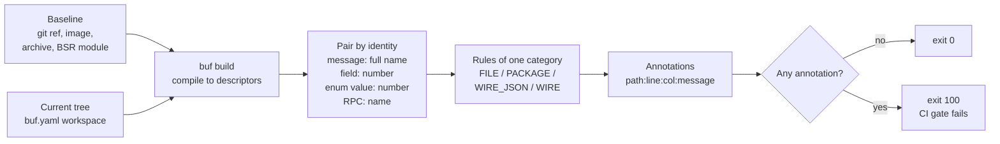

# Schema Governance for Protocol Buffers with Buf (v1.75.0): Package Layout, Linting Categories, and Wire vs Source Breaking-Change Detection

> [!summary] Claim
> `buf breaking` does not diff `.proto` text: it pairs the elements of two compiled schemas by identity and runs one rule per pair, so the category you pick (`FILE`, `PACKAGE`, `WIRE_JSON`, `WIRE`) is a statement about which consumers you promise not to break, and `buf lint` with a package layout that mirrors package names is what makes that pairing reliable.

Part of [gRPC and Protocol Buffers](README.md) in [API Engineering](../README.md).

## TL;DR

- Mechanism: `buf` compiles the current tree and a baseline (a Git ref, an image, an archive, or a BSR module) to descriptors, pairs messages by full name, fields by number, enum values by number, and RPCs by name, then runs each rule of the chosen category over the pairs.
- Contract rule: choose the category from the consumers you cannot coordinate with - `FILE` for public generated SDKs, `PACKAGE` or `WIRE_JSON` for internal JSON-facing services, `WIRE` only when every payload is binary and every reader is yours - and gate every merge on it with a pinned `buf` version.
- Trap: the gate only sees pairs; a package rename leaves nothing to pair, so in `FILE` only `FILE_SAME_PACKAGE` fires, and in `PACKAGE` deleting the last message or last enum of a package is not reported at all (both observed on buf 1.75.0).
- Portability fact: rule membership differs by config version (`v2` vs `v1` and `v1beta1`), the four categories are a strictness ladder but not a subset relation on rule ids, and `WIRE` accepts changes (`int32` to `int64`, `string` to `bytes`) that the `protobuf` runtime executes lossily.
- Do not use it as a substitute for versioning: a deliberate break belongs in a new `v2` package next to `v1`, not behind `buf skip breaking` or an `ignore` entry.

## Mental model



The two inputs are compiled independently, so a rule never sees `.proto` syntax, only the descriptors.
The pairing step is the whole mechanism: a rule only compares things that exist in both versions, and a separate family of `*_NO_DELETE` rules detects absence.
A category is a set of rules chosen so that the set expresses one compatibility promise, and the exit code `100` (observed on buf 1.75.0) is what a CI job keys on.
Lint is the same machinery run on one input, and its `PACKAGE_DIRECTORY_MATCH` and `PACKAGE_VERSION_SUFFIX` rules are what keep the identity used for pairing stable.

## How it works

### Package layout and the module root

A `buf.yaml` at the workspace root declares `modules`, each with a `path` relative to that root, and imports resolve relative to the module root, never relative to the importing file (docs: cli/modules-workspaces, "Modules and workspaces").
Buf requires every `.proto` file in a workspace to have a unique path relative to its module root, because otherwise `import "baz/baz.proto"` is ambiguous; `protoc` resolves that by the order of `-I` flags, and `buf` refuses to compile instead (docs: cli/modules-workspaces, "Unique file paths across modules").
The `MINIMAL` lint category exists to protect this identity: `PACKAGE_DEFINED`, `PACKAGE_DIRECTORY_MATCH`, `DIRECTORY_SAME_PACKAGE`, and `PACKAGE_SAME_DIRECTORY` together mean that every file of package `foo.bar.baz.v1` lives in `foo/bar/baz/v1` and nowhere else (docs: lint/rules, "MINIMAL").
Its fifth rule, `PACKAGE_NO_IMPORT_CYCLE`, forbids import cycles between packages, and is in `MINIMAL`, `BASIC`, and `STANDARD` only for `v2` configuration files (uncategorized in `v1` and `v1beta1`) (docs: lint/rules, "MINIMAL").
Observed on buf 1.75.0 with `modules: [{path: proto}]`, the layout violation is reported relative to the module root:

```text
proto/wrong/dir.proto:3:1:Files with package "acme.other" must be within a directory "acme/other" relative to root but were in directory "wrong".
```

A module's own `lint` or `breaking` block replaces the workspace default in its entirety, with no merging (docs: configuration/v2/buf-yaml, `modules`).
`deps` are BSR modules shared by every module in the workspace and pinned in `buf.lock`, while dependencies between modules of one workspace are resolved automatically (docs: configuration/v2/buf-yaml, `deps`).

### Lint: categories, the ladder, and the STANDARD default

Lint rules form three nested categories and two independent ones (docs: lint/rules, "Categories").
`MINIMAL` is contained in `BASIC`, which is contained in `STANDARD`; `COMMENTS` and `UNARY_RPC` are independent, and one rule, `STABLE_PACKAGE_NO_IMPORT_UNSTABLE`, is in no category.
Measured with `buf config ls-lint-rules --format json` in a directory whose `buf.yaml` is `version: v2` (buf 1.75.0 from Homebrew, macOS 27.3 arm64, re-measured 2026-11-21; non-deprecated rules): 45 rules, of which 35 are in `STANDARD`, 26 in `BASIC`, 5 in `MINIMAL`, 7 in `COMMENTS`, and 2 in `UNARY_RPC`.
`STANDARD` is the default when `buf.yaml` has no `lint` section, with `enum_zero_value_suffix: _UNSPECIFIED`, `service_suffix: Service`, and all three `rpc_allow_*` keys `false` (docs: lint/usage, "Default configuration").
The nine rules `STANDARD` adds to `BASIC` are `ENUM_VALUE_PREFIX`, `ENUM_ZERO_VALUE_SUFFIX`, `FILE_LOWER_SNAKE_CASE`, `PACKAGE_VERSION_SUFFIX`, `PROTOVALIDATE`, `RPC_REQUEST_RESPONSE_UNIQUE`, `RPC_REQUEST_STANDARD_NAME`, `RPC_RESPONSE_STANDARD_NAME`, and `SERVICE_SUFFIX` (docs: lint/rules, "STANDARD"; the set difference was also computed from the `ls-lint-rules` output).

The reasoning behind the load-bearing `STANDARD` rules is stated in the rule reference:

- `ENUM_VALUE_PREFIX`: enum values use C++ scoping, so two enums in one package cannot both have a value named `HTTPS`; a prefix such as `SCHEME_` avoids a future compile error (docs: lint/rules, `ENUM_VALUE_PREFIX`).
- `ENUM_ZERO_VALUE_SUFFIX`: proto3 cannot distinguish set from unset, so an unset enum field reads as the zero value, and a first value like `SCHEME_FTP = 0` makes "unset" mean FTP (docs: lint/rules, `ENUM_ZERO_VALUE_SUFFIX`).
- `RPC_REQUEST_STANDARD_NAME`, `RPC_RESPONSE_STANDARD_NAME`, `RPC_REQUEST_RESPONSE_UNIQUE`: every RPC gets its own request and response messages named `<Rpc>Request` or `<Service><Rpc>Request`, so a change to one RPC's message cannot ripple into another (docs: lint/rules, "RPC_REQUEST_STANDARD_NAME ...").
- `PACKAGE_VERSION_SUFFIX`: every package ends in a version so that a breaking revision can ship as a sibling package (docs: lint/rules, `PACKAGE_VERSION_SUFFIX`).

Implementation detail checked against source: `newPackageVersionForPackage` rejects an empty or one-component package and hands the last component to `newPackageVersionForComponent` (buf 1.75.0 private/pkg/protoversion/package_version.go, `newPackageVersionForComponent`); together they require at least two dot-separated components, a leading `v`, and a major of at least 1; `p<patch>` may precede `alpha` or `beta`, an optional minor of at least 1 may follow, and `test` may be followed by any suffix.
Numbers are parsed as integers by `getNumber` (`strconv.ParseInt` with a minimum, 1 by default unless the `allowV0` option is set), so `foo.v01` and `foo.v1alpha02` are accepted, `foo.v0` and `foo.v1alpha0` are rejected, and a one-component package such as `v1` is rejected; the lab's test table records buf's accept or reject answer for 25 probe packages (observed on buf 1.75.0).
The docs print regular expressions for the last component only, so the source and the observed answers are the reference for edge cases.
The request-name rule is `handleLintRPCRequestStandardName` (buf 1.75.0 private/bufpkg/bufcheck/bufcheckserver/internal/bufcheckserverhandle/lint.go): it takes the last dot-separated component of the input type, builds `ToPascalCase(rpc) + "Request"` and the service-prefixed form, and accepts either.

Comment ignores are a lint-only feature: `// buf:lint:ignore RULE_ID` on the line above the element, one directive per rule, enabled by default in `v2` and disabled with `disallow_comment_ignores: true`; in `v1` the default was reversed and the key was `allow_comment_ignores` (docs: lint/usage, "Ignoring rules with comments"; configuration/v2/buf-yaml, `disallow_comment_ignores`).
Observed on buf 1.75.0: adding `// buf:lint:ignore SERVICE_SUFFIX` above `service Petstore` removed the `SERVICE_SUFFIX` finding, and setting `disallow_comment_ignores: true` brought it back.

### Breaking: the four categories

The docs define the categories from strictest to most lenient (docs: breaking/rules, "Categories"):

- `FILE` (default): breakage of generated source on a per-file basis; necessary for C++ and Python, where generated code is file-specific.
- `PACKAGE`: the same, per package; types may move between files of one package.
- `WIRE_JSON`: breakage of binary or JSON encoding; the docs call it the recommended minimum because JSON is common across transports.
- `WIRE`: breakage of binary encoding only.

Measured with `buf config ls-breaking-rules --format json` (v2 listing, non-deprecated rules, buf 1.75.0, macOS 27.3 arm64, re-measured 2026-11-21): 64 rules; 51 are in `FILE`, 51 in `PACKAGE`, 22 in `WIRE_JSON`, 15 in `WIRE`.
That listing also tags 32 rules with a fifth category, `CSR`, which the rules page does not list; this note does not rely on it (`V2Spec` in buf 1.75.0 private/bufpkg/bufcheck/bufcheckserver/bufcheckserver.go is where the tag is assigned).

The docs say a schema that passes a stricter category also passes the looser ones (docs: breaking, "How compatibility is defined").
That is a statement about behavior, not about rule ids: `FIELD_NO_DELETE` is in `FILE` and `PACKAGE`, while `FIELD_NO_DELETE_UNLESS_NUMBER_RESERVED` is in `WIRE_JSON` and `WIRE` only, and `FIELD_WIRE_COMPATIBLE_TYPE` is in `WIRE` only, so the looser category runs different, weaker rules rather than a subset of the stricter set.
Across the 26 cases captured for the lab, a non-empty result at a looser category always came with a non-empty result at every stricter one (checked by a script over the captured results, not by a lab test).

The looser categories work by swapping a strict rule for a compatible-group rule:

| Strict rule (`FILE`, `PACKAGE`) | `WIRE_JSON` replacement | `WIRE` replacement |
| --- | --- | --- |
| `FIELD_SAME_TYPE` | `FIELD_WIRE_JSON_COMPATIBLE_TYPE` | `FIELD_WIRE_COMPATIBLE_TYPE` |
| `FIELD_SAME_CARDINALITY` | `FIELD_WIRE_JSON_COMPATIBLE_CARDINALITY` | `FIELD_WIRE_COMPATIBLE_CARDINALITY` |
| `FIELD_NO_DELETE` | `FIELD_NO_DELETE_UNLESS_NAME_RESERVED` and `..._NUMBER_RESERVED` | `FIELD_NO_DELETE_UNLESS_NUMBER_RESERVED` |
| `ENUM_VALUE_NO_DELETE` | `ENUM_VALUE_NO_DELETE_UNLESS_NAME_RESERVED` and `..._NUMBER_RESERVED` | `ENUM_VALUE_NO_DELETE_UNLESS_NUMBER_RESERVED` |

The compatible-group tables are plain maps in the source.
`fieldKindToWireCompatibilityGroup` (buf 1.75.0 private/bufpkg/bufcheck/bufcheckserver/internal/bufcheckserverhandle/breaking_util.go) puts `int32`, `int64`, `uint32`, `uint64`, and `bool` in one group, `sint32` and `sint64` in another, `fixed32` with `sfixed32`, `fixed64` with `sfixed64`, and gives `string` and `bytes` separate groups so that `string` to `bytes` can be allowed and `bytes` to `string` rejected by a special case in `handleBreakingFieldWireCompatibleType`.
`fieldKindToWireJSONCompatibilityGroup` in the same file is stricter: only `int32` with `uint32`, `int64` with `uint64`, `fixed32` with `sfixed32`, and `fixed64` with `sfixed64` interchange, because JSON renders 64-bit integers as strings.
`cardinalityToWireCompatibilityGroup` and `cardinalityToWireJSONCompatibilityGroup` (private/bufpkg/bufcheck/bufcheckserver/internal/bufcheckserverhandle/cardinality.go) put implicit and explicit presence in one group, and repeated with map in one group for `WIRE` but in different groups for `WIRE_JSON` ("maps and repeated use different JSON format", per the source comment).

Cardinality itself is computed by `getCardinality` in that file: list, then map, then required, then "has presence" (explicit), else implicit.
For proto3, message-typed fields already have explicit presence, so adding `optional` to a message field changes nothing (docs: breaking/rules, `FIELD_SAME_CARDINALITY`).

### Pairing, and why deleted things need their own rules

The pair handlers live in `bufcheckserverutil/breaking.go`.
`NewBreakingMessagePairRuleHandler` builds `FullNameToMessage` for the current and the `against` files and, for each previous full name present in the current map, calls the rule; `NewBreakingFieldPairRuleHandler` then pairs fields by number inside each paired message; `NewBreakingFilePairRuleHandler` pairs files by path (buf 1.75.0 private/bufpkg/bufcheck/bufcheckserver/internal/bufcheckserverutil/breaking.go).
A message that is gone, or whose package changed so its full name changed, is never handed to `FIELD_SAME_TYPE` and friends; only the `*_NO_DELETE` family can see it.
`FILE_SAME_PACKAGE` (`handleBreakingFileSamePackage`, `checkFileSameValue`) pairs files by path and is in all four categories; when a file keeps its path and changes its `package`, it is the only rule that fires under `FILE`, `WIRE_JSON`, and `WIRE`, while `PACKAGE` adds `PACKAGE_NO_DELETE` (observed on buf 1.75.0, also with a simultaneous `int32` to `string` change).

Deletion rules are parameterized.
`checkFieldNoDeleteWithRules` takes `allowIfNumberReserved` and `allowIfNameReserved`, checks the previous field number against the current message's `NumberToMessageField`, and consults the current message's reserved ranges and names; it returns an error if both flags are set when it meets a deleted field (buf 1.75.0 breaking.go, `checkFieldNoDeleteWithRules`, `isDeletedFieldAllowedWithRules`).
So `FIELD_NO_DELETE` always fails on deletion, even when the number and the name are both reserved, while the `WIRE_JSON` rules pass once both are reserved.
That asymmetry is by design: the `FILE` promise includes generated accessors, and the docs say to deprecate instead of delete (docs: breaking/rules, `FIELD_NO_DELETE`).

`FIELD_SAME_ONEOF` ignores synthetic oneofs (the ones protoc creates for proto3 `optional`) and reports moves into, out of, or between real oneofs, because presence is checked separately (`handleBreakingFieldSameOneof`).
`RESERVED_MESSAGE_NO_DELETE` and `RESERVED_ENUM_NO_DELETE` are in every category: removing a `reserved` range or name re-opens it for reuse.

The package-level rules have a guard.
`handleBreakingPackageEnumNoDelete` iterates `PackageToNestedNameToEnum` of the previous files and skips a package that has no key in the current map (buf 1.75.0 private/bufpkg/bufcheck/bufcheckserver/internal/bufcheckserverhandle/breaking.go, `handleBreakingPackageEnumNoDelete`), and `PackageToNestedNameToEnum` only creates a key when it meets at least one enum (private/bufpkg/bufprotosource/bufprotosource.go, `PackageToNestedNameToEnum`).
Consequence, reproduced on buf 1.75.0 with `breaking: {use: [PACKAGE]}`: deleting one of two enums in a package reports `Previously present enum "Color" was deleted from package "a.v1".`, deleting both reports nothing and exits `0`, and `FILE` reports both.
The same shape was reproduced for messages: removing one of two messages reports `PACKAGE_MESSAGE_NO_DELETE`, removing both exits `0`.
Services behave differently: removing the only service of a package still reports `Previously present service "S" was deleted from package "a.v1".` under `PACKAGE` (observed on buf 1.75.0), because `PackageToNameToService` creates a key for the package of every file whether or not it declares a service (buf 1.75.0 private/bufpkg/bufprotosource/bufprotosource.go, `PackageToNameToService`), so the same guard in `handleBreakingPackageServiceNoDelete` never skips it.

### What the encoded bytes show

The categories exist because the same schema edit has different effects per encoding.
Evidence from the `protobuf` 7.36.2 runtime, using dynamic messages built from a `FileDescriptorProto` (lab function `measure_runtime_effects`):

| Edit | Binary bytes | JSON |
| --- | --- | --- |
| rename `name` to `full_name` | `0a 03 72 65 78` decodes to `full_name = "rex"` under the new schema | `{"name": "rex"}` is rejected with `ParseError`: no field named `name`, available `fullName` |
| `int32` to `int64` | same varint | `{"age": 5}` becomes `{"age": "5"}` (number to string) |
| `int64` to `int32` | a value of `2**33 + 5` reads back as `5` (truncated) | not applicable |
| `sint32` to `int32` | `-1` is written as zigzag `1`, read back as `1` | not applicable |

The field tag and varint layout are covered in [[Protobuf-Wire-Format-TLV-Tags-Varints-and-ZigZag-Encoding]]; here the point is that `WIRE` is a promise about bytes only, and `protobuf.dev` itself calls changes like `int32` to `int64` "wire-compatible (conditionally safe)" because a reader of the narrower type silently drops high bits (docs: protobuf.dev proto3 guide, "Binary Wire-compatible Changes (Conditionally Safe)").

### The baseline

`buf breaking` takes the current input and a baseline passed as `--against` (or `--against-registry` to compare every named workspace module with its latest BSR commit); a baseline can be a Git reference, a BSR module, a tarball, or a zip archive (docs: breaking/usage, "Choose a baseline to compare against").
Examples from the docs: `.git#branch=main`, `.git#tag=v1.0.0,subdir=proto`, a remote `https://github.com/acme/petapis.git`, and an archive URL with `#strip_components=1`.
Git inputs clone with depth 1, or 50 if `ref` is set, and accept `branch`, `tag`, `ref`, `depth`, `subdir`, `recurse_submodules`, and `filter` (docs: reference/inputs, "git").
CI runners often use shallow clones that lack the target branch, so the docs recommend pointing `--against` at the remote URL, where the CLI clones only the single commit it needs.
An image is the offline baseline: `buf build -o image.binpb` followed by `buf breaking --against image.binpb` (docs: reference/inputs).
On the lab schema (a 41-line `pet.proto`), `buf build old -o old.binpb` produced a 1799-byte image (re-measured 2026-11-21, buf 1.75.0, macOS 27.3 arm64; the image includes source info, so the size depends on the file's exact layout).
Useful flags (docs: reference/cli/buf/breaking): `--exclude-imports`, `--limit-to-input-files`, `--path`, `--exclude-path`, `--against-config`, and `--error-format` with `text`, `json`, `msvs`, `junit`, `github-actions`, or `gitlab-code-quality`.

### Configuration keys

Under `breaking:` in `buf.yaml` (docs: configuration/v2/buf-yaml): `use` (default `FILE`), `except`, `ignore`, `ignore_only`, `ignore_unstable_packages`, and `disable_builtin`.
`ignore_unstable_packages: true` skips packages whose last component is `v\d+test.*`, `v\d+(alpha|beta)\d*`, or `v\d+p\d+(alpha|beta)\d*`.
Observed on buf 1.75.0: a `string` to `int32` change in `acme.pet.v1beta1` reported `FIELD_SAME_TYPE` under `FILE`, and exited `0` with `ignore_unstable_packages: true`.
Breaking checks have no comment-ignore directive in the docs read for this note; ignoring is by path in `buf.yaml`.
The docs recommend against `except` and `ignore_only` for breaking, because the rules in a category were chosen to give a coherent guarantee.

### CI and the registry

The `bufbuild/buf-action` GitHub Action runs build, lint, format, and breaking on pull requests, with a summary comment on non-fork PRs, pushes named modules to the BSR on Git pushes, and archives BSR labels when a Git branch or tag is deleted (docs: bsr/ci-cd/github-actions).
Pin the CLI with `version: "1.75.0"`; otherwise the action resolves `BUF_VERSION`, then a preinstalled `buf`, then the latest release.
A pull request with the label `buf skip breaking` runs without the breaking step, which makes an intentional break visible and reviewable; `breaking: ${{ github.event_name == 'pull_request' }}` removes that escape hatch.
For fork PRs the docs say not to enable push or archive, since that would expose a BSR token to untrusted contributors.
On Enterprise plans (a dedicated or private BSR instance), a server-side breaking check enforces `FILE` (the default) or `WIRE_JSON` on commits that try to advance the default label; with the review flow on, a violating commit is stored, the default label does not move, and the commit stays pending until a repository or module owner with the admin role approves or rejects it, and local `buf.yaml` may be stricter than the BSR policy but not looser (docs: bsr/checks/breaking).

## Numbers and limits

| Quantity | Value | Source |
| --- | --- | --- |
| Pinned CLI | `buf` 1.75.0 (as of 2026-11) | `buf --version`, measured here |
| Breaking rules, v2, non-deprecated | 64 | `buf config ls-breaking-rules --format json`, measured here |
| Rules per category | `FILE` 51, `PACKAGE` 51, `WIRE_JSON` 22, `WIRE` 15 (plus 32 tagged `CSR`) | same command |
| Lint rules, non-deprecated | 45: `STANDARD` 35, `BASIC` 26, `COMMENTS` 7, `MINIMAL` 5, `UNARY_RPC` 2, 1 uncategorized | `buf config ls-lint-rules --format json`, measured here |
| Exit codes | `0` clean, `100` annotations found, `1` failure such as a missing input path | observed on buf 1.75.0 |
| Wire compatibility groups | integers and `bool` in one group, `sint*` in a second, `fixed32`/`sfixed32` and `fixed64`/`sfixed64` in two more | buf source `breaking_util.go` |
| Git baseline clone depth | 1, or 50 when `ref` is set | docs: reference/inputs |
| Example image size | 1799 bytes for the one-file lab schema | `buf build old -o old.binpb`, buf 1.75.0, macOS 27.3 arm64, re-measured 2026-11-21 |
| Lab suite | 98 tests, 2.11 s | pytest on CPython 3.14.6, macOS 27.3 arm64, below |
| `PACKAGE` blind spot | removing the last enum or last message of a package is not reported; removing the last service is | measured here, buf 1.75.0 |

## Portability

| Dimension | Result | Evidence |
| --- | --- | --- |
| CPython 3.14.6 on macOS 27.3 arm64 | lab suite passes (98 tests) | pytest run for this note |
| CPython 3.12, 3.13, 3.15, 3.15t | not run | lab matrix runs were paused by the user's instruction of 2026-11-11 |
| `protobuf` runtime 7.36.2 | runtime effects measured | `measure_runtime_effects` test |
| `buf` 1.75.0 on macOS arm64 | all captured oracle rows | commands in "Worked example" |
| `buf` config `v2` vs `v1` and `v1beta1` | breaking rules `EXTENSION_NO_DELETE`, `PACKAGE_EXTENSION_NO_DELETE`, and `FIELD_SAME_DEFAULT` are `v2` only; lint rules `FIELD_NOT_REQUIRED` (`BASIC`, `STANDARD`) and `PACKAGE_NO_IMPORT_CYCLE` (`MINIMAL`, `BASIC`, `STANDARD`) are categorized only in `v2`; comment ignores flipped default | docs: lint/rules, breaking/rules, lint/usage |
| Deprecated rule names | `FIELD_SAME_LABEL` is an alias of three rules in `v1`, of `FIELD_SAME_CARDINALITY` in `v1beta1`, and invalid in `v2`; `FIELD_SAME_CTYPE` is an alias of `FIELD_SAME_CPP_STRING_TYPE` before `v2` | docs: breaking/rules |
| Generated-code languages | `FILE` is needed for C++ and Python; `PACKAGE` suffices for Go-like languages | docs: breaking/rules, "FILE and PACKAGE" |
| HTTP versions, ASGI servers | not applicable: this is a build-time tool | not applicable |

## Worked example

Implementation: [implementation](../labs/src/api_labs/f19_grpc_and_protocol_buffers/buf_governance.py).
Test: [test](../labs/tests/f19_grpc_and_protocol_buffers/test_protobuf_governance_linting_and_breaking_change_gates_with_buf.py).

The lab is an in-process model of the pairing mechanism over dataclasses (`FileDef`, `MessageDef`, `FieldDef`, `EnumDef`, `ServiceDef`, `RpcDef`) with 29 breaking rules and 19 lint rules.
It is validated differentially: the test file embeds rule-id sets captured from the real `buf` 1.75.0 on the same schemas and asserts the model returns the same sets.
Simplified excerpt of the registry and the pair loop (the real file declares all rules; the category membership was copied from `buf config ls-breaking-rules`):

```python
def _field_pairs(previous: _View, current: _View) -> Iterable[FieldPair]:
    """Fields paired by number inside messages paired by full name, as buf pairs them."""
    for path, full_name, previous_message, current_message in _message_pairs(previous, current):
        by_number = {f.number: f for f in current_message.fields}
        for previous_field in sorted(previous_message.fields, key=lambda f: f.number):
            current_field = by_number.get(previous_field.number)
            if current_field is not None:
                yield FieldPair(path, full_name, previous_field, current_field,
                                previous_message, current_message)

BREAKING_RULES = (  # excerpt: 4 of 29 rows
    ("FIELD_SAME_TYPE", (_F, _P), _field_same_type),
    ("FIELD_WIRE_JSON_COMPATIBLE_TYPE", (_J,), _field_wire_json_compatible_type),
    ("FIELD_WIRE_COMPATIBLE_TYPE", (_W,), _field_wire_compatible_type),
    ("FIELD_NO_DELETE_UNLESS_NUMBER_RESERVED", (_J, _W), _field_no_delete_number),
)
```

Captured buf 1.75.0 runs on the lab schema (a one-file module `acme/pet/v1/pet.proto` with a `Pet` message, a `Status` enum, and a `PetService`).
For a "new" tree that renames `name` to `full_name`, widens `age` from `int32` to `int64`, and replaces `tags = 4` with `reserved 4`, run as `buf breaking . --against ../../old.binpb` with `FILE`, then against the directory with `WIRE_JSON`:

```text
acme/pet/v1/pet.proto:10:1:Previously present field "4" with name "tags" on message "Pet" was deleted.
acme/pet/v1/pet.proto:11:3:Field "1" with name "full_name" on message "Pet" changed option "json_name" from "name" to "fullName".
acme/pet/v1/pet.proto:11:10:Field "1" on message "Pet" changed name from "name" to "full_name".
acme/pet/v1/pet.proto:12:3:Field "2" with name "age" on message "Pet" changed type from "int32" to "int64".
exit=100
--- WIRE_JSON, against the old directory
acme/pet/v1/pet.proto:10:1:Previously present field "4" with name "tags" on message "Pet" was deleted without reserving the name "tags".
acme/pet/v1/pet.proto:11:3:Field "1" with name "full_name" on message "Pet" changed option "json_name" from "name" to "fullName".
acme/pet/v1/pet.proto:11:10:Field "1" on message "Pet" changed name from "name" to "full_name".
acme/pet/v1/pet.proto:12:3:Field "2" with name "age" on message "Pet" changed type from "int32" to "int64". See https://developers.google.com/protocol-buffers/docs/proto3#updating for wire compatibility rules and https://developers.google.com/protocol-buffers/docs/proto3#json for JSON compatibility rules.
exit=100
```

The 26-case oracle, abridged (each cell is the rule ids buf reported with `breaking: {use: [<CATEGORY>]}`; "ok" means exit `0`):

| Edit | `FILE` | `PACKAGE` | `WIRE_JSON` | `WIRE` |
| --- | --- | --- | --- | --- |
| rename field | `FIELD_SAME_JSON_NAME`, `FIELD_SAME_NAME` | same | same | ok |
| `int32` to `int64` | `FIELD_SAME_TYPE` | `FIELD_SAME_TYPE` | `FIELD_WIRE_JSON_COMPATIBLE_TYPE` | ok |
| `string` to `bytes` | `FIELD_SAME_TYPE` | `FIELD_SAME_TYPE` | `FIELD_WIRE_JSON_COMPATIBLE_TYPE` | ok |
| `bytes` to `string` | `FIELD_SAME_TYPE` | `FIELD_SAME_TYPE` | `FIELD_WIRE_JSON_COMPATIBLE_TYPE` | `FIELD_WIRE_COMPATIBLE_TYPE` |
| delete field, reserve number only | `FIELD_NO_DELETE` | `FIELD_NO_DELETE` | `FIELD_NO_DELETE_UNLESS_NAME_RESERVED` | ok |
| delete field, reserve both | `FIELD_NO_DELETE` | `FIELD_NO_DELETE` | ok | ok |
| `implicit` to `optional` | `FIELD_SAME_CARDINALITY` | `FIELD_SAME_CARDINALITY` | ok | ok |
| `repeated` to scalar | `FIELD_SAME_CARDINALITY` | `FIELD_SAME_CARDINALITY` | `FIELD_WIRE_JSON_COMPATIBLE_CARDINALITY` | `FIELD_WIRE_COMPATIBLE_CARDINALITY` |
| field into a oneof | `FIELD_SAME_CARDINALITY`, `FIELD_SAME_ONEOF` | same | `FIELD_SAME_ONEOF` | `FIELD_SAME_ONEOF` |
| change `package` | `FILE_SAME_PACKAGE` | `FILE_SAME_PACKAGE`, `PACKAGE_NO_DELETE` | `FILE_SAME_PACKAGE` | `FILE_SAME_PACKAGE` |
| move enum to a new file, same package | `ENUM_NO_DELETE` | ok | ok | ok |
| remove `reserved 9` | `RESERVED_MESSAGE_NO_DELETE` | same | same | same |
| delete the RPC `ListPets` | `RPC_NO_DELETE` | `RPC_NO_DELETE` | ok | ok |
| change a streaming flag | `RPC_SAME_SERVER_STREAMING` | same | same | same |
| add field, RPC, or enum value | ok | ok | ok | ok |

A second captured check, the lint sample run with `lint: {use: [STANDARD]}` and `modules: [{path: proto}]` (14 findings):

```text
proto/acme/pet/v1/pet.proto:8:3:Enum value name "RED" should be prefixed with "COLOR_".
proto/acme/pet/v1/pet.proto:8:3:Enum zero value name "RED" should be suffixed with "_UNSPECIFIED".
proto/acme/pet/v1/pet.proto:9:3:Enum value name "GREEN" should be prefixed with "COLOR_".
proto/acme/pet/v1/pet.proto:13:10:Field name "Name" should be lower_snake_case, such as "name".
proto/acme/pet/v1/pet.proto:17:9:Service name "Petstore" should be suffixed with "Service".
proto/acme/pet/v1/pet.proto:18:3:RPC "get_pet" has the same type "acme.pet.v1.Pet" for the request and response.
proto/acme/pet/v1/pet.proto:18:7:RPC name "get_pet" should be PascalCase, such as "GetPet".
proto/acme/pet/v1/pet.proto:18:15:RPC request type "Pet" should be named "GetPetRequest" or "PetstoreGetPetRequest".
proto/acme/pet/v1/pet.proto:18:29:RPC response type "Pet" should be named "GetPetResponse" or "PetstoreGetPetResponse".
proto/acme/pet/v1/pet.proto:19:3:RPC "Ping" has the same type "google.protobuf.Empty" for the request and response.
proto/acme/pet/v1/pet.proto:19:12:RPC request type "Empty" should be named "PingRequest" or "PetstorePingRequest".
proto/acme/pet/v1/pet.proto:19:44:RPC response type "Empty" should be named "PingResponse" or "PetstorePingResponse".
proto/wrong/dir.proto:3:1:Files with package "acme.other" must be within a directory "acme/other" relative to root but were in directory "wrong".
proto/wrong/dir.proto:3:1:Package name "acme.other" should be suffixed with a correctly formed version, such as "acme.other.v1".
```

Test run, from `labs/` with `uv run --frozen pytest tests/f19_grpc_and_protocol_buffers/test_protobuf_governance_linting_and_breaking_change_gates_with_buf.py -q`, CPython 3.14.6, macOS 27.3 arm64, `protobuf` 7.36.2:

```text
........................................................................ [ 73%]
..........................                                               [100%]
98 passed in 2.11s
```

The 98 tests are 26 breaking cases, 25 package-version probes, 26 name-case probes, and 21 further tests (category and level tables, ladder, package blind spots, unstable packages, runtime effects, lint config).
Per the user's pause on lab checks, no mutation run, no other CPython version, and no `pyright` pass were made for this note; the drafter reported `ruff format`, `ruff check`, and `mypy` passing on the `f19` files, and the independent check re-ran only the pytest command above.
The independent check also re-ran 15 of the 26 oracle edits in all four categories (plus `scalar_to_repeated`, an explicit-presence field moved into a new oneof, a package rename with a type change, and `optional` on a message field), the lint sample, the package blind-spot cases, `ignore_unstable_packages`, comment ignores, and the worked-example commands against `buf` 1.75.0, and compared the embedded category and level tables with the `ls-breaking-rules` and `ls-lint-rules` listings; every result matched.
The tests discriminate because the oracle rows come from the real tool: a model that drops a rule, swaps a category, or pairs by the wrong key changes some row.

## Pitfalls

> [!warning] Deleting a field fails `FILE` even when you reserved it
> Trigger: a PR removes `string tags = 4;` and adds `reserved 4; reserved "tags";`.
> Symptom: `WIRE_JSON` and `WIRE` pass, `FILE` and `PACKAGE` report `FIELD_NO_DELETE` (captured).
> Fix: under `FILE`, deprecate with `[deprecated = true]` and keep the field; delete only under a `WIRE_JSON` or `WIRE` contract, and always reserve both the number and the name.

> [!warning] A package rename passes every check except one
> Trigger: `package acme.pet.v1;` becomes `package acme.pet.v2;` in the same file, with other edits in the same PR.
> Symptom: `FILE` reports only `FILE_SAME_PACKAGE` and hides a simultaneous `int32` to `string` change, because pairing is by full name (captured on buf 1.75.0 for the type change; mechanism in `NewBreakingMessagePairRuleHandler`).
> Fix: treat any `FILE_SAME_PACKAGE` finding as a stop, split the PR, and publish a new version as a new directory next to the old one.

> [!warning] `PACKAGE` does not see the last enum or message of a package disappear
> Trigger: a package with one enum loses it, or loses all its messages, while another type keeps the package alive.
> Symptom: `buf breaking` with `PACKAGE` exits `0`; `FILE` reports `ENUM_NO_DELETE` or `MESSAGE_NO_DELETE` (captured on buf 1.75.0; see `handleBreakingPackageEnumNoDelete`).
> Fix: do not rely on `PACKAGE` alone for removals of whole types; run `FILE` where generated code is consumed, and re-test this case after each `buf` upgrade.

> [!warning] `WIRE` accepts changes that corrupt data at runtime
> Trigger: `int64` to `int32`, or `sint32` to `int32`, under `WIRE`.
> Symptom: no finding; a value of `2**33 + 5` reads back as `5`, and `-1` written as `sint32` reads back as `1` (measured with `protobuf` 7.36.2).
> Fix: use `WIRE_JSON` as the floor, and stage any width change with the rollout discipline in the `protobuf.dev` guide (write only values legal for the narrow type until all readers upgrade).

> [!warning] A module-level `lint` or `breaking` block replaces the defaults entirely
> Trigger: a module sets `lint: {use: [MINIMAL]}` to quiet one noisy rule.
> Symptom: every other rule, including the workspace default `STANDARD`, is off for that module (docs: configuration/v2/buf-yaml, `modules`).
> Fix: prefer `except` or `ignore_only` at workspace scope, and keep legacy paths in a restricted-ownership file listed under `ignore_only` (docs: lint/usage).

> [!warning] Comment ignores are on by default in `v2`
> Trigger: migrating from `v1`, where `allow_comment_ignores` defaulted to off.
> Symptom: any author can silence a rule with `// buf:lint:ignore RULE_ID` (observed: it removed `SERVICE_SUFFIX`).
> Fix: set `disallow_comment_ignores: true` for repositories where ignores must be reviewed in `buf.yaml` instead.

> [!warning] A shallow clone has no baseline branch
> Trigger: `buf breaking --against '.git#branch=main'` in a CI job that checked out one commit.
> Symptom: per the docs, shallow CI clones "don't include the branches you want to diff against", so `.git#branch=main` has no `main` to compare with; not reproduced here because no git was run, so the exact error text is not quoted (docs: breaking/usage, "Remote Git repository", read 2026-11-21).
> Fix: use `--against 'https://github.com/<org>/<repo>.git'`, where the CLI clones only the single commit it needs, or the `bufbuild/buf-action` default.

No public postmortem was fetched for this note; every failure above was reproduced locally or is stated in the cited Buf documentation.

## Security and robustness

- Reuse of a number is the schema-level type-confusion bug: data persisted under field `4` as a string is read as whatever field `4` means later; `RESERVED_MESSAGE_NO_DELETE` and `RESERVED_ENUM_NO_DELETE` are in all four categories for this reason, and `buf` reports removing `reserved 9` as a break even when no field takes its place (captured: `drop_reserved`, `reuse_reserved_number`).
- The breaking gate protects readers of old persisted or in-flight data; the docs list "you're your own client" and data "persisted to disk" as a `WIRE` use case.
- Plugins (`plugins:` in `buf.yaml`) are binaries resolved from `$PATH`, a relative or absolute path, or a BSR plugin path, so a plugin is arbitrary code run in CI; pin and review them like any build tool (docs: configuration/v2/buf-yaml, `plugins`).
- The push and label-archive steps need a BSR token (`BUF_TOKEN`); build, lint, format, and breaking against a public baseline do not, so do not give the token to workflows triggered by fork PRs (docs: bsr/ci-cd/github-actions, "Authentication" and "What runs when").
- The `buf skip breaking` label and `ignore` entries are policy bypasses; require code-owner approval on `buf.yaml` and on the label, so an intentional break has a named approver.
- `PROTOVALIDATE` in `STANDARD` checks that `buf.validate` constraints are well-formed (CEL compiles, bounds are consistent, regexes are valid RE2), so a bad constraint fails at lint time instead of at runtime (docs: lint/rules, `PROTOVALIDATE`); it does not prove the constraint is sufficient.
- Lint does not check values of file options such as `go_package`; it only requires that, if set, they match across files of a package (`PACKAGE_SAME_GO_PACKAGE` and siblings), and managed mode sets them on the fly during `buf generate` so they need not be hand-written (docs: lint/rules, "What we left out", "File option values").

## The principal's view

The decision is which promise the organization makes and who enforces it.
A public SDK, or any schema whose generated code outside your repository compiles against it, needs `FILE`; the cost is that field removal and file reorganization are forbidden, so deprecation becomes the only deletion path.
An internal estate that regenerates code in a monorepo can use `PACKAGE`, accepting the blind spot above, or `WIRE_JSON` and let the build catch source breaks; the docs call `WIRE_JSON` the recommended minimum level because JSON is common across transports, and say to use it with Connect, gRPC-Gateway, or gRPC JSON (docs: breaking/rules, "Categories" and "WIRE and WIRE_JSON").
`WIRE` is for closed systems where the only readers are your binaries and the data is binary.
`buf` is deliberately stricter than the `protobuf.dev` change lists: `protobuf.dev` says a singular `string`, `bytes`, or message field is compatible with `repeated` ("Binary Wire-compatible Changes (Conditionally Safe)") and that changing a single explicit-presence field into a member of a new oneof is safe ("Binary Wire-safe Changes"), while `WIRE` reports `FIELD_WIRE_COMPATIBLE_CARDINALITY` for `string note` to `repeated string note` and every category reports `FIELD_SAME_ONEOF` for `optional string note` moved into a new oneof (observed on buf 1.75.0; docs: protobuf.dev proto3 guide, "Updating A Message Type"; docs: breaking/rules, `FIELD_SAME_ONEOF`, which says the wire exceptions are complex enough that it is safer never to move a field into or out of a oneof).
That strictness trades some false positives for a gate that does not depend on reviewers remembering the exceptions.

Operate it as infrastructure: pin the CLI version, run `lint` and `breaking` on every PR, treat `v1` to `v2` as the only sanctioned break, make `buf skip breaking` a code-owner-gated label, and use the registry check on Enterprise when several teams push to one module.
Roll lint out on a legacy estate with `ignore_only` per rule and path, shrink that list over time, and keep new code on `STANDARD` from day one; the style guide says "Set up breaking change detection from day one." (docs: best-practices/style-guide, "Design recommendations").
Choose a different tool when the contract is OpenAPI or JSON Schema (see [[Compatibility-Taxonomy-Wire-Source-and-Semantic-Compatibility-AIP-180]] and [[Anatomy-of-Breaking-Changes-in-HTTP-and-JSON-APIs]]), and when the compatibility question is semantic (a field changes meaning but not type), which no descriptor diff can see.
For organization-wide mechanics see [[Contract-Governance-in-Monorepos-vs-Polyrepos-Central-Schema-Registries]] and [[Rolling-Out-Automated-API-Linting-Across-Hundreds-of-Repositories]].
Presence semantics that decide whether `implicit_to_optional` matters in your language are in [[Protobuf-Editions-2023-2024-vs-Proto2-and-Proto3-Presence-Semantics]]; the JSON names that `WIRE_JSON` protects reach HTTP clients through [[HTTP-JSON-to-gRPC-Transcoding-and-Google-API-HTTP-Annotations-AIP-127]].

## Interview questions

> [!question] L5: What does `buf breaking --against '.git#branch=main'` compare, and what exit code does it return on a violation?
>
> > [!success]- Answer
> > It compiles the working tree and the `main` branch to descriptors and runs the rules of the configured category over the pairs.
> > Without a `breaking` block the category is `FILE`.
> > On this note's buf 1.75.0 runs, violations exit `100`, a clean run exits `0`, and a failure such as a missing input path exits `1`.
> >
> > Follow-up: why do CI systems often need a remote URL instead of `.git#branch=main`?

> [!question] L5: Which lint category is the default, and name three rules it adds beyond `BASIC`.
>
> > [!success]- Answer
> > `STANDARD` is the default.
> > It adds, for example, `ENUM_ZERO_VALUE_SUFFIX`, `PACKAGE_VERSION_SUFFIX`, and `SERVICE_SUFFIX`.
> > Anything that passes `STANDARD` also passes `BASIC` and `MINIMAL`.
> >
> > Follow-up: how do you change the required zero-value suffix?

> [!question] L5: Why must every file of package `acme.pet.v1` live in `acme/pet/v1` relative to the module root?
>
> > [!success]- Answer
> > `PACKAGE_DIRECTORY_MATCH` and `PACKAGE_SAME_DIRECTORY` enforce it so import paths document their package and generated-code ecosystems that assume the layout work.
> > `buf` also resolves imports relative to the module root and rejects two modules that contain the same relative path.
> > `protoc` does not enforce the layout.
> >
> > Follow-up: what does `buf` do when two modules of a workspace contain `baz/baz.proto`?

> [!question] L6: A teammate renames `string name = 1;` to `string full_name = 1;`, so which categories fail and why?
>
> > [!success]- Answer
> > `FILE`, `PACKAGE`, and `WIRE_JSON` fail with `FIELD_SAME_NAME` and `FIELD_SAME_JSON_NAME`; `WIRE` passes.
> > The bytes are identical because the field number and type are unchanged.
> > JSON uses names, so `{"name": "rex"}` no longer parses against the new schema (the runtime raised `ParseError`), and generated accessors change.
> >
> > Follow-up: how would you roll this rename out to JSON clients without a break?

> [!question] L6: Predict the output: with `int32 age = 2;` in `old` and `int64 age = 2;` in `new`, what does `buf breaking` report for each of `FILE`, `PACKAGE`, `WIRE_JSON`, and `WIRE`?
>
> > [!success]- Answer
> > `FILE` and `PACKAGE` report `FIELD_SAME_TYPE`.
> > `WIRE_JSON` reports `FIELD_WIRE_JSON_COMPATIBLE_TYPE`, because JSON renders `int64` as a string (`{"age": "5"}` versus `{"age": 5}`).
> > `WIRE` reports nothing, since `int32` and `int64` share a wire compatibility group.
> > The reverse edit also passes `WIRE`, but a value of `2**33 + 5` is truncated to `5` by an `int32` reader.
> >
> > Follow-up: what rollout discipline makes a `WIRE`-compatible widening safe?

> [!question] L6: Debug this API: CI runs `buf breaking` with `WIRE` and is green, yet a JavaScript client that parses JSON fails after a deploy that renamed a field, so what went wrong and what do you change?
>
> > [!success]- Answer
> > `WIRE` ignores field names, so the rename passes, and the JSON mapping uses names, so old JSON no longer parses.
> > Change the gate to `WIRE_JSON` (the documented minimum when JSON is on the path), or `FILE` for generated SDKs.
> > Keep the old name as a deprecated field during migration instead of renaming in place.
> >
> > Follow-up: which `buf.yaml` key would you set, and should it be workspace-wide or per module?

> [!question] L6: Why does `WIRE_JSON` still fail a PR that deletes a field and adds only `reserved 4;`?
>
> > [!success]- Answer
> > `FIELD_NO_DELETE_UNLESS_NAME_RESERVED` requires the name reserved too, because JSON identifies fields by name.
> > Reserving the number satisfies `FIELD_NO_DELETE_UNLESS_NUMBER_RESERVED`, which is the `WIRE` rule.
> > Reserving both passes `WIRE_JSON` and `WIRE`, but `FILE` still reports `FIELD_NO_DELETE`.
> >
> > Follow-up: why is deprecating usually better than reserving in advance?

> [!question] L7+: Explain why a package rename combined with a type change reports only `FILE_SAME_PACKAGE` under `FILE`.
>
> > [!success]- Answer
> > Message pairing is by full name, which includes the package.
> > After the rename no previous full name exists in the current schema, so field-level rules receive no pairs and cannot see the type change.
> > `FILE_SAME_PACKAGE` pairs files by path instead, so it still sees the file, and it is in all four categories.
> > The operational rule is to treat that finding as a blocker and ship a new versioned package instead.
> >
> > Follow-up: what other rule, and in which category, notices that the old package vanished?

> [!question] L7+: `buf breaking` with `PACKAGE` exited `0` after a PR deleted the only enum of a package, so is the tool wrong and how do you design the gate around it?
>
> > [!success]- Answer
> > On buf 1.75.0 this is the observed behavior: the package-level handler skips a package with no remaining enum, because the package-to-enums map has no key for it, while `FILE` reports `ENUM_NO_DELETE`.
> > Whether it is intended is not stated in the docs read here, so verify per release instead of assuming.
> > Design: run `FILE` as the gate where generated code is consumed, keep a regression test of this case against your pinned `buf`, and re-run it on every upgrade.
> >
> > Follow-up: which other whole-type removals did the lab check, and did they behave the same way?

> [!question] L7+: How do you decide when a team wants `buf skip breaking` on a regular basis, and what do you offer instead?
>
> > [!success]- Answer
> > Ask which consumers the break affects and who can coordinate them; if any cannot, the answer is a new `v2` package beside `v1`, migrated over time, which `PACKAGE_VERSION_SUFFIX` makes possible.
> > Make the label code-owner gated so every use has a named approver, and use `ignore_unstable_packages` only for alpha, beta, or test packages that are not deployed.
> > Track label use as a metric; frequent use means the category or the process is wrong.
> >
> > Follow-up: what does the Enterprise BSR review flow add over a PR label?

## Related

Prerequisites: [[Protobuf-Schema-Evolution-Invariants-Reserved-Tags-and-Unknown-Fields]]

Next: [[gRPC-Over-HTTP-2-Framing-Length-Prefixed-Messages-and-Trailers]]

See also: [[gRPC-and-Protocol-Buffers]]

- [[Protobuf-Wire-Format-TLV-Tags-Varints-and-ZigZag-Encoding]]: the bytes that `WIRE` protects.
- [[Protobuf-Editions-2023-2024-vs-Proto2-and-Proto3-Presence-Semantics]]: what the cardinality rules compare.
- [[HTTP-JSON-to-gRPC-Transcoding-and-Google-API-HTTP-Annotations-AIP-127]]: how JSON names reach HTTP clients.
- [[Compatibility-Taxonomy-Wire-Source-and-Semantic-Compatibility-AIP-180]]: the wire, source, and semantic compatibility vocabulary.
- [[Contract-Governance-in-Monorepos-vs-Polyrepos-Central-Schema-Registries]]: where the gate runs in an organization.
- [[Rolling-Out-Automated-API-Linting-Across-Hundreds-of-Repositories]]: adopting lint on a legacy estate.
- Lab: `labs/tests/f19_grpc_and_protocol_buffers/test_protobuf_governance_linting_and_breaking_change_gates_with_buf.py`

## Further reading

- Buf docs, "Rules and categories" for breaking changes: every rule, its categories, and the reasoning for the four-category ladder.
- Buf docs, "Rules and categories" for lint: the `MINIMAL`, `BASIC`, `STANDARD` ladder and the rationale for each rule.
- Buf docs, "Configure and run buf breaking" and "Configuring and running buf lint": baselines, config keys, comment ignores.
- Buf docs, `buf.yaml` v2 reference: modules, deps, per-module overrides, plugins, policies.
- Buf docs, "Modules and workspaces" and "Buf CLI inputs": module roots, import resolution, git and archive inputs.
- Buf docs, "CI/CD integration with the Buf GitHub Action" and "Breaking change check": the CI gate and the Enterprise registry gate.
- Protocol Buffers language guide (proto3), "Updating A Message Type": the upstream list of wire-safe, wire-compatible, and wire-unsafe changes that `WIRE` is built from.
- Buf source at tag v1.75.0, `private/bufpkg/bufcheck/bufcheckserver/`: the rule handlers, the group tables, and the pair helpers cited above.
