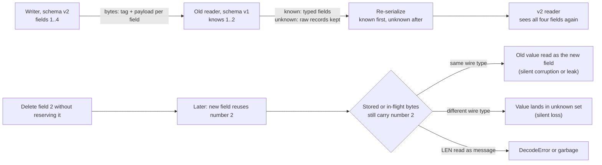

# Wire-Safe Protobuf Schema Evolution: Why Field Numbers Can Never Be Reused, reserved Tags and Names, Wire-Compatible Type Promotions, and Unknown Field Preservation

> [!summary] Claim
> A Protobuf message on the wire carries only field numbers and wire types, so the number is the field's entire identity: never reuse one, `reserve` every number and name you delete, change a type only inside a wire-compatible group, and keep unknown fields flowing through every hop that merely forwards a message.

Part of [gRPC and Protocol Buffers](README.md) in [API Engineering](../README.md).

## TL;DR

- Mechanism: a record on the wire is `(field_number << 3) | wire_type` plus a payload, with no field name and no schema type, so a parser resolves meaning purely by looking the number up in its own schema.
- Contract rule: add fields freely, delete fields only together with `reserved <number>;` and `reserved "<name>";`, and treat a field number as permanent for as long as any byte serialized under the old schema can still exist.
- The trap: reusing a number does not fail loudly in the common cases; with a matching wire type the old value silently becomes a different field, and with a different wire type the old value silently disappears into the unknown set (measured below); only some `LEN` collisions raise a parse error.
- Portability fact: `reserved` is enforced by the C++ `DescriptorBuilder` that `protoc` and the C++ runtime `DescriptorPool` share, but not by the upb definition builder behind the Python package, so a descriptor built in-process in Python accepts a reused number without complaint (protobuf 7.36.2, measured).
- When not to rely on this: ProtoJSON and text format key on names, drop or reject unknown fields, and need a different rule set, so a schema that is also persisted or exchanged as JSON must freeze names as well as numbers.

## Mental model



The top row is the compatibility contract working: the old reader does not understand fields 3 and 4, but it parses them as well-formed unknown records, stores them verbatim, and writes them back out, so the next hop that does know them loses nothing.
The bottom row is the same contract violated: a number that was once deleted is handed to a new field, and any byte string written under the old meaning is now interpreted under the new one with no signal that anything changed.
Which of the three outcomes occurs depends only on whether the old and new types share a wire type, which is why the failure is data-dependent and often invisible in tests.

## How it works

### The number is the identity

The binary encoding is a sequence of records, each a varint tag `(field_number << 3) | wire_type` followed by a value whose layout depends on the wire type: `VARINT` 0, `I64` 1, `LEN` 2, `SGROUP` 3, `EGROUP` 4, `I32` 5 (Protocol Buffers Encoding guide, "Message Structure").
Nothing else is on the wire: no field name, no declared type, no schema version.
Field numbers are limited to 1 through 536,870,911 because the tag is a varint of a 32-bit value whose low three bits hold the wire type (Proto Limits, "Field Numbers"), and 19,000 through 19,999 are set aside for the implementation (proto3 guide, "Assigning Field Numbers").
Numbers 1 through 15 cost one tag byte and 16 through 2047 cost two (proto3 guide, "Assigning Field Numbers"), which is the pressure that tempts people to renumber.
The byte-level layout of tags, varints and `ZigZag` is covered in [[Protobuf-Wire-Format-TLV-Tags-Varints-and-ZigZag-Encoding]]; this note starts from the fact that a parser sees only `(number, wire type, payload)`.

The upb decoder (the C core behind the Python package) shows exactly where the schema is consulted.
`_upb_Decoder_FindField` looks the number up in the message's mini table and returns a "field not found" sentinel if it is absent (protobuf v36.2 upb/wire/decode.c, `_upb_Decoder_FindField`).
`_upb_Decoder_DecodeWireValue` then reads the value according to the wire type on the wire and picks an operation from the field's declared type; if the wire type cannot carry that declared type the operation is `kUpb_DecodeOp_UnknownField` (protobuf v36.2 upb/wire/decode.c, `_upb_Decoder_DecodeWireValue` and `_upb_Decoder_GetVarintOp`, whose table maps `string`, `bytes`, message, `fixed32`, `float`, `double` and the other non-varint types to `kUpb_DecodeOp_UnknownField` for a `VARINT` record).
`_upb_Decoder_DecodeUnknowns` finishes skipping the record, rejects field number 0 as malformed, and appends the raw bytes to the message's unknown storage (protobuf v36.2 upb/wire/decode.c, `_upb_Decoder_DecodeUnknowns`).
The pure-Python implementation reaches the same result differently: `InternalParse` looks up the raw tag bytes in `fields_by_tag`, which is keyed by number and wire type together, so a record whose tag bytes match no declared field is stored as a `(tag_bytes, raw_value_bytes)` pair in `_unknown_fields` (protobuf v36.2 python/google/protobuf/internal/python_message.py, `InternalParse`).
Both implementations therefore convert "a record my schema cannot interpret" into "an opaque record I keep", never into an error, unless the record is structurally malformed.

### Three outcomes of reusing a number

Suppose version 1 stored `string name = 1; string tax_id = 2; int32 balance_cents = 3; string note = 4;` and a later release deletes `tax_id`, `balance_cents` and `note` without reserving them, and a still-later release defines new fields on the same numbers.
The lab builds all of these schemas at runtime and parses the same stored bytes under each of them (see [Worked example](#worked-example)).

| Old field | New field on the same number | Wire types | What the new parser does | Measured result |
|---|---|---|---|---|
| `string tax_id = 2` | `string nickname = 2` | `LEN` and `LEN` | Reads the old string as the new field | `nickname == "123-45-6789"`, a leak |
| `int32 balance_cents = 3` | `int32 loyalty_points = 3` | `VARINT` and `VARINT` | Reads the old integer as the new field | `loyalty_points == 12345`, silent meaning change |
| `int32 balance_cents = 3` | `string flags = 3` | `VARINT` and `LEN` | Stores the record as unknown | `flags == ""`, original bytes still re-serialized |
| `string note = 4` | message `Address address = 4` | `LEN` and `LEN` | Parses the string bytes as an embedded message | `DecodeError` for `"hello"`; a well-formed payload parses as a bogus `Address` |

The last row depends on content: the bytes of `"hello"` decode as field 13 `VARINT` (`68 65`) followed by `6c`, an end-group tag for field 13 with no matching start group, so parsing fails with `DecodeError` (protobuf 7.36.2, upb, measured), but any string whose bytes happen to form a valid record sequence parses cleanly as garbage, which is why the Protobuf documentation lists "a parse/merge error (best case scenario)" first among the consequences, followed by leaked PII and data corruption (proto3 guide, "Consequences of Reusing Field Numbers", also present in the editions guide).
The guide's own explanation is that the wire format "doesn't provide a way to detect fields encoded using one definition and decoded using another" (same section).
Renumbering is the same hazard in disguise: "changing" a number is "equivalent to deleting that field and creating a new field with the same type but a new number" (proto3 guide, "Assigning Field Numbers"), and the guide names aesthetic renumbering and deleting without reserving as the two common causes.

The clients and servers of one system are never updated atomically, and either side can be rolled back, so the Protobuf best-practices page says not to assume a breaking change is safe because "the client and server are in sync" (Proto Best Practices, introduction).
The window in which a reused number is dangerous is therefore not the deployment window but the retention window of the data: logs, queues, caches, databases and files that were written under the old meaning (Proto Best Practices, "Don't Re-use a Tag Number").

### reserved: what it declares and who enforces it

A `reserved` statement lists numbers or names that no field may use.
Numbers are written as a list with inclusive ranges and the `max` keyword, for example `reserved 2, 15, 9 to 11, 40 to max;`, and names are written as quoted strings, for example `reserved "foo", "bar";`; the two kinds cannot be mixed in one statement (proto3 guide, "Reserved Field Numbers" and "Reserved Field Names"; the guide shows `max` only in the enum example under "Reserved Values", and `protoc 36.2` accepts it in a message, measured below).
In `edition = "2023"` files names are bare identifiers, `reserved foo, bar;`, and the parser rejects the wrong form in each syntax: "Reserved names must be string literals. (Only editions supports identifiers.)" in proto2 and proto3, and "Reserved names must be identifiers in editions, not string literals." in editions (protobuf v36.2 src/google/protobuf/compiler/parser.cc, `Parser::ParseReserved`; editions guide, "Reserved Field Names").
Enums have the same statement with the same range syntax (proto3 guide, "Reserved Values").
The descriptor stores ranges half-open: `DescriptorProto.ReservedRange` has `start` inclusive and `end` exclusive, plus a repeated `reserved_name` (protobuf v36.2 src/google/protobuf/descriptor.proto, `DescriptorProto.ReservedRange`).
Compiling `reserved 2, 9 to 11, 40 to max; reserved "foo";` with `protoc 36.2` and reading the descriptor back gives `[(2, 3), (9, 12), (40, 536870912)]` and `['foo']`, so `max` resolves to 536,870,911 inclusive and 536,870,912 exclusive (captured below).

Enforcement lives in the C++ descriptor builder, which `protoc` and the C++ runtime share, not in every runtime.
`DescriptorPool::BuildFileCollectingErrors`, the C++ runtime entry point, constructs the same `DescriptorBuilder` that `protoc` uses (protobuf v36.2 src/google/protobuf/descriptor.cc, `DescriptorPool::BuildFileCollectingErrors`), so a C++ process building descriptors at runtime gets the checks below (read in source, not run here).
`DescriptorBuilder::BuildMessage` rejects overlapping reserved ranges ("Reserved range 4 to 6 overlaps with already-defined range 2 to 5."), duplicate reserved names, fields that use a reserved number ("Field \"x\" uses reserved number 2.") or a reserved name, and extension ranges that overlap a reserved range (protobuf v36.2 src/google/protobuf/descriptor.cc, `DescriptorBuilder::BuildMessage`).
`BuildFieldOrExtension` rejects non-positive numbers and numbers above `FieldDescriptor::kMaxNumber` (protobuf v36.2 src/google/protobuf/descriptor.cc, `BuildFieldOrExtension`).
The 19,000 through 19,999 band is rejected by a separate check in the `protoc` command-line driver, `HasReservedFieldNumber`, not by the descriptor builder (protobuf v36.2 src/google/protobuf/compiler/command_line_interface.cc, `HasReservedFieldNumber`).
The upb definition builder used by the Python package checks only that a number is positive, at most `kUpb_MaxFieldNumber`, and not duplicated within the message (protobuf v36.2 upb/reflection/message_def.c, `_upb_MessageDef_InsertField`: "invalid field number" and "duplicate field number").
That asymmetry was measured: a `FileDescriptorProto` that puts a field on a reserved number, on a reserved name, or on 19500 is accepted by a Python `DescriptorPool` and produces a working message class, while number 536,870,912 and a duplicate number are rejected (protobuf 7.36.2, `uv run --frozen pytest`, see the lab test `test_runtime_pool_does_not_enforce_reserved`).

Captured `libprotoc 36.2` output (Homebrew, macOS 27.3 arm64, run by hand, not by the lab test) for deliberately wrong proto3 schemas: `bad.proto` reserves `2, 9 to 11` and `"balance"` and then declares `loyalty_points = 2`, `dup = 9` and `balance = 3`; `bad2.proto` reserves `2 to 5, 4 to 6` and `"x", "x"` and declares `y = 536870912` and `z = 0`; `bad4.proto` writes `reserved foo;` in proto3; `bad5.proto` writes `reserved "foo";` under `edition = "2023"`:

```text
$ protoc --descriptor_set_out=/dev/null bad.proto
bad.proto:4:12: Field "loyalty_points" uses reserved number 2.
bad.proto:4:15: Field "dup" uses reserved number 9.
bad.proto:9:10: Field name "balance" is reserved.
bad.proto:4:12: Suggested field numbers for demo.Account: 4, 5
$ protoc --descriptor_set_out=/dev/null bad2.proto
bad2.proto:5:13: Field numbers cannot be greater than 536870911.
bad2.proto:6:13: Field numbers must be positive integers.
bad2.proto:3:12: Reserved range 4 to 6 overlaps with already-defined range 2 to 5.
bad2.proto:2:9: Field name "x" is reserved multiple times.
bad2.proto:5:13: Suggested field numbers for A: 1, 7
$ protoc --descriptor_set_out=/dev/null bad3.proto
bad3.proto:3:15: Expected field number range.
$ protoc --descriptor_set_out=/dev/null bad4.proto
bad4.proto:3:12: Reserved names must be string literals. (Only editions supports identifiers.)
$ protoc --descriptor_set_out=/dev/null bad5.proto
bad5.proto:3:12: Reserved names must be identifiers in editions, not string literals.
$ protoc --descriptor_set_out=/dev/null r.proto
r.proto: Field numbers 19000 through 19999 are reserved for the protocol buffer library implementation.
```

Here `bad3.proto` is `reserved 2, "foo";` and `r.proto` declares `int32 internal = 19500;`.

The lab's `check_reserved` reproduces these message texts for the same inputs and the test pins them, which keeps the lab honest about what `protoc` reports, but the lab function is a model of `protoc`, not a replacement for it.

Reserved names matter less than reserved numbers and in a different way.
They have no effect on the binary format; the guide says reserved names "affect only the protoc compiler behavior and not runtime behavior", with one exception: TextProto parsers in C++ and Go discard entries that use a reserved name instead of raising an unknown-field error, and runtime JSON parsing is not affected (proto3 guide, "Reserved Field Names").
Their job is to stop a future field from reusing a name that old JSON or text documents still contain.
The recommended deletion is therefore both: `reserved 2; reserved "tax_id";` (Proto Best Practices, "Do Reserve Tag Numbers for Deleted Fields"; the page adds that no type is needed, which lets a deleted field's imports be dropped).

Extensions follow the same rules, and are where reuse is easiest to cause: "the same Consequences of Reusing Field Numbers also apply to reusing extension field numbers", and an unverified allocation scheme (a number chosen by convention, not by an extension declaration) lets the compiler provide no protection (editions guide, "Choosing Extension Numbers" and "Unverified Extension Number Allocation").

### A safe deletion protocol

1. Stop all writers from setting the field and remove all readers' references, in a release that every deployed binary has passed.
2. Optionally mark the field `[deprecated = true]` first; the guide suggests replacing a field that nobody uses with a `reserved` statement (proto3 guide, "Options").
3. Delete the field and add `reserved <number>;` and `reserved "<name>";` in the same change.
4. Never remove the `reserved` line: the documentation says never to "take a field number out of the reserved list for reuse" (proto3 guide, "Assigning Field Numbers").
5. If a field truly must be redefined, allocate a new number and migrate; the old number stays reserved forever.

Renaming a field instead (for example with an `OBSOLETE_` prefix) is the other option the guide offers (proto3 guide, "Updating A Message Type"), at the cost that the number is still occupied and the name still shows up in generated code.

### Wire-compatible type changes

The proto3 guide classifies schema changes into three groups (proto3 guide, "Updating A Message Type"):

- Wire-unsafe: changing a field number, and moving a field into an existing `oneof`.
- Wire-safe: adding fields, removing fields (with the number reserved), adding enum values, moving a single explicit-presence field into a new `oneof`, moving a one-field `oneof` back to an explicit-presence field, and turning a field into an extension of the same number and type.
- Wire-compatible, "conditionally safe": the same data parses before and after, but may be lossy; the guide says to make these changes only if you control the rollout and generally not for a schema published outside your organization.

The compatible groups are `int32`, `uint32`, `int64`, `uint64` and `bool` (all with each other); `sint32` and `sint64` (with each other only); `fixed32` and `sfixed32`; `fixed64` and `sfixed64`; `string` and `bytes` when the bytes are valid UTF-8; embedded messages and `bytes` when the bytes are an encoded instance; `enum` with the four integer types; singular and repeated for `string`, `bytes` and message fields; and a `map<K, V>` with its repeated entry message.
These groups are exactly the sets that share a wire type and a payload interpretation, which is why the rule is easy to derive: a `VARINT` is a varint whether the schema calls it `int32` or `uint64`, a `LEN` is a length-prefixed byte run whether the schema calls it `string` or `bytes`.

The lab turns the table into a measurement.
For all 225 ordered pairs of the 15 scalar types, it encodes a probe value under the old type, parses it under the new type with the real parser, and classifies what happened (protobuf 7.36.2, upb, Python 3.14.6, macOS arm64): 15 identical, 30 compatible, 26 reinterpreted, 154 wire-mismatch.
The 154 wire-mismatch pairs are the ones where the record is kept as an unknown field and the new field reads as its default; the 26 reinterpreted pairs share a wire type but not a meaning:

- Every pairing between a plain varint type (`int32`, `uint32`, `int64`, `uint64`) and `sint32` or `sint64` in both directions, plus `bool -> sint32` and `bool -> sint64` (18 pairs), because `ZigZag` changes the integer the same bytes denote (`int32` 7 read as `sint32` is -4; `sint32` 7 read as `int32` is 14).
- `fixed32` and `sfixed32` with `float`, and `fixed64` and `sfixed64` with `double`, in both directions: the four bytes are reinterpreted as an IEEE 754 float, so `fixed32` 7 reads as about 9.8e-45 with no error (8 pairs, for 26 in total).
- The guide does not list the float pairs at all, and the type change checkers have to know them or the change looks like a no-op.

The 30 compatible pairs are the guide's 28 ordered pairs plus `sint32 -> bool` and `sint64 -> bool`, which the guide calls incompatible but which the parser handles correctly for truthiness because `ZigZag` maps zero to zero.
The lab's classifier follows the guide, not the parser, so it reports 28 compatible and 28 reinterpreted pairs, and the test pins that deliberate difference.

Compatible does not mean lossless:

- Writing an `int64` value of 2^40 + 5 and reading it as `int32` yields 5, because the varint is truncated to 32 bits "as if you had cast the number to that type in C++"; writing 2^31 yields -2147483648 (protobuf 7.36.2, measured; proto3 guide, "Binary Wire-compatible Changes").
- An `sint64` of 2^31 read as `sint32` is truncated to 32 bits and then zigzag-decoded, giving 0 (measured; the guide describes the same order of operations).
- A negative `int32` is sign-extended to ten varint bytes, so a field record is 11 bytes (one tag byte plus ten), and it reads back as the same negative number as an `int64` (measured).
- `bytes` to `string` fails if the bytes are not UTF-8: upb raises `DecodeError`, and the pure-Python backend raises `UnicodeDecodeError` from the string decoder (protobuf v36.2 python/google/protobuf/internal/decoder.py, `StringDecoder`, `_ConvertToUnicode`; measured on both backends).
- `bool` collapses any nonzero varint to true, so `int32 -> bool -> int32` does not round-trip, and the re-serialized bytes differ from the input (`parsed.SerializeToString() != raw`, measured).

Cardinality changes are narrower than the type table suggests.
Repeated to singular keeps the last `string` (measured: `["a", "b", "c"]` reads as `"c"`), and merges message elements, but numeric repeated fields are packed by default in proto3, so a singular `int32` reading `[1, 2, 3]` sees a `LEN` record, reads the field as its default 0, and keeps the original 5 bytes `0a 03 01 02 03` as an unknown record (measured); the guide warns this is "not generally safe for numeric types" (proto3 guide, "Binary Wire-compatible Changes"; Proto Best Practices, "Don't Go from Repeated to Scalar").
A `map<K, V>` and its repeated entry message are binary-compatible, but a map reader "may reorder entries and drop entries with duplicate keys" when it re-serializes (proto3 guide, "Binary Wire-compatible Changes").

### Unknown field preservation

An unknown field is "well-formed Protobuf serialized data representing fields that the parser does not recognize", and proto2, proto3 and editions messages all preserve them through parsing and serialization (proto3 guide, "Unknown Fields"; editions guide, "Unknown Fields").
The round trip is the property that makes additive evolution safe for intermediaries: a v1 service that reads a v2 message and writes it back emits the new fields unchanged.
The lab test `test_unknown_fields_survive_a_round_trip_through_an_old_service` serializes a v2 `Account` with `name`, `balance_cents`, `email` and `score`, parses it with a v1 class that knows only fields 1 and 2, re-serializes, and asserts the output is byte-identical to the input and parses back to a value equal to the original v2 message.
A scratch run of the same schema (name "x", balance 5, email "e@x", score 2^40) serialized to the records `0a 01 78`, `10 05`, `1a 03 65 40 78` and `20 80 80 80 80 80 20`, and the v1 class re-serialized exactly those bytes.

Where the unknown bytes live differs by implementation, and the Python API for reading them is not uniform.
In the pure-Python backend each unknown record is a `(tag_bytes, raw_value_bytes)` pair in `_unknown_fields`, appended after all known fields at serialization time (protobuf v36.2 python/google/protobuf/internal/python_message.py, `InternalSerialize`: `ListFields()` loop, then the `_unknown_fields` loop).
In the upb backend that ships in the 7.36.2 wheel, the C core stores them and the Python accessor `Message.UnknownFields()` is not implemented: it raises `NotImplementedError("unknown field accessor")` (protobuf v36.2 python/message.c, `PyUpb_Message_UnknownFields`; measured).
The lab therefore ships its own strict TLV scanner, `scan_wire`, to see which records a schema cannot interpret.
The order is observable: known fields are written first and unknown records after, whatever order they arrived in (measured on both upb and the pure-Python backend with the v1 `Account`, where field 2 is `int32`: wire `28 09 10 01` re-serializes as `10 01 28 09`; `28 09 08 01` comes back unchanged because `08 01` is a `VARINT` on the `string` field 1 and is itself unknown), consistent with the guide's statement that serialization order is an implementation detail and parsers must accept any order (Encoding guide, "Field Order").

Unknown records have three rules worth knowing:

- Parsing into an existing message with `MergeFromString` accumulates them, `ParseFromString` clears the message first, and concatenating two serialized messages parses as the merge of the two (Encoding guide, "Last One Wins"; measured: merging `28 09` and `30 07` re-serializes as `28 09 30 07`).
- Field number 0 and structurally malformed records (a truncated `LEN`, an unmatched group end) are parse errors, not unknown fields (protobuf v36.2 upb/wire/decode.c, `_upb_Decoder_DecodeUnknowns`; measured: field 0, a truncated `LEN` and a lone start-group tag are rejected with a parse error).
- Groups, a deprecated wire type, are kept as unknown with their start and end tags intact (Encoding guide, "Groups"; measured: `2b 08 01 2c` survives).

### What loses unknown fields

The guide's list is short: serializing to JSON and iterating over fields to populate a new message both drop them, and the remedies are to use binary and to use `CopyFrom()` and `MergeFrom()` instead of copying field by field (proto3 guide, "Retaining Unknown Fields").
The lab measures each path on one v1 message that carries unknown fields 3 and 4:

| Operation | Keeps unknown records? | Evidence |
|---|---|---|
| `SerializeToString()` then `FromString` | yes | byte-identical output |
| `CopyFrom`, `MergeFrom` | yes | byte-identical output |
| Copy `name` and `balance_cents` by hand | no | fewer bytes, no unknown records |
| `DiscardUnknownFields()` | no | removes them on purpose (upb walks to depth 64) |
| `json_format.MessageToJson` then `Parse` | no | JSON has no representation for them |

`DiscardUnknownFields` is `PyUpb_Message_DiscardUnknownFields`, which calls `upb_Message_DiscardUnknown(msg, msgdef, ext_pool, 64)`, so unknown fields nested deeper than 64 levels are not guaranteed to be discarded (protobuf v36.2 python/message.c, `PyUpb_Message_DiscardUnknownFields`; the depth argument is as read in source, not tested here).
Text format is a special case: serializing prints unknown fields by number, but parsing a text document that contains numeric field entries back into a binary message fails (proto3 guide, "Retaining Unknown Fields").

Enums add two subtleties through "closed" and "open" semantics (Enum Behavior guide, "Definitions").
An open enum (proto3, and editions by default) stores an unrecognized value in the field; a closed enum (proto2) moves it into the unknown set and reports the field as unset.
For a repeated closed-enum field, unrecognized values are removed from their positions and written back later, so `[0, 2, 1, 2]` parses to `[0, 1]` with `[2, 2]` unknown and re-serializes as `[0, 1, 2, 2]` (Enum Behavior guide, "Implications of Closed Enums"; the lab test `test_closed_enum_moves_unknown_values_and_reorders_a_repeated_field` reproduces both outputs with a proto2 schema built at runtime, and shows the proto3 schema keeping `[0, 2, 1, 2]`).
In upb the check is explicit: a `VARINT` record for a closed-enum field whose value is not in the enum becomes `kUpb_DecodeOp_UnknownField`, and packed closed-enum values go through `_upb_Encoder_AddEnumValueToUnknown` (protobuf v36.2 upb/wire/decode.c, `_upb_Decoder_DecodeWireValue` and `_upb_Decoder_DecodeEnumPacked`).
Presence and open versus closed enums are the subject of [[Protobuf-Editions-2023-2024-vs-Proto2-and-Proto3-Presence-Semantics]]; this note only needs the consequence for evolution, which is that adding an enum value is wire-safe but changes what an old closed-enum reader does with it.

### JSON and text are a different contract

The binary rules above do not carry over to ProtoJSON.
ProtoJSON "does not support unknown fields", and "removing fields is a breaking change that will trigger a parsing error" (ProtoJSON guide, introduction).
The lab confirms the default: `json_format.Parse` of a v2 document into a v1 class raises `ParseError: Message type "v1.Account" has no field named "email" at "Account".` (protobuf 7.36.2, measured), and `ignore_unknown_fields=True` makes it succeed and drop the field.
The JSON guide's wire-safe list is therefore different: changing a field number is safe in JSON "(as the field numbers are not used in the ProtoJSON format), but still strongly discouraged", while changing between `string` and `bytes`, between a message and `bytes`, from optional to repeated, to or from an extension of the same number and type, and between a `map` and its repeated entry form are unsafe in JSON though compatible in binary (ProtoJSON guide, "ProtoJSON Wire Safety").
If a message is ever exposed as JSON (for example through transcoding, see [[HTTP-JSON-to-gRPC-Transcoding-and-Google-API-HTTP-Annotations-AIP-127]]), field names and enum value names join field numbers as frozen identifiers, which is what reserved names exist to protect.

### Where wire-safe stops being enough

Wire-safe is not source-safe and not semantic-safe.
The guide notes that "any wire-safe changes may be a breaking change to application code in a given language", for example adding an enum value breaks an exhaustive `switch` (proto3 guide, "Binary Wire-safe Changes").
Changing a field's default, units or meaning while keeping the number and type is wire-identical and semantically breaking (Proto Best Practices, "Don't Change the Default Value of a Field").
How much of this a team enforces mechanically, and how breaking-change gates classify wire versus source breakage, is the subject of [[Protobuf-Governance-Linting-and-Breaking-Change-Gates-with-Buf]], and the general taxonomy is in [[Compatibility-Taxonomy-Wire-Source-and-Semantic-Compatibility-AIP-180]].

## Numbers and limits

| Quantity | Value | Source or measurement |
|---|---|---|
| Valid field numbers | 1 to 536,870,911 (2^29 - 1) | Proto Limits, "Field Numbers" (as of 2026-11) |
| Implementation-reserved band | 19,000 to 19,999 | proto3 guide; `FieldDescriptor::kFirstReservedNumber` and `kLastReservedNumber` (protobuf v36.2 src/google/protobuf/descriptor.h) |
| Tag size | 1 byte for numbers 1 to 15, 2 bytes for 16 to 2047 | proto3 guide, "Assigning Field Numbers" |
| Fields per message | at most 65,535 | Proto Limits, "Number of Fields" (as of 2026-11) |
| Serialized message size | must be under 2 GiB | Encoding guide, "Encoded Proto Size Limitations"; Proto Limits |
| Unmarshal depth limit | Java 100, C++ 100, Go 10000 | Proto Limits, "Depth Limit for Proto Unmarshaling" (as of 2026-11) |
| `max` in a reserved range | descriptor `end` = 536,870,912 (exclusive) | measured with `protoc 36.2`, macOS arm64 |
| Ordered scalar type pairs probed | 225: 15 identical, 30 compatible, 26 reinterpreted, 154 wire-mismatch | lab, protobuf 7.36.2 upb, Python 3.14.6, macOS arm64 |
| Negative `int32` field record | 11 bytes (1 tag + 10 varint) | lab test `test_compatible_int_widening_truncates_out_of_range_values` |

## Portability

The lab test file was run once per interpreter in a minimal environment (`uv run --no-project --python <v> --with protobuf==7.36.2 --with pytest==9.2.0`, `PYTHONPATH=src`, `-c /dev/null`), on macOS arm64.
That is not the locked workspace environment, because building the full `uv.lock` environment for each interpreter was out of scope for this run.
The locked workspace run (`uv run --frozen`) was done on Python 3.14.6 only.
Rows marked "drafter" were run by the note's author; rows marked "verifier" were run once by the independent fact-checker on the same machine (macOS 27.3 arm64, Darwin 27.3.0) with the same minimal-environment command, using the Homebrew interpreters; under `-c /dev/null` pytest also prints 20 `PytestUnknownMarkWarning` lines for the unregistered `unit` marker.

| Interpreter run | Protobuf backend | Result |
|---|---|---|
| CPython 3.12.13 | upb | 20 passed (drafter) |
| CPython 3.13.18 | upb | 20 passed (drafter) |
| CPython 3.14.6 (also the locked workspace) | upb | 20 passed (drafter; locked workspace rerun by verifier: 20 passed) |
| CPython 3.14.10 | upb | 20 passed (verifier) |
| CPython 3.15.0b3 | upb | 20 passed (drafter) |
| CPython 3.15.2 | upb | 20 passed (verifier) |
| CPython 3.14.6 free-threaded | pure Python | 20 passed (drafter; backend `python` confirmed by verifier) |
| CPython 3.15.0b3 free-threaded | pure Python | 20 passed (drafter) |

Facts this table does not claim: `3.12.16` was not run (the installed 3.12 build is 3.12.13), `3.15.2t` was not run (no 3.15.2 free-threaded build is installed on this machine), and the Debian and Alpine container legs were not run.
Two portability differences were observed, not assumed:

- On the free-threaded builds `api_implementation.Type()` reported `python`, not `upb`, so those rows exercise the pure-Python decoder (measured; rechecked on 3.14.6t with `sys._is_gil_enabled()` false).
- `bytes` to `string` with invalid UTF-8 raises `DecodeError` under upb and `UnicodeDecodeError` under the pure-Python backend, so the lab test accepts either (measured on both backends, the pure-Python one also via `PROTOCOL_BUFFERS_PYTHON_IMPLEMENTATION=python` on 3.14.6).

Other axes, by source: `UnknownFields()` is unimplemented in upb 7.36.2 (python/message.c, `PyUpb_Message_UnknownFields`) while the pure-Python module `google/protobuf/unknown_fields.py` implements an `UnknownFieldSet` over `_unknown_fields` (read in the installed package); reserved-range and reserved-name enforcement lives in the C++ `DescriptorBuilder` (`descriptor.cc`), which both `protoc` and the C++ runtime `DescriptorPool` run, while the 19,000 through 19,999 check is `protoc`-only (`command_line_interface.cc`) and the upb builder used by Python checks neither; this note makes no claim about the Java, Go or other runtimes' own descriptor builders, so test runtime-built schemas in each language that builds them; open versus closed enum conformance differs by language: the Enum Behavior guide lists C++, C#, Java, Kotlin, Go, JSPB and Ruby as out of conformance, PHP and Swift as conformant, Python and Objective-C as conformant in versions above 4.22.0 and 3.22.0, and Dart as treating all enums as closed, so enum evolution should be tested in each language you ship (Enum Behavior guide, "Known Issues", as of 2026-11).
HTTP version is irrelevant to this note: schema evolution is a property of the message bytes, whether they travel over HTTP/2 gRPC framing or sit in a file.

## Worked example

The implementation is [implementation](../labs/src/api_labs/f19_grpc_and_protocol_buffers/protobuf_schema_evolution.py) and the test is [test](../labs/tests/f19_grpc_and_protocol_buffers/test_protobuf_schema_evolution_invariants_reserved_tags_and_unknown_fields.py).
The module builds real `protobuf` message classes from `FileDescriptorProto` objects, each in a private pool so an old and a new schema can both be named `Account`.
There is no `protoc` and no network in the lab.

Simplified excerpt of `build_classes` (error handling and enum plumbing trimmed):

```python
def build_classes(package, messages, *, enums=(), syntax="proto3"):
    fdp = descriptor_pb2.FileDescriptorProto(name=f"{package}.proto", package=package, syntax=syntax)
    for spec in messages:
        proto_msg = fdp.message_type.add(name=spec.name)
        for fld in spec.fields:
            proto_msg.field.add(name=fld.name, number=fld.number, type=..., label=...)
        for start, end in spec.reserved_ranges:
            proto_msg.reserved_range.add(start=start, end=end + 1)  # descriptor end is exclusive
        proto_msg.reserved_name.extend(spec.reserved_names)
    pool = descriptor_pool.DescriptorPool()
    pool.Add(fdp)  # the upb pool accepts reserved violations
    return {s.name: message_factory.GetMessageClass(pool.FindMessageTypeByName(...)) for s in messages}
```

Simplified excerpt of the compatibility classifier, which the test checks against the real parser for all 225 ordered pairs:

```python
def classify_type_change(old: str, new: str) -> Compat:
    if old == new:
        return Compat.IDENTICAL
    if any(old in group and new in group for group in COMPATIBILITY_GROUPS):
        return Compat.COMPATIBLE
    if SCALARS[old][1] != SCALARS[new][1]:
        return Compat.WIRE_MISMATCH
    return Compat.REINTERPRETED
```

Simplified excerpt of the unknown-field test, the lab's core claim:

```python
def test_unknown_fields_survive_a_round_trip_through_an_old_service() -> None:
    new = build_classes("v2", (V2,))["Account"]
    old = build_classes("v1", (V1,))["Account"]
    original = new(name="ada", balance_cents=5, email="ada@example.com", score=1 << 40)
    wire = original.SerializeToString()
    through_old = old.FromString(wire)
    assert [r.number for r in unknown_records(old, wire)] == [3, 4]
    reserialized = through_old.SerializeToString()
    assert reserialized == wire
    assert new.FromString(reserialized) == original
```

The lab covers: unknown field survival, ordering, and each loss path; the runtime pool not enforcing `reserved`; `check_reserved` matching the captured `protoc` text; the three outcomes of number reuse; the 225-pair type classification against the parser; integer truncation, UTF-8 failure, repeated-to-singular and packed stranding; closed versus open enum behavior; `bytes` compatibility with an embedded message; the strict scanner; and a small `diff_schema` checker that flags unreserved removals, reserved-number reuse and type changes, and says plainly that a same-type rename cannot be told from a reuse.

Captured output, command `cd labs && uv run --frozen pytest tests/f19_grpc_and_protocol_buffers/test_protobuf_schema_evolution_invariants_reserved_tags_and_unknown_fields.py -q`, CPython 3.14.6, macOS (Darwin 27.3.0, arm64), protobuf 7.36.2:

```text
....................                                                     [100%]
20 passed in 2.10s
```

The same file under the minimal environments from the Portability section printed `20 passed` on 3.12.13, 3.13.18, 3.14.6, 3.14.10, 3.15.0b3, 3.15.2, 3.14.6 free-threaded and 3.15.0b3 free-threaded.
Mutation testing of the tests was paused for this run by instruction, so the claim that each test fails when its behavior is absent rests on the assertions themselves (for example the byte-equality in the round-trip test and the `wrong == []` list in the classification test), not on recorded mutations.

## Pitfalls

> [!warning] Deleting a field without reserving its number
> Trigger: a field is removed in a cleanup and a later author, seeing the number free, assigns it to a new field.
> Symptom: old messages in logs, queues or storage parse into the new field with no error (same wire type) or lose the value into the unknown set (different wire type); the guide lists leaked PII and data corruption among the outcomes (proto3 guide, "Consequences of Reusing Field Numbers").
> Fix: add `reserved <number>;` and `reserved "<name>";` in the deletion change, and run a gate that fails a diff in which a removed number is not reserved; the lab's `diff_schema` encodes this rule as `REMOVED_NUMBER_NOT_RESERVED`.

> [!warning] A proxy that copies fields by hand
> Trigger: a gateway or adapter parses a message, copies the fields it knows into a fresh message, and forwards it.
> Symptom: fields added by a newer upstream disappear at that hop with no error, so a newer client talking to a newer server through the proxy sees the new fields vanish (measured: the field-by-field copy re-serialized to fewer bytes and with no unknown records).
> Fix: forward the original message, or use `CopyFrom` and `MergeFrom`, which keep unknown fields (proto3 guide, "Retaining Unknown Fields"); if a transformation is unavoidable, do it on the wire message and test with a schema one version newer than the proxy.

> [!warning] Trusting the runtime to enforce `reserved`
> Trigger: a service builds descriptors at runtime (a registry, a dynamic schema loader, reflection-driven tooling) and assumes a reserved number cannot be used.
> Symptom: the Python (upb) pool accepts a field on a reserved number, a reserved name or 19500 and produces a working class (protobuf 7.36.2, measured); a C++ `DescriptorPool` rejects the reserved number and name but still accepts 19500, because that check is `protoc`-only (read in source).
> Fix: validate schemas at the same gate that runs `protoc` or `buf`, and run the reserved checks on any schema that did not come from a compiler.

> [!warning] A type change that looks compatible and is not
> Trigger: `int32` becomes `sint32` "to save bytes", or `fixed32` becomes `float`, on a live field.
> Symptom: the same bytes parse without error to a different value, for example 7 becomes -4 or about 9.8e-45; the bytes are never rejected.
> Fix: allocate a new number for the new type, dual-write, migrate readers, then reserve the old number; use the 225-pair measurement above to decide what is a real promotion.

> [!warning] Widening an integer and then writing large values too early
> Trigger: `int32` becomes `int64` and a writer starts emitting values above 2^31 - 1 before every reader has the new schema.
> Symptom: old readers silently truncate to 32 bits (2^40 + 5 reads as 5, measured).
> Fix: roll the schema to all readers first, then widen values, as the guide advises (proto3 guide, "Binary Wire-compatible Changes").

> [!warning] Renaming a field that is also exchanged as JSON or text
> Trigger: a field is renamed because the binary format does not care.
> Symptom: JSON and text documents written under the old name fail to parse, and removed fields trigger a parse error in ProtoJSON (ProtoJSON guide, introduction).
> Fix: treat names as frozen wherever JSON, text format or transcoding is in use, and reserve the old name.

> [!warning] Relying on stable serialization
> Trigger: using serialized bytes as a cache key, hash input or signature input across builds or across an old and a new binary.
> Symptom: logically equal messages serialize differently, for example because an old server keeps unknown fields (Encoding guide, "Implications"; Proto Best Practices, "Never Rely on Serialization Stability Across Builds").
> Fix: compare messages semantically, or use deterministic serialization only within one binary.

## Security and robustness

- Threat model: the actor is the schema's own future, not an attacker, but the effect is the same as a type-confusion bug on persisted or replayed data: a value written under one meaning is acted on under another, which the guide lists as a way to leak PII (proto3 guide, "Consequences of Reusing Field Numbers").
- OWASP API Security: reusing a number for an authorization-relevant field (a role, an owner id, a visibility flag) can turn an old, harmless value into an access decision, which is an instance of broken object property level authorization; see [[Case-Study-Multi-Tenant-BOLA-and-Mass-Assignment-Privilege-Escalation]] for the class of failure.
- Unknown fields are attacker-influenced input that is preserved and forwarded; a service that re-serializes a message it received will pass along fields it did not validate, so validate fields at the trust boundary where the schema is complete, and do not treat "the old service ignored it" as "the old service stripped it".
- Resource limits apply to unknown data too: a unknown-heavy message still counts toward the 2 GiB serialized limit and the recursion limits for nested groups and messages, and the lab's own scanner caps group nesting at 100 (the documented C++ and Java unmarshal depth limit is also 100, Proto Limits, "Depth Limit for Proto Unmarshaling").
- Parsing hostile bytes: field number 0, truncated records, mismatched group ends and varints longer than 10 bytes are rejected, not preserved; the lab's `scan_wire` raises `ValueError` for each, and the library rejects field 0, a truncated `LEN` and a lone start-group tag with a parse error (measured).
- Defense in depth: enforce `reserved` and no-renumber rules in CI, keep storage messages distinct from RPC messages so a storage schema can evolve independently (Proto Best Practices, "Do Use Different Messages For RPC APIs and Storage"), and avoid `required` fields, whose removal is itself a wire-compatibility problem (Proto Best Practices, "Don't Add a Required Field").

## The principal's view

The architectural decision is to treat the field number as an immutable public identifier and to make that mechanical rather than cultural: the repository, not the reviewer, refuses a diff that removes a number without reserving it, reuses a reserved number, or changes a field's wire type.
The organizational trade-off is speed of cleanup against safety of history: a permanent `reserved` line costs a few bytes of schema and some reading effort, and buys protection against data you can no longer enumerate.
Where a schema is published outside the organization, the guide's advice is to avoid even wire-compatible changes, because you cannot know when all consumers have the new schema (proto3 guide, "Binary Wire-compatible Changes"); the practical rule is to add fields and new messages, deprecate old ones, and migrate by new number.
The downside of strict additive evolution is schema accretion: messages grow dead fields and `reserved` lists, and the only ways out are a new message type or a new API version, which is a migration project, not a refactor.
Choose a different tool when the data is long-lived and self-describing needs dominate (a format with embedded schemas), when every hop must see exactly the fields it understands (strict JSON Schema with `additionalProperties: false`), or when the consumers are external and cannot be coordinated, in which case a versioned API surface (see [[Compatibility-Taxonomy-Wire-Source-and-Semantic-Compatibility-AIP-180]] and [[Additive-Schema-Evolution-and-Tolerant-Reader-Patterns]]) matters more than any single message rule.
Pair this note's rules with a tool that enforces them; the comparison of wire-level and source-level breaking checks is in [[Protobuf-Governance-Linting-and-Breaking-Change-Gates-with-Buf]].

## Interview questions

> [!question] L5: Why must you reserve a field number when you delete a field, and what does `reserved` actually do?
>
> > [!success]- Answer
> > The wire format carries only the field number and wire type, so any old bytes still in logs, queues or storage will be interpreted by whatever field later takes that number.
> > `reserved 2;` makes `protoc` reject any field on that number, and `reserved "name";` does the same for the name.
> > It adds no bytes to messages and is a descriptor-building check, not a parse check: `protoc` and the C++ runtime `DescriptorPool` enforce it, the Python (upb) descriptor pool does not.
> >
> > Follow-up: Does the Python runtime reject a descriptor that uses a reserved number?

> [!question] L5: A v2 service adds fields 3 and 4 and sends the message to a v1 service that forwards it to a v2 service; what does the second v2 service see?
>
> > [!success]- Answer
> > Fields 3 and 4, intact, provided the v1 service forwards the parsed message (or `CopyFrom` or `MergeFrom` of it) and not a hand-copied one.
> > The v1 parser stores records it cannot interpret as unknown fields and writes them back when it serializes.
> > In the lab the re-serialized bytes were byte-identical to the original.
> >
> > Follow-up: Name two operations on the v1 message that would drop the new fields.

> [!question] L6: Predict the output: field 1 is `repeated Color r = 1;` where `Color` is a proto2 enum with `A = 0` and `B = 1`, and the wire holds the unpacked values `[0, 2, 1, 2]`; what does the reader see, and what does it write back?
>
> > [!success]- Answer
> > The closed enum parses `[0, 1]` and moves the two unrecognized `2` values into the unknown set.
> > Re-serialization writes `08 00 08 01 08 02 08 02`, that is `[0, 1, 2, 2]`, so the unknown values lose their original positions.
> > An open proto3 enum would instead keep `[0, 2, 1, 2]` and re-serialize it in its packed form.
> >
> > Follow-up: Why does a repeated closed enum make adding an enum value riskier than a singular one?

> [!question] L6: Debug this API: a gateway built on schema v1 accepts a v2 `Account` message and returns it to the client, but clients report that `email` (field 3) is missing after the round trip, and the gateway code is `out = Account(); out.name = msg.name; out.balance_cents = msg.balance_cents; return out`; what is wrong and what is the fix?
>
> > [!success]- Answer
> > The gateway rebuilds the message field by field, so the unknown record for field 3 is never copied, and the output has fewer bytes than the input.
> > Forward the parsed `msg`, or use `out.CopyFrom(msg)` or `out.MergeFrom(msg)`, which carry the unknown fields.
> > Add a test that parses bytes from a schema one version newer than the gateway and asserts the output bytes are unchanged.
> >
> > Follow-up: What other common step in a gateway would also drop field 3?

> [!question] L6: A field is `int32 amount = 3;` and a teammate wants `sint32 amount = 3;` because the values are often negative; is it wire-safe?
>
> > [!success]- Answer
> > No: both are varints, so the bytes parse without error, but `sint32` applies `ZigZag` decoding, so the same bytes mean a different integer (`int32` 7 reads as `sint32` -4; measured across all 225 type pairs, every int-to-`sint` pairing is reinterpreted).
> > The correct move is a new field number with the new type, dual write, reader migration, then reserve the old number.
> >
> > Follow-up: What would the reader see if the new type were `string` instead?

> [!question] L6: `int32 count = 3;` becomes `int64 count = 3;` and a writer immediately starts emitting 2^40 + 5; what do old readers see, and is the change "safe"?
>
> > [!success]- Answer
> > Old readers truncate the varint to 32 bits and see 5, with no error (measured); that is the documented behavior of wire-compatible promotions.
> > The change is conditionally safe: it is fine only if all readers have the new schema before any writer uses values outside the old range.
> > For a published API the guide recommends not making such changes at all.
> >
> > Follow-up: How does a negative `int32` behave when read as `int64`?

> [!question] L7+: Design the CI gate that makes number reuse impossible, and say what it cannot catch.
>
> > [!success]- Answer
> > Diff each changed `.proto` against the base branch and fail on: a removed field number not present in the new `reserved`, a reserved number or name that is no longer reserved or is used by a field, a changed field number, and a type change that is not in a wire-compatible group.
> > Run `protoc` or an equivalent in the same job so the compiler's own reserved checks and the 19,000 through 19,999 check apply, since not every runtime enforces them (the Python upb pool enforces neither).
> > It cannot distinguish a rename from a reuse when the name changes and the type stays the same, so same-type name changes need human review or a name-stability rule; it also cannot see semantic changes such as a new unit or default.
> >
> > Follow-up: Which part of this lives in [[Protobuf-Governance-Linting-and-Breaking-Change-Gates-with-Buf]]?

> [!question] L7+: A message is stored in a database for years and also served over gRPC and JSON transcoding; which evolution rules apply, and what is the safest schema strategy?
>
> > [!success]- Answer
> > The strictest union applies: binary rules for stored bytes (never reuse numbers, reserve deletions, compatible promotions only with controlled rollout), plus JSON rules for transcoded clients (names frozen, no unknown-field tolerance by default, removals break parsing).
> > Use separate storage and RPC messages so each can evolve on its own, and a translation layer between them.
> > Reserve both numbers and names, never delete enum values that appear in JSON, and let new JSON consumers set ignore-unknown-fields deliberately.
> >
> > Follow-up: What happens to a stored message whose field was deleted and reserved when an old binary reads it?

> [!question] L7+: A service must preserve fields it does not understand but also validate its input; how do you reconcile "preserve unknown fields" with "do not forward unvalidated data"?
>
> > [!success]- Answer
> > Preservation is a property of the parse and serialize path, validation is a property of the application, and they do not conflict: validate the fields the service owns and treat the rest as opaque cargo for a peer that owns them.
> > If a hop is a trust boundary, terminate it by decoding with the complete schema (or discarding unknown fields on purpose with `DiscardUnknownFields`) before forwarding.
> > Forwarding an unvalidated unknown field is a deliberate decision, not a default, and the boundary service should make it explicitly.
> >
> > Follow-up: What does `DiscardUnknownFields` not promise about deeply nested messages?

## Related

Prerequisites: [[Protobuf-Editions-2023-2024-vs-Proto2-and-Proto3-Presence-Semantics]]

Next: [[Protobuf-Governance-Linting-and-Breaking-Change-Gates-with-Buf]]

See also: [[gRPC-and-Protocol-Buffers]], [[Protobuf-Wire-Format-TLV-Tags-Varints-and-ZigZag-Encoding]], [[Compatibility-Taxonomy-Wire-Source-and-Semantic-Compatibility-AIP-180]], [[Additive-Schema-Evolution-and-Tolerant-Reader-Patterns]], [[Anatomy-of-Breaking-Changes-in-HTTP-and-JSON-APIs]], [[HTTP-JSON-to-gRPC-Transcoding-and-Google-API-HTTP-Annotations-AIP-127]]

- Lab: `labs/tests/f19_grpc_and_protocol_buffers/test_protobuf_schema_evolution_invariants_reserved_tags_and_unknown_fields.py`

## Further reading

- [Protocol Buffers Language Guide (proto3), Updating A Message Type](https://protobuf.dev/programming-guides/proto3/): the authoritative wire-unsafe, wire-safe and wire-compatible lists and the Unknown Fields rules.
- [Protocol Buffers Encoding](https://protobuf.dev/programming-guides/encoding/): tags, wire types, last-one-wins merging, field order and the 2 GiB limit.
- [Proto Best Practices](https://protobuf.dev/best-practices/dos-donts/): never re-use a tag number, reserve deleted numbers and names, do not change a field's type.
- [Enum Behavior](https://protobuf.dev/programming-guides/enum/): open versus closed enums and why repeated closed enums reorder values.
- [ProtoJSON Format](https://protobuf.dev/programming-guides/json/): why JSON has a different evolution contract and the ProtoJSON Wire Safety lists.
- [Proto Limits](https://protobuf.dev/programming-guides/proto-limits/): field number range, field count and unmarshal depth limits.
- [descriptor.cc at v36.2](https://github.com/protocolbuffers/protobuf/blob/v36.2/src/google/protobuf/descriptor.cc): the reserved-range, reserved-name and field-number checks in `BuildMessage`.
- [upb/wire/decode.c at v36.2](https://github.com/protocolbuffers/protobuf/blob/v36.2/upb/wire/decode.c): where a record becomes a known field or an unknown one.
