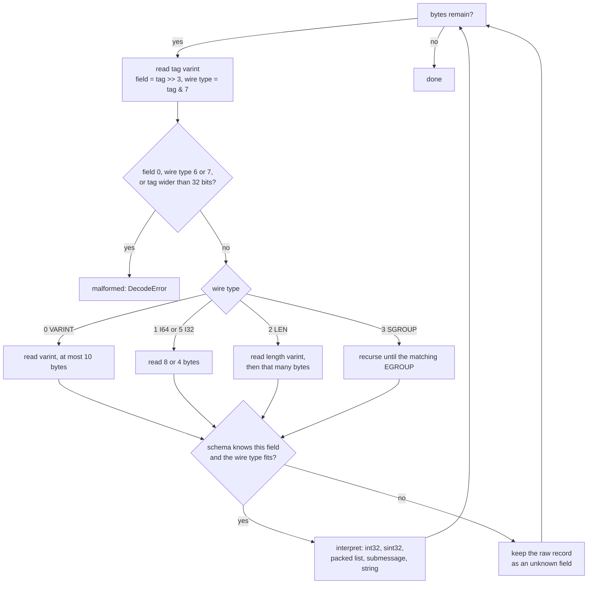

# Protocol Buffers (7.36.2) Binary Wire Format: Tag-Length-Value (TLV), Base-128 Varints, ZigZag Signed Encoding, and Packed Repeated Fields

> [!summary] Claim
> A Protocol Buffers message is a schema-less stream of `(tag, value)` records where the tag is the varint `(field_number << 3) | wire_type`, so every integer cost, every compatibility rule, and every parser limit follows from six wire types, a 10-byte varint, and the fact that nothing on the wire says what a field is called or how it was declared.

Part of [gRPC and Protocol Buffers](README.md) in [API Engineering](../README.md).

## TL;DR

- Mechanism: a message is `(tag value)*`; the tag is a varint of `(field << 3) | wire_type`, and the wire type (`VARINT`, `I64`, `LEN`, `SGROUP`, `EGROUP`, `I32`) alone tells a parser how many bytes the value occupies.
- Contract rule: only the field number and the wire-type family are on the wire, so a field number can never change meaning and a type change is safe only inside one wire-type family (see [[Protobuf-Schema-Evolution-Invariants-Reserved-Tags-and-Unknown-Fields]]).
- Trap: `int32` and `int64` store negatives as 64-bit two's complement, so `-1` costs a 10-byte varint (11 bytes with its tag), while `sint32` and `sint64` apply ZigZag and store `-1` in one byte (2 bytes with its tag).
- Portability: the lab's hand-written encoder matches `protobuf` 7.36.2 byte for byte on both the `upb` and the pure-Python backends (CPython 3.14.6 on macOS arm64), but the two backends raise different exception types on bad UTF-8, disagree on non-canonical and over-wide tags, and serialized bytes are not guaranteed stable across versions or implementations.
- When not to use it: when humans or browsers read the payload directly, when you need canonical bytes to sign or hash, or when one value can exceed 2 GiB.

## Mental model



The decoder never needs the schema to find record boundaries: the wire type in the tag decides how many bytes to consume, which is why a proxy or an old binary can skip fields it has never heard of.
The schema enters only at the diamond near the bottom, where the field number selects a declared type and the wire type is checked against it.
A fit means the bytes are interpreted (ZigZag-decoded, split into a packed list, recursed into as a submessage); a mismatch sends the whole record to the unknown-field set, and the loop continues.
The only exits besides success are the malformed-tag checks and the length and depth limits, which is why those checks are the security surface of every protobuf service.

## How it works

Source citations written `protobuf v36.2 <path>` refer to the C++ and upb files at the GitHub tag `v36.2` of `protocolbuffers/protobuf`; citations written `protobuf 7.36.2 google/protobuf/...` refer to the pure-Python files inside the installed 7.36.2 wheel.
Tag `v36.2` is the release that ships Python 7.36.2: its `version.json` maps `"python": "7.36.2"` (and C++ `7.36.2`), its `python/google/protobuf/__init__.py` sets `__version__ = '7.36.2'` exactly as the installed wheel does, and the wheel's error string `Exceeded upb_DecodeOptions_MaxDepth` matches `decode.c` at that tag.

### The message grammar

The encoding guide gives the grammar in one place; the block below is a condensed excerpt, with the per-wire-type `value` alternatives folded onto one line (encoding guide, "Condensed Reference Card", as of 2026-11):

```text
message    := (tag value)*
tag        := (field << 3) bit-or wire_type;   encoded as uint32 varint
value      := varint | i32 | i64 | len-prefix | <empty for SGROUP and EGROUP>
len-prefix := size (message | string | bytes | packed);   size encoded as int32 varint
```

A message has no header, no length, no field count, and no terminator.
The top-level message ends where the buffer ends, which is why the length of a top-level message must come from the transport (the 5-byte envelope in [[gRPC-Over-HTTP-2-Framing-Length-Prefixed-Messages-and-Trailers]], or a file size).
Missing fields are simply absent records, so a message with three of a thousand fields set costs three records.
Field order is not part of the format: serializers usually emit ascending field numbers, but "there is no guaranteed order for how its known or unknown fields will be written" (encoding guide, "Field Order").

### Base-128 varints

A varint carries an unsigned 64-bit integer in one to ten bytes.
Each byte holds 7 payload bits in its low bits and a continuation flag in the most significant bit: `1` means another byte follows, `0` marks the last byte.
Payload groups are stored least significant group first.

The guide's example decodes `9601`:

```text
10010110 00000001        original bytes (0x96 0x01)
 0010110  0000001        drop the continuation bits
 0000001  0010110        reverse to big-endian order
   00000010010110        concatenate
 128 + 16 + 4 + 2 = 150
```

The lab encoder (a verbatim excerpt, see the worked example) is a loop over 7-bit groups:

```python
def encode_varint(value: int) -> bytes:
    """Base-128 varint of a uint64: 7 payload bits per byte, least significant group first."""
    if not 0 <= value <= _MASK64:
        raise ValueError(f"varint value out of uint64 range: {value}")
    out = bytearray()
    while value > 0x7F:
        out.append(0x80 | (value & 0x7F))
        value >>= 7
    out.append(value)
    return bytes(out)
```

Three implementation facts matter more than the loop:

- A varint is at most 10 bytes.
  `ceil(64 / 7)` is 10, and the tenth byte carries only bit 63.
  C++ names the bound `kMaxVarintBytes = 10`; for a 32-bit value it reads 5 bytes, keeps consuming and discarding high-order bytes until one terminates, and gives up after 10 bytes with the comment that it should "assume the data is corrupt" (protobuf v36.2 `src/google/protobuf/io/coded_stream.cc`, `kMaxVarintBytes`, `ReadVarint32FromArray`).
  The upb reader does the same with a loop that stops when `i` reaches 10 (protobuf v36.2 `upb/wire/reader.c`, `_upb_WireReader_ReadLongVarint`).
  The pure-Python decoder raises `'Too many bytes when decoding varint.'` when a tenth byte still has its continuation bit set, the point where `shift += 7` makes `shift >= 64` true (protobuf 7.36.2 `google/protobuf/internal/decoder.py`, `_VarintDecoder`).
- Parsers accept non-canonical (overlong) varints.
  `08 80 00` is the field 1 tag followed by an overlong zero, and the reference parser reads it as `0` and re-serializes it as `08 00`.
  A tenth byte of `7f` is accepted and its excess bits are dropped, so ten bytes ending in `7f` read as 2^64 - 1.
  Both behaviors are pinned by `test_overlong_varints_are_accepted_but_eleven_bytes_are_not`.
- The size of a varint depends on its value, and a `LEN` prefix must be written before its payload, so a serializer needs every submessage's size before it can emit the submessage.
  The pure-Python module computes sizes with unrolled boundary comparisons (protobuf 7.36.2 `google/protobuf/internal/wire_format.py`, `_VarUInt64ByteSizeNoTag`).

The decoder counterpart (verbatim excerpt):

```python
def decode_varint(buf: bytes, pos: int = 0) -> tuple[int, int]:
    """Return (value, next_pos).

    Like the reference parsers this accepts non-canonical (overlong) encodings, reads at most
    ten bytes, and discards payload bits above bit 63 of the tenth byte.
    """
    result = 0
    for index in range(MAX_VARINT_BYTES):
        if pos + index >= len(buf):
            raise WireError("truncated varint")
        byte = buf[pos + index]
        result |= (byte & 0x7F) << (7 * index)
        if not byte & 0x80:
            return result & _MASK64, pos + index + 1
    raise WireError("varint longer than 10 bytes")
```

### Tags and wire types

A tag is a varint of `(field_number << 3) | wire_type` (encoding guide, "Message Structure"), constrained to 32 bits.
There are six wire types, and the guide's table maps every scalar type onto one:

| ID | Name | Used for |
|----|------|----------|
| 0 | `VARINT` | `int32`, `int64`, `uint32`, `uint64`, `sint32`, `sint64`, `bool`, `enum` |
| 1 | `I64` | `fixed64`, `sfixed64`, `double` |
| 2 | `LEN` | `string`, `bytes`, embedded messages, packed repeated fields |
| 3 | `SGROUP` | group start (deprecated) |
| 4 | `EGROUP` | group end (deprecated) |
| 5 | `I32` | `fixed32`, `sfixed32`, `float` |

The enum is identical in every implementation: upb defines `kUpb_WireType_Varint = 0` through `kUpb_WireType_32Bit = 5` (protobuf v36.2 `upb/wire/types.h`), and the pure-Python module defines `WIRETYPE_VARINT = 0` through `WIRETYPE_FIXED32 = 5` with `TAG_TYPE_BITS = 3` (protobuf 7.36.2 `google/protobuf/internal/wire_format.py`).
Wire types 6 and 7 are unassigned; a tag carrying either is malformed.
Field number 0 is also malformed: upb throws `kUpb_DecodeStatus_Malformed` when asked to keep an unknown field numbered 0 (protobuf v36.2 `upb/wire/decode.c`, `_upb_Decoder_DecodeUnknowns`), and the pure-Python decoder reports `Field number 0 is illegal.` (see the backend table under Implementations in play).

The lab's tag functions:

```python
def make_tag(field_number: int, wire_type: WireType) -> int:
    """(field_number << 3) | wire_type, which is then written as a varint."""
    if not 1 <= field_number <= MAX_FIELD_NUMBER:
        raise ValueError(f"field number out of range 1..{MAX_FIELD_NUMBER}: {field_number}")
    return (field_number << _TAG_TYPE_BITS) | int(wire_type)
```

```python
def split_tag(tag: int) -> tuple[int, WireType]:
    if tag > _MASK32:
        raise WireError("tag does not fit in 32 bits")
    field_number = tag >> _TAG_TYPE_BITS
    raw_type = tag & _TAG_TYPE_MASK
    if field_number == 0:
        raise WireError("field number 0 is illegal")
    try:
        return field_number, WireType(raw_type)
    except ValueError:
        raise WireError(f"unassigned wire type {raw_type}") from None
```

The field-number range is 1 to 2^29 - 1 (536,870,911), "because the field number shares a varint-encoded 32-bit tag with the 3-bit wire type" (proto limits guide, "Field Numbers", as of 2026-11).
A tag is therefore 1 to 5 varint bytes, and the number of bytes spent on tags is a real cost on small-field messages:

| Field numbers | Tag bytes | Why |
|---------------|-----------|-----|
| 1 to 15 | 1 | `n << 3` is below 128 |
| 16 to 2,047 | 2 | `n << 3` is below 2^14 |
| 2,048 to 262,143 | 3 | below 2^21 |
| 262,144 to 33,554,431 | 4 | below 2^28 |
| 33,554,432 to 536,870,911 | 5 | below 2^32 |

The first two rows' boundaries and the 5-byte maximum were measured against `protobuf` 7.36.2 (fields 15, 16, 2047, 2048, and 2^29 - 1 produced 1, 2, 2, 3, and 5 tag bytes in `test_tag_is_field_number_shifted_left_three_or_wire_type`); the middle boundaries follow from the same 7-bit rule.
The practical design rule is to give the hottest fields numbers 1 to 15.

The `upb` backend rejects a tag that does not fit 32 bits: its long-tag loop reads at most 5 bytes and breaks out to an error when `val > UINT32_MAX` (protobuf v36.2 `upb/wire/reader.c`, `_upb_WireReader_ReadLongTag`), so `f8 ff ff ff ff 01 01` and the smallest overflow `80 80 80 80 10 01` (tag = 2^32, then a value byte) both raise `DecodeError`; the lab's `split_tag` enforces the same bound.
The pure-Python backend does not: it parses both of those inputs, keeps the record as an unknown field, and reserializes it unchanged (verify probe, CPython 3.14.6).
The lab's `tag-wider-than-32-bits` case is `f8 ff ff ff ff 01 01` (a 6-byte tag plus a value byte), so it tests the width bound itself rather than truncation; the test asserts `DecodeError` on the default `upb` backend only.
Non-canonical tags split the backends the same way: `upb` reads `88 80 80 80 00 05` as field 1 with value 5 and reserializes it as `08 05`, while the pure-Python decoder looks fields up by the exact tag bytes (`fields_by_tag.get(tag_bytes, ...)` in protobuf 7.36.2 `google/protobuf/internal/python_message.py`), misses, and keeps the whole record as an unknown field, so `f1` stays unset.
That is a parser differential inside one package version.

### Integers: sign extension, ZigZag, and truncation

All of `int32`, `int64`, `uint32`, `uint64`, `sint32`, `sint64`, `bool`, and `enum` use wire type `VARINT`, and "varints are unsigned" (encoding guide, "Signed Integers").
The types differ only in the mapping between the language value and the unsigned 64-bit integer that gets varint-encoded.

**`int32` and `int64` (two's complement).**
A negative value is reinterpreted as the unsigned 64-bit integer with the same bit pattern, so its high bit is set and "all ten bytes must be used" (encoding guide).
`int32` does not use a 32-bit pattern: it is sign-extended to 64 bits first, so `int32` `-1` and `int64` `-1` have identical bytes.
The pure-Python encoder does exactly this: `_SignedVarintEncoder` adds `1 << 64` to a negative value before emitting it, and `Int32Encoder = Int64Encoder = EnumEncoder` share one encoder (protobuf 7.36.2 `google/protobuf/internal/encoder.py`, `_SignedVarintEncoder`).
`wire_format.Int32ByteSizeNoTag` masks with `0xFFFFFFFFFFFFFFFF` for the same reason (protobuf 7.36.2 `google/protobuf/internal/wire_format.py`).
`enum` values are encoded "as if they were int32s", so a negative enum value is also 10 bytes (encoding guide, "Bools and Enums").

Captured from `protobuf` 7.36.2 (`upb` backend, CPython 3.14.6) with a scratch probe, not part of the lab:

```text
int32 -1     08 ff ff ff ff ff ff ff ff ff 01     (11 bytes)
sint32 -1    10 01                                (2 bytes; the probe used field 2)
int32 min    08 80 80 80 80 f8 ff ff ff ff 01
sint32 min   10 ff ff ff ff 0f
```

**`sint32` and `sint64` (ZigZag).**
ZigZag maps signed integers to unsigned ones so that small magnitudes of either sign become small unsigned numbers: non-negative `p` becomes `2p`, negative `n` becomes `2|n| - 1`.
The sequence `0, -1, 1, -2, 2, -3` encodes as `0, 1, 2, 3, 4, 5`, which zig-zags between sides of zero.
The formula is `(n << 1) ^ (n >> 31)` for 32-bit and `(n << 1) ^ (n >> 63)` for 64-bit, where the right shift is arithmetic, so it produces all ones for negatives and all zeros otherwise (encoding guide, "Signed Integers").
C++ spells it with an unsigned left shift to avoid signed-overflow undefined behavior: `(static_cast<uint32_t>(n) << 1) ^ static_cast<uint32_t>(n >> 31)`, and the decoder is `(n >> 1) ^ (~(n & 1) + 1)` (protobuf v36.2 `src/google/protobuf/wire_format_lite.h`, `WireFormatLite::ZigZagEncode32`, `ZigZagDecode32`).
Python has unbounded integers, so the pure-Python implementation special-cases: `value << 1` for non-negative values and `(value << 1) ^ (~0)` for negative ones (protobuf 7.36.2 `google/protobuf/internal/wire_format.py`, `ZigZagEncode`).

The lab's version, with an explicit width so that the mask replaces C's fixed-size overflow:

```python
def zigzag_encode(value: int, bits: int) -> int:
    """(n << 1) ^ (n >> (bits - 1)) with an arithmetic shift: 0, -1, 1, -2 -> 0, 1, 2, 3."""
    if not -(1 << (bits - 1)) <= value < (1 << (bits - 1)):
        raise ValueError(f"{value} does not fit in a signed {bits}-bit integer")
    return ((value << 1) ^ (value >> (bits - 1))) & ((1 << bits) - 1)
```

```python
def zigzag_decode(raw: int) -> int:
    """(n >> 1) ^ -(n & 1): even numbers are non-negative, odd numbers are negative."""
    return (raw >> 1) ^ -(raw & 1)
```

The edges, all confirmed against `protobuf` 7.36.2 in `test_zigzag_interleaves_signs_and_matches_protobuf_at_the_edges`:

| Signed value | ZigZag value | Varint bytes |
|--------------|--------------|--------------|
| 0 | 0 | 1 |
| -1 | 1 | 1 |
| 1 | 2 | 1 |
| -2 | 3 | 1 |
| -500 | 999 | 2 |
| `sint32` max `2147483647` | `4294967294` | 5 |
| `sint32` min `-2147483648` | `4294967295` | 5 |
| `sint64` max `2^63 - 1` | `2^64 - 2` | 10 |
| `sint64` min `-2^63` | `2^64 - 1` | 10 |

ZigZag is not free for positive values: `64` costs 1 byte as `int64` but 2 bytes as `sint64`, because ZigZag doubles every non-negative value.
The break-even is about the sign distribution of the data, not about magnitude: if a field is negative a meaningful share of the time (deltas, offsets, temperatures, signed balances), use `sint`; if it is almost always non-negative (counts, sizes, ids), plain `int` is one bit cheaper.
`-64` to `63` all fit one ZigZag byte (verified in `test_zigzag_is_a_bijection_and_small_magnitudes_stay_one_byte`).

**Decoding truncates, it does not validate.**
An `int32` field accepts a varint wider than 32 bits and keeps the low 32 bits, because the C++ `ReadVarint32` explicitly "read[s] it all and discard[s] the high-order bits".
Measured on `protobuf` 7.36.2: `08 ff ff ff ff 0f`, `08 ff ff ff ff 1f` (0x1ffffffff), and the 10-byte `-1` all decode as `-1`, and `08 80 80 80 80 10` (2^32) decodes as `0` (`test_int32_keeps_only_the_low_32_bits_of_a_wider_varint`).
This is what makes widening `int32` to `int64` wire compatible, and what makes narrowing silently lossy.
`bool` is any non-zero varint: `08 02` and `08 80 01` both parse as `true`.

### Fixed-width values

`I32` and `I64` are exactly 4 and 8 bytes, little-endian, with `float` and `double` being the IEEE 754 single and double bit patterns, a "memcpy of the equivalent C types" (encoding guide, condensed reference card).
Choosing `fixed32` over `uint32` pays off only when most values need a 5-byte varint, that is when values are at least 2^28 (268,435,456) so a varint costs 5 bytes against 4; for `fixed64`, the break-even is values of at least 2^56 (72,057,594,037,927,936), where a varint needs 9 or 10 bytes.
Typical uses are hashes, random identifiers, and timestamps in nanoseconds.
Fixed-width values need no per-byte loop to decode, but any CPU advantage was not measured here.

Captured: field 1 `bool` true, field 2 `float` 1.5, field 3 `double` 25.4, field 4 `fixed32` 200, field 5 `sfixed64` -2, field 6 `uint64` 2^64 - 1, field 7 `sint64` -2^63, from `protobuf` 7.36.2:

| Bytes | Meaning |
|-------|---------|
| `08 01` | field 1 `VARINT`, `true` |
| `15 00 00 c0 3f` | tag `(2 << 3) \| 5`, `I32` = `0x3fc00000` = 1.5 |
| `19 66 66 66 66 66 66 39 40` | tag `(3 << 3) \| 1`, `I64` = 25.4 |
| `25 c8 00 00 00` | tag `(4 << 3) \| 5`, `I32` = 200 |
| `29 fe ff ff ff ff ff ff ff` | tag `(5 << 3) \| 1`, `I64` = -2 (two's complement, little-endian) |
| `30 ff ff ff ff ff ff ff ff ff 01` | tag `(6 << 3) \| 0`, 10-byte varint = 2^64 - 1 |
| `38 ff ff ff ff ff ff ff ff ff 01` | tag `(7 << 3) \| 0`, ZigZag(-2^63) = 2^64 - 1 |

### Length-delimited values

`LEN` is a tag, a varint length, and that many payload bytes.
The same wire type carries four different things: `string` (UTF-8), `bytes`, embedded messages, and packed repeated fields.
Nothing on the wire says which one, so `1a 03 08 96 01` is simultaneously the 3-byte string `\x08\x96\x01`, the bytes value of the same, and the submessage `{1: 150}`; only the schema decides (encoding guide, "Submessages": `3: {1: 150}`).
This ambiguity is also why a `bytes` field that holds a serialized message has no canonical form: the outer message sees opaque bytes, so reserializing the inner message with a different library or version changes them (encoding guide, "Implications").

The length is "the int32 varint", so a `string`, `bytes`, or submessage is limited to 2 GB (encoding guide, "Length-Delimited Records"), and whole messages must be smaller than 2 GiB (encoding guide, "Encoded Proto Size Limitations").
Implementations enforce it on read: C++ `ReadVarintSizeAsIntFallback` returns an error when the varint exceeds `INT_MAX`, and `kDefaultTotalBytesLimit` is `INT_MAX` (protobuf v36.2 `src/google/protobuf/io/coded_stream.cc`, `ReadVarintSizeAsIntFallback`; `coded_stream.h`, `kDefaultTotalBytesLimit`), and the upb reader reads the length into an `int` (protobuf v36.2 `upb/wire/reader.h`, `upb_WireReader_ReadSize`).
A length that points past the end of the buffer is rejected before any payload copy, which is the check that stops a 5-byte message claiming 4 GiB from allocating 4 GiB: in the lab, `1a 05 01` and `12 05 61` fail as truncated, and `protobuf` raises `DecodeError`.

`string` fields must be valid UTF-8, and proto3 parsers verify it: `12 02 ff fe` raises `DecodeError` (`String field had bad UTF-8` on the `upb` backend; probe output below).
Whether a parser checks UTF-8 is configurable (`features.utf8_validation`, which "doesn't impact proto3 files"; in Java, `map<string, ...>` keys are always validated), so do not rely on one language's behavior for security decisions (editions feature guide, "features.utf8_validation", as of 2026-11).

### Packed repeated fields

A repeated field of a numeric scalar type can be written two ways:

- Expanded: one record per element, each with its own tag, so `5: 1`, `5: 2`, `5: 3` is `28 01 28 02 28 03`.
- Packed: one `LEN` record whose payload is the elements back to back with no tags, so `5: {1 2 3}` is `2a 03 01 02 03`.

The saving is the per-element tag: expanded costs `n * (tag + value)` bytes, packed costs `tag + length varint + n * value`.
Measured on `protobuf` 7.36.2 with the field number 1 or 2 and every element the value `1`: 100 elements took 200 bytes expanded and 102 bytes packed, and 300 elements took 600 bytes expanded and 303 bytes packed (the length prefix grows to two bytes at 128 payload bytes; `test_packed_repeated_is_one_len_record_and_expanded_is_one_record_per_element`).

Which form is the default depends on the syntax or edition (editions feature guide, "features.repeated_field_encoding", as of 2026-11):

| Syntax or edition | Default |
|-------------------|---------|
| proto2 | `EXPANDED` |
| proto3 | `PACKED` |
| Edition 2023, 2024, 2026 | `PACKED` |

The same message type serialized by the lab's reference with `e = [1, 2, 3]` on field 5 confirmed it (scratch probe, `upb`, CPython 3.14.6): proto2 gave `28 01 28 02 28 03`, while proto3 and Edition 2023 gave `2a 03 01 02 03`, and `test_proto3_and_editions_style_repeated_numerics_default_to_packed_proto2_to_expanded` pins the proto2 and proto3 pair.
Presence and edition feature semantics are the sibling's lane: [[Protobuf-Editions-2023-2024-vs-Proto2-and-Proto3-Presence-Semantics]].

Decoder obligations, from the guide: "Protobuf parsers must be able to parse repeated fields that were compiled as packed as if they were not packed, and vice versa", and parsers "must be prepared to accept multiple key-value pairs" for a packed field, whose payloads are concatenated, with each payload containing a whole number of elements.
So `2a 02 01 02 28 09 2a 01 03` is a valid encoding of `[1, 2, 9, 3]`, and the lab decodes it identically for both declared encodings (`test_decoders_accept_packed_and_expanded_forms_for_the_same_field`).
That rule is what makes adding or removing `[packed=true]` a wire-compatible change.

Details that bite hand-written parsers:

- Only numeric scalars are packable.
  `string`, `bytes`, and messages are always one record per element (`0a 01 61 0a 02 62 63` for `["a", "bc"]`), and `FieldSpec` rejects `packed=True` for them.
- An empty repeated field emits nothing, packed or not: no tag, no zero-length `LEN` record (measured: `b''`).
  A parser must still accept an explicit empty `LEN` payload.
- Packed varint elements are decoded until the payload is exhausted; an element cut off by the end of the payload is an error (`2a 03 01 02 80` raises `DecodeError`).
- Packed `I32` and `I64` payloads must be a multiple of 4 or 8 bytes; upb throws `kUpb_DecodeStatus_Malformed` when `(size & mask) != 0` (protobuf v36.2 `upb/wire/decode.c`, `_upb_Decoder_DecodeFixedPacked`).
- The element count of a packed varint payload is not known until it is walked, so decoders grow the array as they go.
  The upb packed-varint loop calls `_upb_Decoder_Reserve` per element and copies `scale = 1 << lg2` bytes (4 for `int32`, 8 for `int64`) into the array (protobuf v36.2 `upb/wire/decode.c`, `_upb_Decoder_DecodeVarintPacked`).
  One wire byte can therefore become 8 bytes in memory, an amplification factor to budget for.
- The pure-Python decoder appends elements to the list and, if an element overruns the packed payload, deletes the corrupt element and raises `'Packed element was truncated.'` (protobuf 7.36.2 `google/protobuf/internal/decoder.py`, `_SimpleDecoder`).

The lab's decoder for packed payloads:

```python
def _decode_packed(kind: Kind, payload: bytes) -> list[Scalar]:
    """Elements are decoded back to back until the payload is exhausted."""
    out: list[Scalar] = []
    wire_type = wire_type_of(kind)
    if wire_type is WireType.VARINT:
        pos = 0
        while pos < len(payload):
            raw, pos = decode_varint(payload, pos)
            out.append(decode_scalar(kind, raw))
        return out
    width = 4 if wire_type is WireType.I32 else 8
    if len(payload) % width:
        raise WireError("packed payload is not a whole number of fixed-width elements")
    for start in range(0, len(payload), width):
        out.append(decode_scalar(kind, int.from_bytes(payload[start : start + width], "little")))
    return out
```

### Merge semantics: last one wins, concatenation merges

A parser must tolerate the same singular field appearing more than once.
For numbers and strings, "the parser accepts the last value it sees"; for embedded messages, "the parser merges multiple instances of the same field, as if with the `Message::MergeFrom` method" (encoding guide, "Last One Wins").
For repeated fields, records accumulate, and records of different fields can interleave arbitrarily: `5: 1`, `5: 2`, `4: {"hello"}`, `5: 3` is a valid encoding, and only the relative order within one field is preserved.
The consequence is the property the guide spells out: parsing `str1 + str2` equals parsing each and calling `MergeFrom`, so two serialized messages of any type can be merged by byte concatenation.

Verified in `test_concatenated_messages_parse_as_merge_with_submessages_merged_field_by_field`: two `Outer` encodings that each contain `c` with different inner fields parsed as one `c` with `a = 1`, `b = 5`, and the repeated `r = [7, 8]`.
The merged message reserializes as a single `LEN` record, so the duplication is a parse-time fact, not a serialization-time fact.
`oneof` fields are encoded exactly like ordinary fields, and the last member seen wins; maps are `repeated` entry messages with `key = 1` and `value = 2`, and their order is not preserved (encoding guide, "Oneofs", "Maps").

### Unknown fields and wire-type mismatches

A record is routed to the unknown-field set if its field number is not in the schema, or if the wire type is not compatible with the declared type.
The compatibility test is by wire-type family, so an `int32` field receiving an `I64` record, or a `LEN` record, does not raise: it is kept as unknown.
In upb the same dispatch chooses `kUpb_DecodeOp_UnknownField` when a `32Bit` or `64Bit` value arrives for a type outside `kFixed32OkMask` or `kFixed64OkMask`, and for a closed enum when the value is not a member (protobuf v36.2 `upb/wire/decode.c`, `_upb_Decoder_DecodeWireValue`).

Measured: `09 00 00 00 00 00 00 00 00 08 07` against an `int32 f1 = 1` parsed as `f1 = 7` plus one unknown record `(field 1, wire type 1, 0)`, and reserialized as `08 07 09 00 00 00 00 00 00 00 00`, so known fields come first and the unknown bytes are appended (`test_wire_type_mismatch_is_kept_as_an_unknown_field_and_reserialized`).
`0a 02 01 02` against the same schema (field 1 arriving as `LEN`) leaves `f1` at its default and keeps the record unknown.
This is a silent failure mode: retyping a field from `int32` to `string` raises no error on old readers, the data just disappears into the unknown set.
How unknown fields are retained, discarded, and why reserved tags matter is covered in [[Protobuf-Schema-Evolution-Invariants-Reserved-Tags-and-Unknown-Fields]].

In `protobuf` 7.x the Python API is `google.protobuf.unknown_fields.UnknownFieldSet(message)`, which iterates `field_number`, `wire_type`, and `data`; the old `Message.UnknownFields()` accessor raises `NotImplementedError('unknown field accessor')` on the `upb` backend (observed in the probe, CPython 3.14.6).

### Groups

Groups are deprecated but still in the format.
`SGROUP` (3) opens a group and carries no payload, and `EGROUP` (4) with the same field number closes it, with the group's fields in between; mismatched numbers are malformed (encoding guide, "Groups").
`0b 08 05 0c` is a group on field 1 containing `1: 5`, and a schema that does not know field 1 preserves it unchanged (`test_unknown_groups_round_trip_through_the_record_layer`).
Groups matter today for one reason: they are a recursion that skipping code must follow without a schema, which is where parser depth bugs live (see Security and robustness).

### Serialization order and determinism

The format permits any record order, so serialization bytes are an implementation detail.
The guide's rule is blunt: "Do not assume the byte output of a serialized message is stable", and even `foo.SerializeAsString() == foo.SerializeAsString()` is not guaranteed by default; "Deterministic serialization only guarantees the same byte output for a particular binary" (encoding guide, "Implications", as of 2026-11).
Concrete causes the guide lists: unknown fields from an older server, different field order in another language, map iteration, a `bytes` field that holds another serialized message, a new serializer version, and concatenation order.
The lab's comparison tests use `SerializeToString(deterministic=True)` and ascending field numbers, and every byte comparison passes on `upb` and on the pure-Python backend in this environment; that is evidence about this pinned release, not a guarantee.
Under `PROTOCOL_BUFFERS_PYTHON_IMPLEMENTATION=python` the whole file gives `2 failed, 29 passed` (verify run, CPython 3.14.6): the two failures are the UTF-8 exception type and the depth-limit error message, both backend differences listed in the next table, not byte mismatches.

### Implementations in play

`protobuf` 7.36.2 on this machine uses `upb` (`api_implementation.Type() == "upb"`, `google/_upb/_message.abi3.so`), and the pure-Python backend is selected by `PROTOCOL_BUFFERS_PYTHON_IMPLEMENTATION=python`.
Both encode identically for the lab's corpus, but they are different programs with different errors:

| Input | `upb` backend | Pure-Python backend |
|-------|---------------|---------------------|
| `12 02 ff fe` (bad UTF-8, proto3 string) | `DecodeError: String field had bad UTF-8` | `UnicodeDecodeError`, not a `DecodeError` |
| `0c` (stray `EGROUP`) | `DecodeError: ... Wire format was corrupt` | `DecodeError: Unexpected end-group tag.` |
| `00 01` (field 0) | `DecodeError: ... Wire format was corrupt` | `DecodeError: Field number 0 is illegal.` |
| 11-byte varint | `DecodeError: ... Wire format was corrupt` | `DecodeError: Too many bytes when decoding varint.` |
| `0e 01` (wire type 6) | `DecodeError: ... Wire format was corrupt` | `DecodeError: Wrong wire type in tag.` |
| `80 80 80 80 10 01` (tag = 2^32) | `DecodeError: ... Wire format was corrupt` | accepted, kept as an unknown field, reserialized unchanged |
| `88 80 80 80 00 05` (overlong tag for field 1) | `f1 = 5`, reserialized as `08 05` | `f1` unset, record kept as unknown and reserialized unchanged |
| nesting of 101 submessages | `DecodeError: ... Exceeded upb_DecodeOptions_MaxDepth` | `DecodeError: Error parsing message: too many levels of nesting.` |

The exception-type difference for UTF-8 is pinned by `test_upb_and_pure_python_backends_emit_same_bytes_but_raise_different_utf8_errors`, which runs each backend in a subprocess; the other rows were re-captured in the verify pass with a scratch probe run once per backend (CPython 3.14.6, macOS 27.3 arm64).
An error handler that catches only `DecodeError` misses the pure-Python UTF-8 failure.

### The lab codec

The lab implements two layers.
The record layer (`parse_records`, `encode_record`) splits bytes into `Record(field_number, wire_type, value)` without any schema, as a proxy would.
The schema layer (`FieldSpec`, `encode_message`, `decode_message`) maps the 15 scalar kinds onto records and implements the decoder rules above.
Submessages are tested at the record level (a submessage is a `LEN` record whose payload is another message), and everything is compared against `protobuf` 7.36.2 reference classes that the tests build at runtime from `FileDescriptorProto`s, so no `protoc` is needed.

## Numbers and limits

| Quantity | Value | Source or measurement |
|----------|-------|-----------------------|
| Varint payload per byte | 7 bits | encoding guide, "Base 128 Varints" |
| Maximum varint length | 10 bytes; an 11th continuation byte is malformed | C++ `kMaxVarintBytes = 10` (v36.2 `coded_stream.cc`); upb loop to 10 (v36.2 `reader.c`); measured: lab and `protobuf` 7.36.2 `upb` both accept 10 and reject 11 |
| Varint size steps | 1 byte up to 127, 2 up to 16,383, 3 up to 2,097,151, 4 up to 268,435,455, then one more byte per 7 bits, 9 up to 2^63 - 1, 10 above | measured against `protobuf` 7.36.2 at every 2^(7k) boundary (`test_varint_length_steps_up_every_seven_bits_and_matches_protobuf`); same thresholds in `_VarUInt64ByteSizeNoTag` |
| Assigned wire types | 6 (0 to 5); 6 and 7 are malformed | encoding guide; measured: `0e 01` and `0f 01` raise `DecodeError` |
| Field number range | 1 to 536,870,911 (2^29 - 1) | proto limits guide, "Field Numbers" (as of 2026-11); measured: 2^29 - 1 serializes with a 5-byte tag |
| Tag size | 1 byte for fields 1 to 15, 2 bytes up to 2,047, 3 bytes from 2,048, 5 bytes at 2^29 - 1 | measured at 15, 16, 2047, 2048, 2^29 - 1; middle boundaries derived from the 7-bit rule |
| `int32` `-1` | 10-byte varint, 11 bytes with tag | measured; guide says negative `intN` uses all ten bytes |
| `sint32` `-1` | 1-byte varint, 2 bytes with tag | measured |
| `int32` min / `sint32` min | 10 bytes / 5 bytes | measured |
| `sint64` for `64` vs `int64` for `64` | 2 bytes vs 1 byte | scratch probe on `protobuf` 7.36.2 (`upb`, CPython 3.14.6) |
| Packed vs expanded, 100 elements of value 1 | 102 vs 200 bytes | measured (test) |
| Packed vs expanded, 300 elements of value 1 | 303 vs 600 bytes | measured (test) |
| `fixed32` beats `uint32` | when most values are at least 2^28 | derived from the 5-byte varint threshold |
| Fixed-width sizes | 4 (`I32`) and 8 (`I64`) bytes | encoding guide; measured |
| Largest serialized message or `LEN` value | below 2 GiB; C++ `kDefaultTotalBytesLimit = INT_MAX`; upb reads lengths as `int` | encoding guide; v36.2 `coded_stream.h`, `reader.h` |
| Default nesting limit | 100 in C++ (`default_recursion_limit_`), upb (`kUpb_WireFormat_DefaultDepthLimit`), and pure Python (`DEFAULT_RECURSION_LIMIT`); Java 100; Go 10,000 (planned reduction) | v36.2 `coded_stream.cc`, `upb/wire/internal/constants.h`; protobuf 7.36.2 `decoder.py`; proto limits guide (as of 2026-11); measured on `upb`: 100 nested submessages parse, 101 raises `DecodeError` |
| Fields per message | 65,535 | proto limits guide (as of 2026-11) |
| Lab run | 31 tests passed in 0.55 s on `upb`; 29 passed and 2 failed under the pure-Python backend | `uv run --frozen pytest ...`, CPython 3.14.6, macOS 27.3 arm64 (Darwin 27.3.0), verify run 2026-11-21, see the worked example |

No throughput or latency number appears in this note: none was measured, and the speed claims that circulate about varints and packing are workload dependent.

## Portability

| Dimension | Result | Proof |
|-----------|--------|-------|
| CPython 3.14.6 (the `labs/.venv` interpreter; the matrix names 3.14.10) | 31 passed | ran: `uv run --frozen pytest ... -q`, macOS arm64 |
| CPython 3.12, 3.13, 3.15, 3.15 free-threaded | not run | lab matrix paused by the user's instruction of 2026-11-11; no claim made. Note that the `protobuf` 7.36.2 `METADATA` lists classifiers through Python 3.14 only. |
| `protobuf` backend `upb` | encoder byte-identical to the lab on the lab corpus; decode errors as in the table above | ran (3.14.6) |
| `protobuf` backend pure Python (`PROTOCOL_BUFFERS_PYTHON_IMPLEMENTATION=python`) | serialized bytes identical for the subprocess corpus; bad UTF-8 raises `UnicodeDecodeError`; over-wide and overlong tags become unknown fields; the full lab file gives `2 failed, 29 passed` (UTF-8 exception type, depth error text) | ran in a subprocess (3.14.6), and the whole test file once with the variable set in the verify pass |
| Other `protobuf` point releases | not run | only 7.36.2 is pinned in `labs/pyproject.toml` |
| C++ and Java runtimes | same grammar and 10-byte varint; default recursion limit 100 | proto limits guide and v36.2 `coded_stream.cc` (read, not executed) |
| Go runtime | recursion limit 10,000 with a plan to reduce it | proto limits guide (as of 2026-11); not executed |
| Servers (Uvicorn, Hypercorn, Granian) | not applicable: the wire format is transport independent | no claim |
| HTTP/1.1, HTTP/2, HTTP/3 | bytes are identical; gRPC adds a 5-byte envelope per message in each DATA stream | sibling [[gRPC-Over-HTTP-2-Framing-Length-Prefixed-Messages-and-Trailers]]; not executed here |
| Little-endian assumption | `fixed32`, `fixed64`, `float`, `double` are little-endian everywhere; upb byte-swaps via `upb_BigEndian32` on big-endian hosts | v36.2 `upb/wire/reader.h`, `upb_WireReader_ReadFixed32`; not executed on a big-endian host |

The container legs (Debian Trixie, Alpine musl) of the matrix in the note contract were not run either.

## Worked example

The implementation is [implementation](../labs/src/api_labs/f19_grpc_and_protocol_buffers/protobuf_wire_format.py) and the test is [test](../labs/tests/f19_grpc_and_protocol_buffers/test_protobuf_wire_format_tlv_tags_varints_and_zigzag_encoding.py).
The excerpts below are verbatim function bodies from the implementation; the rest of the module (the record layer, the scalar encoders and decoders, `FieldSpec`) is omitted.

Core of the schema layer, the decoder rules in one function:

```python
def decode_message(
    specs: Sequence[FieldSpec], data: bytes, *, max_depth: int = DEFAULT_MAX_DEPTH
) -> DecodedMessage:
    """Decode with the reference rules: last one wins, packed or expanded accepted for any
    repeated numeric field, and a record whose wire type does not fit the schema is kept as an
    unknown field instead of being an error.
    """
    by_number = {spec.number: spec for spec in specs}
    values: dict[int, Scalar | list[Scalar]] = {}
    unknown: list[Record] = []
    for record in parse_records(data, max_depth=max_depth):
        spec = by_number.get(record.field_number)
        if spec is None:
            unknown.append(record)
        elif record.wire_type is wire_type_of(spec.kind) and not isinstance(record.value, tuple):
            _store(values, spec, [decode_scalar(spec.kind, record.value)])
        elif (
            spec.repeated
            and is_packable(spec.kind)
            and record.wire_type is WireType.LEN
            and isinstance(record.value, bytes)
        ):
            _store(values, spec, _decode_packed(spec.kind, record.value))
        else:
            unknown.append(record)
    return DecodedMessage(values, tuple(unknown))
```

Run from `labs/` on CPython 3.14.6, macOS 27.3 arm64 (Darwin 27.3.0), `protobuf` 7.36.2 with the `upb` backend.
The drafter's first run was `2 failed, 29 passed` because of two bugs in the first version of the test (a proto3 reference class that stated `packed=false`, and a UTF-8 probe aimed at the wrong field), since fixed; this is the verify pass's single run on 2026-11-21 of format, lint, `mypy`, and `pyright` on the two files and then the tests:

```text
$ uv run --frozen ruff format --check <implementation> <test>
2 files already formatted
$ uv run --frozen ruff check <implementation> <test>
All checks passed!
$ uv run --frozen mypy <implementation> <test>
Success: no issues found in 2 source files
$ uv run --frozen pyright <implementation> <test>
0 errors, 0 warnings, 0 informations
$ uv run --frozen pytest tests/f19_grpc_and_protocol_buffers/test_protobuf_wire_format_tlv_tags_varints_and_zigzag_encoding.py -q
...............................                                          [100%]
31 passed in 0.55s
```

The 31 results are 22 test functions, 10 of which belong to the parametrized `test_malformed_wire_bytes_are_rejected_by_the_lab_and_by_protobuf`.
Scratch probes (not part of the lab) against `protobuf` 7.36.2, `upb` backend, CPython 3.14.6, supplied the other captured outputs in this note; the verify pass re-ran one probe on both backends, and these lines are excerpted from its `upb` output (generated package names are `t1`, `t12`, and so on):

```text
proto2 08 96 01 28 01 28 02 28 03
proto3 08 96 01 2a 03 01 02 03
editions 08 96 01 2a 03 01 02 03
08 80 00 -> '' reser
08 ff ff ff ff ff ff ff ff ff 7f -> 'a: -1\n' reser 08 ff ff ff ff ff ff ff ff ff 01
08 80 80 80 80 80 80 80 80 80 80 00 -> DecodeError: Error parsing message with type 't1.M': Wire format was corrupt
depth 100 ok
depth 101 fail DecodeError Error parsing message with type 't12.R': Exceeded upb_DecodeOptions_MaxDepth
```

The first line pairs are for an `int32 a = 1` plus `repeated int32 e = 5` of `[1, 2, 3]` with `a = 150` under proto2, proto3, and Edition 2023; the `08 80 00` line shows an overlong zero accepted and (for proto3's implicit presence) not reserialized.

## Pitfalls

> [!warning] Negative `int32` and `enum` values cost 10 bytes each
> Trigger: a field declared `int32` or an `enum` takes negative values (error codes as `-1`, deltas, signed offsets, sentinel values).
> Symptom: payloads larger than the data warrants; every `-1` is an 11-byte record, and a `repeated int32` of negatives costs 10 bytes per element even when packed.
> Fix: declare `sint32` or `sint64` for fields that are often negative, and keep enum values non-negative; decide at design time, because changing `int32` to `sint32` later is not compatible (the byte `01` is 1 as `int32` and -1 as `sint32`; the compatibility table is in [[Protobuf-Schema-Evolution-Invariants-Reserved-Tags-and-Unknown-Fields]]).
> Verified: `-1` as `int32` is `08 ff ff ff ff ff ff ff ff ff 01` against `08 01` as `sint32` (measured above).

> [!warning] A hand-written parser that assumes one encoding of repeated fields
> Trigger: a service or proxy parses repeated numeric fields itself and handles only expanded records (proto2 clients) or only packed `LEN` records (proto3 and Edition 2023 clients).
> Symptom: lists silently empty or truncated for one client family; the unhandled records fall into the skip path with no error.
> Fix: accept both forms and the interleaved mix, as the guide requires of every parser, and use `FieldSpec`-style tables rather than `if` chains.
> Verified: `test_decoders_accept_packed_and_expanded_forms_for_the_same_field` feeds the same logical list in expanded, packed, and split forms.

> [!warning] Treating serialized bytes as a stable identity
> Trigger: using `SerializeToString()` output as a cache key, an idempotency key, an HMAC input, a content hash, or an equality check.
> Symptom: cache misses and duplicate processing after a library upgrade, after a different-language service handles the message, or whenever a map or unknown fields are involved; signatures that verify on one hop and fail on the next.
> Fix: sign or hash the original received bytes and pass them through untouched, and define a canonical form on your own fields (sorted, normalized) for keys; `deterministic=True` only promises equality within one binary (encoding guide, "Implications").
> Related: parsers accept overlong varints, so two different byte strings parse to the same message (`08 80 00` and `08 00`).

> [!warning] Wire-type mismatches become unknown fields, not errors
> Trigger: a producer changes a field's type to a different wire-type family (`int32` to `string`, `int32` to `fixed32`) while consumers keep the old schema.
> Symptom: no exception, the field reads as its default, and the data accumulates in the unknown-field set (and is re-emitted when the message is forwarded).
> Fix: treat type changes across wire-type families as breaking, enforce it in CI ([[Protobuf-Governance-Linting-and-Breaking-Change-Gates-with-Buf]]), and alert on unknown-field counts at message boundaries you control.
> Verified: `09 00 00 00 00 00 00 00 00 08 07` against `int32 f1 = 1` yields `f1 = 7` and one unknown `I64` record.

> [!warning] `except DecodeError` is not the whole error contract
> Trigger: the pure-Python backend is selected (`PROTOCOL_BUFFERS_PYTHON_IMPLEMENTATION=python`, or a platform without a `upb` wheel) and an invalid UTF-8 string arrives.
> Symptom: `UnicodeDecodeError` escapes a handler that catches only `google.protobuf.message.DecodeError`, turning a client error into a 500 or a crashed worker.
> Fix: catch both at the deserialization boundary, or pin the backend and test the error path on it; measured in `test_upb_and_pure_python_backends_emit_same_bytes_but_raise_different_utf8_errors`.

> [!warning] Unbounded recursion in parsers
> Trigger: untrusted input with deeply nested groups or messages, parsed by a runtime or a hand-written skipper that has no depth limit or an unsafe one.
> Symptom: stack overflow or `RecursionError` instead of a clean parse error; denial of service from a few kilobytes of input.
> Incidents: CVE-2024-7254 (nested groups parsed as unknown fields by the Java `DiscardUnknownFieldsParser`, the Java Lite parser, or against map fields caused a stack overflow, NVD CVSS 3.1 score 7.5, Google CNA CVSS 4.0 score 8.7) and CVE-2025-4565 (the pure-Python backend with "an arbitrary number of recursive groups, recursive messages or a series of SGROUP tags" exceeded the Python recursion limit, NVD CVSS 3.1 score 5.3, Google CNA CVSS 4.0 score 8.2; the record recommends "upgrading to version =>6.31.1").
> Fix: use current runtimes, keep the default depth limit of 100, and when writing a record-level parser (a gateway, a redactor) carry an explicit depth counter, as `parse_records(max_depth=...)` does (`test_nesting_depth_limit_is_one_hundred_submessages`).

> [!warning] Counting on field-number reuse or on field order
> Trigger: reusing a retired field number for a new meaning, or reading unknown-field bytes or ordering out of a message.
> Symptom: old clients decode new data into the wrong field with no error, because the tag is all that identifies a field.
> Fix: `reserved` numbers and names, and the governance checks in the siblings listed under Related.

## Security and robustness

Threat model: the attacker controls every byte of a request body, and the parser runs on that body before any application-level authorization, and before authentication on unauthenticated endpoints and on gateways that parse to route.
The wire format is a compact, schema-less grammar, so each of its features is a resource-consumption lever, which maps onto OWASP API Security 2023 API4 (Unrestricted Resource Consumption) - see [[Unrestricted-Resource-Consumption-API4-2023-Payload-Depth-and-Limit-Guards]].

- Depth: nested `LEN` submessages and groups recurse.
  Enforce a limit (default 100) and keep it; CVE-2024-7254 (Java parsers) and CVE-2025-4565 (the pure-Python backend) are both unbounded recursion.
  Any custom record-level walker needs its own counter.
- Length claims: a 5-byte `LEN` header can claim up to `INT_MAX` bytes.
  Check the claim against the bytes actually remaining before allocating, as the reference parsers do, and set a transport-level maximum message size below 2 GiB ([[gRPC-Keepalive-Flow-Control-and-Max-Message-Size-Tuning]]).
- Memory amplification: one wire byte of a packed `int32` or `int64` becomes 4 or 8 bytes in the array (upb copies `scale` bytes per element).
  A two-byte `1a 00` record for a repeated message field allocates a submessage object (mechanism read in `_upb_Decoder_NewSubMessage` callers; the factor was not measured).
  The amplification factor is a property of the runtime and the schema, so size limits on the wire are not memory limits.
- Quadratic and bloat paths: CVE-2022-1941 (NVD CVSS 7.5) showed `MessageSet` parsing with multiple key-value elements leading to out-of-memory in `protobuf-cpp` and `protobuf-python` before fixes; avoid `message_set_wire_format` for new schemas.
- Unknown-field retention: unknown fields are stored and re-emitted.
  A gateway that deserializes and reserializes untrusted messages forwards attacker-chosen bytes to internal services unless it discards unknown fields (`DiscardUnknownFields`) deliberately.
- Non-canonical input: overlong varints, repeated singular fields, split packed payloads, and any field order all parse.
  Do not verify a signature over a reserialization of the parsed message when the signer signed the original bytes.
  Do not validate bytes with one parser when a different parser will read them, which is a parser differential: even the two backends of `protobuf` 7.36.2 disagree, since `upb` reads the overlong tag `88 80 80 80 00 05` as field 1 while the pure-Python backend files it as an unknown field (the wire-versus-source distinction is in [[Compatibility-Taxonomy-Wire-Source-and-Semantic-Compatibility-AIP-180]]).
- Truncation, not validation: `int32` keeps 32 bits of a wider varint, `bool` is any non-zero value, so range checks must be applied to the decoded value in your own code, not assumed from the declared type.
- UTF-8: validation differs by language, edition, and backend; for security-relevant strings (identifiers, paths, keys) validate in application code or declare them where validation is guaranteed.
- Defense in depth: bound request size at the proxy, bound message size and depth in the runtime, set deadlines so slow parse paths cannot hold a worker, and fuzz any hand-written parser against the reference one (the lab's `test_malformed_wire_bytes_are_rejected_by_the_lab_and_by_protobuf` is the shape of that differential test).

## The principal's view

The wire format is the contract, and the `.proto` file is only one tool for generating it: what you can never change later is a field number, a wire-type family, and the meaning attached to them.
A staff-plus decision about it has three parts.

First, make the schema choices that cost bytes forever at design time: hot fields in 1 to 15, `sint` for signed data that really is signed, non-negative enums, packed numeric lists (the default in proto3 and editions), and `fixed` types for high-entropy 32 and 64-bit values.
The trade-off is readability and ecosystem friction: no human can read these bytes, tooling to inspect them (protoscope, reflection) must exist in the on-call toolbox before the incident, and a schema registry or Buf gate ([[Protobuf-Governance-Linting-and-Breaking-Change-Gates-with-Buf]]) becomes organizational infrastructure rather than a convenience.

Second, decide where bytes are opaque.
Proxies, queues, and stores that forward messages without needing to change them should carry the received bytes untouched, never decode and re-encode, so signatures, hashes, and unknown fields survive; anything that must inspect a field should use a record-level reader with explicit depth and length limits, not a copy of the schema that will drift.
The cost is that such a component can silently go stale against the schema, so it needs an owner and a conformance test against the reference parser.

Third, know the boundary where this format is the wrong tool.
Choose JSON when the consumer is a browser or a human, or when diffs and logs must be readable; choose a canonical-by-construction format when bytes are signed or content-addressed; choose a columnar format for analytical scans, where per-record tags are pure overhead; and chunk or stream anything that approaches 2 GiB rather than raising limits.
Transcoding between JSON and protobuf for external clients is its own design: [[HTTP-JSON-to-gRPC-Transcoding-and-Google-API-HTTP-Annotations-AIP-127]].
The organizational trade-off is cost allocation: the bytes saved accrue to the platform team's bandwidth bill, while the cost of opaque payloads accrues to every team debugging at 3 a.m., so the rollout needs shared tooling, not just a library.

## Interview questions

> [!question] L5: Decode `08 96 01` by hand.
>
> > [!success]- Answer
> > The first byte is the tag `0x08`, which is `0000 1000`: the low three bits are `000`, wire type 0 (`VARINT`), and shifting right by three gives field number 1.
> > The next bytes `96 01` are a varint: `0x96` has its continuation bit set, so drop it and keep `0010110` (22), and `0x01` has the bit clear and keeps `0000001`.
> > Groups are least significant first, so the value is `(1 << 7) | 22 = 150`.
> > The message is `1: 150`, which is `int32 a = 1` set to 150, the example in the encoding guide.
> >
> > Follow-up: What does the decoder do if the varint continues for 11 bytes?

> [!question] L5: Why does `int32` `-1` take 10 bytes while `sint32` `-1` takes one?
>
> > [!success]- Answer
> > Varints are unsigned, and `int32` encodes a negative value as its 64-bit two's complement, which has the top bit set, so the varint needs all 10 bytes (`ceil(64 / 7)`).
> > `sint32` first applies ZigZag, `(n << 1) ^ (n >> 31)`, which maps `-1` to `1`, and a small unsigned number is one byte.
> > In the lab: `int32` `-1` is `08 ff ff ff ff ff ff ff ff ff 01`, and `sint32` `-1` is `08 01`, both matching `protobuf` 7.36.2.
> >
> > Follow-up: When is `int64` cheaper than `sint64`?

> [!question] L5: What are the six wire types and which scalar types use each?
>
> > [!success]- Answer
> > `VARINT` (0): `int32`, `int64`, `uint32`, `uint64`, `sint32`, `sint64`, `bool`, `enum`.
> > `I64` (1): `fixed64`, `sfixed64`, `double`.
> > `LEN` (2): `string`, `bytes`, submessages, packed repeated fields.
> > `SGROUP` (3) and `EGROUP` (4): deprecated group delimiters with no payload.
> > `I32` (5): `fixed32`, `sfixed32`, `float`.
> > Wire types 6 and 7 are unassigned and make a message malformed.
> >
> > Follow-up: Why can an old parser skip a field it has never seen?

> [!question] L6: Predict the output: what bytes does `encode_message([FieldSpec(1, Kind.INT32, repeated=True, packed=True)], {1: [-1, 1]})` return?
>
> > [!success]- Answer
> > The tag for field 1 with wire type `LEN` is `(1 << 3) | 2 = 0x0a`.
> > The payload is the 10-byte varint for `-1` (`ff ff ff ff ff ff ff ff ff 01`) followed by the 1-byte varint `01`, 11 bytes in total, so the length is `0x0b`.
> > The result is `0a 0b ff ff ff ff ff ff ff ff ff 01 01`, 13 bytes.
> > The lab returns exactly that, and `protobuf` 7.36.2 serializes a proto3 `repeated int32` field 1 set to `[-1, 1]` to the same 13 bytes on both backends (verify probe, CPython 3.14.6); `[-1]` alone is `0a 0a ff ff ff ff ff ff ff ff ff 01`.
> >
> > Follow-up: How many bytes if the field were `sint32` instead?

> [!question] L6: What does a parser produce for `08 01 08 02` on a scalar field, and for two `1a` records on a submessage field?
>
> > [!success]- Answer
> > For the singular scalar `08 01 08 02`, last one wins: the value is 2.
> > For the embedded message, the parser merges the two records as if with `MergeFrom`: scalar fields from the later record replace earlier ones, singular submessages merge, and repeated fields concatenate.
> > For two records such as `1a 04 08 01 18 07` and `1a 04 10 05 18 08`, the lab's test produced one submessage with `a = 1`, `b = 5`, and `r = [7, 8]` (its own bytes, built the same way), and it reserialized as a single `LEN` record.
> > The same rule means that concatenating two serialized messages of the same type parses as their merge.
> >
> > Follow-up: What can go wrong if a proxy appends bytes to modify a field of a message it cannot parse?

> [!question] L6: Debug this API: why does a hand-written C parser return `ids` for proto2 clients but an empty list for proto3 clients when both send `[1, 2, 3]` for `repeated int32 ids = 4`?
>
> > [!success]- Answer
> > The proto2 clients send the expanded form `20 01 20 02 20 03`, one `VARINT` record per element.
> > The proto3 clients send the packed form `22 03 01 02 03`, one `LEN` record whose payload is the elements.
> > The C parser only recognizes the `VARINT` wire type for field 4, so the `LEN` record takes the "wire type does not fit, skip it" path, and no error is raised.
> > Parsers must accept both forms and any interleaving: when a repeated numeric field arrives as `LEN`, decode its payload as a sequence of elements until the payload is exhausted, and append.
> > The lab's `decode_message` has the same routing (`test_decoders_accept_packed_and_expanded_forms_for_the_same_field`).
> >
> > Follow-up: How would you prove the fix covers the split-payload case `22 02 01 02 20 09 22 01 03`?

> [!question] L6: Why do field numbers 1 to 15 matter, and what is the full numeric range?
>
> > [!success]- Answer
> > The tag is a varint of `(field << 3) | wire_type`, so a field number below 16 leaves the tag under 128 and costs one byte, and numbers up to 2,047 cost two.
> > Every record of a small message pays this per field, so the frequent fields belong in 1 to 15.
> > The valid range is 1 to 2^29 - 1 because the tag must fit 32 bits with the 3 wire-type bits, which makes the largest tag 5 bytes; field number 0 and tags wider than 32 bits are malformed.
> >
> > Follow-up: What happens to a record whose tag decodes to field 0 in a parser that skips unknown fields?

> [!question] L7+: What must a schema-less gateway that routes on one field of an opaque protobuf request parse and enforce?
>
> > [!success]- Answer
> > It walks records: read the tag varint (at most 32 bits), switch on the wire type, skip `VARINT` (at most 10 bytes), `I32` and `I64` (4 and 8 bytes), and `LEN` (read the length, check it against the remaining bytes), and extract the target field number.
> > It must reject field 0, wire types 6 and 7, truncated values, and varints longer than 10 bytes; it must carry a depth counter for groups and not recurse into `LEN` payloads it does not need.
> > It must also handle the last-one-wins rule (a repeated target field means the last record counts, as the real parser would see it) to avoid a parser differential between routing and the backend.
> > The lab's `parse_records` is exactly this layer, and `test_malformed_wire_bytes_are_rejected_by_the_lab_and_by_protobuf` is the differential test against the reference runtime.
> > Forward the original bytes untouched.
> >
> > Follow-up: How would you stop a routing field that exists inside an unknown group from being honored by the gateway but ignored by the backend?

> [!question] L7+: Why is hashing `SerializeToString()` output a wrong cache key for protobuf requests, and what do you use instead?
>
> > [!success]- Answer
> > Serialization is not canonical: field order may differ between implementations and versions, maps are unordered, unknown fields and a `bytes` field holding a nested message vary, and parsers accept overlong varints and repeated or split records, so logically equal messages produce different bytes.
> > `deterministic=True` guarantees equality only within one binary, per the encoding guide.
> > Derive the key from the logical fields: a canonical projection (selected fields, normalized, maps sorted) hashed with a fixed algorithm, versioned alongside the schema.
> > If you must hash bytes, hash the bytes you received and treat them as opaque.
> >
> > Follow-up: What breaks when two services on different `protobuf` major versions share the cache?

> [!question] L7+: How do you bound the cost of parsing hostile protobuf, given that CVE-2024-7254 and CVE-2025-4565 were both depth problems?
>
> > [!success]- Answer
> > Layer the limits.
> > At the edge, cap message size (well under the 2 GiB format limit) so length claims are bounded, and set deadlines.
> > In the runtime, keep the recursion limit at its default of 100 (C++, upb, pure Python, and Java default to 100; Go's default is 10,000 as of 2026-11, so lower it deliberately).
> > Keep runtimes patched: the CVE-2025-4565 record recommends 6.31.1 or later for the pure-Python backend.
> > In custom code, any record walker needs its own depth counter and must reject unmatched `EGROUP` tags.
> > Budget memory by schema, not by wire size: a packed `int64` list expands 8x and repeated empty submessages allocate objects, so wire limits are not memory limits.
> > Add differential fuzzing between custom parsers and the reference runtime.
> >
> > Follow-up: Which of these limits would you move into a shared interceptor, and which stay per service?

> [!question] L7+: What do you tell a team that wants to carry a serialized protobuf message in a signed `bytes` field?
>
> > [!success]- Answer
> > A `bytes` field has no canonical serialization when it holds a protobuf message, so sign the bytes exactly as produced and verified end to end, and never reserialize between signer and verifier.
> > Verification must run on the original received bytes; parsing and reserializing may change field order, drop or reorder unknown fields, and normalize overlong varints.
> > If a parser differential is possible, define a canonical encoding for the signed content (explicit field order, no unknown fields, no maps, canonical varints) and verify that form, or use a format built for signing.
> > Document that `deterministic=True` is not a cross-version guarantee.
> >
> > Follow-up: What do you do when the signer and the verifier are different languages?

## Related

Prerequisites: [[The-Sixty-Second-API-Incident-Triage-Playbook]]

Next: [[Protobuf-Editions-2023-2024-vs-Proto2-and-Proto3-Presence-Semantics]]

See also: [[gRPC-and-Protocol-Buffers]]

Siblings in this folder: [[Protobuf-Schema-Evolution-Invariants-Reserved-Tags-and-Unknown-Fields]], [[Protobuf-Governance-Linting-and-Breaking-Change-Gates-with-Buf]], [[gRPC-Over-HTTP-2-Framing-Length-Prefixed-Messages-and-Trailers]], [[gRPC-Keepalive-Flow-Control-and-Max-Message-Size-Tuning]], [[gRPC-Status-Codes-and-Google-RPC-Status-Rich-Error-Payloads]], [[HTTP-JSON-to-gRPC-Transcoding-and-Google-API-HTTP-Annotations-AIP-127]], [[The-Four-gRPC-Communication-Modes-Unary-Server-Client-and-Bidi-Streaming]].

Across the vault: [[Unrestricted-Resource-Consumption-API4-2023-Payload-Depth-and-Limit-Guards]], [[Compatibility-Taxonomy-Wire-Source-and-Semantic-Compatibility-AIP-180]], [[HTTP-2-Binary-Framing-and-Stream-State-Machine]].

- Lab: `labs/tests/f19_grpc_and_protocol_buffers/test_protobuf_wire_format_tlv_tags_varints_and_zigzag_encoding.py`

## Further reading

- [Protocol Buffers: Encoding](https://protobuf.dev/programming-guides/encoding/) - the normative description of the wire format, packed fields, last-one-wins, and determinism.
- [Protocol Buffers: Proto Limits](https://protobuf.dev/programming-guides/proto-limits/) - field-number range, message size, and nesting limits per language.
- [Protocol Buffers: Feature Settings for Editions](https://protobuf.dev/editions/features/) - `repeated_field_encoding` and `utf8_validation` defaults per syntax and edition.
- [upb wire decoder at v36.2](https://github.com/protocolbuffers/protobuf/blob/v36.2/upb/wire/decode.c) - the C decoder the Python `upb` backend uses: depth limit, packed decoding, unknown-field routing.
- [upb wire reader at v36.2](https://github.com/protocolbuffers/protobuf/blob/v36.2/upb/wire/reader.c) - the 10-byte varint loop.
- [C++ `CodedInputStream` at v36.2](https://github.com/protocolbuffers/protobuf/blob/v36.2/src/google/protobuf/io/coded_stream.cc) - `kMaxVarintBytes`, the 32-bit truncation, and the `INT_MAX` size limit.
- [`WireFormatLite` at v36.2](https://github.com/protocolbuffers/protobuf/blob/v36.2/src/google/protobuf/wire_format_lite.h) - the ZigZag definitions and their documented mapping table.
- [NVD: CVE-2025-4565](https://nvd.nist.gov/vuln/detail/CVE-2025-4565) - pure-Python backend recursion denial of service.
- [NVD: CVE-2024-7254](https://nvd.nist.gov/vuln/detail/CVE-2024-7254) - nested-group stack overflow in the Java runtimes.
- [NVD: CVE-2022-1941](https://nvd.nist.gov/vuln/detail/CVE-2022-1941) - `MessageSet` parsing out-of-memory in C++ and Python.
