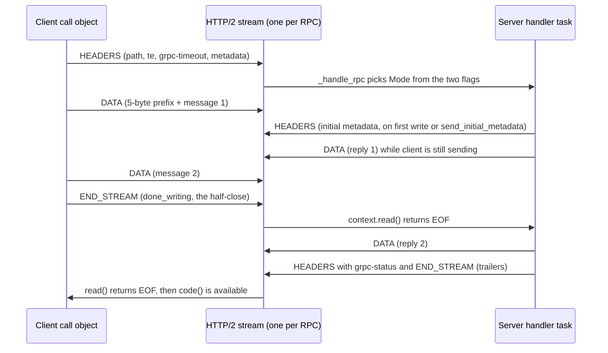

# gRPC's Four Streaming Modes in Python grpc.aio (1.85.1): Unary, Server Streaming, Client Streaming, and Full-Duplex Bidirectional Streaming

> [!summary] Claim
> The four gRPC modes are one HTTP/2 wire grammar (`Request-Headers`, any number of length-prefixed messages, half-close; then `Response-Headers`, any number of messages, `Trailers`), so a mode is only a cardinality contract that `grpc.aio` enforces in its handler and call objects, not on the wire: the server dispatches on two booleans, the half-close is the only signal that ends a request stream, and a client that uses the wrong multicallable can hang instead of failing.

Part of [gRPC and Protocol Buffers](README.md) in [API Engineering](../README.md).

## TL;DR

- Mechanism: a method handler has `request_streaming` and `response_streaming` flags, `grpc.aio` dispatches on them in `_handle_rpc`, and each mode differs only in how many length-prefixed messages it reads and writes before the final `grpc-status`.
- Contract rule: the end of a request stream is the client's half-close (`END_STREAM`, `done_writing()`), the end of any RPC is the server's trailers; a handler may finish (and the client see `OK`) before the client half-closes.
- Trap: the wire cannot tell the modes apart, so calling a server-streaming method through `channel.unary_unary` works for one response message and never completes for two (measured and traced to Core's transport below), and cancellation inside a handler can arrive as end-of-stream before it arrives as `CancelledError`.
- Portability: the lab passed 30 tests on CPython 3.14.6 with `grpcio` 1.85.1 on macOS 27.3 arm64 (rerun in verification), and the drafter reported the same 30 passing on 3.12.13, 3.13.18, 3.14.10, 3.15.2, and a 3.15.0b3 free-threaded build (where `cygrpc` forces the GIL back on).
- When not to use streaming: for independent request/response pairs, short calls, or anything that must be load balanced per call; streams pin to one connection and are harder to retry, observe, and shed.

## Mental model



One RPC is one HTTP/2 stream with two independent halves.
The client half starts with `HEADERS`, carries zero or more length-prefixed messages, and ends at `END_STREAM`, which the server sees as end-of-stream (`EOF`) on `context.read()` (RFC 9113 Section 5.1, the "half-closed" states).
The server half starts with response `HEADERS` (initial metadata), carries zero or more messages, and ends with a `HEADERS` frame holding `grpc-status` and `END_STREAM`.
Unary means "exactly one message on that half", streaming means "any number", and the diagram above is the general case: the reply to message 1 left the server before the client had half-closed.
`grpc.aio` adds a task per RPC on each side and a state machine that turns those frames into `await call`, `async for`, `read()`, `write()`, and `done_writing()`.

## How it works

### The wire grammar is shared by all four modes

The gRPC-over-HTTP/2 specification defines one request shape and one response shape: `Request -> Request-Headers *Length-Prefixed-Message EOS` and `Response -> (Response-Headers *Length-Prefixed-Message Trailers) / Trailers-Only` (grpc v1.85.1 `doc/PROTOCOL-HTTP2.md`, "Outline", "Requests", "Responses").
The `*` means zero or more, and nothing in the grammar fixes a count of one.
Each `Length-Prefixed-Message` is a 1-byte `Compressed-Flag` plus a 4-byte big-endian `Message-Length` plus the message (framing is the sibling note [[gRPC-Over-HTTP-2-Framing-Length-Prefixed-Messages-and-Trailers]]).
For requests, `EOS` is the `END_STREAM` flag on the last `DATA` frame, and "implementations MUST send an empty DATA frame with this flag set" when no data remains (same document, "Requests").
For responses, end-of-stream is `END_STREAM` on the `HEADERS` frame that carries the trailers, and "Status must be sent in Trailers even if the status code is OK" (same document, "Responses").
The four modes the user sees are the user-facing names for the four combinations of "one or many" on each half (grpc.io `core-concepts.md`, "Service definition", as of 2026-11).

| Mode | `.proto` shape | Messages client -> server | Messages server -> client | Handler flags |
|---|---|---|---|---|
| Unary | `rpc M(Req) returns (Res)` | exactly 1 by contract | exactly 1 by contract | `request_streaming=False`, `response_streaming=False` |
| Server streaming | `rpc M(Req) returns (stream Res)` | exactly 1 | 0 or more | `False`, `True` |
| Client streaming | `rpc M(stream Req) returns (Res)` | 0 or more | exactly 1 | `True`, `False` |
| Bidirectional streaming | `rpc M(stream Req) returns (stream Res)` | 0 or more | 0 or more | `True`, `True` |

The consequence, which the lab tests (`test_unary_client_can_call_client_streaming_and_bidi_methods`, `test_server_streaming_client_can_call_a_unary_method`), is that the server does not learn the client's mode from the bytes.
A unary client calling a client-streaming or bidirectional handler works whenever the handler is satisfied by one request message, and a server-streaming client can call a unary handler and read one message.
In a throwaway script (not a lab test, because the result may depend on whether the client's writes win a race against the server's status) a client-streaming client sent three messages and then `done_writing()` to a unary handler and received the result for the first one, with no error, in each of five attempts during verification (CPython 3.14.6, `grpcio` 1.85.1).

### Server side: two booleans select the handler

A generic handler maps `"/lab.Calc/Square"` to a `grpc.RpcMethodHandler` built by one of four factories: `grpc.unary_unary_rpc_method_handler`, `unary_stream_rpc_method_handler`, `stream_unary_rpc_method_handler`, `stream_stream_rpc_method_handler` (grpcio 1.85.1 `grpc/__init__.py`).
`RpcMethodHandler` carries `request_streaming` and `response_streaming` plus four slots (`unary_unary`, `unary_stream`, `stream_unary`, `stream_stream`) of which only the matching one is non-`None` (`grpc/__init__.py`, `RpcMethodHandler`; lab tests `test_registration_factory_fixes_the_mode` and `test_handler_slot_is_filled_only_for_its_own_mode`).
The Cython server resolves the handler (registered methods first, then each generic handler's `service()`; `None` becomes `UNIMPLEMENTED` with details `Method not found!`) and then branches on the two flags into `_handle_unary_unary_rpc`, `_handle_unary_stream_rpc`, `_handle_stream_unary_rpc`, or `_handle_stream_stream_rpc` (grpcio 1.85.1 `src/python/grpcio/grpc/_cython/_cygrpc/aio/server.pyx.pxi`, `_MethodResolver.resolve_handler` and `_handle_rpc`).
Each accepted RPC gets an asyncio task running `_schedule_rpc_coro`, which creates a second task, `HandleExceptions[<method>]`, that runs the handler inside `_handle_exceptions`, and then itself awaits `_handle_cancellation_from_core` to watch for the peer's cancel (same file, `AioServer._server_main_loop` and `_schedule_rpc_coro`).
The server main loop re-arms a request-call future (`_make_request_call_future`, backed by `grpc_server_request_call` for generic handlers) after every accepted call, so accepting is a loop in the same event loop that runs your handlers (same file, `AioServer._server_main_loop`).

### Unary: read one, call, then message plus status in one batch

`_handle_unary_unary_rpc` awaits one received message, deserializes it, builds a `_ServicerContext`, and calls `_finish_handler_with_unary_response` (same file).
That function awaits an async handler on the loop, or runs a plain `def` handler through `loop.run_in_executor(rpc_state.server.thread_pool(), ...)`, which is the `migration_thread_pool` argument of `grpc.aio.server()` (grpcio 1.85.1 `grpc/aio/_server.py`, `server`).
Then it calls `rpc_state.raise_for_termination()`, serializes the response only if `status_code == StatusCode.ok` (otherwise it queues an empty message), and executes one batch: `SendMessageOperation`, `SendStatusFromServerOperation`, with `SendInitialMetadata` prepended if metadata was not already sent (same file, `_finish_handler_with_unary_response`).
The consequence is the lab's `test_unary_nonok_code_discards_the_returned_response`: a handler that calls `context.set_code(FAILED_PRECONDITION)` and still returns a value delivers the code and details, and the client raises `AioRpcError` with no response.
`context.abort(code, details)` behaves differently: it sets `abort_exception`, sends the error status immediately with `_send_error_status_from_server`, and raises `AbortError` to stop the handler (`_ServicerContext.abort`, `_handle_exceptions`).
If the handler swallows that `AbortError` and returns a value, `raise_for_termination` re-raises the stored `abort_exception` right after the handler returns, `_handle_exceptions` catches it in its `except AbortError` branch and returns quietly, and the client still sees the aborted status; the return value is never sent (same file; verified with a throwaway script on CPython 3.14.6, `grpcio` 1.85.1, where the client got `INVALID_ARGUMENT` and no `Abort error unexpectedly suppressed` line was logged).
That log line sits in the `else` branch of `_handle_exceptions` and fires only if the RPC coroutine completes normally with `abort_exception` set, which the four finish paths prevent by calling `raise_for_termination` after the handler.

On the client, `UnaryUnaryCall._invoke` serializes the request and calls `_cython_call.unary_unary`, which executes six operations in one batch: send initial metadata, send message, send close, receive initial metadata, receive message, receive status (grpcio 1.85.1 `grpc/aio/_call.py`, `UnaryUnaryCall._invoke`; `call.pyx.pxi`, `_AioCall.unary_unary`).
That single batch is why unary is the cheapest mode per call, and `await call` returns the message only if the status code is `OK`; otherwise `_UnaryResponseMixin.__await__` raises `AioRpcError` built from the status, or `asyncio.CancelledError` if the call was cancelled locally (`grpc/aio/_call.py`, `_UnaryResponseMixin.__await__`).

### Server streaming: one request, then a loop of writes

`_handle_unary_stream_rpc` reads the single request and calls `_finish_handler_with_stream_responses`, which supports three handler styles (server.pyx.pxi, `_finish_handler_with_stream_responses`):

1. A coroutine function (`inspect.iscoroutinefunction`): the handler returns `None` and calls `await context.write(msg)` itself (the reader-writer style).
2. An async generator function (`inspect.isasyncgenfunction`): the server runs `async for response_message in async_response_generator`, calling `rpc_state.raise_for_termination()` then `await servicer_context.write(response_message)` for each item.
3. A plain generator (sync stack): wrapped by `generator_to_async_generator` and pulled on the migration thread pool.

After the stream ends the server sends a `SendStatusFromServerOperation` with the accumulated `status_code`, `status_details`, and `trailing_metadata`, prepending initial metadata if no write has happened (same function).
`context.write` sends initial metadata with the first message if it was not sent yet, so for a server stream the response headers appear with the first `DATA` frame unless the handler called `await context.send_initial_metadata(...)` first (`_ServicerContext.write`, `send_initial_metadata`; lab test `test_server_initial_metadata_is_sent_before_the_first_message`, which blocks the handler after sending metadata and shows the client has the metadata before any message).
Trailing metadata set with `context.set_trailing_metadata` reaches the client only with the final status, after the last message (lab test `test_server_streaming_delivers_messages_in_order_then_trailers` reads `x-count` from `call.trailing_metadata()` after the iteration).

Streaming is real streaming, not buffering: the lab's `countdown_gated` handler yields one message, parks on an `asyncio.Event`, and the client reads that message while `call.done()` is `False` (`test_server_streaming_first_message_arrives_before_handler_finishes`).
If the handler raises after some messages, the client receives those messages first and then fails: the lab's `countdown(-1)` yields `2` and `1` and raises `RuntimeError`, the client collects `[2, 1]`, then gets `AioRpcError` with code `UNKNOWN` and details beginning `Unexpected <class 'RuntimeError'>: ...` (`_handle_exceptions` builds `'Unexpected %s: %s' % (type(e), e)` with `StatusCode.unknown` when no code was set; lab test `test_server_streaming_handler_error_arrives_after_the_messages_sent_so_far`).

The client side of a server stream is `UnaryStreamCall`: `initiate_unary_stream` starts a background `_handle_status_once_received` task that watches for the final status, then sends one batch of initial metadata, the message, and the close (call.pyx.pxi, `_AioCall.initiate_unary_stream`).
The returned call object supports two mutually exclusive styles: `async for message in call` (`__aiter__`, which wraps `_fetch_stream_responses`) and `await call.read()`, which returns `grpc.aio.EOF` at the end.
Mixing them raises `grpc.aio.UsageError` with the text `The iterator and read/write APIs may not be mixed on a single RPC.` (`grpc/aio/_call.py`, `_StreamResponseMixin._update_response_style` and `_API_STYLE_ERROR`; lab test `test_response_iterator_and_read_api_cannot_be_mixed`).
After `EOF`, both styles call `_raise_for_status`, so a non-`OK` status surfaces as `AioRpcError` at the point the stream ends, not at the first message.

### Client streaming: the half-close ends the handler's loop

For a client-streaming method the server does not read a request first.
`_handle_stream_unary_rpc` builds a `_MessageReceiver`, an object whose async iterator repeatedly awaits `context.read()` and stops when it returns `EOF`, hands it to the handler as `request_iterator`, and then uses the same finish function as unary to send message plus status (server.pyx.pxi, `_MessageReceiver` and `_handle_stream_unary_rpc`).
`context.read()` returns `EOF` when `_receive_message` gets no message, which happens at the client's half-close or when the receive batch fails, for example on cancellation (`callback_common.pyx.pxi`, `_receive_message`: "The receive message operation has two ways to indicate finish state").
So a handler like the lab's `total` can sum values and return only after the client has called `done_writing()`.
The lab proves the ordering with an `asyncio.Queue` the handler writes to: after three writes the test sees `recv 1`, `recv 2`, `recv 3`, then asserts the call does not complete within 0.2 s (`asyncio.wait_for(asyncio.shield(call), 0.2)` raises `TimeoutError`) and no `eof` was recorded, then calls `done_writing()`, sees `eof`, and gets `6` (`test_client_streaming_server_answers_only_after_half_close`).

The client call is `StreamUnaryCall`.
It supports two ways to feed requests, chosen at call creation (grpcio 1.85.1 `grpc/aio/_call.py`, `_StreamRequestMixin`):

- Pass an `(async) iterable` to the multicallable: a task, `_consume_request_iterator`, drains it with `_write` and finishes with `_done_writing()`.
- Pass nothing and call `await call.write(msg)` and `await call.done_writing()` yourself (the reader-writer style); `done_writing` is idempotent, and `write` after it raises `asyncio.InvalidStateError` with the text `RPC is half closed after calling "done_writing".` (lab test `test_write_after_done_writing_raises_invalid_state`).

Using `write` on a call that was given an iterator raises `UsageError` (lab test `test_request_iterator_and_write_api_cannot_be_mixed`).
`_write` waits for a `_metadata_sent` event first, because `stream_unary` sends initial metadata before anything else and only then calls `metadata_sent_observer` (call.pyx.pxi, `_AioCall.stream_unary`; `grpc/aio/_call.py`, `_StreamRequestMixin._write`).
The failure handling inside `_consume_request_iterator` is a trap, covered under Pitfalls.

### Bidirectional streaming: two independent halves

`_handle_stream_stream_rpc` combines both: a `_MessageReceiver` for input and the stream-response finish function for output (server.pyx.pxi).
The two halves share nothing except the call, so any interleaving is legal: the server can reply to each request (ping-pong), batch replies after EOF, or ignore the request stream entirely (grpc.io `core-concepts.md`, "Service definition": "The two streams operate independently ... The order of messages in each stream is preserved"; the "Bidirectional streaming RPC" section adds that "the client and server can read and write messages in any order", as of 2026-11).
Order within one direction is guaranteed; no order is defined between the two directions.

The lab covers both handler styles and the interleaving:

- `echo_double` is a reader-writer coroutine (`await context.read()` then `await context.write(value * 2)` until `EOF`); the test writes `1`, reads `2`, writes `2`, reads `4`, and so on, asserting `not call.done()` after each reply, so every reply left the server before the request stream had ended (`test_bidi_reader_writer_interleaves_before_the_request_stream_ends`).
- `running_sum` is an async generator over `request_iterator`; 200 requests produce the 200 prefix sums in order (`test_bidi_async_generator_style_preserves_order_over_many_messages`).
- `first_only` replies to the first message and returns without waiting for `EOF`; the client reads `1001`, then `read()` returns `EOF` and `code()` is `OK` although the client never called `done_writing()`, and a later `write` raises `InvalidStateError` with `RPC already finished.` (`test_bidi_server_may_finish_before_the_client_half_closes`).

The last case is permitted by HTTP/2: a server "can send a complete response prior to the client sending an entire request if the response does not depend on any portion of the request that has not been sent and received", and then "MAY request that the client abort transmission of a request without error by sending a RST_STREAM with an error code of NO_ERROR" (RFC 9113 Section 8.1).
Clients "MUST NOT discard responses as a result of receiving such a RST_STREAM" (same section).

Because each side has a flow-control window (initial value 65,535 octets for both a stream and the connection, RFC 9113 Section 5.2.1 and Section 6.9.2), a bidirectional design in which both peers write large volumes without reading can stall on the window; this is reasoning from the RFC, not something the lab measured, and window tuning belongs to [[gRPC-Keepalive-Flow-Control-and-Max-Message-Size-Tuning]].

The client side is `StreamStreamCall`: `_prepare_rpc` runs `initiate_stream_stream`, which sends initial metadata, signals `metadata_sent_observer`, and receives initial metadata, while a background task watches for the final status (call.pyx.pxi, `_AioCall.initiate_stream_stream`).
It inherits the request-side mixin from client streaming and the response-side mixin from server streaming, so it has the same two API styles on each side, chosen independently: an async iterator or `write` on the way out, `async for` or `read()` on the way in.

### Status, errors, and who sees what

The final status always rides in the trailers (`grpc-status`, `grpc-message`, optional `grpc-status-details-bin`; "Trailers-Only" is allowed for calls that produce an immediate error, PROTOCOL-HTTP2.md, "Responses").
On the client `AioRpcError` exposes `code()`, `details()`, `initial_metadata()`, `trailing_metadata()`, and `debug_error_string()` (grpcio 1.85.1 `grpc/aio/_call.py`, `AioRpcError`).
Status code semantics are in [[gRPC-Status-Codes-and-Google-RPC-Status-Rich-Error-Payloads]].
Two server-side details matter for the modes:

- A streaming handler that returns normally after its last write sends `OK` implicitly; a handler that wants a non-`OK` ending after sending messages must `abort` (which skips the rest) or `set_code` before returning.
- In the unary-response path the server runs `raise_for_termination()` after the handler returns, so a handler that called `abort` and swallowed the exception is still stopped.

### Cancellation and half-close are different events

A client `call.cancel()` marks the call cancelled locally (`_cancel` forwards `Locally cancelled by application!`) and cancels its helper tasks (`_StreamRequestMixin.cancel`, `_UnaryResponseMixin.cancel`, `_StreamResponseMixin.cancel` in `grpc/aio/_call.py`).
Dropping the last reference to an unfinished call cancels it with `Cancelled upon garbage collection!` (`Call.__del__`).
On the server, `_handle_cancellation_from_core` awaits a `ReceiveCloseOnServerOperation`, and if the operation reports cancelled and the task is not done and no status was sent, calls `rpc_task.cancel()`, which injects `asyncio.CancelledError` into the handler (server.pyx.pxi).
`_handle_exceptions` then logs `RPC cancelled for servicer method [...]` at DEBUG and finishes quietly.
Two details are easy to get wrong, and the lab pins both in `test_client_cancel_raises_cancelled_error_in_the_server_handler`:

- A cancel that lands while the handler is awaiting `context.read()` can arrive as `EOF` first, because `_receive_message` turns a failed receive into `None` and `_ServicerContext.read` returns `EOF` for `None`.
  The lab's `hold` handler is therefore written to park after its read loop so the later `CancelledError` is still observable; my first version of that handler, which waited inside the loop with an extra `yield`, never saw the cancellation because the task was inside the server's own `write` when the cancel hit.
- `context.cancelled()` does not report a client cancel: `_ServicerContext.cancelled` returns `self._rpc_state.status_code == StatusCode.cancelled`, and that field changes only through `set_code` or `abort`.
  In the lab, `trace.context_cancelled` is `False` after a real client cancel.

Deadline propagation, which cancels the same way, is the next note: [[gRPC-Deadlines-Timeout-Header-and-Context-Cancellation-Cascade]].

### Concurrency limit and shutdown apply per RPC, not per message

`grpc.aio.server(maximum_concurrent_rpcs=N)` installs a `_ConcurrentRpcLimiter`: every accepted call increments an active count, a call that arrives at the limit is still scheduled but `_handle_rpc` answers it with `RESOURCE_EXHAUSTED` and details `Concurrent RPC limit exceeded!`, and the count drops when the RPC task finishes; a non-positive limit raises `ValueError` (server.pyx.pxi, `_ConcurrentRpcLimiter`, `_handle_rpc`).
Because it counts RPCs, a long-lived bidirectional stream consumes one slot for its whole life.
The lab holds a bidirectional call open with `maximum_concurrent_rpcs=1` and shows a second unary call fail with that code and text, and shows with no limit that the second call succeeds (`test_maximum_concurrent_rpcs_sheds_the_extra_call_with_resource_exhausted`, `test_without_a_limit_a_second_call_is_served_while_one_is_held`).
`server.stop(grace)` stops accepting, waits up to `grace` seconds for active RPCs, then cancels the rest; `grace=None` cancels all calls immediately (`grpc/aio/_server.py`, `Server.stop` docstring; server.pyx.pxi, `AioServer.shutdown`); the operating details are in [[gRPC-Health-Checking-Protocol-Server-Reflection-and-Graceful-Stop]].
Interceptors wrap handler lookup (`_find_method_handler`, `_run_interceptor`) and are covered in [[gRPC-Interceptors-in-AsyncIO-Auth-Logging-Metrics-and-Retries]].

## Numbers and limits

| Quantity | Value | Source or measurement |
|---|---|---|
| Message prefix | 1 byte `Compressed-Flag` + 4 bytes big-endian length = 5 bytes | grpc v1.85.1 `doc/PROTOCOL-HTTP2.md`, "Requests" |
| `grpc-timeout` value | at most 8 ASCII digits plus a unit (`H`, `M`, `S`, `m`, `u`, `n`) | same document, "Requests" (`Timeout`) |
| Suggested header block limit | 8 KiB default (request headers; also responses and trailers) | same document, "Requests" and "Responses" |
| Default max receive message | 4 MiB (`grpc.max_receive_message_length`; -1 is unlimited) | grpc v1.85.1 `include/grpc/impl/channel_arg_names.h` |
| Max send message | `grpc.max_send_message_length`; -1 is unlimited (the header comment states no default) | same header |
| HTTP/2 initial flow-control window | 65,535 octets per stream and per connection | RFC 9113 Section 5.2.1, Section 6.9.2 |
| `maximum_concurrent_rpcs` default | `None` (no limit); value must be a positive integer | `grpc/aio/_server.py`, `server`; server.pyx.pxi, `_ConcurrentRpcLimiter` |
| Lab suite | 30 tests, 2.17 s wall time in the verification run | measured, `pytest` output below |
| Sequential unary, 2000 calls | 13.451 s, 6725.4 us/call, 149 calls/s | measured, `measure_round_trips(2000)`, heavily loaded machine |
| One bidi stream, 2000 ping-pong messages | 2.842 s, 1421.2 us/message, 704 messages/s | measured, same run |
| One bidi stream, 2000 pipelined messages | 2.900 s, 1449.9 us/message, 690 messages/s | measured, same run |

The three timings come from one run of `measure_round_trips(2000)` from `labs/`: `uv run --frozen python -c "import asyncio; from api_labs.f19_grpc_and_protocol_buffers.streaming_modes import measure_round_trips; print(asyncio.run(measure_round_trips(2000)))"` on CPython 3.14.6, macOS 27.3 arm64 (12 cores), `grpcio` 1.85.1, client and server on one event loop over `127.0.0.1`, after one warm-up call.
The machine was heavily loaded during that run (`uptime` load average 140.94 on 12 cores), so the absolute values are inflated; the drafter's earlier single run with the same command and versions measured 5.021 s, 1.485 s, and 0.749 s.
They are one sample, not a distribution, and they include both the client and the server cost because both share a core and a loop; read them as ratios rather than absolutes.
Both runs agree that sequential unary costs several times more per message than either stream form (about 4.7x ping-pong and 4.6x pipelined in the verification run, 3.4x and 6.7x in the drafter's run); the ordering of ping-pong versus pipelined did not reproduce under load, so this note makes no claim about it.
The grpc.io performance guide says streams "might increase performance at a small scale", with a side note that this "does not apply to Python", and that in gRPC Python "Streaming RPCs create extra threads for receiving and possibly sending the messages, which makes streaming RPCs much slower than unary RPCs", adding that using asyncio "could improve performance" (grpc.io `performance.md`, "Python", as of 2026-11); the timings above are for `grpc.aio` and do not measure the sync stack.

## Portability

| Cell | Result | Evidence |
|---|---|---|
| CPython 3.14.6, workspace `.venv`, full pinned lock | 30 passed | `uv run --frozen pytest` (rerun in verification, 2026-11-21) |
| CPython 3.12.13 | 30 passed | drafter's run, not re-executed in verification (matrix runs paused 2026-11-11): `uv run --no-project --python 3.12.13` with only `grpcio==1.85.1`, `pytest==9.2.0`, `pytest-asyncio==1.4.1.post1`, `PYTHONPATH=src` |
| CPython 3.13.18 | 30 passed | drafter's run, same method |
| CPython 3.14.10 | 30 passed | drafter's run, same method |
| CPython 3.15.2 | 30 passed | drafter's run, same method |
| CPython 3.15.0b3 free-threaded (matrix label 3.15.2t) | 30 passed, with the GIL re-enabled | drafter's run: `uv` built `grpcio` 1.85.1 from source; at import the interpreter warned `The global interpreter lock (GIL) has been enabled to load module 'grpc._cython.cygrpc', which has not declared that it can run safely without the GIL`, so this leg ran with the GIL on; 3.15.2t itself is not installed here |
| CPython 3.12.16 (matrix label) | not run | the installed 3.12 is 3.12.13 |
| `grpcio` other than 1.85.1 | not run | the semantics above are read from the 1.85.1 source only |
| Debian Trixie and Alpine containers | not run | container checks are paused for this job |
| gRPC servers other than `grpc.aio` | not applicable | the four modes are language-neutral (grpc.io `core-concepts.md`), but the handler styles, `UsageError`, `abort` exception, and limiter here are `grpc.aio` behavior |
| ASGI servers (Uvicorn, Hypercorn, Granian) | not applicable | `grpc.aio` serves HTTP/2 itself on Core, with no ASGI layer |
| HTTP/1.1 | not supported | the gRPC-over-HTTP/2 specification is built on HTTP/2 framing (`PROTOCOL-HTTP2.md`, "Introduction") |
| HTTP/3 | no claim | not described in `PROTOCOL-HTTP2.md` at v1.85.1 |
| Browsers via gRPC-Web | unary and server streaming only | grpc-web `README.md`: "Client-side and Bi-directional streaming is not currently supported" |

The non-workspace legs used the lab's own `pyproject.toml` pytest settings (`-c pyproject.toml --rootdir .`) and the pinned versions of the three packages the test needs, not the full lock.
The drafter reports identical counts on each interpreter and no per-version behavior difference in these 30 tests.

## Worked example

The implementation is [implementation](../labs/src/api_labs/f19_grpc_and_protocol_buffers/streaming_modes.py) and the test is [test](../labs/tests/f19_grpc_and_protocol_buffers/test_the_four_grpc_communication_modes_unary_server_client_and_bidi_streaming.py).
The lab uses decimal-ASCII integers as messages (`encode` and `decode`) instead of generated protobuf classes, because `grpc.aio` only calls the serializer functions it is given; a generated stub passes `Message.SerializeToString` and `Message.FromString` in the same slots, and the protobuf byte layout is the subject of [[Protobuf-Wire-Format-TLV-Tags-Varints-and-ZigZag-Encoding]].
The server runs on `127.0.0.1:0` and the test client connects to the port the OS chose.

Simplified excerpt of the registration: the factory chosen fixes the mode, and each handler is a native coroutine or async generator.

```python
def build_handler(service: CalcService) -> grpc.GenericRpcHandler:
    kwargs = {"request_deserializer": decode, "response_serializer": encode}
    handlers = {
        "Square": grpc.unary_unary_rpc_method_handler(service.square, **kwargs),
        "Countdown": grpc.unary_stream_rpc_method_handler(service.countdown, **kwargs),
        "Total": grpc.stream_unary_rpc_method_handler(service.total, **kwargs),
        "RunningSum": grpc.stream_stream_rpc_method_handler(service.running_sum, **kwargs),
        "EchoDouble": grpc.stream_stream_rpc_method_handler(service.echo_double, **kwargs),
        # ... FirstOnly, Hold, CountdownGated, StreamWithMetadata
    }
    return grpc.method_handlers_generic_handler(SERVICE, handlers)
```

Simplified excerpt of the three handler styles (client streaming by iterator, bidirectional by async generator, bidirectional by reader-writer):

```python
async def total(self, request_iterator, context) -> int:
    running = 0
    async for value in request_iterator:        # ends only at the client's half-close
        running += value
        self.trace.received.put_nowait(f"recv {value}")
    self.trace.received.put_nowait("eof")
    return running

async def running_sum(self, request_iterator, context):
    running = 0
    async for value in request_iterator:        # one reply per request
        running += value
        yield running

async def echo_double(self, request_iterator, context) -> None:
    while True:
        value = await context.read()            # aio.EOF at half-close
        if value is aio.EOF:
            break
        await context.write(value * 2)
```

Simplified excerpt of the test that proves the half-close rule:

```python
async with lab_server(trace) as client:
    call = client.total()
    for value in (1, 2, 3):
        await call.write(value)
    for value in (1, 2, 3):
        assert await asyncio.wait_for(trace.received.get(), WAIT) == f"recv {value}"
    with pytest.raises(asyncio.TimeoutError):
        await asyncio.wait_for(asyncio.shield(call), 0.2)
    assert trace.received.empty()              # the handler has not seen EOF
    await call.done_writing()
    assert await asyncio.wait_for(trace.received.get(), WAIT) == "eof"
    assert await asyncio.wait_for(call, WAIT) == 6
```

Captured run, from `labs/` with `uv run --frozen pytest tests/f19_grpc_and_protocol_buffers/test_the_four_grpc_communication_modes_unary_server_client_and_bidi_streaming.py -v`, CPython 3.14.6, `grpcio` 1.85.1, pytest 9.2.0, macOS 27.3 arm64, taken during verification on 2026-11-21 (the test-file path before each `::` is shortened to `...`, and the plugin header lines are omitted):

```text
collecting ... collected 30 items

...::test_registration_factory_fixes_the_mode[Square-Mode.UNARY] PASSED [  3%]
...::test_registration_factory_fixes_the_mode[Countdown-Mode.SERVER_STREAMING] PASSED [  6%]
...::test_registration_factory_fixes_the_mode[Total-Mode.CLIENT_STREAMING] PASSED [ 10%]
...::test_registration_factory_fixes_the_mode[RunningSum-Mode.BIDI_STREAMING] PASSED [ 13%]
...::test_handler_slot_is_filled_only_for_its_own_mode PASSED [ 16%]
...::test_unknown_method_resolves_to_no_handler PASSED [ 20%]
...::test_codecs_round_trip_and_are_the_serializer_slots PASSED [ 23%]
...::test_unary_returns_one_response_and_ok_status PASSED [ 26%]
...::test_unary_nonok_code_discards_the_returned_response PASSED [ 30%]
...::test_unary_abort_carries_code_and_details PASSED [ 33%]
...::test_unknown_method_returns_unimplemented_method_not_found PASSED [ 36%]
...::test_server_streaming_delivers_messages_in_order_then_trailers PASSED [ 40%]
...::test_server_streaming_first_message_arrives_before_handler_finishes PASSED [ 43%]
...::test_server_streaming_handler_error_arrives_after_the_messages_sent_so_far PASSED [ 46%]
...::test_server_initial_metadata_is_sent_before_the_first_message PASSED [ 50%]
...::test_client_streaming_server_answers_only_after_half_close PASSED [ 53%]
...::test_client_streaming_accepts_an_async_iterator_of_requests PASSED [ 56%]
...::test_write_after_done_writing_raises_invalid_state PASSED [ 60%]
...::test_request_iterator_and_write_api_cannot_be_mixed PASSED [ 63%]
...::test_bidi_reader_writer_interleaves_before_the_request_stream_ends PASSED [ 66%]
...::test_bidi_async_generator_style_preserves_order_over_many_messages PASSED [ 70%]
...::test_bidi_server_may_finish_before_the_client_half_closes PASSED [ 73%]
...::test_response_iterator_and_read_api_cannot_be_mixed PASSED [ 76%]
...::test_client_cancel_raises_cancelled_error_in_the_server_handler PASSED [ 80%]
...::test_maximum_concurrent_rpcs_sheds_the_extra_call_with_resource_exhausted PASSED [ 83%]
...::test_without_a_limit_a_second_call_is_served_while_one_is_held PASSED [ 86%]
...::test_unary_client_can_call_client_streaming_and_bidi_methods PASSED [ 90%]
...::test_server_streaming_client_can_call_a_unary_method PASSED [ 93%]
...::test_unary_client_never_completes_against_a_two_message_response PASSED [ 96%]
...::test_measure_round_trips_reports_all_three_shapes PASSED [100%]

============================== 30 passed in 2.17s ==============================
```

The drafter's three earlier runs of the same suite reported `30 passed in 2.41s`, `30 passed in 1.83s`, and `30 passed in 2.20s`.
`ruff format --check`, `ruff check`, `mypy`, and `pyright` were run once on the two lab files during verification and reported no problems (`2 files already formatted`, `All checks passed!`, `Success: no issues found in 2 source files`, `0 errors, 0 warnings, 0 informations`); mutation tests were not run (paused by the user's instruction, 2026-11-11), so the claim that each test is discriminating rests on reading, not on a recorded mutation.

## Pitfalls

> [!warning] A unary client against a streaming method hangs instead of failing
> Trigger: the client opens a method through the wrong multicallable (here `channel.unary_unary` on a server-streaming method) and the server sends more than one response message.
> Symptom: with one response message `await call` returns it; with two, the lab's `unary(2)` never completed and only my `asyncio.wait_for(..., 1.0)` ended the wait (`test_unary_client_never_completes_against_a_two_message_response`, CPython 3.14.6, `grpcio` 1.85.1).
> Cause (read from source, not instrumented): the unary batch has exactly one receive-message operation, and the HTTP/2 transport completes a client's receive-trailing-metadata closure only once the stream is read-closed and `s->frame_storage.length == 0`, that is, every received message byte has been handed to the application (grpc v1.85.1 `src/core/ext/transport/chttp2/transport/chttp2_transport.cc`, `grpc_chttp2_maybe_complete_recv_trailing_metadata`; the batch only finishes when its `kRecvTrailingMetadata` step does, `src/core/lib/surface/filter_stack_call.cc`, `BatchControl::FinishStep`).
> The second message is never read, so the status op never completes and the call never finishes; I confirmed the hang here but my `GRPC_TRACE=http` run printed none of the `maybe_complete_recv_trailing_metadata` lines, so the buffered-bytes step is a source reading, not an observed trace.
> Fix: generate stubs from the `.proto` (the multicallable then matches the method), put a deadline on every call, and treat a hang on one specific method as a mode mismatch first.

> [!warning] A broken request generator surfaces as `CancelledError`, and write errors are logged at DEBUG
> Trigger: you pass an `async` generator to a client-streaming or bidirectional call and it raises.
> Symptom: `_consume_request_iterator` has a bare `except` that logs `Client request_iterator raised exception` at DEBUG and calls `self.cancel()`, and `_raise_for_status` raises `asyncio.CancelledError` when the call was cancelled locally, so the awaiting code sees `CancelledError`, not your exception; separately, an `AioRpcError` raised by `_write` inside the loop is caught, logged at DEBUG, and the task returns without calling `done_writing` (`grpc/aio/_call.py`, `_StreamRequestMixin._consume_request_iterator` and `Call._raise_for_status`; in a throwaway verification script on CPython 3.14.6, `grpcio` 1.85.1, an async generator that yielded `1` then raised `ValueError` made `await call` raise `CancelledError()`, the `ValueError` appeared only in the DEBUG log, and the server logged `RPC cancelled for servicer method [...]`).
> Fix: catch and record exceptions inside your generator, enable `grpc._cython.cygrpc` and `grpc.aio` DEBUG logging when diagnosing, and check `await call.code()` after the call.

> [!warning] Cancellation can appear as end-of-stream, and `context.cancelled()` stays `False`
> Trigger: cleanup code in a streaming handler keys off `context.cancelled()` or off the read loop ending.
> Symptom: the loop over `request_iterator` ends normally on a cancelled call, and `context.cancelled()` reads a status code that only the handler sets, so cleanup is skipped or runs on the wrong branch (callback_common.pyx.pxi, `_receive_message`; server.pyx.pxi, `_ServicerContext.cancelled`; lab `test_client_cancel_raises_cancelled_error_in_the_server_handler`).
> Fix: put cleanup in `finally`, catch `asyncio.CancelledError` where the handler awaits, and use `context.add_done_callback` for work that must run once the RPC ends.

> [!warning] Raising a plain exception leaks its text and loses the status you meant
> Trigger: a handler raises `ValueError` or `RuntimeError` after a bug or a failed dependency call.
> Symptom: the client sees `UNKNOWN` with details `Unexpected <class '...'>: <message>` (`_handle_exceptions`), which exposes internals and loses the semantic code; the server logs the traceback with `_LOGGER.exception`.
> Fix: map expected errors to `await context.abort(code, safe_message)`, catch everything else at one boundary, and return a generic message with a request id.

> [!warning] Swallowing `AbortError` or blocking the event loop
> Trigger: `except Exception` around `await context.abort(...)`, or `time.sleep` and blocking I/O in an `async def` handler.
> Symptom: the code after the swallowed `abort` keeps running (side effects, a return value), although the client still receives the abort status because `raise_for_termination` re-raises the stored `AbortError` once the handler returns and `_handle_exceptions` discards it quietly, with no log line (server.pyx.pxi, `RPCState.raise_for_termination`, `_handle_exceptions`; verified with a throwaway script, see How it works); for blocking calls, every RPC and the accept loop stall because they share the loop (`_server_main_loop`).
> Fix: let `AbortError` propagate (its MRO in the lab venv is `AbortError`, `BaseError`, `Exception`, so a broad `except Exception` does catch it; catch narrow types or re-raise), and use `run_in_executor` or a `def` handler on the migration pool for blocking work.

> [!warning] Long-lived streams pin to one backend and one connection
> Trigger: a bidirectional stream used as a general transport for many logical operations.
> Symptom: per-call load balancing does not rebalance a stream, queueing appears when a connection reaches its concurrent-stream limit, and stream failures are harder to debug (grpc.io `performance.md`: streams "cannot be load balanced once they have started and can be hard to debug for stream failures"; "additional RPCs are queued in the client" at the limit).
> Fix: bound stream lifetimes (reopen periodically), put deadlines on them, and use a separate channel for high-load areas as the guide suggests; see [[gRPC-Load-Balancing-Subchannels-Pick-First-vs-Round-Robin-and-xDS]].

## Security and robustness

- Threat model: a streaming RPC is a long-lived authenticated session with an unbounded message count, so a per-message size cap (default receive limit 4 MiB, `channel_arg_names.h`) does not bound total bytes, memory held by a slow reader, or the time a stream occupies a concurrency slot.
- Bound the number of concurrent RPCs with `maximum_concurrent_rpcs` (rejected calls get `RESOURCE_EXHAUSTED` quickly, and the server main loop re-arms regardless, `_server_main_loop`), bound each stream with a deadline, and cap messages or bytes per stream in the handler (count inside the `async for`).
- Authenticate at stream start (interceptor or metadata), but remember a token can expire while a stream lives: re-check expiry on a timer or per N messages and `abort` with `UNAUTHENTICATED`.
- Validate every message in a stream, not just the first; the handler loop is the trust boundary for each `Req`.
- Do not echo exception text to callers (the `Unexpected <class ...>` details above are an information leak by default).
- Rapid stream cancellation is an HTTP/2-level denial of service: CVE-2023-44487 (published 2023-10-10 in NVD) describes that "request cancellation can reset many streams quickly, as exploited in the wild in August through October 2023"; per-RPC server tasks make a flood of started-then-cancelled streams cost scheduling work, so run behind a proxy or server with rapid-reset mitigations and keep `maximum_concurrent_rpcs` set (the mitigation specifics were not tested here).
- The half-close is client-controlled: a client that never half-closes a client-streaming call keeps the handler awaiting `read()`; only a deadline, cancellation, or server stop ends it.
- Keepalive and idle behavior for dead peers is in [[gRPC-Keepalive-Flow-Control-and-Max-Message-Size-Tuning]]; deadline semantics are in [[gRPC-Deadlines-Timeout-Header-and-Context-Cancellation-Cascade]].

## The principal's view

- Default to unary.
  A unary call has a clean retry story, per-call load balancing, a single status, and one batch on each side (measured above at about 6.7 ms per call on a heavily loaded machine and 2.5 ms in the drafter's earlier run, with client and server on one loop; use it only as a ratio against the streaming rows, not as a network latency).
- Use server streaming when the response is naturally a sequence the client can consume incrementally (change feeds, large result sets) and a restart from a cursor is cheap.
- Use client streaming for uploads or aggregations where the server's single answer depends on all inputs, and design a resume token because a failure discards the whole call.
- Use bidirectional streaming only when both directions are genuinely interleaved and long-lived (interactive sessions, multiplexed event channels), and budget for what you give up: per-call balancing, simple retries, and easy debugging (grpc.io `performance.md`).
- The organizational cost is that a streaming contract is stricter to evolve than a unary one: message ordering, half-close semantics, who ends the stream, and keepalive are part of the API, so write them down next to the `.proto` and gate changes with [[Protobuf-Governance-Linting-and-Breaking-Change-Gates-with-Buf]].
- Choose another paradigm when the client is a browser (gRPC-Web has no client or bidirectional streaming, so use WebSockets or server-sent events for those), when the traffic is public REST (see [[HTTP-JSON-to-gRPC-Transcoding-and-Google-API-HTTP-Annotations-AIP-127]]), or when a message queue's durability and replay are what you actually need.
- Do not use streaming "for speed" by default; the guide's own advice is "Use streams to optimize the application, not gRPC".

## Interview questions

> [!question] L5: How many wire formats do the four gRPC modes have, and how does a server know which one a client is using?
>
> > [!success]- Answer
> > One: `Request-Headers`, zero or more length-prefixed messages, half-close, then `Response-Headers`, zero or more messages, `Trailers` (`PROTOCOL-HTTP2.md`).
> > The server does not learn the client's mode from the bytes; it uses the `request_streaming` and `response_streaming` flags of the registered handler and reads accordingly.
> > A mismatch is not detected on the wire: a unary client against a client-streaming handler just works for one message.
> >
> > Follow-up: What happens when a unary client calls a server-streaming method that sends two messages? (It never completes in the lab; add a deadline.)

> [!question] L5: In a client-streaming RPC, what ends the handler's `async for value in request_iterator` loop?
>
> > [!success]- Answer
> > The client's half-close: `END_STREAM` on the request, which the client sends with `done_writing()` or when the request iterator it passed is exhausted.
> > `context.read()` then returns `EOF` and `_MessageReceiver` stops iterating.
> > A cancel or a failed receive can also end it, so check the final status.
> >
> > Follow-up: Can the server finish and return `OK` before the client half-closes? (Yes, `first_only` in the lab; the client's next `write` raises `InvalidStateError`.)

> [!question] L5: Predict the output.
> ```python
> call = client.total()          # server: sums values, returns only after the request stream ends
> await call.write(1)
> await call.write(2)
> try:
>     await asyncio.wait_for(asyncio.shield(call), 0.2)
> except TimeoutError:
>     print("timeout")
> await call.done_writing()
> print(await call)
> ```
>
> > [!success]- Answer
> > It prints `timeout`, then `3`.
> > The handler is parked in its read loop until the half-close, so the call cannot finish in 0.2 s; `shield` keeps the timeout from cancelling the call.
> > After `done_writing()` the handler sees `EOF` and returns `3`.
> >
> > Follow-up: What changes if you remove `asyncio.shield`? (The timeout cancels the call, and `await call` then raises `CancelledError`; in a throwaway probe on CPython 3.14.6, `grpcio` 1.85.1, the output was `timeout`, `await call raised CancelledError`, and `code()` was `CANCELLED`.)

> [!question] L6: Debug this API: a client calls `channel.unary_unary("/lab.Calc/Countdown")(5)` and hangs until its own timeout while `(1)` works; what is wrong?
>
> > [!success]- Answer
> > `Countdown` is registered as server streaming, so for input `5` it sends five messages, and the unary multicallable expects one.
> > One message works because the wire has no mode: the unary client's batch receives the single message and the status.
> > With two or more, the call did not complete in the lab: the unary batch reads one message, and Core's HTTP/2 transport withholds the client's final status while unread message bytes remain (`chttp2_transport.cc`, `grpc_chttp2_maybe_complete_recv_trailing_metadata`, read from source).
> > Fix: call it with `channel.unary_stream`, or use generated stubs, and always set a deadline.
> >
> > Follow-up: What does the client see if it adds `timeout=1`? (`AioRpcError` with `DEADLINE_EXCEEDED`; see the deadlines note.)

> [!question] L6: A handler raises `RuntimeError("boom")` after yielding two messages; what does the client observe, and in what order?
>
> > [!success]- Answer
> > It receives the two messages, then `AioRpcError` with code `UNKNOWN` and details `Unexpected <class 'RuntimeError'>: boom`.
> > The messages are already on the wire before the trailers; the status arrives with the trailers, and `async for` raises at the end of the stream.
> > The server logs the traceback with `_LOGGER.exception`.
> >
> > Follow-up: How do you send a meaningful code instead? (`await context.abort(grpc.StatusCode.X, message)` or `set_code` and return.)

> [!question] L6: How does a server-streaming handler learn that the client cancelled, and why is `context.cancelled()` a poor signal?
>
> > [!success]- Answer
> > `_handle_cancellation_from_core` calls `rpc_task.cancel()` when the receive-close operation reports cancelled, so `asyncio.CancelledError` is raised at the handler's current `await`.
> > A pending `context.read()` can instead return `EOF` first, so a handler must not assume the loop ending means the client finished cleanly.
> > `_ServicerContext.cancelled()` compares `status_code` with `CANCELLED`, a field only `set_code` and `abort` change, so the lab shows it stays `False` after a client cancel.
> >
> > Follow-up: Where should cleanup live? (In `finally`, plus `context.add_done_callback` for post-RPC work.)

> [!question] L6: When do initial metadata and trailing metadata reach the client in each mode?
>
> > [!success]- Answer
> > Initial metadata goes out with the first server message, or earlier if the handler awaits `context.send_initial_metadata`, or with the status if there is no message (`_ServicerContext.write` and the finish functions).
> > Trailing metadata goes out with the final status after the last message.
> > In the lab, a server stream that sends metadata then blocks lets the client read `x-ready` before any message.
> >
> > Follow-up: Why can't you call `send_initial_metadata` twice? (It raises `UsageError`, `Send initial metadata failed: already sent`.)

> [!question] L7: You must upload a 10 GB file through gRPC. Compare unary, client streaming, and a chunked design, and say what you would ship.
>
> > [!success]- Answer
> > Unary cannot work with a 4 MiB default receive cap and holds the whole message in memory (`channel_arg_names.h`).
> > Client streaming in chunks bounds memory per message, but one failure loses the stream, the stream pins to one backend, and the single response only arrives after the half-close.
> > Ship chunked client streaming with a resume token (an upload id plus offset in the first message), a deadline, a per-stream byte cap, checksum verification at the end, and an idempotent finalize; or hand out a presigned object-store URL and keep gRPC for the control plane.
> >
> > Follow-up: What breaks first under many concurrent uploads? (Concurrency slots, memory for slow readers, and the connection's stream limit; set `maximum_concurrent_rpcs`.)

> [!question] L7: How does `maximum_concurrent_rpcs` behave with streaming, and how would you protect a server from stream abuse?
>
> > [!success]- Answer
> > The limiter counts RPC tasks, so a long-lived stream holds a slot for its lifetime; a call that arrives at the limit is answered `RESOURCE_EXHAUSTED` (`Concurrent RPC limit exceeded!`) and the accept loop keeps re-arming, so rejection is cheap.
> > Defense in depth: set the limit, require deadlines, cap messages and bytes per stream, re-check auth expiry on long streams, run behind a proxy that mitigates HTTP/2 rapid reset (CVE-2023-44487), and rely on keepalive settings to reap dead peers.
> > A size cap per message alone does not bound a stream.
> >
> > Follow-up: What is the failure mode of a limit that is too low for streaming workloads? (Legitimate streams starve unary traffic; separate the services or servers.)

> [!question] L7: Why is bidirectional streaming harder to operate than the same logic as repeated unary calls?
>
> > [!success]- Answer
> > The stream is one RPC: per-call load balancing happens once, retries cannot replay a partially consumed stream cleanly, one status covers the whole session, and tracing, auth expiry, and shutdown all have to handle a call that lives for minutes.
> > The grpc.io guide says streams "cannot be load balanced once they have started and can be hard to debug for stream failures", and recommends them only for substantial benefit.
> > Repeated unary calls restate state per call and recover per call.
> >
> > Follow-up: What would make you choose the stream anyway? (A measured per-call cost you cannot amortize, such as the lab's per-message gap of roughly 3x to 7x between sequential unary and one stream, or inherently interleaved real-time semantics.)

## Related

Prerequisites: [[gRPC-Over-HTTP-2-Framing-Length-Prefixed-Messages-and-Trailers]]

Next: [[gRPC-Deadlines-Timeout-Header-and-Context-Cancellation-Cascade]]

See also: [[gRPC-and-Protocol-Buffers]], [[gRPC-Status-Codes-and-Google-RPC-Status-Rich-Error-Payloads]], [[gRPC-Interceptors-in-AsyncIO-Auth-Logging-Metrics-and-Retries]], [[gRPC-Keepalive-Flow-Control-and-Max-Message-Size-Tuning]], [[gRPC-Load-Balancing-Subchannels-Pick-First-vs-Round-Robin-and-xDS]], [[gRPC-Health-Checking-Protocol-Server-Reflection-and-Graceful-Stop]], [[Protobuf-Wire-Format-TLV-Tags-Varints-and-ZigZag-Encoding]], [[Protobuf-Governance-Linting-and-Breaking-Change-Gates-with-Buf]], [[HTTP-JSON-to-gRPC-Transcoding-and-Google-API-HTTP-Annotations-AIP-127]]

- Lab: `labs/tests/f19_grpc_and_protocol_buffers/test_the_four_grpc_communication_modes_unary_server_client_and_bidi_streaming.py`

## Further reading

- gRPC over HTTP/2 (`doc/PROTOCOL-HTTP2.md`, tag v1.85.1): the one grammar behind all four modes, the message prefix, trailers, and `grpc-timeout`.
- RFC 9113 (HTTP/2), Section 5.1, Section 5.2.1, Section 6.9.2, and Section 8.1: stream states, flow-control windows, and a server responding before the request is complete.
- grpc.io core concepts (`what-is-grpc/core-concepts`): the official definition of the four service method types and their ordering guarantees.
- grpc.io performance guide (`guides/performance`): when streams help, when they hurt, and the Python-specific caveats.
- grpc `src/python/grpcio/grpc/_cython/_cygrpc/aio/server.pyx.pxi` (tag v1.85.1): the aio server dispatch, handler styles, cancellation, limiter, and shutdown.
- grpc `src/python/grpcio/grpc/_cython/_cygrpc/aio/call.pyx.pxi` (tag v1.85.1): the client call batches for each mode.
- grpc `src/core/ext/transport/chttp2/transport/chttp2_transport.cc` (tag v1.85.1): when a client's final status is released, which explains the unary-against-streaming hang.
- grpcio 1.85.1 `grpc/aio/_call.py`: the client call objects, the two API styles, and `AioRpcError`.
- grpc-web `README.md`: the streaming limits that decide whether a browser client can use a mode.
- NVD CVE-2023-44487: the HTTP/2 rapid-reset record behind the stream-abuse threat.
