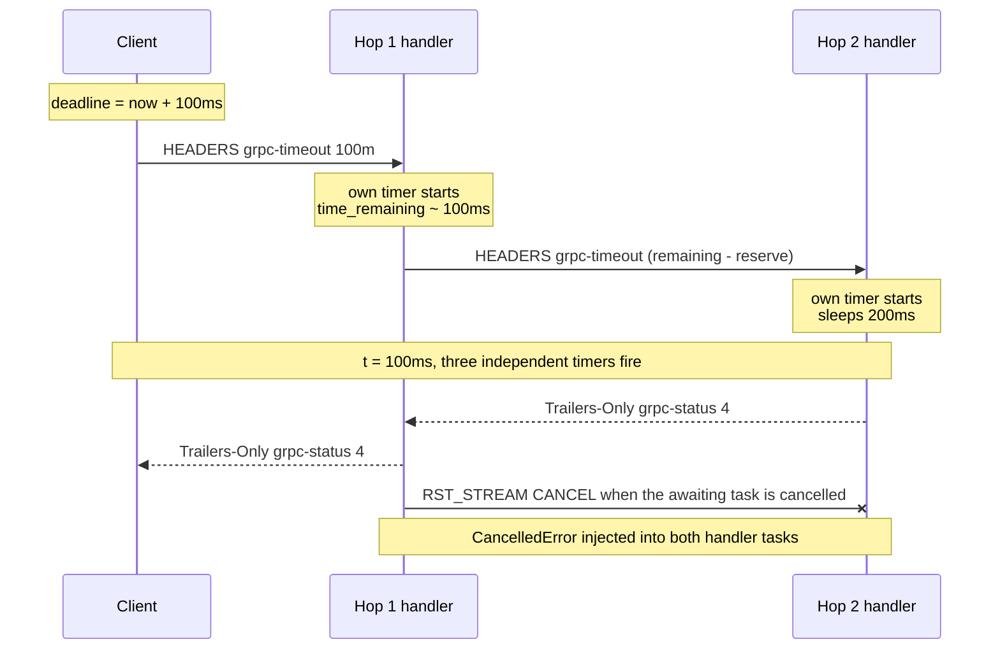

# Deadlines and Cancellation Propagation in gRPC: The grpc-timeout Wire Header and Automatic Downstream RPC Abortion

> [!summary] Claim
> A gRPC deadline travels as a relative `grpc-timeout` header that each hop must re-derive from its own remaining budget, and what stops downstream work is not the deadline but cancellation: an HTTP/2 `RST_STREAM` with error code `CANCEL` that cascades hop by hop only while every handler stays inside the cancelled task.

Part of [gRPC and Protocol Buffers](README.md) in [API Engineering](../README.md).

## TL;DR

- Mechanism: the client turns its absolute deadline into a remaining duration at send time and writes it as `grpc-timeout: <1-8 digits><H|M|S|m|u|n>`; every peer starts its own timer from that value, so no clock is ever compared across machines.
- Contract rule: a handler that makes downstream calls must pass `context.time_remaining()` minus a reserve as the downstream `timeout`; `grpc.aio` creates every outgoing call with a NULL parent and an empty propagation mask, so nothing is inherited.
- Trap: cancellation reaches downstream only through the awaiting task; a `shield`ed or detached task, an executor thread, or a swallowed `CancelledError` keeps the downstream RPC running after the client has gone, and a downstream `DEADLINE_EXCEEDED` that escapes a handler as an exception reaches the client as `UNKNOWN`.
- Portability: the wire grammar is in the protocol spec and is identical across implementations; automatic propagation is not (Java and Go on by default, C++ opt-in, Python `grpc.aio` manual, per the gRPC guide); everything measured here ran on `grpcio 1.85.1`, CPython 3.14.6, macOS arm64 only.
- When not to use: do not propagate a deadline into work that must finish regardless of the caller (checkpointed catch-up, audit writes, billing commits); detach it deliberately with its own budget and say so.

## Mental model



The client never sends "the deadline"; it sends how long the server has, measured at the instant of sending, and each hop converts that back into a local timer.
Three independent timers (client, hop 1, hop 2) therefore race to the same wall-clock moment, give or take network transit, and whichever fires first produces `DEADLINE_EXCEEDED`.
The `RST_STREAM` arrow is the second mechanism: it is sent when a hop's own call object is cancelled, either by its own timer or because the task awaiting it was cancelled, and it makes the next hop's handler task receive `CancelledError` even when no timeout header was ever propagated.
The deadline bounds how long work may start or continue; cancellation is what reclaims the resources, and the two are separate paths with different failure modes.

## How it works

### Deadline versus timeout

A deadline is a point in time and a timeout is a duration; the gRPC guide states that a timeout converts to a deadline by adding it to the current time when the call starts, and that gRPC puts a duration on the wire precisely because two servers' clocks may not agree (grpc.io guides, Deadlines, "Deadline Propagation").
In `grpc.aio` the conversion happens when the call object is built: `_timeout_to_deadline` returns `time.time() + timeout`, or `None` for no timeout (grpcio 1.85.1 `grpc/aio/_utils.py`, `_timeout_to_deadline`; used by `grpc/aio/_channel.py`, `UnaryUnaryMultiCallable.__call__`).
Two consequences follow.
The clock starts at call construction, so channel connection time, name resolution, and `wait_for_ready` queueing are all charged against the deadline, and the value that finally goes on the wire is smaller than the requested timeout (the lab's `test_sub_second_timeout_loses_connection_setup_time` asserts a 0.5 s request is sent as between 0.3 s and 0.51 s).
And by default there is no deadline at all: the spec says "If Timeout is omitted a server should assume an infinite timeout" and that clients are free to send a default minimum timeout (PROTOCOL-HTTP2.md, Requests, grpc v1.85.1).

### The wire header

The request grammar is `Timeout -> "grpc-timeout" TimeoutValue TimeoutUnit`, where `TimeoutValue` is a positive integer of at most 8 ASCII digits and the unit is one of `H`, `M`, `S` (hour, minute, second), `m`, `u`, `n` (milli-, micro-, nanosecond) (PROTOCOL-HTTP2.md, Requests, grpc v1.85.1).
The spec says HTTP/2 requires reserved (colon-prefixed) headers first and that implementations "should send Timeout immediately after the reserved headers", ahead of the other Call-Definition headers and custom metadata.
That is a "should", and `grpcio 1.85.1` does not follow it: the captured request below carries `grpc-timeout` after `content-type`, `te`, and `grpc-accept-encoding`.
The spec's own example request carries `grpc-timeout = 1S` next to `content-type = application/grpc+proto` and `grpc-encoding = gzip`.
The header belongs to the request only; it never appears in the response, and the grpc-core metadata trait sets `kPublishToApp = false` for it, so a handler does not see `grpc-timeout` in `context.invocation_metadata()` and must use `time_remaining()` instead (grpc-core 1.85.1 `src/core/call/metadata_batch.h`, `GrpcTimeoutMetadata`; an exploratory probe against `grpcio 1.85.1` listed only `user-agent` and the custom `x-a` key for a call made with `timeout=5`, reproduced by the verifier).

The HEADERS content in the order `h2` decoded it from the lab's fake HTTP/2 peer (`WireProbe.capture_client_headers`) for a 3600 s request, one exploratory run by the verifier (grpcio 1.85.1, CPython 3.14.6, macOS 27.3 arm64; the port number is replaced by `<port>`):

```text
:path = /lab.Chain/X
:authority = 127.0.0.1:<port>
:method = POST
:scheme = http
content-type = application/grpc
te = trailers
grpc-accept-encoding = identity, deflate, gzip
grpc-timeout = 1H
user-agent = grpc-python-asyncio/1.85.1 grpc-c/58.0.0 (osx; chttp2)
```

(The lab's test asserts the shape `[0-9]{1,8}[HMSmun]`, the unit set, and bounds, because the exact string depends on millisecond jitter, as shown next.)

### How the C core encodes the value

`Timeout::FromMillis` in `src/core/lib/transport/timeout_encoding.cc` (grpc-core 1.85.1) picks the representation, and the lab ports it as `encode_timeout_ms`:

| Remaining (ms) | Rule in `FromMillis` and its helpers | Wire value |
|---|---|---|
| `<= 0` | fixed | `1n` |
| `1..999` | milliseconds, exact | `100m` |
| `1000..9999` | `ceil(ms/10)` in units of ten ms unless that is a whole second count | `1234 -> 1240m`, `1000 -> 1S` |
| `10000..99999` | `ceil(ms/100)` in hundreds of ms unless that is a whole second count | `12345 -> 12400m`, `10000 -> 10S`, `60000 -> 1M` |
| larger, or any whole second count above | `FromSeconds(ceil(ms/1000))`, then the same cascade through ten-second and hundred-second units, minutes, hours | `100000 -> 100S`, `3600000 -> 1H` |
| beyond 27000 hours | clamped by `kMaxHours = 27000` | `27000H` |

Every step rounds up, so the encoded duration is never shorter than the remaining time (the lab's property test `test_encode_never_shortens_and_fits_the_spec_grammar` checks `decoded >= requested` and `decoded <= 1.10 * requested + 1 ms` over 400 derandomized examples).
The source states no design rationale; the effect is that the value never exceeds five digits (`Timeout::Encode` writes a `uint16_t` value into at most five digits plus padding zeros and a unit) and that nearby remaining times often encode to identical bytes, which the HPACK layer then exploits.
Core goes one step further in the HPACK layer: `TimeoutCompressorImpl::EncodeWith` in `src/core/ext/transport/chttp2/transport/hpack_encoder.cc` remembers the last `kNumPreviousValues = 5` encoded timeouts (the constant is declared in `hpack_encoder.h`) and, when the new timeout is shorter than a remembered one but within 3 percent of it (`ratio > -3 && ratio <= 0`), emits an HPACK indexed reference to the older, longer value instead of a new literal.
So the value on the wire can be up to 3 percent longer than the remaining time, in addition to the rounding, and it is never shorter; the receiver's timer is therefore a conservative upper bound on the sender's.
The exact string is a function of millisecond jitter: in exploratory runs a 1.234 s request went out as `1240m`, 30 s as `30S`, 3600 s as `1H`, and 7200 s as `2H`, but a remaining time of 7200.001 s would encode as `7210S` by the same table, which is why the shipped wire test asserts bounds rather than strings.

### How the receiver parses it

`ParseTimeout` (same file) skips leading spaces, reads digits, skips spaces, reads one unit character, and requires only spaces after it.
It rounds `n` and `u` up to whole milliseconds, so `5n` becomes 1 ms and `0n` stays 0.
Its digit loop returns `Duration::Infinity()` when the accumulator has already reached 100,000,000 and another digit follows, unless the result is exactly `1000000000`; the comment in source says "spec allows max. 8 digits, but we allow values up to 1,000,000,000".
The limit is on the number, not the unit, so `1000000000H` is accepted too.
The lab confirms the tolerance end to end: a raw `123456789S` (nine digits, outside the spec) is accepted and yields a `time_remaining()` above 1.2e8 s (`test_nine_digit_header_is_accepted_as_a_very_long_deadline`).
An exploratory raw-client run by the verifier on the same machine confirmed the overflow edge on the wire: `1000000000S` gave `time_remaining()` of about 1e9 s, `1000000000H` about 3.6e12 s, and `1000000001S` and `10000000000S` gave `None` (infinite); every one of those calls completed normally.
`GrpcTimeoutMetadata::ParseMemento` (`src/core/call/metadata_batch.cc`) returns `Duration::Infinity()` after calling `on_error("invalid value", value)` for a malformed value, and `MementoToValue` maps a finite timeout to `Timestamp::Now() + timeout`.
What a malformed value does to the call is observable behavior, not just that source: the lab sends `grpc-timeout: 5x` with a raw HTTP/2 client and `grpcio 1.85.1` answers `grpc-status: 13` (`INTERNAL`) with `grpc-message: Error parsing 'grpc-timeout' metadata` and never invokes the handler (`test_malformed_header_fails_the_call_with_internal_in_1_85_1`).
A stray character is therefore a hard failure, not a silent "no deadline", and the pinned test name carries the version because other implementations may differ.

### Server side: the receiver's own timer

The server enforces the header without any help from the client.
The lab's `test_server_enforces_the_header_without_any_client_library` sends a hand-built HTTP/2 request with `grpc-timeout: 50m` to a handler that sleeps one second, and observes: a `:status 200` response carrying `grpc-status: 4` and `grpc-message: Deadline Exceeded` in a single HEADERS frame (the Trailers-Only form of the response grammar, PROTOCOL-HTTP2.md, Responses), the handler receiving `CancelledError`, and the whole exchange completing well under 0.5 s (five exploratory runs by the verifier measured 0.053 s to 0.057 s; an `h2` event trace confirmed one `ResponseReceived` carrying `grpc-status` with `END_STREAM` and no DATA frame).
In grpc-core the deadline timer is `Call::UpdateDeadline`, which cancels immediately with `absl::DeadlineExceededError("Deadline Exceeded")` if the deadline is already past and otherwise schedules `event_engine->RunAfter(...)`; the expiry callback `Call::Run` calls `CancelWithError(absl::DeadlineExceededError("Deadline Exceeded"))` (grpc-core 1.85.1 `src/core/lib/surface/call.cc`).
Note the status: the gRPC guide says a server cancels the call "(`CANCELLED` status) once a deadline set by the client has passed" (Deadlines, "Deadlines on the Server"), but the status code table in `doc/statuscodes.md` lists "Deadline expires before server returns status -> `DEADLINE_EXCEEDED`, generated at both client and server", and that is what the wire shows in 1.85.1.
Treat the guide's `CANCELLED` wording as imprecise for this version.

In `grpc.aio` the handler runs as an asyncio task and a separate coroutine watches the transport.
`_schedule_rpc_coro` creates the handler task (named `HandleExceptions[<method>]`) and then awaits `_handle_cancellation_from_core`, which executes a `ReceiveCloseOnServerOperation` batch; when that completes with `op.cancelled()` true, the task is not done, and `rpc_state.status_sent` is false, it calls `rpc_task.cancel()`, with the source comment "Injects `CancelledError` to halt the RPC coroutine" (grpcio 1.85.1 `grpc/_cython/_cygrpc/aio/server.pyx.pxi`, `_handle_cancellation_from_core`, `_schedule_rpc_coro`).
`_handle_exceptions` catches `asyncio.CancelledError` and logs `RPC cancelled for servicer method [...]` at debug level.
So a cancelled or expired RPC is, from the handler's point of view, an ordinary asyncio cancellation delivered at the handler's current `await`.
`ServicerContext.time_remaining()` returns `None` when the core deadline is infinite and otherwise `max(deadline - time.time(), 0)` (same file, `_ServicerContext.time_remaining`).
Because the deadline comes from core while `time_remaining()` subtracts Python's `time.time()`, the two clocks are not the same source, and `test_a_call_that_fits_the_budget_completes` allows 50 ms of skew above the requested 5 s as a guard.
The drafter reported one overshoot above 5 s; the verifier could not reproduce it: 40 samples (20 chain runs, both hops, 5 s budget) never exceeded 5 s, with a maximum of 4.9993 s.

### Propagation is explicit in Python

Core has the primitive: `Call::InitParent` takes a parent server call and, when the propagation mask has `GRPC_PROPAGATE_DEADLINE`, sets the child's `send_deadline_` to `std::min(send_deadline_, parent->send_deadline_)` (grpc-core 1.85.1 `src/core/lib/surface/call.cc`).
`grpc.aio` does not use it: `_AioCall._create_grpc_call` calls `grpc_channel_create_call` (or the registered-call variant) with parent `NULL` and `_EMPTY_MASK` (grpcio 1.85.1 `grpc/_cython/_cygrpc/aio/call.pyx.pxi`, `_AioCall._create_grpc_call`).
The gRPC guide records the per-language outcome: automatic propagation "is supported by some gRPC implementations", enabled by default in Java and Go and explicitly in C++ (Deadlines, "Deadline Propagation"); the guide's cancellation page lists automatic cancellation of outgoing RPCs for Java, Go, and C++ and leaves the Python row empty (Cancellation, "Language Support").
The lab's `Propagation.CANCEL_ONLY` mode is the evidence for Python: hop 2 sees `time_remaining() is None`, so no deadline was inherited (`test_without_propagation_hop2_has_no_deadline_but_is_still_cancelled`).

The rule a `grpc.aio` handler applies by hand is the one in the Google SRE book, which says each hop in a request tree should keep the same absolute deadline, so a 30-second deadline with 7 seconds spent before the call to B yields a 23-second deadline for A to B (Addressing Cascading Failures, "Deadline propagation").
Simplified excerpt of `outgoing_timeout` from `grpc_deadlines.py` (docstring removed):

```python
def outgoing_timeout(
    remaining: float | None, *, reserve: float = 0.0, default: float | None = None
) -> float | None:
    if remaining is None:
        return default
    budget = remaining - reserve
    if budget <= 0:
        raise DeadlineExhausted(f"remaining={remaining:.4f}s reserve={reserve:.4f}s")
    return budget
```

The three parameters are the design.
`remaining` is `context.time_remaining()`; `None` means the caller set no deadline, and `default` is where you impose your own upper bound (the SRE chapter recommends an upper bound on outgoing deadlines and a small reduction of the outgoing deadline).
`reserve` is time you keep for yourself so the downstream deadline fires first and you can still return a meaningful status; with `reserve=0` the client, hop 1, and hop 2 timers all target nearly the same instant and which error you observe is a race.
An exhausted budget raises rather than calling: do not start an RPC you have already lost.

### The cancellation cascade

When a downstream call is awaited from a handler, cancelling the handler task cancels the call.
`_UnaryResponseMixin.__await__` in `grpc/aio/_call.py` (1.85.1) wraps `yield from self._call_response` in `except asyncio.CancelledError:` and, if the call is not already cancelled, calls `self.cancel()` and re-raises.
`Call.cancel` forwards to the Cython call with the details string `Locally cancelled by application!`; that cancels the core call, and the HTTP/2 transport emits `RST_STREAM`.
The mapping is in the spec: `CANCEL` on a client-sent `RST_STREAM` is "Mapped to call cancellation" and on a server-sent one "Mapped to `CANCELLED`" (PROTOCOL-HTTP2.md, Errors); the frame itself fully terminates the stream and its error code `CANCEL (0x08)` means "the stream is no longer needed" (RFC 9113 Section 6.4 and Section 7).
The lab captures the real frame: it cancels a `grpc.aio` call against a peer that never answers and the peer's `h2` state machine reports a stream reset with error code `0x08` (`test_client_cancel_is_rst_stream_cancel_on_the_wire`).
Hop 2's handler then receives `CancelledError` through the same `_handle_cancellation_from_core` path described above.

Put together, an expired or cancelled client RPC aborts the chain like this: the client's call object ends (timer or `cancel()`), hop 1's `ReceiveCloseOnServer` completes as cancelled and `rpc_task.cancel()` raises `CancelledError` at hop 1's `await stub(...)`, the `__await__` handler cancels the downstream call, and `RST_STREAM(CANCEL)` makes hop 2's task cancel in turn.
The lab proves each link: with `Propagation.DEADLINE`, a 100 ms client deadline against a 200 ms hop 2 gives `DEADLINE_EXCEEDED` at the client, hop 2 outcome `cancelled`, and hop 1 outcome `cancelled` or `downstream-error` (whichever timer won the race); with `CANCEL_ONLY` hop 2 has no deadline and is still cancelled; and an explicit `call.cancel()` with no deadline anywhere yields `CANCELLED` at the client and `cancelled` at both hops.
The guide's own sequence diagram for the deadline case shows the same ordering: the client stops waiting with `DEADLINE_EXCEEDED`, then cancels flow server by server.

### What stops the cascade

Cancellation is cooperative.
The cancellation guide states that "The gRPC library in general does not have a mechanism to interrupt the application-provided server handler", so a handler has to stop its own work.
In asyncio that means the handler must remain a single awaiting chain.
`Propagation.DETACHED` shows the break: hop 1 runs `asyncio.ensure_future(downstream_call)` and awaits `asyncio.shield(task)`; the client still gets `DEADLINE_EXCEEDED` and hop 1 is cancelled, but the shield absorbs the cancellation, the downstream call is never cancelled (so no `RST_STREAM` is sent for it; the lab infers this from hop 2's outcome rather than capturing frames), and hop 2 runs to `completed` after the caller has gone (`test_detached_downstream_task_survives_and_wastes_the_work`).
The same shape appears as fire-and-forget `asyncio.create_task`, work handed to `loop.run_in_executor`, a `try/except` that swallows `CancelledError` and continues, and any blocking synchronous call that never yields to the loop; in each case the RPC is formally dead while its work continues.
For the SRE book's cases where finishing is correct (a catch-up operation that checkpoints), check the deadline only after each checkpoint rather than abandoning mid-write.

### Status codes along the chain

The client sees `DEADLINE_EXCEEDED` (code 4) whether its own timer, hop 1's trailers, or hop 2's trailers arrives first.
The `statuscodes.md` table lists both "Client Application cancelled the request -> `CANCELLED`" and "Deadline expires before server returns status -> `DEADLINE_EXCEEDED`", generated at either side.
The documentation for `DEADLINE_EXCEEDED` adds that "for operations that change the state of the system, this error may be returned even if the operation has completed successfully", so a timed-out write is an unknown outcome, not a failure; this is the argument for idempotency keys in the [[gRPC-Status-Codes-and-Google-RPC-Status-Rich-Error-Payloads]] note.
The trap is what hop 1 does with the downstream error.
Letting the `AioRpcError` escape the handler reaches the client as `UNKNOWN` with details `Unexpected <class 'grpc.aio._call.AioRpcError'>: ...`, matching the table row "Server side application throws an exception ... -> `UNKNOWN`" (`test_downstream_error_escaping_the_handler_becomes_unknown`).
Catching it and calling `await context.abort(error.code(), ...)` preserves `DEADLINE_EXCEEDED` (`test_mapping_the_downstream_status_preserves_deadline_exceeded`).
Both tests use `reserve=0.03` so that hop 2's shorter deadline fires first and hop 1 genuinely observes a downstream error instead of its own cancellation.

### Deadlines above one attempt and below one message

The deadline belongs to the call, not to an attempt or a message.
The retry design (gRFC A6, "gRPC Retry Design") states that "gRPC's call deadline applies across all attempts for a given RPC", and for hedging that "gRPC call deadlines apply to the entire chain of hedged requests" (A6-client-retries.md, grpc/proposal master; `doc/service_config.md` does not say this).
A method-level `timeout` in `methodConfig` is a default: "The actual deadline used will be the minimum of the value specified here and the value set by the application", with either one standing alone if the other is unset (`service_config.proto`, `MethodConfig.timeout`).
The mechanics of retries and interceptors that rewrite timeouts are in [[gRPC-Interceptors-in-AsyncIO-Auth-Logging-Metrics-and-Retries]]; the streaming modes, where one deadline spans the whole stream, are in [[The-Four-gRPC-Communication-Modes-Unary-Server-Client-and-Bidi-Streaming]]; the frame layout of the response is in [[gRPC-Over-HTTP-2-Framing-Length-Prefixed-Messages-and-Trailers]].

## Numbers and limits

| Quantity | Value | Source or measurement |
|---|---|---|
| Digits in `TimeoutValue` | at most 8 ASCII digits | PROTOCOL-HTTP2.md, Requests (grpc v1.85.1) |
| Units | `H`, `M`, `S`, `m`, `u`, `n` | same |
| Default when header omitted | infinite | same; lab `test_absent_header_means_no_deadline` (`time_remaining()` is `None`) |
| Digits accepted by core parser | any value up to `1000000000` in any unit (so more than the spec's 8 digits); a larger value gives infinite | `ParseTimeout`, `timeout_encoding.cc` 1.85.1; lab pins 9 digits on the wire and the overflow against the Python port; verifier's exploratory wire run: `1000000000S` finite, `1000000001S` infinite |
| Largest encodable value | `27000H` (`kMaxHours`) | `timeout_encoding.cc` 1.85.1; lab `test_encode_timeout_matches_core_vectors` |
| Encoder rounding | up, to 10 ms below 10 s, 100 ms below 100 s, then whole seconds and coarser | `Timeout::FromMillis` and helpers; lab vectors `1234 -> 1240m`, `12345 -> 12400m`, `3600000 -> 1H` |
| HPACK reuse window | 5 remembered values, reuse within 3 percent shorter | `hpack_encoder.cc` 1.85.1, `TimeoutCompressorImpl::EncodeWith`; `kNumPreviousValues` in `hpack_encoder.h` |
| Expired-at-send header | `0m` and `1n` from a raw client each gave an immediate Trailers-Only `grpc-status 4` (0.001 s and 0.004 s) without invoking the handler | verifier's exploratory run, grpcio 1.85.1, macOS 27.3 arm64, CPython 3.14.6 |
| Server-side expiry latency, 50 ms deadline | 0.053 s to 0.057 s to the Trailers-Only reply (five runs); test asserts under 0.5 s | verifier's exploratory runs, same machine |
| `time_remaining()` at entry, 5 s budget | at most 4.9993 s over 40 samples; test allows up to 5.05 s | verifier's exploratory runs of `ChainLab`, same machine |
| Sub-second send loss | 0.5 s request sent as 0.3 s to 0.51 s | `test_sub_second_timeout_loses_connection_setup_time` |
| Suggested header size cap | 8 KiB default for `Request-Headers` | PROTOCOL-HTTP2.md (relevant because a deadline rides in headers) |
| Example propagation arithmetic | 30 s - 7 s = 23 s, then 19 s | SRE book, Addressing Cascading Failures |

Volatile facts are dated `(as of 2026-11)`: `grpcio 1.85.1` and `protobuf 7.36.2` per the folder README, with the behavior above verified against the `v1.85.1` tag and the installed wheel.
Wall-clock numbers marked "exploratory" come from scratch scripts that are not kept in the lab; the shipped tests assert loose bounds only.

## Portability

| Axis | Status |
|---|---|
| CPython 3.14.6 (workspace `.venv`), macOS 27.3 arm64, `grpcio 1.85.1` | all 56 lab tests passed in the independent verification run (2026-11-21); the drafter reports earlier timing flakes fixed by loosening bounds; this is the only interpreter exercised |
| CPython 3.12, 3.13, 3.15, 3.15t | not run: the user paused lab matrix checks on 2026-11-11; no claim is made |
| Debian and Alpine containers | not run, same reason |
| Wire grammar across gRPC implementations | specified by PROTOCOL-HTTP2.md, not implementation-specific |
| Automatic deadline propagation | Java and Go default on, C++ opt-in, per the gRPC Deadlines guide; Python `grpc.aio` manual, shown by the lab and the `call.pyx.pxi` `NULL` parent |
| Automatic cancellation of outgoing RPCs | Java, Go, C++ per the Cancellation guide; `grpc.aio` achieves it through `asyncio` cancellation of the awaiting task, shown by the lab |
| Server status on expiry | `DEADLINE_EXCEEDED` on `grpcio 1.85.1` (wire capture); the Deadlines guide says `CANCELLED`, treat the guide as imprecise |
| Malformed `grpc-timeout` | `INTERNAL` on `grpcio 1.85.1` (wire capture); other implementations not tested |
| Uvicorn, Hypercorn, Granian | not applicable: `grpc.aio` serves through grpc-core, not an ASGI server |
| HTTP/2 | the only transport the spec defines (PROTOCOL-HTTP2.md); `RST_STREAM CANCEL` per RFC 9113 Section 7 |
| HTTP/1.1, HTTP/3 | not applicable: PROTOCOL-HTTP2.md defines the mapping for HTTP/2 only; no claim for other versions |

## Worked example

Implementation: [implementation](../labs/src/api_labs/f19_grpc_and_protocol_buffers/grpc_deadlines.py).
Test: [test](../labs/tests/f19_grpc_and_protocol_buffers/test_grpc_deadlines_timeout_header_and_context_cancellation_cascade.py).

The chain is a client calling `/lab.Chain/Hop1`, whose handler calls `/lab.Chain/Hop2`, which sleeps 200 ms.
Both servers are real `grpc.aio` servers on `127.0.0.1:0`; the handlers record what they saw in a `HopRecord`.
Simplified excerpt of the two handlers and the propagation switch from `grpc_deadlines.py` (the `MAPPED_ERROR` branch is shown in the full file):

```python
async def _hop2(self, request: bytes, context: grpc.aio.ServicerContext) -> bytes:
    self.hop2.enter(context.time_remaining())
    try:
        await asyncio.sleep(self.stall)
    except asyncio.CancelledError:
        self.hop2.settle("cancelled")
        raise
    self.hop2.settle("completed")
    return b"hop2-done"

async def _call_downstream(self, request: bytes, context: grpc.aio.ServicerContext) -> bytes:
    mode = self.propagation
    if mode is Propagation.CANCEL_ONLY:
        return bytes(await self._downstream(request))
    if mode is Propagation.DETACHED:
        task = asyncio.ensure_future(self._downstream(request))
        self.detached.append(task)
        return bytes(await asyncio.shield(task))
    timeout = outgoing_timeout(context.time_remaining(), reserve=self.reserve)
    return bytes(await self._downstream(request, timeout=timeout))
```

The headline test, simplified excerpt from the test module (the trailing `remaining_at_entry` bound checks are omitted):

```python
@pytest.mark.socket
@pytest.mark.asyncio
async def test_deadline_propagates_and_both_hops_abort() -> None:
    async with ChainLab(Propagation.DEADLINE, stall=0.2) as lab:
        error = await fail_with(lab, 0.1)
        assert error.code() == grpc.StatusCode.DEADLINE_EXCEEDED
        assert await settled(lab.hop2) == "cancelled"
        assert await settled(lab.hop1) in {"cancelled", "downstream-error"}
```

Captured output, from `labs/`, CPython 3.14.6 and `grpcio 1.85.1` on macOS 27.3 (Darwin 27.3.0 arm64), pytest 9.2.0, verification run on 2026-11-21:

```text
$ uv run --frozen pytest tests/f19_grpc_and_protocol_buffers/test_grpc_deadlines_timeout_header_and_context_cancellation_cascade.py -q
........................................................                 [100%]
56 passed in 4.94s
```

Per-test lines for the network tests, from a verbose run of the `socket`-marked tests on the same machine (`-v -m socket`, the file path prefix and progress percentages stripped; that run printed `16 passed, 40 deselected in 3.84s`):

```text
test_client_sends_remaining_time_in_a_coarse_unit[30.0-Sm] PASSED
test_client_sends_remaining_time_in_a_coarse_unit[3600.0-HS] PASSED
test_client_sends_remaining_time_in_a_coarse_unit[7200.0-HS] PASSED
test_sub_second_timeout_loses_connection_setup_time PASSED
test_client_cancel_is_rst_stream_cancel_on_the_wire PASSED
test_server_enforces_the_header_without_any_client_library PASSED
test_absent_header_means_no_deadline PASSED
test_malformed_header_fails_the_call_with_internal_in_1_85_1 PASSED
test_nine_digit_header_is_accepted_as_a_very_long_deadline PASSED
test_deadline_propagates_and_both_hops_abort PASSED
test_without_propagation_hop2_has_no_deadline_but_is_still_cancelled PASSED
test_detached_downstream_task_survives_and_wastes_the_work PASSED
test_client_cancel_cascades_through_both_hops PASSED
test_a_call_that_fits_the_budget_completes PASSED
test_downstream_error_escaping_the_handler_becomes_unknown PASSED
test_mapping_the_downstream_status_preserves_deadline_exceeded PASSED
```

Mutation testing of the tests was not run (paused by the user's instruction), so "discriminating" here means designed against a control, not mutation-proven: each cascade test has a sibling that must behave differently (`DETACHED` versus `CANCEL_ONLY`, a 5 s budget versus 100 ms, `RAW_ERROR` versus `MAPPED_ERROR`).

## Pitfalls

> [!warning] A shielded or detached downstream call survives the caller
> Trigger: a handler wraps the downstream RPC in `asyncio.shield`, `create_task`, or `run_in_executor` so that it "finishes the job anyway".
> Symptom: the client gets `DEADLINE_EXCEEDED`, hop 1 is cancelled, and hop 2 still burns its full 200 ms (`completed`), with no `RST_STREAM`; under load this is the SRE book's "servers spend resources handling requests that will exceed their deadlines" (Addressing Cascading Failures, "Missing deadlines").
> Fix: keep the downstream `await` in the handler's own task, or give detached work an explicit, bounded timeout of its own and a log line saying it is intentional.

> [!warning] A downstream `DEADLINE_EXCEEDED` becomes `UNKNOWN`
> Trigger: forwarding the deadline with `reserve > 0` and letting `AioRpcError` propagate out of the handler.
> Symptom: the client sees `StatusCode.UNKNOWN` with `Unexpected <class 'grpc.aio._call.AioRpcError'>` in the details, and your timeout alerting, keyed on code 4, never fires.
> Fix: catch `grpc.aio.AioRpcError`, decide a mapping, and `await context.abort(code, details)`; the same applies to `DeadlineExhausted` from `outgoing_timeout`.

> [!warning] No propagation means a fresh clock per hop
> Trigger: `await stub(request)` with no `timeout`, or a hard-coded one, inside a handler.
> Symptom: hop 2 sees `time_remaining() is None` or a stale 20 s when the caller has 2 s left, which is the exact scenario the SRE book describes: "server C processes the request thinking it has 15 seconds to spare, but is not doing useful work".
> Fix: always derive the downstream timeout with `outgoing_timeout`; cancellation will still clean up after expiry, but only after the caller has already given up.

> [!warning] The deadline starts before the connection exists
> Trigger: a short deadline on a cold channel, or `wait_for_ready=True`.
> Symptom: the call fails with `DEADLINE_EXCEEDED` having never reached the server; the sent `grpc-timeout` is visibly smaller than the configured timeout (the lab measures a 0.5 s request leaving as 0.3 s to 0.51 s).
> Fix: budget for connection establishment or warm the channel; do not treat `DEADLINE_EXCEEDED` as proof that the server did the work.

> [!warning] `DEADLINE_EXCEEDED` on a write is an unknown outcome
> Trigger: retrying a non-idempotent call after a deadline expiry.
> Symptom: the status documentation warns the operation "may be returned even if the operation has completed successfully", so a retry can double-apply.
> Fix: idempotency keys; the spec also notes that "Unless explicitly defined to be, gRPC Calls are not assumed to be idempotent" (PROTOCOL-HTTP2.md, Idempotency and Retries).

> [!warning] Blocking the event loop postpones cancellation
> Trigger: synchronous CPU or I/O in an `async def` handler.
> Symptom: `CancelledError` is injected only at the next `await`, so the handler keeps running past the deadline and every other RPC on the loop stalls with it; the lab does not demonstrate this because client and server share one loop there.
> Fix: offload to a bounded executor and check `context.time_remaining()` between steps; the cancellation guide says a long-lived handler "must periodically check if the RPC it is servicing has been cancelled".

> [!warning] Deadlines far above typical latency amplify outages
> Trigger: 100 s deadlines on a service whose mean latency is 100 ms.
> Symptom: the SRE book's worked case: 5 percent of requests hit the deadline at 50 QPS and would hold 5,000 threads (50 QPS x 100 s), exhausting the frontend.
> Fix: deadlines "several orders of magnitude longer than the mean request latency is usually bad"; pick from measured latency and cap outgoing deadlines.

## Security and robustness

- Treat `grpc-timeout` as attacker-controlled input at any internet-facing server: the core parser accepts a value up to `1000000000` in any unit (`1000000000H` gave a `time_remaining()` of about 3.6e12 s in the verifier's exploratory run), an overflowing value becomes infinite, and a missing header means infinite, so a client can ask for an effectively unbounded hold on a server task; enforce a server-side maximum with your own check against `context.time_remaining()` and reject or clamp (the spec lets clients choose, and nothing in it forces servers to honor the value).
- A tiny deadline is the opposite abuse: `grpc-timeout: 0m` made the 1.85.1 server answer `DEADLINE_EXCEEDED` immediately, which is cheap, but a flood of such requests still costs a stream each; the guide warns an "unrealistically short deadline" wastes resources "and in the worst case scenario, crash the server".
- Malformed values are a robust failure (`INTERNAL`, handler never run), which is the safe direction; do not add middleware that re-parses and silently defaults them.
- The OWASP API Security Top 10 2023 category is API4:2023 Unrestricted Resource Consumption (owasp.org/API-Security/editions/2023/en/0xa4-unrestricted-resource-consumption), which lists missing or badly set "Execution timeouts" as a vulnerability; deadlines and server-side maximums are the control.
- Defense in depth: a client deadline on every call, a server clamp, a concurrency limit, and a load-shedding rule that rejects requests whose `time_remaining()` is below the minimum useful service time (the SRE book's advice to check the deadline at each stage).
- Cancellation must stay idempotent and safe: a handler can be cancelled between any two awaits, so use `try/finally` for resource release and do not leave a transaction half-applied; commit and compensation logic belongs after, not inside, the cancellable region, or in a shielded section you have bounded.
- Do not put secrets in `grpc-timeout` surrogates or reflect it into logs unvalidated; it is an ASCII value, but log it as data.

## The principal's view

The decision is whether deadline propagation is a library default or a per-handler habit.
In Go and Java the context object carries the deadline, so it is free and tends to be right; in Python `grpc.aio` it is a convention you must enforce, so enforce it in one place: a thin client wrapper (or a client interceptor, see [[gRPC-Interceptors-in-AsyncIO-Auth-Logging-Metrics-and-Retries]]) that reads the current handler's remaining time and refuses to issue an RPC without a timeout.
That wrapper is a design recommendation, not something the lab tests.
Organizationally, set deadlines top-down from the user-visible budget and publish a per-service ceiling; a deadline is a contract between callers and callees, and retries (see [[gRPC-Keepalive-Flow-Control-and-Max-Message-Size-Tuning]] for the transport timers that are not deadlines) must spend from the same budget, because the service config applies one deadline across all attempts.
The trade-off is false timeouts: propagating tightly means a slow hop 1 starves hop 2 and the user sees more `DEADLINE_EXCEEDED` instead of a slow success, which the SRE book calls an art.
Choose different machinery when the work should outlive the caller: for long-running operations return an operation handle and poll, rather than a long unary call whose deadline you then have to defeat.
For HTTP/JSON gateways in front of gRPC, remember the gateway must translate its own request timeout into `grpc-timeout` ([[HTTP-JSON-to-gRPC-Transcoding-and-Google-API-HTTP-Annotations-AIP-127]]), and when a load balancer or proxy sits in between, check that it forwards the header rather than substituting its own ([[gRPC-Load-Balancing-Subchannels-Pick-First-vs-Round-Robin-and-xDS]]); this note verified none of the proxy behavior.

## Interview questions

> [!question] L5: What is on the wire when a client sets a 2 second timeout, and what does the server do with it?
>
> > [!success]- Answer
> > The client sends a `grpc-timeout` request header such as `2S`, a relative duration, not a timestamp.
> > The server starts its own timer from the moment it receives it and cancels the call with `DEADLINE_EXCEEDED` when it fires.
> > No clock is compared across machines.
> > If the header is absent, the server assumes no deadline.
> >
> > Follow-up: why is the header a duration instead of an absolute time?

> [!question] L5: When the client times out after 100 ms, does the work on the server stop?
>
> > [!success]- Answer
> > The server's own timer, or an `RST_STREAM` with `CANCEL`, cancels the call, and in `grpc.aio` that injects `asyncio.CancelledError` into the handler at its current `await`.
> > The work stops only if the handler is awaiting cancellable operations; blocking code, executors, and detached tasks keep running.
> > The gRPC library does not interrupt application code on its own.
> >
> > Follow-up: how would you check from inside a long loop whether to stop?

> [!question] L6: Predict the output: hop 1 calls `await stub(req)` with no `timeout`, the client called hop 1 with `timeout=0.1`, and hop 2 sleeps 0.2 s recording `context.time_remaining()` and whether it was cancelled - what does the client see and what did hop 2 record?
>
> > [!success]- Answer
> > The client sees `StatusCode.DEADLINE_EXCEEDED` at about 100 ms.
> > Hop 2 recorded `time_remaining()` of `None` because nothing was propagated, yet it is cancelled anyway: hop 1's task is cancelled, the awaiting call is cancelled in `_UnaryResponseMixin.__await__`, and `RST_STREAM(CANCEL)` reaches hop 2.
> > This is the lab test `test_without_propagation_hop2_has_no_deadline_but_is_still_cancelled`.
> >
> > Follow-up: what single change makes hop 2 survive the cancellation?

> [!question] L6: Debug this API: a handler does `try: return await stub(req, timeout=ctx.time_remaining() - 0.03)` then `except grpc.aio.AioRpcError: raise`, and clients report `UNKNOWN` with `Unexpected <class 'grpc.aio._call.AioRpcError'>` instead of `DEADLINE_EXCEEDED` - what is wrong and how do you fix it?
>
> > [!success]- Answer
> > Re-raising an arbitrary exception from a handler makes the server answer `UNKNOWN`, per the status table row for server-side exceptions.
> > The downstream deadline fired 30 ms before the caller's, so the handler really did receive `DEADLINE_EXCEEDED` from hop 2 and then converted it to `UNKNOWN`.
> > Catch the error and `await context.abort(error.code(), ...)`, or map it deliberately.
> > Also handle `DeadlineExhausted` or the `None` case, since `time_remaining()` can be `None` and `None - 0.03` raises `TypeError`.
> >
> > Follow-up: should an upstream caller ever see a downstream's `DEADLINE_EXCEEDED` verbatim?

> [!question] L6: Why does the lab pass `reserve=0.03` in two tests and `0` in the headline test?
>
> > [!success]- Answer
> > With `reserve=0` the client, hop 1, and hop 2 deadlines coincide, so which component reports the error is a race and the hop 1 outcome can be `cancelled` or `downstream-error`.
> > A reserve makes hop 2's deadline fire first, so hop 1 deterministically observes a downstream `DEADLINE_EXCEEDED` and the error-mapping behavior can be asserted.
> > It is also how a real hop keeps time to produce its own useful status.
> >
> > Follow-up: what reserve would you choose for a hop that does 5 ms of post-processing at p99?

> [!question] L7+: Design deadline policy for a 5-hop call graph with retries and fan-out.
>
> > [!success]- Answer
> > Set one budget at the edge from the user-visible SLO and propagate absolute-equivalent remaining time at every hop with a small reserve and a per-service ceiling.
> > Retries and hedges must draw from the same budget; the service config applies one deadline across all attempts and across a hedged chain.
> > Fan-out calls get the parent's remaining time, not a fresh timeout, and the parent should cancel the slow siblings once it has enough replies.
> > Shed load by rejecting requests whose remaining time is below the minimum service time, and alert on the ratio of deadline-exceeded at each tier.
> > Deadlines orders of magnitude above mean latency cause the thread exhaustion described in the SRE book.
> >
> > Follow-up: where does idempotency enter, given `DEADLINE_EXCEEDED` is an unknown outcome for writes?

> [!question] L7+: Which do you trust when the 1.85.1 server answers a deadline expiry with `DEADLINE_EXCEEDED` but the gRPC guide says `CANCELLED`, and how do you decide?
>
> > [!success]- Answer
> > Trust the wire and the source for the pinned version, then reconcile with the spec tables.
> > The lab captured `grpc-status: 4` from a raw HTTP/2 client, grpc-core's `Call::Run` cancels with `DeadlineExceededError`, and `statuscodes.md` lists `DEADLINE_EXCEEDED` for "Deadline expires before server returns status" at both ends.
> > The guide's wording is prose, not the contract.
> > I would also pin the behavior in a test with the version in its name, as the lab does, so an upgrade that changes it fails loudly.
> >
> > Follow-up: what could the client library do differently from the server here?

> [!question] L7+: Why can a `grpc-timeout` of `1240m` appear on the wire for a 1.234 s deadline, and why does that not violate the deadline?
>
> > [!success]- Answer
> > The core encoder rounds remaining time up to a coarse unit that keeps the value to at most five digits, which also lets nearby values share HPACK bytes: between 1 and 10 seconds it rounds up to 10 ms, so 1234 ms becomes `1240m`.
> > The HPACK layer additionally reuses one of the last five values if the new one is shorter by less than 3 percent.
> > The receiver's timer is therefore slightly long and never short, so the sender's own client-side timer, which uses the exact deadline, is always the first to fire.
> > The cost is up to a few percent of extra server work after the client has left, which cancellation then reclaims.
> >
> > Follow-up: what breaks if an implementation rounded down instead?

## Related

Prerequisites: [[The-Four-gRPC-Communication-Modes-Unary-Server-Client-and-Bidi-Streaming]]

Next: [[gRPC-Status-Codes-and-Google-RPC-Status-Rich-Error-Payloads]]

See also: [[gRPC-and-Protocol-Buffers]], [[02-Programming-Languages/Python/Python-Backend-Interview-Prep/16-Asyncio-Deep-Dive]], [[gRPC-Over-HTTP-2-Framing-Length-Prefixed-Messages-and-Trailers]], [[gRPC-Interceptors-in-AsyncIO-Auth-Logging-Metrics-and-Retries]], [[gRPC-Keepalive-Flow-Control-and-Max-Message-Size-Tuning]], [[gRPC-Load-Balancing-Subchannels-Pick-First-vs-Round-Robin-and-xDS]], [[HTTP-JSON-to-gRPC-Transcoding-and-Google-API-HTTP-Annotations-AIP-127]]

- Lab: `labs/tests/f19_grpc_and_protocol_buffers/test_grpc_deadlines_timeout_header_and_context_cancellation_cascade.py`

## Further reading

- gRPC over HTTP/2 protocol specification (`PROTOCOL-HTTP2.md`, tag v1.85.1): the normative `grpc-timeout` grammar, Trailers-Only responses, and the `RST_STREAM` mapping.
- gRPC guide "Deadlines": the client-side, server-side, and propagation model, including the per-language propagation defaults.
- gRPC guide "Cancellation": why handlers must cooperate, and the per-language automatic cancellation table.
- gRPC status codes document (`doc/statuscodes.md`, v1.85.1): which side generates `CANCELLED` and `DEADLINE_EXCEEDED`.
- `service_config.proto` (grpc-proto): the `MethodConfig.timeout` field's minimum rule.
- gRFC A6 "gRPC Retry Design" (`A6-client-retries.md`, grpc/proposal): one call deadline across all retry attempts and the whole hedged chain.
- grpc-core `src/core/lib/transport/timeout_encoding.cc` and `src/core/ext/transport/chttp2/transport/hpack_encoder.cc` (v1.85.1): the actual encoder, parser, and HPACK reuse heuristic.
- grpcio `grpc/_cython/_cygrpc/aio/server.pyx.pxi` and `call.pyx.pxi` (v1.85.1): how the `grpc.aio` server injects `CancelledError` and why the client passes no parent call.
- RFC 9113 Section 6.4 and Section 7 (HTTP/2): `RST_STREAM` and the `CANCEL` error code.
- Google SRE Book, "Addressing Cascading Failures", sections "Latency and Deadlines" and "Deadline propagation": the operational argument and worked arithmetic.
