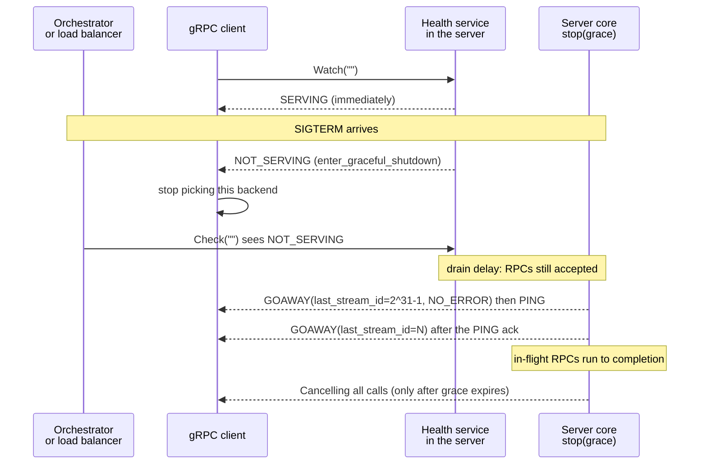

# Operating gRPC in Production: The Standard gRPC Health Checking Protocol (grpc.health.v1.Health), Server Reflection, and server.stop(grace)

> [!summary] Claim
> `grpc.health.v1.Health` only advertises readiness and `server.stop(grace)` only enforces it, so a clean deploy needs both in order: flip every service to `NOT_SERVING`, give observers time to react, then call `stop(grace)` with open `Watch` streams ended and the grace shorter than the orchestrator's kill timer.

Part of [gRPC and Protocol Buffers](README.md) in [API Engineering](../README.md).

## TL;DR

- Mechanism: `Health.Check` (unary) and `Health.Watch` (server stream) report a per-service `ServingStatus`, keyed by full service name with `""` meaning the whole server; `stop(grace)` sends a graceful `GOAWAY`, closes the listener, waits up to `grace` seconds for running handlers, then cancels what is left.
- Contract rule: `Check` of an unregistered name fails with `NOT_FOUND`, but `Watch` of an unregistered name answers `SERVICE_UNKNOWN` and keeps the stream open; a server without the service answers `UNIMPLEMENTED`, which clients must read as "no health checking", not as "unhealthy".
- Trap: `NOT_SERVING` rejects nothing, and an open `Watch` stream is an in-flight RPC that holds `stop(grace)` open for the whole grace period unless you end it (measured in the lab below).
- Portability: the same wire contract everywhere, but the implementations differ: the Python reference servicer has no `List` implementation at 1.85.1 while grpc-go caps `List` at 100 services, Python ships only `v1alpha` reflection, and the sync Python `stop(grace)` returns an event instead of blocking.
- Do not use: gRPC health as the only liveness signal for a process that can wedge below the gRPC layer, and never leave reflection open on a public listener.

## Mental model



Health is a side channel: it tells observers to stop sending new work, and it carries no authority over the server.
The orchestrator and the clients that watch it react to `NOT_SERVING` after a network round trip plus their own polling period, so the server keeps serving during a drain delay.
Only then does `stop(grace)` start: the core stops listening, announces `GOAWAY` on every connection in two steps so that no request that was already in flight is lost, and lets running handlers finish until the grace timer fires.
Whatever is still running when the timer fires is cancelled, and its client sees a status, not a silent drop.
Server reflection is a separate bidirectional stream service that describes the schema, and it matters here because it is the other service every production server is tempted to leave open.

## How it works

### The health protocol

The service definition is `grpc.health.v1.Health` with `Check`, `Watch`, and, in current `grpc-proto`, `List` (grpc-proto master grpc/health/v1/health.proto, `service Health`).
The request carries one string, `service = 1`; the response carries one enum, `status = 1`, with `UNKNOWN = 0`, `SERVING = 1`, `NOT_SERVING = 2`, and `SERVICE_UNKNOWN = 3`, the last "used only by the Watch method" (same file, `HealthCheckResponse.ServingStatus`).
On the wire a `Check` for service `x` is a gRPC message whose 5-byte prefix is the compressed flag and a big-endian length (gRPC over HTTP/2 `PROTOCOL-HTTP2.md`, Length-Prefixed-Message) followed by the protobuf bytes `0a 01 78`, so the HTTP/2 DATA payload is `00 00 00 00 03 0a 01 78`; the `:path` is `/grpc.health.v1.Health/Check` (`PROTOCOL-HTTP2.md`, Path).
A `HealthCheckResponse(status=SERVING)` serializes to `08 01`, and an `UNKNOWN` response serializes to zero bytes because proto3 omits default values; both byte strings are asserted by `test_health_messages_use_the_field_numbers_of_health_proto`.
The framing and trailer details belong to [[gRPC-Over-HTTP-2-Framing-Length-Prefixed-Messages-and-Trailers]]; the numbers above are what the health layer adds.

The behavioral contract is in `doc/health-checking.md` (grpc 1.85.1, identical to master when fetched 2026-11-26):
- The server "should register all the services manually and set the individual status, including an empty service name".
- For a registered name `Check` answers `OK` with `SERVING` or `NOT_SERVING`; for an unregistered name the server "returns a `NOT_FOUND` GRPC status".
- The empty string is the server's overall health, matching is exact, and wildcards are not part of the contract.
- A client "should be able to handle the case where server does not have the Health service".
- `Watch` "will immediately send back a message indicating the current serving status" and then sends a message whenever the status changes.

`health.proto` adds the rules the prose omits:
- `Watch` of an unknown service sends `SERVICE_UNKNOWN` and does not terminate; if the service later becomes known, a new message follows.
- A `Watch` that ends with `UNIMPLEMENTED` must not be retried, and one that ends with any other status, including `OK`, should be retried with exponential backoff.
- `List` is "a non-atomic snapshot", may fail with `RESOURCE_EXHAUSTED` if too many services exist, and the set of services can change during the process lifetime.
- Clients "should set a deadline" on `Check` and `List` and may declare the server unhealthy if the reply is late.

### The reference servicers

The Python package at tag v1.85.1 ships two servicers (grpc 1.85.1 src/python/grpcio_health_checking/grpc_health/v1/health.py, `HealthServicer`; same directory `_async.py`, `HealthServicer`).
Both start with `{"": SERVING}`, and both implement `enter_graceful_shutdown`, which sets every known service to `NOT_SERVING` and makes later `set` calls no-ops.
The threaded servicer has a one-slot `collections.deque(maxlen=1)` mailbox (`_Watcher`), but only for its backwards-compatible blocking path, taken when the server passes no `send_response_callback`.
On grpcio's own sync server that path is not taken: `HealthServicer.__init__` sets `Watch.experimental_non_blocking = True` by default, `_stream_response_in_pool` then passes `send_response_callback=send_response`, and every `set` sends one message per watcher, with no coalescing and no deduplication, through `_send_response`, which waits for each send to complete (grpcio 1.85.1 `grpc/_server.py`, `_stream_response_in_pool`, `_send_response`).
The asyncio servicer waits on an `asyncio.Condition` per service and sends only when the observed status differs from the last one it sent; its own comment says missing intermediate statuses are "considered acceptable since peer only interested in eventual status".
Neither Python servicer implements `List` at 1.85.1, although the package's `health.proto` declares it (`rpc List` at the same tag), so a `List` call falls through to the generated base class, which sets `UNIMPLEMENTED` with details `Method not implemented!` and raises `NotImplementedError` (grpcio-health-checking 1.85.1 wheel `grpc_health/v1/health_pb2_grpc.py`, `HealthServicer.List`; the wheel's `health.py` and `_async.py` are byte-identical to the tag).
grpc-go's `health.Server` does implement it, with `maxAllowedServices = 100` and `RESOURCE_EXHAUSTED` above that, plus `Shutdown()` and `Resume()`, and a one-slot channel per watcher that drops an unsent update when a newer one arrives (grpc-go master health/server.go, `Server.List`, `Server.Shutdown`, `Server.Resume`, `setServingStatusLocked`) (as of 2026-11, master rather than a tag).

### Client-side health checking

Clients do not have to call `Check` themselves.
gRFC A17 (status "Draft" in the file I fetched, last updated 2018-08-27) moves health into the subchannel: when a connection is established and `healthCheckConfig` names a `serviceName` in the service config, the client starts a `Watch` on it, keeps the subchannel `CONNECTING` until the first response, then flips between `READY` and `TRANSIENT_FAILURE` as the status changes (A17, "Client Workflow").
`UNIMPLEMENTED` makes the client behave as if health checking were off and treat the channel as healthy; any other terminal status sets `TRANSIENT_FAILURE` and retries with backoff that resets when a message arrives; a `GOAWAY` or subchannel shutdown cancels the `Watch` (A17, "Client Workflow").
`pick_first` unconditionally inhibits health checking, `round_robin` honors it, and the whole mechanism costs one stream per connection against `MAX_CONCURRENT_STREAMS` and one extra round trip before a new subchannel becomes `READY` (A17, "pick_first", "round_robin", "Caveats", "Race Conditions and Subchannel Startup").
gRFC A61 (dualstack backends, last updated 2025-03-06) keeps that for a top-level `pick_first` but moves the health watch into `pick_first` when it runs as the child of a petiole policy such as `round_robin`, through an internal-only option that applications cannot set (A61, "Generic Health Reporting Mechanism").
A17 itself names the failure mode: a bug in the health service could leave it responding while failing to announce unhealthiness, and only keepalives catch a server that stops polling I/O (A17, "Watch-Based Health Checking Protocol").
Load balancing context is in [[gRPC-Load-Balancing-Subchannels-Pick-First-vs-Round-Robin-and-xDS]], and keepalive tuning in [[gRPC-Keepalive-Flow-Control-and-Max-Message-Size-Tuning]].

### Orchestrators

Kubernetes has a native `grpc` probe, stable since v1.27 (as of 2026-11, per the probes page), that calls the Health protocol.
The page lists its limits: probes run against the pod IP or hostname, so the server must listen on the pod IP; they connect in plaintext by default, with TLS an alpha opt-in via the `GRPCContainerProbeTLS` gate and `mode: TLS` (alpha since v1.37, no certificate verification); there are no error codes, any error is a failure; and named ports are not supported for gRPC probes.
Before the native probe, `grpc_health_probe` was an `exec` probe that calls `/grpc.health.v1.Health/Check` and exits non-zero unless the status is `SERVING`; its README now points to the built-in feature and keeps the tool for custom metadata, TLS, and finer timeouts.
The native probe can ask for a named service: `GRPCAction` has `port`, an optional `service` "to place in the gRPC HealthCheckRequest" that defaults to `""`, and the feature-gated `mode` (kubernetes/api master core/v1/types.go, `GRPCAction`, as of 2026-11); the probes page's examples set only `port`.
The termination timeline (default `terminationGracePeriodSeconds` 30 s, a one-off 2 s extension if `preStop` overruns, then `TERM` to PID 1, `KILL` after the grace period, and no defined order between containers' `TERM`) comes from the Pod termination page and is expanded in [[Graceful-Shutdown-SIGTERM-Drain-Windows-and-Kubernetes-PreStop-Hooks]]; probe semantics are in [[Health-Check-Engineering-Liveness-Readiness-Startup-and-Cascading-Restarts]].

### What stop(grace) does, layer by layer

The contract (grpc 1.85.1 `grpc/aio/_server.py`, `Server.stop`): it "immediately stops the server from servicing new RPCs in all cases"; with a grace it waits for active RPCs and then aborts the rest; with `None` it aborts all RPCs at once and blocks until the last handler ends; it is idempotent and "the most restrictive grace value is used".

The implementation is `AioServer.shutdown` (grpc 1.85.1 src/python/grpcio/grpc/_cython/_cygrpc/aio/server.pyx.pxi, `AioServer.shutdown`, `_start_shutting_down`):
1. Under a lock it moves `RUNNING` to `STOPPING` and calls `grpc_server_shutdown_and_notify`, then awaits the serving task.
2. If `grace is None` it calls `grpc_server_cancel_all_calls` and awaits `_shutdown_completed`.
3. Otherwise it awaits `asyncio.wait_for(asyncio.shield(self._shutdown_completed), grace)`; on `asyncio.TimeoutError` it calls `grpc_server_cancel_all_calls` and awaits completion.
4. It destroys the core server and sets `STOPPED`.

A second call with a smaller grace skips step 1 (the status is already `STOPPING`) and starts its own wait, so the smaller value wins; a larger one simply waits on the same completion future.
The sync server differs in shape: `_stop` in `grpc/_server.py` returns a `threading.Event`, and when `grace` is not `None` it starts a thread that waits on that event for `grace` seconds and then calls `cancel_all_calls`, then returns the event immediately without blocking; only `grace=None` blocks (grpcio 1.85.1 `grpc/_server.py`, `_stop`).

In the C-core (grpc 1.85.1 src/core/server/server.cc, `Server::ShutdownAndNotify`), shutdown stops the listeners, kills pending requests with "Server Shutdown", and broadcasts a shutdown to every channel with `send_goaway=true`; its comment states that the transport keeps a connection open while the server still has calls in progress and closes it once none remain.
`Server::CancelAllCalls` broadcasts with `send_goaway=false` and a "Cancelling all calls" disconnect error, which is the string a client sees when grace runs out (measured below).
For HTTP/2 the server then runs `GracefulGoaway` (src/core/ext/transport/chttp2/transport/chttp2_transport.cc, `GracefulGoaway`, `send_goaway`): it sends `GOAWAY` with last stream id `(1u << 31) - 1` and error `NO_ERROR`, caps the transport's keepalive and ping timeouts at 20 seconds, sends a `PING`, and when the ack arrives sends a final `GOAWAY` carrying `t->last_new_stream_id`; if the transport is already closing it abandons the second step.
This is the sequence RFC 9113 recommends: "a server that is attempting to gracefully shut down a connection SHOULD send an initial GOAWAY frame with the last stream identifier set to 2^31-1 and a NO_ERROR code", wait "at least one round-trip time", and "MAY send another GOAWAY frame with an updated last stream identifier" (RFC 9113 Section 6.8), and endpoints MUST NOT increase the last stream id they send.
The `GOAWAY` frame is `Last-Stream-ID (31)`, `Error Code (32)`, and opaque debug data on stream 0 (RFC 9113 Section 6.8), and on `stop` the debug text the C-core puts there is "Server shutdown", the error that `ChannelBroadcaster::SendShutdown` attaches and `send_goaway` hands to `GracefulGoaway` (server.cc, `ChannelBroadcaster::SendShutdown`; chttp2_transport.cc, `send_goaway`).
The other text, "Server is stopping to serve requests.", comes from `ActiveConnection::SendGoAwayImplLocked` in chttp2_server.cc, which runs when a listener drains its connections because its serving configuration changed or it stopped serving (server.cc, `Server::ListenerState::DrainConnectionsLocked`, called from `ConfigFetcherWatcher::UpdateConnectionManager` and `StopServing`), not on `stop`.
On the client side, gRPC maps streams the server never processed to `UNAVAILABLE` and says they can be retried elsewhere (`PROTOCOL-HTTP2.md`, GOAWAY Frame and the `REFUSED_STREAM` row), and `statuscodes.md` lists "Server shutting down" as `UNAVAILABLE` generated at the server.
grpc-go splits the same choice into two methods: `Stop` closes transports, `GracefulStop` drains them and "blocks until all the pending RPCs are finished", and a code comment in `Server.stop` calls `Stop()` "the recommended way to abort a GracefulStop that is taking too long" (grpc-go master server.go, `Server.GracefulStop`, `Server.stop`) (as of 2026-11).
Deadline and cancellation behavior on the handler side is in [[gRPC-Deadlines-Timeout-Header-and-Context-Cancellation-Cascade]], and status semantics in [[gRPC-Status-Codes-and-Google-RPC-Status-Rich-Error-Payloads]].

### Server reflection

Reflection is one service: `grpc.reflection.v1.ServerReflection` with a single bidirectional method, `ServerReflectionInfo(stream ServerReflectionRequest) returns (stream ServerReflectionResponse)` (grpc-proto master grpc/reflection/v1/reflection.proto).
The request has a `host` and a oneof `message_request` with `file_by_filename = 3`, `file_containing_symbol = 4`, `file_containing_extension = 5`, `all_extension_numbers_of_type = 6`, and `list_services = 7`.
The response has `valid_host`, `original_request`, and a oneof of `file_descriptor_response = 4`, `all_extension_numbers_response = 5`, `list_services_response = 6`, and `error_response = 7` (an `error_code` from `grpc::StatusCode` plus a message).
The file answers carry serialized `FileDescriptorProto` bytes, opaque on purpose "to avoid taking a dependency on descriptor.proto", and the server may skip files "previously sent in response to earlier requests in the stream".
The stream shape exists so that "all related requests go to a single server", which keeps a reverse proxy from mixing descriptors from backends on different builds (`doc/server-reflection.md`, "Reverse proxy traversal"); the document also says a server need not list every method it supports, and a proxy may describe only its own.
`file_containing_symbol` takes "`<package>.<service>[.<method>]` or `<package>.<type>`" (reflection.proto), and a reply includes the transitive dependencies of the file.

The Python implementation at v1.85.1 lives only under `grpc_reflection/v1alpha` (a directory listing of `src/python/grpcio_reflection/grpc_reflection` at that tag shows `v1alpha` alone), so a server built on it registers `grpc.reflection.v1alpha.ServerReflection`, not `v1`.
Its servicer (`_base.py`, `BaseReflectionServicer`) is constructed from `service_names` that the application passes in by hand (`doc/python/server_reflection.md`: "with Python you need to manually register the service descriptors") and answers `list_services` from exactly that tuple, sorted.
Every other query goes to a `DescriptorPool`, which defaults to the process-wide `descriptor_pool.Default()` (`_base.py`, `_POOL`), and `_file_descriptor_response` returns the requested file first and then its dependencies depth-first from `CopyToProto`.
Errors travel as a normal response with `error_response` set (`NOT_FOUND` for a missing file or symbol, `INVALID_ARGUMENT` when no oneof member is set), so the RPC itself still ends with `OK`.

### What the lab builds

The lab does not import `grpcio-health-checking` or `grpcio-reflection`, because neither is pinned in this workspace's `pyproject.toml` and I may not add packages.
It assembles the same message and service descriptors with `descriptor_pb2` in a private `DescriptorPool`, copies the semantics above, and adds a `Work` service whose `block` input parks on an `asyncio.Event` so tests can hold an RPC in flight deterministically.
The differences from the reference servicers are intentional and listed here so no reader mistakes the lab for the package: `set` is a plain method rather than a coroutine, `List` and `resume()` follow grpc-go, the `Watch` mailbox is one slot like grpc-go (the threaded Python servicer has one only in its blocking fallback), `close_watch_streams` is an addition, method symbols are resolved by a service-then-method fallback because the protobuf pool alone cannot do it, `file_containing_extension` and `all_extension_numbers_of_type` answer `UNIMPLEMENTED` where the reference `_base.py` implements them, and an `allowlist_only` reflection mode is an addition that the reference lacks.

## Numbers and limits

| Quantity | Value | Source or measurement |
| --- | --- | --- |
| `ServingStatus` values | `UNKNOWN` 0, `SERVING` 1, `NOT_SERVING` 2, `SERVICE_UNKNOWN` 3 | grpc-proto master health.proto, asserted by `test_enum_numbers_and_method_paths_match_the_spec` |
| Overall-server service name | `""` (empty string) | `doc/health-checking.md` at grpc 1.85.1 |
| `Check` of an unregistered name | `NOT_FOUND` | same document; lab `test_check_over_the_wire_overall_named_and_unknown` |
| `Watch` of an unregistered name | `SERVICE_UNKNOWN`, stream stays open | health.proto; lab `test_watch_over_the_wire_streams_changes_and_survives_an_unknown_service` |
| `List` cap in grpc-go | 100 services, then `RESOURCE_EXHAUSTED` | grpc-go master health/server.go, `maxAllowedServices` (as of 2026-11) |
| Python reference `List` | not implemented in `health.py` or `_async.py` at v1.85.1 | files read at tag v1.85.1 |
| Initial graceful `GOAWAY` last stream id | `2^31-1` = 2147483647 | RFC 9113 Section 6.8; `GracefulGoaway` at v1.85.1 |
| Cap on the ping wait during graceful `GOAWAY` | 20 seconds | `GracefulGoaway` constructor in chttp2_transport.cc at v1.85.1 |
| Kubernetes default `terminationGracePeriodSeconds` | 30 s, plus a one-off 2 s extension if `preStop` overruns | Pod termination page (as of 2026-11) |
| Kubernetes gRPC probe | stable since v1.27; TLS mode alpha since v1.37 | probes page (as of 2026-11) |
| Lab: grace 0.8 s, one open `Watch`, handler released | `stop` took 0.80 s | verifier driver below, `uv run --frozen python drain_driver.py` from `labs/`, CPython 3.14.6, grpcio 1.85.1, macOS 27.3 arm64 (`uname -r` 27.3.0), single run, 2026-11-26 |
| Lab: grace 5 s, `Watch` ended, handler released | `stop` took 0.20 s | same driver and run |
| Lab: grace 0.5 s, handler never released | `stop` took 0.50 s, client got `UNAVAILABLE` "Cancelling all calls" | same driver and run |
| Lab: `grace=None`, handler never released | `stop` took 0.00 s, client got `UNAVAILABLE` "Cancelling all calls" | same driver and run |
| Lab: first fresh RPC issued as `stop` begins | `CANCELLED`, handler never ran it; the next 7 got `UNAVAILABLE` "Connection refused" | same driver, race part, 5 runs, 5 of 5 identical |

The timings are one laptop, one run, loopback, and a 0.1 s drain delay; they show ordering and which status appears, not performance.
The drafter's own driver gave the same values to two decimals.

## Portability

| Cell | Status | Evidence |
| --- | --- | --- |
| CPython 3.14.6 on macOS-27.3 arm64 (workspace `.venv`, grpcio 1.85.1, protobuf 7.36.2) | 30 of 30 lab tests pass | `uv run --frozen pytest ...` output in the worked example |
| CPython 3.12, 3.13, 3.15, 3.15 free-threaded | not run | matrix checks were paused by the user instruction of 2026-11-11, so no claim is made |
| Debian Trixie and Alpine musl containers | not run | same pause |
| Python sync `grpc.server` `stop(grace)` | returns a `threading.Event` without blocking when `grace` is not `None` | source read in the pinned grpcio 1.85.1, `grpc/_server.py`, `_stop`; not exercised by the lab |
| Python reflection package | `v1alpha` only at tag v1.85.1 | directory listing at that tag, via the GitHub contents API |
| Python health package `List` | declared in `health.proto`, not implemented by either servicer | `health.proto`, `health.py`, `_async.py` at v1.85.1 |
| grpc-go health server | `List`, `Shutdown`, `Resume` present | grpc-go master (not a release tag), read 2026-11-26 |
| grpc-java health service | `Check` and `Watch` only, no `List` override; `enterTerminalState()` marks every service `NOT_SERVING` and blocks later updates; unknown `Check` is `NOT_FOUND` "unknown service" | grpc-java master `services/src/main/java/io/grpc/protobuf/services/HealthServiceImpl.java` and `HealthStatusManager.java`, read 2026-11-26 (master, not a tag) |
| grpc-node health service | `Check`, `Watch`, and `List`, with `List` failing `RESOURCE_EXHAUSTED` "Too many services to list." above `RESOURCE_EXHAUSTION_LIMIT = 100` | grpc-node master `packages/grpc-health-check/src/health.ts`, read 2026-11-26 (master, not a tag) |
| grpc-dotnet health service | `Check` and `Watch` overrides only, no `List` override; `ClearAll()` resets every service to `SERVICE_UNKNOWN` rather than `NOT_SERVING` | grpc-dotnet master `src/Grpc.HealthCheck/HealthServiceImpl.cs`, read 2026-11-26 (master, not a tag) |
| ASGI servers (Uvicorn, Hypercorn, Granian) | not applicable | gRPC servers use the gRPC core's own HTTP/2 listener, not an ASGI server |
| HTTP versions | HTTP/2 only in the sources read | `PROTOCOL-HTTP2.md` defines the mapping onto HTTP/2; no fetched source describes gRPC over HTTP/3 |

## Worked example

The implementation is [implementation](../labs/src/api_labs/f19_grpc_and_protocol_buffers/health_reflection_shutdown.py) and the test is [test](../labs/tests/f19_grpc_and_protocol_buffers/test_grpc_health_checking_protocol_server_reflection_and_graceful_stop.py).
It runs a real `grpc.aio` server on `127.0.0.1:0` with `Health`, `ServerReflection`, and `Work` registered through generic handlers, and drives it with `channel.unary_unary`, `unary_stream`, and `stream_stream` stubs built from the same descriptors.

The `Watch` mailbox is the piece that explains coalescing, deduplication, and the clean end of the stream (simplified excerpt; the class and method names are the lab's):

```python
class _Watcher:
    def __init__(self, initial: int) -> None:
        self.pending: int | None = initial
        self.closed = False
        self.wake = asyncio.Event()

    def push(self, status: int) -> None:
        self.pending = status          # overwrites an unsent older status
        self.wake.set()

    def close(self) -> None:
        self.closed = True
        self.wake.set()

async def watch(self, request, context):
    service = request.service
    watcher = _Watcher(self._status.get(service, SERVICE_UNKNOWN))
    self._watchers.setdefault(service, set()).add(watcher)
    last = None
    try:
        while True:
            while watcher.pending is not None:
                status, watcher.pending = watcher.pending, None
                if status != last:
                    last = status
                    yield self._response(status=status)
            if watcher.closed:
                return
            watcher.wake.clear()
            await watcher.wake.wait()
    finally:
        ...  # remove the watcher; delete the service entry when empty
```

There is no `await` between the last check of `pending` and `wake.clear()`, so on the single event-loop thread a `push` cannot be lost between them.
`close()` sets `closed` but the loop still delivers a pending status first, which is why the final `NOT_SERVING` reaches the client before the stream ends with `OK`.

The orchestration is one short function (simplified excerpt):

```python
async def drain_and_stop(lab, *, drain_delay, grace, end_watches):
    report = DrainReport()
    lab.health.enter_graceful_shutdown()       # every service -> NOT_SERVING, registry frozen
    if end_watches:
        lab.health.close_watch_streams()       # Watch streams end with OK after NOT_SERVING
    await asyncio.sleep(drain_delay)           # observers react; RPCs are still accepted
    started = time.monotonic()
    await lab.server.stop(grace)               # GOAWAY, wait for handlers, cancel at grace
    report.stop_seconds = time.monotonic() - started
    return report
```

Run from `labs/` (CPython 3.14.6, macOS-27.3 arm64, pytest 9.2.0, grpcio 1.85.1):

```sh
uv run --frozen pytest tests/f19_grpc_and_protocol_buffers/test_grpc_health_checking_protocol_server_reflection_and_graceful_stop.py -q
```

```text
..............................                                           [100%]
30 passed in 3.59s
```

The tests that matter most for the claim:
- `test_not_serving_is_advisory_and_does_not_reject_rpcs`: after `enter_graceful_shutdown`, `Check` says `NOT_SERVING` and a `Do` RPC still succeeds.
- `test_stop_with_grace_finishes_inflight_rpcs_and_refuses_new_ones`: a blocked handler survives `stop(5)` until the gate opens, `stop` stays pending meanwhile, and a fresh RPC never reaches the handler.
- `test_an_open_watch_stream_pins_stop_until_the_grace_expires` and `test_ending_watch_streams_lets_stop_return_well_inside_the_grace`: the same server with and without `end_watches`.
- `test_a_second_stop_with_a_smaller_grace_shortens_the_first`: `stop(30.0)` followed by `stop(0.1)` returns inside the 5 s test guard.
- `test_watch_coalesces_a_burst_to_the_latest_status`: three flips while the reader is busy yield one message.
- `test_reference_style_reflection_describes_a_service_it_does_not_list` and `test_allowlist_mode_hides_unlisted_files_but_serves_listed_closures`.

The timings and codes in the numbers table come from a verifier driver that is not part of the lab or the test file.
For each drain scenario it opens a `Watch`, starts a blocked `Do`, runs `drain_and_stop(drain_delay=0.1, ...)` as a task, issues a fresh `Do` 0.3 s later, then optionally releases the handler.
Its race part starts a blocked `Do`, schedules `server.stop(5.0)` with no `Watch` open, and immediately issues eight fresh `Do` calls 0.02 s apart before releasing the handler.
Its output, as printed (`stop` is `report.stop_seconds`, `total` runs from the start of the drain, `fresh` is the fresh RPC's status, `inflight` the blocked RPC's result, `handler` the handler's recorded outcomes, and `watch_after` and `watch_end` what the `Watch` received after its first message and how it ended):

```text
3.14.6 1.85.1
release grace=5 watches-ended: first=SERVING stop=0.20s total=0.30s fresh=UNAVAILABLE inflight=OK handler=['completed'] watch_after=['NOT_SERVING'] watch_end=OK
release grace=0.8 watch-open: first=SERVING stop=0.80s total=0.90s fresh=UNAVAILABLE inflight=OK handler=['completed'] watch_after=['NOT_SERVING'] watch_end=UNAVAILABLE
no-release grace=0.5 watches-ended: first=SERVING stop=0.50s total=0.60s fresh=UNAVAILABLE inflight=UNAVAILABLE:Cancelling all calls handler=['cancelled'] watch_after=['NOT_SERVING'] watch_end=OK
no-release grace=None watches-ended: first=SERVING stop=0.00s total=0.30s fresh=UNAVAILABLE inflight=UNAVAILABLE:Cancelling all calls handler=['cancelled'] watch_after=['NOT_SERVING'] watch_end=OK
race run 1: codes=['CANCELLED', 'UNAVAILABLE', 'UNAVAILABLE', 'UNAVAILABLE', 'UNAVAILABLE', 'UNAVAILABLE', 'UNAVAILABLE', 'UNAVAILABLE'] seen=['block']
race run 2: codes=['CANCELLED', 'UNAVAILABLE', 'UNAVAILABLE', 'UNAVAILABLE', 'UNAVAILABLE', 'UNAVAILABLE', 'UNAVAILABLE', 'UNAVAILABLE'] seen=['block']
race run 3: codes=['CANCELLED', 'UNAVAILABLE', 'UNAVAILABLE', 'UNAVAILABLE', 'UNAVAILABLE', 'UNAVAILABLE', 'UNAVAILABLE', 'UNAVAILABLE'] seen=['block']
race run 4: codes=['CANCELLED', 'UNAVAILABLE', 'UNAVAILABLE', 'UNAVAILABLE', 'UNAVAILABLE', 'UNAVAILABLE', 'UNAVAILABLE', 'UNAVAILABLE'] seen=['block']
race run 5: codes=['CANCELLED', 'UNAVAILABLE', 'UNAVAILABLE', 'UNAVAILABLE', 'UNAVAILABLE', 'UNAVAILABLE', 'UNAVAILABLE', 'UNAVAILABLE'] seen=['block']
```

The handler's `seen` list was `['block']` in every race run, so the racing calls never reached it.
A second run of the race part that printed details as well showed `CANCELLED` with details `CANCELLED`, and each `UNAVAILABLE` with details beginning `failed to connect to all addresses` and ending `Failed to connect to remote host: Connection refused`.

## Pitfalls

> [!warning] NOT_SERVING is advice, not a gate
> Trigger: a SIGTERM handler flips health and assumes traffic has stopped.
> Symptom: requests keep arriving for as long as the orchestrator and the clients take to notice, and the lab shows `Do` succeeding after `Check` returns `NOT_SERVING`.
> Fix: keep serving through a drain delay sized to the slowest observer, and only then call `stop(grace)`.

> [!warning] An open Watch stream holds stop(grace) open
> Trigger: clients, sidecars, or an xDS control plane keep `Watch` calls open and the server calls `stop(grace)`.
> Symptom: `stop` returns only when `grace` expires and the stream ends `UNAVAILABLE`; in the lab, a 0.8 s grace took 0.80 s with one idle `Watch`, against 0.20 s once the stream was ended.
> Incident: grpc-go issue 8776 (opened 2025-12-17, closed 2026-02-24) reports exactly this: a Go server called `health.Server.Shutdown()` then `GracefulStop()`, and with a client holding a `Watch` open `GracefulStop` always overran the reporter's 5 s timeout.
> The maintainers' answer (comments of 2026-01-16 and 2026-02-06) is that the health server will not be changed to close streams; a `Watch` driven by the client's service config is cancelled by the client internals after `GOAWAY`, a `Watch` opened explicitly by application code is owned by that code and must be cancelled by it, and applications should always put a hard `Stop()` behind a timeout.
> Fix: cancel explicitly opened `Watch` calls on the client when the channel goes `IDLE`, use the service-config health check for client-side balancing, always bound the server with a hard stop, and where you own the server and cannot control every client, end the streams after `NOT_SERVING` has been delivered, as the lab's `close_watch_streams` does; that last step is this note's addition, not what the grpc-go maintainers chose, and the reference Python servicers do not do it either.

> [!warning] The racing RPC is not always UNAVAILABLE
> Trigger: a fresh RPC on an existing connection issued at the instant `stop` begins.
> Symptom: in 5 of 5 runs here it ended `CANCELLED` with details `CANCELLED` and never reached the handler, while every later RPC ended `UNAVAILABLE` with the text `failed to connect to all addresses` and `Connection refused`.
> Fix: do not key retry policy on `UNAVAILABLE` alone during rollouts; for idempotent methods, treat `CANCELLED` from a call you did not cancel as retryable on a different backend.
> This note claims no cause for the `CANCELLED`: the lab observed only the outcome, and the layer that produced the status (client, transport, or server core) was not established, so do not read it as a documented contract.

> [!warning] Sync stop(grace) returns before the drain is done
> Trigger: `server.stop(30)` on `grpc.server` followed by process exit.
> Symptom: the call returns immediately with an event and the interpreter exits while handlers still run; `grpc/_server.py` `_stop` blocks only for `grace=None`.
> Fix: call `server.stop(30).wait()` and bound it, or use `grpc.aio`, where `await server.stop(grace)` completes after the drain.

> [!warning] Late set() calls are ignored after the flip
> Trigger: a background task marks a service `SERVING` after `enter_graceful_shutdown`, or registers a new service then.
> Symptom: the status stays `NOT_SERVING` (and the new name answers `NOT_FOUND` on `Check`), which is the intended behavior in both reference servicers and in the lab's `test_enter_graceful_shutdown_flips_every_service_and_freezes_the_registry`.
> Fix: treat the flip as one-way; use `resume()` (grpc-go semantics) only in tests or for an aborted drain.

> [!warning] Check and Watch disagree about unknown names
> Trigger: a dashboard or probe uses `Check` for a service name that the server registered under a different spelling.
> Symptom: `Check` fails with `NOT_FOUND` while `Watch` happily streams `SERVICE_UNKNOWN`, so a client-side health check on a typo'd `serviceName` sits at `TRANSIENT_FAILURE` forever.
> Fix: register every service you serve, including the empty name, and test the exact string the client config uses.

> [!warning] Mixing async for and read() on one call
> Trigger: reading a client `Watch` call with `read()` in one place and `async for` in another.
> Symptom: `grpc._cython.cygrpc.UsageError: The iterator and read/write APIs may not be mixed on a single RPC.`, which my first version of the lab's helper hit.
> Fix: pick one style per call; the lab's `next_or_none` uses `read()` and the `grpc.aio.EOF` sentinel.

> [!warning] Reflection answers for symbols it does not list
> Trigger: reflection built on the reference servicer with the default pool.
> Symptom: `list_services` shows only the names you passed, yet `file_containing_symbol` returns the file for any symbol in the process-wide pool, including an unregistered `lab.internal.v1.Admin` (the lab's `test_reference_style_reflection_describes_a_service_it_does_not_list`).
> Fix: pass a dedicated pool that contains only public files, or enforce an allowlist as `allowlist_only` does.

> [!warning] Method-qualified symbols
> Trigger: a client asks `file_containing_symbol` for `pkg.Service.Method`, which `reflection.proto` allows.
> Symptom: the protobuf pool alone raises `KeyError` for it (`test_the_protobuf_pool_alone_does_not_resolve_method_symbols`), so an implementation that forwards the name straight to the pool answers `NOT_FOUND` for a symbol the spec says it should find.
> The reference does forward it straight: `_file_containing_symbol` calls `self._pool.FindFileContainingSymbol` and maps `KeyError` to `_not_found_error` (grpcio-reflection 1.85.1 `grpc_reflection/v1alpha/_base.py`, `BaseReflectionServicer._file_containing_symbol`), and with `health.proto` added to `descriptor_pool.Default()` the way a generated `_pb2` module adds it, protobuf 7.36.2 (upb backend) raised `KeyError "Couldn't find symbol grpc.health.v1.Health.Watch"` while resolving `grpc.health.v1.Health`.
> Fix: resolve the parent service and look the method up, as the lab does.

> [!warning] Probes that cannot reach the listener
> Trigger: the server binds `127.0.0.1` or requires TLS or per-call credentials on every method.
> Symptom: the kubelet's gRPC probe, which uses the pod IP and plaintext by default, fails and the pod restarts or never becomes ready.
> Fix: listen on the pod IP, exempt `/grpc.health.v1.Health/` from auth interceptors, and enable the TLS probe mode only where the gate is on.

Only the open-`Watch` pitfall cites an upstream incident (grpc-go issue 8776); the other pitfalls rest on the lab, the source files, and the specifications, because no primary-source postmortem was found for them.

## Security and robustness

- Reflection is schema disclosure.
  It tells an unauthenticated caller every method name, message shape, and field number, and in the reference servicer it answers beyond the listed services.
  This is an inventory problem in OWASP API Security terms (API9:2023, see [[Improper-Inventory-Management-API9-2023-and-Unsafe-Consumption-of-APIs-API10-2023]] and [[OWASP-API-Security-Top-10-2023-Complete-Threat-Model]]).
  Serve it only on an internal or authenticated listener, give it a pool limited to public files, or turn it off in production and ship descriptors through the build.
- Health is a normal gRPC service, so the server "has full control over the access" to it (`doc/health-checking.md`).
  Authenticating it breaks kubelet probes, so the usual compromise is an auth exemption for that one path plus a network boundary; `List` leaks the service inventory and should not be exempt.
- Each `Watch` is a long-lived stream.
  A client that opens many can exhaust `MAX_CONCURRENT_STREAMS` (A17 "Caveats") and server memory, which is the unrestricted-resource-consumption risk in [[Unrestricted-Resource-Consumption-API4-2023-Payload-Depth-and-Limit-Guards]].
  Bound it with `maximum_concurrent_rpcs` on `grpc.aio.server`, whose documented overflow status is `RESOURCE_EXHAUSTED`, and with connection limits at the edge.
- `GOAWAY` debug data "carries no semantic value" and may be sensitive (RFC 9113 Section 6.8), so keep internal detail out of the text you pass to the transport.
- A healthy `SERVING` must not be computed from a hot path that can itself hang: a `Check` that calls a database makes the probe a dependency of the dependency.
  Keep `""` cheap and derive per-service status from cached state.
- Health can lie by omission: A17 notes a server could keep responding while failing to announce unhealthiness.
  Pair `Watch` with keepalives and passive outlier detection ([[Envoy-Outlier-Detection-Passive-Health-Checking-and-Panic-Thresholds]]).
- Cancellation at grace expiry aborts handlers mid-work.
  Handlers that write to a database or a queue must be idempotent or transactional, and the lab's `cancelled` outcome shows what the handler sees: an `asyncio.CancelledError` at its current `await`.

## The principal's view

The architectural decision is to treat shutdown as a protocol with a time budget, not as a function call, and to write the budget down per service.
The sum that must hold is: `preStop` and drain delay, plus `stop(grace)`, plus a margin, is less than `terminationGracePeriodSeconds` (30 s by default, extendable by 2 s once for an overrunning `preStop`).
The drain delay is a function of the slowest observer: the load balancer's poll period or the `Watch` propagation plus the client re-resolve time, and nothing in gRPC tells the server when observers have reacted, which is why it is a sleep.
The grace is a function of the longest legitimate handler, and a streaming RPC with no natural end (a subscription, a `Watch`) has no legitimate length, so it needs an application-level close message.
Organizationally, put the drain sequence in the shared server wrapper, not in each service: one place that owns SIGTERM, the health flip, the delay, the watch closure, and `stop`, with the numbers set by config and the defaults reviewed by whoever owns the platform.
The trade-off is a slower rollout: every pod now costs the drain delay plus the longest in-flight call, and a fleet of 500 pods rolling 10 at a time pays that 50 times.
Choose the readiness signal deliberately: native probe on `""` for simple services, an `exec` probe when you need metadata or finer timeouts, client-side `Watch` through `round_robin` or xDS when the client library is yours, and plain HTTP `/healthz` on a side port when the gRPC listener is not the thing you want the kubelet to depend on.
Choose a different mechanism when the load balancer is an L7 proxy that does its own active checks (the proxy will not read `Watch`), when the clients are browsers (gRPC-Web gateways rarely expose `Watch`), or when many tenants share one process and a single `""` status would hide a per-tenant outage.
Related lifecycle and probe policy lives in [[Graceful-Shutdown-SIGTERM-Drain-Windows-and-Kubernetes-PreStop-Hooks]] and [[Health-Check-Engineering-Liveness-Readiness-Startup-and-Cascading-Restarts]], and request-level retries in [[gRPC-Interceptors-in-AsyncIO-Auth-Logging-Metrics-and-Retries]].

## Interview questions

> [!question] L5: What does `Health.Check` return for a service name the server never registered, and how does `Watch` differ?
>
> > [!success]- Answer
> > `Check` fails with the `NOT_FOUND` status, because the server must return it for an unregistered name.
> > `Watch` sends one `SERVICE_UNKNOWN` message and keeps the stream open, and sends a real status if the service is registered later.
> > A server with no Health service at all answers `UNIMPLEMENTED`, which A17 clients treat as "health checking off", not as unhealthy.
> >
> > Follow-up: why is `SERVICE_UNKNOWN` documented as "used only by the Watch method"?

> [!question] L5: What is special about the empty service name?
>
> > [!success]- Answer
> > It is the key for the server's overall health, so a client that does not care about one service can send an empty request.
> > Matching is exact, so `""` does not mean "all services"; it is its own entry that the server sets.
> > Flipping only `""` to `NOT_SERVING` signals the whole process; flipping a named service signals just that service.
> >
> > Follow-up: what does `enter_graceful_shutdown` do to entries that were registered after it ran?

> [!question] L5: What is the difference between `await server.stop(None)` and `await server.stop(5)` on `grpc.aio`?
>
> > [!success]- Answer
> > Both stop accepting new RPCs at once.
> > `stop(5)` waits up to five seconds for running handlers and then cancels the rest.
> > `stop(None)` cancels every running call immediately and returns after the handlers end.
> >
> > Follow-up: what does the sync `grpc.server` return from `stop(5)`, and why does that matter for process exit?

> [!question] L6: Predict the output.
> ```python
> servicer = HealthServicer(build_schema())
> stream = servicer.watch(health_request(""), FakeContext())
> first = (await anext(stream)).status
> for status in (NOT_SERVING, SERVING, NOT_SERVING):
>     servicer.set("", status)
> second = (await asyncio.wait_for(anext(stream), 5)).status
> try:
>     await asyncio.wait_for(anext(stream), 0.05)
>     third = "message"
> except TimeoutError:
>     third = "timeout"
> print(first, second, third)
> ```
>
> > [!success]- Answer
> > It prints `1 2 timeout`, that is `SERVING`, `NOT_SERVING`, and no third message.
> > The mailbox holds one slot, so the three flips collapse to the last one, `NOT_SERVING`, and the next wake finds nothing new.
> > This is `test_watch_coalesces_a_burst_to_the_latest_status`; grpc-go and the asyncio Python servicer can also drop intermediate statuses by design, while the threaded Python servicer on grpcio's sync server sends all three messages, because its non-blocking `Watch` path sends one message per `set`.
> >
> > Follow-up: what changes if the sequence is `NOT_SERVING, SERVING` and the last status the reader saw was `SERVING`?

> [!question] L6: Debug this API: a SIGTERM handler runs `health.set("", NOT_SERVING); await server.stop(30)`, yet every rollout shows a burst of `UNAVAILABLE` and some pods take the full 30 seconds to exit, so what is wrong?
>
> > [!success]- Answer
> > There is no drain delay, so `stop` begins before the load balancer or clients have seen `NOT_SERVING`, and new connections land on a listener that is about to close.
> > Idle `Watch` streams are in-flight RPCs, so `stop(30)` waits the whole grace for them and then cancels them.
> > Flipping only `""` with `set` leaves every named service at `SERVING`, which is a second inconsistency; `enter_graceful_shutdown` flips them all.
> > Fix: `enter_graceful_shutdown`, close watch streams, sleep the drain delay, then `stop(grace)` with grace plus delay below `terminationGracePeriodSeconds`.
> >
> > Follow-up: how would you pick the drain delay when the client uses a DNS-based `round_robin`?

> [!question] L6: Why does gRPC send two `GOAWAY` frames when a server shuts down gracefully?
>
> > [!success]- Answer
> > The first carries last stream id `2^31-1` and `NO_ERROR`, which tells the client to open no new streams but accepts everything already in flight.
> > The server then sends a `PING` and, when the ack proves one round trip has passed, sends a final `GOAWAY` with the id of the last stream it actually accepted.
> > Without the first frame, a stream the client had just opened could land after a single final `GOAWAY` and be lost; RFC 9113 Section 6.8 describes exactly this two-step pattern and forbids raising the id later.
> >
> > Follow-up: what does the C-core do if the transport is already closing when the ping ack arrives?

> [!question] L7: Design the shutdown budget for a gRPC service on Kubernetes with 4 s p99 unary latency, one `Watch` subscription endpoint, and a default 30 s termination grace.
>
> > [!success]- Answer
> > Split the 30 s: a `preStop` or in-process drain delay long enough for endpoint removal and client re-resolution, then `stop(grace)` with grace at least the p99 handler time plus margin, then slack for the 2 s extension rules and `TERM` ordering.
> > A workable split is a 5 s drain delay, a 15 s grace, and 10 s of slack, with the numbers validated by a rollout test, not by arithmetic alone.
> > The subscription endpoint needs an application-level close so it finishes inside the grace instead of being cancelled, and the health `Watch` streams are closed after `NOT_SERVING` is delivered.
> > Raise `terminationGracePeriodSeconds` if the sum does not fit; do not shrink grace below the p99.
> >
> > Follow-up: how do you detect in CI that a change made the drain exceed the budget?

> [!question] L7: Your security team asks whether server reflection can stay enabled in production, so what position do you take?
>
> > [!success]- Answer
> > Default off on any listener that unauthenticated or external callers reach, because it discloses the full schema and, in the Python reference implementation, files beyond the listed services.
> > If operators need it, put it on an internal listener behind mutual TLS or an authenticating interceptor, give it a pool built from public files only, and allowlist by service closure.
> > Distribute descriptors out of band, from a registry, so tools like `grpcurl` can run with `-protoset` instead of live reflection.
> > Treat the service list as inventory data (API9:2023) and alert on reflection calls from unexpected principals.
> >
> > Follow-up: what does `list_services` not prove about which methods are callable?

> [!question] L7: When would you not use client-side health checking through `Watch`?
>
> > [!success]- Answer
> > With `pick_first`, which disables it by design, or when the proxy in front of the servers does active checks of its own and will not read `Watch`.
> > Each connection spends one stream on `Watch`, which matters when `MAX_CONCURRENT_STREAMS` is small, and a new subchannel pays an extra round trip before `READY`.
> > It also trusts the server to announce its own unhealthiness; a wedged service that still answers `SERVING` needs passive outlier detection or keepalives as a second signal.
> >
> > Follow-up: what does a client do if `Watch` ends with `UNIMPLEMENTED`, and why is that the safe default?

## Related

Prerequisites: [[HTTP-JSON-to-gRPC-Transcoding-and-Google-API-HTTP-Annotations-AIP-127]]

Next: [[GraphQL-Specification-September-2025-SDL-AST-and-Execution-Engine]]

See also: [[gRPC-and-Protocol-Buffers]]

See also: [[gRPC-Over-HTTP-2-Framing-Length-Prefixed-Messages-and-Trailers]], [[gRPC-Deadlines-Timeout-Header-and-Context-Cancellation-Cascade]], [[gRPC-Status-Codes-and-Google-RPC-Status-Rich-Error-Payloads]], [[gRPC-Keepalive-Flow-Control-and-Max-Message-Size-Tuning]], [[gRPC-Load-Balancing-Subchannels-Pick-First-vs-Round-Robin-and-xDS]], [[The-Four-gRPC-Communication-Modes-Unary-Server-Client-and-Bidi-Streaming]], [[gRPC-Interceptors-in-AsyncIO-Auth-Logging-Metrics-and-Retries]]

See also: [[Graceful-Shutdown-SIGTERM-Drain-Windows-and-Kubernetes-PreStop-Hooks]], [[Health-Check-Engineering-Liveness-Readiness-Startup-and-Cascading-Restarts]], [[Envoy-Outlier-Detection-Passive-Health-Checking-and-Panic-Thresholds]], [[Improper-Inventory-Management-API9-2023-and-Unsafe-Consumption-of-APIs-API10-2023]], [[OWASP-API-Security-Top-10-2023-Complete-Threat-Model]], [[Unrestricted-Resource-Consumption-API4-2023-Payload-Depth-and-Limit-Guards]]

- Lab: `labs/tests/f19_grpc_and_protocol_buffers/test_grpc_health_checking_protocol_server_reflection_and_graceful_stop.py`

## Further reading

- [gRPC Health Checking Protocol](https://github.com/grpc/grpc/blob/master/doc/health-checking.md): the normative prose for `Check`, `Watch`, the empty name, and `NOT_FOUND`.
- [grpc-proto health.proto](https://github.com/grpc/grpc-proto/blob/master/grpc/health/v1/health.proto): the field numbers and the `Watch`, `List`, and retry rules in comments.
- [gRFC A17 Client-Side Health Checking](https://github.com/grpc/proposal/blob/master/A17-client-side-health-checking.md): how the subchannel uses `Watch`, and its caveats.
- [gRPC Server Reflection Protocol](https://github.com/grpc/grpc/blob/master/doc/server-reflection.md): why the service is a bidirectional stream and what it must return.
- [grpc-proto reflection.proto](https://github.com/grpc/grpc-proto/blob/master/grpc/reflection/v1/reflection.proto): the `v1` messages and oneof numbers.
- [RFC 9113 Section 6.8](https://www.rfc-editor.org/rfc/rfc9113.html#name-goaway): the `GOAWAY` frame and the two-step graceful shutdown.
- [gRPC over HTTP/2](https://github.com/grpc/grpc/blob/master/doc/PROTOCOL-HTTP2.md): length-prefixed messages, paths, and the `GOAWAY` mapping to `UNAVAILABLE`.
- [gRPC status codes](https://github.com/grpc/grpc/blob/master/doc/statuscodes.md): which layer generates which status during shutdown.
- [grpc chttp2_transport.cc](https://github.com/grpc/grpc/blob/v1.85.1/src/core/ext/transport/chttp2/transport/chttp2_transport.cc): `GracefulGoaway`, the actual shutdown frames.
- [grpc aio server.pyx.pxi](https://github.com/grpc/grpc/blob/v1.85.1/src/python/grpcio/grpc/_cython/_cygrpc/aio/server.pyx.pxi): `AioServer.shutdown`, the grace timer.
- [grpc-go health/server.go](https://github.com/grpc/grpc-go/blob/master/health/server.go): the most complete reference health server, with `List`, `Shutdown`, and `Resume`.
- [Kubernetes liveness, readiness, and startup probes](https://kubernetes.io/docs/tasks/configure-pod-container/configure-liveness-readiness-startup-probes/): the native gRPC probe and its limits.
- [Kubernetes Pod termination](https://kubernetes.io/docs/concepts/workloads/pods/pod-termination/): the kill timeline the grace budget must fit inside.
