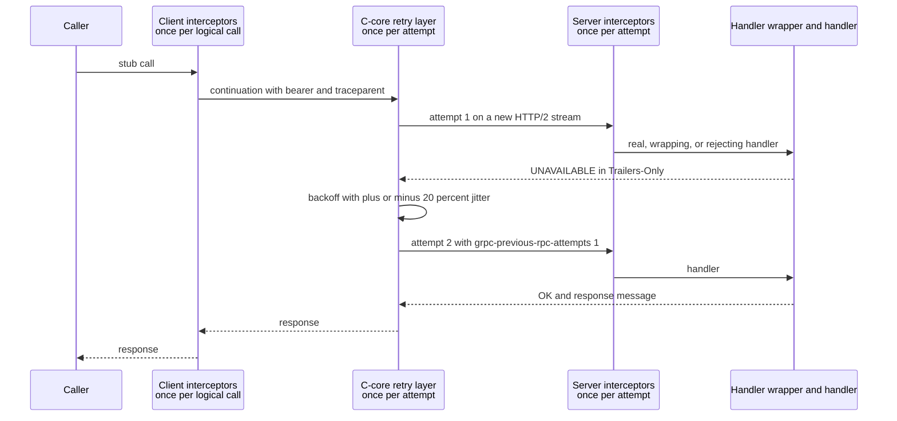

# Building Async Server and Client Interceptors in grpc.aio (1.85.1) for JWT Verification, OpenTelemetry Tracing, and Service-Config Retries

> [!summary] Claim
> In `grpc.aio` 1.85.1 a server interceptor is a per-attempt rewrite of the `RpcMethodHandler` (it sees the method and the metadata, never the request), and a client interceptor runs once per logical call above the C-core retry layer, so authentication must reject by returning an aborting handler, telemetry must wrap the returned handler from outside the auth interceptor, and service-config retries are invisible to client code but visible to the server as `grpc-previous-rpc-attempts`.

Part of [gRPC and Protocol Buffers](README.md) in [API Engineering](../README.md).
All behavior below is checked against the pinned `grpcio 1.85.1` release (as of 2026-11), its C-core source at tag `v1.85.1`, and the lab in this note.

## TL;DR

- Mechanism: the aio server calls each `ServerInterceptor.intercept_service(continuation, handler_call_details)` once per RPC attempt, in registration order, and uses the `RpcMethodHandler` that comes back; the client chain runs once per logical call inside a task, and the retry layer sits below it.
- Contract rule: authenticate before calling `continuation`, fail closed, reject with a handler that aborts at once, always re-raise `AbortError` and `CancelledError` from wrappers, and register telemetry before (outside) auth so rejections are observed.
- Trap: a client interceptor class that implements several `*ClientInterceptor` interfaces is registered for the first matching call kind only, and a JWT without an `exp` claim is accepted by PyJWT unless `exp` is listed in `require`.
- Portability fact: the 75 lab tests pass on CPython 3.12.13, 3.13.18, 3.14.6, 3.14.10, and 3.15.2, while `import grpc` segfaults on CPython 3.15.0b3 and `grpcio 1.85.1` has no free-threaded wheel here (as of 2026-11).
- When not to use: do not hand-write retry loops in a client interceptor when a service-config `retryPolicy` fits, do not verify JWTs per hop when a mesh or gateway already terminates identity, and remember the aio interceptor API is documented as experimental.

## Mental model



The caller's call enters the client interceptor chain once, and the chain's last `continuation` creates the real C-core call.
Everything below that point, including retries, happens inside C-core: each attempt is a fresh HTTP/2 stream, and on the server each attempt is a fresh RPC that runs the server interceptor chain again.
The server interceptor does not process messages; it chooses which `RpcMethodHandler` will serve the call, so both policy (reject) and instrumentation (wrap) are handler rewrites.
The mental error to avoid is treating either side as middleware around a request object: the server side has no request at interception time, and the client side cannot see attempts.

## How it works

### Server interceptors: a handler lookup chain

`grpc.aio.server(interceptors=[...])` stores the interceptors and, in `Server.__init__`, raises `ValueError` if any element is not a `grpc.aio.ServerInterceptor` (grpcio 1.85.1 grpc/aio/_server.py, `Server.__init__`).
The lab proves the rejection of a plain `object()` in `test_server_rejects_objects_that_are_not_server_interceptors`.
Both `ServerInterceptor` and `ClientCallDetails` carry the docstring line "This is an EXPERIMENTAL API." (grpcio 1.85.1 grpc/aio/_interceptor.py), so pin the release and keep a test that exercises each interceptor.

For every incoming call the C-core loop in `AioServer` creates an RPC coroutine, `_handle_rpc`, and that coroutine calls `_find_method_handler` first (grpc v1.85.1 src/python/grpcio/grpc/_cython/_cygrpc/aio/server.pyx.pxi, `_handle_rpc` and `_find_method_handler`).
`_find_method_handler` builds a `_HandlerCallDetails(method, invocation_metadata)` and, when interceptors exist, runs `_run_interceptor(iter(interceptors), query_handlers, handler_call_details)`.
`_run_interceptor` takes the next interceptor with `next(interceptors, None)`, binds a `continuation` with `functools.partial`, and awaits `interceptor.intercept_service(continuation, handler_call_details)`.
When the iterator is exhausted it calls `query_handlers`, which asks `_MethodResolver.resolve_handler` to check the registered method handlers first and then each generic handler's `service()` method.
The result is an `RpcMethodHandler` or `None`.

Consequences that follow directly from that code:

- The interceptor sees `handler_call_details.method` (for example `/t.Svc/Echo`) and `handler_call_details.invocation_metadata`, a tuple of `_Metadatum(key, value)` namedtuples (grpc v1.85.1 src/python/grpcio/grpc/_cython/_cygrpc/metadata.pyx.pxi, `_Metadatum`); a verification probe on 2026-11-26 saw the `user-agent` entry `grpc-python-asyncio/1.85.1 grpc-c/58.0.0 (osx; chttp2)` in it, and on retries it also carries `grpc-previous-rpc-attempts`.
- It never sees a request message, so nothing here can inspect the payload; payload-aware logic belongs in the handler or in a wrapper handler.
- Each interceptor must `await continuation(handler_call_details)` to proceed; returning a handler without calling it short-circuits the rest of the chain, and returning `None` makes `_handle_rpc` answer `UNIMPLEMENTED` with the details `Method not found!`.
- State flows by `contextvars`: the `ServerInterceptor.intercept_service` docstring says the first interceptor is called from an empty `contextvars.Context` and the same context is used for downstream interceptors and for the final handler call (grpcio 1.85.1 grpc/aio/_interceptor.py, `ServerInterceptor.intercept_service`), and the lab confirms a `ContextVar` set in the auth interceptor is read by the handler (`test_authenticated_unary_call_sees_the_principal_in_the_handler`) and stays isolated between two concurrent RPCs (`test_principal_is_isolated_between_concurrent_rpcs`).
- The docstring also warns there is no guarantee that interceptors and handlers run on the same thread, which only matters for sync handlers run in the migration thread pool.

After the lookup, `_handle_rpc` checks `method_handler is None` (answers `UNIMPLEMENTED`), then `concurrency_exceeded` (answers `RESOURCE_EXHAUSTED` with `Concurrent RPC limit exceeded!`), and only then dispatches by `request_streaming` and `response_streaming` to the four `_handle_*_rpc` functions.
So interceptors run before the concurrency limit is applied: a shed RPC still pays for every interceptor, and it never reaches a handler wrapper.
The lab measures both halves: with `maximum_concurrent_rpcs=1` and one blocked call, a second call got `RESOURCE_EXHAUSTED`, a counting interceptor ran for both calls, and the telemetry wrapper recorded only the first (`test_shed_rpcs_run_interceptors_but_never_reach_handler_wrappers`).

The whole `_handle_rpc` coroutine runs inside `_handle_exceptions`.
That function treats `AbortError` as the normal end of an aborted RPC (it asserts the exception is the one stored in `rpc_state.abort_exception`) and treats `asyncio.CancelledError` as a client cancellation.
For any other `Exception` it logs, and if no status was sent it sends status `UNKNOWN` (or the already set non-OK code) with the details `Unexpected <class 'X'>: <message>` (grpc v1.85.1 server.pyx.pxi, `_handle_exceptions`).
This applies to exceptions raised in an interceptor too: the lab raises `RuntimeError("secret-internal-detail")` from an interceptor and the client receives `UNKNOWN` whose details contain that text (`test_exception_escaping_an_interceptor_reaches_the_client_as_unknown_with_its_text`).

### Rejecting: return a handler that aborts, and choose its arity

Because the interceptor has no `context`, it cannot call `context.abort`.
The standard move is to return a handler whose behavior aborts.
`_ServicerContext.abort` stores an `AbortError`, sets `status_code`, sends the status (together with the initial metadata op if not yet sent), and raises (grpc v1.85.1 server.pyx.pxi, `_ServicerContext.abort`).
After an abort, `context.code()` returns the code (it returns `py_status_code`), which is how the telemetry wrapper reads the final status.

The arity of the rejection handler matters.
cygrpc serves a unary-unary handler by first awaiting the request message (`_handle_unary_unary_rpc` calls `_receive_message`), while a stream-stream handler is invoked without reading anything (`_handle_stream_stream_rpc`).
A bidirectional client that waits for the server to speak first never sends a message, so a unary-shaped rejection leaves it hanging until its deadline.
The lab measures it: against a unary-shaped rejection a silent `stream_stream` client ended with `DEADLINE_EXCEEDED` at its 1 s deadline, while a client that wrote one message got `UNAUTHENTICATED` immediately (`test_unary_shaped_rejection_leaves_a_silent_bidi_client_waiting_for_its_deadline`).
The lab's `_reject_handler` therefore always returns a stream-stream handler, which also removes the need to call `continuation` just to learn the real arity; the same handler returned `UNAUTHENTICATED` for unary, server-streaming, and bidirectional clients without hanging (`test_missing_token_is_unauthenticated_for_every_call_kind_without_hanging`).

Rejecting before calling `continuation` also avoids an existence oracle: an unauthenticated caller gets `UNAUTHENTICATED` for every method, existing or not, instead of `UNIMPLEMENTED` for the missing ones.
`test_rejection_never_calls_the_continuation` pins that order.

### Instrumenting: wrap the handler, keep its kind

To observe a call the interceptor awaits `continuation`, takes the returned handler, and returns a new handler of the same shape that wraps the behavior.
The wrapper must preserve two things.

1. The arity and the serializers: build the new handler with `grpc.unary_unary_rpc_method_handler(wrapper, request_deserializer=..., response_serializer=...)` using the original handler's `request_deserializer` and `response_serializer`.
2. The callable kind for response-streaming handlers: `_finish_handler_with_stream_responses` calls `inspect.iscoroutinefunction(stream_handler)` first (reader-writer style, the handler calls `context.write` itself), then `inspect.isasyncgenfunction(stream_handler)` (async generator style), and treats anything else as a sync generator run in the thread pool (grpc v1.85.1 server.pyx.pxi, `_finish_handler_with_stream_responses`).
   A wrapper of the wrong kind silently changes the calling convention, so the lab wrapper is an async generator when the inner handler is one and a coroutine otherwise (`test_wrappers_keep_the_handler_kind_cygrpc_dispatches_on`, `test_streaming_handlers_work_through_the_telemetry_wrappers`).

Inside the wrapper the status is derived the way cygrpc derives it: an `AbortError` carries the code in `context.code()`, a `CancelledError` is `CANCELLED`, any other exception with no code set is `UNKNOWN`, and a normal return uses `context.code()` or `OK`.
Every path re-raises, because `_handle_exceptions` asserts that the `AbortError` it catches is the stored one.

### Verifying a JWT in the interceptor

Header parsing comes first and is strict.
`Authorization` is metadata like any other, so a client can send zero, one, or several values; the lab rejects anything except exactly one value.
The auth scheme token is case-insensitive (RFC 9110 Section 11.1), the Bearer credential syntax is `"Bearer" 1*SP b64token` with `b64token = 1*( ALPHA / DIGIT / "-" / "." / "_" / "~" / "+" / "/" ) *"="` (RFC 6750 Section 2.1), and the lab enforces both with a `fullmatch` on that character class plus a length cap.
The regex also rejects CR and LF, which keeps attacker-controlled text out of log lines (`test_malformed_authorization_is_unauthenticated` includes a `crlf` case).

Verification then goes through PyJWT 2.15.1 `jwt.decode` with everything fixed in server-side policy and nothing read from the token:

- `algorithms` is mandatory: `PyJWS.decode_complete` raises `DecodeError` with the text `It is required that you pass in a value for the "algorithms" argument when calling decode().` when verifying a signature without it (PyJWT 2.15.1 jwt/api_jws.py, `decode_complete`), and the docstring of `PyJWT.decode_complete` warns against deriving it from the token's own `alg` (PyJWT 2.15.1 jwt/api_jwt.py, `decode_complete`, citing RFC 8725 Section 2.1).
  Libraries "MUST enable the caller to specify a supported set of algorithms and MUST NOT use any other algorithms" (RFC 8725 Section 3.1); the lab rejects `alg: none` and an `HS512` token under an `HS256` policy with `InvalidAlgorithmError` (`test_alg_none_and_wrong_algorithm_are_rejected`).
- `exp` is only checked when present: `_validate_claims` runs `_validate_exp` under `if "exp" in payload and options["verify_exp"]`, and `require` defaults to an empty list (PyJWT 2.15.1 jwt/api_jwt.py, `_get_default_options` and `_validate_claims`).
  RFC 7519 Section 4.1.4 says a JWT "MUST NOT be accepted for processing" on or after its `exp`, so a service that wants that guarantee must list `exp` in `require`.
  The lab policy requires `exp`, `iss`, `aud`, and `sub`, and `test_token_without_exp_is_rejected_because_exp_is_required` shows the same token accepted when `exp` is removed from the required set, which is what makes the test discriminating.
- `iss` and `aud` are checked against values from policy (RFC 8725 Sections 3.8 and 3.9).
- An optional `required_typ` implements explicit typing: RFC 9068 Section 4 requires a resource server to verify that the `typ` header is `at+jwt` or `application/at+jwt`, and RFC 8725 Section 3.11 recommends explicit typing to prevent cross-JWT confusion (`test_required_typ_header_rejects_a_token_of_another_kind`).
- `leeway` is explicit and defaults to zero (RFC 7519 Section 4.1.4 allows "some small leeway").

Authorization is a separate decision with a separate status code.
A valid token that lacks the scope for the method gets `PERMISSION_DENIED`, an unlisted method is denied (fail closed), and a failed or missing credential gets `UNAUTHENTICATED`; the code semantics are in [[gRPC-Status-Codes-and-Google-RPC-Status-Rich-Error-Payloads]].
The `scope` claim is read as a space-delimited string (RFC 9068 Section 2.2.3 points to the RFC 8693 `scope` claim for access tokens).
The client sees only the constant details `invalid credentials` or `denied`; the exception class and message go to the server log.

`jwt.decode` is synchronous CPU work executed on the event loop thread.
A verification run measured a median of 19.0 us per `verify_bearer` call for a 213-byte HS256 token (see Numbers and limits).
Anything that does I/O, such as fetching a JWKS document, must not run in the interceptor's event-loop path; the key-fetch and cache design belongs to [[JWKS-Discovery-Caching-Key-Rotation-and-Thundering-Herd-Protection]], and the cryptographic pitfalls to [[JWT-Cryptographic-Pitfalls-and-RFC-8725-Best-Current-Practices]].

### Server telemetry: spans, metrics, and a log line per attempt

Trace context arrives as ordinary metadata.
`traceparent` is `version "-" trace-id "-" parent-id "-" trace-flags` with `trace-id` 32 lowercase hex digits, `parent-id` 16 lowercase hex digits, all-zero ids forbidden and version `ff` invalid (W3C Trace Context Section 3.2.2).
The lab extracts it with `TraceContextTextMapPropagator.extract` from the text-valued metadata (binary values, whose names end in `-bin` and which are base64 on the wire, are skipped; grpc v1.85.1 doc/PROTOCOL-HTTP2.md, Custom-Metadata), starts a `SpanKind.SERVER` span with that parent, and `test_server_span_continues_the_incoming_traceparent` checks the trace id and the parent span id.
Propagation design, sampling, and `tracestate` are in [[Distributed-Tracing-W3C-Trace-Context-and-Baggage-Propagation]].

The span follows the OpenTelemetry gRPC conventions fetched from the `main` branch (as of 2026-11): `rpc.system.name` is `grpc`, `rpc.method` is the fully-qualified method (`t.Svc/Echo`, no leading slash), the span name is `{rpc.method}`, `rpc.status_code` carries the status name, and `error.type` is set when the call fails (OpenTelemetry semantic conventions docs/rpc/grpc.md and docs/rpc/rpc-spans.md).
Two rules differ by side and the lab encodes both.

- Server span status is `ERROR` only for `UNKNOWN`, `DEADLINE_EXCEEDED`, `UNIMPLEMENTED`, `INTERNAL`, `UNAVAILABLE`, and `DATA_LOSS`; `INVALID_ARGUMENT`, `NOT_FOUND`, `UNAUTHENTICATED` and the rest stay unset (`test_server_span_is_error_only_for_the_semconv_server_codes`).
- Client span status is `ERROR` for every code except `OK`, and a client span "SHOULD cover the duration of the logical call with all retries" (`test_client_span_is_error_for_any_non_ok_status`).

For a method no handler serves, the lab records `rpc.method` as `_OTHER` with `UNIMPLEMENTED` instead of the raw path, because the conventions note that the method name "MAY have unbounded cardinality in edge or error cases" and list `_OTHER` as a value (`test_unknown_method_is_counted_under_the_bounded_other_label`).
The log line carries method, status name, duration, trace id, and the subject read from the same `ContextVar` the auth interceptor set; `test_logs_carry_code_and_subject_but_never_the_token` asserts that neither a valid nor a rejected token string appears anywhere in the captured logs.

Because the wrapper runs once per attempt, a call that needed three attempts produces three server spans and three metric observations.
The lab records the attempt number from `grpc-previous-rpc-attempts` as the custom attribute `app.grpc.previous_attempts` (a lab-specific name, not a semantic convention) and the test sees `["0", "1", "2"]`.
Count attempts and calls separately in dashboards, or an error ratio computed from server metrics will include the failed attempts that the client later hid with a retry.

### Client interceptors: once per logical call, above the retry layer

On the client, `Channel.__init__` sorts interceptors into four lists with an `if`/`elif` ladder: `UnaryUnaryClientInterceptor`, then `UnaryStreamClientInterceptor`, then `StreamUnaryClientInterceptor`, then `StreamStreamClientInterceptor`, and raises `ValueError` for anything else (grpcio 1.85.1 grpc/aio/_channel.py, `Channel.__init__`).
Because of the `elif`, one class that inherits two interfaces lands in only the first matching list.
The lab shows it: a class implementing both unary-unary and unary-stream saw 1 unary call and 0 stream calls (`test_a_multi_interface_client_interceptor_is_registered_for_the_first_kind_only`).
The fix, used by `bearer_interceptors`, is one class per call arity.

An intercepted unary call is an `InterceptedUnaryUnaryCall` whose constructor creates `interceptors_task = loop.create_task(self._invoke(...))` (grpcio 1.85.1 grpc/aio/_interceptor.py, `InterceptedUnaryUnaryCall.__init__`).
`_invoke` builds a `ClientCallDetails(method, timeout, metadata, credentials, wait_for_ready)` namedtuple, and `_run_interceptor` recurses: for each interceptor it binds `continuation` to the remaining list and awaits `intercept_unary_unary(continuation, client_call_details, request)`; after the last interceptor it constructs the real `UnaryUnaryCall`, converting `client_call_details.timeout` with `_timeout_to_deadline`.
Points that follow from the source:

- `ClientCallDetails.method` is `bytes` in the aio implementation (the class annotation says `method: bytes`, and the channel passes `_common.encode(method)`), while the base `grpc.ClientCallDetails` carries no annotation and its docstring only says "The method name of the RPC." (grpcio 1.85.1 grpc/__init__.py, `ClientCallDetails`); a verification probe saw `bytes` at runtime, and the lab decodes defensively.
- Details are a namedtuple, so build a new one rather than mutating the caller's `Metadata`; `with_metadata` copies and replaces keys (`test_with_metadata_replaces_listed_keys_and_keeps_the_rest`).
- The interceptor may return the call or a plain response.
  A plain response is wrapped in `UnaryUnaryCallResponse`, whose `initial_metadata()` and `trailing_metadata()` return `None`, `code()` returns `OK`, and `done()` returns `True`, so the caller loses real metadata (grpcio 1.85.1 grpc/aio/_interceptor.py, `UnaryUnaryCallResponse`).
  The lab tracing interceptor awaits the call to observe the status and then returns the call itself; awaiting a finished call again returns the cached response, because `UnaryUnaryCall.__await__` yields from `self._call_response`, an `asyncio.Task` that keeps its result (grpcio 1.85.1 grpc/aio/_call.py, `UnaryUnaryCall.__await__`), and a verification probe got `b'hi'` from both awaits.
- `InterceptedCall.__del__` calls `self.cancel()`, so dropping the last reference to an intercepted call cancels it (grpcio 1.85.1 grpc/aio/_interceptor.py, `InterceptedCall.__del__`).

`BearerUnaryUnaryInterceptor` and its three siblings await a token provider on every call, so a refreshed token is used on the next call (`test_bearer_interceptor_fetches_a_fresh_token_for_every_call`).
`ClientTracingInterceptor` starts a `SpanKind.CLIENT` span with `start_as_current_span`, injects `traceparent` into a carrier dict, adds it to the metadata, and records the status.
It handles unary-unary calls only; a streaming client span has to end when the stream ends, which needs a done-callback design that this lab does not implement, so streaming calls are not traced by it.
`test_trace_context_crosses_the_wire_from_client_span_to_server_span` runs client and server in one process and checks that the server span has the client span's trace id and its parent span id equals the client span id.

### Service-config retries: configuration, algorithm, and where they sit

Retries are configured by a service config, a JSON document with `methodConfig` entries (grpc v1.85.1 doc/service_config.md; gRFC A6, "Retry Policy" and "Integration with Service Config").
In Python the document is passed as the channel argument `grpc.service_config` and retries are switched by `grpc.enable_retries`; the upstream example does exactly that with `("grpc.enable_retries", 1)` and `("grpc.service_config", service_config_json)` (grpc v1.85.1 examples/python/retry/retry_client.py).
`GRPC_ARG_ENABLE_RETRIES` is documented as defaulting to true, enabling transparent retries and, when a policy is configured, configurable retries (grpc v1.85.1 include/grpc/impl/channel_arg_names.h).

A policy has `maxAttempts`, `initialBackoff`, `maxBackoff`, `backoffMultiplier`, and `retryableStatusCodes`.
The C-core parser requires `maxAttempts` of at least 2, clamps it to 5 with a log line instead of failing (`MAX_MAX_RETRY_ATTEMPTS` is 5), requires both backoffs and the multiplier to be greater than 0, and requires a non-empty status list (grpc v1.85.1 src/core/client_channel/retry_service_config.cc, `RetryMethodConfig::JsonPostLoad`).
The lab builder validates the same rules at construction and deliberately does not clamp, so that the 9-to-5 behavior is observed from C-core rather than from lab code (`test_max_attempts_above_five_is_clamped_by_the_client_core`).

The delay before the first retry is `initialBackoff * random(0.8, 1.2)` and before the n-th it is `min(initialBackoff * backoffMultiplier**(n-1), maxBackoff) * random(0.8, 1.2)` (gRFC A6, "Exponential Backoff"); the lab function `backoff_delays` implements the schedule with an explicit jitter factor so it is testable.
The call deadline applies across all attempts (gRFC A6, "Maximum Number of Retries"), so total backoff competes with the deadline from [[gRPC-Deadlines-Timeout-Header-and-Context-Cancellation-Cascade]].

Where the retry decision is made, in `RetryFilter::LegacyCallData::CallAttempt::ShouldRetry` (grpc v1.85.1 retry_filter_legacy_call_data.cc), in this order:

1. No retry policy for the method: do not retry.
2. Status `OK`: record a success on the throttler and stop.
3. Status not in `retryableStatusCodes`: do not retry (and, importantly, do not count it as a throttling failure).
4. Record a failure on the throttler; if the throttler says throttled, do not retry.
5. If the RPC is committed, do not retry.
6. Increment the completed-attempt count; if it reached `maxAttempts`, do not retry.
7. If the server sent pushback, a negative value means do not retry, and a non-negative value is the delay.

The throttler is `retryThrottling` with `maxTokens` (an integer in (0, 1000] per gRFC A6, "Validation of retryThrottling"; C-core 1.85.1 parses it as `uint32_t` and rejects only 0, in retry_service_config.cc, `RetryGlobalConfig::JsonPostLoad`) and `tokenRatio` (greater than 0, three decimals kept).
The token count starts at `maxTokens`, each retryable failure subtracts 1, each success adds `tokenRatio`, and retries are allowed only while the count after the decrement is strictly greater than `maxTokens / 2` (gRFC A6, "Throttling Retry Attempts and Hedged RPCs"; grpc v1.85.1 retry_throttle.cc, `RetryThrottler::RecordFailure`).
With `maxTokens` of 4 the lab sees 2 attempts for the first failing call and 1 attempt for the second, because the state persists across calls on the channel (`test_retry_throttling_stops_retries_once_tokens_fall_to_half`).

An RPC becomes committed when the client receives Response-Headers or when its outgoing message overflows the retry buffer (gRFC A6, "When Retries are Valid").
The default per-RPC buffer is 256 KiB, set by `grpc.per_rpc_retry_buffer_size` (channel_arg_names.h), and the legacy call data commits when `bytes_buffered_for_retry_` exceeds it.
Servers "should delay the Response-Headers until the first response message or until the application code chooses to send headers", and an error before that is sent as Trailers-Only; an `abort` in the lab produces exactly that and is retried.
A handler that calls `context.send_initial_metadata` before failing commits the RPC: with a 4-attempt policy the lab observed exactly 1 attempt and a final `UNAVAILABLE` (`test_sending_initial_metadata_before_failing_commits_the_rpc_and_disables_retries`).

Header names starting with `grpc-` that the protocol does not define are reserved for gRPC and should not be used by applications (grpc v1.85.1 doc/PROTOCOL-HTTP2.md, Custom-Metadata), which is why application attempt counters must use another prefix.
On each attempt after the first, the client adds the outgoing initial metadata entry `grpc-previous-rpc-attempts` with the number of completed attempts, and removes any such entry on the first attempt (retry_filter_legacy_call_data.cc, `AddRetriableSendInitialMetadataOp`; gRFC A6, "Exposed Retry Metadata").
The server in the lab saw `[None, '1', '2']`.
The same function copies the original initial metadata for every attempt, so every attempt replays the same `authorization` value that the client interceptor produced once.
A server can also push back with `grpc-retry-pushback-ms`, a signed 32-bit integer in milliseconds where negative or unparseable means "do not retry" (gRFC A6, "Pushback").

Two retry classes exist besides the configured one.
Transparent retries cover RPCs that never left the client or never reached the server application, are retried regardless of configuration, do not count toward `maxAttempts`, and do not count as throttling failures (gRFC A6, "Transparent Retries"); setting `grpc.enable_retries` to 0 disables them together with configured retries, which the lab shows for the configured case (`test_enable_retries_zero_ignores_the_service_config_policy`).
Hedging is specified in A6 but the 1.85.1 channel-argument documentation says hedging "is not yet implemented" and that those service-config fields are ignored, so [[Hedged-Requests-and-Tail-Latency-Taming-at-Scale]] describes the pattern and this note does not rely on it.

### Why interceptors and retries do not compose the way people expect

A6 places retries "in-between the channel and the load balancing policy" so each retry can pick a different subchannel (gRFC A6, "Where Retries Occur"), which is why [[gRPC-Load-Balancing-Subchannels-Pick-First-vs-Round-Robin-and-xDS]] matters for retry effectiveness.
Client interceptors are above all of that.
The lab counts a client interceptor's calls while the server aborts twice: the interceptor ran 1 time, the server handler ran 3 times, and the server interceptor ran 3 times (`test_unavailable_is_retried_and_the_server_sees_each_attempt_numbered`).
Per-attempt client behavior therefore cannot be implemented in a client interceptor, and per-attempt server behavior (auth, spans, metrics) already happens per attempt without any extra work.

## Numbers and limits

| Quantity | Value | Source or measurement |
|---|---|---|
| Client ceiling on `maxAttempts` | 5; values above are clamped | gRFC A6 "Limits on Retries and Hedges"; C-core `MAX_MAX_RETRY_ATTEMPTS` 5; lab: `maxAttempts` 9 gave 5 server attempts |
| Minimum `maxAttempts` | 2 (1 or less is a validation error) | retry_service_config.cc `JsonPostLoad` |
| Backoff jitter | plus or minus 20 percent | gRFC A6 "Exponential Backoff" |
| Backoff for `maxAttempts` 4, 0.1 s, multiplier 2, cap 1 s | delays 0.1, 0.2, 0.4 s; sum 0.7 s nominal, 0.84 s at +20 percent | computed by the lab `backoff_delays` in `test_backoff_follows_the_a6_formula_and_is_capped` |
| Per-RPC retry buffer | 256 KiB default | channel_arg_names.h `GRPC_ARG_PER_RPC_RETRY_BUFFER_SIZE` |
| `retryThrottling.maxTokens` | integer in (0, 1000]; retries stop when tokens fall to `maxTokens / 2` or less | gRFC A6; retry_throttle.cc |
| Throttle with `maxTokens` 4, ratio 0.1, `maxAttempts` 5 | 2 attempts on the first failing call, then 1 on the next | lab, `test_retry_throttling_stops_retries_once_tokens_fall_to_half` |
| `grpc-retry-pushback-ms` | signed 32-bit integer, milliseconds | gRFC A6 "Pushback" |
| Metadata size limits | soft 8 KB, hard 16 KB defaults | channel_arg_names.h `GRPC_ARG_MAX_METADATA_SIZE`, `GRPC_ARG_ABSOLUTE_MAX_METADATA_SIZE` |
| Lab bearer-token length cap | 4096 characters | lab constant `MAX_TOKEN_BYTES` (a lab choice, not a gRPC limit) |
| HS256 `verify_bearer`, 213-byte token (the lab `mint()` claims) | median 19.0 us per call (7 runs of 5000 calls: 18.8 to 19.2 us; an earlier run of the same script gave a median of 21.0 us) | measured 2026-11-26: `timeit.repeat(..., number=5000, repeat=7)` in a scratch script run with `uv run --frozen python`, Apple M3 Pro, macOS 27.3 arm64, CPython 3.14.6, PyJWT 2.15.1 |
| Verification ceiling implied by that cost | about 52,600 verifications per second per event loop thread | derived: 1 / 19.0 us |
| Retry attempts multiplied by an application retry loop | 5 x 5 = 25 calls worst case | arithmetic on the cap above |
| Lab suite | 75 tests in 2.39 s | `uv run --frozen pytest <test> -v` on 2026-11-26, Apple M3 Pro, macOS 27.3 arm64, CPython 3.14.6 |

The 19.0 us figure covers `extract_bearer`, `jwt.decode` with HS256, claim validation, and `Principal` construction, with a warm interpreter; asymmetric algorithms, a JWKS lookup, or a longer token will cost more and were not measured.
Metadata limits matter because the bearer token is metadata: a token plus other headers that exceeds the soft limit can be rejected for a random sample of requests (channel_arg_names.h comment on `GRPC_ARG_MAX_METADATA_SIZE`), so keep access tokens small and put large entitlements behind a lookup.

## Portability

| Axis | Variant | Result | Evidence |
|---|---|---|---|
| CPython | 3.12.13 (the matrix lists 3.12.16, not installable here) | 75 passed | `uv run --frozen --python 3.12 pytest <test> -q`, full workspace environment, 2026-11 (drafter's run; not re-executed in verification, matrix runs paused) |
| CPython | 3.13.18 | 75 passed | same command with `--python 3.13`, full workspace environment (drafter's run; not re-executed in verification) |
| CPython | 3.14.6 (workspace `.venv`) | 75 passed in 2.39 s | `uv run --frozen pytest <test> -v`, re-run in verification on 2026-11-26 |
| CPython | 3.14.10 | 75 passed | `uv run --frozen --python /opt/homebrew/bin/python3.14`, full workspace environment (drafter's run; not re-executed in verification) |
| CPython | 3.15.2 | 75 passed | minimal environment with only `grpcio 1.85.1`, `PyJWT 2.15.1`, `opentelemetry-api` and `opentelemetry-sdk 1.45.2`, `pytest 9.2.0`, `pytest-asyncio 1.4.1.post1`; the full workspace environment was not built for 3.15.2 (drafter's run; not re-executed in verification) |
| CPython | 3.15.0b3 (uv-managed beta) | not runnable: `import grpc` exits with status 139 (segmentation fault) | `python -X faulthandler -c 'import grpc'` printed `Fatal Python error: Segmentation fault`; a `grpcio` cp315 darwin wheel was installed (drafter's run; not re-executed in verification) |
| CPython | 3.15.2t (free-threaded) | not run | no 3.15.2t interpreter here; for the 3.15.0b3 free-threaded build `uv pip install --only-binary :all: grpcio==1.85.1` found no usable wheel, and the full workspace environment failed earlier on `psycopg-binary==3.3.8` |
| `grpcio` | 1.85.1 | pinned, all results above | `labs/pyproject.toml` |
| `grpcio` | other point releases | not tested | the `if`/`elif` registration, `_handle_rpc` ordering, and `_handle_exceptions` text are implementation details; the tests that pin them will flag a change |
| Server implementation | Uvicorn, Hypercorn, Granian | not applicable | `grpc.aio` serves through C-core, not an ASGI server |
| Protocol | HTTP/2 | exercised on loopback | gRPC runs over HTTP/2; framing is in [[gRPC-Over-HTTP-2-Framing-Length-Prefixed-Messages-and-Trailers]] |
| Protocol | HTTP/1.1 and HTTP/3 | not applicable or not tested | no claim made |
| OS | macOS 27.3 arm64 | all runs | Linux glibc and Alpine musl legs were not run (lab checks were paused for this draft) |

Free-threaded status deserves its own sentence: the result for 3.15.2t is "unknown", not "fails", because the blocker found here is the missing `grpcio` wheel for the free-threaded build that was available.

## Worked example

The implementation is [implementation](../labs/src/api_labs/f19_grpc_and_protocol_buffers/grpc_interceptors.py) and the test is [test](../labs/tests/f19_grpc_and_protocol_buffers/test_grpc_interceptors_in_asyncio_auth_logging_metrics_and_retries.py).
The lab uses generic handlers with bytes in and bytes out, so no generated protobuf code is needed, and it binds only `127.0.0.1:0`.
It has 50 test functions (75 test cases): 31 marked `unit` (in-process fakes, no sockets) and 19 marked `socket`.

The server-side rejection and the ordering rule, as a simplified excerpt:

```python
def _reject_handler(code: grpc.StatusCode, detail: str) -> Any:
    async def reject(request_iterator: Any, context: Any) -> None:
        await context.abort(code, detail)

    return cast("Any", grpc.stream_stream_rpc_method_handler(reject))


class JwtServerInterceptor(grpc.aio.ServerInterceptor):
    async def intercept_service(self, continuation, handler_call_details):
        try:
            principal = self.authorize(
                handler_call_details.method, handler_call_details.invocation_metadata
            )
        except AuthError as exc:
            self._log.warning(
                "auth rejected method=%r code=%s reason=%s",
                handler_call_details.method, exc.code.name, exc.reason,
            )
            return _reject_handler(exc.code, exc.detail)
        if principal is not None:
            current_principal.set(principal)
        return await continuation(handler_call_details)
```

The verifier, with `exp` required, as a simplified excerpt:

```python
claims = jwt.decode(
    token,
    policy.key,
    algorithms=list(policy.algorithms),
    audience=policy.audience,
    issuer=policy.issuer,
    leeway=policy.leeway_s,
    options={"require": list(policy.required_claims)},  # ("exp", "iss", "aud", "sub")
)
```

The handler wrapper for a unary response, as a simplified excerpt (the streaming variants are the same shape with `async for` or a coroutine):

```python
async def unary_response(request: Any, context: Any) -> Any:
    scope = scope_for(method, parent, attempt)   # starts a SERVER span, counts the call
    try:
        response = await unary_inner(request, context)
    except asyncio.CancelledError:
        scope.finish(grpc.StatusCode.CANCELLED)
        raise
    except BaseException:
        scope.finish(_final_code(context, failed=True))  # AbortError carries context.code()
        raise
    scope.finish(_final_code(context, failed=False))
    return response
```

The retry test, as a simplified excerpt:

```python
service = Service(fail_first=2)              # aborts UNAVAILABLE on attempts 1 and 2
counter = CountingClientInterceptor()
async with running_server(service, [telemetry.interceptor]) as target:
    channel = open_channel(
        target, options=retry_options(unary_policy()), interceptors=[counter]
    )
    async with channel:
        assert await channel.unary_unary("/t.Svc/Flaky")(b"ok", timeout=10) == b"ok"
assert service.attempts == 3
assert service.previous_attempts == [None, "1", "2"]
assert counter.calls == 1
```

Run on 2026-11-26 from `labs/` during verification: `uv run --frozen pytest tests/f19_grpc_and_protocol_buffers/test_grpc_interceptors_in_asyncio_auth_logging_metrics_and_retries.py -v`, CPython 3.14.6, pytest 9.2.0, Apple M3 Pro, macOS 27.3 arm64.
This is the tail of the captured output, with the `tests/f19_grpc_and_protocol_buffers/test_grpc_interceptors_in_asyncio_auth_logging_metrics_and_retries.py::` prefix removed from each line and the blank line before the summary dropped (the first 61 result lines cover token parsing, JWT verification, the in-process interceptor tests, and the retry-policy arithmetic):

```text
test_client_span_is_error_for_any_non_ok_status PASSED [ 82%]
test_unavailable_is_retried_and_the_server_sees_each_attempt_numbered PASSED [ 84%]
test_a_status_outside_retryable_codes_is_not_retried PASSED [ 85%]
test_attempts_stop_at_max_attempts_and_the_last_status_is_returned PASSED [ 86%]
test_max_attempts_above_five_is_clamped_by_the_client_core PASSED [ 88%]
test_enable_retries_zero_ignores_the_service_config_policy PASSED [ 89%]
test_retry_throttling_stops_retries_once_tokens_fall_to_half PASSED [ 90%]
test_retry_policy_applies_only_to_the_named_method PASSED [ 92%]
test_a_multi_interface_client_interceptor_is_registered_for_the_first_kind_only PASSED [ 93%]
test_exception_escaping_an_interceptor_reaches_the_client_as_unknown_with_its_text PASSED [ 94%]
test_shed_rpcs_run_interceptors_but_never_reach_handler_wrappers PASSED [ 96%]
test_server_rejects_objects_that_are_not_server_interceptors PASSED [ 97%]
test_sending_initial_metadata_before_failing_commits_the_rpc_and_disables_retries PASSED [ 98%]
test_unary_shaped_rejection_leaves_a_silent_bidi_client_waiting_for_its_deadline PASSED [100%]
============================== 75 passed in 2.39s ==============================
```

Wall time varies between runs on the same machine (the drafter recorded 1.84 s for `-v` and 2.16 s for `-q` before this 2.39 s run), so do not compare it across environments.
Mutation testing of the individual assertions was not run for this draft or in verification (the user paused lab checks on 2026-11-11), so the claim that each test is discriminating rests on its design, noted in the test names, and not on recorded mutation results.

## Pitfalls

> [!warning] A client interceptor class that implements several interfaces is registered once
> Trigger: one class inherits `UnaryUnaryClientInterceptor` and `UnaryStreamClientInterceptor` (and more) and is passed in `interceptors=[...]`.
> Symptom: unary calls carry the bearer token, streaming calls arrive with no `authorization` and the server answers `UNAUTHENTICATED`; the lab first hit this exact failure with a four-interface class.
> Cause: `Channel.__init__` uses `if`/`elif` over `isinstance` checks, so only the first matching list receives the interceptor (grpcio 1.85.1 grpc/aio/_channel.py).
> Fix: one class per arity, built by a factory such as `bearer_interceptors`, and a test that makes a streaming call.

> [!warning] A unary-shaped rejection handler hangs bidirectional clients
> Trigger: the auth interceptor returns `grpc.unary_unary_rpc_method_handler(reject)` for every denied method.
> Symptom: a bidi or client-streaming caller that waits for the server before writing sees nothing until its deadline, then `DEADLINE_EXCEEDED` instead of `UNAUTHENTICATED`; the lab measured the deadline at 1 s.
> Cause: cygrpc reads one request message before invoking a unary-unary handler, and the silent client never sends one.
> Fix: reject with a stream-stream handler, which cygrpc invokes without reading.

> [!warning] PyJWT accepts a token with no `exp` and lets the caller pick algorithms
> Trigger: `jwt.decode(token, key, algorithms=[...])` with the default options.
> Symptom: tokens that omit `exp` never expire, because `_validate_exp` only runs when `exp` is in the payload; an application that passes an over-broad `algorithms` list, or one computed from the token, exposes key-confusion attacks.
> Incident: CVE-2022-29217 describes PyJWT key confusion through non-blocklisted public key formats when the application accepted every algorithm, for example with `algorithms=jwt.algorithms.get_default_algorithms()`; the GitHub advisory lists affected versions `>= 1.5.0, < 2.4.0` and patched version `2.4.0`, and the NVD description recommends to "always be explicit with the algorithms that are accepted and expected when decoding" (GHSA-ffqj-6fqr-9h24, NVD record CVE-2022-29217).
> Fix: pin `algorithms` in server-side policy next to the key (RFC 8725 Section 3.1), list `exp`, `iss`, `aud`, and `sub` in `require`, and test a token without `exp`.

> [!warning] Telemetry registered inside auth never sees rejections
> Trigger: `interceptors=[JwtServerInterceptor(...), ServerTelemetryInterceptor(...)]`.
> Symptom: the auth log shows a burst of `UNAUTHENTICATED` while the status counter for that method stays empty, so an attack or a clock-skew outage is invisible on the dashboard.
> Cause: the auth interceptor returns its rejection handler without calling `continuation`, so the inner telemetry interceptor never runs.
> Fix: register telemetry first; the lab shows `{("t.Svc/Echo", "UNAUTHENTICATED"): 1}` for the outer order and an empty map for the inner order (`test_telemetry_outside_auth_observes_rejections_and_inside_does_not`).

> [!warning] Exceptions escaping an interceptor become `UNKNOWN` with their message
> Trigger: an unhandled error inside `intercept_service`, such as a key-store lookup raising `KeyError`.
> Symptom: the client receives `UNKNOWN` and the details text `Unexpected <class 'KeyError'>: ...`, and the server logs a stack trace through `_handle_exceptions`.
> Fix: catch domain errors in the interceptor and map them to a status through a rejection handler, and treat any other exception as an internal fault whose message must not be client-visible; the lab's `AuthError` carries a separate client-safe `detail`.

> [!warning] Shed RPCs pay for interceptors and bypass handler wrappers
> Trigger: `maximum_concurrent_rpcs` set, plus JWT verification and handler-wrapping telemetry.
> Symptom: under overload every rejected-for-capacity RPC still runs the full interceptor chain (about 19 us of HS256 verification each in the verification measurement, more for asymmetric algorithms) and does not appear in the handler-wrapper metrics, so the dashboard shows a healthy request rate while clients see `RESOURCE_EXHAUSTED`.
> Fix: do cheap checks first in the chain, count `RESOURCE_EXHAUSTED` from the client side or from a transport-level metric, and prefer load shedding designs in [[Load-Shedding-Priority-Traffic-Classes-and-LIFO-Queue-Management]].

> [!warning] Sending initial metadata early silently turns retries off
> Trigger: a server-side wrapper or handler calls `context.send_initial_metadata(...)` (for example to emit a request-id header) before the work that can fail with a retryable code.
> Symptom: the client policy says 4 attempts but only 1 happens, and the call fails with `UNAVAILABLE`; the RPC was committed when the client received Response-Headers.
> Fix: attach response metadata to the final status path (trailing metadata) or send it after the point of possible failure; the lab shows 1 attempt with an early send and 3 attempts when the handler just aborts.

> [!warning] Returning the response instead of the call loses metadata and status
> Trigger: a client interceptor does `return await call` instead of `return call`.
> Symptom: the caller gets a `UnaryUnaryCallResponse` whose `initial_metadata()` and `trailing_metadata()` are `None` and whose `code()` is always `OK`, even though the real call carried trailers.
> Fix: await the call to observe errors, then return the call object.

> [!warning] Stacking an application retry loop on top of service-config retries
> Trigger: a client interceptor or a wrapper library retries `AioRpcError` while the channel also has a `retryPolicy`.
> Symptom: failed dependencies see up to 5 x 5 = 25 calls per logical request, the retry throttler counts only the inner failures, and the application loop retries calls that the inner layer already retried; A6 itself notes that wrapping libraries with their own retries are why retries can be disabled per channel (gRFC A6, "Disabling Retries").
> Fix: own retries in exactly one layer, use `grpc.enable_retries` set to 0 for the other, and bound the total with a budget as in [[Retry-Budgets-and-Preventing-Cascading-Retry-Amplification-Storms]].

> [!warning] Every retry attempt replays the original token
> Trigger: the client interceptor stamps an access token whose remaining lifetime is shorter than the total backoff.
> Symptom: the first attempt authenticates and a late attempt is rejected with `UNAUTHENTICATED`, which is not in the retry list, so the call fails with an auth error that a fresh call would not have produced.
> Cause: the interceptor ran once, and C-core copies the original initial metadata for each attempt (retry_filter_legacy_call_data.cc, `AddRetriableSendInitialMetadataOp`).
> Fix: refresh tokens with a margin larger than the worst-case retry time (0.84 s for the example policy in this note) or use call credentials that C-core evaluates itself.
> Why call credentials differ (read in source at tag `v1.85.1`, not run in the lab): `RetryFilter::LegacyCallData::CallAttempt`'s constructor calls `CreateLoadBalancedCall` (retry_filter_legacy_call_data.cc), so every attempt builds a new subchannel call.
> `RegisterSecurityFilters` registers `ClientAuthFilter` at `GRPC_CLIENT_SUBCHANNEL` (src/core/lib/surface/init.cc), so it sits below the retry filter and runs for each attempt.
> Its `OnClientInitialMetadata` calls `CheckCallHost` and then `GetCallCredsMetadata`, which invokes `creds->GetRequestMetadata` (src/core/filter/auth/auth_filters.h).
> A credentials object is therefore asked for metadata again on every attempt, while a token stamped by a client interceptor is not; whether a particular credentials type caches its token between those calls is that type's own behavior and was not checked.

## Security and robustness

- Threat model: the caller controls every metadata byte, including `authorization`, `traceparent`, and `grpc-previous-rpc-attempts`; treat all of it as untrusted input to the interceptor.
- OWASP API Security 2023 mapping: API2:2023 Broken Authentication (token verification, algorithm pinning, required claims, small leeway), API5:2023 Broken Function Level Authorization (a per-method scope map that denies unlisted methods), API1:2023 Broken Object Level Authorization (not solvable in an interceptor, because the object id lives in the request body that the interceptor never sees), and API4:2023 Unrestricted Resource Consumption (interceptors run before `maximum_concurrent_rpcs`, so verification cost is part of the attack surface); category names are from the OWASP API Security Top 10 2023 page.
- Transport: the lab uses insecure loopback channels so that tests need no certificates.
  A bearer token sent over a plaintext channel is a leaked credential, so production channels use TLS or mTLS, and the TLS posture is a prerequisite to everything here.
- Fail closed twice: an unlisted method is `PERMISSION_DENIED`, and an interceptor bug that raises must not fall through to "allow" (here it falls through to `UNKNOWN`, which is closed but leaky, so wrap the body).
- Do not trust `grpc-previous-rpc-attempts`: it is client-supplied metadata that C-core clients set and strip, but a custom client can send any value, so use it for observability and never for authorization, billing, or idempotency decisions.
- Log hygiene: never log metadata values; log a method, a status name, a duration, and a trace id.
  The lab's `%r` formatting of the wire-supplied method name in the auth log escapes control characters.
- Error opacity: the client receives `invalid credentials` or `denied` only; PyJWT messages stay in the server log.
- Bound the work before the cryptography: length cap and character class before `jwt.decode`, a single `authorization` value, and an `algorithms` whitelist.
- Cache and key rotation: a JWKS client does blocking I/O, so keep it out of the event loop path or behind an executor, and design the cache for rotation and stampedes as in [[JWKS-Discovery-Caching-Key-Rotation-and-Thundering-Herd-Protection]].
- Idempotency: `retryableStatusCodes` containing anything other than codes that guarantee the server did not process the request is a correctness decision about the method, and gRPC provides no way to mark a method idempotent (gRFC A6, "Retryable Status Codes").
- Replay: a bearer token is replayable by whoever holds it; sender-constrained tokens (see [[Sender-Constrained-Tokens-DPoP-RFC-9449-and-mTLS-Binding-RFC-8705]]) are the structural fix, and short lifetimes are the cheap mitigation.

## The principal's view

The decision is where identity, telemetry, and retries live: in the application interceptors, in the platform (mesh, gateway, or sidecar), or in the language-neutral gRPC service config.

- Retries belong in the service config, owned by the service team and delivered to clients, because C-core retries see attempts, subchannels, throttling, and pushback that an interceptor cannot.
  The trade-off is that policy is per method in JSON, the 5-attempt ceiling is not negotiable from the service side, and idempotency becomes an organizational contract: whoever lists `UNAVAILABLE` for a mutating method is promising the server tolerates duplicates.
- Authentication belongs once, as close to the edge as the trust model allows.
  An in-process JWT interceptor costs about 19 us of event-loop time per RPC for HS256 in this lab (asymmetric verification was not measured and costs more) and repeats at every hop; verifying at the edge and propagating a signed internal identity, or using mTLS identity in a mesh, moves that cost and the key management out of every service (see [[API-Authentication-Architecture-Edge-Verification-vs-Zero-Trust-Propagation]] and [[Service-to-Service-Identity-Client-Credentials-and-Token-Exchange-RFC-8693]]).
  Keep a thin in-process interceptor for authorization decisions that need method names, and keep it identical across services by shipping it as a library with the tests from this lab.
- Telemetry belongs in a shared library with fixed semantics (status mapping, `_OTHER` method label, per-attempt spans), because divergent interceptors produce dashboards that disagree.
  Check whether a maintained instrumentation package covers `grpc.aio` for your versions before keeping a custom one; this lab does not pin one and did not evaluate any.
- Choose a different mechanism when the policy must be cross-language and uniform (a gateway or a proxy), when the decision needs the request message (put it in the handler or a typed middleware), or when the aio interceptor API's experimental status is unacceptable for a given release train.
- Organizational cost: interceptor semantics are subtle enough that a wrong ordering (telemetry inside auth) or a wrong arity (unary rejection) ships silently, so the unit of ownership is the tested library, not a code snippet in each service.

## Interview questions

> [!question] L5: What does a `grpc.aio` server interceptor see, and what can it return?
>
> > [!success]- Answer
> > It sees `handler_call_details` with `method` and `invocation_metadata`, and a `continuation` coroutine.
> > It never sees the request message, because it runs during handler lookup before any message is read.
> > It returns an `RpcMethodHandler` (the real one from `continuation`, a wrapper, or a rejecting handler) or `None`.
> > Returning `None` makes the server answer `UNIMPLEMENTED`.
> >
> > Follow-up: How would you reject a call from an interceptor, given that there is no `context` object?

> [!question] L5: Predict the output of one retried call.
> A server handler aborts with `UNAVAILABLE` on its first two attempts.
> The channel has a `retryPolicy` with `maxAttempts` 4 for `UNAVAILABLE`, and a client interceptor counts its invocations.
> What does `print(reply, service.attempts, counter.calls, service.previous_attempts)` show for one call?
>
> > [!success]- Answer
> > It prints `b'ok' 3 1 [None, '1', '2']`.
> > The retry layer lives below client interceptors, so the interceptor ran once for the logical call.
> > The server handler ran 3 times, and attempts 2 and 3 carried `grpc-previous-rpc-attempts` of `1` and `2`, while the first attempt had no such entry.
> > This is the assertion set of `test_unavailable_is_retried_and_the_server_sees_each_attempt_numbered`.
> >
> > Follow-up: What would change if `enable_retries` were 0?

> [!question] L6: Debug this API: streaming calls lose their credentials.
> Unary RPCs succeed, but every server-streaming and bidirectional call from the same client fails with `UNAUTHENTICATED`.
> The client code is `class AuthInterceptor(UnaryUnaryClientInterceptor, UnaryStreamClientInterceptor, StreamStreamClientInterceptor)`, passed once as `interceptors=[AuthInterceptor()]`, with all three `intercept_*` methods implemented.
> What is wrong?
>
> > [!success]- Answer
> > `grpc.aio.Channel.__init__` sorts each interceptor with an `if`/`elif` chain, so the instance is registered only for the first matching kind, unary-unary here.
> > The streaming calls therefore skip it and carry no `authorization` metadata.
> > Split it into one class per call kind (sharing a base class for the token logic) and pass all of them.
> > Add a test that makes a streaming call and asserts the server saw the header.
> >
> > Follow-up: Which part of the source would you read to confirm, and how would you make the test fail loudly if a future release changed the behavior?

> [!question] L6: Why does the lab reject with a stream-stream handler regardless of the real method's arity?
>
> > [!success]- Answer
> > cygrpc reads one request message before invoking a unary-unary handler, so a bidirectional client that waits for the server to speak first would hang until its deadline.
> > A stream-stream handler is invoked without reading, so the abort goes out at once for unary, server-streaming, and bidirectional clients (the lab tests those three; client-streaming follows from the same `_handle_stream_stream_rpc` path but is not exercised).
> > It also means the interceptor can reject before calling `continuation`, so unauthenticated callers cannot tell existing methods from missing ones.
> >
> > Follow-up: What does the client see for a bidi call against a unary-shaped rejection, and after how long?

> [!question] L6: The dashboard shows no `UNAUTHENTICATED` series while the auth log is full of rejections.
> Where do you look first?
>
> > [!success]- Answer
> > Look at interceptor order: the interceptors list is `[auth, telemetry]`.
> > The auth interceptor returns its rejection handler without calling `continuation`, so a telemetry interceptor placed after it never runs for rejected calls.
> > Put telemetry first so it wraps whatever handler the rest of the chain returns, including the rejection handler.
> > Then count unknown methods under a bounded label such as `_OTHER`.
> >
> > Follow-up: Which RPCs will still be missing from handler-wrapper metrics after the reorder?

> [!question] L6: A token without an `exp` claim is accepted by your interceptor.
> Why, and how do you fix it?
>
> > [!success]- Answer
> > PyJWT validates `exp` only if the claim is present, and its `require` option defaults to an empty list.
> > RFC 7519 Section 4.1.4 forbids accepting a token on or after `exp`, but it does not say a token must have one, so the library leaves that to policy.
> > Pass `options={"require": ["exp", "iss", "aud", "sub"]}`, pin `algorithms`, and test a token minted without `exp`.
> >
> > Follow-up: What other header check would you add if these are RFC 9068 access tokens?

> [!question] L7+: Design the retry strategy for a gRPC `CreatePayment` method behind this stack.
>
> > [!success]- Answer
> > The default is no retry policy, because a payment is not idempotent unless the API makes it so.
> > Make the request carry an idempotency key and make the server deduplicate on it, then allow `UNAVAILABLE` only, since that code is the one that most often means the request did not run.
> > Keep `maxAttempts` small (3 to 4), set `maxBackoff` so the worst-case sum stays well under the call deadline, and configure `retryThrottling` so a failing dependency stops receiving retries once tokens fall to half.
> > Do not add an application retry loop, since 5 x 5 attempts multiply, and watch server metrics per attempt using `grpc-previous-rpc-attempts` for observability only.
> >
> > Follow-up: A handler sends response headers early for request-id propagation; what does that do to this policy?

> [!question] L7+: JWT verification costs about 19 us on the event loop in your service.
> What do you change at 20,000 requests per second per instance?
>
> > [!success]- Answer
> > 20,000 x 19 us is 0.38 s of CPU per second, so HS256 verification alone takes about 38 percent of the single event-loop thread before any handler runs, and an asymmetric algorithm or a JWKS lookup makes it worse.
> > Move verification to the edge (gateway or mesh) and propagate a short-lived, signed internal identity or mTLS identity, or cache successful verifications keyed by token hash with a lifetime bounded by `exp`.
> > Run multiple processes if verification must stay in-process, and measure asymmetric algorithms separately, since this lab measured only HS256.
> > Keep the interceptor for scope checks that need the method name, and keep JWKS fetches off the event loop.
> >
> > Follow-up: What are the security costs of a verification cache, and how do you bound them?

> [!question] L7+: Why can a client interceptor not implement per-attempt behavior, and where do per-attempt facts live instead?
>
> > [!success]- Answer
> > Client interceptors wrap the call above the C-core retry filter, which sits between the channel and the load-balancing policy, so an interceptor runs once per logical call.
> > Per-attempt facts live on the server, where each attempt is a new RPC that runs the server interceptors and carries `grpc-previous-rpc-attempts`, and in C-core metrics such as `grpc.client.attempt.started` described in the gRPC retry guide.
> > A client span should cover the logical call with all retries, and server spans are per attempt.
> >
> > Follow-up: How would you compute a user-visible error rate when server spans are per attempt?

## Related

Prerequisites: [[gRPC-Status-Codes-and-Google-RPC-Status-Rich-Error-Payloads]]

Next: [[gRPC-Keepalive-Flow-Control-and-Max-Message-Size-Tuning]]

See also: [[gRPC-and-Protocol-Buffers]], [[The-Four-gRPC-Communication-Modes-Unary-Server-Client-and-Bidi-Streaming]], [[gRPC-Deadlines-Timeout-Header-and-Context-Cancellation-Cascade]], [[gRPC-Over-HTTP-2-Framing-Length-Prefixed-Messages-and-Trailers]], [[gRPC-Load-Balancing-Subchannels-Pick-First-vs-Round-Robin-and-xDS]], [[gRPC-Health-Checking-Protocol-Server-Reflection-and-Graceful-Stop]], [[JWT-Cryptographic-Pitfalls-and-RFC-8725-Best-Current-Practices]], [[JWT-JWS-JWK-Structure-and-RFC-9068-Access-Token-Profile]], [[JWKS-Discovery-Caching-Key-Rotation-and-Thundering-Herd-Protection]], [[Distributed-Tracing-W3C-Trace-Context-and-Baggage-Propagation]], [[RED-and-USE-Metrics-and-OpenTelemetry-HTTP-Semantic-Conventions]], [[Structured-Logging-with-Structlog-and-Stripe-Canonical-Log-Lines]], [[Retries-Exponential-Backoff-Full-vs-Decorrelated-Jitter-and-Stamina]], [[Retry-Budgets-and-Preventing-Cascading-Retry-Amplification-Storms]], [[Hedged-Requests-and-Tail-Latency-Taming-at-Scale]], [[Load-Shedding-Priority-Traffic-Classes-and-LIFO-Queue-Management]], [[Timeout-Taxonomy-Connect-Read-Write-Pool-and-Deadline-Propagation]]

- Lab: `labs/tests/f19_grpc_and_protocol_buffers/test_grpc_interceptors_in_asyncio_auth_logging_metrics_and_retries.py`

## Further reading

- [gRFC A6: gRPC Client Retries](https://github.com/grpc/proposal/blob/master/A6-client-retries.md): the normative description of retry and hedging policy, throttling, pushback, commitment, buffering, and `grpc-previous-rpc-attempts`.
- [gRPC retry guide](https://grpc.io/docs/guides/retry/): maintainer documentation of transparent retries, the per-attempt metrics, and how retry state is kept.
- [Service Config in gRPC](https://github.com/grpc/grpc/blob/v1.85.1/doc/service_config.md): the JSON service config format that carries `methodConfig` and `retryPolicy`.
- [grpc/grpc v1.85.1 server.pyx.pxi](https://github.com/grpc/grpc/blob/v1.85.1/src/python/grpcio/grpc/_cython/_cygrpc/aio/server.pyx.pxi): the real interceptor chain, rejection paths, exception mapping, and concurrency check.
- [grpc/grpc v1.85.1 retry_filter_legacy_call_data.cc](https://github.com/grpc/grpc/blob/v1.85.1/src/core/client_channel/retry_filter_legacy_call_data.cc): `ShouldRetry`, commitment, and the metadata copy per attempt.
- [grpc/grpc v1.85.1 auth_filters.h](https://github.com/grpc/grpc/blob/v1.85.1/src/core/filter/auth/auth_filters.h) and [init.cc](https://github.com/grpc/grpc/blob/v1.85.1/src/core/lib/surface/init.cc): `ClientAuthFilter` evaluates call credentials, and `RegisterSecurityFilters` places it in the per-attempt subchannel stack.
- [grpc/grpc v1.85.1 channel_arg_names.h](https://github.com/grpc/grpc/blob/v1.85.1/include/grpc/impl/channel_arg_names.h): `grpc.enable_retries`, `grpc.per_rpc_retry_buffer_size`, and the metadata size limits.
- [RFC 7519: JSON Web Token](https://www.rfc-editor.org/rfc/rfc7519.html): claim semantics, including the `exp` rule in Section 4.1.4.
- [RFC 8725: JSON Web Token Best Current Practices](https://www.rfc-editor.org/rfc/rfc8725.html): algorithm verification, issuer and audience validation, and explicit typing.
- [RFC 9068: JWT Profile for OAuth 2.0 Access Tokens](https://www.rfc-editor.org/rfc/rfc9068.html): the `at+jwt` type, the `scope` claim, and the validation steps for a resource server.
- [RFC 6750: Bearer Token Usage](https://www.rfc-editor.org/rfc/rfc6750.html): the `Authorization` header syntax and `b64token` grammar.
- [W3C Trace Context](https://www.w3.org/TR/trace-context/): the `traceparent` field grammar that the client injects and the server extracts.
- [OpenTelemetry gRPC semantic conventions](https://github.com/open-telemetry/semantic-conventions/blob/main/docs/rpc/grpc.md): attribute names, which status codes are errors on each side, and the `_OTHER` method value.
- [GHSA-ffqj-6fqr-9h24 and CVE-2022-29217](https://github.com/jpadilla/pyjwt/security/advisories/GHSA-ffqj-6fqr-9h24): the PyJWT key-confusion advisory behind the "pin algorithms" rule.
