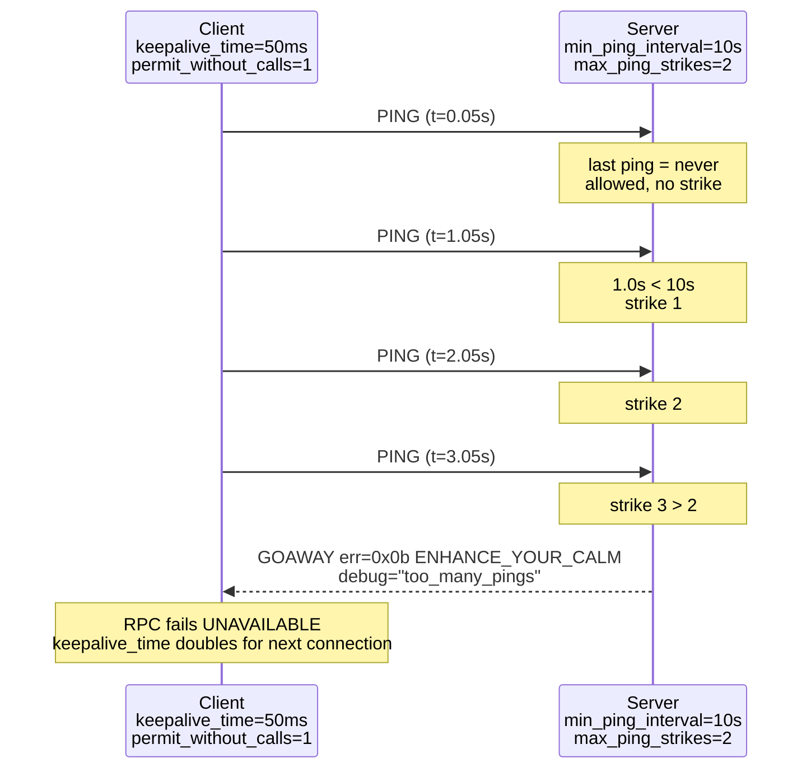

# Production gRPC Tuning: HTTP/2 PING Keepalives (ENHANCE_YOUR_CALM / too_many_pings), Max Receive/Send Message Limits, and Stream Flow Control

> [!summary] Claim
> A gRPC connection is governed by three independent budgets that must be set as matched client/server pairs: a ping budget (the client's keepalive must stay inside what the server will tolerate, or the server answers `GOAWAY(ENHANCE_YOUR_CALM, "too_many_pings")`), a message-size budget (`4194304` bytes receive by default, enforced separately on each side, so raising one side only moves the `RESOURCE_EXHAUSTED` to the other), and an HTTP/2 window budget (a stream moves at most one window per round trip).

Part of [gRPC and Protocol Buffers](README.md) in [API Engineering](../README.md).

## TL;DR

- Mechanism: keepalive is an HTTP/2 `PING` (RFC 9113 Section 6.7) on a timer; the server counts pings that arrive too soon as strikes and, past `grpc.http2.max_ping_strikes` (default `2`), sends `GOAWAY` with error code `0x0b` and debug data `too_many_pings`, then closes the transport (grpc-core 1.85.1 `ping_abuse_policy.cc`, `ReceivedOnePing`; `chttp2_transport.cc`, `grpc_chttp2_exceeded_ping_strikes`).
- Contract rule: client `grpc.keepalive_time_ms` must be at least the server's `grpc.http2.min_ping_interval_without_data_ms` (default `300000`), and a client that pings with no calls in flight needs the server's `grpc.keepalive_permit_without_calls=1`, otherwise the server's idle allowance is two hours.
- Trap: the failure is silent until it is not.
  Client defaults (`grpc.http2.max_pings_without_data=2`) throttle pings and hide a bad config, a chatty stream resets the server's strike counter and hides it again, and the symptom is a mid-call `UNAVAILABLE` ("Too many pings") that looks like a network fault.
- Portability: grpc-core, grpc-go, and grpc-java implement the same strike rule independently but differ in defaults (Go clamps client keepalive to `10 s` and enforces `5 min`, Java's window is `1 MiB`), and Python `grpc.aio` uses grpc-core's `grpc.*` channel-argument keys.
- When not to use: do not enable keepalive to paper over a load balancer idle timeout you control (raise the timeout or use `max_connection_age` from A9), and do not raise `grpc.max_receive_message_length` to ship blobs; stream chunks instead.

## Mental model



The client's timer fires every `keepalive_time_ms`, but grpc-core will not put two pings closer than one second on the wire while calls are active (`writing.cc`, `NextAllowedPingInterval`), which is why a `50 ms` setting produces pings about one second apart.
The server compares each ping with the previous one; a ping inside the permitted interval is a strike, the fourth ping in the picture is strike three, and strikes greater than two close the transport with the `GOAWAY` shown.
The client treats `GOAWAY` plus `too_many_pings` as an instruction to double its keepalive time for new connections (`chttp2_transport.cc`, comment above the `too_many_pings` check).
Message limits and flow-control windows follow the same shape but live in different layers: the size check happens per message after the 5-byte envelope is parsed, and the window check happens per `DATA` frame inside HTTP/2.

## How it works

### 1. PING on the wire

A `PING` frame is type `0x06`, a 9-octet header plus exactly 8 octets of opaque data, on stream `0`; the receiver of a non-ACK ping MUST echo it with the `ACK` flag (`0x01`) and the same payload (RFC 9113 Section 6.7).
A ping with a nonzero stream identifier is a connection error `PROTOCOL_ERROR`, and a length other than 8 is `FRAME_SIZE_ERROR` (RFC 9113 Section 6.7).
Because the ACK is mandatory and cheap to demand, it is a classic amplification vector, which is why RFC 9113 Section 10.5 lists "An endpoint is required to respond to a `PING` frame" among the flood techniques and says an endpoint MAY treat suspicious activity as a connection error of type `ENHANCE_YOUR_CALM` (`0x0b`, RFC 9113 Section 7).
gRPC's protocol document says only that either side can send `PING`, that an expired server-initiated ping closes calls with `CANCELLED`, and that an expired client-initiated ping closes calls with `UNAVAILABLE`, leaving frequency to the implementation (gRPC `doc/PROTOCOL-HTTP2.md`, PING Frame).

### 2. Client keepalive: who may ping, how often

The knobs and their defaults are in grpc-core's `doc/keepalive.md` (v1.85.1) and `include/grpc/impl/channel_arg_names.h`:

| Channel argument | Side | Default | Meaning |
| --- | --- | --- | --- |
| `grpc.keepalive_time_ms` | both | client disabled (`INT_MAX`), server `7200000` | idle period before a ping |
| `grpc.keepalive_timeout_ms` | both | `20000` | wait for the ACK, then close the transport |
| `grpc.keepalive_permit_without_calls` | both | `0` | client: ping with no calls; server: tolerate such pings |
| `grpc.http2.max_pings_without_data` | client | `2` | pings allowed before a `HEADERS` or `DATA` frame must be sent; `0` is unlimited; servers force it to `0` (`ping_rate_policy.cc`, constructor) |
| `grpc.http2.min_ping_interval_without_data_ms` | server | `300000` | minimum spacing of received pings |
| `grpc.http2.max_ping_strikes` | server | `2` | strikes tolerated; `0` means unlimited |

Three gates sit between the timer and the wire in grpc-core 1.85.1:

1. The timer callback (`chttp2_transport.cc`, `init_keepalive_ping_locked`) sends a ping only if `keepalive_permit_without_calls` is set or the stream map is non-empty; otherwise it re-arms the timer for another `keepalive_time` and sends nothing.
2. `Chttp2PingRatePolicy::RequestSendPing` (`ping_rate_policy.cc`) first refuses with `TooManyRecentPings` when `grpc.http2.max_inflight_pings` (default `1`) pings are unacknowledged, then refuses with `TooSoon` if the last ping was sent less than `next_allowed_ping_interval` ago.
   For a client that interval is `Hours(2)` when there are no streams and `permit_without_calls` is `0`, else `Seconds(1)` (`writing.cc`, `NextAllowedPingInterval`).
   That one-second floor is why `grpc.keepalive_time_ms` below `1000` behaves like `1000` while calls are active.
   (A8's "Extending for Basic Health Checking" section says a `KEEPALIVE_TIME` below ten seconds is replaced by ten seconds; core clamps only to `1 ms`, in the transport constructor and in `grpc_chttp2_config_default_keepalive_args_client` (`chttp2_transport.cc`), and grpc-go documents a `10 s` clamp, `keepalive/keepalive.go`, `ClientParameters.Time`.)
3. If `max_pings_without_data` is nonzero and `pings_before_data_sending_required_` has reached `0`, further pings are throttled to one per minute (`kThrottleIntervalWithoutDataSent = Minutes(1)`).
   The counter starts at `0` (`ping_rate_policy.h`), so a transport that has written nothing yet is already in the throttled state.
   Writing a `HEADERS`, `DATA`, trailer, or `WINDOW_UPDATE` frame calls `grpc_chttp2_reset_ping_clock` (call sites in `writing.cc`, definition in `chttp2_transport.cc`), which calls `ResetPingsBeforeDataRequired` and refills the counter to `max_pings_without_data`.
   Receiving a `DATA` or `HEADERS` frame resets `last_ping_sent_time_` (`ReceivedDataFrame`, called from `init_data_frame_parser` and `init_header_frame_parser` in `parsing.cc`), so a chatty server also reopens the client's ping gate.

After a ping is sent the keepalive watchdog starts; any incoming read cancels it (`chttp2_transport.cc`, `read_action_locked`), and if nothing arrives within `keepalive_timeout_ms` `grpc_chttp2_keepalive_timeout` sends a `GOAWAY` with `ENHANCE_YOUR_CALM` and debug text `keepalive_timeout`, then closes the transport with `UNAVAILABLE` "keepalive timeout" (`chttp2_transport.cc`; `doc/keepalive.md`, FAQ; `keepalive.cc`, `KeepaliveManager::WaitForKeepAliveTimeout` is the equivalent in the newer promise-based transport).
That shared error code is why alerting must match the debug text `too_many_pings`, not `ENHANCE_YOUR_CALM` alone.

### 3. Server enforcement: the strike algorithm

The server-side policy is a small state machine, `Chttp2PingAbusePolicy` (`ping_abuse_policy.cc`):

```text
ReceivedOnePing(transport_idle):
    interval = 2 hours                    if transport_idle
             = min_recv_ping_interval     otherwise
    next_allowed = last_ping_recv_time + interval
    last_ping_recv_time = now             (updated for good and bad pings)
    if next_allowed <= now: return false
    ping_strikes++
    return ping_strikes > max_ping_strikes and max_ping_strikes != 0
```

`transport_idle` is computed in `frame_ping.cc` as `keepalive_permit_without_calls == 0 && stream_map.empty()`, using the server's own flag and its own open-stream count.
Two consequences are easy to miss.
First, with no streams open and the server flag at its default `0`, the server's tolerance is two hours (the RFC 1122 TCP keepalive floor, per the comment in `RecvPingIntervalWithoutData`), not `min_ping_interval_without_data_ms`; lowering that argument does nothing for idle connections.
Second, the first ping after a reset is always free because `last_ping_recv_time_` starts at negative infinity, so the close arrives on the fourth tightly spaced ping, not the third.
The reset happens when the server writes `HEADERS`, `DATA`, trailers, or a stream or connection `WINDOW_UPDATE` (`writing.cc`, calls to `grpc_chttp2_reset_ping_clock`, which calls `ResetPingStrikes` only when `!t->is_client`), a superset of A8, which says servers should permit a `PING` after sending `HEADERS` and `DATA` frames because pings also measure latency and bandwidth (gRFC A8, Server Enforcement).
Core also departs from A8's suggested algorithm in one detail: A8 updates `last_valid_ping_time` only for a ping that passed the check, while `ReceivedOnePing` overwrites `last_ping_recv_time_` on every ping, so in core each ping is judged against the previous ping, good or bad.

When the count is exceeded, `grpc_chttp2_exceeded_ping_strikes` sends a final `GOAWAY` with `Http2ErrorCode::kEnhanceYourCalm` and the message `too_many_pings`, then calls `close_transport_locked(t, absl::UnavailableError("Too many pings"))` (`chttp2_transport.cc`).
The `GOAWAY` frame layout is `Last-Stream-ID (31)`, `Error Code (32)`, `Additional Debug Data (..)` (RFC 9113 Section 6.8), so on the wire the end of the frame reads `00 00 00 0b` followed by the ASCII bytes `746f6f5f6d616e795f70696e6773`.
A8 requires closing immediately because "Immediately closing the connection fails any in-progress RPCs which increases the chance of the client author detecting the misconfiguration" (gRFC A8, Server Enforcement).

On the client, a `GOAWAY` with error `11` and debug text exactly `too_many_pings` logs at `ERROR` level and records a throttled keepalive time of twice the current value, saturating at `INT_MAX` ms, for new connections (`chttp2_transport.cc`, `GOAWAY` handler; `KEEPALIVE_TIME_BACKOFF_MULTIPLIER` is `2` in `transport_common.h`).
A8 says the same (gRFC A8, Basic Keepalive).

### 4. Message size limits

The limits are two channel arguments: `grpc.max_receive_message_length` (default `4 MiB`, `-1` unlimited) and `grpc.max_send_message_length` (no default limit, `-1` unlimited) (`channel_arg_names.h`).
Both are resolved by `GetMaxRecvSizeFromChannelArgs` and `GetMaxSendSizeFromChannelArgs` (`src/core/transport/message_size_service_config.cc`): any negative value means no limit, and `grpc.minimal_stack` disables both limits regardless of the arguments.
They are enforced by `ClientMessageSizeFilter` and `ServerMessageSizeFilter` in the call stack, each checking `msg.payload()->Length() <= max` and otherwise cancelling the call with `RESOURCE_EXHAUSTED` and the text `"<SIDE>: <Sent|Received> message larger than max (<len> vs. <max>)"` (`message_size_filter.cc`, `CheckPayload`).
The length is the message payload without the 5-byte envelope (`Compressed-Flag` 1 byte plus `Message-Length` 4 bytes, big-endian; gRPC `doc/PROTOCOL-HTTP2.md`, Requests), so a message of exactly `4194304` bytes passes and `4194305` fails.
Details of the envelope belong to [[gRPC-Over-HTTP-2-Framing-Length-Prefixed-Messages-and-Trailers]]; the status mapping belongs to [[gRPC-Status-Codes-and-Google-RPC-Status-Rich-Error-Payloads]].

Four properties matter operationally:

- Each side checks its own receive limit and its own send limit; there is no negotiation, no `SETTINGS` entry, and no header advertising the limit, so the first symptom of a mismatch is a failed call, not a handshake error.
- A send-limit violation fails locally before the message is written (`CLIENT: Sent message larger than max (2000 vs. 1000)` in the lab); a receive-limit violation is detected by the receiver after the bytes crossed the network.
- In 1.85.1 the receive limit is checked in two places: the size filter and `ChannelCompression::DecompressMessage` (`compression_filter.cc`), which first compares the wire (compressed) length with `max_recv_message_length` and then decompresses with an output cap only if `IsMessageSizeRefactoringEnabled()`.
  That experiment, `message_size_refactoring`, defaults to `true` in 1.85.1 (`src/core/lib/experiments/rollouts.yaml`; `experiments.h` compiles `IsMessageSizeRefactoringEnabled()` to `return true`), and the cap is enforced inside zlib inflation, which returns `RESOURCE_EXHAUSTED` "Decompressed message larger than max" (`src/core/lib/compression/message_compress.cc`, `ZlibBody`).
  A scratch run on this machine confirmed it: a `5 MiB` all-zero request sent with `grpc.Compression.Gzip` to a default server failed `RESOURCE_EXHAUSTED: Decompressed message larger than max`.
  The protection hangs on an experiment flag, so re-check it on every grpcio upgrade.
- The limit can also come from the per-method service config (`MessageSizeParsedConfig`, merged by taking the smaller value in `ClientMessageSizeFilter::Call::OnClientInitialMetadata`); on the client the per-method request size caps sends and the response size caps receives.

Two neighbouring limits are not message-size limits and are easy to confuse with them.
`grpc.max_metadata_size` is a soft limit on the sum of all metadata entries in one batch of headers, defaulting to the larger of `8 KB` and `0.8 * grpc.absolute_max_metadata_size` when that is set; a random sample of requests between the soft and the hard limit is rejected.
`grpc.absolute_max_metadata_size` is the hard limit, defaulting to the larger of `16 KB` and `1.25 * grpc.max_metadata_size` when that is set, and every request above it is rejected (`channel_arg_names.h`, v1.85.1; read, not run).
`grpc.max_concurrent_streams` bounds concurrent incoming streams per connection and defaults to `-1`, meaning no explicit limit (`channel_arg_names.h`; the HTTP/2 `SETTINGS_MAX_CONCURRENT_STREAMS` wire default in grpc-core is `4294967295`, `http2_settings.h`, `kDefaultMaxConcurrentStreams`).
Raising `grpc.max_receive_message_length` therefore does not raise the header budget, and a large auth token in metadata fails on the metadata limit, not on the message limit.

### 5. HTTP/2 flow control and what gRPC does with it

Flow control is credit-based, per hop, and applies only to `DATA` frames; the initial window is `65535` octets for every stream and for the connection, the maximum is `2^31-1`, and a sender must respect both the stream and the connection window (RFC 9113 Section 5.2.1, Section 6.9.1, Section 6.9.2).
`SETTINGS_INITIAL_WINDOW_SIZE` (`0x04`) changes the stream windows, possibly driving them negative, but "A `SETTINGS` frame cannot alter the connection flow-control window", which only `WINDOW_UPDATE` on stream `0` can change (RFC 9113 Section 6.9.2).
`SETTINGS_MAX_FRAME_SIZE` defaults to `16384` and may be advertised between `2^14` and `2^24-1` (RFC 9113 Section 6.5.2).
The RFC deliberately leaves the receiver's update policy open and warns that a window smaller than the bandwidth-delay product caps throughput (RFC 9113 Section 5.2.1, Section 5.2.3), which gives the bound the lab computes: `max_throughput = window / RTT`.
At `65535` bytes and a `50 ms` RTT that is `1310700` bytes per second per stream (computed in the lab test, not a measurement of a link).

grpc-core does not leave the window at the default.
`GRPC_ARG_HTTP2_BDP_PROBE` defaults to true: the transport sends probe pings only while receiving data, a `BdpEstimator` starts at `kInitialBdpDefault = 65536`, probes every `100 ms` at first (`kDefaultInterPingDelayMillis`), and on each completed ping sets `estimate = max(accumulator, 2 * estimate)` when `accumulator > 2/3 * estimate` and the bandwidth sample beats the best seen, halving the probe delay; once stable it backs off with jitter toward `kMaxInterPingDelaySeconds = 10` (`bdp_estimator.h`, `bdp_estimator.cc`, `CompletePing`).
`TransportFlowControl::PeriodicUpdate` turns the estimate into `SETTINGS_INITIAL_WINDOW_SIZE`: under low memory pressure (below `0.2`) the target is `max(4 MiB, 2 * BDP)`, rounded up to a power of two and clamped to `kMaxInitialWindowSize = 1 << 30`; it falls linearly to `2 * BDP` at pressure `0.5` and toward zero at `1.0` (`flow_control.cc`, `TargetInitialWindowSizeBasedOnMemoryPressureAndBdp`, `PeriodicUpdate`).
Per-stream `WINDOW_UPDATE` credit is capped at `kMaxWindowDelta = 1 << 20` while a reader is waiting (`StreamFlowControl::DesiredAnnounceSize`), and a stream update is sent immediately once the pending increment exceeds `max(initial_window / 2, 8192)` (`StreamFlowControl::UpdateAction`).
Setting `grpc.http2.lookahead_bytes` sets the local initial window and the flow-control target directly (`chttp2_transport.cc`, init), but with BDP probing on the next `PeriodicUpdate` replaces that target; the header documents it as "Defaults to 64kb, larger values can help throughput on high-latency connections" and notes it may become a no-op.
Disabling BDP with `grpc.http2.bdp_probe=0` freezes the window at the configured value, so a fixed `lookahead_bytes` is then the only tuning knob.

Two interactions with this note's other mechanisms deserve naming.
BDP probes are pings, so they exercise the same strike policy; the deprecated `grpc.http2.min_time_between_pings_ms` once limited them and now "Does not have any effect" (`channel_arg_names.h`), and servers only count pings arriving without an intervening server write of `HEADERS`, `DATA`, or `WINDOW_UPDATE`, which BDP traffic (probes are scheduled only on receiving `DATA`, `parsing.cc`, `init_data_frame_parser`) normally guarantees.
A large message does not by itself need a large window if the application reads promptly; the window must cover the bandwidth-delay product, the message limit must cover the largest legal message, and the two are unrelated numbers.

### 6. Other implementations

- grpc-go v1.85.0: `keepalive.ClientParameters{Time, Timeout, PermitWithoutStream}` and `keepalive.EnforcementPolicy{MinTime (5 min default), PermitWithoutStream}`; the server counts `pingStrikes`, `maxPingStrikes = 2`, and sends `GOAWAY` with `http2.ErrCodeEnhanceYourCalm` and debug data `too_many_pings`; an idle server (no streams, `PermitWithoutStream` false) tolerates pings only every `defaultPingTimeout = 2 * time.Hour` (`internal/transport/http2_server.go`, `handlePing`).
  The window starts at `65535` and BDP-tunes up to `bdpLimit = (1 << 20) * 16` (`internal/transport/defaults.go`, `bdp_estimator.go`); `defaultServerMaxReceiveMessageSize = 1024 * 1024 * 4` and the default send size is `math.MaxInt32` (`server.go`); the receive error is `"grpc: received message larger than max (%d vs. %d)"` with code `ResourceExhausted` (`rpc_util.go`), and decompressed messages are re-checked (`"message after decompression larger than max"`).
- grpc-java v1.85.1: `NettyServerBuilder.DEFAULT_FLOW_CONTROL_WINDOW = 1024 * 1024` with auto tuning on by default (`autoFlowControl = true`); `flowControlWindow(int)` disables auto tuning while `initialFlowControlWindow(int)` keeps it; `GrpcUtil.DEFAULT_MAX_MESSAGE_SIZE = 4 * 1024 * 1024`; server keepalive time default is two hours (`GrpcUtil.DEFAULT_SERVER_KEEPALIVE_TIME_NANOS`), and `permitKeepAliveTime` sets the enforcement interval, default `5` minutes (`GrpcUtil.DEFAULT_SERVER_PERMIT_KEEPALIVE_TIME_NANOS = TimeUnit.MINUTES.toNanos(5L)`).
- Envoy (docs as of 2026-11): `Http2ProtocolOptions.initial_stream_window_size` defaults to `16 MiB` and `initial_connection_window_size` to `24 MiB`, both only increasable above the HTTP/2 default; `max_outbound_frames` defaults to `10000` and `max_outbound_control_frames` (pending `PING`, `SETTINGS`, and `RST_STREAM`) to `1000`, and exceeding either terminates the connection; `connection_keepalive` sends HTTP/2 `PING`s and aborts the connection if the peer does not answer.
  An Envoy in the path therefore re-originates flow control and pings per hop, which is exactly the RFC's "flow control is specific to a connection" (RFC 9113 Section 5.2.1); a `PING` lives on stream `0` of one connection (RFC 9113 Section 6.7), so its ACK proves only that the next hop answered, and this note makes no claim about whether any particular proxy maps downstream pings onto upstream ones.
  For load balancer and server-side connection recycling, see [[gRPC-Load-Balancing-Subchannels-Pick-First-vs-Round-Robin-and-xDS]] and A9 (`grpc.max_connection_age_ms`, `grpc.max_connection_idle_ms`, `grpc.max_connection_age_grace_ms`).

## Numbers and limits

| Quantity | Value | Source or measurement |
| --- | --- | --- |
| Default receive message limit | `4194304` bytes; `4194305` fails with `SERVER: Received message larger than max (4194305 vs. 4194304)` | `channel_arg_names.h` v1.85.1; measured in the lab (`test_real_grpc_rejects_messages_over_the_default_4_mib_limit`, grpcio 1.85.1, Python 3.14.6, Darwin 27.3.0 arm64) |
| Default send message limit | unlimited (`-1`); a `5 MiB` server reply was delivered to a client with `grpc.max_receive_message_length=-1` | `channel_arg_names.h`; re-measured in the verifier's scratch run on the same machine |
| gRPC envelope | 5 bytes (flag + 4-byte big-endian length) | `doc/PROTOCOL-HTTP2.md` v1.85.1; asserted by `test_grpc_message_prefix_is_five_bytes_and_not_counted_against_the_limit` |
| Server ping strike threshold | closes when strikes `> 2`, i.e. on the 4th too-soon ping | `ping_abuse_policy.cc`; `test_server_closes_on_the_fourth_too_soon_ping_not_the_third` |
| Default server ping interval | `300000 ms` busy, `2 h` idle | `ping_abuse_policy.cc`, `frame_ping.cc`; `test_idle_transport_uses_two_hours_even_when_the_policy_interval_is_tiny` |
| Client ping floor | `1 s` with calls or permit, `2 h` otherwise | `writing.cc`, `NextAllowedPingInterval` |
| Client no-data throttle | `max_pings_without_data=2`, then `1 min` between pings | `ping_rate_policy.cc`; `test_client_stops_after_two_data_less_pings_unless_the_limit_is_zero` |
| Keepalive close observed, active call | real `UNAVAILABLE` ("Too many pings") at `3.08 s` for `keepalive_time_ms=50`, `max_pings_without_data=0`, server interval `10 s`; the simulator predicts `3.05 s` | one scratch run by the verifier on 2026-11-21 (`real_call("Hold", b"8", ...)`), grpcio 1.85.1, CPython 3.14.6, macOS 27.3 arm64 (Darwin 27.3.0); the lab test asserts only that it ends before `7.5 s` |
| Keepalive close observed, idle channel | channel left `READY` `3.08 s` after `channel_ready()` (client permit on, server default) | same scratch run |
| Decompressed-size cap | `5 MiB` of zeros sent gzip-compressed fails `RESOURCE_EXHAUSTED: Decompressed message larger than max` | same scratch run; `message_compress.cc`, `ZlibBody` |
| HTTP/2 initial window | `65535`; max `2147483647` | RFC 9113 Section 6.9.2, Section 6.9.1 |
| HTTP/2 default / max frame size | `16384` / `16777215` | RFC 9113 Section 6.5.2 |
| Rounds to push a `1 MiB` message | default windows: `19` rounds, `72` `WindowUpdated` events; both windows raised to `1 MiB + 5`: `1` round, `4` events; stream window raised, connection window not: `19` rounds, `37` events | re-measured by the verifier with a scratch driver around `transfer_rounds`, h2 4.4.1, CPython 3.14.6, macOS 27.3 arm64; the lab asserts `>= 17`, `== 1`, and stream-only equals default |
| Single-stream throughput bound | `window / RTT`: `65535 B / 0.05 s = 1310700 B/s`; `4 MiB / 0.05 s = 83886080 B/s` | computed by `window_throughput_bytes_per_s`, asserted in `test_window_over_rtt_bounds_stream_throughput` |
| grpc-core BDP start, probe delay | `65536`; `100 ms` growing toward `10 s` | `bdp_estimator.h` v1.85.1 |
| grpc-core target window, low memory pressure | `max(4 MiB, 2 * BDP)` rounded to a power of two, at most `1 << 30` | `flow_control.cc`; `test_bdp_estimate_doubles_only_while_bandwidth_keeps_improving` |
| grpc-go BDP ceiling | `16 MiB` | `bdp_estimator.go` v1.85.0 |
| grpc-java default window | `1 MiB`, auto tuned | `NettyServerBuilder.java` v1.85.1 |
| Envoy default windows | stream `16 MiB`, connection `24 MiB` | Envoy `protocol.proto` docs (as of 2026-11) |

## Portability

| Axis | Cell | Evidence |
| --- | --- | --- |
| CPython 3.14.6 (uv-managed, macOS 27.3 arm64) | 24 tests pass | `uv run --frozen pytest ... -q` rerun by the verifier on 2026-11-21 (see Worked example) |
| CPython 3.12.16, 3.13.18, 3.14.10, 3.15.2, 3.15.2t | not run | the user paused lab checks on 2026-11-11; no claim is made beyond 3.14.6.<br/>The module uses only the standard library plus `h2` and `grpc` and no 3.14-specific syntax, but that is an expectation, not a result |
| Debian Trixie and Alpine musl containers | not run | containers are outside the paused scope; no claim is made |
| `grpcio` 1.85.1 | message-limit strings, keepalive behavior match the models | lab socket tests |
| Other `grpcio` releases | not run | no claim is made beyond 1.85.1; the ping-rate code carries experiment hooks (the "multiping" experiment is mentioned in `ping_rate_policy.h`), and the decompressed-size cap depends on the `message_size_refactoring` experiment default (`rollouts.yaml`), so both can differ by release |
| Server: grpc-core (Python `grpc.aio`) | the models and the real run agree for the scenarios in the lab | `test_real_grpc_keepalive_goaway_matches_the_simulator` |
| Server: grpc-go v1.85.0 | same strike rule, `5 min` default `MinTime`, `2 h` idle, `maxPingStrikes = 2`; `4 MiB` receive; `MaxInt32` send | `http2_server.go`, `defaults.go`, `server.go` (source read, not run) |
| Server: grpc-java v1.85.1 | `1 MiB` window with auto tuning, `4 MiB` message limit, 2 h server keepalive, `5 min` permit time | `NettyServerBuilder.java`, `GrpcUtil.java` (source read, not run) |
| ASGI servers (Uvicorn, Hypercorn, Granian) | not applicable: gRPC over `grpc.aio` uses grpc-core's own HTTP/2 stack, not an ASGI server | `grpc.aio.server` in the lab |
| HTTP/1.1 | not applicable: gRPC requires HTTP/2 framing | `doc/PROTOCOL-HTTP2.md` |
| HTTP/3 over QUIC | not run | no primary source on gRPC over HTTP/3 was read, so no claim is made |

## Worked example

The lab has three layers, all in [implementation](../labs/src/api_labs/f19_grpc_and_protocol_buffers/grpc_tuning.py) and exercised by the [test](../labs/tests/f19_grpc_and_protocol_buffers/test_grpc_keepalive_flow_control_and_max_message_size_tuning.py):

1. A deterministic port of the server strike algorithm and the client rate gate on a `ManualClock`, plus `simulate_keepalive` that predicts when a `(client, server, call_active)` triple gets a `GOAWAY`.
2. An `h2` 4.4.1 endpoint pair: `PingFloodServer` applies the policy and answers with a real `GOAWAY` frame, and `transfer_rounds` pushes one length-prefixed message through two `H2Connection` objects to count flow-control rounds.
3. A real `grpc.aio` harness on `127.0.0.1:0` (generic handlers, bytes in and out, no generated code) that reproduces `RESOURCE_EXHAUSTED` and the keepalive `GOAWAY` and checks the simulator against the real runtime.

Simplified excerpt of the strike policy (the full module also ports the client gate and the BDP step):

```python
class PingAbusePolicy:
    """Server side: port of `Chttp2PingAbusePolicy` (ping_abuse_policy.cc)."""

    def received_one_ping(self, *, transport_idle: bool) -> bool:
        """Record a ping; True means close the transport (strikes exceeded)."""
        now = self._clock.now_ms
        interval = IDLE_PING_INTERVAL_MS if transport_idle else self._min_interval_ms
        next_allowed = self._last_recv_ms + interval
        self._last_recv_ms = now  # updated for good and bad pings alike
        if next_allowed <= now:
            return False
        self.strikes += 1
        return self.strikes > self._max_strikes and self._max_strikes != 0
```

Usage sketch (not a lab file; the asserted list is what `ClientKeepalive.options()` returns, and every key is a real grpc-core channel argument):

```python
client = ClientKeepalive(time_ms=30_000, permit_without_calls=False)
server = ServerPingPolicy(min_recv_ping_interval_ms=20_000)  # strictly below client time
assert client.options() == [
    ("grpc.keepalive_time_ms", 30_000),
    ("grpc.keepalive_timeout_ms", 20_000),
    ("grpc.keepalive_permit_without_calls", 0),
    ("grpc.http2.max_pings_without_data", 2),
]
```

The decisive test runs six real scenarios concurrently and compares each with the simulator's prediction (three with an `8 s` call in flight, three with an idle channel watched for `6 s`).
For a predicted `GOAWAY` it requires the call to fail `UNAVAILABLE` with "too many pings" in the details; for a predicted survival it requires `OK` or a channel still `READY`.
A real run of the `h2` layer shows the frame the client receives: error code `11` (`ENHANCE_YOUR_CALM`) with additional data `746f6f5f6d616e795f70696e6773`, which is the ASCII `too_many_pings`.

Captured output (command from `labs/`, CPython 3.14.6, grpcio 1.85.1, h2 4.4.1, macOS 27.3 arm64, Darwin 27.3.0; rerun by the verifier on 2026-11-21):

```text
$ uv run --frozen pytest tests/f19_grpc_and_protocol_buffers/test_grpc_keepalive_flow_control_and_max_message_size_tuning.py -q
........................                                                 [100%]
24 passed in 9.34s
```

Scratch observations on the same machine, from one-off driver scripts that were deleted afterwards, are labelled as such in Numbers and limits: the first `GOAWAY` for `keepalive_time_ms=50` and a `10 s` server interval arrived after `3.08 s` with details `Too many pings` (the simulator's fourth ping is at `3.05 s`), and the grpc-core log line was `Received a GOAWAY with error code ENHANCE_YOUR_CALM and debug data equal to "too_many_pings". Current keepalive time (before throttling): 50ms`.

## Pitfalls

> [!warning] Client keepalive below the server's permit interval
> Trigger: the client sets `grpc.keepalive_time_ms` below the server's `grpc.http2.min_ping_interval_without_data_ms` (default `300000`), for example `30000` against a default server.
> Symptom: calls die with `UNAVAILABLE` ("Too many pings") after about four ping periods; the client logs `GOAWAY ... ENHANCE_YOUR_CALM ... too_many_pings`; the simulator predicts `120000 ms` for a `30 s` keepalive with the client's `max_pings_without_data` set to `0`, and `180000 ms` with the default `2` (derived from the ported policies; only the short-interval version was run against the real runtime).
> Fix: raise the client `keepalive_time_ms` to at least the server interval, or lower the server's `min_ping_interval_without_data_ms` deliberately; `doc/keepalive.md` names this exact case as a source of `ENHANCE_YOUR_CALM`.

> [!warning] `permit_without_calls` set on the client only
> Trigger: the client sets `grpc.keepalive_permit_without_calls=1` to keep idle connections warm, but the server flag is still `0`.
> Symptom: the server's idle tolerance is two hours (`frame_ping.cc`), so every ping after the first is a strike regardless of `min_ping_interval_without_data_ms`; in the lab the idle channel left `READY` at about `3 s` with a `50 ms` client timer.
> Fix: set `grpc.keepalive_permit_without_calls=1` on the server too, and keep the client interval at least the server's `min_ping_interval_without_data_ms`.

> [!warning] Defaults that hide the misconfiguration
> Trigger: client `grpc.http2.max_pings_without_data` left at `2`, or a stream whose server side writes `DATA` often.
> Symptom: staging looks healthy because the client stops pinging after two pings with no data (one per minute thereafter, `ping_rate_policy.cc`) or the server resets its strike count every time it writes `HEADERS`, `DATA`, or `WINDOW_UPDATE` (`writing.cc`); production, with quiet streams or a different client build, fails.
> Fix: test the configuration under a quiet long-lived stream and an idle channel, which is what the lab matrix does; do not "fix" a `GOAWAY` by setting `max_pings_without_data=0` without also fixing the interval, because that turns a hidden mismatch into a fast failure (the `strict-server` and `default-max-pings-without-data` scenarios in the lab differ only in that argument).

> [!warning] Raising only one side's message limit
> Trigger: a server raises `grpc.max_receive_message_length` to accept a `5 MiB` request, the client and the reply path still use the default.
> Symptom: the request is accepted, then the echoed or computed `5 MiB` reply fails on the client with `RESOURCE_EXHAUSTED` ("CLIENT: Received message larger than max"), reproduced in `test_real_grpc_send_limit_fails_locally_and_raising_one_side_moves_the_failure`.
> Fix: configure receive and send limits on both ends and on every proxy hop, or better, stream chunks (see [[The-Four-gRPC-Communication-Modes-Unary-Server-Client-and-Bidi-Streaming]]).

> [!warning] Stale advice about `min_time_between_pings_ms`
> Trigger: copying a blog post that sets `grpc.http2.min_time_between_pings_ms` to "allow" faster pings.
> Symptom: no effect; `channel_arg_names.h` marks it deprecated and "Does not have any effect".
> Fix: use `grpc.http2.min_ping_interval_without_data_ms` on the server and `grpc.keepalive_time_ms` on the client.

> [!warning] Keepalive timeout shorter than the stall it must tolerate
> Trigger: `grpc.keepalive_timeout_ms` of a few hundred milliseconds on a busy host or across a lossy link.
> Symptom: healthy connections closed with `UNAVAILABLE` after a garbage-collection pause or a TCP retransmit.
> Fix: A8 says the timeout should be "at least multiple times the round-trip time" and may need to be higher for long GC pauses (gRFC A8, Basic Keepalive); the default is `20000` ms.

> [!warning] Treating message limits as a security boundary on compressed traffic
> Trigger: relying on `4 MiB` to bound memory while compression is enabled.
> Symptom: the first comparison is against the wire length; the decompressed-output cap exists only because the `message_size_refactoring` experiment is on by default in 1.85.1 (`compression_filter.cc`, `rollouts.yaml`), so a release or build where that experiment is off lets a small compressed message inflate past the limit.
> Fix: verify the cap on the release you ship (a gzip-compressed `5 MiB` zero buffer must fail `RESOURCE_EXHAUSTED`), bound decompressed size in the application, leave per-message compression off for untrusted callers (`grpc.per_message_compression=0` per `channel_arg_names.h`), and keep the limit as one layer of several.

## Security and robustness

- Ping floods: a mandatory ACK per `PING` lets a peer force the victim to queue frames; this is CVE-2019-9512, described by the NVD as "an HTTP/2 peer, causing the peer to build an internal queue of responses" with excess CPU or memory (NVD, published 2019-08-13), and RFC 9113 Section 10.5 lists it with `SETTINGS` and `RST_STREAM` floods and cites Netflix's advisory `NFLX-2019-002`.
  The strike policy and `ENHANCE_YOUR_CALM` are the gRPC-level answer; Envoy adds `max_outbound_frames` (default `10000`) and `max_outbound_control_frames` (default `1000`), which terminate the connection.
- Defense in depth for pings: keep `max_ping_strikes` at `2` (never `0` on an internet-facing server), keep the idle allowance at the default, and cap connections per client at the L4 layer; `0` strikes disables enforcement entirely (`ReceivedOnePing` returns false when `max_ping_strikes_ == 0`).
- Unrestricted resource consumption: unbounded request size is OWASP API4:2023, "Unrestricted Resource Consumption"; the receive limit is the first control, and a `-1` receive limit on a public endpoint trades a safe default for a memory ceiling set by the attacker.
  Pair it with `maximum_concurrent_rpcs`, `grpc.max_concurrent_streams`, and per-call deadlines (see [[gRPC-Deadlines-Timeout-Header-and-Context-Cancellation-Cascade]]); see also [[Unrestricted-Resource-Consumption-API4-2023-Payload-Depth-and-Limit-Guards]].
- Flow control as a resource bound: the window is the maximum number of unacknowledged bytes a peer can force the receiver to buffer per stream and per connection, so a `1 GiB` initial window multiplied by many streams is a memory commitment; RFC 9113 Section 5.2.2 says flow control can "limit the amount of memory a peer can consume", and Section 10.5 warns that tiny `WINDOW_UPDATE` increments can make a sender generate a large number of `DATA` frames.
  grpc-core scales its advertised window down under memory pressure (`flow_control.cc`), a defense Go and Java do not document in the files read here.
- Slow readers: a peer that stops reading holds its streams at zero window; only deadlines and keepalive close them.
  A keepalive ACK proves the peer's HTTP/2 stack is alive, not that the application is reading, so keepalive is not a slow-consumer defense.
- Operational robustness: log the `too_many_pings` `GOAWAY` at a level that is on by default, as A8 requires, alert on `UNAVAILABLE` with that text, and treat the first one as a configuration bug, not a transient fault.

## The principal's view

The decision is not "what numbers" but who owns the contract.
Keepalive parameters are a bilateral contract between every client library in the fleet and every server and proxy it traverses, and A8 says so plainly: "client authors must coordinate with service owners" (gRFC A8, Proposal).
Publish one tuning profile per service tier in the platform (server `PERMIT` values and the client minimum), version it with the proto contract (see [[Protobuf-Governance-Linting-and-Breaking-Change-Gates-with-Buf]]), and make the client wrapper reject a `keepalive_time_ms` below the published floor at construction time.
Prefer server-side recycling (`max_connection_age`, `max_connection_idle`, A9) and healthy load balancing over aggressive client pings, because a million clients each pinging every ten seconds is "100 thousand QPS for no work" (gRFC A8, Background).
Message limits are an API contract too: a `4 MiB` default is a design signal that unary messages should stay small; when a use case needs `64 MiB`, ask whether it should be client or server streaming, or an object-store upload with a signed URL, before raising the number on every hop.
Flow-control tuning is the last lever, to pull only with a measured bottleneck: with BDP probing on by default in core and Go, hand-set `lookahead_bytes` or `flowControlWindow` is justified for a known long-fat path or when probing misbehaves, not as a default.
Choose a different paradigm when the cost is the point: a mobile fleet behind carrier NAT where idle timeouts are `60 s` favors push or a plain HTTPS long-poll with short TCP keepalives at the edge; a bulk transfer path favors HTTP range requests over gRPC.
The organizational trade-off is autonomy against safety: letting each team pick keepalive numbers produces the fleet-wide `GOAWAY` storms that A8's "accidental DDoS" paragraph predicts, while a central profile slows the one team that legitimately needs fast failure detection and must be granted an exception, with the server owner's sign-off, rather than a silent override.

## Interview questions

> [!question] L5: What does `GOAWAY` with `ENHANCE_YOUR_CALM` and `too_many_pings` mean, and who sends it?
>
> > [!success]- Answer
> > The server sends it when a client sent pings more often than the server permits, after the strike count exceeded `grpc.http2.max_ping_strikes` (default `2`).
> > Error code `0x0b` is `ENHANCE_YOUR_CALM` (RFC 9113 Section 7) and the debug data is the ASCII text `too_many_pings`.
> > The server then closes the transport, so in-flight calls fail `UNAVAILABLE` on the client.
> >
> > Follow-up: What does the client do with its keepalive time afterwards?

> [!question] L5: A call with a `5 MiB` message fails with `RESOURCE_EXHAUSTED`, so what is the default limit and what are the two fixes?
>
> > [!success]- Answer
> > The default receive limit is `4194304` bytes, and the 5-byte envelope is not counted.
> > Raise `grpc.max_receive_message_length` on the receiving side, and the send-side `grpc.max_send_message_length` if you set one.
> > The better fix is usually to stream the payload in chunks.
> >
> > Follow-up: Why can the same error reappear on the other side after the first fix?

> [!question] L6: Predict the output when a client uses `grpc.keepalive_time_ms=20000`, `grpc.keepalive_permit_without_calls=1`, `grpc.http2.max_pings_without_data=0`, and opens a channel to a default server with no calls; what happens and when?
>
> > [!success]- Answer
> > The server has no streams and its own `permit_without_calls` is `0`, so it is idle and allows one ping per two hours.
> > Pings arrive at `20 s`, `40 s`, `60 s`, `80 s`; the first is free, the next three are strikes `1`, `2`, `3`, and strike `3` exceeds `2`.
> > The server sends `GOAWAY(ENHANCE_YOUR_CALM, "too_many_pings")` at about `80 s` and the channel leaves `READY`.
> > `simulate_keepalive` returns `goaway_at_ms=80000` for this input; the real runtime was verified only at the `50 ms` scale in the lab.
> >
> > Follow-up: Which single server flag change makes this safe, and what does the server then enforce?

> [!question] L6: Debug this API, where a bidirectional stream is healthy in staging but production clients get `UNAVAILABLE` "Too many pings" every few minutes with client `keepalive_time_ms=30000`, `permit_without_calls=1`, and default server options; why only production?
>
> > [!success]- Answer
> > The server permits one ping per `300000 ms` while calls are active, and the client pings every `30 s`, so every ping after the first is a strike.
> > In staging the server writes `HEADERS`, `DATA`, or `WINDOW_UPDATE` frequently, and each write resets the strike counter (`grpc_chttp2_reset_ping_clock`), hiding the mismatch.
> > In production the stream is quiet, strikes accumulate, and the fourth ping closes the connection (about `120 s` per the simulator when `max_pings_without_data=0`).
> > Fix by raising the client keepalive to at least `300000`, or by lowering the server's `min_ping_interval_without_data_ms` to match the client, and test with a quiet stream.
> >
> > Follow-up: Why is raising `max_ping_strikes` the wrong fix?

> [!question] L6: Why does `grpc.keepalive_time_ms=50` still ping only about once per second?
>
> > [!success]- Answer
> > The client's rate policy refuses to send two pings closer than `Seconds(1)` when calls are active or `permit_without_calls` is set (`writing.cc`, `NextAllowedPingInterval`), and `Hours(2)` otherwise.
> > The timer fires every `50 ms`, finds `TooSoon`, and retries after the remaining wait.
> > A scratch run saw the first `GOAWAY` after `3.08 s` against a `10 s` server interval, matching the simulator's fourth one-second-spaced ping at `3.05 s`.
> >
> > Follow-up: What would the floor be for a client with no streams and `permit_without_calls=0`?

> [!question] L6: How many round trips does a 1 MiB message need over a `50 ms` RTT link with default HTTP/2 windows, and what fixes it?
>
> > [!success]- Answer
> > The sender can have at most `65535` unacknowledged `DATA` bytes per window, so it needs at least `ceil(1048581 / 65535) = 17` round trips; the lab's `h2` pair needed `19` rounds.
> > Raising only the stream window does not help because the connection window is also `65535`; both must grow (`SETTINGS_INITIAL_WINDOW_SIZE` for streams and `WINDOW_UPDATE` on stream `0` for the connection).
> > In grpc-core, BDP probing grows the window automatically while data is flowing; `grpc.http2.lookahead_bytes` sets it by hand.
> >
> > Follow-up: What is the per-stream throughput ceiling at `65535` bytes and `50 ms`?

> [!question] L7+: Design the keepalive policy for a service with 200k mobile clients behind carrier NAT (idle timeout 60 s) and a gRPC server behind an L7 proxy.
>
> > [!success]- Answer
> > Keepalive only validates one hop, so the client-to-proxy connection needs its own policy and the proxy-to-server hop another; flow control and `PING` frames are connection-scoped (RFC 9113 Section 5.2.1, Section 6.7).
> > Pick a client `keepalive_time_ms` just under the NAT timeout but not below the proxy's permit interval, set the server and proxy `permit_without_calls` and `min_ping_interval` to match, and prefer `max_connection_age` with a grace period so connections rotate before they rot.
> > Compute the load: `200k / 45 s` is about `4444` pings per second fleet-wide, which A8 warns against at scale, so also use jitter and measure `GOAWAY` rates.
> > Make the client wrapper enforce the published floor, and alert on `too_many_pings`.
> >
> > Follow-up: What breaks if the proxy terminates HTTP/2 and runs its own keepalive?

> [!question] L7+: What is the blast radius of setting `grpc.max_receive_message_length=-1` on a public server, and what do you do instead?
>
> > [!success]- Answer
> > Each concurrent call can force the server to buffer an attacker-chosen message, so memory scales with the number of streams times the message size; this is OWASP API4:2023 territory.
> > Compression adds a second concern: with `-1` there is no decompressed-size cap at all, and even with a finite limit the cap on decompressed output exists in 1.85.1 only because the `message_size_refactoring` experiment defaults to on (`compression_filter.cc`, `rollouts.yaml`).
> > Instead, set an explicit limit sized from the largest legitimate message, add `maximum_concurrent_rpcs` and deadlines, stream large payloads in chunks, and move truly large objects to an upload path.
> >
> > Follow-up: How would you detect abuse before memory pressure shows up?

> [!question] L7+: grpc-go, grpc-java, and grpc-core agree on the strike rule, so what differs and why does it matter for a polyglot fleet?
>
> > [!success]- Answer
> > The shape is shared (A8): idle servers tolerate one ping per `2 h`, busy ones use the policy interval, strikes above `2` close with `ENHANCE_YOUR_CALM`.
> > Defaults differ: Go's `EnforcementPolicy.MinTime` is `5 min` and its client clamps `Time` to `10 s`; core clamps only to `1 ms` but throttles to one ping per second; Java's window is `1 MiB` with auto tuning.
> > A fleet-wide client profile must therefore be validated per language against the server's real stack, and one conformance test per language pair beats trusting the docs.
> >
> > Follow-up: Which of these differences would you encode in a shared test fixture first?

## Related

Prerequisites: [[gRPC-Interceptors-in-AsyncIO-Auth-Logging-Metrics-and-Retries]]

Next: [[gRPC-Load-Balancing-Subchannels-Pick-First-vs-Round-Robin-and-xDS]]

See also: [[gRPC-and-Protocol-Buffers]], [[gRPC-Over-HTTP-2-Framing-Length-Prefixed-Messages-and-Trailers]], [[gRPC-Status-Codes-and-Google-RPC-Status-Rich-Error-Payloads]], [[gRPC-Deadlines-Timeout-Header-and-Context-Cancellation-Cascade]], [[gRPC-Health-Checking-Protocol-Server-Reflection-and-Graceful-Stop]], [[The-Four-gRPC-Communication-Modes-Unary-Server-Client-and-Bidi-Streaming]], [[HTTP-2-Flow-Control-and-Window-Update-Mechanics]], [[HTTP-2-Binary-Framing-and-Stream-State-Machine]], [[Unrestricted-Resource-Consumption-API4-2023-Payload-Depth-and-Limit-Guards]]

- Lab: `labs/tests/f19_grpc_and_protocol_buffers/test_grpc_keepalive_flow_control_and_max_message_size_tuning.py`

## Further reading

- [RFC 9113 HTTP/2](https://www.rfc-editor.org/rfc/rfc9113.html): Section 5.2 flow control, Section 6.7 `PING`, Section 6.8 `GOAWAY`, Section 6.9 `WINDOW_UPDATE`, Section 7 error codes, Section 10.5 denial-of-service.
- [gRFC A8 Client-side Keepalive](https://github.com/grpc/proposal/blob/master/A8-client-side-keepalive.md): the strike algorithm, the `too_many_pings` contract, and the DDoS reasoning.
- [gRFC A9 Server-side Connection Management](https://github.com/grpc/proposal/blob/master/A9-server-side-conn-mgt.md): `max_connection_age`, `max_connection_idle`, and server keepalive.
- [grpc-core `doc/keepalive.md`](https://github.com/grpc/grpc/blob/v1.85.1/doc/keepalive.md): the channel arguments, defaults, and the FAQ on `ENHANCE_YOUR_CALM`.
- [grpc-core `ping_abuse_policy.cc`](https://github.com/grpc/grpc/blob/v1.85.1/src/core/ext/transport/chttp2/transport/ping_abuse_policy.cc): the whole server enforcement algorithm in 80 lines.
- [grpc-core `message_size_filter.cc`](https://github.com/grpc/grpc/blob/v1.85.1/src/core/ext/filters/message_size/message_size_filter.cc): the exact check and error text for `RESOURCE_EXHAUSTED`.
- [grpc-core `flow_control.cc`](https://github.com/grpc/grpc/blob/v1.85.1/src/core/ext/transport/chttp2/transport/flow_control.cc): how a BDP estimate becomes an advertised window under memory pressure.
- [gRPC over HTTP/2 protocol](https://github.com/grpc/grpc/blob/v1.85.1/doc/PROTOCOL-HTTP2.md): the envelope, the `PING` and `GOAWAY` behavior, and error-code mappings.
- [NVD CVE-2019-9512](https://nvd.nist.gov/vuln/detail/CVE-2019-9512): the canonical HTTP/2 ping flood record behind the policy.
