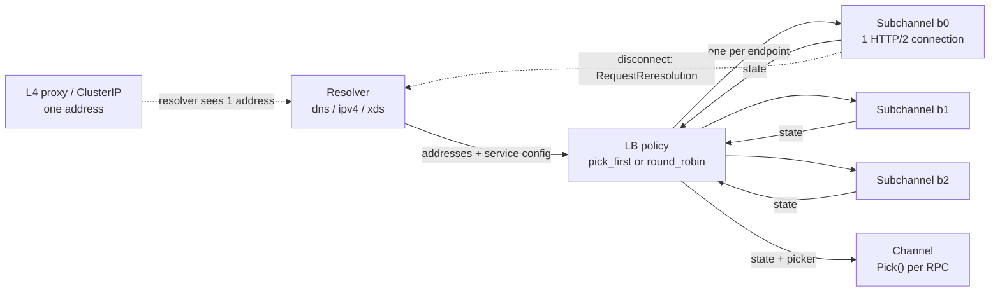

# Solving the gRPC Load Balancing Dilemma: Headless DNS Service Discovery, Client-Side round_robin Subchannels, and Proxyless xDS

> [!summary] Claim
> A gRPC channel multiplexes every RPC onto one long-lived HTTP/2 connection per backend address, so an L4 balancer (a Kubernetes `ClusterIP`, a cloud TCP load balancer) balances connections, not calls, and a single client stays pinned to one backend until its connection dies; the fix is to let the client see every backend address (headless DNS, a static `ipv4:` list, or xDS) and to run `round_robin` (or a weighted, hashing, or least-loaded policy) so the load-balancing decision happens per call, or to move the decision into an L7 proxy.

Part of [gRPC and Protocol Buffers](README.md) in [API Engineering](../README.md).

## TL;DR

- Mechanism: a channel is resolver -> LB policy -> subchannels -> picker; the resolver yields addresses (and optionally a service config), the policy owns one subchannel (one HTTP/2 connection) per endpoint, and the policy's picker chooses a subchannel for each RPC (gRPC `doc/load-balancing.md`, v1.85.1).
- Contract rule: the default policy is `pick_first`, which sends every RPC to one address; `round_robin` must be selected explicitly, by `loadBalancingConfig` in the service config (highest precedence), the deprecated `loadBalancingPolicy`, or the `grpc.lb_policy_name` channel argument (grpc-core 1.85.1 `client_channel.cc`, `ChooseLbPolicy`).
- Trap: `round_robin` only helps if the resolver returns more than one address; behind a single virtual IP it degenerates to `pick_first`, and the lab shows 30 of 30 RPCs on one backend through an L4 proxy even with `round_robin` selected.
- Portability: the policies and their JSON config are specified once in gRFCs, but implementations differ by release (C-core, Python, and Ruby share one core; `least_request` is listed for Java only and `random_subsetting_experimental` is absent from the C-core 1.85.1 tree), so check `doc/grpc_xds_features.md` before depending on a policy.
- When not to use: do not build client-side balancing when clients are browsers, short-lived scripts, or too numerous for full connection fan-out; use an L7 proxy, or `pick_first` with `shuffleAddressList` plus `max_connection_age`, or subsetting.

## Mental model



The resolver turns a target (`dns:///svc:50051`, `ipv4:a,b,c`, `xds:///svc`) into a list of endpoints; the LB policy creates one subchannel per endpoint and reports an aggregate connectivity state plus a picker back to the channel, and the channel asks the picker once per RPC.
Solid arrows are the steady state; the dotted arrow from a subchannel back to the resolver is the only thing that makes a DNS resolver look again, because gRPC's DNS resolver does not poll on a TTL.
The bottom dotted edge is the dilemma: an L4 virtual IP collapses the endpoint list to one address, so no policy has anything to choose between, and the L4 balancer decided once, at connection time.

## How it works

### 1. Why L4 balancing fails for gRPC

gRPC runs over HTTP/2, which multiplexes many streams over one TCP connection (see [[gRPC-Over-HTTP-2-Framing-Length-Prefixed-Messages-and-Trailers]]).
The gRPC load balancing design states the goal directly: "Load-balancing within gRPC happens on a per-call basis, not a per-connection basis" (`doc/load-balancing.md`, Background).
A TCP-level balancer sees only the connection, so it makes one decision per client connection and every RPC on that connection follows it.
The lab reproduces this with an in-process L4 proxy that hands each accepted connection to the next upstream in turn ([implementation](../labs/src/api_labs/f19_grpc_and_protocol_buffers/grpc_load_balancing.py), `L4Proxy`):

| Setup | Connections the proxy accepted | Per-backend RPCs (30 total) |
| --- | --- | --- |
| 1 channel, `round_robin` selected, via the proxy | 1 | `b0`: 30 |
| 3 channels, 10 RPCs each, via the proxy | 3 (assigned `0, 1, 2`) | `b0`, `b1`, `b2`: 10 each |

Both rows are assertions in the lab test (`test_l4_proxy_pins_one_channel_to_one_backend_whatever_the_policy`, `test_l4_proxy_balances_connections_so_many_clients_spread_but_each_stays_pinned`), run on CPython 3.14.6, macOS arm64, `grpcio 1.85.1`.
With many clients the connection-level spread averages out; with few clients, or one fat client such as a gateway, it does not, and the busiest backend carries a multiple of the mean (a client pinned to one of three backends is at `3.0x`, asserted by `imbalance` in the lab).

### 2. The client channel pipeline

1. On startup the channel resolves the name; the result is addresses, an optional service config, and attributes (`doc/load-balancing.md`, Workflow, step 1).
2. The channel instantiates the LB policy with its config and the address list.
3. The policy creates subchannels (which may differ from the resolver's addresses) and watches their connectivity.
4. For each RPC the policy's picker selects a subchannel (`doc/load-balancing.md`, Workflow, steps 2 to 4).

The policy is chosen in `ChooseLbPolicy` (grpc-core 1.85.1 `src/core/client_channel/client_channel.cc`) in this order:

1. The `loadBalancingConfig` list in the service config, parsed by `LoadBalancingPolicyRegistry::ParseLoadBalancingConfigHelper` (`lb_policy_registry.cc`): the first entry whose policy name is registered wins; an entry with more than one key is a `oneOf violation`; if none is known the whole config is an error, `No known policies in list: ...` (gRFC A24).
2. The deprecated `loadBalancingPolicy` string in the service config.
3. The `grpc.lb_policy_name` channel argument (`GRPC_ARG_LB_POLICY_NAME`); if the name is unregistered or the policy requires a config, the channel logs an error and uses `pick_first`.
4. `pick_first`.

The service config comes from the resolver, or, when the resolver returns none, from the `grpc.service_config` channel argument (`channel_arg_names.h`: "This value will be ignored if the name resolver returns a service config").
The lab proves the precedence on the real runtime: `grpc.service_config` selecting `pick_first` together with `grpc.lb_policy_name=round_robin` yields `{"b0": 12}` (`test_service_config_outranks_the_lb_policy_name_channel_arg`), and an unregistered name degrades silently to `pick_first` (`test_unknown_lb_policy_name_channel_arg_degrades_to_pick_first`).

### 3. Name resolution and headless DNS

`doc/naming.md` defines the schemes: `dns:[//authority/]host[:port]` (the default when no scheme is given, port `443` if absent), `unix:`, `unix-abstract:`, `vsock:`, and, in C-core, `ipv4:addr[:port][,addr...]` and `ipv6:` static lists.
The static `ipv4:` list is the simplest way to hand a policy several addresses with no DNS at all, and it is what the lab uses.

A Kubernetes headless Service is `.spec.clusterIP: None`: "a cluster IP is not allocated, kube-proxy does not handle these Services, and there is no load balancing or proxying done by the platform"; for a headless Service with selectors the control plane creates EndpointSlices and the DNS name returns A or AAAA records that point directly at the pods (Kubernetes docs, Services, Headless Services).
That multi-record answer is exactly the endpoint list the gRPC DNS resolver wants, and it is the reason `dns:///my-svc.my-ns.svc.cluster.local:50051` plus `round_robin` works where the same name against a `ClusterIP` Service does not.

The DNS resolver (grpc-core 1.85.1 `src/core/resolver/dns/dns_resolver.cc`, `ClientChannelDNSResolver`) is a `PollingResolver`, and its re-resolution rules matter more than its lookups:

- It does not poll on the record TTL.
  A new resolution starts when the LB policy calls `RequestReresolution()` (`polling_resolver.cc`, `RequestReresolutionLocked`), which `pick_first` does when its selected connection breaks and when every address has failed (`pick_first.cc`, `SubchannelState::OnConnectivityStateChange` for the selected subchannel and `SubchannelData::OnConnectivityStateChange` when every address has failed), and which `round_robin` inherits because each endpoint's `pick_first` child delegates its control helper to the parent (`endpoint_list.cc`, `Endpoint::Helper`).
- A request inside the cooldown is deferred: `MaybeStartResolvingLocked` schedules the next resolution at `last_resolution + min_time_between_resolutions`, which defaults to `30` seconds (`grpc.dns_min_time_between_resolutions_ms`, `channel_arg_names.h`; `dns_resolver.cc`, `CreateResolver`).
- When the channel reports the result unusable, the resolver retries with its own backoff of `1` s initial, `1.6` multiplier, `0.2` jitter, `120` s max (`dns_resolver.cc` constants `GRPC_DNS_INITIAL_CONNECT_BACKOFF_SECONDS` and friends; `polling_resolver.cc`, `GetResultStatus`).
- Each resolved address becomes its own endpoint, because DNS cannot say which addresses belong to one machine (gRFC A61, "Allow Resolvers to Return Multiple Addresses Per Endpoint").
- gRPC expects the DNS resolver to apply RFC 6724 address sorting, and A62 notes that client-side DNS caching can defeat server-side record shuffling (gRFC A62, "L4 Load Balancing").
- Service config over DNS is opt-in: the resolver looks up a TXT record named `_grpc_config.<name>` only when `grpc.service_config_disable_resolution` is set to `0` (default disabled, `channel_arg_names.h` and `dns_resolver.cc`, `request_service_config_`; record format in gRFC A2).
  SRV lookups run only with `grpc.dns_enable_srv_queries` and serve `grpclb`.
- In 1.85.1 `RegisterDnsResolver` registers `ClientChannelDNSResolverFactory` (`dns_resolver.cc`), which delegates to `PosixEventEngine::GetDNSResolver` (`src/core/lib/event_engine/posix_engine/posix_engine.cc`): `doc/environment_variables.md` states `GRPC_DNS_RESOLVER` selects `ares` (default where built with c-ares) or `native` (`getaddrinfo()`), and running the `grpcio 1.85.1` macOS arm64 wheel with `GRPC_TRACE=event_engine_dns` and `GRPC_VERBOSITY=INFO` logs `PosixEventEngine::... creating AresResolver` by default.

The consequence for operators: with headless DNS, a scale-out from 3 to 6 pods is invisible to existing clients until something breaks their connections and the cooldown elapses; a scale-in is visible only as connection failures.

### 4. Subchannels, connectivity states, and backoff

A subchannel is the policy-facing wrapper around a connection to one address, with its own connectivity state: `IDLE`, `CONNECTING`, `READY`, `TRANSIENT_FAILURE`, `SHUTDOWN` (`doc/connectivity-semantics-and-api.md`).
Connection attempts use exponential backoff: `INITIAL_BACKOFF` 1 s, `MULTIPLIER` 1.6, `JITTER` 0.2, `MAX_BACKOFF` 120 s, `MIN_CONNECT_TIMEOUT` 20 s (`doc/connection-backoff.md`; `subchannel.cc`, `GRPC_SUBCHANNEL_*` defines, overridable by `grpc.initial_reconnect_backoff_ms`, `grpc.min_reconnect_backoff_ms`, `grpc.max_reconnect_backoff_ms`).
`BackOff::NextAttemptDelay` (`src/core/util/backoff.cc`) returns the initial value first, multiplies by `1.6` on each later call, clamps to the maximum, then multiplies by a uniform factor in `[1 - 0.2, 1 + 0.2]`.
The lab ports it exactly (`Backoff`): with the jitter factor pinned to `1.0` the delays are `1, 1.6, 2.56, ...`, the tenth call returns `1.6^10 = 109.95` s and the eleventh is capped at `120` s.
`Subchannel::StartConnectingLocked` sets `next_attempt_time = now + NextAttemptDelay()` and gives the attempt the deadline `max(next_attempt_time, now + min_connect_timeout)`.
The backoff resets to its initial value when a connection succeeds (`subchannel.cc`, where the connected subchannel is published after `backoff_.Reset()`); `doc/connection-backoff.md` ties the reset to receipt of the server's `SETTINGS` frame, which is how it knows the server accepted the connection.

Two properties follow.
Backoff is per subchannel, so a backend that is down costs one slow reconnect loop, not a channel-wide stall.
Jitter disperses clients that all lost the same server at the same instant; `doc/connection-backoff.md` requires that "connection backoffs started at the same time disperse".

Subchannels are shared between channels through a global subchannel pool keyed by `SubchannelKey`, whose fields are the resolved address (`grpc_resolved_address address_`) and the channel arguments (`ChannelArgs args_`) (`src/core/client_channel/subchannel_pool_interface.h`, `SubchannelKey`; `subchannel.cc`, `Subchannel::Create`), unless `grpc.use_local_subchannel_pool` is set (`channel_arg_names.h`), so channels in one process with identical addresses and arguments reuse a subchannel.

### 5. `pick_first`: ordered, sticky, and the L4 workaround

`pick_first` takes the endpoint list and keeps one connection (`doc/load-balancing.md`): "all RPCs sent on the channel will be sent to that address".
Its picker is a constant: `Picker::Pick` returns the selected subchannel and nothing else (`pick_first.cc`, `PickFirst::Picker`).
Behavior in grpc-core 1.85.1:

- Order and Happy Eyeballs.
  `UpdateLocked` flattens the endpoints to one address each and interleaves address families as in RFC 8305 Section 4 (the first family seen leads, then families alternate); the lab ports the interleave (`interleave_by_family`).
  The first pass over the list starts a connection attempt on the first address, then on the next after `grpc.happy_eyeballs_connection_attempt_delay_ms` (default `250`, clamped to `100..2000` in the constructor) or as soon as an attempt fails; after the pass every address is tried in parallel, and the first `READY` wins and the other subchannels are dropped (gRFC A61, "Happy Eyeballs in the pick_first LB Policy"; `pick_first.cc`, `MaybeFinishHappyEyeballsPass`, `Select`).
- Failover is in list order.
  With no shuffling the first reachable address in the list is the one used; the lab shows `b0` serves the first RPC, and after `b0` is stopped traffic moves to `b1` and `b2` stays at zero hits (`test_pick_first_fails_over_to_the_next_address_in_list_order`).
- Disconnect handling.
  If the selected subchannel changes state, `pick_first` counts a disconnection, calls `RequestReresolution()`, and then either reports `CONNECTING` and starts a new connection pass (new state `CONNECTING` or `TRANSIENT_FAILURE`) or goes `IDLE` and stays there until an RPC or an explicit connect request arrives (`doc/load-balancing.md`; `pick_first.cc`, `SubchannelState::OnConnectivityStateChange`, `GoIdle`).
- Sticky `TRANSIENT_FAILURE`.
  When every address has failed the policy reports `TRANSIENT_FAILURE` and keeps retrying with backoff; the status text is `failed to connect to all addresses; last error: ...` (`pick_first.cc`; gRFC A62, "Use sticky-TF by default", which also recommends a 30 minute `IDLE_TIMEOUT`; the `grpc.client_idle_timeout_ms` argument exists in `channel_arg_names.h`).
- Resolver errors never discard good addresses: an update carrying an error keeps the previous list (`pick_first.cc`, end of `UpdateLocked`), and an update whose list no longer contains the selected address drops the connection and goes `IDLE`.
- `shuffleAddressList`.
  The `pick_first` config has one field, `shuffleAddressList` (boolean, default false), which shuffles the list once per update (`pick_first.cc`, `PickFirstConfig`; gRFC A62).
  It exists because "`pick_first` ... is often used for L4 load balancing by randomizing the order of the addresses used by each client".
  In the lab, 24 fresh channels without shuffling all land on `b0`, and 24 with `{"pick_first": {"shuffleAddressList": true}}` land on at least two backends (`test_pick_first_shuffle_address_list_spreads_clients_across_backends`; the failure probability of that assertion is below `3^-23` per run for a uniform shuffle).
  A weighted variant that reads `GRPC_ARG_ADDRESS_WEIGHT` is gated at runtime on `IsExperimentEnvVarEnabled("GRPC_EXPERIMENTAL_PF_WEIGHTED_SHUFFLING")` (`pick_first.cc`, `PfWeightedShufflingEnabled`; gRFC A113, status In Review as of 2026-11), so it is disabled by default in `grpcio 1.85.1` unless `GRPC_EXPERIMENTAL_PF_WEIGHTED_SHUFFLING` is enabled in the environment.

`pick_first` is the correct choice for a single backend, for L4-balanced fleets where each client holds one connection, and for leaf-level connection management under other policies.
It is the wrong choice whenever one client must spread calls.

### 6. `round_robin`: one pick_first child per endpoint

In 1.85.1 `round_robin` is a petiole policy: `RoundRobinEndpointList` creates, for each endpoint, a child `pick_first` instance with health checking enabled (`endpoint_list.cc`, `Endpoint::Init`, which sets `GRPC_ARG_INTERNAL_PICK_FIRST_ENABLE_HEALTH_CHECKING`) so that an endpoint with several addresses uses Happy Eyeballs (gRFC A61, "Use pick_first as the Universal Leaf Policy").
It tracks how many children are in each state and applies a first-match rule (`round_robin.cc`, `MaybeUpdateRoundRobinConnectivityStateLocked`):

1. any child `READY` -> the policy is `READY`, with a picker over exactly the `READY` children;
2. else any child `CONNECTING` or `IDLE` -> `CONNECTING` (`UpdateStateCountersLocked` counts `IDLE` as `CONNECTING`, and a child reporting `IDLE` is told to `ExitIdleLocked()` at once, so the policy never reports `IDLE`; the `doc/load-balancing.md` sentence about an `IDLE` aggregate does not match the source);
3. else all children `TRANSIENT_FAILURE` -> `TRANSIENT_FAILURE` with the message `connections to all backends failing; last error: ...`.

The picker is a shared atomic counter: `Pick` does `fetch_add(1, relaxed) % pickers_.size()`, and the starting index is random per picker, "For discussion on why we generate a random starting index for the picker", the source points to `grpc/grpc-go` issue `2580` (`round_robin.cc`, `Picker::Picker` and `Picker::Pick`).
The reason in outline: without a random start every freshly created channel would send its first RPC to the first address, concentrating load from many clients on one backend.
Every state change builds a new picker, with a new random start, so counts are exactly even only while the `READY` set is stable; the lab warms the channel until all three backends have answered, which proves all three were `READY` at once, and then asserts exactly `10/10/10` over 30 serial RPCs (`test_round_robin_spreads_rpcs_evenly_once_every_subchannel_is_ready`).
`round_robin` with a stopped backend drops it from the `READY` set and keeps cycling the rest: after stopping `b1` the lab waits for a window of six calls that contains only `b0` or `b2`, then asserts `10/10` (`test_round_robin_drops_a_stopped_backend_and_keeps_balancing_the_rest`); calls that race the connection teardown can see `UNAVAILABLE`, which the lab's `survive_call` helper treats as a retry signal.

Address updates are staged: a new endpoint list is built as `latest_pending_endpoint_list_` and swapped in when (a) the current list has no `READY` child, or (b) the pending list has a `READY` child and every endpoint has reported an initial state, or (c) every pending child is `TRANSIENT_FAILURE`; an empty list is promoted immediately and reports `TRANSIENT_FAILURE` with `empty address list` (`round_robin.cc`, `UpdateLocked`).
This is why a DNS change does not drop traffic: the old list keeps serving until the new one has something `READY`.

`round_robin` balances call counts, not load.
Equal counts to unequal machines, or to calls of unequal cost, still produce hot spots; that is the case for the policies in the next section.

### 7. Beyond round robin: weighted, hashing, least-loaded, subsetting

| Policy | Idea | Key parameters and defaults | In C-core 1.85.1 |
| --- | --- | --- | --- |
| `weighted_round_robin` | weight each endpoint by `qps / (utilization + eps / qps * errorUtilizationPenalty)` from backend load reports (ORCA), per call or out of band | `enableOobLoadReport` false, `oobReportingPeriod` 10 s, `blackoutPeriod` 10 s, `weightUpdatePeriod` 1 s (floor 100 ms), `weightExpirationPeriod` 3 min, `errorUtilizationPenalty` 1.0 (`weighted_round_robin.h`, `weighted_round_robin.cc`) | yes (C++, Python since v1.55.0, `doc/grpc_xds_features.md`) |
| `ring_hash_experimental` | consistent hashing of a per-request hash onto a ring of endpoints, for affinity | `minRingSize` 1024, `maxRingSize` 4096 locally (xDS allows up to 8388608 but `grpc.lb.ring_hash.ring_size_cap` defaults to 4096), hash `XXH64` seed 0 (gRFC A42; `ring_hash.cc`; `xds_cluster_parser.cc`) | yes, selected through xDS |
| `least_request_experimental` | power of two choices over in-flight request counts | `choiceCount` 2, range `[2, 10]` (gRFC A48) | no `least_request` file in the v1.85.1 `src/core/load_balancing/` tree; the features table lists Java only |
| `random_subsetting_experimental` | each client keeps `subset_size` endpoints chosen by rendezvous hashing with a per-client random seed | `subset_size` required, `> 0` (gRFC A68) | not present in the v1.85.1 tree listing |
| `outlier_detection_experimental` | eject endpoints with abnormal success rate or failure percentage | `interval` 10 s, `baseEjectionTime` 30 s, `maxEjectionTime` 300 s, `maxEjectionPercent` 10 (gRFC A50; `outlier_detection.h`, `outlier_detection.cc`) | yes, inserted by the xDS `cds` policy |

For `weighted_round_robin`, a subchannel included with weight zero is still picked "but with the average weight", and with fewer than two endpoints holding load data the policy behaves like `round_robin` (gRFC A58).
`MaybeUpdateWeight` ignores an update whose computed weight is zero; `GetWeight` returns zero when the last update is older than `weightExpirationPeriod` or less than `blackoutPeriod` after the first non-empty report (`weighted_round_robin.cc`); the lab ports both formulas (`wrr_weight`, `wrr_usable_weight`) and pins them with arithmetic cases (`100 qps, 0.5 utilization` gives `200`; adding `10` errors per second gives `100 / 0.6`).
The cost of WRR is that every backend must export load data, or the policy silently degrades to `round_robin`.

### 8. Proxyless xDS

xDS replaces the static address list and the per-channel service config with a control plane that pushes configuration to the client library, with no sidecar in the data path.
The pieces, as implemented in grpc-core 1.85.1:

- Target and bootstrap.
  The channel target is `xds:///service.example.com:50051`.
  The xDS client finds its bootstrap in the file named by `GRPC_XDS_BOOTSTRAP`, else the JSON in `GRPC_XDS_BOOTSTRAP_CONFIG`, else a programmatic fallback (`xds_client_grpc.cc`, `FindBootstrapContents`).
  The parser accepts `xds_servers` (required), `node`, `certificate_providers`, `authorities`, `client_default_listener_resource_name_template`, and `allowed_grpc_services` (`xds_bootstrap_grpc.cc`); each `xds_servers` entry carries a `server_uri` and a `channel_creds` list, of which the client uses the first type it supports (gRFC A27, "XdsClient and Bootstrap File").
  Without a bootstrap the channel fails fast and visibly; on this machine, `xds:///who.example.com:50051` through `grpc.aio.insecure_channel` with both variables unset returned `StatusCode.UNAVAILABLE` with details `Failed to create XdsClient: Environment variables GRPC_XDS_BOOTSTRAP or GRPC_XDS_BOOTSTRAP_CONFIG not defined`, and the core logged `channel will remain in TRANSIENT_FAILURE` (Python 3.14.6, `grpcio 1.85.1`, macOS arm64, one run).
- Watches.
  The `xds` resolver derives the listener name from the target through `client_default_listener_resource_name_template` (default `%s`), or `xdstp://` names when the URI has an authority (`xds_resolver.cc`), then follows listener -> route configuration -> cluster -> endpoints (`Listener` -> `RouteConfiguration` -> `Cluster` -> `ClusterLoadAssignment`, gRFC A27).
  Since gRFC A74 all of these watches live in the resolver (`XdsDependencyManager`) so a multi-resource change applies atomically, the `xds_cluster_resolver` policy was removed, and the LB tree receives the full config as an attribute; the CDS/EDS split in the 2020 text of gRFC A27 is historical.
- Policy tree.
  The resolver synthesizes a service config whose top policy is `xds_cluster_manager_experimental`, with a `cds_experimental` child per cluster (`xds_resolver.cc`).
  For each leaf cluster the `cds` policy builds `outlier_detection_experimental` -> `xds_cluster_impl_experimental` -> `xds_override_host_experimental` -> `priority_experimental`, with one priority child per EDS priority (`cds.cc`, `CdsLb::CreateChildPolicyConfigForLeafCluster`); an aggregate cluster becomes a `priority_experimental` whose children are `cds_experimental` instances for each underlying cluster (`cds.cc`, `CdsLb::CreateChildPolicyConfigForAggregateCluster`).
  The per-priority child comes from the cluster's `load_balancing_policy` field (gRFC A52), or, from the legacy `lb_policy` enum, `ROUND_ROBIN` becomes `xds_wrr_locality_experimental` with a `round_robin` child (locality weights choose the locality, `round_robin` the endpoint inside it) and `RING_HASH` becomes `ring_hash_experimental` with `minRingSize` and `maxRingSize` (`xds_cluster_parser.cc`, `ParseLbPolicyConfig`); any other enum value is rejected with `LB policy is not supported`.
  The `priority` policy fails over to the next priority after a child has been unready for `10` seconds and keeps deactivated children for `15` minutes (`priority.cc`, `kDefaultChildFailoverTimeout`, `kChildRetentionInterval`).
- NACK semantics.
  A client "will simply ignore the configuration of a feature it does not support", but NACKs a supported field with an unsupported value, and since the protocol rejects whole responses, one unsupported cluster policy rejects every cluster in the response; rolling `ROUND_ROBIN` to `RING_HASH` therefore needs every client upgraded first (`doc/grpc_xds_features.md`).
- Scope notes.
  gRPC does not implement Envoy overprovisioning and reports per-locality, not per-endpoint, load (`doc/grpc_xds_features.md`); the same document's sentence that `load_balancing_weight` on an endpoint is always ignored is stale for C-core 1.85.1, where `ParseEndpointAddresses` (`src/core/xds/grpc/xds_endpoint_parser.cc`) reads `envoy_config_endpoint_v3_LbEndpoint_load_balancing_weight` into `GRPC_ARG_ADDRESS_WEIGHT` and `cds.cc` multiplies or normalizes it with the locality weight (`GRPC_ARG_XDS_LOCALITY_WEIGHT`) for `ring_hash_experimental` and weighted `pick_first` (gRFC A42, gRFC A113).
- Python surface.
  `grpc.xds_channel_credentials(fallback_credentials=None)` and `grpc.xds_server_credentials(fallback_credentials)` are present in `grpcio 1.85.1` and marked EXPERIMENTAL in their docstrings; the channel itself needs only the `xds:` target and the bootstrap variable.
  Feature availability by language and release (for example `weighted_round_robin` C++ and Python v1.55.0, Java v1.54.0, Go v1.56.0; xDS fallback C++ v1.67.0, Java v1.71.0, Go v1.70.0) is tabulated in `doc/grpc_xds_features.md` (as of v1.85.1).

### 9. Making any policy re-balance: `max_connection_age`

Static connections never rebalance.
gRFC A9 defines server-side `MAX_CONNECTION_AGE` (default infinite), applies a `+/-10%` per-connection jitter, and closes by sending a `GOAWAY` with `NO_ERROR` and debug data `max_age`, then draining for `MAX_CONNECTION_AGE_GRACE`; its stated purpose includes "a L4 LB which allows spreading load more quickly" (gRFC A9; channel arguments `grpc.max_connection_age_ms` and `grpc.max_connection_age_grace_ms`, `channel_arg_names.h`; see also [[gRPC-Keepalive-Flow-Control-and-Max-Message-Size-Tuning]]).
After the `GOAWAY` the subchannel leaves `READY`; `pick_first` goes `IDLE` or reconnects, and a `round_robin` child reconnects at once; behind an L4 balancer the new connection is a new balancing decision.
The lab shows both sides: with `grpc.max_connection_age_ms=300` on three backends behind the proxy, a single client sees at least two distinct backends and the proxy accepts at least two connections; with no age limit, 20 RPCs use exactly one connection (`test_max_connection_age_makes_an_l4_balanced_client_move_between_backends`).
Choose the age to bound reconnect churn: each recycle is a TCP and TLS handshake plus a brief window of in-flight RPCs draining.

## Numbers and limits

| Quantity | Value | Source |
| --- | --- | --- |
| Default LB policy | `pick_first` | `doc/load-balancing.md`; `client_channel.cc`, `ChooseLbPolicy` |
| Connection backoff | initial 1 s, x1.6, jitter 0.2, max 120 s, min connect timeout 20 s | `doc/connection-backoff.md`; `subchannel.cc` defines (grpc-core 1.85.1) |
| DNS minimum time between resolutions | 30 s (`grpc.dns_min_time_between_resolutions_ms`) | `channel_arg_names.h`; `dns_resolver.cc`, `CreateResolver` |
| DNS resolver retry backoff | 1 s, x1.6, jitter 0.2, max 120 s | `dns_resolver.cc` defines |
| c-ares query timeout | 120000 ms (`grpc.dns_ares_query_timeout`) | `channel_arg_names.h` |
| Happy Eyeballs connection attempt delay | 250 ms default, clamped to 100 to 2000 ms | `pick_first.cc`, constructor |
| `pick_first` recommended idle timeout | 30 minutes (a recommendation in the gRFC) | gRFC A62 |
| `round_robin` picker | `fetch_add` counter modulo READY children, random start index | `round_robin.cc`, `Picker` |
| WRR defaults | blackout 10 s, update period 1 s (min 100 ms), expiration 3 min, OOB period 10 s, error penalty 1.0 | `weighted_round_robin.h`, `weighted_round_robin.cc` |
| Ring hash size | min 1024, max 4096 locally; cap `grpc.lb.ring_hash.ring_size_cap` default 4096; xDS max 8388608 | gRFC A42; `channel_arg_names.h`; `xds_cluster_parser.cc` |
| Least request `choiceCount` | 2, range 2 to 10 | gRFC A48 |
| Outlier detection | interval 10 s, base ejection 30 s, max ejection 300 s, max ejected 10 percent | gRFC A50; `outlier_detection.h`, `outlier_detection.cc` |
| `priority` failover timeout / child retention | 10 s / 15 min | `priority.cc` |
| `MAX_CONNECTION_AGE` | infinite by default, +/-10% jitter, `GOAWAY` debug data `max_age` | gRFC A9 |
| `grpc.max_connections_per_subchannel_cap` | 10 (cap on a service-config-requested value) | `channel_arg_names.h` |
| Lab: RPCs per backend, `pick_first`, 3 backends, 30 RPCs | `b0`: 30 (imbalance 3.0) | lab test, CPython 3.14.6, macOS arm64, `grpcio 1.85.1` |
| Lab: RPCs per backend, `round_robin`, warmed, 30 RPCs | 10, 10, 10 (imbalance 1.0) | lab test, same environment |
| Lab: one channel through the L4 proxy | 1 connection, `b0`: 30 | lab test, same environment |
| Lab: whole test module | 37 tests passed in 0.83 s | see Worked example |

All C-core defaults are as of grpc-core v1.85.1 and `grpcio 1.85.1`, current as of 2026-11.

## Portability

| Dimension | Status | Proof |
| --- | --- | --- |
| CPython 3.14.6 (workspace interpreter), macOS arm64 | passes, 37 tests | lab run on this machine |
| CPython 3.12, 3.13, 3.15.2, 3.15t | not run | the job brief paused the interpreter matrix (2026-11-11 instruction); no claim made |
| Debian Trixie, Alpine musl | not run | same pause; the socket tests use only `127.0.0.1:0` |
| `grpcio` 1.85.1 only | passes | pinned in `labs/pyproject.toml`; other point releases unchecked |
| C-core (C++, Python, Ruby, PHP) vs Go vs Java | policies differ by release | `doc/grpc_xds_features.md`: `weighted_round_robin` v1.55.0 / Java v1.54.0 / Go v1.56.0; `pick_first` gRFC A62 v1.58.0 / Java v1.58.1 / Go v1.56.0; dualstack A61 v1.66.1 / Go v1.71.0; `least_request` listed for Java only |
| xDS in Python | `xds:` target and `xds_channel_credentials` present; bootstrap required | observed `UNAVAILABLE` without bootstrap, one run; docstring says EXPERIMENTAL |
| ASGI servers (Uvicorn, Hypercorn, Granian) | not applicable | gRPC servers use gRPC's own HTTP/2 stack, not ASGI |
| HTTP/1.1, HTTP/2, HTTP/3 | HTTP/2 only | `doc/PROTOCOL-HTTP2.md` defines the gRPC wire protocol over HTTP/2 (see [[gRPC-Over-HTTP-2-Framing-Length-Prefixed-Messages-and-Trailers]]); grpc-core 1.85.1 defines no HTTP/1.1 or HTTP/3 gRPC transport |

## Worked example

The lab ([implementation](../labs/src/api_labs/f19_grpc_and_protocol_buffers/grpc_load_balancing.py), [test](../labs/tests/f19_grpc_and_protocol_buffers/test_grpc_load_balancing_subchannels_pick_first_vs_round_robin_and_xds.py)) has pure ports of the policy logic and a real `grpc.aio` harness on `127.0.0.1:0`: N backends that answer `/lab.Who/Who` with their name, and an L4 proxy.

Simplified excerpt of the `round_robin` model (`aggregate_round_robin`, `RoundRobinPicker`):

```python
def aggregate_round_robin(states: Sequence[State]) -> State:
    if any(s is State.READY for s in states):
        return State.READY
    if any(s in (State.CONNECTING, State.IDLE) for s in states):
        return State.CONNECTING
    return State.TRANSIENT_FAILURE


@dataclass(slots=True)
class RoundRobinPicker:
    ready: tuple[str, ...]
    next_index: int

    def pick(self) -> str:
        index = self.next_index % len(self.ready)
        self.next_index += 1
        return self.ready[index]
```

Simplified excerpt of the L4 proxy connection handler, which decides once per connection:

```python
async def _on_connect(self, reader, writer) -> None:
    index = len(self.assignments) % len(self._ports)
    self.assignments.append(index)
    up_reader, up_writer = await asyncio.open_connection("127.0.0.1", self._ports[index])
    await asyncio.gather(_pipe(reader, up_writer), _pipe(up_reader, writer))
```

Simplified excerpt of the central socket test, `round_robin` selected through the service config over a static `ipv4:` list:

```python
async with start_backends(3) as backends:
    target = ipv4_target([b.address for b in backends])
    options = [("grpc.service_config", lb_service_config("round_robin"))]
    async with make_channel(target, options) as channel:
        await warm_up(channel, set(NAMES))
        tally = await sample(channel, 30)
assert tally == {"b0": 10, "b1": 10, "b2": 10}
```

Captured run, from `labs/`, CPython 3.14.6, macOS 27.3 (Darwin 27.3.0) arm64, `grpcio 1.85.1`, `pytest 9.2.0`:

```text
$ uv run --frozen pytest tests/f19_grpc_and_protocol_buffers/test_grpc_load_balancing_subchannels_pick_first_vs_round_robin_and_xds.py -q
.....................................                                    [100%]
37 passed in 0.83s
```

The test names, from `pytest --collect-only -q` (37 collected), include the socket tests:

```text
test_pick_first_sends_every_rpc_to_the_first_address
test_round_robin_spreads_rpcs_evenly_once_every_subchannel_is_ready
test_lb_policy_name_channel_arg_selects_round_robin
test_service_config_outranks_the_lb_policy_name_channel_arg
test_unknown_lb_policy_name_channel_arg_degrades_to_pick_first
test_pick_first_shuffle_address_list_spreads_clients_across_backends
test_round_robin_drops_a_stopped_backend_and_keeps_balancing_the_rest
test_pick_first_fails_over_to_the_next_address_in_list_order
test_l4_proxy_pins_one_channel_to_one_backend_whatever_the_policy
test_l4_proxy_balances_connections_so_many_clients_spread_but_each_stays_pinned
test_max_connection_age_makes_an_l4_balanced_client_move_between_backends
```

The module was re-run once in the finish pass (`37 passed in 0.83s` on CPython 3.14.6, macOS 27.3 Darwin 27.3.0 arm64).
Mutation testing was not run, by the job's pause instruction, so discrimination of each test is argued from its assertions and not proven by mutation.

## Pitfalls

> [!warning] One virtual IP, no balancing
> Trigger: the client targets a Kubernetes `ClusterIP` Service, a cloud TCP load balancer, or any single address, and selects `round_robin`.
> Symptom: one backend takes all traffic from each client; adding replicas changes nothing; the lab shows 1 connection and 30 of 30 RPCs on `b0`.
> Fix: use a headless Service or an `xds:` target so the resolver returns every endpoint, or put an L7 proxy in front, or recycle connections with `max_connection_age` so the L4 balancer decides again.

> [!warning] `pick_first` is the default and it does not spread
> Trigger: a headless DNS name resolving to several records and no service config.
> Symptom: every RPC from a client goes to the first reachable address, and clients that all see the same record order all pick the same backend; the lab shows `{"b0": 30}`.
> Fix: select `round_robin`, or keep `pick_first` and set `shuffleAddressList` when each client should hold one connection (gRFC A62).

> [!warning] New pods get no traffic
> Trigger: scale-out behind headless DNS with long-lived connections.
> Symptom: old pods stay hot and new pods idle; gRPC DNS does not follow the record TTL and re-resolves only after a disconnect, no more often than every `30` s.
> Fix: set `grpc.max_connection_age_ms` on servers (jittered `+/-10%`, gRFC A9), or move to xDS where the control plane pushes endpoint changes, or lower `grpc.dns_min_time_between_resolutions_ms` knowing it raises DNS load.

> [!warning] Precedence surprises with `grpc.lb_policy_name`
> Trigger: setting `grpc.lb_policy_name=round_robin` while a service config (from DNS TXT, the resolver, or `grpc.service_config`) already names a policy, or misspelling the name.
> Symptom: the channel runs `pick_first` and only an error log mentions it; the lab shows the service config winning and an unknown name degrading silently.
> Fix: set the policy in one place, prefer `loadBalancingConfig`, and assert the observed distribution in a test; enable the `round_robin`, `pick_first`, and `client_channel` tracers (tracer names in the source; `GRPC_TRACE` in `doc/environment_variables.md`) when diagnosing.

> [!warning] Equal counts are not equal load
> Trigger: `round_robin` over heterogeneous backends or calls of very different cost.
> Symptom: a slow node queues while others idle, because the picker ignores load.
> Fix: `weighted_round_robin` with backend load reports (otherwise it degrades to `round_robin`), `least_request` where the runtime has it, or outlier detection through xDS.

> [!warning] Connection fan-out
> Trigger: `round_robin` with many clients and many servers.
> Symptom: every server holds a connection from every client (`N x M`), costing memory, keepalive traffic, and TLS state, and making local decisions imprecise; gRFC A68 states this as its motivation.
> Fix: subsetting where available, a proxy tier, or `pick_first` with shuffling.

> [!warning] xDS config rejected wholesale
> Trigger: a control plane sets a cluster `lb_policy` or field that some clients do not support.
> Symptom: those clients NACK the response and reject every cluster in it (`doc/grpc_xds_features.md`); with no bootstrap the channel stays in `TRANSIENT_FAILURE` (observed: `Environment variables GRPC_XDS_BOOTSTRAP or GRPC_XDS_BOOTSTRAP_CONFIG not defined`).
> Fix: upgrade clients before enabling a policy, canary by node metadata, and verify the bootstrap in deployment checks.

No production postmortem was verified for this note; the pitfalls above rest on the gRPC documents, gRFC text, source, and the lab.

## Security and robustness

- Trust moves from the network to the resolver.
  With DNS, whoever controls the records chooses where the client connects; with xDS, the control plane and the bootstrap decide routing, security policy, and endpoints.
  Authenticate backends with TLS or mTLS so a resolved IP is never the trust anchor; for xDS, the control-plane connection uses the first supported `channel_creds` entry in the bootstrap (gRFC A27), so protect the bootstrap file and `GRPC_XDS_BOOTSTRAP` environment as you would a credentials file.
- Fail closed on bad config.
  A client NACKs unsupported values; a missing bootstrap keeps the channel in `TRANSIENT_FAILURE` rather than guessing (`xds_resolver.cc`).
  An unknown policy in `loadBalancingConfig` is a config error, whereas an unknown `grpc.lb_policy_name` silently becomes `pick_first`; treat the latter as a robustness gap and test for it.
- Bound the blast radius of a bad push.
  The local ring-size cap (`4096` default) bounds memory even when the control plane asks for up to `8388608` (`channel_arg_names.h`, `xds_cluster_parser.cc`); outlier detection caps ejection at `10` percent of endpoints by default (gRFC A50), so a faulty detector cannot eject the fleet.
- Avoid thundering herds.
  Reconnect backoff is jittered by `0.2`, `max_connection_age` by `0.1` (gRFC A9), and the DNS resolver backs off after failures; do not set `grpc.max_reconnect_backoff_ms` or the age to small fixed values without jitter.
- Unrestricted resource consumption (OWASP API Security Top 10 2023, `API4:2023`).
  Client-side fan-out multiplies server connections; servers can cap incoming connections with `grpc.max_allowed_incoming_connections` (unlimited by default, `channel_arg_names.h`), and keepalive abuse limits are in [[gRPC-Keepalive-Flow-Control-and-Max-Message-Size-Tuning]].
- Health and shutdown interact with balancing: a draining server should stop accepting new RPCs and send `GOAWAY` so clients leave it, which is covered in [[gRPC-Health-Checking-Protocol-Server-Reflection-and-Graceful-Stop]].

## The principal's view

The decision is where the per-call choice is made, and who owns that component.

| Option | Choice made by | Cost | Pick when |
| --- | --- | --- | --- |
| L4 only (`ClusterIP`, NLB) plus `max_connection_age` | the network, per connection | free, coarse; imbalance with few clients | small fleet, many clients, simplicity first |
| Headless DNS plus `round_robin` | the client | `N x M` connections, slow membership changes | tens of backends, Kubernetes, no control plane |
| `pick_first` plus `shuffleAddressList` | the client, per client | one connection per client; no per-call spread | very many clients, L4-style spread is enough |
| Proxyless xDS | the client, driven by a control plane | a control plane and bootstrap to run; client upgrade skew | large polyglot fleet, traffic management and zero extra hop |
| L7 proxy (Envoy, gateway) | the proxy, per call | one more hop and a tier to operate | clients you cannot upgrade, browsers, rich policy and observability |

Organizational trade-off: client-side balancing puts routing behavior into every service's dependency tree, so a policy change is a library rollout, not a config change; xDS reduces that to a control-plane change but turns the control plane into a tier-0 dependency and makes the lowest-common-denominator client the constraint (the NACK rule).
Decide with data, not preference: measure per-backend request share and connection counts before and after, as the lab does in miniature.
Choose a different paradigm when the call pattern is not request-response over long connections (browser clients, serverless clients with no reusable connection), when the client language lacks the needed policy (check the features table), or when a single backend per call needs sticky state (use `ring_hash` or session affinity deliberately, not by accident).

## Interview questions

> [!question] L5: Why does a Kubernetes `ClusterIP` Service not balance gRPC calls across pods?
>
> > [!success]- Answer
> > gRPC multiplexes all RPCs of a channel over one HTTP/2 connection.
> > `kube-proxy` and other L4 balancers choose a backend once, when the TCP connection is made.
> > Every RPC on that connection then goes to the same pod until the connection closes.
> > Balancing needs a per-call decision, which means the client must know the endpoints or an L7 proxy must terminate HTTP/2.
> >
> > Follow-up: What does a headless Service change, and what does it not change?

> [!question] L5: Predict the output of 12 serial RPCs: three backends `b0`, `b1`, `b2`, target `ipv4:` with their three addresses, `grpc.service_config` set to `{"loadBalancingConfig":[{"pick_first":{}}]}`, and `grpc.lb_policy_name` set to `round_robin`; what is the tally?
>
> > [!success]- Answer
> > `Counter({'b0': 12})`.
> > The service config's `loadBalancingConfig` outranks the `grpc.lb_policy_name` channel argument (`ChooseLbPolicy`).
> > `pick_first` connects to the first address in list order, which is `b0`.
> > The lab asserts exactly this in `test_service_config_outranks_the_lb_policy_name_channel_arg`.
> >
> > Follow-up: What would the tally be with the service config removed, and why only after a warm-up?

> [!question] L5: What happens to a `round_robin` channel when one of three backends is stopped?
>
> > [!success]- Answer
> > The stopped backend's subchannel leaves `READY`, the policy rebuilds its picker over the remaining `READY` children, and calls alternate between the survivors.
> > The policy stays `READY` because any `READY` child suffices.
> > RPCs that race the teardown can fail with `UNAVAILABLE`, so callers need retries or hedging.
> > The disconnected child is asked to reconnect with exponential backoff (`1` s growing by `1.6` to at most `120` s, jittered by `0.2`).
> >
> > Follow-up: When does the channel itself report `TRANSIENT_FAILURE`?

> [!question] L6: Debug this API: a `replicas: 6` service behind `ClusterIP` is called through `grpc.aio.insecure_channel("orders.prod.svc.cluster.local:50051", options=[("grpc.lb_policy_name", "round_robin")])`, one pod sits at 90 percent CPU while five idle, so why, and what are two fixes?
>
> > [!success]- Answer
> > The name resolves to the single `ClusterIP`, so the resolver hands `round_robin` one address and it has nothing to rotate over; `kube-proxy` chose the pod when the one connection was made.
> > Fix one: make the Service headless (`clusterIP: None`) so DNS returns the pod addresses, and keep `round_robin`, preferably set through `loadBalancingConfig`.
> > Fix two: keep the `ClusterIP` and add `grpc.max_connection_age_ms` on the servers so the connection is recycled and `kube-proxy` decides again, or front the service with an L7 proxy.
> > Verify by counting connections per pod, not by the policy name.
> >
> > Follow-up: With the headless fix, how long until clients notice a new pod, and why?

> [!question] L6: After scaling a headless-DNS service from 3 to 6 pods, the new pods stay idle for hours; how does the resolver's behavior explain this?
>
> > [!success]- Answer
> > gRPC's DNS resolver is a polling resolver that does not follow the record TTL.
> > It re-resolves when the policy calls `RequestReresolution()` after a connection breaks, and never more often than `grpc.dns_min_time_between_resolutions_ms` (default `30000`).
> > With healthy, long-lived connections nothing triggers a lookup, so existing clients never see the new pods.
> > Servers can force the issue with `grpc.max_connection_age_ms`, which sends `GOAWAY` and makes clients reconnect and re-resolve; xDS avoids the issue by pushing endpoint updates.
> >
> > Follow-up: What does `pick_first` do when the new address list no longer contains the address it is connected to?

> [!question] L6: Why does `round_robin`'s picker start at a random index, and why is the distribution exactly even in the lab but not guaranteed in production?
>
> > [!success]- Answer
> > Without a random start, every new channel would send its first RPC to the first address, so many short-lived or freshly created clients would pile onto one backend; the source cites `grpc-go` issue `2580`.
> > The picker is a shared counter modulo the `READY` children, so over a stable `READY` set the counts differ by at most one per cycle.
> > Each state change builds a new picker with a new random start, and the set of `READY` children changes during churn, so production counts are only approximately even.
> > The lab warms the channel until all backends have answered, which proves a stable full set, then asserts exactly `10/10/10`.
> >
> > Follow-up: What would break if the picker kept a per-call lock instead of an atomic counter?

> [!question] L6: When does `weighted_round_robin` behave exactly like `round_robin`, and what makes it risky to adopt?
>
> > [!success]- Answer
> > When fewer than two endpoints have usable load data, or all weights are zero, every endpoint gets the same weight (gRFC A58).
> > Weights come from backend load reports, `qps / (utilization + eps / qps * penalty)`, and a weight is unusable for the first `blackoutPeriod` (10 s) and after `weightExpirationPeriod` (3 min) without reports.
> > The risk is silent degradation: backends that do not export ORCA load data leave the policy equal to `round_robin` with no error.
> > It also needs a client release that has it (C-core and Python from v1.55.0).
> >
> > Follow-up: How does `errorUtilizationPenalty` change the weight of an endpoint that returns many errors?

> [!question] L7+: For a 2000-instance client fleet calling a 200-instance backend, how do headless DNS plus `round_robin`, `pick_first` with `shuffleAddressList`, and proxyless xDS compare, and which do you ship?
>
> > [!success]- Answer
> > `round_robin` gives exact per-call spread but 400,000 connections, memory and keepalive load on every backend, and slow membership updates.
> > `pick_first` with shuffling gives 2,000 connections, a roughly uniform connection spread, and no per-call spread; it is stale until connections recycle, so pair it with `max_connection_age`.
> > Proxyless xDS gives endpoint push, locality and priority failover, outlier detection, and room for subsetting, at the price of a control plane, bootstrap distribution, and client upgrade skew.
> > Ship xDS if you can run the control plane and your clients are on supported languages and versions; otherwise `pick_first` plus shuffling plus age limits is the robust floor, and subsetting (gRFC A68, absent from C-core 1.85.1) is the missing middle.
> >
> > Follow-up: What would you measure in the first week to decide the connection count is acceptable?

> [!question] L7+: When a control plane switches a cluster from `ROUND_ROBIN` to `RING_HASH`, why do some clients stop getting any updates, and how do you prevent it?
>
> > [!success]- Answer
> > A client that does not support the new policy NACKs the response, and because xDS rejects whole responses, it rejects every cluster resource in it, so none of that response's updates are applied.
> > Prevent it by upgrading clients to a release with `ring_hash` first, gating the change by node metadata or a canary population, and watching NACK counts.
> > Also remember the local ring cap (`4096` by default) can silently shrink a requested ring.
> >
> > Follow-up: How does xDS fallback (gRFC A71) change the failure mode when the primary control plane is down?

## Related

Prerequisites: [[gRPC-Keepalive-Flow-Control-and-Max-Message-Size-Tuning]]

Next: [[HTTP-JSON-to-gRPC-Transcoding-and-Google-API-HTTP-Annotations-AIP-127]]

See also: [[gRPC-and-Protocol-Buffers]], [[gRPC-Over-HTTP-2-Framing-Length-Prefixed-Messages-and-Trailers]], [[gRPC-Health-Checking-Protocol-Server-Reflection-and-Graceful-Stop]], [[gRPC-Deadlines-Timeout-Header-and-Context-Cancellation-Cascade]], [[gRPC-Status-Codes-and-Google-RPC-Status-Rich-Error-Payloads]], [[gRPC-Interceptors-in-AsyncIO-Auth-Logging-Metrics-and-Retries]]

- Lab: `labs/tests/f19_grpc_and_protocol_buffers/test_grpc_load_balancing_subchannels_pick_first_vs_round_robin_and_xds.py`

## Further reading

- gRPC `doc/load-balancing.md` (v1.85.1): the policy workflow, `pick_first`, `round_robin`, and `grpclb` as specified.
- gRPC `doc/naming.md` and `doc/service_config.md`: resolver schemes and the JSON service config that carries `loadBalancingConfig`.
- gRPC `doc/connection-backoff.md`: the reconnect algorithm and its parameters.
- gRPC `doc/grpc_xds_features.md`: per-language, per-release xDS feature table and NACK rules.
- gRFC A2 (service config in DNS), A24 (LB policy config), A27 (xDS global load balancing), A74 (xDS config tears): how the control plane maps onto the channel.
- gRFC A9 (server-side connection management): `max_connection_age`, jitter, and `GOAWAY` semantics.
- gRFC A42 (ring hash), A48 (least request), A50 (outlier detection), A58 (weighted round robin), A68 (random subsetting): the policy designs and their defaults.
- gRFC A61 (dual-stack and Happy Eyeballs) and A62 (`pick_first` sticky transient failure and shuffling): the current shape of `pick_first` and why it exists.
- grpc-core `round_robin.cc`, `pick_first.cc`, `endpoint_list.cc`, `polling_resolver.cc` at v1.85.1: the implementation cited throughout.
- Kubernetes Services documentation, Headless Services: what DNS returns without a cluster IP.
