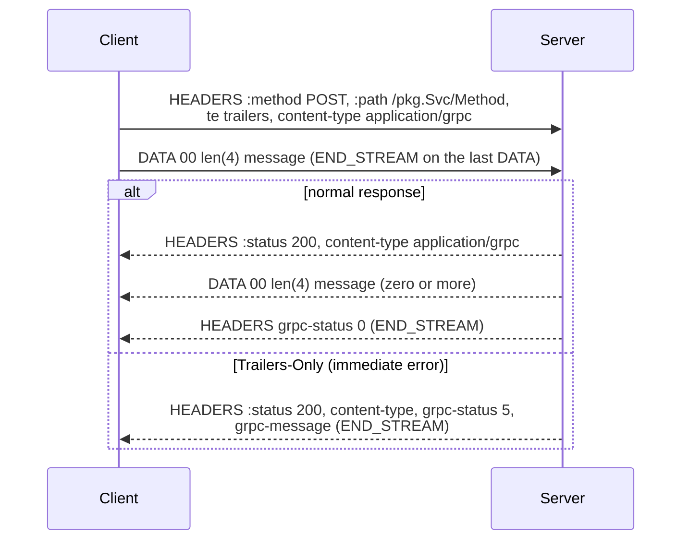

# How gRPC Maps to HTTP/2: Pseudo-Headers, 5-Byte Length-Prefixed Message Envelopes, and Trailers-Only grpc-status Responses

> [!summary] Claim
> A gRPC call is one HTTP/2 stream: a `POST` request whose body is a sequence of messages, each wrapped in a 5-byte envelope (1 flag byte plus a 4-byte big-endian length) that is unrelated to DATA frame boundaries, answered by `200 OK` headers, messages, and a final HEADERS frame (the trailers) that carries `grpc-status` - or, for an immediate failure, by a single Trailers-Only HEADERS frame - so the HTTP status never says whether the call succeeded.

Part of [gRPC and Protocol Buffers](README.md) in [API Engineering](../README.md).

## TL;DR

- Mechanism: request = HEADERS (`:method POST`, `:scheme`, `:path /Service/Method`, `:authority`, `te: trailers`, `content-type: application/grpc`) then DATA frames carrying `flag(1) || length(4, big endian) || message` envelopes, closed by `END_STREAM`; response = HEADERS (`:status 200`), DATA, then a trailing HEADERS frame with `END_STREAM` and `grpc-status`.
- Contract rule: `grpc-status` is mandatory in the trailers even for `OK` (0), and it is the only success signal; the HTTP status is `200` for every application outcome, and a client must synthesize a status itself when a hop or a crash leaves it missing.
- Trap: a DATA frame is not a message and a message is not a DATA frame; a parser that assumes either breaks the first time a 4 MiB message crosses 16 KiB frames or two small messages share one frame.
- Portability fact: the envelope is identical in every gRPC implementation read here (grpc core 1.85.1, grpc-go 1.85.0) and in the lab on CPython 3.12 through 3.15 including free-threaded (drafter's runs; verification re-ran 3.14.6); only `grpc-web` changes it, by putting trailers inside the body behind a flag byte with the high bit set.
- When not to use it: browsers cannot read HTTP/2 trailers, and HTTP/1.1 hops cannot be relied on to forward them, so a browser-facing or trailer-stripping path needs `grpc-web` or JSON transcoding (see [[HTTP-JSON-to-gRPC-Transcoding-and-Google-API-HTTP-Annotations-AIP-127]]).

## Mental model



The client opens a stream with one HEADERS block, then streams envelopes in DATA frames and half-closes with `END_STREAM`.
The server answers on the same stream.
In the normal shape it sends response headers first, then envelopes, then a final HEADERS frame whose `END_STREAM` flag ends the stream and whose fields (`grpc-status`, optionally `grpc-message`, `grpc-status-details-bin`, custom metadata) are the trailers.
If the server can fail before producing any header or message, it folds the response headers and the trailers into a single HEADERS frame with `END_STREAM`, the Trailers-Only form, which saves a frame and tells the client at the first byte that there will be no messages.
Nothing in this picture is a gRPC-specific frame type: every arrow is an ordinary HTTP/2 frame defined by RFC 9113, and gRPC adds only field names and the envelope inside DATA.

## How it works

### Layering, byte by byte

An HTTP/2 frame starts with a fixed 9-octet header: 24-bit payload length, 8-bit type, 8-bit flags, 1 reserved bit, and a 31-bit stream identifier (RFC 9113 Section 4.1).
A DATA frame payload is opaque application bytes, optionally padded (RFC 9113 Section 6.1).
gRPC puts its own framing inside those bytes.

```text
HTTP/2 frame   | len(3) | type=0x0 | flags | R+stream(4) | DATA payload ...          |
gRPC envelope                                              | flag(1) | len(4) | message ... |
Example: 3-byte message "abc"   00 00 00 00 03 61 62 63
Example: 300-byte message       00 00 00 01 2c  <300 bytes>
```

The envelope is `Length-Prefixed-Message -> Compressed-Flag Message-Length Message` with the flag as one unsigned byte (0 or 1) and the length as a 4-byte unsigned big-endian integer (grpc/grpc `doc/PROTOCOL-HTTP2.md`, "Requests").
The largest message the field can describe is 2^32 - 1 bytes.
An empty message (a protobuf message with every field at its default encodes to zero bytes, see [[Protobuf-Wire-Format-TLV-Tags-Varints-and-ZigZag-Encoding]]) is still the five bytes `00 00 00 00 00`; it is a message, not an absence of one.

Why an envelope at all: HTTP/2 DATA frames are a byte stream with frame boundaries chosen by each sender for flow control and frame-size reasons, and a streaming RPC needs message boundaries inside one request or response body.
The spec says so directly: "DATA frame boundaries have no relation to Length-Prefixed-Message boundaries and implementations should make no assumptions about their alignment" (`doc/PROTOCOL-HTTP2.md`, "Data Frames").

On the request side, end-of-stream is the `END_STREAM` flag on the last DATA frame, and when the request stream must be closed with no data left to send, implementations MUST send an empty DATA frame carrying that flag (`doc/PROTOCOL-HTTP2.md`, "Requests"; RFC 9113 Section 6.9.1 notes that a zero-length DATA frame with `END_STREAM` MAY be sent even with no flow-control window).
A streaming client that finishes after its last message was already flushed therefore costs one extra zero-length DATA frame; it is not a zero-length message, because an empty message is the five-byte envelope, not an empty frame.

### Request-Headers: what is pseudo and what is gRPC

Every HTTP/2 request must carry exactly one `:method`, `:scheme`, and `:path` (RFC 9113 Section 8.3.1), and all pseudo-header fields must precede every regular field (RFC 9113 Section 8.3).
Pseudo-headers must not appear in trailers (RFC 9113 Section 8.1 and 8.3).
gRPC's Call-Definition fixes their values:

| Field | gRPC rule (`doc/PROTOCOL-HTTP2.md`) |
|---|---|
| `:method` | Always `POST`, for unary and streaming alike |
| `:scheme` | `http` or `https` |
| `:path` | `/` Service-Name `/` method name, case-sensitive; for protobuf the service name is the optional package, a dot, and the service name |
| `:authority` | Optional in the grammar; the virtual host |
| `te` | `trailers`, "Used to detect incompatible proxies"; RFC 9113 Section 8.2.2 allows `TE` in HTTP/2 requests only with the value `trailers` |
| `grpc-timeout` | Optional; at most 8 ASCII digits plus a unit `H`, `M`, `S`, `m`, `u`, `n` (semantics in [[gRPC-Deadlines-Timeout-Header-and-Context-Cancellation-Cascade]]) |
| `content-type` | `application/grpc`, optionally `+proto`, `+json`, or a custom suffix |
| `grpc-encoding` | Optional compression of messages: `identity`, `gzip`, `deflate`, `snappy`, or custom |
| `grpc-accept-encoding` | Comma-separated list of acceptable encodings |
| `user-agent` | Recommended structured string such as `grpc-java/1.2.3` |

Implementations should send `grpc-timeout` immediately after the pseudo-headers and the Call-Definition headers before custom metadata, which the spec states as a recommendation, not a requirement.

Custom metadata is the application's key-value space.
Names use `0-9 a-z _ - .`; names starting with `grpc-` that the spec does not list are reserved for future gRPC use.
A name ending in `-bin` carries a binary value that runtimes Base64-encode on send and decode on receive; receivers must accept padded and un-padded Base64 and senders should emit un-padded values, and implementations must split `-bin` values on `,` before decoding because duplicate names may be joined with a comma.
RFC 9113 Section 8.2 independently requires lowercase field names on the wire.
Header order is not preserved except among duplicates of one name.

Header limits are advisory in both layers.
`SETTINGS_MAX_HEADER_LIST_SIZE` is the sum over fields of name length plus value length plus 32, measured on uncompressed fields, and its initial value is unlimited (RFC 9113 Section 6.5.2); the gRPC spec suggests servers cap Request-Headers at 8 KiB computed the same way, with `-bin` values counted after Base64, and suggests the same default for clients on Response-Headers, Trailers, and Trailers-Only.
A field block larger than one frame is split into HEADERS plus CONTINUATION frames, and no other frame may interleave (RFC 9113 Section 6.10 and 8.1); this is why the spec says Request-Headers are "delivered as HEADERS + CONTINUATION frames".

Content-type is the first gate.
If `content-type` does not begin with `application/grpc`, servers SHOULD answer HTTP 415 so that a non-gRPC HTTP/2 client does not read a gRPC error response, which is HTTP 200, as success.
grpc-go v1.85.0 implements that gate in `internal/transport/http2_server.go` (`operateHeaders`, which calls `writeEarlyAbort`) with a response carrying `:status 415`, `content-type`, `grpc-status 3` (`INVALID_ARGUMENT`), and a percent-encoded `grpc-message`; it accepts the base type exactly or the base type followed by `+` or `;` (`internal/grpcutil/method.go`, `ContentSubtype`), so `application/grpcfoo` is rejected even though it shares the prefix.
The same function answers a non-`POST` request with HTTP 405 and a missing authority or host with HTTP 400, each with a `grpc-status` of 13 (`INTERNAL`).

### The envelope in the receivers

grpc core's HTTP/2 transport defines `GRPC_HEADER_SIZE_IN_BYTES` as 5 (grpc 1.85.1 `src/core/ext/transport/chttp2/transport/internal.h`).
The deframer (grpc 1.85.1 `src/core/ext/transport/chttp2/transport/frame_data.cc`, `grpc_deframe_unprocessed_incoming_frames`) returns pending until 5 bytes are buffered, reads the first byte, and accepts only 0 (not compressed) or 1 (compressed); any other value fails with the error text `Bad GRPC frame type 0x%02x`.
It then assembles the length from bytes 1 to 4 most significant first, and, when the message-size refactoring experiment is enabled in that release, rejects a length above the stream's `max_recv_message_length` with `RESOURCE_EXHAUSTED` before the body arrives.
Only when `GRPC_HEADER_SIZE_IN_BYTES + length` bytes are buffered does it release a message.
The same file's `grpc_chttp2_data_parser_begin_frame` rejects any DATA frame flag other than `END_STREAM` (`unsupported data flags`), so a peer that sends `PADDED` DATA to grpc core gets an error; RFC 9113 Section 6.1 permits padding, so this is a core-specific restriction, not an HTTP/2 rule.

grpc-go v1.85.0 does the same in `rpc_util.go` (`parser.recvMsg`): read a 5-byte header, `pf := payloadFormat(p.header[0])`, `length := binary.BigEndian.Uint32(p.header[1:])`, fail with `ResourceExhausted` if `length` exceeds the machine's `maxInt` or `maxReceiveMessageSize`, and only then read the body; a stream that ends inside the body becomes `io.ErrUnexpectedEOF`, which `toRPCErr` turns into `INTERNAL`.
The sender side is `msgHeader`, which writes the flag byte and `binary.BigEndian.PutUint32` of the payload length, using `headerLen = payloadLen + sizeLen = 1 + 4`.
`encode` refuses a message above `math.MaxUint32` with `ResourceExhausted`.

The design consequence is that the limit is enforced from 5 bytes of input.
A parser that waits for the body before checking the length can be made to buffer up to 4 GiB per message by a peer that sends only the prefix and then the body slowly.

### Compression: flag, header, and failure codes

The Compressed-Flag says whether this one message is compressed with the algorithm named in `grpc-encoding`; compression contexts are not kept across messages, so each message gets a fresh context, and if `grpc-encoding` is absent the flag must be 0 (`doc/PROTOCOL-HTTP2.md`).
`deflate` means the zlib structure of RFC 1950 around RFC 1951 deflate, and raw deflate must not be sent (`doc/compression.md`, "Deflate Compression").
A gzip stream starts `1f 8b`; a zlib stream starts with `78` for the default window; the lab asserts both prefixes.

The failure cases are specified and implemented consistently:

| Situation | Status | Source |
|---|---|---|
| Client message uses an encoding the server lacks | `UNIMPLEMENTED`, with `grpc-accept-encoding` listing what the server accepts | `doc/compression.md` |
| Server message uses an encoding the client lacks | `INTERNAL` on the client | `doc/compression.md` |
| Flag set but `grpc-encoding` missing or `identity` | `INTERNAL` | `doc/compression.md` test case 6; grpc-go `checkRecvPayload` |
| Flag byte not 0 or 1 | `INTERNAL` | grpc-go `checkRecvPayload`, grpc core `Bad GRPC frame type` |
| Decompressed size above the receive limit | `RESOURCE_EXHAUSTED` | grpc-go `decompress` |

grpc-go bounds the built-in gzip decompressor at `maxReceiveMessageSize` plus one byte "so that a small but highly compressed payload (a 'zip bomb') cannot expand to gigabytes in memory" before its post-decompression check can fire (v1.85.0 `rpc_util.go`, `decompress`).
When the user of either peer disables compression, the next message MUST be sent uncompressed, which the spec calls "instrumental in preventing BEAST/CRIME attacks" on secrets mixed with attacker-controlled data (`doc/compression.md`, "Specific Disabling of Compression").

### Responses: headers, trailers, and Trailers-Only

The response grammar is `(Response-Headers *Length-Prefixed-Message Trailers) / Trailers-Only`.
Response-Headers is `:status 200`, optional `grpc-encoding` and `grpc-accept-encoding`, `content-type`, and custom metadata.
Trailers is `grpc-status` (decimal ASCII, `1*DIGIT`, no leading zeros), optional `grpc-message`, optional `grpc-status-details-bin`, and custom metadata.
The status must be sent in Trailers even when it is `OK`, and end-of-stream for a response is the `END_STREAM` flag on the HEADERS frame that carries the Trailers (`doc/PROTOCOL-HTTP2.md`, "Responses").
That is the HTTP/2 trailer mechanism: a trailer section is a HEADERS frame (plus CONTINUATION) that bears `END_STREAM`, contains no pseudo-header fields, and is the last thing on the stream; a HEADERS frame without `END_STREAM` after the final status is malformed (RFC 9113 Section 8.1).
The lab's `h2` 4.4.1 enforces the same on its send path: `H2Stream.send_headers` raises `ProtocolError("Trailers must have END_STREAM set.")` and the pseudo-header check in `h2/utilities.py` (`_check_pseudo_header_field_acceptability`) raises on any pseudo-header in a trailer block.

Why the status lives in trailers: a server streaming messages has committed to `200` and the response headers long before it knows how the call ends, so the outcome has to come after the data.
That is also why an HTTP/1.1 intermediary that buffers, de-chunks, and re-frames the body with `Content-Length` silently deletes the status; see the byte-level treatment in [[HTTP-Trailers-Streaming-Checksums-and-gRPC-Status]].

Trailers-Only is permitted "for calls that produce an immediate error".
It is `HTTP-Status Content-Type Trailers` delivered in one HEADERS block, so `:status 200`, `content-type`, `grpc-status`, and `grpc-message` travel together with `END_STREAM`.
grpc-go v1.85.0 shows exactly when a server takes it (`internal/transport/http2_server.go`, `writeStatus`): if no headers have been sent and the application set no response metadata, it appends `:status 200` and `content-type` to the status fields and ends the stream in that one frame; if the application set header metadata, it first emits a separate HEADERS frame through `writeHeaderLocked` and then the trailers.
So the shape is an implementation consequence of "did anything go out before the failure", not a flag a service author sets.
After the trailers, if the client had not already half-closed (stream state still active), `writeStatus` finishes the stream with an `RST_STREAM` carrying `NO_ERROR`; RFC 9113 Section 8.1 explicitly allows a server that has sent a complete response to ask the client to stop sending that way, and says clients MUST NOT discard the response because of it.

A client tells the shapes apart by the first HEADERS frame: with `END_STREAM` set it is Trailers-Only and the status is in that block, without it the status comes later in the trailers.
In the lab, `h2`'s `ResponseReceived.stream_ended` is that bit.

`grpc-message` is conceptually Unicode, physically UTF-8 followed by percent-encoding of every byte outside `%x20-%x24` and `%x26-%x7E` (so `%` itself is encoded), with upper-case hex digits; decoders MUST NOT fail on bad input and at worst keep the raw form.
grpc core's `PercentEncodeSlice` with the `Compatible` table implements exactly that set (bytes 32 through 126 except `%`) and upper-case hex (grpc 1.85.1 `src/core/lib/slice/percent_encoding.cc`); grpc-go's `encodeGrpcMessage` does the same in `internal/transport/http_util.go`.
`grpc-status-details-bin` is allowed only for a non-`OK` status, holds a base64 `google.rpc.Status`, and its code, if present, must not contradict `grpc-status` (the consumer must check); the payload design is in [[gRPC-Status-Codes-and-Google-RPC-Status-Rich-Error-Payloads]].

### When no `grpc-status` arrives

"Implementations should expect broken deployments to send non-200 HTTP status codes in responses as well as a variety of non-GRPC content-types and to omit Status & Status-Message", and must synthesize a status for the application (`doc/PROTOCOL-HTTP2.md`).
The mapping used only when `grpc-status` is absent (`doc/http-grpc-status-mapping.md`; a present `grpc-status` always wins, and servers must not use the table to choose an HTTP status):

| HTTP status | gRPC status |
|---|---|
| 400 | `INTERNAL` |
| 401 | `UNAUTHENTICATED` |
| 403 | `PERMISSION_DENIED` |
| 404 | `UNIMPLEMENTED` |
| 429, 502, 503, 504 | `UNAVAILABLE` |
| any other, including 200 | `UNKNOWN` |

The document's reason for 200: there should have been a `grpc-status` in a truly OK response.
grpc core's `grpc_http2_status_to_grpc_status` (grpc 1.85.1 `src/core/lib/transport/status_conversion.cc`) lists 200 as `GRPC_STATUS_OK` and otherwise matches the table; within `chttp2_transport.cc` its one caller is `try_http_parsing`, the path that reports `Trying to connect an http1.x server (HTTP status N)` when a gRPC client reads an HTTP/1.x reply.
A second caller, `CheckServerMetadata` (grpc 1.85.1 `src/core/ext/filters/http/client/http_client_filter.cc`), keeps the documented precedence: if `grpc-status` is present or `:status` is 200 it drops the HTTP status, and only otherwise fails the call with `grpc_http2_status_to_grpc_status(status)` and the text `Received http2 header with status: N`, so the 200 -> `OK` entry is never reached on that path.
The lab follows the documentation table.

Stream-level failures use `RST_STREAM` and map as follows (`doc/PROTOCOL-HTTP2.md`, "Errors"): `NO_ERROR`, `PROTOCOL_ERROR`, `INTERNAL_ERROR`, `FLOW_CONTROL_ERROR`, `SETTINGS_TIMEOUT`, `FRAME_SIZE_ERROR`, `COMPRESSION_ERROR`, `CONNECT_ERROR` all to `INTERNAL`; `REFUSED_STREAM` to `UNAVAILABLE` ("no processing occurred and the request can be retried, possibly elsewhere"); `CANCEL` to call cancellation from a client or `CANCELLED` from a server; `ENHANCE_YOUR_CALM` to `RESOURCE_EXHAUSTED`; `INADEQUATE_SECURITY` to `PERMISSION_DENIED`.
The `REFUSED_STREAM` rule is the gRPC face of RFC 9113 Section 8.7: a stream reset with `REFUSED_STREAM`, or a stream numbered above the `GOAWAY` last-stream-id, is guaranteed unprocessed and so safe to retry even for a non-idempotent call.
Connection loss gives `UNAVAILABLE` on the client and `CANCELLED` on the server; the spec's PING and GOAWAY text and their tuning are in [[gRPC-Keepalive-Flow-Control-and-Max-Message-Size-Tuning]] and [[gRPC-Health-Checking-Protocol-Server-Reflection-and-Graceful-Stop]].

### gRPC-Web: the one sanctioned deviation

Browsers cannot see HTTP/2 trailers, so `application/grpc-web` keeps the envelope but moves trailers into the body: the high bit of the first byte marks a trailers frame (`10000000b` uncompressed trailers, `10000001b` compressed), its payload is HTTP/1-style `key: value\r\n` lines in lower case, and it must be the last message; the stream ends at EOF, stream ids and GOAWAY are not used, and Trailers-Only is unchanged (`doc/PROTOCOL-WEB.md`).
This is why the flag byte values 0 and 1 are the whole native vocabulary and any other value, 0x80 included, is a framing error to a native receiver, as in the `frame_data.cc` check above.

## Numbers and limits

| Quantity | Value | Source |
|---|---|---|
| HTTP/2 frame header | 9 octets | RFC 9113 Section 4.1 |
| gRPC envelope header | 5 octets (1 flag + 4 length) | `doc/PROTOCOL-HTTP2.md`; grpc core `GRPC_HEADER_SIZE_IN_BYTES` |
| Largest wire-encodable message | 2^32 - 1 bytes | 4-byte length field |
| Default max receive message | 4 MiB (4 * 1024 * 1024); -1 means unlimited | grpc 1.85.1 `include/grpc/impl/channel_arg_names.h`, `GRPC_ARG_MAX_RECEIVE_MESSAGE_LENGTH` (as of 2026-11) |
| Initial `SETTINGS_MAX_FRAME_SIZE` | 16,384; allowed range up to 2^24 - 1 | RFC 9113 Section 4.2, 6.5.2 |
| Initial `SETTINGS_INITIAL_WINDOW_SIZE` | 65,535; maximum window 2^31 - 1 | RFC 9113 Section 6.5.2 |
| `SETTINGS_MAX_HEADER_LIST_SIZE` | initially unlimited; per field = name + value + 32 | RFC 9113 Section 6.5.2 |
| Suggested header size limit | 8 KiB for request headers and for each of response headers, trailers, and Trailers-Only | `doc/PROTOCOL-HTTP2.md` |
| `grpc-timeout` value | at most 8 digits | `doc/PROTOCOL-HTTP2.md` |
| Canonical status codes | 17 (0 to 16) | `doc/statuscodes.md` |
| DATA frames for a 40,192-byte message at 16,384 max frame size | 3 frames of 16,384, 16,384, and 7,429 payload bytes | measured: lab capture script (see Worked example), `h2` 4.4.1, CPython 3.14.6, macOS 27.3 (Darwin 27.3.0) arm64; re-measured in verification 2026-11-21 with identical results |
| Unary `ping` request, frame payload sizes | HEADERS 50, DATA 9 (5 envelope + 4) | same capture |
| Unary `pong` response, frame payload sizes | HEADERS 19, DATA 9, trailer HEADERS 12 | same capture |
| Trailers-Only `NOT_FOUND` response | one HEADERS frame, 55 payload bytes | same capture |

The three header-block sizes are HPACK output from `h2` 4.4.1 and `hpack` 4.2.0 on a fresh connection, so they are specific to that encoder and that header set; a real server with a warm dynamic table emits smaller blocks for repeated calls (HPACK mechanics: [[HPACK-Header-Compression-and-Dynamic-Table-Security]]).
Flow control applies to DATA frames only, including the 5 envelope bytes (RFC 9113 Section 6.9), so a message larger than the 65,535-byte initial stream window stalls until the receiver sends `WINDOW_UPDATE`; see [[HTTP-2-Flow-Control-and-Window-Update-Mechanics]].

## Portability

| Dimension | Result | Proof |
|---|---|---|
| CPython 3.12.13 | 52 passed | drafter's run, `uv run --frozen --python 3.12`, separate environment; not re-run in verification (lab checks paused 2026-11-11) |
| CPython 3.13.18 | 52 passed | drafter's run, same method; not re-run in verification |
| CPython 3.14.6 (workspace default) | 52 passed | drafter's run, re-run in verification 2026-11-21 on macOS 27.3 (Darwin 27.3.0) arm64: 52 passed |
| CPython 3.14.10 | 52 passed | drafter's run, `/opt/homebrew/bin/python3.14`; not re-run in verification |
| CPython 3.15.2 | 52 passed | drafter's run, `/opt/homebrew/bin/python3.15`; not re-run in verification |
| CPython 3.15.0b3 free-threaded (`sysconfig` `Py_GIL_DISABLED` = 1) | 52 passed in a minimal environment (`h2` 4.4.1, `hpack` 4.2.0, `hyperframe` 6.1.0, `pytest` 9.2.0) | drafter's run; not re-run in verification; a free-threaded 3.15.2 was not installed (verification confirmed `uv` has only `3.15.0b3+freethreaded`), and the full workspace does not resolve there because `psycopg-binary` 3.3.8 has no wheel for it |
| `h2` 4.4.1, `hyperframe` 6.1.0, `hpack` 4.2.0 | the lab's only third-party runtime dependencies | pinned in `labs/pyproject.toml`, exercised by the runs above |
| grpc core 1.85.1 | flag byte 0 or 1, 5-byte header, length checked before body | source read: `frame_data.cc`, `internal.h` |
| grpc-go 1.85.0 | same envelope; Trailers-Only decided in `writeStatus`; 415 gate in `operateHeaders` | source read: `rpc_util.go`, `http2_server.go` |
| grpcio (Python) 1.85.1 | pinned in the workspace; the lab does not drive it, so no behavior is claimed | not exercised |
| HTTP/1.1 | not a gRPC transport: grpc core turns an HTTP/1.x reply into a failed connection with the text `Trying to connect an http1.x server` | source read: `chttp2_transport.cc`, `try_http_parsing` |
| HTTP/2 | the defined transport | `doc/PROTOCOL-HTTP2.md` |
| HTTP/3 over QUIC | not covered: the specification fetched is titled "gRPC over HTTP2" and no HTTP/3 mapping was read | not claimed |
| Uvicorn, Hypercorn, Granian | not gRPC servers and not exercised | not claimed |
| `grpc-web` | different trailer placement (flag high bit) | `doc/PROTOCOL-WEB.md` |

The 3.15 and 3.15t rows are CPython 3.15 pre-release or release builds as installed by `uv` and Homebrew on this machine: `uv` supplied `3.15.0b3` for both the `3.15` request and the free-threaded one, and Homebrew supplied `3.15.2`.

## Worked example

Implementation: [implementation](../labs/src/api_labs/f19_grpc_and_protocol_buffers/grpc_http2_framing.py).
Test: [test](../labs/tests/f19_grpc_and_protocol_buffers/test_grpc_over_http_2_framing_length_prefixed_messages_and_trailers.py).
The lab runs a client and a server `h2` state machine against each other in memory, captures the exact bytes, and parses them with `hyperframe`.

Simplified excerpt of the envelope encoder and incremental decoder (the full file adds the compression, metadata, and header checks):

```python
def encode_message(payload: bytes, *, compressed: bool = False) -> bytes:
    """Return ``Compressed-Flag (1) || Message-Length (4, big endian) || Message``."""
    if len(payload) > MAX_WIRE_LENGTH:
        raise FramingError(Code.RESOURCE_EXHAUSTED, f"message too large ({len(payload)} bytes)")
    return bytes([1 if compressed else 0]) + len(payload).to_bytes(4, "big") + payload


class MessageDecoder:
    def feed(self, data: bytes) -> list[Message]:
        self._buf += data
        out: list[Message] = []
        while len(self._buf) >= PREFIX_LEN:
            flag = self._buf[0]
            if flag not in (0, 1):
                raise FramingError(Code.INTERNAL, f"Bad GRPC frame type 0x{flag:02x}")
            length = int.from_bytes(self._buf[1:PREFIX_LEN], "big")
            if length > self.max_message_size:  # decided from the prefix alone
                raise FramingError(Code.RESOURCE_EXHAUSTED, "received message larger than max")
            end = PREFIX_LEN + length
            if len(self._buf) < end:
                break
            out.append(Message(compressed=flag == 1, payload=bytes(self._buf[PREFIX_LEN:end])))
            del self._buf[:end]
        return out
```

Simplified excerpt of the two response shapes:

```python
def respond_ok(payload: bytes) -> Responder:
    def respond(server: h2.connection.H2Connection, sid: int) -> None:
        server.send_headers(sid, [(":status", "200"), ("content-type", "application/grpc+proto")])
        send_chunked(server, sid, encode_message(payload))
        server.send_headers(sid, [("grpc-status", "0")], end_stream=True)

    return respond


def respond_trailers_only(code: Code, message: str) -> Responder:
    def respond(server: h2.connection.H2Connection, sid: int) -> None:
        server.send_headers(
            sid,
            [
                (":status", "200"),
                ("content-type", "application/grpc"),
                ("grpc-status", str(int(code))),
                ("grpc-message", encode_status_message(message)),
            ],
            end_stream=True,
        )

    return respond
```

The lab found two real mistakes in its first draft, both now fixed and both encoded as tests.
First, `h2` 4.4.1 raises `FrameTooLargeError: Cannot send frame size 40197, max frame size is 16384` when asked to `send_data` one oversized chunk, so the sender must split a message across DATA frames itself (`send_chunked`).
Second, the first `resolve_call` ran the envelope decoder over the HTML body of a proxy's `503`, failing with `Bad GRPC frame type 0x3c` (the byte `<`); a client must decode envelopes only when the response `content-type` is a gRPC one.

Captured output.
Command (from `labs/`): `uv run --frozen pytest tests/f19_grpc_and_protocol_buffers/test_grpc_over_http_2_framing_length_prefixed_messages_and_trailers.py -q`, CPython 3.14.6, macOS 27.3 (Darwin 27.3.0) arm64, verification run 2026-11-21:

```text
....................................................                     [100%]
52 passed in 0.47s
```

Wire shapes captured by a throwaway script calling the lab functions on the same interpreter (request bytes after the connection preface and SETTINGS exchange; the result message is printed with `ascii()`), re-run in verification with identical output:

```text
encode_message(b"abc")           00 00 00 00 03 61 62 63
encode_message(b"x" * 300)[:5]   00 00 00 01 2c
ok request    ['HEADERS END_HEADERS len=50', 'DATA END_STREAM len=9']
ok response   ['HEADERS END_HEADERS len=19', 'DATA - len=9', 'HEADERS END_HEADERS|END_STREAM len=12']
ok result     shape=headers+trailers code=OK messages=(b'pong',) frames_before_status=1
trailers-only request  ['HEADERS END_HEADERS len=50', 'DATA END_STREAM len=9']
trailers-only response ['HEADERS END_HEADERS|END_STREAM len=55']
trailers-only result   shape=trailers-only code=NOT_FOUND message='no such item: caf\xe9' messages=()
40192-byte message     ['HEADERS END_HEADERS len=19', 'DATA - len=16384', 'DATA - len=16384', 'DATA - len=7429', 'HEADERS END_HEADERS|END_STREAM len=12'] frames_before_status=3
encode_status_message("caf\u00e9 100%")  caf%C3%A9 100%25
```

What each test class proves: the envelope layout and the empty message; reassembly from splits of 1, 2, 4, 5, 6, 7, 64 bytes and whole; that a message is not released one byte early; flag bytes 2, 0x80, and 0xFF rejected; the oversize length rejected from five bytes with no body and the exact limit accepted; truncation caught at `finish`; the compression failure table including raw deflate rejected and an 8 MiB gzip bomb cut off at a 1 MiB limit; `grpc-message` encoding and permissive decoding; `-bin` padding rules; request header order; `h2` refusing late pseudo-headers, pseudo-headers in trailers, and trailers without `END_STREAM`; the 415, 405, and path gates; request, normal response, and Trailers-Only frame sequences; the three-frame split; synthesized statuses for eight HTTP codes; `grpc-status` overriding a contradicting `502`; and seven `RST_STREAM` codes mapped.
Mutation testing of these tests was not run (the user paused lab checks on 2026-11-11), so the claim "each test fails without the mechanism" is argued from the assertions, not demonstrated.

## Pitfalls

> [!warning] Reading the HTTP status as the call outcome
> Trigger: a gateway, metrics pipeline, or load-balancer health rule keys on `:status`.
> Symptom: every failed RPC shows as `200`, dashboards report 100 percent success, and alerts never fire.
> Fix: derive success from `grpc-status` in the trailers or the Trailers-Only block, and record the gRPC code as the outcome label.

> [!warning] Treating a DATA frame as a message
> Trigger: a custom proxy, test double, or capture tool calls the DATA payload "the message".
> Symptom: works on small messages, then truncates, merges, or crashes on a message that spans frames or two messages that share one.
> Fix: run every DATA payload through an incremental envelope decoder like `MessageDecoder`; the lab splits one stream at step sizes 1 through 64 to prove independence from frame boundaries.

> [!warning] An intermediary drops trailers
> Trigger: an HTTP/1.1 hop, an L7 proxy that buffers and re-frames, or a gateway without end-to-end HTTP/2 sits between client and server.
> Symptom: the client receives data and a clean `END_STREAM` but no `grpc-status`, and surfaces `UNKNOWN` because 200 with no status maps to `UNKNOWN`.
> Fix: require HTTP/2 end to end for gRPC paths (the `te: trailers` request header exists to detect incompatible proxies) and see [[L4-vs-L7-Load-Balancing-for-HTTP-1-1-HTTP-2-and-gRPC]].

> [!warning] Parsing a proxy error body as gRPC
> Trigger: a client runs the envelope decoder on every response body.
> Symptom: `Bad GRPC frame type 0x3c` (an HTML `<`) instead of the real cause, which was a `503` page; the lab reproduced this exactly in its first draft.
> Fix: check `content-type` begins with `application/grpc` before decoding, and otherwise synthesize a status from the HTTP code by the mapping table.

> [!warning] Compressed flag without a usable encoding
> Trigger: a sender sets the flag to 1 on a message while `grpc-encoding` is absent or `identity`, or uses an encoding the peer does not list.
> Symptom: `INTERNAL` ("compressed flag set with identity or empty encoding") or `UNIMPLEMENTED` from a server, with no hint in the payload.
> Fix: set the flag only for messages actually compressed with the declared encoding; on `UNIMPLEMENTED`, read `grpc-accept-encoding` and retry with a listed algorithm.

> [!warning] Raw non-ASCII or control characters in `grpc-message`
> Trigger: an application copies an exception string into the status message without percent-encoding.
> Symptom: the HTTP/2 field validity rules (RFC 9113 Section 8.2.1) treat NUL, CR, and LF in a value as malformed, so the whole response can be treated as malformed and the status is lost.
> Fix: always encode (UTF-8, then percent-encode); the lab shows `caf\u00e9 100%` becoming `caf%C3%A9 100%25`.

> [!warning] Header block growth and CONTINUATION abuse
> Trigger: unbounded custom metadata, or a peer sending endless CONTINUATION frames.
> Symptom: memory growth during header parsing; CVE-2023-45288 (NVD, published 2024-04-04) describes an HTTP/2 endpoint reading arbitrary amounts of header data through excessive CONTINUATION frames because HPACK state forces all of them to be parsed.
> Fix: enforce a header list limit and a CONTINUATION frame count in the transport, advertise `SETTINGS_MAX_HEADER_LIST_SIZE`, and keep metadata small; the 8 KiB gRPC suggestion is the starting point.

## Security and robustness

- Length-prefix amplification (OWASP API4:2023 Unrestricted Resource Consumption): the 4-byte length lets a peer claim up to 2^32 - 1 bytes in 5 bytes of input.
  Enforce the receive limit when the prefix completes, as grpc core and grpc-go do, and keep the 4 MiB default unless a measured need exists.
- Decompression bombs: a flag byte of 1 plus a small gzip stream can inflate by orders of magnitude; the lab's 8 MiB of zeros compresses to 8,175 bytes of gzip (measured with `zlib` default level, CPython 3.14.6, macOS 27.3 arm64), a ratio above 1,000 to 1.
  Bound output at the receive limit during inflation, never after, as grpc-go's `decompress` does.
- Compression oracle attacks: compressing secrets with attacker-controlled data in one message leaks via size (CRIME and BEAST class); gRPC lets a server disable compression per message for this reason (`doc/compression.md`).
- Stream reset floods: CVE-2023-44487 (NVD, published 2023-10-10) describes HTTP/2 request cancellation resetting many streams quickly to consume server resources; a gRPC client cancel is an `RST_STREAM` with `CANCEL`, so per-connection reset-rate limits belong in the transport and proxy.
- Content-type confusion: the 415 gate exists so a generic HTTP/2 client does not treat a gRPC `200` error body as success; also reject `application/grpcfoo` by checking the character after the base type, as grpc-go does.
- Status trust: `grpc-status-details-bin` must not contradict `grpc-status`, and a consumer must verify it; never let a proxy-injected `grpc-status` or a client-supplied `grpc-`-prefixed metadata key stand in for application authorization (reserved prefix, `doc/PROTOCOL-HTTP2.md`).
- Log injection: after decoding, `grpc-message` can contain any Unicode including newlines; escape before logging.
- Defense in depth: validate field names and values per RFC 9113 Section 8.2.1 (no NUL, CR, LF; lowercase names), cap header list size and CONTINUATION count, cap concurrent streams (recommended no smaller than 100 by RFC 9113 Section 6.5.2), and never forward a malformed message (RFC 9113 Section 8.1.1).

## The principal's view

The decision is whether the organization wants an HTTP/2-trailers contract on every hop.
gRPC buys strongly typed streaming, small frames, per-message flow control, and a uniform status model, and it pays by making every proxy, CDN, WAF, and browser path trailer-aware; the failure mode is the quiet one, where a hop that cannot forward trailers turns correct servers into `UNKNOWN` at the client.
Pick gRPC for service-to-service traffic inside infrastructure you control end to end, and put a transcoding or `grpc-web` edge where browsers and third parties connect.
Treat the envelope limits as part of the API contract: a 4 MiB default receive cap is a decision about how large one message may be, and the right answer for bulk data is a stream of smaller messages, not a raised cap.
Observability should key on the gRPC code, not the HTTP status, from day one, because retrofitting it means re-baselining every alert.
Choose REST over HTTP/1.1 or HTTP/2 when caching by intermediaries, browser-native access, or public ecosystem tooling matters more than streaming and typing, and choose a message queue when the interaction is not request-shaped at all.
The organizational trade-off is that a single `.proto` gives one source of truth but couples client and server release trains through field-number discipline (see [[Protobuf-Governance-Linting-and-Breaking-Change-Gates-with-Buf]]).

## Interview questions

> [!question] L5: Which HTTP/2 frames make up a successful unary gRPC call, and where does the status appear?
>
> > [!success]- Answer
> > The client sends HEADERS then DATA with `END_STREAM`.
> > The server sends HEADERS with `:status 200`, one DATA frame carrying the response envelope, then a final HEADERS frame with `END_STREAM` that carries `grpc-status: 0`.
> > The status is in that trailing HEADERS frame, never in the HTTP status.
> >
> > Follow-up: Why must `grpc-status` be sent even when it is `OK`?

> [!question] L5: What are the five bytes in front of every gRPC message?
>
> > [!success]- Answer
> > One flag byte, 0 for uncompressed or 1 for compressed with the declared `grpc-encoding`, then a 4-byte unsigned big-endian message length.
> > A 3-byte message is `00 00 00 00 03` followed by the three bytes.
> > An empty message is exactly five zero bytes.
> >
> > Follow-up: What does a receiver do with a flag byte of 2?

> [!question] L5: Why is `:status` always 200 for a gRPC error such as `NOT_FOUND`?
>
> > [!success]- Answer
> > The HTTP exchange succeeded; the application outcome is carried in `grpc-status` and `grpc-message`.
> > A non-gRPC HTTP/2 client would otherwise read the response body as a result, which is why a request with a non-gRPC `content-type` gets HTTP 415.
> >
> > Follow-up: What does a client do when it gets a `503` with an HTML body and no `grpc-status`?

> [!question] L6: Predict the output.
> A server sends one HEADERS frame with `END_STREAM` containing `:status 200`, `content-type: application/grpc`, `grpc-status: 5`, and `grpc-message: no%20item`.
> What does the client report, and how many DATA frames arrived?
>
> > [!success]- Answer
> > The client reports `NOT_FOUND` with message `no item`, in the Trailers-Only shape, and zero messages.
> > No DATA frame arrived: the first HEADERS frame carried `END_STREAM`, so the status is in that block.
> > The lab's `test_trailers_only_is_a_single_headers_frame_carrying_the_status` asserts this shape.
> >
> > Follow-up: What would the client report if the same frame lacked `grpc-status`?

> [!question] L6: Debug this API.
> Clients behind a corporate proxy intermittently report `UNKNOWN` with no message, while direct clients are fine, and server logs show the handler returned `OK`.
> What is the likely cause and how do you confirm it?
>
> > [!success]- Answer
> > The proxy terminates HTTP/2 or downgrades to HTTP/1.1 and drops the trailers, so the client sees `200`, data, and `END_STREAM` with no `grpc-status`; the status mapping makes that `UNKNOWN`.
> > Confirm by capturing frames on the client side of the proxy and checking whether the last HEADERS frame with `END_STREAM` is present; the `te: trailers` request header is the spec's hook for detecting such proxies.
> > Fix by routing gRPC through an HTTP/2-end-to-end path.
> >
> > Follow-up: Why does grpc-web avoid this class of failure?

> [!question] L6: A receiver reads one DATA frame and calls the protobuf parser on its payload.
> It works in tests and fails in production.
> Why, and what is the correct structure?
>
> > [!success]- Answer
> > Frame boundaries are chosen by the sender for frame-size and flow-control reasons and bear no relation to message boundaries.
> > A 40,192-byte message at the default 16,384-byte frame size arrives as three DATA frames in the lab capture, and small messages can share a frame.
> > Buffer bytes, read the 5-byte prefix, wait for the full length, then release the message, as `MessageDecoder.feed` does.
> >
> > Follow-up: At what point should the length be compared with the receive limit?

> [!question] L6: Why must the receive limit be checked from the 5-byte prefix and not after the body arrives?
>
> > [!success]- Answer
> > The length is attacker-controlled and can claim up to 2^32 - 1 bytes; waiting for the body means buffering without bound.
> > grpc core's deframer and grpc-go's `recvMsg` both compare the length with the maximum before reading the body, and the lab's test feeds only the prefix of a 4 MiB + 1 message and expects `RESOURCE_EXHAUSTED`.
> >
> > Follow-up: What is the default receive limit and how is it changed?

> [!question] L7+: Design the status resolution for a gRPC client library that sits behind arbitrary proxies.
> Which inputs does it consult, in what order, and which are traps?
>
> > [!success]- Answer
> > First a stream reset: map the `RST_STREAM` code (for example `REFUSED_STREAM` to `UNAVAILABLE`, `CANCEL` to `CANCELLED`, others to `INTERNAL`).
> > Then `grpc-status` in the trailers, or in the first HEADERS frame when it carries `END_STREAM`, which always wins over the HTTP status.
> > Only if absent, synthesize from the HTTP status by the mapping table, with 200 and unknown codes giving `UNKNOWN`.
> > Traps: decoding non-gRPC bodies as envelopes, trusting `grpc-status` inside a non-gRPC `content-type`, and reading `:status` first.
> >
> > Follow-up: Which synthesized statuses are safe to retry for a non-idempotent call?

> [!question] L7+: Why does gRPC use trailers for status instead of a status field in the last message, and what does that cost?
>
> > [!success]- Answer
> > The server commits to the response headers before it knows the outcome of a streaming call, so the outcome has to follow the data, and HTTP/2 trailers are the protocol's slot for that; a status inside a message would force every message type to carry one.
> > The cost is a hard dependency on trailer-capable hops end to end, which browsers lack and HTTP/1.1 intermediaries often break, which is why `grpc-web` moves trailers into a flagged last message.
> >
> > Follow-up: How does `grpc-web` mark that message, and why is it invalid to a native receiver?

> [!question] L7+: How would you test that your gRPC proxy preserves Trailers-Only responses and correct status for a flood of failing calls without a real backend?
>
> > [!success]- Answer
> > Drive in-memory HTTP/2 state machines as the lab does: a scripted server emits Trailers-Only and normal responses, and the test asserts on parsed frame sequences, not on library return values, for shape, `END_STREAM` placement, and the percent-encoded `grpc-message`.
> > Add cases for a missing `grpc-status`, a reset, and a contradicting HTTP status, and assert the synthesized codes.
> > Pair it with a real-socket test on the proxy for flow control and `GOAWAY`.
> >
> > Follow-up: What does that test not tell you about trailers inside a real browser path?

## Related

Prerequisites: [[Protobuf-Governance-Linting-and-Breaking-Change-Gates-with-Buf]]

Next: [[The-Four-gRPC-Communication-Modes-Unary-Server-Client-and-Bidi-Streaming]]

See also: [[gRPC-and-Protocol-Buffers]], [[HTTP-Evolution-HTTP1-HTTP2-HTTP3]], [[HTTP-2-Binary-Framing-and-Stream-State-Machine]], [[HTTP-2-Flow-Control-and-Window-Update-Mechanics]], [[HPACK-Header-Compression-and-Dynamic-Table-Security]], [[HTTP-Trailers-Streaming-Checksums-and-gRPC-Status]], [[L4-vs-L7-Load-Balancing-for-HTTP-1-1-HTTP-2-and-gRPC]], [[Protobuf-Wire-Format-TLV-Tags-Varints-and-ZigZag-Encoding]], [[gRPC-Status-Codes-and-Google-RPC-Status-Rich-Error-Payloads]], [[gRPC-Deadlines-Timeout-Header-and-Context-Cancellation-Cascade]], [[gRPC-Keepalive-Flow-Control-and-Max-Message-Size-Tuning]], [[HTTP-JSON-to-gRPC-Transcoding-and-Google-API-HTTP-Annotations-AIP-127]]

- Lab: `labs/tests/f19_grpc_and_protocol_buffers/test_grpc_over_http_2_framing_length_prefixed_messages_and_trailers.py`

## Further reading

- [gRPC over HTTP2 (`doc/PROTOCOL-HTTP2.md`)](https://github.com/grpc/grpc/blob/master/doc/PROTOCOL-HTTP2.md): the normative request, response, envelope, and RST_STREAM mapping.
- [gRPC Compression (`doc/compression.md`)](https://github.com/grpc/grpc/blob/master/doc/compression.md): `grpc-encoding`, `grpc-accept-encoding`, failure statuses, and the deflate definition.
- [HTTP to gRPC Status Code Mapping (`doc/http-grpc-status-mapping.md`)](https://github.com/grpc/grpc/blob/master/doc/http-grpc-status-mapping.md): the synthesis table for responses without `grpc-status`.
- [Status codes and their use in gRPC (`doc/statuscodes.md`)](https://github.com/grpc/grpc/blob/master/doc/statuscodes.md): the 17 canonical codes.
- [gRPC Web (`doc/PROTOCOL-WEB.md`)](https://github.com/grpc/grpc/blob/master/doc/PROTOCOL-WEB.md): trailers inside the body behind a flag-byte high bit.
- [RFC 9113, HTTP/2](https://www.rfc-editor.org/rfc/rfc9113.html): frame format (Section 4.1), message framing and trailers (Section 8.1), pseudo-headers (Section 8.3), request reliability (Section 8.7).
- [grpc core v1.85.1 `frame_data.cc`](https://github.com/grpc/grpc/blob/v1.85.1/src/core/ext/transport/chttp2/transport/frame_data.cc): the envelope deframer.
- [grpc-go v1.85.0 `rpc_util.go`](https://github.com/grpc/grpc-go/blob/v1.85.0/rpc_util.go): `parser.recvMsg`, `msgHeader`, `checkRecvPayload`, `decompress`.
- [grpc-go v1.85.0 `internal/transport/http2_server.go`](https://github.com/grpc/grpc-go/blob/v1.85.0/internal/transport/http2_server.go): `writeStatus` (Trailers-Only) and `writeEarlyAbort` (415).
- [CVE-2023-45288 (NVD)](https://nvd.nist.gov/vuln/detail/CVE-2023-45288) and [CVE-2023-44487 (NVD)](https://nvd.nist.gov/vuln/detail/CVE-2023-44487): the CONTINUATION flood and Rapid Reset records.
