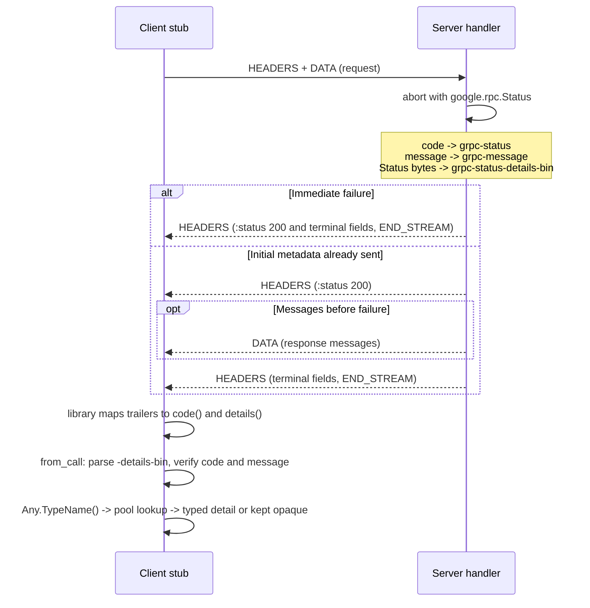

# gRPC Error Handling: The 16 Canonical Status Codes, grpc-status-details-bin Trailers, and Unpacking google.rpc.Status Protobuf Details

> [!summary] Claim
> A gRPC caller learns the RPC outcome from `grpc-status` and should verify any accompanying `google.rpc.Status` against it before using typed error details.

Part of [gRPC and Protocol Buffers](README.md) in [API Engineering](../README.md).

## TL;DR

- The server ends the RPC with `grpc-status`, optional `grpc-message`, and, for failures that need typed details, a serialized `google.rpc.Status` in `grpc-status-details-bin`.
- The receiver verifies that the inner `code` agrees with `grpc-status` before resolving `Any` entries against its local descriptors.
- An over-budget trailer block can replace the original failure with `RESOURCE_EXHAUSTED` and discard its details.
- The wire schema is shared across languages, while Python and Go expose and validate the rich status differently.
- Use the outer code and message alone when the caller can decide what to do from the canonical code and has no use for structured context.

## Mental model



The handler builds one `google.rpc.Status`, from which the server derives the outer code and message plus the optional rich trailer.
An immediate failure can finish in one field block, while a failure after initial metadata ends the existing response with a separate field block.
The client surfaces the outer outcome, verifies the inner status if present, and resolves individual `Any` entries against a local descriptor pool.
Unknown types remain opaque so new detail types can ship independently of clients.
If the connection fails or ends without a usable status, the client may synthesize an outcome from the HTTP status or transport failure.

## How it works

### The code space

`google.rpc.Code` defines 17 values: `OK = 0` and 16 error codes, `CANCELLED = 1` through `UNAUTHENTICATED = 16` (googleapis `google/rpc/code.proto`).
Use the numeric values explicitly when constructing a table because `code.proto` declares `UNAUTHENTICATED = 16` between `PERMISSION_DENIED = 7` and `RESOURCE_EXHAUSTED = 8`.
grpc's own statement is that "applications should only use values defined above", and that libraries seeing a value outside the range "must either propagate them directly or convert them to UNKNOWN" (`doc/statuscodes.md`).
Measured here against a real `grpcio 1.85.1` client, a raw peer sending `grpc-status: 99` produced `UNKNOWN` (`test_out_of_range_grpc_status_number_becomes_unknown`).

Each code has a design intent that matters more than its name, because retry and alerting logic hangs off it:

| Code | Number | Use it when | Library generates it |
|---|---|---|---|
| `OK` | 0 | success (never in `-details-bin`) | n/a |
| `CANCELLED` | 1 | the caller cancelled | yes |
| `UNKNOWN` | 2 | an error from an unknown error space, or a handler that raised | yes |
| `INVALID_ARGUMENT` | 3 | the arguments are bad regardless of system state | never |
| `DEADLINE_EXCEEDED` | 4 | the deadline expired before completion, although a state change may still have happened | yes |
| `NOT_FOUND` | 5 | the entity is absent (or hidden for a whole class of users) | never |
| `ALREADY_EXISTS` | 6 | a create hit an existing entity | never |
| `PERMISSION_DENIED` | 7 | the caller is known but not allowed | not in either list of `doc/statuscodes.md` |
| `RESOURCE_EXHAUSTED` | 8 | a quota or resource ran out | yes |
| `FAILED_PRECONDITION` | 9 | the system state forbids it until someone fixes the state | never |
| `ABORTED` | 10 | a concurrency conflict requires restarting the transaction | never |
| `OUT_OF_RANGE` | 11 | past the valid range of a changing state (read past EOF) | never |
| `UNIMPLEMENTED` | 12 | method or feature not implemented or not enabled | yes |
| `INTERNAL` | 13 | a serious invariant failure occurred | yes |
| `UNAVAILABLE` | 14 | the operation is temporarily unavailable | yes |
| `DATA_LOSS` | 15 | unrecoverable loss or corruption | never |
| `UNAUTHENTICATED` | 16 | no valid credentials | yes |

The "library generates it" column is `doc/statuscodes.md`: the table of library-generated situations names eight codes (`CANCELLED`, `UNKNOWN`, `DEADLINE_EXCEEDED`, `UNIMPLEMENTED`, `UNAVAILABLE`, `INTERNAL`, `RESOURCE_EXHAUSTED`, `UNAUTHENTICATED`), and a separate list names seven that are "never generated by the library" (`INVALID_ARGUMENT`, `NOT_FOUND`, `ALREADY_EXISTS`, `FAILED_PRECONDITION`, `ABORTED`, `OUT_OF_RANGE`, `DATA_LOSS`).
`PERMISSION_DENIED` is in neither list in that file, but it does arise in the library via the HTTP `403` and `INADEQUATE_SECURITY` mappings below.
The practical consequence the document states: an application can be sure a code from the never-generated list was returned by application code, but a server may also return one of the library codes itself, so a library-generated code does not prove the library produced it.

The three codes people confuse have an explicit decision rule in `doc/statuscodes.md` and in `code.proto`: use `UNAVAILABLE` if the client can retry just the failing call, `ABORTED` if the client should retry at a higher level (a failed test-and-set means restart the read-modify-write), and `FAILED_PRECONDITION` if the client should not retry until state has been explicitly fixed.
`INVALID_ARGUMENT` means the request is invalid regardless of system state.
`OUT_OF_RANGE` identifies an invalid position in the current state, which an iterating caller can use as an end-of-data signal.
For denial, `NOT_FOUND` may be used when a request is denied for an entire class of users (a gradual rollout), but `PERMISSION_DENIED` "must be used" for per-user access control, and `PERMISSION_DENIED` must not be used for exhaustion (`RESOURCE_EXHAUSTED`) or an unidentified caller (`UNAUTHENTICATED`) (`doc/statuscodes.md`).

`code.proto` documents the server-to-HTTP mapping used by transcoders.

| HTTP status | Canonical code |
|---|---|
| `200` | `OK` |
| `400` | `INVALID_ARGUMENT`, `FAILED_PRECONDITION`, `OUT_OF_RANGE` |
| `401` | `UNAUTHENTICATED` |
| `403` | `PERMISSION_DENIED` |
| `404` | `NOT_FOUND` |
| `409` | `ALREADY_EXISTS`, `ABORTED` |
| `429` | `RESOURCE_EXHAUSTED` |
| `499` | `CANCELLED` |
| `500` | `UNKNOWN`, `INTERNAL`, `DATA_LOSS` |
| `501` | `UNIMPLEMENTED` |
| `503` | `UNAVAILABLE` |
| `504` | `DEADLINE_EXCEEDED` |

The AIP-193 JSON envelope uses the mapped HTTP number in `error.code` and the canonical name in `error.status`, so a gRPC `NOT_FOUND` with code `5` becomes `error.code = 404` and `error.status = "NOT_FOUND"`.
Envoy's `convert_grpc_status` can render a failure when the upstream sends no HTTP body, and its documented example uses HTTP `404` with the canonical number `5` in the top-level JSON `code` (Envoy `transcoder.proto`, as of 2026-11).
Both forms use the ProtoJSON `@type` discriminator to identify the unpacked detail object.
Envoy needs each rendered detail type in its configured descriptor set, so introduce a new detail in that set before emitting it on a path that depends on JSON conversion.
See [[HTTP-JSON-to-gRPC-Transcoding-and-Google-API-HTTP-Annotations-AIP-127]] for the gateway contract.

### The wire contract: three trailers

The response grammar (PROTOCOL-HTTP2, Responses) is `Response -> (Response-Headers *Length-Prefixed-Message Trailers) / Trailers-Only`, with `Trailers -> Status [Status-Message] [Status-Details] *Custom-Metadata`.
`Status` is `grpc-status` with `1*DIGIT`, "decimal-encoded ... without any leading zeros", and it "must be sent in Trailers even if the status code is OK".
`Trailers-Only` carries `:status 200`, `content-type`, and the terminal fields in the initial field block when the server can fail immediately.
`Trailers-Only` uses the initial HTTP field section, which permits `:status`, while a separate HTTP/2 trailer section forbids pseudo-header fields (RFC 9113 Section 8.3).
`END_STREAM` marks the terminal `HEADERS` frame, while `END_HEADERS` marks the end of the field block, which can span `CONTINUATION` frames (RFC 9113 Sections 4.3 and 6.2).
A streaming call can deliver response messages before its terminal error, so the caller must check final status and define whether prior results can be used or replayed (PROTOCOL-HTTP2, Responses and Errors).
See [[gRPC-Over-HTTP-2-Framing-Length-Prefixed-Messages-and-Trailers]] for the framing details.

`grpc-message` is "UTF-8 followed by percent-encoding" in RFC 3986 Section 2.1 style, with `%` and everything outside `%x20-%x7E` escaped.
When percent decoding fails, the protocol requires the decoder to retain the message, with the raw encoded form as a valid fallback.
A real `grpcio 1.85.1` server and client round-tripped `"caf\u00e9 100% done\nnext"` transparently (`test_grpc_message_percent_encoding_is_transparent`).
At the field level that text encodes as `caf%C3%A9 100%25 done%0Anext` under the gRPC escaping rules, with one escape per UTF-8 byte outside the permitted set.

`grpc-status-details-bin` follows the generic binary-header rule in PROTOCOL-HTTP2, which requires accepting padded and unpadded base64 and recommends emitting unpadded base64.
With the peer's true-binary setting `0xfe03` enabled, gRPC Core 1.85.1 writes `0x00` followed by the raw bytes without HPACK Huffman coding.
Its base64 path Huffman-encodes the base64 text (gRFC G1 and gRPC 1.85.1 `src/core/ext/transport/chttp2/transport/hpack_encoder.cc`, `GetWireValue`).
Core 1.85.1 advertises that setting by default unless `grpc.http2.true_binary` is `0`, so the lab's Core-to-Core calls take the true-binary path (gRPC 1.85.1 `src/core/ext/transport/chttp2/transport/chttp2_transport.cc`, `grpc_chttp2_transport::grpc_chttp2_transport` and `read_channel_args`).
`grpc.aio` delivers the decoded value as Python `bytes` in either case.
A raw HTTP/2 peer that sent the same serialized status once with `=` padding and once without was accepted by the `grpcio 1.85.1` client both times, and both decoded to identical bytes (`test_client_accepts_padded_and_unpadded_base64_details`).
The header is "allowed only if Status is not OK" (PROTOCOL-HTTP2, Responses).
If it carries a status code field, the specification says it "MUST NOT contradict the Status header" and that "the consumer MUST verify this requirement".
The protocol reserves names beginning with `grpc-`, including `grpc-status-details-bin`.

### The google.rpc.Status message

`google.rpc.Status` has exactly three fields (googleapis `google/rpc/status.proto`): `int32 code = 1`, `string message = 2` (developer-facing, "should be in English"), and `repeated google.protobuf.Any details = 3`.
The proto3 `code` field has implicit presence, so an omitted field and an explicit zero both read as `0`.
An empty serialized message can therefore parse successfully yet fail the consistency check against a nonzero outer code (Protobuf field presence guide and grpcio-status 1.85.1 `grpc_status/rpc_status.py`, `from_call`).
Because `Any` is a message, each entry is `Any { string type_url = 1; bytes value = 2; }` (protobuf `google/protobuf/any.proto`), and the whole thing is ordinary Protobuf TLV (see [[Protobuf-Wire-Format-TLV-Tags-Varints-and-ZigZag-Encoding]]).
The lab hand-derives the bytes of `Status(code=3, message="bad", details=[Any(RetryInfo{retry_delay{seconds=1}})])` and the protobuf runtime reproduces them exactly: 57 bytes, `08 03` (code), `12 03 62 61 64` (message), `1a 30` (details, length 48), `0a 28` plus the 40-byte URL `type.googleapis.com/google.rpc.RetryInfo`, `12 04 0a 02 08 01` (`Any.value`) (`test_status_serializes_to_hand_derived_wire_bytes`).
Base64 of those 57 bytes is 76 characters (57 is divisible by 3, so no `=` padding).

The standard detail messages live in `google/rpc/error_details.proto` (googleapis master, as of 2026-11): `ErrorInfo`, `RetryInfo`, `DebugInfo`, `QuotaFailure`, `PreconditionFailure`, `BadRequest`, `RequestInfo`, `ResourceInfo`, `Help`, and `LocalizedMessage`, ten in all.
The ones that carry machine-actionable structure:

- `ErrorInfo { reason = 1; domain = 2; map<string,string> metadata = 3; }`: `reason` is at most 63 characters matching `[A-Z][A-Z0-9_]+[A-Z0-9]`, `domain` is the logical grouping, typically the registered service name, which AIP-193 requires to be globally unique, metadata keys match `[a-z][a-zA-Z0-9-_]+` and are at most 64 characters.
- `RetryInfo { google.protobuf.Duration retry_delay = 1; }`: "clients should wait at least this long between retrying the same request", then back off exponentially.
- `BadRequest { repeated FieldViolation field_violations = 1; }` with `FieldViolation { field = 1; description = 2; reason = 3; LocalizedMessage localized_message = 4; }`, where `field` is a dot-separated path such as `email_addresses[0].email`.
- `QuotaFailure.Violation` has `subject`, `description`, `api_service`, `quota_metric`, `quota_id`, `map quota_dimensions = 6`, `int64 quota_value = 7`, and `optional int64 future_quota_value = 8`.
- `PreconditionFailure.Violation { type = 1; subject = 2; description = 3; }` identifies the state constraint the caller needs to fix before retrying.
- `RequestInfo.request_id` is an opaque correlation identifier, and `serving_data` is optional context the service can interpret when investigating that request.
- `ResourceInfo` carries the resource type, name, owner, and a description of the access error, so expose those values only to callers authorized to see them.
- `Help.links` supplies descriptions and URLs for remediation.
- `LocalizedMessage.locale` and `message` carry user-facing text independently of the developer-facing `Status.message`.
- `DebugInfo.stack_entries` and `detail` are diagnostic fields that can expose service internals.

AIP-193 adds the policy on top of the schema: services "must" return a `google.rpc.Status`, "must" use the canonical codes, every error "must include an `ErrorInfo`", and each detail type "must be included at most once" (so at most one `BadRequest`, but a `BadRequest` and a `PreconditionFailure` may coexist).
The `(reason, domain)` pair is the stable machine identifier.
AIP-193 requires request-specific values from `Status.message` and `LocalizedMessage.message` to appear in `ErrorInfo.metadata`.
Once a client has observed a metadata key for a `(reason, domain)` pair, the service must continue sending it and may use an empty value.
For an RPC that predates machine-readable `ErrorInfo`, AIP-193 keeps the established `Status.message` stable and recommends adding `LocalizedMessage` for improved text.
See [[Google-AIP-193-Error-Model-and-Rich-Error-Details]] for the HTTP representation.
For validation paths, `BadRequest.FieldViolation.field` uses the field naming of the request representation, such as `email_addresses[0].email` for protobuf or `emailAddresses[0].email` for JSON (googleapis `google/rpc/error_details.proto`).
The protobuf schema permits repeated entries of the same type and does not validate the AIP's naming conventions, so producers must enforce those rules when adopting AIP-193.

### Server side: producing the trailers (grpc.aio, grpcio 1.85.1)

`grpc_status.rpc_status.to_status(status)` returns a `grpc.Status` whose `code` is the mapped `grpc.StatusCode` (raising `ValueError("Invalid status code ...")` for an unknown number), `details` is `status.message`, and `trailing_metadata` is the single pair `("grpc-status-details-bin", status.SerializeToString())` (grpcio-status 1.85.1 `grpc_status/rpc_status.py`, `to_status`; `grpc_status/_common.py`, `code_to_grpc_status_code`).
`await context.abort_with_status(status)` then calls `abort(status.code, status.details, status.trailing_metadata)` (grpcio 1.85.1 `grpc/_cython/_cygrpc/aio/server.pyx.pxi`, `abort_with_status` and `abort`), which sends the initial metadata if not yet sent plus the status in one batch via `_send_error_status_from_server`, and then raises `AbortError('Locally aborted.')` so that the handler stops.
Two behaviors there are worth knowing because they are not in the documentation:

- `_send_error_status_from_server` begins with `assert code != StatusCode.ok, 'Expecting non-ok status code.'` (`aio/callback_common.pyx.pxi`).
  `abort(StatusCode.OK, ...)` marks `status_sent = True` first, so the assertion failure is caught by the generic handler in `_handle_exceptions`, which sees the status as already sent and sends nothing.
  The call is then unanswered until the client's deadline: measured here, `abort(OK, ...)` produced `DEADLINE_EXCEEDED` on a 0.5 s client deadline with the assertion logged on the server (`test_aio_abort_with_ok_hangs_the_call_until_the_deadline`).
  The lab's `to_grpc_status` therefore refuses code 0, which upstream `to_status` does not.
- An exception that escapes a handler is not an `INTERNAL`: `_handle_exceptions` sends `UNKNOWN` (or the code previously set with `set_code`) with the details string `'Unexpected %s: %s' % (type(e), e)`, so the exception type and message reach the client.
  Measured: `raise ValueError("boom")` arrived as `UNKNOWN` with details `"Unexpected <class 'ValueError'>: boom"` (`test_uncaught_exception_becomes_unknown_with_the_exception_type`).

A missing method is generated by the library as `UNIMPLEMENTED` with details `'Method not found!'` (`_handle_rpc` in the same file), measured in `test_unimplemented_is_generated_by_the_library_for_a_missing_method`.

### Client side: consuming and verifying

`grpc_status.rpc_status.from_call(call)` returns `None` when the call has no `grpc-status-details-bin` entry.
It parses the first matching entry with `status_pb2.Status.FromString` and raises `ValueError` if `call.code().value[0] != rich_status.code` or `call.details() != rich_status.message` (grpcio-status 1.85.1 `grpc_status/rpc_status.py`, `from_call`).
For an active AsyncIO call, `grpc_status.rpc_status.aio.from_call()` awaits completion to read the status fields (`grpcio-status` 1.85.1 `grpc_status/_async.py`, `from_call`).
The protocol requires consumers to verify code consistency, and the Python helper additionally checks message equality.
The lab's `grpcio 1.85.1` client receives `NOT_FOUND` outside and `INVALID_ARGUMENT` inside, and the lab's helper catches the contradiction (`test_grpc_does_not_enforce_the_details_consistency_rule_the_consumer_must`).
The upstream helper can raise protobuf `DecodeError` for malformed bytes, which the lab wraps as `MalformedDetailsError`.
The lab also normalizes absent outer text to `""`, while the upstream helper compares directly with `call.details()`.
gRPC-Go 1.78.0 `internal/status/status.go` (`NewWithProto`) falls back to the outer pair for absent, repeated, or unparseable data and constructs `INTERNAL` on code mismatch.
With one parseable trailer and matching codes, it returns the entire inner status, so the Go client sees the inner message even if the outer `grpc-message` differs.

Unpacking is a second step.
`Any.TypeName()` is `type_url.rpartition('/')[2]` and `Any.Is(descriptor)` additionally requires `'/' in type_url` (protobuf 7.36.2 `google/protobuf/internal/well_known_types.py`, `Any.TypeName` and `Any.Is`, with the in-source comment "Only last part is to be used: b/25630112").
So the URL prefix never selects the type: `example.org/some/path/google.rpc.RetryInfo` unpacks as a `RetryInfo`, and a bare `google.rpc.RetryInfo` with no `/` is not resolvable at all (both proven in `test_type_url_prefix_does_not_select_the_type` and `test_type_url_without_a_slash_is_unresolvable`).
`any.proto` defines the last path segment as the fully qualified type name and directs implementations to leave percent escapes intact and avoid network resolution.
A client needs an installed descriptor for each detail type it acts on and can retain unknown `type_url` and `value` pairs as opaque bytes (`test_unknown_detail_types_survive_a_parse_and_reserialize_cycle`).
A known type can still have malformed payload bytes: in protobuf 7.36.2, `Any.Unpack()` returns `False` on a descriptor mismatch and propagates the inner parse error when `ParseFromString()` fails (`google/protobuf/internal/well_known_types.py`, `Any.Unpack`).
When unpacking fails, an application can preserve the validated outer code and report the detail failure separately.

### Synthesized statuses: when no `grpc-status` arrives

Intermediaries and broken servers produce responses with no `grpc-status`, and the specification requires implementations to "synthesize a Status and Status-Message" (PROTOCOL-HTTP2, Responses).
`doc/http-grpc-status-mapping.md` gives the HTTP mapping for clients that received a response without `grpc-status`.
If `grpc-status` was provided it "must be used", and servers "must not" use the table in reverse:

| HTTP status | gRPC code |
|---|---|
| `400` | `INTERNAL` |
| `401` | `UNAUTHENTICATED` |
| `403` | `PERMISSION_DENIED` |
| `404` | `UNIMPLEMENTED` |
| `429`, `502`, `503`, `504` | `UNAVAILABLE` |
| every other status, including `200` and `500` | `UNKNOWN` |

The raw `h2` server exercised every row of the table against a `grpcio 1.85.1` `grpc.aio` client (`test_real_client_applies_the_http_to_grpc_table_when_grpc_status_is_missing`).
A `503` that also carried `grpc-status: 5` and `grpc-message: gone` produced `NOT_FOUND` with details `gone` (`test_grpc_status_wins_over_the_http_status`).
One divergence from the document was found: it lists "Error parsing returned status" as `UNKNOWN`, but `grpc-status: abc` produced `INTERNAL` with a details string starting `Error parsing 'grpc-status'` in grpc core 1.85.1 (`test_non_numeric_grpc_status_becomes_internal_not_unknown`).

A stream reset is the other transport path.
PROTOCOL-HTTP2 (Errors) specifies the mapping clients use for a peer's `RST_STREAM`.

| HTTP/2 error | gRPC outcome |
|---|---|
| `NO_ERROR`, `PROTOCOL_ERROR`, `INTERNAL_ERROR`, `FLOW_CONTROL_ERROR`, `SETTINGS_TIMEOUT`, `FRAME_SIZE_ERROR`, `COMPRESSION_ERROR`, `CONNECT_ERROR` | `INTERNAL` |
| `REFUSED_STREAM` | `UNAVAILABLE` with no processing implied |
| `CANCEL` from the server | `CANCELLED` |
| `ENHANCE_YOUR_CALM` | `RESOURCE_EXHAUSTED` |
| `INADEQUATE_SECURITY` | `PERMISSION_DENIED` |
| `STREAM_CLOSED` | No mapping because the stream is already closed |

The numeric values are the RFC 9113 Section 7 registry (`REFUSED_STREAM (0x07)`, `ENHANCE_YOUR_CALM (0x0b)`, `INADEQUATE_SECURITY (0x0c)`), carried in an `RST_STREAM` frame (RFC 9113 Section 6.4).
Eleven of those codes (everything except `NO_ERROR` and `STREAM_CLOSED`) were sent by a raw `h2` peer and mapped as documented by the real client (`test_real_client_maps_rst_stream_error_codes`).
For `ENHANCE_YOUR_CALM` in the keepalive context, see [[gRPC-Keepalive-Flow-Control-and-Max-Message-Size-Tuning]].

### Which codes a client may retry

gRPC deliberately defines no universal retryable set: "there is no fixed list of status codes on which it is appropriate to retry in all applications" (`doc/statuscodes.md`), because the library can generate the same code for different cases and servers can return it too.
The retry gRFC A6 makes the list per-method configuration: `retryableStatusCodes` "MUST be specified as a JSON array ... non-empty", as integers or case-insensitive names, and "gRPC retries do not provide a mechanism to specifically mark a method as idempotent" (gRFC A6, Retryable Status Codes).
A6 also defines server pushback: the metadata key `grpc-retry-pushback-ms`, "an ASCII encoded signed 32-bit integer ... how many milliseconds to wait before sending a retry", where a negative or unparseable value means do not retry at all, and the client retries after exactly that delay (gRFC A6, Pushback).
`RetryInfo.retry_delay` is an application-level hint outside the A6 retry policy.
A6 commits the RPC when the client receives initial response headers or exhausts its replay buffer, so a retryable code in later trailers cannot undo commitment.
A Trailers-Only failure carries no separate `Response-Headers`, so it reaches the retry policy before the RPC commits.
Transparent retries for attempts known to have failed before server application logic are a separate A6 mechanism.
An application retry should check idempotency or an operation key, the remaining deadline, and its retry budget before honoring a valid nonnegative `RetryInfo.retry_delay`.
`retry_delay` is a protobuf `Duration`, so check its seconds and nanos ranges and their sign agreement before converting it to a clock delay, and decline a retry if the indicated minimum leaves too little time for another attempt (protobuf v36.2 `src/google/protobuf/duration.proto` and googleapis `google/rpc/error_details.proto`).
AIP-194 recommends automatically retrying `UNAVAILABLE` for unary, idempotent, non-transactional requests.
It says `OK`, `CANCELLED`, `DEADLINE_EXCEEDED`, `INVALID_ARGUMENT`, and `DATA_LOSS` should not be automatically retried for any request.
It generally discourages automatic retries for `RESOURCE_EXHAUSTED`, `INTERNAL`, `UNKNOWN`, and `ABORTED`, with `ABORTED` handled at the transaction level.
AIP-194 also says `NOT_FOUND`, `ALREADY_EXISTS`, `PERMISSION_DENIED`, `UNAUTHENTICATED`, `FAILED_PRECONDITION`, `OUT_OF_RANGE`, and `UNIMPLEMENTED` should not be automatically retried, and the lab's `retryability` maps all of these to `NEVER`.
See [[gRPC-Interceptors-in-AsyncIO-Auth-Logging-Metrics-and-Retries]] and [[gRPC-Deadlines-Timeout-Header-and-Context-Cancellation-Cascade]] for enforcement.

### The size limit that eats your details

In gRPC Core 1.85.1, `grpc.max_metadata_size` defaults to a soft limit of 8 KiB and `grpc.absolute_max_metadata_size` defaults to a hard limit of 16 KiB when both are unset.
Core samples rejections between the thresholds and rejects every block above the hard limit.
Setting just one argument can change the other effective limit, since an unset soft limit is at least `0.8 * hard` and an unset hard limit is normally at least `1.25 * soft` (gRPC 1.85.1 `src/core/call/metadata_info.h`, `GetSoftLimitFromChannelArgs` and `GetHardLimitFromChannelArgs`).
RFC 9113 Section 6.5.2 defines the advisory `SETTINGS_MAX_HEADER_LIST_SIZE` accounting as uncompressed name plus value length plus 32 octets per field line.
PROTOCOL-HTTP2 suggests an 8 KiB budget for each response field block and specifies post-base64 lengths in its analogous request-header sizing guidance.
Core's field-block accounting adds the name length, `value.wire_size`, and the per-field overhead (gRPC 1.85.1 `src/core/ext/transport/chttp2/transport/hpack_parser.cc`, `ParseValueBody` and `EmitHeader`).
On the base64 path, `value.wire_size` counts base64 characters after any HPACK Huffman decoding and before base64 decoding.
On the true-binary path the unhuffman-coded branch counts the prefix byte along with the payload, while the separate Huffman decoder branch skips the prefix before counting the decoded bytes (`ParseBinary` and `Unbase64`).
The per-field rejection diagnostic is calculated from decoded metadata, so the 16000-byte test reports `grpc-status-details-bin:16055B` from `23 + 16000 + 32` (gRPC 1.85.1 `src/core/ext/transport/chttp2/transport/hpack_parse_result.cc`, `MetadataSizeLimitExceededEncoder`).
The 20000-byte test reaches the hard limit before decoding the value, and the client receives `RESOURCE_EXHAUSTED` without the original details.
For the unhuffman-coded true-binary value of 20000 bytes, the early parser sees a value length of 20001 because it includes the marker.
`ShouldSkipParsingString` also checks the current HPACK table size before discarding a literal, so the parser can update the dynamic table correctly for later streams.
Budget for the entire field block at the smallest receive limit on the response path, including the base64 expansion that a proxy can introduce.

## Numbers and limits

| Quantity | Value | Source or measurement |
|---|---|---|
| Canonical codes | 17 values: `OK` plus 16 errors, numbers 0..16 | googleapis `google/rpc/code.proto` (as of 2026-11) |
| Codes the library never generates | 7 | grpc `doc/statuscodes.md` (as of 2026-11) |
| `grpc-status` value | decimal, 1 or more digits, no leading zeros | PROTOCOL-HTTP2, Responses |
| Suggested response header and trailer cap | 8 KiB each | PROTOCOL-HTTP2, Responses |
| Default soft metadata limit | 8 KiB (`8192` bytes), sampled rejection above it | gRPC 1.85.1 `src/core/call/metadata_info.h`, `GetSoftLimitFromChannelArgs` |
| Default hard metadata limit | 16 KiB (`16384` bytes), every over-limit block rejected | gRPC 1.85.1 `src/core/call/metadata_info.h`, `GetHardLimitFromChannelArgs` |
| Per-field overhead | 32 octets | RFC 9113 Section 6.5.2 |
| Details field of decoded length `n` | Diagnostic `23 + n + 32`, parser charge `23 + (n + 1) + 32` for true binary without Huffman coding, `23 + n + 32` for Huffman-coded true binary, or `23 + base64_length + 32` for base64 | gRPC 1.85.1 `hpack_parser.cc`, `hpack_parse_result.cc`, and the soft-limit test |
| Example `Status` with one `RetryInfo` | 57 serialized bytes, 76 base64 characters, 112 bytes in the decoded diagnostic | Hand-derived wire example and `test_status_serializes_to_hand_derived_wire_bytes` |
| `ErrorInfo.reason` | at most 63 characters, `[A-Z][A-Z0-9_]+[A-Z0-9]` | `error_details.proto`, AIP-193 |
| `ErrorInfo.metadata` key | at most 64 characters, `[a-z][a-zA-Z0-9-_]+` | `error_details.proto`, AIP-193 |
| `grpc-retry-pushback-ms` | signed 32-bit integer, ASCII, milliseconds; negative means do not retry | gRFC A6, Pushback |
| Standard detail messages | 10 in `error_details.proto` | googleapis master (as of 2026-11) |
| Lab tests | 75 passed | Targeted command in Worked example |

## Portability

The runtime evidence comes from one loopback run on the workspace interpreter.

| Axis | Result | Basis |
|---|---|---|
| CPython 3.14.6 (workspace interpreter) | 75 passed on macOS arm64 | Targeted command in Worked example |
| CPython 3.12.16, 3.13.18, 3.14.10, 3.15.2, 3.15.2t | Runtime compatibility unverified | Matrix paused |
| `grpcio 1.85.1`, `protobuf 7.36.2`, `h2 4.4.1` | Lab dependency pins | `labs/pyproject.toml` and `labs/uv.lock` |
| Code numbers 0..16 and trailer names | identical in every language | `code.proto`, PROTOCOL-HTTP2 |
| Rich error model | gRPC documents helpers for C++, Go, Java, Python, and Ruby (as of 2026-11) | [gRPC error handling guide](https://grpc.io/docs/guides/error/) |
| `Any` resolution | Name after the last `/` with local descriptors | `any.proto` and protobuf 7.36.2 `google/protobuf/internal/well_known_types.py`, `Any.Is` and `Any.TypeName` |
| HTTP/2 | Native mapping exercised by the lab | PROTOCOL-HTTP2 and RFC 9113 Sections 4.3, 6.2, 6.4, 6.5.2, and 7 |
| HTTP/1.1 | gRPC-Web marks an uncompressed body trailer frame with `0x80` and permits trailers-only status in the initial fields, while HTTP/JSON transcoding can publish a JSON error body | PROTOCOL-WEB and AIP-193 |
| HTTP/3 over QUIC | gRFC G2 preserves gRPC HTTP semantics and specifies QUIC-specific transport error mappings | [gRFC G2](https://github.com/grpc/proposal/blob/master/G2-http3-protocol.md) |
| Uvicorn 0.54.0 | HTTP/2 uses the optional `zttp` protocol with `http2=True`, and the documented ASGI trailer path requires the client to send `TE: trailers` | Uvicorn 0.54.0 `uvicorn/config.py`, `Config.load`, and [Uvicorn HTTP/2 response trailers](https://uvicorn.dev/concepts/http2/#response-trailers) |
| Hypercorn 0.18.0 | Offers `h2` and `http/1.1` via ALPN and creates UDP sockets for configured QUIC binds under TLS | Hypercorn 0.18.0 `src/hypercorn/config.py`, `Config.alpn_protocols` and `Config.create_sockets` |
| Granian 2.8.7 | Documents HTTP/1 and HTTP/2 with ASGI, RSGI, or WSGI application interfaces | Granian 2.8.7 `README.md`, Features |
| Alpine musl and Debian containers | Runtime compatibility unverified | Container runs paused |

The lab uses `grpcio` as its RPC server and client and `h2` as the raw HTTP/2 peer.
For any deployment that terminates or translates gRPC, verify that the deployed stack preserves terminal fields and applies a compatible metadata budget.
The lab builds the `google.rpc` descriptors in a private pool and uses local equivalents of `grpcio-status` 1.85.1 helpers.

## Worked example

The implementation builds a private `google.rpc` descriptor pool and converts a failed call into an `ErrorReport` with the code, retry classification, and recognized detail fields. [Implementation](../labs/src/api_labs/f19_grpc_and_protocol_buffers/rich_status.py)
The test starts a real `grpc.aio` server on `127.0.0.1:0` with generic handlers (no generated stubs), plus a raw `h2` peer that sends responses a gRPC server never would.
The fixture packs `BadRequest` and a 2.5-second `RetryInfo` together to exercise both decoders.
The resulting `INVALID_ARGUMENT` remains non-retryable under the lab's policy regardless of the decoded delay. [Test](../labs/tests/f19_grpc_and_protocol_buffers/test_grpc_status_codes_and_google_rpc_status_rich_error_payloads.py)

Simplified excerpt of the contract functions (docstrings and the error classes elided; the file has the full versions):

```python
def to_grpc_status(status: Any) -> Any:
    if status.code == 0:
        raise ValueError("an error Status must not carry code 0 (OK)")
    if status.code not in _BY_NUMBER:
        raise ValueError(f"Invalid status code {status.code}")
    return _Status(
        code=_BY_NUMBER[status.code],
        details=status.message,
        trailing_metadata=((DETAILS_KEY, status.SerializeToString(deterministic=True)),),
    )


def from_trailing_metadata(
    code: Any, details: str | None, trailing_metadata: Iterable[tuple[str, str | bytes]] | None
) -> Any | None:
    if trailing_metadata is None:
        return None
    for key, value in trailing_metadata:
        if key != DETAILS_KEY:
            continue
        if isinstance(value, str):
            raise MalformedDetailsError(f"{DETAILS_KEY} arrived as text, not bytes")
        rich = message_class("google.rpc.Status")()
        try:
            rich.ParseFromString(value)
        except DecodeError as exc:
            raise MalformedDetailsError(str(exc)) from exc
        if code_number(code) != rich.code:
            raise StatusMismatchError(
                f"Code in Status proto ({rich.code}) doesn't match status code ({code})"
            )
        if (details or "") != rich.message:
            raise StatusMismatchError(
                f"Message in Status proto ({rich.message!r}) doesn't match ({details!r})"
            )
        return rich
    return None


def unpack_details(status: Any, *, pool: Any = POOL) -> tuple[Any, ...]:
    out: list[Any] = []
    for packed in status.details:
        try:
            descriptor = pool.FindMessageTypeByName(packed.TypeName())
        except KeyError:
            out.append(UnknownDetail(packed.type_url, packed.value))
            continue
        inner = message_factory.GetMessageClass(descriptor)()
        if packed.Unpack(inner):
            out.append(inner)
        else:
            out.append(UnknownDetail(packed.type_url, packed.value))
    return tuple(out)
```

The handler delegates trailer construction to `to_grpc_status()` and stops via `abort_with_status()`.

```python
async def _rich_fail(request: bytes, context: Any) -> bytes:
    await context.abort_with_status(to_grpc_status(_rich_status()))
    raise AssertionError("abort_with_status returns only by raising")
```

The finishing run used the pinned `.venv` from `labs/` on an Apple Silicon Mac (`Mac15,7`) with macOS 27.3 (Darwin 27.3.0 arm64), CPython 3.14.6, `grpcio 1.85.1`, `protobuf 7.36.2`, `h2 4.4.1`, and `pytest 9.2.0` (2026-11-26).
The command, run from `labs/`, was `uv run --frozen pytest tests/f19_grpc_and_protocol_buffers/test_grpc_status_codes_and_google_rpc_status_rich_error_payloads.py -q -p no:cacheprovider`.

```text
........................................................................ [ 96%]
...                                                                      [100%]
75 passed in 1.13s
```

What the tests prove, in the order of the mechanism:

- The code table matches the numeric assignments in `code.proto`, the library and application-only sets are disjoint, the HTTP fallback mapping matches the gRPC document, and `retryability` follows the lab's AIP-194 policy.
- Bytes: a hand-derived 57-byte `Status` equals the protobuf runtime output, and a `Status` survives a trailer round trip.
- Contract: a contradicting code or message raises `StatusMismatchError`, garbage bytes raise `MalformedDetailsError`, the first `grpc-status-details-bin` wins when the trailer repeats, and an unresolvable `Any` is reported in `unknown_types` instead of raising.
- Real peer: a rich status survives a real `grpc.aio` call byte for byte, a plain `abort` sends no details trailer, a lying trailer is delivered untouched, `abort(OK)` hangs until the deadline, an over-limit details trailer is replaced by `RESOURCE_EXHAUSTED`, and the HTTP, base64, and `RST_STREAM` tables hold against a raw `h2` peer.

## Pitfalls

> [!warning] Trusting the details trailer without checking it against the outer status
> Trigger: a client reads `grpc-status-details-bin` straight from `trailing_metadata()` and branches on `Status.code` or `ErrorInfo.reason`.
> Symptom: a buggy server, an intermediary, or a server that called `set_trailing_metadata` with a stale trailer makes the client act on a code that differs from the `grpc-status` the stream actually ended with; the lab shows a real server delivering `NOT_FOUND` outside and `INVALID_ARGUMENT` inside, untouched by the client library.
> Fix: go through `rpc_status.from_call` (or the lab's `from_trailing_metadata`), which raises on a mismatch, and treat the raise as an `INTERNAL`-class bug, not as input to retry logic.

> [!warning] A detail payload that crosses the metadata limit replaces the real code
> A large `BadRequest` can push the field block past the receiver's soft or hard metadata limit.
> In the Core lab, the caller receives a transport-generated `RESOURCE_EXHAUSTED` and loses the original detail.
> Bound the number and length of violations, account for the encoding on each hop, and size the result below the smallest receive budget on the path.
> The gRPC error handling guide also identifies loss of the original error and decreased compression efficiency. [gRPC error handling guide](https://grpc.io/docs/guides/error/)

> [!warning] `abort(StatusCode.OK, ...)` or an OK `Status` in grpc.aio
> Trigger: a server converts a `google.rpc.Status` generically and a path produces `code = 0`.
> Symptom: in `grpcio 1.85.1` `grpc.aio` the internal `assert code != StatusCode.ok` fails after `status_sent` is set, nothing is sent, and the client waits until its deadline and sees `DEADLINE_EXCEEDED` (measured: about 0.5 s with a 0.5 s deadline, with `Expecting non-ok status code` logged on the server).
> Fix: refuse code 0 before calling `abort`, as `to_grpc_status` does here; return normally for success.

> [!warning] Leaking exception text through the default UNKNOWN
> Trigger: a handler raises an unexpected exception.
> Symptom: the client receives `UNKNOWN` with details `Unexpected <class '...'>: <str(e)>`, which can contain SQL fragments, file paths, hostnames, or tokens that were interpolated into an exception message.
> Fix: catch at the boundary (an interceptor) and convert to a sanitized `INTERNAL` with an `ErrorInfo` and a `RequestInfo.request_id`, logging the original server-side; see [[gRPC-Interceptors-in-AsyncIO-Auth-Logging-Metrics-and-Retries]].

> [!warning] Reading the code table as an HTTP table
> Trigger: a gateway or client uses the client-side HTTP-to-gRPC table in reverse, or assumes `404` means `NOT_FOUND`.
> Symptom: `404` maps to `UNIMPLEMENTED` and `400` to `INTERNAL` in the client table (`http-grpc-status-mapping.md`), while `code.proto` maps `NOT_FOUND` to 404 and `INVALID_ARGUMENT` to 400; the two tables are "neither symmetric nor 1-to-1", so a request that fails at an intermediary with 404 looks like a missing method, not a missing entity.
> Fix: always emit `grpc-status` from the origin, apply the client table only for responses without it, and use the `code.proto` annotations only for the server-to-HTTP direction.

> [!warning] Retrying by code alone
> Trigger: a retry wrapper retries every `UNAVAILABLE`, `ABORTED`, or `RESOURCE_EXHAUSTED` without reading the method's idempotency or the details.
> Symptom: duplicated side effects on non-idempotent calls (A6 states retries have no idempotency marker), billing from retrying a quota `RESOURCE_EXHAUSTED`, and tight loops when `RetryInfo.retry_delay` is ignored.
> Fix: choose `retryableStatusCodes` per method (A6), honor `grpc-retry-pushback-ms` where built-in retry is used, treat `ABORTED` as a whole-transaction retry (AIP-194), and read `RetryInfo` yourself when you retry above the library.

> [!warning] A proxy retry policy can miss a terminal status
> Envoy issue 11049 documents an operator seeing no retry for a configured gRPC code that arrived in a separate trailer block.
> Envoy's router documentation scopes `x-envoy-retry-grpc-on` to status in response headers (as of 2026-11).
> Verify both Trailers-Only and post-headers failures against the deployed router and assign a single retry owner to protect the attempt budget. [Envoy issue 11049](https://github.com/envoyproxy/envoy/issues/11049) and [Envoy router configuration](https://github.com/envoyproxy/envoy/blob/main/docs/root/configuration/http/http_filters/router_filter.rst)

> [!warning] Resolving `Any` by URL prefix or failing on an unknown type
> A client that requires the `type.googleapis.com/` prefix can reject a valid status from another producer.
> Resolve the fully qualified name after the last `/` using installed descriptors and retain unfamiliar entries as opaque `UnknownDetail` values.

> [!warning] Stream cancellation does not establish a safe resource bound
> The gRPC-Go Rapid Reset advisory documents versions before 1.56.3, 1.57.1, and 1.58.3 launching more concurrent handlers than the configured stream limit when a client opens and cancels streams.
> Upgrade to a patched release (1.56.3, 1.57.1, 1.58.3, or 1.59.0) and use `grpc.MaxConcurrentStreams` to bound per-connection work in that stack.
> Measure handler concurrency independently of stream and status counts. [gRPC-Go maintainer advisory](https://github.com/grpc/grpc-go/security/advisories/GHSA-m425-mq94-257g)

## Security and robustness

- Treat trailer protobuf as input from a peer that can send malformed bytes, conflicting status, duplicates, or oversized values.
- Verify status consistency, handle outer and inner parse failures separately, and apply an explicit duplicate policy at the client or gateway boundary.
- Bound the entire receive field block and cap the detail count, individual decoded payload size, and downstream work before unpacking typed data (OWASP API4:2023).
- Resolve `Any.type_url` only with installed descriptors and allow-list the types that drive behavior, because the peer controls the URL text (`any.proto` and OWASP API10:2023).
- Sanitize exception text, stack entries, and identifying fields such as `ResourceInfo.owner` at the service boundary, and expose a `RequestInfo.request_id` for authorized investigation (OWASP API3:2023 and API8:2023).
- Check authorization before existence for AIP-193 APIs and use consistent `PERMISSION_DENIED` for unauthorized callers whether the target exists or not (AIP-193, Permission Denied, and OWASP API1:2023).
- Validate `ErrorInfo.reason` syntax and allow-list known `(domain, reason)` pairs before using them as metric labels, since even well-formed peer-controlled strings can create unbounded cardinality.

The category references are from the [OWASP API Security Top 10 2023](https://api-security.owasp.org/editions/2023/en/0x11-t10/).

## The principal's view

The decision is whether to adopt the rich model at all, and how to bound it.
Use the outer code for coarse client branching and record it at each gRPC-aware hop.
Use the `(reason, domain)` pair for stable business distinctions and keep human-facing text out of control flow.
The rich model is worth adopting when many clients in many languages must branch on error causes (quota versus rate limit, which field is bad, retry timing), when you publish an API externally and need a stable machine contract (AIP-193 makes `ErrorInfo` mandatory for exactly this reason), and when you want one error vocabulary across gRPC and transcoded REST.
The cost is bytes against every hop's field budget, lower compression efficiency for high-variance details, and language-specific validation behavior.
For diagnosis, compare the status the origin emitted with the status the caller observed and count absent, malformed, and rejected rich details separately.
The organizational trade-off is governance: a detail type is an API, so add a `reason` the way you add a field, never reuse or repurpose one, never remove a metadata key once observed (AIP-193), and gate it with the schema checks in [[Protobuf-Governance-Linting-and-Breaking-Change-Gates-with-Buf]] and the evolution rules in [[Protobuf-Schema-Evolution-Invariants-Reserved-Tags-and-Unknown-Fields]].
For a generic HTTP API, use an error body such as RFC 9457 problem details (see [[Problem-Details-for-HTTP-APIs-RFC-9457]]).
For a large diagnostic, keep the RPC failure in the terminal code and return a bounded reference to an authorized diagnostic resource.
For APIs that need partial errors, AIP-193 recommends a long-running operation with per-item `google.rpc.Status` values in the operation metadata.
For the taxonomy and client contract above the transport, see [[Error-Taxonomy-Retryability-and-Client-Contract-Design]].

## Interview questions

> [!question] L5: Name the three codes a service can use for "try again later" or "do not retry yet" failures, and give the rule that separates them.
>
> > [!success]- Answer
> > `UNAVAILABLE` means the client can retry just the failing call, usually with backoff.
> > `ABORTED` means the client should retry at a higher level, for example restarting a read-modify-write after a failed test-and-set.
> > `FAILED_PRECONDITION` means the client should not retry until the system state has been explicitly fixed, for example a non-empty directory on `rmdir`.
> > The rule is in `doc/statuscodes.md` and `code.proto`.
> >
> > Follow-up: which of the three does AIP-194 say may be automatically retried for a single idempotent unary call?

> [!question] L5: Where on the wire does a gRPC server put the status code, the message, and a `google.rpc.Status` with details?
>
> > [!success]- Answer
> > The terminal field block carries all three and starts in the `HEADERS` frame with `END_STREAM`, which is the initial field block for a Trailers-Only response.
> > `grpc-status` is a decimal integer and `grpc-message` is percent-encoded UTF-8.
> > The `-bin` trailer carries the serialized `google.rpc.Status` as base64 or as NUL-prefixed bytes when the peers use true-binary metadata.
> >
> > Follow-up: why is the details trailer forbidden when the status is `OK`?

> [!question] L5: A client gets `UNKNOWN` with details `Unexpected <class 'KeyError'>: 'user_id'`; what happened and what should the server do instead?
>
> > [!success]- Answer
> > A `grpc.aio` handler raised an exception that nobody converted, so `_handle_exceptions` sent `UNKNOWN` with the exception type and text, which leaks internals.
> > The server should catch at the boundary, map known failures to specific codes, convert the rest to a sanitized `INTERNAL` with an `ErrorInfo` and a request id, and log the original server-side.
> >
> > Follow-up: what is the difference in meaning between `UNKNOWN` and `INTERNAL` per AIP-194?

> [!question] L6: Predict the output: a `grpc.aio` handler runs `await context.abort(StatusCode.OK, "fine")` and the client calls with a 0.5 s timeout; what does the client see and when?
>
> > [!success]- Answer
> > The client sees `DEADLINE_EXCEEDED` after about 0.5 s, not an immediate result.
> > In `grpcio 1.85.1`, `abort` sets `status_sent` and then `_send_error_status_from_server` fails its `assert code != StatusCode.ok`, so the generic exception handler sees the status as sent and sends nothing.
> > The lab measures this in `test_aio_abort_with_ok_hangs_the_call_until_the_deadline`.
> >
> > Follow-up: how does the lab's `to_grpc_status` avoid triggering it, and why is that a deviation from upstream `to_status`?

> [!question] L6: Your `from_call` raises `ValueError` because the inner code is `INVALID_ARGUMENT` and the outer code is `NOT_FOUND`; what do you do?
>
> > [!success]- Answer
> > The server or a rewriting intermediary produced inconsistent status fields.
> > Preserve the outer code, discard the contradictory rich details, and record both numeric codes for diagnosis.
> > At the origin, derive all terminal fields from a single `google.rpc.Status` with `to_status`.
> >
> > Follow-up: could an intermediary legitimately change `grpc-status` without touching the details, and what does that imply for verification?

> [!question] L6: Debug this API: a `CreateOrder` handler returns `INVALID_ARGUMENT` with a `BadRequest` listing 400 field violations, but mobile clients intermittently see `RESOURCE_EXHAUSTED` and no field list; why?
>
> > [!success]- Answer
> > The field block crosses the 8 KiB soft limit in gRPC Core 1.85.1, so the receiver samples rejections.
> > In the lab, a 16000-byte value appears as `16055B` in the decoded field diagnostic, and a 20000-byte value always exceeds the 16 KiB hard limit.
> > Cap violation count and string lengths, account for all fields as encoded at each hop, and use a linked resource if the caller needs the entire list.
> >
> > Follow-up: which limit would you raise, on which peers, and what do you lose?

> [!question] L6: A newer server adds a `google.rpc.QuotaFailure` detail your client has never compiled in; how must the client behave and how does `Any` resolution work?
>
> > [!success]- Answer
> > It must not fail: resolve each `Any` by the text after the last `/` of `type_url` (`Any.TypeName()`), look it up in its descriptor pool, and keep unresolved entries as opaque `(type_url, value)` so the status can still be logged or re-serialized.
> > A URL without any `/` is unresolvable by `Any.Is`, and the prefix before the last `/` is ignored.
> > Both behaviors are tested in the lab.
> >
> > Follow-up: what breaks if the client strips `type.googleapis.com/` before matching?

> [!question] L7+: How do `RetryInfo`, `grpc-retry-pushback-ms`, and `retryableStatusCodes` relate, and which one would you let govern retry timing in a polyglot fleet?
>
> > [!success]- Answer
> > They are three layers.
> > `retryableStatusCodes` (gRFC A6) is per-method client configuration of which codes may be retried by the built-in policy.
> > `grpc-retry-pushback-ms` (A6) is a server metadata hint, read by the built-in retry, giving an exact delay or a negative value meaning stop.
> > `RetryInfo.retry_delay` is an application-level hint in the rich status that A6 does not read.
> > Use pushback and per-method codes for library-managed retry, and interpret `RetryInfo` in application code on paths that preserve the detail.
> >
> > Follow-up: what does hedging do with a pushback that says not to retry (A6)?

> [!question] L7+: Argue for or against mandating `ErrorInfo` on every error in a company-wide API standard.
>
> > [!success]- Answer
> > AIP-193 uses `(reason, domain)` to give clients a stable machine identifier and keep programs from parsing `message`.
> > Each error pays for extra trailer bytes, client and gateway support varies, and reasons and metadata keys become part of the API.
> > A reasonable position is to mandate it for external and cross-team APIs, enforce the schema in lint, budget the trailer, and keep alerting on the outer code.
> >
> > Follow-up: how would you stop `reason` from becoming a metrics label cardinality problem?

## Related

Prerequisites: [[gRPC-Deadlines-Timeout-Header-and-Context-Cancellation-Cascade]]

Next: [[gRPC-Interceptors-in-AsyncIO-Auth-Logging-Metrics-and-Retries]]

See also: [[gRPC-and-Protocol-Buffers]], [[gRPC-Over-HTTP-2-Framing-Length-Prefixed-Messages-and-Trailers]], [[gRPC-Keepalive-Flow-Control-and-Max-Message-Size-Tuning]], [[HTTP-JSON-to-gRPC-Transcoding-and-Google-API-HTTP-Annotations-AIP-127]], [[Protobuf-Wire-Format-TLV-Tags-Varints-and-ZigZag-Encoding]], [[Protobuf-Schema-Evolution-Invariants-Reserved-Tags-and-Unknown-Fields]], [[Google-AIP-193-Error-Model-and-Rich-Error-Details]], [[Error-Taxonomy-Retryability-and-Client-Contract-Design]], [[Problem-Details-for-HTTP-APIs-RFC-9457]]

- Lab: `labs/tests/f19_grpc_and_protocol_buffers/test_grpc_status_codes_and_google_rpc_status_rich_error_payloads.py`

## Further reading

- gRPC `doc/statuscodes.md` (https://github.com/grpc/grpc/blob/master/doc/statuscodes.md): the 17 codes, which ones the library generates, and the statement that no retryable set is universal.
- gRPC `doc/PROTOCOL-HTTP2.md` (https://github.com/grpc/grpc/blob/master/doc/PROTOCOL-HTTP2.md): the `Trailers` grammar, percent-encoding, the `-bin` rule, the "consumer MUST verify" requirement, and the `RST_STREAM` mapping.
- gRPC `doc/http-grpc-status-mapping.md` (https://github.com/grpc/grpc/blob/master/doc/http-grpc-status-mapping.md): the client-only HTTP-to-gRPC table.
- googleapis `google/rpc/code.proto`, `status.proto`, `error_details.proto` (https://github.com/googleapis/googleapis/tree/master/google/rpc): the canonical definitions and the server-to-HTTP code mapping.
- AIP-193 Errors (https://google.aip.dev/193) and AIP-194 Automatic retry configuration (https://google.aip.dev/194): the policy layer, including mandatory `ErrorInfo` and the retry classification.
- gRFC A6 client retries (https://github.com/grpc/proposal/blob/master/A6-client-retries.md): `retryableStatusCodes` and `grpc-retry-pushback-ms`.
- gRPC error handling guide (https://grpc.io/docs/guides/error/): the standard versus richer model and its explicit trade-offs.
- RFC 9113 Sections 6.4, 6.5.2, 7, and 10.5.1 (https://www.rfc-editor.org/rfc/rfc9113.html): `RST_STREAM`, the 32-octet field overhead, the error code registry, and the advisory nature of header limits.
- The tagged protobuf `any.proto` defines local type resolution, `duration.proto` defines the numeric bounds on retry hints, and the ProtoJSON guide defines the transcoded shape. [Any](https://github.com/protocolbuffers/protobuf/blob/v36.2/src/google/protobuf/any.proto), [Duration](https://github.com/protocolbuffers/protobuf/blob/v36.2/src/google/protobuf/duration.proto), [ProtoJSON](https://protobuf.dev/programming-guides/json/)
- Read the gRPC Core 1.85.1 [HPACK parser](https://github.com/grpc/grpc/blob/v1.85.1/src/core/ext/transport/chttp2/transport/hpack_parser.cc) and [error formatter](https://github.com/grpc/grpc/blob/v1.85.1/src/core/ext/transport/chttp2/transport/hpack_parse_result.cc) to see why enforcement and diagnostics count different bytes.
- Read [gRFC G1](https://github.com/grpc/proposal/blob/master/G1-true-binary-metadata.md) for the true-binary extension and [gRFC G2](https://github.com/grpc/proposal/blob/master/G2-http3-protocol.md) for the QUIC transport mapping.
- Compare the [Python status helper](https://github.com/grpc/grpc/blob/v1.85.1/src/python/grpcio_status/grpc_status/rpc_status.py) and [Go status constructor](https://github.com/grpc/grpc-go/blob/v1.78.0/internal/status/status.go) for differences in handling contradictory details.
- Read the [gRPC-Web protocol](https://github.com/grpc/grpc/blob/master/doc/PROTOCOL-WEB.md) for body-encoded trailers and [RFC 9457](https://www.rfc-editor.org/rfc/rfc9457.html) for a structured error body in generic HTTP APIs.
