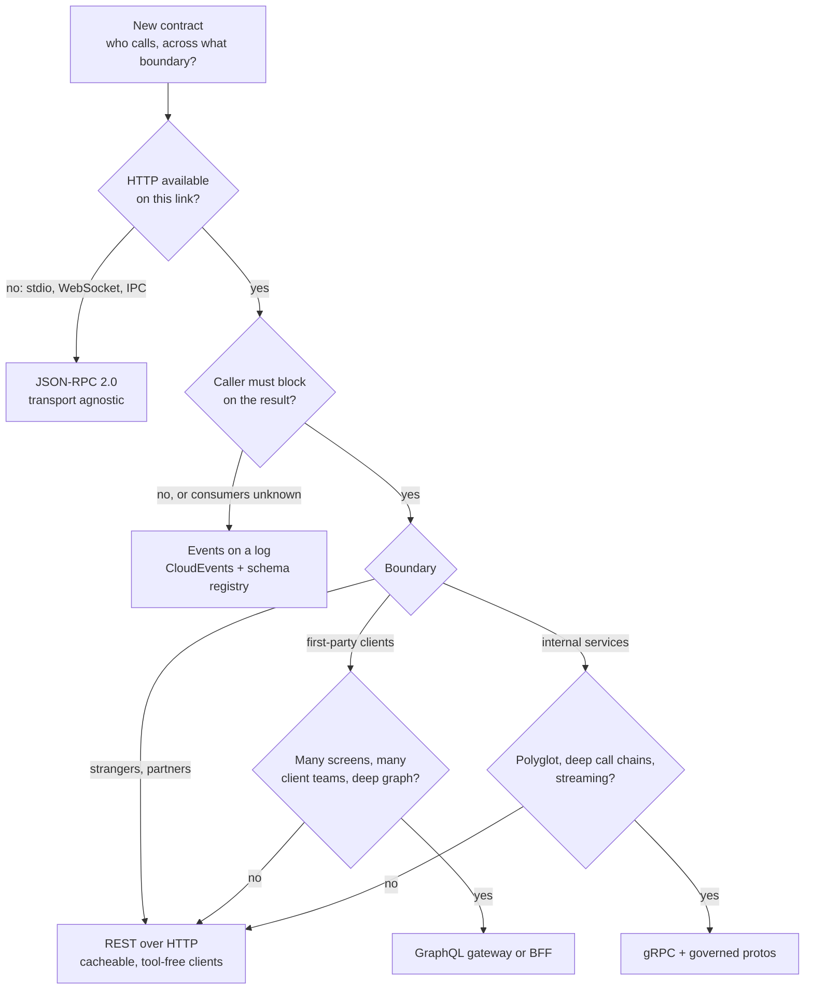

# The Principal Engineer's Paradigm Decision Matrix: Choosing REST, gRPC, GraphQL, JSON-RPC, or Event Streams by Boundary, Team Topology, and Latency

> [!summary] Claim
> Pick the paradigm from three facts about the contract, namely the boundary it crosses, the team structure that will evolve it, and the number of sequential round trips it forces, because codec speed is a microsecond effect while round trips, silent schema breakage, and lost HTTP semantics are the costs that decide outcomes.

Part of [GraphQL JSON RPC and Event APIs](README.md) in [API Engineering](../README.md).

## TL;DR

- Mechanism: each paradigm fixes a different unit of contract (a resource for REST, a method plus a protobuf message for gRPC, a typed graph plus a client-written selection for GraphQL, a method name plus params for JSON-RPC, a fact on a log for events), and that unit decides who can evolve what without a meeting.
- Contract rule: choose by boundary first (strangers, first-party clients, internal services, non-HTTP transport), then by topology (who owns the schema and who consumes it), then by the critical path, which is sequential round trips and not bytes (measured here: the same screen takes 5 requests and depth 2 on resource-grained REST, 2 and depth 2 on JSON-RPC, and 1 and depth 1 on GraphQL or on a purpose-built REST `expand`).
- Trap: the failure modes differ in loudness, and the quiet ones hurt most; in this lab's matrix a removed protobuf field and a changed protobuf field type are `silent_wrong` (the old reader parses without error and shows a default), while the same changes on JSON paradigms are `hard_error`.
- Portability fact: gRPC over HTTP/2 needs trailers and framing that browsers do not expose, so browser-direct gRPC needs gRPC-Web or Connect, REST needs HTTP semantics, and only JSON-RPC and the GraphQL specification itself define no transport (lab run on CPython 3.14.6 only).
- When not to use this note's matrix: when a hard constraint already decides it (a non-HTTP stdio transport forces JSON-RPC, an unknown set of independent consumers forces events, a public third-party boundary forces REST-shaped HTTP) or when the choice is really about transport, which [[Real-Time-Push-Protocols-Compared-WebSockets-vs-SSE-vs-HTTP-2-3-Streaming-vs-Long-Polling]] covers.

## Mental model



The first branch asks whether HTTP exists at all, because REST needs HTTP semantics and gRPC needs HTTP/2 framing, while JSON-RPC only needs a way to move JSON.
The second branch asks whether the caller can proceed without an answer, since only a log decouples producer and consumer in time, and a caller that must block on a result cannot use one.
The third branch is the boundary, where strangers get the paradigm with the widest tooling and shared-cache support, first-party clients get field selection when many screens consume a deep graph, and internal services get typed code generation and deadlines when many languages and deep call chains are involved.
Every leaf is a default, not a verdict: `rank` in the lab turns these branches into an explicit rule table so a disagreement becomes an argument about a named rule and a weight.

## How it works

### The unit of contract in each paradigm

REST contracts a resource and a uniform interface.
Fielding's dissertation states the price of the uniform interface plainly: it "degrades efficiency, since information is transferred in a standardized form rather than one which is specific to an application's needs", and it is "not optimal for other forms of architectural interaction" (Fielding dissertation Section 5.1.5).
What it buys is visibility: methods carry generic semantics that intermediaries understand without knowing the application.
`GET` is safe and idempotent, `PUT` and `DELETE` are idempotent, and `POST` is in neither list (RFC 9110 Sections 9.2.1 and 9.2.2; Section 9.3.3 calls `POST` "potentially unsafe").
A `POST` response is cacheable only with explicit freshness information and a `Content-Location` equal to the request target (RFC 9110 Section 9.3.3), which is why a paradigm that sends every read as `POST` gives up shared caching by default.
RFC 9205 (BCP 56) states the discipline the other paradigms violate when they tunnel: "applications that use HTTP MUST NOT redefine, refine, or overlay the semantics of generic protocol elements such as methods, status codes, or existing header fields" (RFC 9205 Section 3.1, "Generic Semantics").

gRPC contracts a service method and a protobuf message pair, carried on HTTP/2.
A request is `Request-Headers` followed by length-prefixed messages and end of stream, and a response is `Response-Headers`, messages, and `Trailers`, or `Trailers-Only` for an immediate error (grpc PROTOCOL-HTTP2.md, "Outline").
The path is `/Service-Name/method` and the method is always `POST`.
`grpc-status` travels in trailers even on success, the HTTP status is `200` even for application errors, and a server SHOULD answer `415` when `Content-Type` does not begin with `application/grpc`, precisely so that other HTTP/2 clients do not read a gRPC error as success (grpc PROTOCOL-HTTP2.md, "Requests" and "Responses").
The trailer section is an HTTP/2 mechanism: a `HEADERS` frame carrying `END_STREAM` after the `DATA` frames (RFC 9113 Sections 8.1 and 8.8.5).

GraphQL contracts a typed graph and lets the client write the selection.
Over HTTP, a server must support `POST` with a JSON body and may support `GET`, but `GET` must not execute a mutation, and the working draft recommends `405` with an `Allow` header for that case (GraphQL over HTTP working draft Sections 4.3 and 5.4, as of 2026-11).
The type system has a hard edge that matters for ids and timestamps: `Int` is a signed 32-bit value, and "numeric integer values larger than 32-bit should either use String or a custom-defined Scalar" (GraphQL September 2025 Section 3.5.1).
Everything below the selection set, including resolver cost and `N+1`, is the server's problem, covered in [[The-GraphQL-N-Plus-1-Problem-and-DataLoader-Tick-Batching-Internals]] and [[GraphQL-Security-Query-Depth-Complexity-Cost-Analysis-and-Batch-Limits]].

JSON-RPC 2.0 contracts a method name and its params inside an envelope, and nothing else.
The specification calls itself "transport agnostic in that the concepts can be used within the same process, over sockets, over http, or in many various message passing environments" (JSON-RPC 2.0 Section 1).
A notification is a request without `id` and gets no response (Section 4.1), error codes `-32768` to `-32000` are reserved with `-32700`, `-32600`, `-32601`, `-32602`, and `-32603` predefined (Section 5.1), and a batch may be processed "as a set of concurrent tasks, processing them in any order and with any width of parallelism" (Section 6).
That last sentence is the reason a batch cannot carry a data dependency, which the round-trip experiment below makes concrete.
Details and edge cases live in [[JSON-RPC-2-0-Specification-Batching-Notifications-and-Error-Codes]].
Two widely deployed protocols pick JSON-RPC for exactly the transport reason: the Language Server Protocol's content part "uses JSON-RPC to describe requests, responses and notifications" over a header-framed stream (LSP 3.17 base protocol), and the MCP Python SDK 2.3.0 stdio server validates each line read from standard input as a JSON-RPC message (mcp 2.3.0 mcp/server/stdio.py, `stdio_server`, whose `stdin_reader` calls `types.jsonrpc_message_adapter.validate_json` per line).

Events contract a fact on a log with unknown, independent consumers.
CloudEvents 1.0.2 requires four context attributes in every event: `id`, `source`, `specversion`, and `type` (CloudEvents 1.0.2 spec.md, "REQUIRED Attributes"), with envelope mechanics in [[CloudEvents-1-0-2-Envelope-Structured-vs-Binary-Content-Modes-and-Schema-Registries]] and channel contracts in [[Event-Driven-APIs-and-AsyncAPI-3-1-0-Specification]].
Fowler separates the patterns people lump together: Event Notification, where "the source system doesn't really care much about the response", and Event-Carried State Transfer, where recipients keep their own copy so it "never needs to talk to the main customer system in order to do its work in the future" (Fowler, "What do you mean by Event-Driven?").
His warning applies to every event-driven design: when a real logical flow runs across notifications, it "can be hard to see such a flow as it's not explicit in any program text".

### Wire bytes of the same Order

The lab encodes one `Order` (id `100234`, three lines) five ways.
The protobuf encoding is built in code with `descriptor_pb2` and `message_factory`, with no `protoc`, and the lab test checks it against an independent hand-written varint encoder.
A protobuf record is a tag varint `(field_number << 3) | wire_type` followed by a payload, where wire type `0` is `VARINT` and `2` is `LEN` (protobuf.dev encoding guide, "Message Structure").
The documented example `08 96 01` is field 1 with the varint `150` (protobuf.dev encoding guide), and the lab asserts that its schema compiler emits exactly those bytes.

```text
08 8a 8f 06                 1:VARINT 100234          id
10 b3 3c                    2:VARINT 7731            customer_id
18 02                       3:VARINT 2               status (CONFIRMED)
20 80 f2 d6 ca 06           4:VARINT 1767225600      created_at (5-byte varint)
2a 03 55 53 44              5:LEN "USD"              currency
32 0f 0a 08 "SKU-1001" 10 02 18 cf 0f      6:LEN line (15 bytes): sku, quantity 2, price 1999
32 0f 0a 08 "SKU-2002" 10 01 18 e6 74      6:LEN line: quantity 1, price 14950
32 0f 0a 08 "SKU-3003" 10 05 18 c5 02      6:LEN line: quantity 5, price 325
```

That is 71 bytes.
A gRPC `Length-Prefixed-Message` adds a 1-byte `Compressed-Flag` and a 4-byte big-endian `Message-Length`, so the message travels as 76 bytes (grpc PROTOCOL-HTTP2.md, "Requests", `Length-Prefixed-Message`).
Fields numbered 1 to 15 take a one-byte tag and numbers from 16 take two, which the lab proves by encoding a field 15 and a field 16 (protobuf.dev proto3 guide, "Assigning Field Numbers").
Proto3 does not serialize a field at its default value, so `{"a": 0}` encodes to zero bytes (lab test `test_proto3_default_values_are_not_serialized`).
This is also the root of the silent failures below: an absent field and a default field are the same bytes.

gRPC-Web exists because a browser cannot read HTTP/2 trailers.
Its design goals include to "decouple from HTTP/2 framing which is not, and will never be, directly exposed by browsers" (grpc PROTOCOL-WEB.md, "Design goals").
It moves the status into the body: a final frame whose first byte has its most significant bit set (`10000000b` uncompressed trailers), containing `key: value\r\n` header lines, and trailers must be the last message (grpc PROTOCOL-WEB.md, "Protocol differences vs gRPC over HTTP2", message framing).
The lab builds and parses that frame (`grpc_web_trailer_frame`, `parse_frames`) and asserts the flag `0x80` and the payload `grpc-status: 0\r\n`.

Connect, the other browser-friendly option, drops trailers and gRPC framing for unary calls: most requests are `POST` with `application/proto` or `application/json`, paths are derived from the schema, responses carry meaningful HTTP statuses, and an RPC annotated `idempotency_level = NO_SIDE_EFFECTS` may be sent as `GET` (Connect protocol documentation, "Summary").
Its documentation states that bidirectional streaming requires HTTP/2 while the other call types also work over HTTP/1.1.
That makes Connect and the HTTP transcoding path in [[HTTP-JSON-to-gRPC-Transcoding-and-Google-API-HTTP-Annotations-AIP-127]] the escape hatches when one `.proto` must serve both internal services and browsers.

### Schema evolution: the same four changes on five paradigms

The lab applies each change to the writer and reads the result with a v1 reader, then compares the parsed result with the original.
`compatible` means the reader parsed everything and every value equals the original, `hard_error` means the reader raised, and `silent_wrong` means the reader raised nothing and at least one value differs.

| Change | REST | JSON-RPC | Events | gRPC | GraphQL |
|---|---|---|---|---|---|
| add a field | compatible | compatible | compatible | compatible | compatible |
| remove `status` | hard_error | hard_error | hard_error | **silent_wrong** | hard_error |
| rename `status` | hard_error | hard_error | hard_error | compatible | hard_error |
| `created_at` int to string | hard_error | hard_error | hard_error | **silent_wrong** | **silent_wrong** |

(Measured on CPython 3.14.6; the JSON readers are strict pydantic `2.14.3` models that ignore extra fields, GraphQL clients are queries validated by `graphql-core` `3.3.2` against the new SDL, and the protobuf reader is the v1 message class.)

The mechanics behind each cell:

- Protobuf add: the old reader keeps the new field as an unknown field and re-emits it when it re-serializes, so a proxy that parses and forwards does not drop it ("Proto3 messages preserve unknown fields and include them during parsing and in the serialized output", protobuf.dev proto3 guide, "Unknown Fields"; lab test `test_old_protobuf_reader_preserves_the_unknown_field_on_reserialize`).
  Unknown fields are lost on a trip through JSON or when a caller copies field by field (same guide, "Retaining Unknown Fields").
- Protobuf remove: the reader sees field 3 as absent and reports the proto3 default `0`, so `status` silently becomes "unspecified".
  The guide's rule is that removal is wire-safe only if the number is never reused, so reserve it (protobuf.dev proto3 guide, "Reserved Field Numbers"); reuse is worse, because the lab test `test_reusing_a_removed_field_number_silently_changes_meaning` shows an old reader decoding a new `priority = 9` as `status = 9`.
- Protobuf rename: names are not on the wire, so a rename that keeps the number is compatible, but ProtoJSON puts names in the payload, so the same rename breaks JSON clients (lab test `test_renamed_protobuf_field_keeps_the_wire_but_breaks_protojson`; the guide says ProtoJSON "puts field and enum value names into encoded messages which makes it much harder to change those names later", protobuf.dev JSON guide).
- Protobuf type change: field 4 arrives as wire type `LEN` where the reader expects `VARINT`, and the lab measures that the parser raises nothing, leaves `created_at == 0`, and keeps the record as an unknown field (field 4, `LEN`) that it re-emits on serialization (lab test `test_wire_type_mismatch_becomes_an_unknown_field_without_an_error`).
  This is a lab measurement with protobuf `7.36.2` on the `upb` backend; the proto3 guide's wire-compatible list, which does not include `int64` to `string`, is the rule to follow instead of relying on this behavior (protobuf.dev proto3 guide, "Binary Wire-compatible Changes (Conditionally Safe)").
- GraphQL remove or rename: the client's query no longer validates against the new schema and the lab reports errors, which is the point of validation: "execution should only occur for valid requests", and "any change that can cause a previously valid request to become invalid is considered a breaking change" (GraphQL September 2025 Section 5, Validation, and its "Type System Evolution" subsection).
  GraphQL type change is `silent_wrong` in the matrix because `createdAt: Int!` to `String!` leaves the query valid and changes the JSON type the client receives.
  Deprecation (`@deprecated`) is the migration tool that makes the hard errors avoidable, and the compatibility vocabulary is in [[Compatibility-Taxonomy-Wire-Source-and-Semantic-Compatibility-AIP-180]] and [[Additive-Schema-Evolution-and-Tolerant-Reader-Patterns]].
- JSON paradigms: the tolerant reader ignores additions and rejects everything else, which is a choice, not a law; a reader with defaults would turn removal into `silent_wrong` too.
- Events differ from the others in a way this matrix cannot show: old events stay in the log, so a new consumer must also read old shapes, and compatibility has to hold in both directions.
  [[Idempotent-Event-Consumers-Inbox-Pattern-and-Poison-Message-DLQs]] covers the consumer side.

Protobuf serialization is also not canonical: "Do not assume the byte output of a serialized message is stable", and repeated serialization of the same instance may differ (protobuf.dev encoding guide, "Field Order", "Implications").
Never hash or sign serialized protobuf bytes, and never use them as a cache key across binaries.

### The round-trip experiment

One order screen shows the order status, the customer's name and tier, and for each line its sku, quantity, and the product title.
The lab serves it four ways from one in-process FastAPI app: resource-grained REST (`GET /orders/{id}`, `/customers/{id}`, `/products/{sku}`), REST with `GET /orders/{id}?expand=customer,lines.product`, JSON-RPC with `order.get`, `customer.get`, `product.get` and a batch, and a Strawberry GraphQL endpoint with a nested selection.
All four loaders return the same `ScreenView`, and a `Tracker` installed as `httpx` event hooks counts requests and the depth of the longest chain of requests that had to wait for an earlier reply.

```python
# simplified excerpt of Tracker (labs/src/.../architectural_paradigm_selection_*.py)
async def on_request(self, request: httpx.Request) -> None:
    self.requests += 1
    self._depth_of[id(request)] = self._completed_depth + 1

async def on_response(self, response: httpx.Response) -> None:
    await response.aread()
    depth = self._depth_of[id(response.request)]
    self.response_bytes += len(response.content)
    self._completed_depth = max(self._completed_depth, depth)
    self.max_depth = max(self.max_depth, depth)
```

A request that starts after some reply completed gets depth one greater than the deepest completed reply, and requests started together share a depth.
To make "started together" deterministic without timers, every handler does one `await asyncio.sleep(0)`, so each task in an `asyncio.gather` reaches its first suspension before any of them completes.
The test `test_tracker_separates_parallel_siblings_from_dependent_chains` checks the instrument itself: five concurrent requests give depth 1 and three more sequential ones give depth 4.

Why the numbers fall out as they do:

- Resource-grained REST needs two waves because the customer id and the sku list come from the order response, so wave 2 cannot start until wave 1 finishes, and wave 2 fans out into 1 customer plus 3 product requests.
- JSON-RPC needs two waves for the same reason, and its batch does not help because a batch is a set of independent requests that the server may run in any order (JSON-RPC 2.0 Section 6), with no syntax to reference an earlier result; the lab test sends a batch whose second item tries a reference (`"$1.customerId"`) and gets an error object and no `result` for it, because the handler receives the literal string and not a looked-up id.
- REST with `expand` is one request because the server implements a bespoke projection; the round-trip count is the same as GraphQL, and the cost moved from the client to a server endpoint that is now coupled to one screen, which is the Backend-for-Frontend trade-off in [[Backend-for-Frontend-BFF-Aggregation-Fan-Out-and-Partial-Degradation]].
- GraphQL is one request because the client states the whole subtree and the server resolves it, and the server still performs the dependent lookups internally, so the latency hidden from the client re-appears as server-side fan-out unless batched.

### Team topology decides who can change the contract

Conway's thesis is that "organizations which design systems ... are constrained to produce designs which are copies of the communication structures of these organizations" (Conway 1968, conclusion).
Read as a selection rule, the paradigm should match the communication structure it has to survive:

| Topology | Who edits the contract | Fits | Why |
|---|---|---|---|
| one team owns client and server | the same people | REST or JSON-RPC, lowest ceremony | no coordination cost to optimize |
| several frontend squads over one backend | frontend squads want to change what they read without a backend release | GraphQL gateway or BFF | selection moves with the client team, the platform team owns the schema and its cost limits |
| many service teams, many languages | a central or federated schema owner | gRPC with governed protos, plus events between domains | shared generated clients, lint gates ([[Protobuf-Governance-Linting-and-Breaking-Change-Gates-with-Buf]]), temporal decoupling |
| unknown external consumers | the provider alone | REST over HTTP, versioned | consumers cannot be coordinated, so the contract must be tool-free and cacheable |

The downside is the same in each row: the paradigm centralizes some decision.
GraphQL centralizes schema design and cost control in a platform team, gRPC centralizes `.proto` review, and events centralize the meaning of a fact in its producer while consumers multiply invisibly.

### Latency is round trips times hop cost, and the codec is noise

The critical path of a sequence of dependent calls is `depth * (rtt + server_time)`, and parallel siblings add no depth (lab `critical_path_ms`).
With illustrative inputs of a 5 ms server time, depth 2 costs 12 ms at a 1 ms round trip and 170 ms at an 80 ms round trip, while depth 1 costs 6 ms and 85 ms (arithmetic from `critical_path_ms`, with assumed inputs and no measured network).
The lab also measured the codec paths on this machine, and they are small next to a round trip (the next table in Numbers and limits).
So the useful latency questions are: how many dependent round trips does the screen need, how many bytes cross a slow link, and does the server do the fan-out in parallel.
Deadlines are the other latency contract: gRPC carries one as the `grpc-timeout` header, "positive integer as ASCII string of at most 8 digits" plus a unit among `H`, `M`, `S`, `m`, `u`, `n`, and a missing timeout means "an infinite timeout" (grpc PROTOCOL-HTTP2.md, "Requests"), with propagation covered in [[gRPC-Deadlines-Timeout-Header-and-Context-Cancellation-Cascade]].
Events replace the round trip with lag, which has no request-time SLO unless you build one.

### The decision engine as an explicit rule table

`rank(requirements, rules)` scores each of the five paradigms with rules that carry a name, a predicate over `Requirements`, per-paradigm score effects, a set of vetoes, and a reason.
Vetoes sort last regardless of score, and ties break by declared order.

```python
# simplified excerpt of rank (labs/src/.../architectural_paradigm_selection_*.py)
for rule in rules:
    if not rule.applies(requirements):
        continue
    for paradigm, delta in rule.effects.items():
        scores[paradigm] += delta
        reasons[paradigm].append(f"{rule.name}: {delta:+d}")
    for paradigm in rule.vetoes:
        vetoed.add(paradigm)
        reasons[paradigm].append(f"{rule.name}: VETO")
...
return sorted(ranked, key=lambda r: (r.vetoed, -r.score, order.index(r.paradigm)))
```

| Rule | Effect | Source of the claim |
|---|---|---|
| `default_rest` | REST +1 | the uniform interface and caching in RFC 9110 and Fielding Section 5.1.5 |
| `non_http_transport` | JSON-RPC +5, GraphQL -3, vetoes REST and gRPC | JSON-RPC 2.0 Section 1; gRPC is defined over HTTP/2; the GraphQL penalty is judgment, since its specification leaves transport open but its standardized serving is over HTTP |
| `public_third_party` | REST +3, gRPC -2, JSON-RPC -1 | RFC 9205 Section 3.1 |
| `browser_without_proxy` | vetoes gRPC | grpc PROTOCOL-WEB.md "Design goals" |
| `browser_with_proxy` | gRPC -2 | gRPC-Web or Connect adds a layer |
| `cdn_cacheable_reads` | REST +3, GraphQL -1, JSON-RPC -2, gRPC -3 | RFC 9110 Section 9.3.3 |
| `client_shaped_reads` | GraphQL +3, REST -1 | the measured round trips above |
| `frontend_backend_split` | GraphQL +2 | Conway 1968 |
| `bidirectional_streaming` | gRPC +3, Events +1, REST -2, JSON-RPC -1, GraphQL -1 | grpc PROTOCOL-HTTP2.md |
| `polyglot_internal` | gRPC +3 | generated clients |
| `deep_serial_chain` | gRPC +2 | `grpc-timeout` deadline propagation |
| `many_service_teams` | gRPC +1, Events +1 | Conway 1968 |
| `decoupled_in_time` | Events +5, others -1 | Fowler |
| `synchronous_answer` | vetoes Events | Fowler's Event Notification definition |

The weights are this note's judgment, not measurements, and the table exists to make that judgment reviewable; the tests pin the five canonical scenarios (public payments -> REST, internal polyglot mesh -> gRPC, multi-squad first-party app -> GraphQL, domain events -> Events, editor protocol over stdio -> JSON-RPC) and prove that every rule changes the outcome of at least one catalog scenario, so a dead rule cannot hide.

## Numbers and limits

Measured in this lab (command and machine under Worked example; body bytes only, with HTTP headers, TLS, and HTTP/2 framing excluded; CPython 3.14.6, protobuf `7.36.2` with the `upb` backend, strawberry-graphql `0.340.0`, graphql-core `3.3.2`; re-run by the verifier on 2026-11-26 with identical byte counts):

| Payload (same 3-line order) | Request body bytes | Response body bytes | gzip of response (level 6) |
|---|---:|---:|---:|
| REST `GET /orders/100234` | 0 | 264 | 181 |
| JSON-RPC `order.get` | 68 | 298 | 203 |
| GraphQL, full selection | 146 | 287 | 195 |
| GraphQL, `id status` only | 81 | 55 | 71 |
| gRPC (5-byte frame plus protobuf) | 9 | 76 | 84 |
| CloudEvents structured JSON event | 0 | 443 | 292 |

Reading the table: protobuf is 71 bytes against 264 for REST JSON, the JSON-RPC envelope adds 34 bytes, the CloudEvents envelope adds 179 bytes, GraphQL pays 146 request bytes for query text but a two-field selection returns 55 bytes, smaller than the protobuf message because it sends fewer fields, and gzip makes the gRPC and slim GraphQL responses larger (84 against 76 and 71 against 55), so gzip's per-stream framing outweighs any saving on messages this small.
The GraphQL request cost is why persisted queries exist ([[Automatic-Persisted-Queries-APQ-and-Edge-CDN-Caching-for-GraphQL]]).

Screen cost, same machine, response bodies only:

| Loader | HTTP requests | Sequential depth | Response bytes |
|---|---:|---:|---:|
| REST, resource-grained | 5 | 2 | 1403 |
| REST with `expand` | 1 | 1 | 1448 |
| JSON-RPC, `order.get` then a batch | 2 | 2 | 1607 |
| GraphQL, one nested query | 1 | 1 | 306 |

The byte gap (306 against 1403 to 1607) comes from fixture fields the screen never shows (a long product `description`, a customer `address`), so it is fixture-dependent over-fetching, not a general ratio; the request and depth counts are the portable result.

Codec cost, ns per call, `benchmark_roundtrips(SAMPLE_ORDER, 20000)`, Apple M3 Pro, macOS 27.3 (Darwin 27.3.0), CPython 3.14.6, one verifier run on 2026-11-26 (not repeated, no variance stated; the drafter's earlier run gave figures up to 2.9 times higher, so treat them as noisy):

| Path | ns per call |
|---|---:|
| REST: build dict, `json.dumps`, `json.loads` | 11065 |
| protobuf: fill message, serialize, parse, read fields | 5350 |
| GraphQL: `Schema.execute_sync` of the full query, then `json.loads` | 1027347 |
| `json.loads` of a prebuilt REST body | 1843 |
| `json.loads` of a prebuilt GraphQL body | 1932 |
| protobuf parse plus field read of a prebuilt message | 2056 |

Treat these as relative orders of magnitude and not as codec benchmarks: the encode-side figures include this lab's pure-Python glue (`camelize`, the descriptor-driven `_fill`), the protobuf read includes converting to a dict, and the GraphQL figure includes whatever `execute_sync` does on every call (structurally, `execute_sync` parses the query text on every call, runs validation when validation rules are configured, and then calls the execute function, with no query cache in between: strawberry-graphql 0.340.0 strawberry/schema/schema.py, `Schema.execute_sync`, `_prepare_operation_sync`, `_parse_operation_document`, `_run_validation`; the lab did not time the three phases separately, so the note makes no claim about their split).
The robust reading is that parsing a 3-line order costs microseconds on any of them, and a full GraphQL execution costs about a millisecond in this call path.

Specification and source numbers:

| Limit | Value | Source |
|---|---|---|
| gRPC default max receive message | 4 MiB (4194304 bytes), `-1` unlimited | grpc v1.85.1 `include/grpc/impl/channel_arg_names.h`, `GRPC_ARG_MAX_RECEIVE_MESSAGE_LENGTH` |
| gRPC suggested header limit | 8 KiB, counted like `SETTINGS_MAX_HEADER_LIST_SIZE` (name plus value plus 32 per field) | grpc PROTOCOL-HTTP2.md, "Requests" |
| `grpc-timeout` value | at most 8 ASCII digits plus a unit | grpc PROTOCOL-HTTP2.md, "Requests" |
| HTTP/2 concurrent streams | recommended not below 100 | RFC 9113 Section 6.5.2 |
| JSON integers exact for binary64 parsers | `[-(2**53)+1, (2**53)-1]` | RFC 8259 Section 6 |
| GraphQL `Int` | signed 32-bit | GraphQL September 2025 Section 3.5.1 |
| Protobuf one-byte tags | field numbers 1 to 15 | protobuf.dev proto3 guide, "Assigning Field Numbers" |
| Protobuf reserved numbers | 19000 to 19999 | protobuf.dev proto3 guide, "Assigning Field Numbers" |
| JSON-RPC reserved error range | `-32768` to `-32000` | JSON-RPC 2.0 Section 5.1 |

(as of 2026-11 for all "master" and "draft" documents above)

## Portability

| Dimension | Result | Proof |
|---|---|---|
| CPython 3.14.6 on macOS arm64 | 46 tests passed | ran here, see Worked example |
| CPython 3.12 as the minimum | the lab's syntax needs 3.12 or later | the test module uses a `type` alias statement, which is new in 3.12 (PEP 695, `Python-Version: 3.12`); `match` needs 3.10 (PEP 634) and `StrEnum` needs 3.11 (Python `enum` documentation, "Added in version 3.11"); `labs/pyproject.toml` pins `requires-python = ">=3.12,<3.16"` |
| protobuf `7.36.2`, `upb` backend | wire bytes equal the hand oracle | ran here (`protobuf_backend()` returned `upb`) |
| strawberry-graphql `0.340.0` | `Int` rejects `2**31` with a 32-bit error, accepts `2**31 - 1` | ran here (`test_graphql_int_is_32_bit`); the error `Int cannot represent non 32-bit signed integer value: 2147483648` is raised by graphql-core (graphql-core 3.3.2 graphql/type/scalars.py, `serialize_int`) |
| HTTP/1.1 | REST, GraphQL, JSON-RPC, Connect unary, and gRPC-Web work | grpc PROTOCOL-WEB.md ("support any HTTP/*"), Connect documentation; native gRPC does not |
| HTTP/2 | native gRPC requires it; Connect bidirectional streaming requires it | grpc PROTOCOL-HTTP2.md (defined over HTTP/2 framing), Connect documentation, RFC 9113 Section 8.1 |
| HTTP/3 over QUIC | HTTP/3 carries a trailer section as a single `HEADERS` frame, but the gRPC wire protocol is defined over HTTP/2 only | RFC 9114 Section 4.1; grpc PROTOCOL-HTTP2.md (defined over HTTP/2 framing) |

Not covered, so the note makes no claim about them: CPython 3.12, 3.13, 3.14.10, 3.15 and 3.15t free-threaded as runtimes for the lab, the protobuf pure-Python and C++ backends (the unknown-field and wire-type-mismatch results were measured on `upb` only), Uvicorn, Hypercorn and Granian as real servers (the lab drives the app in process through `httpx.ASGITransport`), gRPC over HTTP/3, and Linux, Windows and Alpine musl.
The lab was run on one interpreter on one machine, because lab checks were paused by the user's instruction of 2026-11-11.

## Worked example

Implementation: [implementation](../labs/src/api_labs/f20_graphql_json_rpc_and_event_apis/architectural_paradigm_selection_rest_vs_grpc_vs_graphql_vs_json_rpc_vs_events.py).
Test: [test](../labs/tests/f20_graphql_json_rpc_and_event_apis/test_architectural_paradigm_selection_rest_vs_grpc_vs_graphql_vs_json_rpc_vs_events.py).

The three pieces that carry the argument, as simplified excerpts of the implementation:

```python
# simplified excerpt: gRPC and gRPC-Web framing
def grpc_frame(message: bytes, *, compressed: bool = False) -> bytes:
    return bytes([1 if compressed else 0]) + len(message).to_bytes(4, "big") + message

def grpc_web_trailer_frame(status: int, message: str = "") -> bytes:
    block = f"grpc-status: {status}\r\n"
    if message:
        block += f"grpc-message: {message}\r\n"
    payload = block.encode("ascii")
    return bytes([GRPC_WEB_TRAILER_FLAG]) + len(payload).to_bytes(4, "big") + payload
```

```python
# simplified excerpt: the four schema changes, applied to the writer's logical dict
def _apply_change(data: dict[str, Any], change: Change) -> dict[str, Any]:
    changed = dict(data)
    match change:
        case Change.ADD_FIELD:
            changed["fulfillment_note"] = "gift wrap"
        case Change.REMOVE_FIELD:
            del changed["status"]
        case Change.RENAME_FIELD:
            changed["state"] = changed.pop("status")
        case Change.CHANGE_TYPE:
            changed["created_at"] = "2026-01-01T00:00:00Z"
    return changed
```

```python
# simplified excerpt of the test oracle: an independent varint encoder
def varint(value: int) -> bytes:
    out = bytearray()
    while True:
        group = value & 0x7F
        value >>= 7
        if value:
            out.append(group | 0x80)
        else:
            out.append(group)
            return bytes(out)

def test_protobuf_bytes_equal_an_independent_hand_encoding() -> None:
    assert encode_protobuf(SAMPLE_ORDER) == hand_encoded_order()
    assert len(encode_protobuf(SAMPLE_ORDER)) == 71
```

Command, run from `labs/` on CPython 3.14.6, macOS (Darwin 27.3.0, arm64, Apple M3 Pro):

```text
$ uv run --frozen pytest tests/f20_graphql_json_rpc_and_event_apis/test_architectural_paradigm_selection_rest_vs_grpc_vs_graphql_vs_json_rpc_vs_events.py -q
..............................................                           [100%]
46 passed in 0.53s
```

The captured wire, evolution, and screen output from one run of the lab functions (`measure_wire`, `evolution_matrix`, `tracked_client` with the four loaders) is the source of every table in this note, and the numbers are those printed by that run: for example `graphql_slim 81 55 71`, `grpc 9 76 84`, `rest 5 2 1403`, `graphql 1 1 306`.

## Pitfalls

> [!warning] Resource-grained REST for a client-shaped screen
> Trigger: a screen that needs an order, its customer, and each line's product, built on three resource types.
> Symptom: 5 requests at depth 2 in this lab (1403 response bytes), and on a slow link two sequential round trips of latency; the client also carries the join logic.
> Fix: add a purpose-built projection (`expand`, a BFF endpoint) or a GraphQL gateway, and accept the cost you chose: a screen-coupled endpoint or a platform-owned schema.

> [!warning] Choosing gRPC and then discovering the browser
> Trigger: an internal gRPC API later needs to be called from a web page.
> Symptom: browsers cannot read HTTP/2 trailers, and gRPC-Web is a different wire protocol that needs a translating proxy (grpc PROTOCOL-WEB.md).
> Fix: decide at design time whether a translation layer is acceptable, or use Connect, or expose a transcoded JSON surface from the same `.proto` ([[HTTP-JSON-to-gRPC-Transcoding-and-Google-API-HTTP-Annotations-AIP-127]]).

> [!warning] Silent protobuf breakage looks like success
> Trigger: removing a field, reusing its number, or changing a field's type.
> Symptom: old readers parse without error and read a default or a different field's value, as in `test_reusing_a_removed_field_number_silently_changes_meaning`.
> Fix: `reserved` every retired number and name (protobuf.dev proto3 guide, "Reserved Field Numbers"), follow the wire-safe list, and gate with breaking-change tooling ([[Protobuf-Governance-Linting-and-Breaking-Change-Gates-with-Buf]], [[Protobuf-Schema-Evolution-Invariants-Reserved-Tags-and-Unknown-Fields]]).

> [!warning] 64-bit ids as JSON numbers
> Trigger: an `int64` id above `2**53 - 1` in a JSON number.
> Symptom: a browser or any binary64 parser silently changes it; the lab shows `2**53 + 1` parsing back as `2**53`, which is how one customer's data ends up under another's id.
> Fix: send ids as strings (ProtoJSON emits `int64` as strings for this reason, protobuf.dev JSON guide, "Strings for int64"; GraphQL `ID` is a string), per RFC 8259 Section 6.

> [!warning] GraphQL `Int` for timestamps and money
> Trigger: epoch seconds or minor units in an `Int` field.
> Symptom: values from `2**31` (epoch second 2147483648, in January 2038) fail with a 32-bit error and, because the field is non-null, the failure nulls its parent (lab `test_graphql_int_is_32_bit` returned `{"order": null}`).
> Fix: use `String`, `ID`, or a custom scalar (GraphQL September 2025 Section 3.5.1), and see [[GraphQL-Field-Level-Authorization-and-Partial-Error-Null-Bubbling]] for the null-propagation rules.

> [!warning] Tunneling errors through `200 OK`
> Trigger: JSON-RPC over HTTP, or GraphQL with execution errors, where the HTTP status stays `200`.
> Symptom: gateways, retries, and dashboards see success; the lab's JSON-RPC `-32601` reply is `200` with an `error` object.
> Fix: log and alert on the body-level error, and for GraphQL follow the draft's media type and status guidance (`application/graphql-response+json`, which MUST be answered with `4xx` or `5xx` when the result has no `data` entry and SHOULD use `294` when it has both `data` and errors; the draft calls `294 Partial Success` a custom code "not yet registered with IANA", as of 2026-11) (GraphQL over HTTP working draft Sections 3.1, 5.4, and 6.1; RFC 9205 Section 3.1).

> [!warning] Events where the caller needs an answer
> Trigger: modelling "reserve stock at checkout" as publish and hope.
> Symptom: the checkout flow runs across notifications that no code shows, and a failure has no place to go (Fowler's warning about hidden flow).
> Fix: use request-response for the decision and events for the fact afterwards; for the long-running variant see [[HTTP-Callback-Subscriptions-WebSub-and-Async-Request-Reply-Patterns]].

> [!warning] Hashing or signing protobuf bytes
> Trigger: using `SerializeToString()` output as an ETag, signature input, or dedupe key.
> Symptom: the same logical message produces different bytes across binaries, languages, or after an old server forwarded unknown fields (protobuf.dev encoding guide, "Field Order", "Implications").
> Fix: sign a canonical form you define, or use deterministic serialization only within one binary.

## Security and robustness

The paradigm changes which layer can see and limit abuse.
OWASP API Security Top 10 2023 names the risks that recur (OWASP API Security 2023, `API1` Broken Object Level Authorization, `API3` Broken Object Property Level Authorization, `API4` Unrestricted Resource Consumption, `API9` Improper Inventory Management, `API10` Unsafe Consumption of APIs):

| Paradigm | Where the enforcement point moves | Main risk |
|---|---|---|
| REST | method plus path are visible, so gateways and WAFs can authorize and rate-limit per route | `API1` object-level checks per resource id |
| GraphQL | one URL and one method, so the operation is in the body and the gateway is blind | `API4` unbounded depth, breadth, and alias or batch amplification, and `API3` per-field authorization (siblings: [[GraphQL-Security-Query-Depth-Complexity-Cost-Analysis-and-Batch-Limits]], [[GraphQL-Field-Level-Authorization-and-Partial-Error-Null-Bubbling]]) |
| gRPC | the path names the method, but the proxy must understand HTTP/2 and trailers | message size (4 MiB default receive limit) and reflection exposure ([[gRPC-Health-Checking-Protocol-Server-Reflection-and-Graceful-Stop]]) |
| JSON-RPC | one endpoint, the method is in the body, a batch is an amplifier | `API4` through batches, and no standard way for an intermediary to see the method |
| Events | authorization is at publish and subscribe, not per call | `API10`: consumers trust payloads, poison messages and replay ([[Idempotent-Event-Consumers-Inbox-Pattern-and-Poison-Message-DLQs]]) |

Cross-cutting rules:

- HTTP/2 is shared fate: CVE-2023-44487 (HTTP/2 Rapid Reset, published 2023-10-10, NVD CVSS 3.1 base score 7.5, exploited in the wild August through October 2023 per the NVD description, and a `cisaExploitAdd` date of 2023-10-10 in the same record) is an HTTP/2 protocol weakness, so gRPC, REST, and GraphQL served over HTTP/2 all sit behind the same server and proxy patches.
  The fix therefore lives in each HTTP/2 implementation and proxy you run.
- Validate at the boundary in every paradigm: protobuf keeps unknown fields and accepts defaults, so a missing required value is not an error unless your code checks it, and the strict pydantic readers in the lab show the opposite stance for JSON.
- Enforce limits where the paradigm hides them: depth and cost for GraphQL, batch size for JSON-RPC, message size for gRPC, schema and retention for events.
- Defense in depth for a mixed estate: authenticate at the edge, authorize per object in the service, and keep an inventory of every endpoint and event channel (`API9`).
- Do not let a gateway translate semantics it cannot preserve: a gRPC `NOT_FOUND` mapped to HTTP `200`, or a JSON-RPC error mapped to success, removes the signal the retry and circuit-breaker layers use ([[Error-Taxonomy-Retryability-and-Client-Contract-Design]]).

## The principal's view

The decision a staff-plus engineer makes is not "which paradigm" but "which paradigm at which boundary, owned by whom, and how many do we operate".
The defensible default is REST over HTTP at every boundary with strangers or partners, because the uniform interface, shared caches, and tool-free clients are the properties you cannot retrofit, and Fielding's price (less efficiency for a standard form) is almost always cheaper than a custom client for every consumer.
Move off the default only for a named reason from the rule table: non-HTTP transport (JSON-RPC), temporal decoupling or unknown consumers (events), many client teams reading a deep graph (GraphQL at the first-party edge), or polyglot internal calls with deep chains and streaming (gRPC).

The organizational trade-offs are the real cost:

- Every extra paradigm is another toolchain, another failure mode, another on-call skill, and another place where a gateway can lose semantics.
  A reasonable ceiling is one paradigm per boundary type and at most three in the estate.
- GraphQL moves work from client teams to the platform team: schema design, resolver performance, cost limits, and persisted-query operations.
  If you cannot staff that, the BFF in REST is the smaller commitment.
- gRPC moves work to schema governance: review, lint, breaking-change gates, and a plan for the browser.
  Without governance, the silent failure modes above become the incident.
- Events move work to consumers and to operations: idempotency, ordering, replay, and the fact that a consumer's behavior is invisible to the producer.
- Do not choose by codec benchmark: in this lab's numbers, parsing is microseconds and a round trip is milliseconds, so an extra dependent request costs orders of magnitude more than JSON against protobuf for a payload like this one.
  Choose a binary format when measured bytes and CPU at your scale matter, and measure first.

Choose differently when the constraints change: a mobile app on a poor link with one backend team still often wants a BFF, a single team with a monolith and two services does not need gRPC, and a system where partners want webhooks wants events delivered over HTTP callbacks, not a broker handed to strangers.
The decision should be recorded as an ADR that names the boundary, the topology, the rule weights that were contested, and the metric (dependent round trips on the critical path, breaking-change incidents, consumer onboarding time) that would reverse it.

## Interview questions

> [!question] L5: Why can resource-grained REST take 5 requests for a screen that needs an order, its customer, and each line's product, where GraphQL takes 1, and how can REST match it?
>
> > [!success]- Answer
> > The customer id and the product skus come from the order response, so the second wave of requests cannot start until the first returns.
> > Resource-grained REST therefore needs depth 2 and, with 3 lines, 5 requests in this lab (1 order, then 1 customer and 3 products in parallel).
> > GraphQL lets the client state the whole subtree, and the server resolves the dependent lookups internally, so the client sees 1 request at depth 1.
> > REST matches the round-trip count with a purpose-built projection such as `GET /orders/{id}?expand=customer,lines.product`.
> > The downside is a server endpoint coupled to one screen, which is the Backend-for-Frontend trade-off.
> >
> > Follow-up: What does the server pay for the GraphQL version that the client no longer sees?

> [!question] L5: Predict the output: for a proto3 message with one `int32` field `a` numbered 1 built by `compile_schema`, what are the hex bytes of `{"a": 150}` and what do they mean?
>
> > [!success]- Answer
> > The bytes are `08 96 01`.
> > `08` is the tag `(1 << 3) | 0`, field 1 with wire type `VARINT`.
> > `96 01` is the varint for 150: the low seven bits `0x16` with the continuation bit set, then `0x01`, giving `0x16 + (1 << 7) = 150`.
> > Encoding `{"a": 0}` gives zero bytes because proto3 does not serialize default values.
> >
> > Follow-up: Which field numbers cost a one-byte tag, and why does that matter for schema design?

> [!question] L5: Name the situation where JSON-RPC is the right choice over REST and gRPC.
>
> > [!success]- Answer
> > It is right when the link is not HTTP, such as stdio or a WebSocket between a tool and its host.
> > The specification is transport agnostic, so it works in-process, over sockets, or over HTTP.
> > The Language Server Protocol and the MCP stdio transport use it for that reason.
> > REST needs HTTP methods, status codes, and caching, and gRPC needs HTTP/2 framing and trailers, so neither fits a pipe.
> >
> > Follow-up: What do you give up when you tunnel JSON-RPC over HTTP anyway?

> [!question] L6: Debug this API: a web client shows order `9007199254740992` where the endpoint returns `{"id":9007199254740993}` and the backend logs the correct id, so what is wrong and what are the fixes?
>
> > [!success]- Answer
> > The browser's JSON parser reads every number as an IEEE 754 binary64, and `9007199254740993` is `2**53 + 1`, which binary64 cannot represent.
> > RFC 8259 Section 6 says only integers in `[-(2**53)+1, (2**53)-1]` are interoperable.
> > The server is correct and the contract is wrong.
> > Return ids as strings, as ProtoJSON does for `int64` and as GraphQL `ID` does, and document that ids are opaque.
> > The lab reproduces it: `parse_like_javascript` turns `2**53 + 1` into `2**53`.
> >
> > Follow-up: Why is GraphQL `Int` not a fix for this?

> [!question] L6: Why do old clients show wrong statuses without any error after a team removes `status` from a protobuf message and a month later adds `priority` reusing field number 3, and how do you prevent it?
>
> > [!success]- Answer
> > Names are not on the wire, only numbers, so an old reader decodes field 3 as `status` whatever it now means.
> > Both fields are `int32`, so the bytes parse and the value `9` becomes `status = 9`.
> > The lab test `test_reusing_a_removed_field_number_silently_changes_meaning` reproduces it.
> > Removal is safe only if the number is never reused, so put the number and name in `reserved`.
> > Back that with a breaking-change gate in CI, because the compiler flags reuse only if the reservation exists.
> >
> > Follow-up: What would the same mistake do to a JSON paradigm with a strict reader?

> [!question] L6: What are the options and costs when a frontend team wants to call an existing internal gRPC service directly from the browser?
>
> > [!success]- Answer
> > Browsers do not expose HTTP/2 framing or trailers, so native gRPC cannot run in the page.
> > Option one is gRPC-Web with a translating proxy, which moves the status into a body frame with the trailer flag set and is a different wire protocol you must operate.
> > Option two is Connect, whose unary calls are plain `POST` with `application/proto` or `application/json`, with no trailers.
> > Option three is a transcoded JSON surface generated from the same `.proto` through HTTP annotations.
> > Each adds a component and a compatibility surface, and bidirectional streaming from a browser is still limited.
> >
> > Follow-up: How does the answer change if the frontend already talks to a BFF?

> [!question] L6: What is wrong with publishing an `OrderPlaced` event and letting inventory react when checkout must reserve stock before confirming the order, and what do you propose instead?
>
> > [!success]- Answer
> > The caller must know whether the reservation succeeded before it proceeds, and a published event has no response path.
> > Fowler's Event Notification is for sources that "don't really care much about the response", and a flow hidden across notifications is hard to see and to debug.
> > Use a request-response call for the reservation decision, or an asynchronous request-reply with a status resource if it is slow.
> > Then publish `OrderConfirmed` as a fact for the consumers that do not need to answer.
> >
> > Follow-up: Which rule in the lab's table encodes this, and what does it do to the ranking?

> [!question] L7: Make the case that codec speed is the wrong primary criterion for choosing gRPC over REST, using evidence, and then say when it is the right one.
>
> > [!success]- Answer
> > In this lab a 3-line order parses in microseconds with JSON or protobuf, while one dependent round trip costs milliseconds, so one extra round trip outweighs the codec difference by orders of magnitude.
> > The measured wire difference is 71 bytes against 264, which matters on slow links or at very high request rates but is small per call.
> > The silent failure modes of protobuf (removed fields read as defaults) and the browser constraint cost more engineering time than the CPU saved at typical volume.
> > Codec cost becomes the right criterion when you measure sustained high throughput, large messages, or tight tail-latency budgets and find serialization on the profile.
> > The lab's numbers are a single run with lab glue included, so measure your own payload before deciding.
> >
> > Follow-up: What would you measure, and how would you avoid coordinated omission in the measurement?

> [!question] L7: You inherit 200 services, 6 frontend squads, and partners calling a public API. Propose a paradigm policy and its governance.
>
> > [!success]- Answer
> > Use REST at the public boundary, because the contract must be tool-free, versioned, and cacheable, and use a GraphQL gateway or BFF for first-party clients if several squads need different selections over a deep graph.
> > Use gRPC between services where call depth, languages, or streaming justify it, with a central `.proto` repository, lint and breaking-change gates, and a rule that retired numbers are reserved.
> > Use events between domains where producers must not wait, with a schema registry and the consumer disciplines of inbox and replay.
> > Cap the estate at three paradigms, record each boundary choice in an ADR with the contested rule weights, and track dependent round trips, breaking-change incidents, and onboarding time as the reversal metrics.
> > Fund the platform team that owns the GraphQL schema and cost limits, or do not adopt GraphQL.
> >
> > Follow-up: Which part of this policy would you drop first if headcount were cut in half?

> [!question] L7: How should API paradigm choices change when one backend team splits into twelve service teams, and what does Conway's thesis predict if they do not?
>
> > [!success]- Answer
> > Conway's thesis is that systems copy the communication structure of the organization that builds them, so twelve teams that share one synchronous REST monolith contract will produce twelve-way coordination on every change.
> > Move toward contracts that let teams change independently: governed gRPC or REST with explicit versioning for synchronous calls, and events between domains so a producer does not wait on consumers.
> > The cost is operational: schema governance, consumer-driven discovery, and invisible flows that need tracing.
> > If you keep one shared contract, the predicted outcome is that change requests queue at the owner of that contract, and teams build workarounds that copy its shape.
> >
> > Follow-up: How would you detect that the contract is already the bottleneck?

## Related

Prerequisites: [[HTTP-Callback-Subscriptions-WebSub-and-Async-Request-Reply-Patterns]]

Next: [[Streaming-LLM-Token-APIs-SSE-Framing-Heartbeats-and-Mid-Stream-Errors]]

See also: [[04-System-Design/04-APIs-and-Protocols/README]], [[REST-APIs]], [[GraphQL]], [[gRPC-and-Protocol-Buffers]], [[02-Programming-Languages/Python/Python-Backend-Interview-Prep/05-REST-API-Design]], [[GraphQL-Specification-September-2025-SDL-AST-and-Execution-Engine]], [[Strawberry-GraphQL-with-FastAPI-Types-Context-Mutations-and-Subscriptions]], [[The-GraphQL-N-Plus-1-Problem-and-DataLoader-Tick-Batching-Internals]], [[GraphQL-Security-Query-Depth-Complexity-Cost-Analysis-and-Batch-Limits]], [[Automatic-Persisted-Queries-APQ-and-Edge-CDN-Caching-for-GraphQL]], [[Distributed-GraphQL-Apollo-Federation-v2-Entities-and-Subgraph-Planning]], [[JSON-RPC-2-0-Specification-Batching-Notifications-and-Error-Codes]], [[Event-Driven-APIs-and-AsyncAPI-3-1-0-Specification]], [[CloudEvents-1-0-2-Envelope-Structured-vs-Binary-Content-Modes-and-Schema-Registries]], [[Idempotent-Event-Consumers-Inbox-Pattern-and-Poison-Message-DLQs]], [[Real-Time-Push-Protocols-Compared-WebSockets-vs-SSE-vs-HTTP-2-3-Streaming-vs-Long-Polling]], [[Protobuf-Wire-Format-TLV-Tags-Varints-and-ZigZag-Encoding]], [[Protobuf-Schema-Evolution-Invariants-Reserved-Tags-and-Unknown-Fields]], [[Protobuf-Governance-Linting-and-Breaking-Change-Gates-with-Buf]], [[gRPC-Over-HTTP-2-Framing-Length-Prefixed-Messages-and-Trailers]], [[HTTP-JSON-to-gRPC-Transcoding-and-Google-API-HTTP-Annotations-AIP-127]], [[Backend-for-Frontend-BFF-Aggregation-Fan-Out-and-Partial-Degradation]], [[Fieldings-Dissertation-and-the-Six-Constraints-of-REST]], [[Compatibility-Taxonomy-Wire-Source-and-Semantic-Compatibility-AIP-180]], [[Additive-Schema-Evolution-and-Tolerant-Reader-Patterns]]

- Lab: `labs/tests/f20_graphql_json_rpc_and_event_apis/test_architectural_paradigm_selection_rest_vs_grpc_vs_graphql_vs_json_rpc_vs_events.py`

## Further reading

- [Fielding dissertation, Section 5.1](https://ics.uci.edu/~fielding/pubs/dissertation/rest_arch_style.htm): the constraints of REST and the stated efficiency price of the uniform interface.
- [RFC 9110](https://www.rfc-editor.org/rfc/rfc9110.html): HTTP semantics, method safety and idempotency (Section 9.2), and `POST` cacheability (Section 9.3.3).
- [RFC 9113](https://www.rfc-editor.org/rfc/rfc9113.html): HTTP/2 message framing and trailers (Section 8.1) and stream concurrency (Section 6.5.2).
- [RFC 9205 (BCP 56)](https://www.rfc-editor.org/rfc/rfc9205.html): what an application protocol must not redefine when it uses HTTP.
- [RFC 8259](https://www.rfc-editor.org/rfc/rfc8259.html): JSON number interoperability limits (Section 6).
- [gRPC over HTTP/2](https://raw.githubusercontent.com/grpc/grpc/master/doc/PROTOCOL-HTTP2.md) and [gRPC-Web](https://raw.githubusercontent.com/grpc/grpc/master/doc/PROTOCOL-WEB.md): the wire protocols and the browser delta.
- [Protocol Buffers encoding guide](https://protobuf.dev/programming-guides/encoding/), [proto3 guide](https://protobuf.dev/programming-guides/proto3/), and [ProtoJSON](https://protobuf.dev/programming-guides/json/): wire format, evolution rules, and the JSON mapping.
- [GraphQL September 2025 specification](https://spec.graphql.org/September2025/) and the [GraphQL over HTTP working draft](https://graphql.github.io/graphql-over-http/draft/): type system limits and HTTP serving rules.
- [JSON-RPC 2.0 specification](https://www.jsonrpc.org/specification): the envelope, batch, and error-code contract.
- [CloudEvents 1.0.2](https://raw.githubusercontent.com/cloudevents/spec/v1.0.2/cloudevents/spec.md): the required event context attributes.
- [Connect protocol](https://connectrpc.com/docs/protocol/): a browser-friendly RPC protocol over plain HTTP.
- [Conway, "How Do Committees Invent?"](http://www.melconway.com/Home/Committees_Paper.html): the communication-structure thesis behind topology-driven choices.
- [Fowler, "What do you mean by Event-Driven?"](https://martinfowler.com/articles/201701-event-driven.html): event notification versus event-carried state transfer.
- [OWASP API Security Top 10 2023](https://owasp.org/API-Security/editions/2023/en/0x11-t10/): the risk categories used in the security section.
- [NVD record for CVE-2023-44487](https://services.nvd.nist.gov/rest/json/cves/2.0?cveId=CVE-2023-44487): HTTP/2 Rapid Reset.
