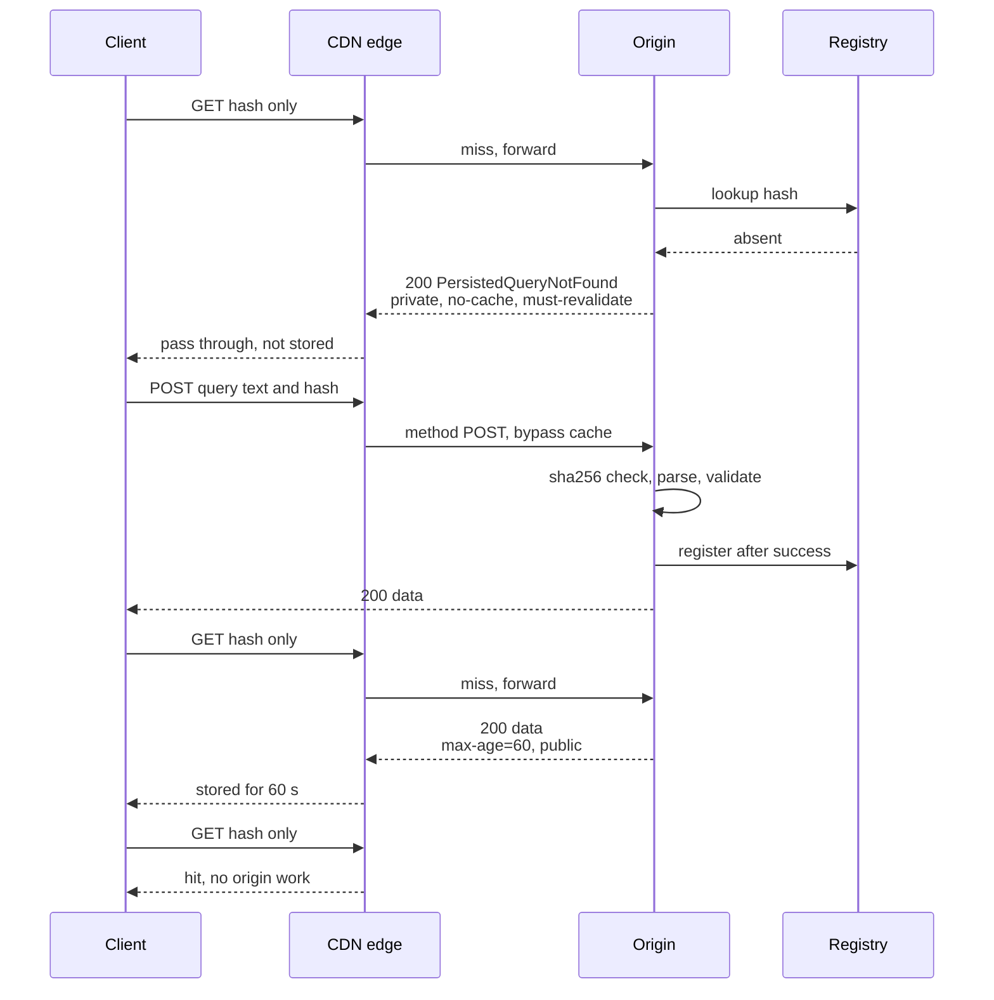

# Overcoming GraphQL's POST Caching Problem: Automatic Persisted Queries (APQ), Trusted Documents (Allowlisted Query Hashes), and GET CDN Caching

> [!summary] Claim
> A shared cache can only reuse a response when the request has a cacheable method and a short, stable URL, so a GraphQL API earns CDN hits only by replacing the query text with a SHA-256 identifier the server can expand (APQ, which any client may register, or trusted documents, which only the build may register), sending it as a `GET`, and emitting a truthful `Cache-Control` for every response.

Part of [GraphQL JSON RPC and Event APIs](README.md) in [API Engineering](../README.md).

## TL;DR

- Mechanism: the client sends `extensions.persistedQuery = {"version": 1, "sha256Hash": <64 hex chars>}` with no `query`, the server answers `PersistedQueryNotFound` once, the client retries with the full text so the server can register it, and every later request is a short `GET` whose URL a CDN can use as a cache key.
- Contract rule: the server must hash the received text itself and compare it to the claimed hash before registering anything, register only after the text parses, validates, and is allowed on the method, and return the not-found error as `200` with `Cache-Control: private, no-cache, must-revalidate` so no cache keeps it.
- Trap: a CDN stores only what `Cache-Control` allows, and GraphQL servers default to "uncacheable" (Apollo gives every root field `maxAge` 0), so turning APQ and `GET` on without schema cache hints yields `no-store` on every response and a 0% hit rate, while a wrongly `public` hint on per-user data leaks it across users.
- Portability fact: APQ is a de facto protocol (Apollo), not part of the GraphQL specification or the GraphQL over HTTP draft, `GET` URLs are bounded by intermediaries (8,192 bytes at CloudFront, 16 KB at Cloudflare, 8,190 bytes in Apache, one 8 KB buffer in nginx by default, as of 2026-11), and RFC 10008 (June 2026) now defines a cacheable `QUERY` method keyed on the body.
- When not to use it: when responses are per-user and private (APQ then saves bytes but no edge hits), when you need an allowlist (use trusted documents and turn APQ off), or when every operation is already a short `GET` on a stable URL.

## Mental model



The first `GET` is a probe: it costs one round trip and teaches the server nothing, so the server replies that it does not know the hash.
The client then sends the full text with the hash in a `POST`, which no cache will store, and the server verifies the hash against the text, runs the usual parse and validation, and only then writes the registry.
From the next request on, the client sends only the short `GET`; the first one is a cache miss that the origin answers with a `Cache-Control` derived from the schema, and every `GET` after that within the freshness lifetime is answered by the edge without touching the origin.
The not-found reply is deliberately uncacheable, because the very next request will succeed, and a cached "not found" would trap every client behind that edge in an endless retry.

## How it works

### Why `POST` kills caching, and what a CDN needs instead

HTTP defines caching semantics for `GET`, `HEAD`, and `POST`, "although the overwhelming majority of cache implementations only support GET and HEAD" (RFC 9110 Section 9.2.3).
A `POST` response is cacheable only with explicit freshness plus a `Content-Location` equal to the target URI, and it can then satisfy only a later `GET` or `HEAD`, never another `POST` (RFC 9110 Section 9.3.3).
The cache key is the target URI plus any request fields named by `Vary`: a cache reuses a stored response only when "the presented target URI (Section 7.1 of [HTTP]) and that of the stored response match" and the stored request method allows reuse (RFC 9111 Section 4, Section 4.1).
The request body is not part of that key, and `POST` is unsafe, so a cache "MUST write through" it and "MUST invalidate the target URI" on a non-error response (RFC 9111 Section 4, Section 4.4).
A GraphQL endpoint therefore has three separate problems for a shared cache:

1. The method: queries travel as `POST /graphql`, which CDNs do not store (Cloudflare lists "The HTTP request method is anything other than a GET" among the reasons it does not cache a resource, as of 2026-11).
2. The key: all operations share one URL, so even a cache willing to store `POST` would have to hash the body.
3. The size: moving the query into the URL fixes the key but long queries break URL limits (see Numbers and limits).

The standard answers are three: shorten the URL by sending an identifier instead of the text (APQ or trusted documents), cache `GET` only, or change the method to one whose key includes the body (`QUERY`, RFC 10008).

### The APQ protocol on the wire

APQ is a convention between Apollo Client and Apollo Server, introduced in a December 6, 2017 Apollo blog post as a "lightweight protocol extension" whose point was shrinking queries that had reached "well above 10 KB" (Apollo blog, "Improve GraphQL Performance with Automatic Persisted Queries").
It is not in the GraphQL specification and not in the GraphQL over HTTP draft, which reserves `extensions` as "reserved for implementers to extend the protocol however they see fit" (GraphQL over HTTP draft Section 4.1).
The pieces are:

- Request: `extensions.persistedQuery` is an object with `version` (the integer `1`) and `sha256Hash`, the lowercase hex SHA-256 of the exact query string, 64 characters (Apollo Server docs, "Automatic persisted queries"; Apollo blog says "short (64-byte)").
- Identifier example: the SHA-256 of `{__typename}` is `ecf4edb46db40b5132295c0291d62fb65d6759a9eedfa4d5d612dd5ec54a6b38` (Apollo Server docs, command-line testing); the lab asserts this value.
- `GET` encoding: the same names as query-string parameters, where `variables` and `extensions` are JSON strings, per the URL-encoded form in the GraphQL over HTTP draft (Section 4.3).
- Not-found: a result with `errors[0].message` equal to `PersistedQueryNotFound` and `errors[0].extensions.code` equal to `PERSISTED_QUERY_NOT_FOUND` (apollo-server 5.5.2 packages/server/src/internalErrorClasses.ts, `PersistedQueryNotFoundError`).
- Not-supported: `PersistedQueryNotSupported` with code `PERSISTED_QUERY_NOT_SUPPORTED`, returned when APQ is disabled with `persistedQueries: false` (same file; Apollo Server docs, "Disabling APQ").
- Status and caching of those errors: both are `200` with `Cache-Control: private, no-cache, must-revalidate`; the source comment says they "need to be uncached, because hopefully we're about to fill in the APQ cache and the same request will succeed next time", and chooses `200` "to avoid any error handling that may mask the contents of an error response" (apollo-server 5.5.2 internalErrorClasses.ts, `getPersistedQueryErrorHttp`).

Run the documented `curl` handshake against a server and you will see the whole protocol: a hash-only `GET` returns `PERSISTED_QUERY_NOT_FOUND`, a `GET` with `query` and `extensions` registers and answers, and the hash-only `GET` now answers directly (Apollo Server docs, command-line testing).

### The server pipeline and why registration comes last

Apollo Server 5.5.2 processes a request in this order (apollo-server 5.5.2 packages/server/src/requestPipeline.ts, `processGraphQLRequest`):

1. If `extensions.persistedQuery` is present and APQ is off, return `PersistedQueryNotSupported`.
2. If `version` is not `1`, return a `400` "Unsupported persisted query version".
3. If there is no `query`, look the hash up in the registry: a hit becomes the source text, a miss returns `PersistedQueryNotFound`.
4. If there is a `query`, compute its SHA-256 and compare it to the claimed hash, otherwise return `400` "provided sha does not match query"; the code comment names this "hash hijacking", where "a new and potentially malicious query is associated with an existing hash".
5. Mark the text for registration but do not write it yet; the comment says "Deferring the writing gives plugins the ability to 'win' from use of the cache, but also have their say in whether or not the cache is written to".
6. Parse and validate (a parse error is a `400` `GRAPHQL_PARSE_FAILED`, a validation error a `400` `GRAPHQL_VALIDATION_FAILED`; apollo-server 5.5.2 internalErrorClasses.ts, `SyntaxError` and `ValidationError`).
7. Resolve the operation, and reject a non-query operation on a `GET` with `405` and `Allow: POST` (requestPipeline.ts: "GET requests only support query operations").
8. Only now write `cache.set(queryHash, query, ...)`, with a `ttl` only if one was configured, and log a failed write instead of failing the request.

The consequence is that a registry entry always names text that parsed, validated, and was allowed on the method that carried it.
A forged hash, a syntax error, a validation error, and a `GET` mutation each leave the registry unchanged; the lab tests each of those four (`test_a_mismatched_hash_is_rejected_and_nothing_is_registered`, `test_a_query_that_fails_parse_or_validation_is_never_registered`, `test_mutation_over_get_is_405_with_allow_post_and_is_not_registered`).
The lab uses `422` for a validation error because the GraphQL over HTTP draft recommends it with `application/graphql-response+json` (draft Section 5.4); Apollo Server 5.5.2 uses `400`.

### The registry: cache, prefix, TTL, and where it lives

The registry is an ordinary key-value cache.
`ApolloServer` wraps `config.persistedQueries?.cache ?? this.cache` in a `PrefixingKeyValueCache` with the prefix `apq:` (apollo-server 5.5.2 packages/server/src/ApolloServer.ts, constructor; `APQ_CACHE_PREFIX` in requestPipeline.ts).
When no cache is configured the server cache is an `InMemoryLRUCache` (same constructor), whose source comment says "Create ~about~ a 30MiB cache by default", set with `maxSize: Math.pow(2, 20) * 30` (apollo-utils main packages/keyValueCache/src/InMemoryLRUCache.ts, as of 2026-11).
The default in-memory store sets no TTL for APQs, so an entry lives until LRU eviction, and `persistedQueries.ttl` (seconds) or `null` overrides that (Apollo Server docs, "Adjusting cache time-to-live").
The docs state that "by default, Apollo Server stores its APQ registry within its local in-memory cache".
That sentence has an operational consequence: with N server processes behind a load balancer, each process learns a hash independently, so each one answers `PersistedQueryNotFound` once per query after every deploy.
The lab shows the split directly: a text registered on instance A is `PERSISTED_QUERY_NOT_FOUND` on instance B with a per-instance registry and a hit with a shared one (`test_per_process_registries_make_every_instance_miss_once`).

### The client: hash, probe, retry once, never loop

Apollo Client 4.3.8 implements the client half as `PersistedQueryLink` in `src/link/persisted-queries/index.ts` (`createPersistedQueryLink`):

- It prints the `DocumentNode`, hashes the printed string with a caller-supplied `sha256` function (`sha256!(print(query))`), and caches the hash per document in a weak cache, so the text is hashed once per document and not per request.
- It first sends the request with `includeQuery: false, includeExtensions: true`, and with `useGETForHashedQueries` it switches `fetchOptions.method` to `GET` unless the operation defines a mutation (`operationDefinesMutation`); the option is `false` by default.
- On a result that carries errors it calls `handleRetry`, which has a `retried` flag: the second failure is reported, never retried again.
- The default `retry` predicate is "not supported" or "not found" and the default `disable` predicate is "not supported", where `processErrors` sets each flag when any error has the message (`PersistedQueryNotSupported`, `PersistedQueryNotFound`) or the code (`PERSISTED_QUERY_NOT_SUPPORTED`, `PERSISTED_QUERY_NOT_FOUND`); disabling also deletes the extension and clears the hash cache for the session.
- The retry sets `includeQuery: true`, keeps `includeExtensions` when still enabled, and sets `fetchOptions.method` to `"POST"`, with the comment that a full query "may be large, we should send it in the body of a POST request" (issue #7456); when `useGETForHashedQueries` had switched the first attempt to `GET`, the link then restores the `fetchOptions` saved before that switch, so the retry goes out with whatever method the request had before the link touched it.
- It also parses the JSON body of non-`2xx` responses to find these codes, with the comment "This is persisted-query specific (see #9410) and deviates from the GraphQL-over-HTTP spec for application/json responses. This is intentional."

The lab client (`ApqClient`) reproduces the same state machine: hash-only first, one retry as `POST` with text and hash, a session-wide off switch on not-supported, and no `GET` for a mutation.
It tests that a server that always answers not-found produces exactly two requests, `GET` then `POST` (`test_client_retries_exactly_once_and_never_loops`).

### `GET` semantics that an APQ deployment inherits

The GraphQL over HTTP draft requires `GET` to carry the parameters in the query component, encoded as `application/x-www-form-urlencoded`, with `variables` and `extensions` as JSON strings, and forbids mutations over `GET`: the server "MUST respond with an appropriate 4xx status code and halt execution; status code 405 (Method Not Allowed) is RECOMMENDED" and must then send `Allow` (draft Section 4.3 and Section 5.4).
A URL that is too long gets `414`, "and the client should consider using POST instead" (draft Section 5.4), which is precisely the problem APQ removes for the hash form.
RFC 9110 Section 15.5.15 says `414` is for a target URI "longer than the server is willing to interpret", and adds that it is heuristically cacheable.

Apollo Server adds three behaviors that matter for browsers:

- A `GET` with a `Content-Type` other than `application/json` is rejected with `415` since 5.5.0, which fixes GHSA-9q82-xgwf-vj6h (published 2026-03-26, patched in `@apollo/server` 5.5.0): a browser bug made some cross-origin authenticated `GET` queries run without a CORS preflight, enabling timing "XS-Search" attacks on cookie-authenticated servers; a `GET` with no `Content-Type` is still allowed, and the advisory lists `apollo-server-core` <= 3.13.0 as affected with no patched version (apollo-server 5.5.2 runHttpQuery.ts, `GET` case; GitHub advisory).
- CSRF prevention requires every request to either carry a parseable `Content-Type` outside `application/x-www-form-urlencoded`, `multipart/form-data`, and `text/plain`, or a non-empty value for one of the configured headers, by default `recommendedCsrfPreventionRequestHeaders` = `x-apollo-operation-name` and `apollo-require-preflight`, so a browser `GET` is forced into a CORS preflight (apollo-server 5.5.2 packages/server/src/preventCsrf.ts, `preventCsrf`).
- A repeated `query`, `variables`, `operationName`, or `extensions` parameter is a `400` (runHttpQuery.ts, `searchParamIfSpecifiedOnce`).

The consequence for caching is that a browser APQ `GET` normally carries `Content-Type: application/json`, which the CDN cache key ignores unless the origin names it in `Vary`; do not add `Vary: Content-Type`, or every client that omits it becomes a separate cache entry (see [[Vary-Header-Mechanics-and-Cache-Hit-Collapse]]).

### Deriving `Cache-Control` from the schema

A cacheable `GET` is worthless if the response says `no-store`.
Apollo Server computes the header from cache hints in the schema (Apollo Server docs, "Caching"; apollo-server 5.5.2 packages/server/src/plugin/cacheControl/index.ts):

- Hints are `@cacheControl(maxAge: N, scope: PUBLIC | PRIVATE, inheritMaxAge: Boolean)` on fields and types, or set dynamically in a resolver.
- The default `maxAge` is 0 for root fields and for fields returning an object, interface, or union; a non-root scalar field with no hint contributes nothing and so inherits its parent's value (Apollo Server docs, "Default maxAge").
- Each resolved field's policy is folded into one overall policy with `restrict` after the resolver finishes, so the response `maxAge` is "the lowest maxAge among included fields" and the scope is `PRIVATE` if any included field is private (Apollo Server docs; plugin `willResolveField`, `requestContext.overallCachePolicy.restrict(fieldPolicy)`).
- In `willSendResponse`, a response that is cacheable, is a single result, and has no `errors` gets `cache-control: max-age=<n>, public` or `max-age=<n>, private`; anything else gets `no-store` unless `calculateHttpHeaders` is `'if-cacheable'`; the plugin does not overwrite a header it cannot parse, and an incremental-delivery response never gets the cacheable header, because "we don't know if a later part of the execution will affect the cache policy", so it falls into the `no-store` branch.
- The source comment on the `no-store` branch: "This is especially important for GET requests, because browsers and other agents cache many GET requests by default."

The lab reproduces this rule statically over the operation document (`compute_cache_policy`) with three hints (`Query.product` 60 s, `Product.reviews` 30 s, `Query.viewer` 60 s private) and tests the corners: the minimum is taken (`max-age=30, public` for a query touching both products and reviews), one unhinted root field turns the whole response into `no-store`, a private field makes the response `private`, and a request error is `no-store`.
The static walk is a simplification: Apollo folds only the fields that were actually resolved, so a field under a `null` parent is never resolved and does not count at runtime, while the lab's walk counts it; the minimum over more fields can only be lower, so the lab is at least as restrictive as Apollo for the same field hints (the lab models field-coordinate hints only, not type-level hints).

### What the CDN does with it

A shared cache may store a response only under RFC 9111 Section 3: the method is understood, the status is final, there is no `no-store`, a shared cache sees no unqualified `private`, a request with `Authorization` is only reusable when the response carries `public`, `s-maxage`, or `must-revalidate` (RFC 9111 Section 3.5), and the response has explicit freshness (`max-age`, `s-maxage`, `public`, `Expires`) or a heuristically cacheable status.
The lab's `EdgeCache` implements a stricter subset: it stores only `200`, refuses any `private` (qualified or not) and also `no-cache`, which RFC 9111 Section 5.2.2.4 lets a cache store as long as it revalidates before reuse, and it reads freshness only from `s-maxage` or `max-age`, falling back to a configurable heuristic TTL (0 by default) instead of `Expires`.
That list is why Apollo's `max-age=60, private` for per-user data is never stored by a shared cache: "a shared cache MUST NOT store the response" under an unqualified `private` (RFC 9111 Section 5.2.2.7), so a `private` GraphQL response saves origin bytes (APQ) but buys no edge hits.
`s-maxage` overrides `max-age` for shared caches and also permits reuse for `Authorization` requests (RFC 9111 Section 5.2.2.10), and RFC 9213 defines `CDN-Cache-Control`, a targeted field that a CDN implementing it uses instead of `Cache-Control` and `Expires`, so an origin can give the edge a longer lifetime than the browser (RFC 9213 Section 2.2 and Section 3).
Apollo Server emits only `max-age`, so an edge-only TTL needs a header rewrite at the gateway.
A stored response with `Vary` is reused without revalidation only when every request field it nominates matches the original request (RFC 9111 Section 4.1), and a cache "MUST generate an Age header field" when it serves a stored response without validation (RFC 9111 Section 4).
A non-error response to a `POST` makes a cache invalidate that request's target URI and permits, but does not require, invalidating the `Location` and `Content-Location` URIs (RFC 9111 Section 4.4), so a mutation sent to `/graphql` does not purge the cached `GET /graphql?extensions=...` URLs, which are different target URIs; staleness is bounded only by `max-age`, and explicit purge is a separate design (see [[Cache-Invalidation-Upon-Unsafe-Methods-and-Purge-Patterns]]).

Vendor defaults matter because they decide the key.
Cloudflare's default cache key includes the whole query string ("To include all query string parameters (the default behavior), use include: \"*\""), and it can be configured to ignore it with `exclude: "*"` (Cloudflare Cache Keys docs, as of 2026-11).
A rule that ignores query strings on `/graphql` would map every APQ hash to one cached response, which is a correctness bug, not a tuning choice.
Cloudflare also "does not cache the resource when" `Cache-Control` contains `private`, `no-store`, `no-cache`, or `max-age=0`, when `Set-Cookie` is present, or when the method is not `GET` (Cloudflare default cache behavior, as of 2026-11), and it can cache a response without `Cache-Control` by status code, which is why the not-found error carries an explicit uncacheable header.

### Trusted documents: the build registers, the server only reads

APQ lets any client add entries.
Trusted documents (also called persisted queries, persisted operations, or persisted documents) invert that: the client build extracts every operation, computes an identifier, and publishes a manifest; the server loads it read-only and never accepts unknown text.

- Relay: with `persistConfig` the compiler "converts all query and mutation operation texts to md5 hashes" stored as the operation `id` with `text: null`, and the local-file config accepts `algorithm` of `MD5`, `SHA256`, or `SHA1`, writing a `persisted_queries.json` map of id to text; the docs' network layer sends the id in the `POST` body as `doc_id` instead of `query`; Relay lists the trade-offs of the local-file variant with an APQ-style handshake: automatic recovery if the server store is wiped, but an extra round trip on a miss and a larger browser bundle because the map ships to the client (Relay docs v21.0.1, "Persisted Queries").
- GraphQL Code Generator: the client preset option `persistedDocuments: true` emits `persisted-documents.json`, "a mapping of the document's hash to the document's content", and adds a `hash` to each generated document; the docs say the technique reduces upstream traffic, bundle size, and attack surface (Codegen client preset docs).
- GraphQL Yoga: `usePersistedOperations({ getPersistedOperation })` accepts the same `extensions.persistedQuery` envelope but "if you now sent a normal GraphQL operation that is not within the store, it will be rejected" with `{"errors":[{"message":"PersistedQueryOnly"}]}` (Yoga docs).
- Apollo GraphOS Router: operations are registered in a persisted query list (PQL) from CI; the router supports levels from "allow operation IDs", through audit with `log_unknown: true`, to `safelist.enabled: true`, and finally `safelist.require_id: true`, which rejects operation text "even operation strings present in the PQL"; safelisting requires APQ to be disabled because "APQs let clients register arbitrary operations at runtime while safelisting restricts operations to those that have been explicitly registered" (Apollo GraphOS docs, "Safelisting with Persisted Queries", which lists the feature on the Free, Developer, Standard, and Enterprise plans with rate limits on Free and requires router v1.32.0 or later, as of 2026-11).
In the Router source, an unknown id with APQ off is `404` with code `PERSISTED_QUERY_NOT_IN_LIST`, operation text outside the safelist is `403` with `QUERY_NOT_IN_SAFELIST`, and freeform text under `require_id` is `400` with `PERSISTED_QUERY_ID_REQUIRED` (apollographql/router v2.19.1 apollo-router/src/services/layers/persisted_queries/mod.rs, `supergraph_err_operation_not_found`, `supergraph_err_operation_not_in_safelist`, `supergraph_err_pq_id_required`).

The two designs differ on the axis that matters most for a cache and for security:

| Property | APQ | Trusted documents |
| --- | --- | --- |
| Who writes the registry | any client, at runtime | the build or CI, before deploy |
| Unknown identifier | `PersistedQueryNotFound`, client retries with text | rejected, no retry helps (the lab returns `403`, GraphOS Router v2.19.1 `404` `PERSISTED_QUERY_NOT_IN_LIST`) |
| Arbitrary text | accepted and validated | rejected, or accepted only if its hash is in the manifest |
| First-request cost | one extra round trip per hash per registry | none, the manifest is loaded at start |
| Registry growth | unbounded by clients, bounded by LRU and TTL | fixed by the manifest |
| Allowlist | no ("APQ doesn't provide safelisting capabilities") | yes |

The lab implements both in one server (`PersistedQueryMode.APQ`, `ALLOWLIST`, `DISABLED`) so the difference is testable.
In allowlist mode a text outside the manifest is `403` with code `PERSISTED_QUERY_NOT_ALLOWED` and nothing is written (`test_allowlist_rejects_text_outside_the_manifest_and_registers_nothing`), a manifest id is served through the edge with no registration traffic (`test_allowlist_serves_a_manifest_id_through_the_edge_with_no_registration_traffic`), `require_id` rejects even manifest text (`test_require_id_rejects_operation_text_even_when_the_text_is_in_the_manifest`), and 1000 unknown ids execute nothing and grow no state (`test_a_flood_of_unknown_ids_grows_no_state_and_executes_nothing`).
The `403` status and the code `PERSISTED_QUERY_NOT_ALLOWED` are the lab's choices for both cases; the Router splits them into `404` `PERSISTED_QUERY_NOT_IN_LIST` for an unknown id and `403` `QUERY_NOT_IN_SAFELIST` for disallowed text (Router source above).
Neither Router code is a retry trigger for Apollo Client, whose defaults match only the APQ not-found and not-supported message or code.
Reusing `PERSISTED_QUERY_NOT_FOUND` would be wrong here, because Apollo Client's default `retry` would resend the text in a `POST` that the server must reject again; the lab client does not retry a `403` (`test_allowlist_answers_403_for_an_unknown_id_and_the_client_does_not_retry`).

### The standard fix: the `QUERY` method (RFC 10008)

RFC 10008, "The HTTP QUERY Method" (J. Reschke, J.M. Snell, M. Bishop; June 2026, Standards Track), defines a safe, idempotent request that carries its input in the content (RFC 10008 Section 1, Section 2).
Its caching rules address exactly the `POST` problem: "The response to a QUERY method is cacheable", and "The cache key for a QUERY request (Section 2 of [HTTP-CACHING]) MUST incorporate the request content (Section 6 of [HTTP-CACHING]) and related metadata (Section 8 of [HTTP])" (RFC 10008 Section 2.7).
It lets caches normalize semantically insignificant differences (content codings, `+json` conventions) for the key and notes that this is "inherently more complex than caching responses to GET, as complete reading of the request's content is needed in order to determine the cache key" (Section 2.7), and it warns that a cache that normalizes wrongly "can return an incorrect response if normalization results in a false positive" (Section 4).
A server can return `Location` for an "equivalent resource" so the client can switch to `GET` (Section 2.2 and Section 2.4), which is the APQ idea expressed as a URL.
`Accept-Query` advertises support and the query media types (Section 3), and `QUERY` triggers a CORS preflight (Section 4).
The lab models the cache-key rule with `cache_key` (method, target, `Content-Type`, SHA-256 of the body) and shows that identical `QUERY` bodies are one origin execution, a different body is another, and two identical `POST`s are two (`test_query_method_is_cacheable_keyed_by_body_while_post_is_not`), and that a mutation over `QUERY` is refused like one over `GET` because the method is safe (`test_a_mutation_over_query_is_refused_because_query_is_safe`).
Support in today's stack is thin, and what I checked points the same way (as of 2026-11).
Cloudflare lists "The HTTP request method is anything other than a GET" among the conditions under which it does not cache a resource (Cloudflare Cache docs, "Default cache behavior").
CloudFront "always caches responses to GET and HEAD requests", can be configured to cache `OPTIONS`, and "does not cache responses to requests that use the other methods" (CloudFront Developer Guide, "Request and response behavior for custom origins"), so a `QUERY` response is not cached there.
Apollo Server 5.5.2 answers any method other than `GET` and `POST` with `405` and `Allow: GET, POST` ("Apollo Server supports only GET/POST requests.", `packages/server/src/runHttpQuery.ts`, `runHttpQuery`).
At the parser level nothing blocks it: h11 0.16.0 defines `method = token` (h11/_abnf.py), and I ran `h11.Connection(h11.SERVER)` on CPython 3.14.6 (macOS 27.3, arm64) against `QUERY /graphql HTTP/1.1` and it returned `method=b'QUERY'`; CPython's own `http.HTTPMethod` has no `QUERY` member in 3.14.6.
I did not check Fastly or any client library, so plan APQ and `GET` for now and test `QUERY` per CDN before relying on it.

### The lab in one place

`ApqServer` is the origin, `EdgeCache` is a shared cache, `ApqClient` is the Apollo-style client, and `build_app` mounts the origin on Starlette.
The core takes `HttpRequest` and returns `HttpResponse` values, so every behavior is deterministic and visible, and two ASGI tests run the handshake through `httpx.ASGITransport` to check real URL decoding and headers.

## Numbers and limits

Measured rows come from the lab on CPython 3.14.6, macOS 27.3 (Darwin 27.3.0, arm64), `graphql-core 3.3.2`, `starlette 1.10.0`, `httpx 0.28.1`, command `uv run --frozen pytest tests/f20_graphql_json_rpc_and_event_apis/test_automatic_persisted_queries_apq_and_edge_cdn_caching_for_graphql.py -v -rP` from `labs/`; the fact-check rerun on 2026-11-26 reproduced every measured value below exactly.
Sourced rows cite the page or file I fetched, dated `(as of 2026-11)`.

| Quantity | Value | Source |
| --- | --- | --- |
| APQ identifier | SHA-256, 64 lowercase hex characters | Apollo Server docs; Apollo blog; lab `test_hash_of_typename_query_matches_the_documented_value` |
| `{__typename}` identifier | `ecf4edb46db40b5132295c0291d62fb65d6759a9eedfa4d5d612dd5ec54a6b38` | Apollo Server docs, asserted by the lab |
| Query text in the large-query test | 12,693 characters (400 aliased `product` fields) | measured, `test_measured_request_sizes_for_a_large_query` |
| Cold start, 2 requests (hash `GET` then full `POST`) | 18,204 request-target plus body bytes | measured, same test; headers excluded |
| Warm, 1 request (hash `GET`) | 164 request-target bytes | measured, same test |
| Cold cost vs plain text | 18,204 exceeds 12,693 because the client sends `print_ast` output, which is pretty-printed and longer than the compact source | measured; the sizes are the lab's, not Apollo's |
| Origin executions for 5 client calls through the edge | 2 executions, 3 edge hits, 1 `PersistedQueryNotFound` | measured, `test_hash_only_get_is_served_from_the_edge_after_one_origin_execution` |
| Registry flood | 4 distinct registrations evict a hot entry from a 4-entry LRU, so the client pays 2 requests again | measured, `test_a_flood_of_unique_queries_evicts_a_hot_entry_and_costs_one_extra_round_trip` |
| Unknown-id flood in allowlist mode | 1000 requests, 0 executions, 0 registry entries | measured, `test_a_flood_of_unknown_ids_grows_no_state_and_executes_nothing` |
| Recommended minimum URI length support | 8000 octets | RFC 9110 Section 4.1; RFC 9112 Section 3 (request line) |
| CloudFront URL limit | 8,192 bytes; request or origin response excluding body 32,768 bytes | AWS CloudFront quotas page (as of 2026-11) |
| Cloudflare limits | URL 16 KB, request headers 128 KB total | Cloudflare connection limits (as of 2026-11) |
| nginx request line | one buffer of `large_client_header_buffers`, default `4 8k`, else `414` | nginx `ngx_http_core_module` docs (as of 2026-11) |
| Apache `LimitRequestLine` | default 8190 | Apache httpd 2.4 core docs (as of 2026-11) |
| h11 incomplete request limit | 16 KiB (`DEFAULT_MAX_INCOMPLETE_EVENT_SIZE = 16 * 1024`), then `RemoteProtocolError("Receive buffer too long", error_status_hint=431)` | h11 0.16.0 h11/_connection.py, `Connection.next_event`; read in the installed package |
| Uvicorn and Hypercorn on h11 | Uvicorn passes `h11_max_incomplete_event_size` or the h11 default; Hypercorn `h11_max_incomplete_size = 16 * 1024 * BYTES` with `BYTES = 1` | uvicorn 0.54.0 uvicorn/protocols/http/h11_impl.py, `H11Protocol.__init__`; hypercorn 0.18.0 hypercorn/config.py, `Config`; read, not run |
| Granian buffers | `HTTP1Settings.max_buffer_size = 8192 + 4096 * 100` (417,792 bytes), `HTTP2Settings.max_headers_size = 16 * 1024 * 1024` | granian 2.8.7 granian/http.py; read, not run |
| Granian HTTP/1 request-line limit | the setting is passed to hyper's `http1::Builder::max_buf_size`; hyper 1.12.0 (the version in Granian 2.8.7 `Cargo.lock`) answers `431` when a message head does not complete within that buffer and `414` for a target longer than `MAX_URI_LEN = u16::MAX - 1` (65,534 bytes), so the effective cap on a `GET` URL is the smaller of 65,534 bytes and the buffer less the other head bytes | granian 2.8.7 src/workers.rs, `conn_builder_h1`; hyper 1.12.0 src/proto/h1/io.rs, `DEFAULT_MAX_BUFFER_SIZE` and `parse`; src/proto/h1/role.rs, `MAX_URI_LEN` and `on_error`; read, not run |
| HTTP/2 and HTTP/3 header lists | `SETTINGS_MAX_HEADER_LIST_SIZE` and `SETTINGS_MAX_FIELD_SECTION_SIZE` are advisory, initial value unlimited | RFC 9113 Section 6.5.2; RFC 9114 Section 4.2.2 and Section 7.2.4.1 |
| Apollo default registry size | about 30 MiB (`maxSize: Math.pow(2, 20) * 30`) | apollo-utils main `InMemoryLRUCache.ts` |
| Apollo default registry TTL | none | Apollo Server docs, "Adjusting cache time-to-live" |
| Overlong `GET` through the edge | `414` from the edge for 400 aliases with `max_url_bytes=8192`, origin never contacted | measured, `test_an_overlong_get_url_is_refused_by_the_edge_but_the_hash_url_is_tiny` |

Reading the table: the byte saving is the whole 12,693-character document turned into a 164-byte URL on every request after the first, and the cold path costs more than a plain `POST` (two requests and a pretty-printed body), so APQ pays back only when a query is sent more than once per registry lifetime.
The lab measures bytes, not latency, and no latency figure is claimed.

## Portability

| Axis | Result | Evidence |
| --- | --- | --- |
| CPython 3.14.6 | 50 of 50 lab tests pass | rerun by the fact-check on 2026-11-26, macOS 27.3 (Darwin 27.3.0, arm64), output in Worked example; the drafter reports ruff, mypy strict, and pyright strict passing on the two lab files, not rerun because format, lint, and type checks are paused |
| CPython 3.12, 3.13, 3.15, 3.15t | not run | the user paused the lab matrix on 2026-11-11, so no cell is claimed; the lab uses only the standard library, `graphql-core`, `starlette`, and `httpx` |
| Strawberry 0.340.0 | no APQ implementation | grep of the installed package found no `persistedQuery` or `sha256Hash` handling, only a comment that `query` is optional "as it can be added by an extensions (for example an extension for persisted queries)" (strawberry 0.340.0 strawberry/http/__init__.py, `GraphQLRequestData`); its `parse_query_params` JSON-decodes `variables` and `extensions` from a `GET` (strawberry 0.340.0 strawberry/http/base.py, `parse_query_params`), so APQ needs your own extension; see [[Strawberry-GraphQL-with-FastAPI-Types-Context-Mutations-and-Subscriptions]] |
| Apollo Server 3 and 4 | batched requests could carry the wrong `cache-control` | GHSA-8r69-3cvp-wxc3 (published 2022-11-02), fixed in `apollo-server-core` 3.11.0 and `@apollo/server` 4.1.0 |
| Apollo Server 5.5.2, Apollo Client 4.3.8 | read, not run | source at the tags `@apollo/server@5.5.2` and `@apollo/client@4.3.8` |
| Hypercorn, Uvicorn, Granian | not run | the lab binding is Starlette on `httpx.ASGITransport`, so no server parsed a long URL; the h11 and Granian settings above were read, including the hyper 1.12.0 source that turns Granian's buffer setting into `431` and `414`, but no server was run against a long URL |
| HTTP/1.1 | request-line limits apply | RFC 9112 Section 3 recommends supporting at least 8000 octets |
| HTTP/2 and HTTP/3 | same caching semantics; the URL travels in the `:path` pseudo-header, so it counts against the peer's field-section limit, which the protocols leave advisory and unlimited by default | RFC 9110 and RFC 9111 define version-independent semantics; RFC 9113 Section 8.3.1 (`:path`) and Section 6.5.2; RFC 9114 Section 4.2.2; nginx docs state `large_client_header_buffers` limits "are similarly applied in HTTP/2 and HTTP/3 connections" |
| CDNs | `GET` only by default; key includes the query string by default on Cloudflare | Cloudflare docs (default cache behavior); CloudFront Developer Guide (cached methods are `GET`, `HEAD`, and optionally `OPTIONS`); Fastly behavior is not claimed here |

## Worked example

Implementation: [implementation](../labs/src/api_labs/f20_graphql_json_rpc_and_event_apis/automatic_persisted_queries_apq_and_edge_cdn_caching_for_graphql.py).
Test: [test](../labs/tests/f20_graphql_json_rpc_and_event_apis/test_automatic_persisted_queries_apq_and_edge_cdn_caching_for_graphql.py).

Simplified excerpt of the server's source resolution, the heart of the protocol (the real method also handles the `DISABLED` mode, a non-object `persistedQuery`, a `version` other than `1`, and a non-string `sha256Hash`, see the file):

```python
def _resolve_source(self, params: _Params) -> tuple[str, str, bool]:
    persisted = params.extensions.get("persistedQuery")
    if persisted is None:
        return self._plain_source(params)
    ...
    digest = persisted_fields.get("sha256Hash")
    allowlist = self.mode is PersistedQueryMode.ALLOWLIST
    if params.query is None:
        text = self.manifest.get(digest) if allowlist else self.registry.get(digest)
        if text is None:
            if allowlist:
                raise self._forbid("Unknown persisted query id")
            raise self._pq_error("PersistedQueryNotFound", CODE_NOT_FOUND)
        self.stats.hits += 1
        return text, digest, False
    if sha256_hex(params.query) != digest:
        raise _Rejected(_error(400, "provided sha does not match query"))
    if allowlist:
        if self._require_id or digest not in self.manifest:
            raise self._forbid("Operation text is not allowed")
        return params.query, digest, False
    return params.query, digest, True
```

The third element of the result says "register after the pipeline succeeds", which `_handle` honors after parse, validation, and the method check.

Excerpt (the `EdgeCache._ttl` method, dedented) of the shared-cache storability rule, a stricter subset of RFC 9111 Section 3:

```python
def _ttl(self, request: HttpRequest, response: HttpResponse) -> float | None:
    if response.status != 200:
        return None
    directives = parse_cache_control(response.headers.get("cache-control", ""))
    if {"no-store", "private", "no-cache"} & directives.keys():
        return None
    if "authorization" in request.headers and not (
        {"public", "s-maxage", "must-revalidate"} & directives.keys()
    ):
        return None  # RFC 9111 Section 3.5
    explicit = directives.get("s-maxage") or directives.get("max-age")
    ttl = float(explicit) if explicit is not None else self._heuristic_ttl
    return ttl if ttl > 0 else None
```

Simplified excerpt of the central test: five client calls for one query through the edge cost two origin executions.

```python
def test_hash_only_get_is_served_from_the_edge_after_one_origin_execution() -> None:
    clock = ManualClock()
    server = ApqServer()
    edge = EdgeCache(server.handle, clock=clock)
    client = ApqClient(edge)
    for _ in range(5):
        assert client.execute(PRODUCT).response.json()["data"]["product"]["name"] == "product-1"
    assert server.stats.executed == 2
    assert server.stats.not_found == 1
    assert (edge.stats.hits, edge.stats.misses, edge.stats.bypasses, edge.stats.stores) == (3, 2, 1, 1)
```

The accounting is the protocol: call 1 is a `GET` miss answered with not-found (not stored) plus a `POST` bypass that executes and registers; call 2 is a `GET` miss that executes and is stored; calls 3 to 5 are edge hits.

The leak that a wrong hint produces, and the `Vary` mitigation, are two short tests over the same stack.
With the hint `Query.viewer` wrongly public, user bob gets alice's data from a URL-keyed edge (simplified excerpt of `test_a_wrongly_public_hint_leaks_one_users_data_to_another_through_a_url_keyed_edge`):

```python
leaky = {"Query.viewer": CacheHint(max_age=60, private=False)}
server = ApqServer(hints=leaky)
edge = EdgeCache(server.handle, clock=ManualClock())
assert _viewer_via_edge(edge, "alice") == "alice"
assert _viewer_via_edge(edge, "alice") == "alice"
assert _viewer_via_edge(edge, "bob") == "alice"   # the leak
```

With `ApqServer(hints=leaky, vary=("authorization",))` the third call returns `"bob"` (`test_vary_authorization_stops_the_leak_even_with_the_wrong_hint`).

Captured output, command `uv run --frozen pytest tests/f20_graphql_json_rpc_and_event_apis/test_automatic_persisted_queries_apq_and_edge_cdn_caching_for_graphql.py -v -rP` from `labs/`, CPython 3.14.6, macOS 27.3 (Darwin 27.3.0, arm64), pytest 9.2.0, rerun by the fact-check on 2026-11-26.
The node-id prefix `tests/f20_graphql_json_rpc_and_event_apis/test_automatic_persisted_queries_apq_and_edge_cdn_caching_for_graphql.py::` is elided from each line for width, and the session header above `collecting ...` is omitted; everything else is verbatim.

```text
collecting ... collected 50 items

test_hash_of_typename_query_matches_the_documented_value PASSED [  2%]
test_hash_only_request_on_an_empty_registry_is_persisted_query_not_found PASSED [  4%]
test_registration_then_hash_only_request_executes_the_stored_text PASSED [  6%]
test_a_mismatched_hash_is_rejected_and_nothing_is_registered PASSED [  8%]
test_unsupported_version_is_a_400 PASSED [ 10%]
test_a_query_that_fails_parse_or_validation_is_never_registered PASSED [ 12%]
test_mutation_over_get_is_405_with_allow_post_and_is_not_registered PASSED [ 14%]
test_mutation_over_post_executes_and_is_no_store PASSED [ 16%]
test_disabled_apq_answers_persisted_query_not_supported PASSED [ 18%]
test_get_with_a_non_json_content_type_is_415 PASSED [ 20%]
test_a_repeated_query_parameter_is_a_400 PASSED [ 22%]
test_an_empty_post_without_query_or_extension_is_a_400 PASSED [ 24%]
test_cache_control_is_the_minimum_max_age_over_the_selected_fields PASSED [ 26%]
test_an_unhinted_root_field_makes_the_whole_response_no_store PASSED [ 28%]
test_a_private_field_makes_the_response_private PASSED [ 30%]
test_a_request_error_is_no_store_and_422 PASSED [ 32%]
test_an_edge_cache_never_stores_post_so_identical_posts_reach_the_origin PASSED [ 34%]
test_hash_only_get_is_served_from_the_edge_after_one_origin_execution PASSED [ 36%]
test_edge_entry_expires_after_max_age_and_the_origin_is_asked_again PASSED [ 38%]
test_not_found_is_not_stored_even_by_an_edge_that_caches_by_status_alone PASSED [ 40%]
test_a_heuristic_edge_does_store_a_200_without_cache_control PASSED [ 42%]
test_private_scope_is_never_stored_by_the_shared_cache PASSED [ 44%]
test_a_wrongly_public_hint_leaks_one_users_data_to_another_through_a_url_keyed_edge PASSED [ 46%]
test_vary_authorization_stops_the_leak_even_with_the_wrong_hint PASSED [ 48%]
test_authorized_responses_need_an_explicit_shared_cache_directive[max-age=60-0] PASSED [ 50%]
test_authorized_responses_need_an_explicit_shared_cache_directive[s-maxage=60-1] PASSED [ 52%]
test_an_overlong_get_url_is_refused_by_the_edge_but_the_hash_url_is_tiny PASSED [ 54%]
test_measured_request_sizes_for_a_large_query PASSED [ 56%]
test_query_method_is_cacheable_keyed_by_body_while_post_is_not PASSED [ 58%]
test_a_mutation_over_query_is_refused_because_query_is_safe PASSED [ 60%]
test_query_method_is_405_unless_enabled PASSED [ 62%]
test_client_retries_exactly_once_and_never_loops PASSED [ 64%]
test_not_supported_turns_apq_off_for_the_rest_of_the_session PASSED [ 66%]
test_client_never_sends_a_mutation_over_get PASSED [ 68%]
test_document_normalization_makes_equivalent_texts_share_one_registration PASSED [ 70%]
test_variable_key_order_fragments_the_edge_cache_unless_urls_are_canonical[False-2] PASSED [ 72%]
test_variable_key_order_fragments_the_edge_cache_unless_urls_are_canonical[True-1] PASSED [ 74%]
test_a_flood_of_unique_queries_evicts_a_hot_entry_and_costs_one_extra_round_trip PASSED [ 76%]
test_an_oversized_query_executes_but_is_not_registered PASSED [ 78%]
test_registry_ttl_expiry_is_healed_by_the_client_retry PASSED [ 80%]
test_per_process_registries_make_every_instance_miss_once[False-PERSISTED_QUERY_NOT_FOUND] PASSED [ 82%]
test_per_process_registries_make_every_instance_miss_once[True-] PASSED [ 84%]
test_manifest_ids_are_the_sha256_of_the_normalized_text PASSED [ 86%]
test_allowlist_rejects_text_outside_the_manifest_and_registers_nothing PASSED [ 88%]
test_allowlist_serves_a_manifest_id_through_the_edge_with_no_registration_traffic PASSED [ 90%]
test_allowlist_answers_403_for_an_unknown_id_and_the_client_does_not_retry PASSED [ 92%]
test_require_id_rejects_operation_text_even_when_the_text_is_in_the_manifest PASSED [ 94%]
test_a_flood_of_unknown_ids_grows_no_state_and_executes_nothing PASSED [ 96%]
test_the_curl_handshake_works_through_real_asgi_with_real_headers PASSED [ 98%]
test_the_asgi_binding_returns_what_the_core_handler_returns PASSED [100%]

==================================== PASSES ====================================
________________ test_measured_request_sizes_for_a_large_query _________________
----------------------------- Captured stdout call -----------------------------
MEASURED query_chars=12693 cold_requests=2 cold_wire_bytes=18204 warm_wire_bytes=164 hash_get_target_bytes=164
============================== 50 passed in 0.80s ==============================
```

## Pitfalls

> [!warning] Hint-less schema means `no-store` everywhere
> Trigger: you enable APQ and `useGETForHashedQueries` and put a CDN in front, but the schema has no cache hints.
> Symptom: every response says `Cache-Control: no-store` and the CDN hit ratio is 0%, because root fields default to `maxAge` 0 and the response takes the minimum (Apollo Server docs, "Default maxAge").
> Fix: hint every field that fetches data, set `defaultMaxAge` only after auditing exceptions, and check the header from the CDN side.
> The lab test is `test_an_unhinted_root_field_makes_the_whole_response_no_store`.

> [!warning] One wrongly public field leaks one user's data to the next
> Trigger: a field that depends on the session (the viewer, a cart, a feature flag) is hinted `PUBLIC` or inherits a public hint, and the CDN keys on the URL.
> Symptom: user B receives user A's response; RFC 9111 Section 3.5 does not stop it, because a response with `public` may be stored even for an `Authorization` request.
> Fix: mark per-user fields `scope: PRIVATE` so Apollo emits `private`, which shared caches may not store (RFC 9111 Section 5.2.2.7), or put the identity in `Vary`, and test with two users.
> The lab reproduces the leak and both fixes (`test_a_wrongly_public_hint_leaks_one_users_data_to_another_through_a_url_keyed_edge`, `test_vary_authorization_stops_the_leak_even_with_the_wrong_hint`).
> `Vary: Authorization` costs hit ratio, because each token is its own variant.

> [!warning] Batched requests and the wrong `cache-control`
> Trigger: Apollo Server 3 before 3.11.0 or 4 before 4.1.0 with HTTP batching, behind a cache that stores `POST`.
> Symptom: the response header reflected only one of the operations, so a response containing an uncacheable result could be cached; the advisory describes a cache poisoning scenario where an attacker's per-session result is stored for others (GHSA-8r69-3cvp-wxc3, 2022-11-02).
> Fix: upgrade; in 3.11.0 the cache control plugin never sets the header for batches, and in 4.1.0 it merges `cache-control` across all operations of the request.
> Because valid batches must be `POST`, this does not affect a `GET`-only edge.

> [!warning] An edge that ignores query strings on the GraphQL path
> Trigger: a CDN rule such as "ignore query string" or an include list that omits `extensions`, `variables`, or `query` is applied to `/graphql`.
> Symptom: every hash maps to one cache entry, and clients get another operation's data; Cloudflare supports `exclude: "*"` and Ignore Query String (Cloudflare cache keys docs).
> Fix: keep the whole query string in the key on this path, and test two different hashes through the edge before launch.

> [!warning] Variable key order and parameter order fragment the cache
> Trigger: two clients serialize `variables` with different key order or put parameters in a different order; the URL is the key.
> Symptom: the same operation misses at the edge once per spelling; the lab shows 2 origin executions for `{"id", "limit"}` versus `{"limit", "id"}` and 1 once URLs are canonical (`test_variable_key_order_fragments_the_edge_cache_unless_urls_are_canonical`).
> Fix: sort parameter names and JSON keys in one shared client function.
> Equivalent text with different whitespace also hashes differently (`{__typename}` versus `{ __typename }`), so hash the printed document, as Apollo Client does with `print`, and the lab's normalization test shows one registration instead of two.

> [!warning] A cached not-found loop
> Trigger: the not-found error is sent without an uncacheable header and a cache stores `200` responses by status.
> Symptom: clients behind that edge keep receiving `PersistedQueryNotFound` after the server has registered the text; Cloudflare "does cache the resource even if there is no Cache-Control header based on status codes" (Cloudflare default cache behavior).
> Fix: send `private, no-cache, must-revalidate` as Apollo Server does.
> The lab edge can be put in heuristic mode and still does not store the not-found (`test_not_found_is_not_stored_even_by_an_edge_that_caches_by_status_alone`).

> [!warning] Per-process registries and deploy waves
> Trigger: APQ with the default in-memory cache and several instances, or a rolling restart.
> Symptom: a burst of `PERSISTED_QUERY_NOT_FOUND` and full-text `POST`s after every deploy, each registering again, and the origin receives the large bodies the feature was meant to avoid.
> Fix: use a shared registry (`persistedQueries.cache`), or trusted documents loaded at start; the lab shows the per-instance miss (`test_per_process_registries_make_every_instance_miss_once`).

> [!warning] The CDN hides traffic from your analytics
> Trigger: the cache serves most requests.
> Symptom: dashboards show a fraction of the real load; Apollo's docs note "requests served directly by a CDN will not show up in the Studio dashboard".
> Fix: log and meter at the edge, and use the standard cache status field when available (see [[Cache-Status-Header-for-Observability-RFC-9211]]).

## Security and robustness

- Threat model: the registry is a write path open to anyone who can reach the endpoint, which falls under OWASP API4:2023 Unrestricted Resource Consumption, whose list of limits includes the number of operations in a single request (OWASP API Security Top 10 2023, API4).
  Each unique valid query that passes validation adds a bounded entry, and a flood evicts hot entries so legitimate clients pay the retry round trip (lab test: 4 distinct registrations evict the hot entry from a 4-entry LRU).
  Bound entries, bound the per-entry size (the lab refuses to register above `max_query_bytes` and still executes the query, `test_an_oversized_query_executes_but_is_not_registered`), set a TTL, and rate limit registration separately from execution.
- Hash hijacking: always compute the hash server-side and compare; accepting a client-claimed hash for new text would let an attacker overwrite a legitimate id with a malicious query that other clients then execute (Apollo's source comment names it).
- APQ is not an allowlist: the registry accepts any valid text, so anything the schema permits is reachable, and depth, complexity, and batching limits still apply; see [[GraphQL-Security-Query-Depth-Complexity-Cost-Analysis-and-Batch-Limits]].
  The Apollo documentation is explicit that "APQ doesn't provide safelisting capabilities".
- Trusted documents are the allowlist: unknown ids and unknown text are rejected before parse, so arbitrary-query abuse and most of the cost-analysis surface disappear, at the price of a build and release process.
  Keep a dry-run mode that logs unknown operations before enforcing (Apollo's `log_unknown`), and version the manifest with the client so an old app version's ids stay valid for as long as the app is supported.
- Authorization is not the cache's job and not the hash's: a hash is a content address, not a capability, so knowing it grants nothing and must not bypass authorization; enforce authorization per field as in [[GraphQL-Field-Level-Authorization-and-Partial-Error-Null-Bubbling]], and never cache a response that depends on identity as `public`.
- CSRF and XS-Search for `GET`: a `GET` query is a "simple" request unless it carries a non-safelisted header; require `Content-Type: application/json` or a custom header such as `apollo-require-preflight`, and reject `GET` with other content types as Apollo Server 5.5.0 does (GHSA-9q82-xgwf-vj6h); the lab has the `415` check (`test_get_with_a_non_json_content_type_is_415`).
  This applies to cookie-authenticated APIs; bearer-token APIs are not exposed to CSRF in the same way, but a token in a URL is a different risk, so never put credentials in the query string.
- Logging: URLs are logged more than bodies, and RFC 10008 lists this among the reasons for `QUERY` ("request URIs are more likely to be logged than request content", Section 1).
  An APQ `GET` URL contains `variables`, so personal data in variables lands in access logs and in the CDN key; use `POST` for sensitive variables or put them in a header-only scheme.
- Cache poisoning: only the origin-set `Cache-Control` and the key decide what is stored, and RFC 9111 Section 7.1 notes poisoning through "differences in message parsing on proxies and in user agents"; keep unkeyed inputs out of responses, and see [[Web-Cache-Poisoning-and-Cache-Deception-Attacks]].
- Robustness: treat the registry as a cache, never as a source of truth; a miss must always be recoverable by the client retry (the lab tests TTL expiry healing through one retry, `test_registry_ttl_expiry_is_healed_by_the_client_retry`), and the server must never depend on a registered entry for correctness.

## The principal's view

The decision is not "APQ or not" but what each hop needs.
If the problem is upstream bytes on mobile links, APQ with `POST` is enough, needs no CDN, and costs one extra round trip per hash per registry lifetime.
If the problem is origin load for anonymous, shared data (catalog, content, public profiles), add `GET`, schema hints, and a CDN, and treat the hit ratio as an SLO with an owner for the hints.
If the API is authenticated per user, expect little edge benefit and spend the effort on an application cache keyed by user and on persisted queries for bytes only.
If the API is public or third-party and you fear abusive queries, choose trusted documents, turn APQ off, and accept the build coupling; Apollo's own comparison says APQ fits a goal of lower request latency and bandwidth and that safelisting needs operations registered in a persisted query list.
The organizational trade-off is who owns the hints: a cache hint is a data classification decision, so it belongs with the team that owns the field and should be reviewed like an authorization rule, because a wrong `PUBLIC` is a data leak and a missing hint is a silent cost.
Federated graphs make this harder because a response mixes subgraphs, and the Router's response cache merges the hints of everything in one client response by taking the most restrictive value of each directive: `no-store` from either side collapses the result to `no-store`, `max-age` and `s-maxage` take the minimum, `private` beats `public`, and `no-cache` and `must-revalidate` are OR-ed (apollo-router v2.19.1 apollo-router/src/plugins/response_cache/cache_control.rs, `CacheControl::merge_inner`, called from `update_cache_control` in plugin.rs), which is the same minimum rule Apollo Server applies inside one subgraph, so the least cacheable field sets the TTL for the whole response; see [[Distributed-GraphQL-Apollo-Federation-v2-Entities-and-Subgraph-Planning]].
Choose a different paradigm when read traffic dominates and URLs can be stable resources: REST resources get every HTTP cache feature for free, and gRPC or events fit other shapes; see [[Architectural-Paradigm-Selection-REST-vs-gRPC-vs-GraphQL-vs-JSON-RPC-vs-Events]].
Watch RFC 10008: a standard cacheable body-carrying method removes the URL-size and identifier-registry machinery for clients and CDNs that support it, but the vendor documents I read (Cloudflare, CloudFront, Apollo Server 5.5.2) show no `QUERY` caching or handling today, so plan APQ and `GET` for now and keep the option.

## Interview questions

> [!question] L5: Why does a CDN not cache `POST /graphql`, and what does APQ change?
>
> > [!success]- Answer
> > HTTP defines caching for `POST` only with explicit freshness and a matching `Content-Location`, and most caches support only `GET` and `HEAD` (RFC 9110 Section 9.2.3 and Section 9.3.3).
> > The cache key is the target URI and does not include the body, so every operation would collide on one URL.
> > APQ replaces the query text with a SHA-256 identifier, so a `GET` URL names the operation and is short enough to be a key.
> >
> > Follow-up: what else must be true for the CDN to store the response?

> [!question] L5: Walk through the APQ handshake and say how many requests a brand-new query costs.
>
> > [!success]- Answer
> > The client sends a hash-only request, the server answers `PersistedQueryNotFound`, the client retries once with the text and hash, and the server verifies the hash and registers the text.
> > A new query costs two requests, and every later request is one.
> > The lab shows 2 requests cold and 1 warm for the same query.
> >
> > Follow-up: why does Apollo Client retry as `POST` and not as `GET`?

> [!question] L6: Predict the output: with a CDN in front of the lab server, default schema hints, and a client that runs the same `product` query five times with `useGETForHashedQueries`, how many times does the origin execute the query and how many requests does the edge answer alone?
>
> > [!success]- Answer
> > The origin executes twice and the edge answers three requests alone.
> > Call 1 is a `GET` that returns `PersistedQueryNotFound` (not stored, no execution) and a `POST` that the edge bypasses and the origin executes and registers.
> > Call 2 is a `GET` miss that the origin executes and the edge stores for 60 seconds, and calls 3 to 5 are edge hits.
> > The lab asserts `server.stats.executed == 2` and `edge.stats.hits == 3`.
> >
> > Follow-up: what changes if the query selects the `viewer` field?

> [!question] L6: Debug this API: APQ and `useGETForHashedQueries` are on and a CDN is configured, yet the hit ratio is 0% and every response has `Cache-Control: no-store`, so what do you check?
>
> > [!success]- Answer
> > First check the schema hints: root fields default to `maxAge` 0 and the response takes the minimum, so one unhinted root field makes the whole response `no-store`.
> > Then check for `errors` in the body (Apollo does not emit a cacheable header for a response with errors), for an uncached field mixed into a query, and for a client that is still sending `POST` (the retry path).
> > If the header is `max-age=60, private`, a shared cache will not store it, so look for a `PRIVATE` field.
> > Finally confirm the CDN honors the origin header and does not ignore the query string.
> >
> > Follow-up: how would you test the cache hints in CI?

> [!question] L6: Why must the server hash the text itself, and why does Apollo register only after parse and validation?
>
> > [!success]- Answer
> > If the server trusted a claimed hash it could be made to map an existing id to new, malicious text, which later hash-only requests from legitimate clients would execute.
> > Registering last means the registry only holds text that parsed, validated, and was allowed on the method, so garbage and `GET` mutations cannot fill it.
> > Deferring the write also lets plugins reject the request first, as the source comments say.
> >
> > Follow-up: what does the registry still not protect against?

> [!question] L6: What breaks if a teammate returns `404` for `PersistedQueryNotFound` because it is more RESTful?
>
> > [!success]- Answer
> > Apollo returns `200` with a body and `Cache-Control: private, no-cache, must-revalidate` so that client error handling does not mask the body and no cache keeps it.
> > Apollo Client does read the JSON body of non-`2xx` responses to find the code, but other clients and gateways may treat a `4xx` as a hard failure and never retry.
> > A `404` is heuristically cacheable (RFC 9110 Section 15.1), so without an uncacheable header a CDN can store it, which makes clients loop on a stale not-found.
> >
> > Follow-up: which status do you use for an unknown id in allowlist mode, and why is that not a retry trigger?

> [!question] L7+: Design a persisted-query strategy for a public GraphQL API used by first-party apps and third-party integrators.
>
> > [!success]- Answer
> > Split the audiences: first-party clients use trusted documents from CI with the manifest shipped to the server and `require_id` once all app versions send ids; third-party clients use a separate endpoint with APQ, strict cost limits, and per-key rate limits, or plain queries.
> > Keep the allowlist endpoint APQ-disabled so nobody can register text, and run it in audit mode (log unknown) before enforcing.
> > Version manifests per app release and retain old ones for the support window.
> > Put the CDN only on the endpoint whose responses are public, with hints reviewed as data classification, and measure the hit ratio.
> >
> > Follow-up: how do you roll back a bad manifest?

> [!question] L7+: How would RFC 10008 change the design, and what would you check before adopting `QUERY`?
>
> > [!success]- Answer
> > `QUERY` is safe, idempotent, and cacheable with a key that includes the request content, so a CDN could cache a GraphQL query without a registry or a URL-size limit (RFC 10008 Section 2.7).
> > Check that your CDN keys on the body (not all will), how it normalizes (wrong normalization can return incorrect responses, Section 4), that browsers trigger a CORS preflight, and that proxies and WAFs pass an unknown method.
> > The server can return `Location` for an equivalent `GET` resource, which gets you a short URL for later requests (Section 2.4).
> > Keep APQ `GET` as the fallback until your edge supports it.
> >
> > Follow-up: what is the cost of normalizing the body at the edge?

> [!question] L7+: Diagnose and fix an origin load spike that followed an APQ rollout and a deploy.
>
> > [!success]- Answer
> > The in-memory registry was per process, so each new instance answered `PersistedQueryNotFound` for every hot query and received the full bodies, and the CDN entries expired at the same time.
> > Fix with a shared registry or preloaded manifest, warm the registry before shifting traffic (GraphOS Router prewarms its query plan cache from the PQL when a new schema loads, and at startup only with `experimental_prewarm_query_plan_cache.on_startup: true`, as of 2026-11), and stagger `max-age` or use `stale-while-revalidate` (RFC 5861 Section 3) so the edge does not expire together.
> > Add a metric for not-found rate per instance.
> >
> > Follow-up: how do you avoid a stampede on the first miss at the edge?

## Related

Prerequisites: [[GraphQL-Field-Level-Authorization-and-Partial-Error-Null-Bubbling]]

Next: [[Distributed-GraphQL-Apollo-Federation-v2-Entities-and-Subgraph-Planning]]

See also: [[GraphQL]], [[REST-APIs]]

Caching series: [[Cache-Control-Directives-and-Freshness-Lifetime-Calculation]], [[Vary-Header-Mechanics-and-Cache-Hit-Collapse]], [[HTTP-Caching-Architecture-Private-Shared-and-Gateway-Caches]], [[Caching-Authenticated-and-Multi-Tenant-API-Responses]], [[Web-Cache-Poisoning-and-Cache-Deception-Attacks]], [[Cache-Invalidation-Upon-Unsafe-Methods-and-Purge-Patterns]], [[Cache-Stampede-Singleflight-Coalescing-and-Probabilistic-Early-Expiration]], [[Stale-While-Revalidate-and-Stale-If-Error-RFC-5861]]

GraphQL series: [[GraphQL-Security-Query-Depth-Complexity-Cost-Analysis-and-Batch-Limits]], [[GraphQL-Specification-September-2025-SDL-AST-and-Execution-Engine]], [[Strawberry-GraphQL-with-FastAPI-Types-Context-Mutations-and-Subscriptions]], [[Architectural-Paradigm-Selection-REST-vs-gRPC-vs-GraphQL-vs-JSON-RPC-vs-Events]]

- Lab: `labs/tests/f20_graphql_json_rpc_and_event_apis/test_automatic_persisted_queries_apq_and_edge_cdn_caching_for_graphql.py`

## Further reading

- RFC 9111, HTTP Caching: Section 3 (storing), Section 3.5 (authenticated requests), Section 4.1 (`Vary`), Section 4.4 (invalidation), Section 5.2.2.7 and Section 5.2.2.10 (`private`, `s-maxage`) are the rules a CDN applies.
- RFC 9110, HTTP Semantics: Section 9.2.3 and Section 9.3.3 say why `POST` is rarely cached, and Section 15.5.15 defines `414`.
- RFC 9112, HTTP/1.1: Section 3 recommends supporting request lines of at least 8000 octets.
- RFC 10008, The HTTP `QUERY` Method: Section 2.7 defines the cacheable, body-keyed alternative to `POST`.
- RFC 9213, Targeted HTTP Cache Control: `CDN-Cache-Control` gives the edge its own freshness policy.
- RFC 5861, Section 3: `stale-while-revalidate` for smoothing expiry after a deploy.
- GraphQL over HTTP draft: Section 4.3 (`GET`), Section 5.4 (status codes) are the closest thing to a standard for this transport.
- Apollo Server docs, "Automatic persisted queries" and "Caching": the reference behavior of APQ and `@cacheControl`.
- `requestPipeline.ts` and `plugin/cacheControl/index.ts` at `@apollo/server@5.5.2`: the exact order of checks and the `no-store` logic.
- `src/link/persisted-queries/index.ts` at `@apollo/client@4.3.8`: the client state machine.
- Apollo GraphOS docs, "Safelisting with Persisted Queries", and the Relay, Codegen, and Yoga persisted-operation guides: the trusted-documents side.
- GHSA-8r69-3cvp-wxc3 and GHSA-9q82-xgwf-vj6h: two real advisories at the GraphQL and HTTP cache boundary.
- `apollo-router/src/plugins/response_cache/cache_control.rs` at `v2.19.1`: how the Router merges cache hints across subgraph responses.
- `src/proto/h1/io.rs` and `src/proto/h1/role.rs` at hyper `v1.12.0`: where a server built on hyper (Granian) turns an oversized head or target into `431` or `414`.
