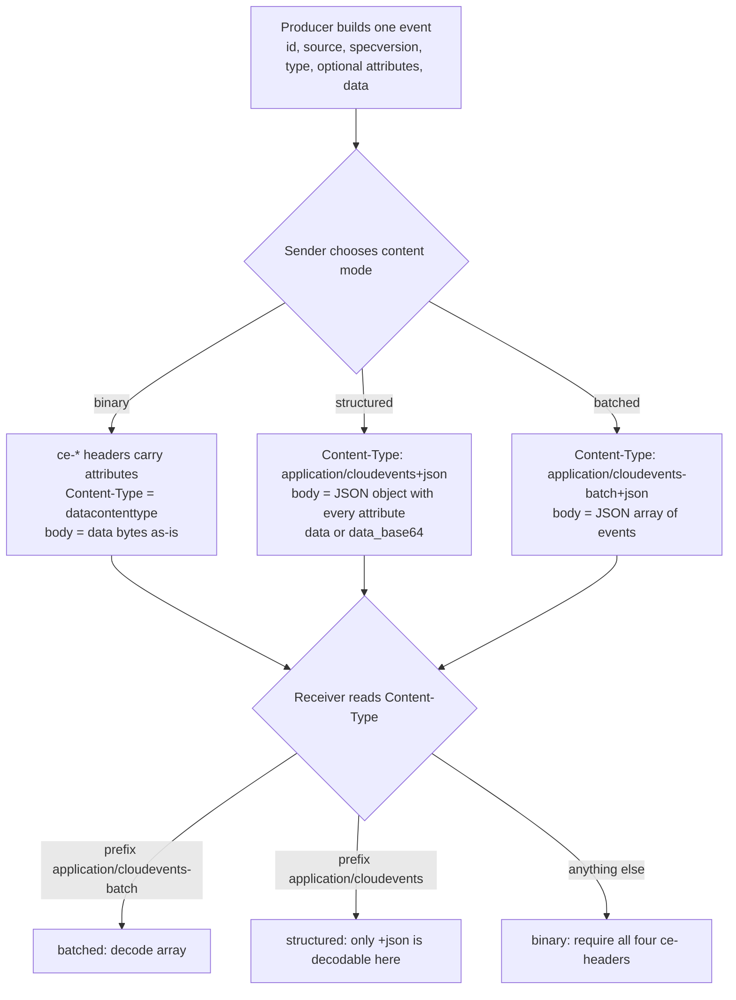

# Standardizing Event Payloads with CloudEvents (v1.0.2): Context Attributes (id, source, type, specversion), Binary vs Structured HTTP Binding, and Schema Evolution

> [!summary] Claim
> CloudEvents 1.0.2 standardizes the envelope, not the payload: four required context attributes (`id`, `source`, `specversion`, `type`) travel either as `ce-` HTTP headers beside the raw bytes (binary mode) or inside a JSON body (structured mode), and everything about how `data` evolves is left to `type`, `dataschema`, and a registry you operate yourself.

Part of [GraphQL JSON RPC and Event APIs](README.md) in [API Engineering](../README.md).

## TL;DR

- Mechanism: one logical event has two HTTP encodings; the sender picks the mode, and the receiver recovers it from `Content-Type` alone (`application/cloudevents+json` is structured, `application/cloudevents-batch+json` is batched, anything else is binary).
- Contract rule: `source` + `id` must be unique per distinct event, so a consumer may treat a repeat as a duplicate, and in binary mode every other attribute must be percent-encoded into a `ce-` header while `Content-Type` carries `datacontenttype`.
- Trap: `application/cloudevents-batch+json` also starts with `application/cloudevents`, so a receiver that tests the structured prefix first misroutes every batch; and binary mode flattens every extension attribute to a string.
- Portability fact: the 107-test lab passed on CPython 3.12.13, 3.13.18, 3.14.6, 3.14.10, 3.15.0b3, 3.15.2, and 3.15.0b3 free-threaded in the drafter's matrix run, and again on 3.14.6 in the independent verification (as of 2026-11); the spec binds HTTP/1.1 and says it applies equivalently to HTTP/2.
- When not to use it: a single team publishing to its own brokers with a registry-governed Avro or Protobuf contract gains little from the envelope; CloudEvents earns its cost when events cross organizations, brokers, or protocols.

## Mental model



The producer never encodes routing information; the HTTP request target does that, and the Primer lists protocol-level routing as an explicit non-goal.
The sender chooses among three encodings of the same event, and the three arrows into the receiver show that the receiver gets no out-of-band hint: the `Content-Type` string is the only discriminator.
The two prefix tests on the receiver side are ordered because the batch media type is a textual extension of the structured prefix, so the more specific test must run first.
The binary branch is a fallback, not a positive match, which is why a receiver must additionally check that all four mandatory `ce-` headers are present before it believes a message is an event.

## How it works

### The event and its context attributes

An event is "a data record expressing an occurrence and its context" (CloudEvents 1.0.2 spec.md, Notations and Terminology, Event).
Context attributes are designed to be serializable independently of `data`, so an intermediary can route on them without decoding the payload (spec.md, Context Attributes).

| Attribute | Type | Required | Constraint (spec.md) |
|---|---|---|---|
| `id` | String | yes | non-empty; `source` + `id` MUST be unique per distinct event; a re-sent duplicate MAY reuse the `id` |
| `source` | URI-reference | yes | non-empty; an absolute URI is RECOMMENDED |
| `specversion` | String | yes | non-empty; producers MUST use `1.0` for this version |
| `type` | String | yes | non-empty; SHOULD be prefixed with a reverse-DNS name |
| `datacontenttype` | String (RFC 2046) | no | media type of `data` |
| `dataschema` | URI | no | non-empty; incompatible schema changes SHOULD change the URI |
| `subject` | String | no | non-empty; subject of the event within the `source` context |
| `time` | Timestamp | no | RFC 3339; producers for one `source` MUST be consistent about what it means |

Attribute names are `[a-z0-9]+` from ASCII and SHOULD NOT exceed 20 characters, so that case-folding protocols and identifier-restricted languages cannot collide (spec.md, Attribute Naming Convention).
Extension attributes follow the same naming and the same type system and are serialized exactly like core attributes (spec.md, Extension Context Attributes).

The type system is deliberately small: `Boolean`, `Integer` (signed 32-bit, -2,147,483,648 to 2,147,483,647), `String`, `Binary` (Base64 as the string encoding), `URI`, `URI-reference`, and `Timestamp` (spec.md, Type System).
A `String` may not contain U+0000-U+001F or U+007F-U+009F, Unicode noncharacters, or unpaired surrogates (spec.md, Type System).
When Python decodes UTF-8 or a JSON surrogate-pair escape (the two escapes `D83D` and `DE00` for U+1F600), a valid surrogate pair becomes a single code point, so the lab's `check_string` treats any surrogate code point left in a `str` as unpaired (`cloudevents_envelope.py`, `check_string`).
That is slightly stricter than the spec: a `str` built by hand from two adjacent surrogate code points is also rejected, although in UTF-16 terms it is a pair.

Uniqueness is relative to the producer: "`source` + `id`" is the identity, which is why `id` alone is the wrong deduplication key (spec.md, `id`; the lab's `dedup_key` returns the pair).
The Primer adds the one caveat that matters for idempotent consumers: the only case where two events legitimately share an `id` is replay (primer.md, id).
That is the contract the sibling note [[Idempotent-Event-Consumers-Inbox-Pattern-and-Poison-Message-DLQs]] builds its inbox on.

The `time` value is RFC 3339 `date-time`: `full-date "T" full-time` with a mandatory offset, a fractional second of one or more digits, and seconds `00-60` to admit a leap second (RFC 3339 Section 5.6).
RFC 3339 notes that `T` and `Z` may alternatively be lower case, which the lab accepts.

`source` is a URI-reference, so `/sensors/tn-1234567/alerts` and `1-555-123-4567` are legal while a value with a space is not (RFC 3986 Section 4.1 grammar, spec.md `source` examples).
`dataschema` is the stricter `URI` type, defined as an `Absolute URI` (RFC 3986 Section 4.3), and that grammar "does not allow a fragment".
Read literally, `https://schemas.example.com/order#/defs/x` is therefore not a valid `dataschema`, and the lab rejects it; the shipped JSON Schema only says `"format": "uri"`, and this note makes no claim about what individual SDKs enforce.

### The JSON event format

The JSON format is the one format every implementation MUST support (spec.md, Overview).
The media type is `application/cloudevents+json`, and every REQUIRED and every non-omitted OPTIONAL attribute becomes a top-level member (json-format.md Section 3).
Extensions are top-level members too, not nested under an `extensions` key, so that a future core attribute can be promoted without moving on the wire (primer.md, JSON Extensions).

Optional attributes may be encoded as JSON `null`, and decoders must treat `null` as unset (json-format.md Section 2.2).
Applied to a REQUIRED attribute, that rule makes `null` equivalent to a missing attribute, so the event is invalid; the JSON Schema shipped with the spec agrees, listing `id`, `source`, `specversion`, and `type` under `required` and typing each as a non-null `string` with `minLength: 1` (formats/cloudevents.json, `required`, `iddef`, `sourcedef`, `specversiondef`, `typedef`).

The payload rules are the part implementers get wrong (json-format.md Section 3.1.1):

1. If the runtime type of `data` is `Binary`, it is Base64 text under the member name `data_base64`.
2. Otherwise, if `datacontenttype` has media type `*/json` or `*/*+json` after stripping parameters, or is absent (an absent value is treated as `application/json`), `data` is stored directly as a JSON value, never as a JSON document inside a string.
3. Otherwise `data` is a string holding the value encoded according to `datacontenttype`.
4. `data` and `data_base64` are mutually exclusive, and an explicit `"data": null` is a distinct event from an event with no `data` member.

The `+json` suffix test relies on the structured syntax suffix registered in RFC 6839 Section 3.1.
The schema in `formats/cloudevents.json` is JSON Schema draft-07 and types `data` as any of object, string, number, array, boolean, or null, and `data_base64` as a string or null with `contentEncoding: base64`.

The batch format is "a JSON array filled with CloudEvents" with media type `application/cloudevents-batch+json`, and it is "considered as a separate format": an implementation of the JSON format need not support it (json-format.md Section 4).

### The HTTP binding

The binding "does not prescribe rules constraining the use or handling of specific HTTP methods" and does not constrain the target resource, and it applies to HTTP/2 "which is compatible with HTTP 1.1 semantics" (http-protocol-binding.md Section 1.2); the same mapping applies to requests and responses (Section 3).
Every compliant implementation SHOULD support structured and binary modes, and one that supports structured mode MUST support the non-batching JSON format (Section 1.3 and 1.4).

#### Mode detection

The receiver distinguishes modes by `Content-Type` (Section 3):

- prefixed with `application/cloudevents`: structured, using a known event format;
- prefixed with `application/cloudevents-batch`: batched;
- otherwise: binary.

A receiver that sees the CloudEvents media type with a format it cannot decode, such as `application/cloudevents+avro`, "MAY still treat the event as binary and forward it to another party as-is" (Section 3).
The lab does the stricter thing and raises `UnsupportedEventFormatError`, which the receiver maps to `415 Unsupported Media Type`, the status `http-webhook.md` Section 2.2 requires when the notification format is not understood.

Because the media-type match is a prefix match on a case-insensitive token (RFC 9110 Section 8.3.1: type and subtype are case-insensitive, parameters may be present), the lab lower-cases and strips parameters before testing the prefixes.
The binding adds that a message without the CloudEvents media type is only "probably" a CloudEvent if it carries all mandatory attributes as headers, and that anything not adhering to the normative language "is not a valid CloudEvent" (Section 3).

#### Binary mode

The `data` bytes are the HTTP body, unmodified (Section 3.1.2).
The `Content-Type` header is populated from `datacontenttype`, and "a `ce-datacontenttype` HTTP header MUST NOT also be present" (Section 3.1.1).
Every other attribute, including extensions, maps to a header named `ce-` plus the attribute name; header names are case-insensitive (Section 3.1.3.1, citing RFC 7230 Section 3.2, restated in RFC 9110 Section 5.1).

Header values use the attribute's canonical string encoding, with one extra layer (Section 3.1.3.2).
RFC 9110 Section 5.5 says specifications for newly defined fields SHOULD limit their values to visible US-ASCII, SP, and HTAB, and a recipient SHOULD treat other octets (obs-text) as opaque, so the binding requires percent-encoding of every character that is a space, a double quote, a percent sign, or outside U+0021-U+007E.
Each such character is UTF-8 encoded and every byte written as `%XY`, upper-case SHOULD, lower-case MUST be accepted.
The spec's own example is `Euro <euro sign> <grinning face>` encoding to `Euro%20%E2%82%AC%20%F0%9F%98%80`, which the lab asserts byte for byte (`test_header_encoding_matches_the_spec_example`).

Decoding is a fixed two-step pipeline: first undo any RFC 7230 quoted-string (older producers sent quoted values), then perform exactly one round of percent-decoding.
Unnecessarily encoded values MUST be accepted, and byte sequences that are invalid UTF-8 MUST be rejected, with `%C0%A0` (an overlong encoding of U+0020) the named example.
"Exactly one round" is load-bearing: decoding `%2541` once yields `%41`, and a second round would turn it into `A`.

The lab's encoder (verbatim excerpt of `cloudevents_envelope.py`):

```python
def encode_header_value(value: str) -> str:
    """Percent-encode per binding 3.1.3.2: space, `"`, `%`, and anything outside U+0021-U+007E."""
    out: list[str] = []
    for ch in value:
        if 0x21 <= ord(ch) <= 0x7E and ch not in '"%':
            out.append(ch)
        else:
            out.extend(f"%{byte:02X}" for byte in ch.encode("utf-8"))
    return "".join(out)
```

Typing is lost in this mode: an `Integer` extension `5` leaves as `ce-comexampleothervalue: 5` and arrives as the string `"5"`, because the header carries only the canonical string and nothing says which type it was (Section 3.1.3.2; the lab asserts `parsed.extensions == {"n": "5", "flag": "true"}`).
A strongly typed consumer must convert from the canonical string using its knowledge of the extension, which is exactly what the spec's type-system section demands of "a strongly-typed programming model" (spec.md, Type System).

#### Structured mode

`Content-Type` is the event format's media type, for example `application/cloudevents+json; charset=UTF-8`, and the body is the entire event (Section 3.2).
Implementations MAY also send the `ce-` headers, but "All CloudEvents metadata attributes MUST be mapped into the payload, even if they are also mapped into HTTP headers" (Section 3.2.3).
The lab takes the consequence literally: with mirrored headers, the body wins, and a tampered `ce-id` header is ignored (`test_mirrored_ce_headers_never_override_the_body`).

#### Batched mode

Several events share one body, `Content-Type: application/cloudevents-batch+json`, and the batch may be empty; all events in a batch MUST share a `specversion`, while other attributes, including `datacontenttype`, may differ (Section 3.3.2).
"The _batched_ mode MUST NOT be used unless solicited, and the gesture SHOULD allow the receiver to choose the maximum size of a batch" (Section 3).
The Primer states a batch "carries no semantic meaning and is not ordered", and an intermediary may add or remove batching or reassign events to different batches (primer.md, Design Goals).
Do not put ordering or transactional meaning into a batch.

The mode-detection function, verbatim from the lab, shows why order matters:

```python
def detect_mode(content_type: str | None) -> Mode:
    """Binding section 3: batch prefix is tested before the structured prefix.

    `application/cloudevents-batch+json` also starts with `application/cloudevents`, so the
    order of the two prefix tests is load-bearing.
    """
    if content_type is None:
        return Mode.BINARY
    mt = media_type(content_type)
    for prefix, mode, expected in (
        ("application/cloudevents-batch", Mode.BATCHED, "+json"),
        ("application/cloudevents", Mode.STRUCTURED, "+json"),
    ):
        if mt.startswith(prefix):
            if mt[len(prefix) :] != expected:
                raise UnsupportedEventFormatError(f"no decoder for event format {mt!r}")
            return mode
    return Mode.BINARY
```

#### Which mode when

The binding's own rationale: binary "accommodates any shape of event data, and allows for efficient transfer and without transcoding effort", while structured "allows simple forwarding of the same event across multiple routing hops, and across multiple protocols" (Section 3.1 and 3.2).
The measured cost of structured mode for binary payloads is in Numbers and limits.

### Other protocol bindings (same event, different carrier)

The envelope idea repeats with protocol-native names, which matters when an event enters over HTTP and leaves over a broker.

| Protocol | Binary-mode attribute carrier | Content type carrier | Structured mode | Source |
|---|---|---|---|---|
| HTTP | header `ce-<name>`, percent-encoded | `Content-Type` | `application/cloudevents+json` body | http-protocol-binding.md Section 3 |
| Kafka | header `ce_<name>`, UTF-8 | header `content-type` | value holds JSON, `content-type: application/cloudevents+json` | kafka-protocol-binding.md Section 3 |
| AMQP | application property `cloudEvents:<name>` | `content-type` message property | body holds JSON | amqp-protocol-binding.md Section 3 |
| MQTT 5.0 | User Property named exactly as the attribute, no prefix | PUBLISH `Content Type` property | payload holds JSON | mqtt-protocol-binding.md Section 3 |

Kafka needs two additional rules.
Binary mode requires Kafka 0.11.0.0 or newer because older versions lack record headers; on 0.10.x and below, implementations MUST use structured JSON (kafka-protocol-binding.md Section 1.3).
MQTT 3.1.1 has no per-message properties, so the content mode there "is always structured" (mqtt-protocol-binding.md Section 3).

The Kafka record key is not an attribute: by default the user-supplied key is the record key, and an opt-in "Key Mapper" SHOULD be able to map the `partitionkey` extension to it, but a mapper MUST NOT modify the event (Section 3.1).
The binding warns against that mapping when both source and sink are Kafka, because it "might cause the re-keying of the records" (Section 1.2).

### Delivery and abuse protection over HTTP (the `http-webhook.md` companion)

The CloudEvents webhook companion fixes what the binding leaves open (http-webhook.md Section 2 to 4):

- delivery uses HTTPS and `POST`, with a `Content-Type` and a non-empty payload; a notification expressed only in headers is not permitted;
- the response MUST NOT be a `3xx`, and the sender MUST NOT follow one;
- `200 OK` or `201 Created` when the response carries a payload with a `Content-Type`; `201 Created` or `204 No Content` when it carries none; `202 Accepted` for accepted but not yet processed;
- `410 Gone` retires a target, `429 Too Many Requests` must carry `Retry-After`, and `415 Unsupported Media Type` signals an unintelligible format;
- authorization is a bearer token in `Authorization` or in an `access_token` query parameter, the latter discouraged because URLs get logged.

The validation handshake protects the sender from being pointed at a victim.
It is an `OPTIONS` request to the exact registered target carrying `WebHook-Request-Origin` (and optionally `WebHook-Request-Callback` and `WebHook-Request-Rate`); consent is expressed by the response headers `WebHook-Allowed-Origin` (the origin echoed, or `*`) and `WebHook-Allowed-Rate` (an integer of requests per minute, or `*`), and "the handshake cannot rely on status codes".
A target that does not handle `OPTIONS` SHOULD answer `405` as if `OPTIONS` were unsupported, and the `OPTIONS` response SHOULD include an `Allow` header naming `POST` (http-webhook.md Section 4.2).
The lab's receiver grants consent only to configured origins, echoes a requested `WebHook-Request-Rate` (or `*` when none was requested), and, as a lab choice, answers a non-consenting request with `405` and `Allow: POST` (`cloudevents_receiver.py`, `build_app`).
For the receiver-side signature and replay-window concerns that this spec leaves out, see [[Webhook-Consumer-Engineering-Signature-Verification-Replay-Windows-and-Idempotency]] and [[Webhook-Sender-Architecture-Standard-Webhooks-Signatures-and-Fan-Out]].

### Extensions that change how you operate events

`documented-extensions.md` lists five (Known Extensions); the ones that interact with the envelope:

- `sequence` (+ `sequencetype`): a non-empty lexicographically orderable string; with `sequencetype` `Integer` it starts at `1`, increases by `1`, and wraps from 2,147,483,647 to -2,147,483,648.
- `partitionkey`: a non-empty string for co-partitioning; "it is possible that the value of this attribute might change, or even be removed" across hops.
- `dataref`: the claim-check pattern; `data` and `dataref` may coexist and must be identical, and a middleware may drop `data` when `dataref` exists.
- `traceparent` and `tracestate`: in a single hop they must carry the same trace information as the protocol headers, and across hops they carry the trace that started the transmission, not each hop's span.
- `sampledrate`: an `Integer`; 30 occurrences emitting one event means `sampledrate` is 30.

Extensions are optional and unknown ones must not break consumers, because an OPTIONAL feature a consumer does not support is "silently ignored" while an intermediary SHOULD forward it (spec.md, Notational Conventions).

### Schema evolution

CloudEvents does not mandate a versioning pattern; "this decision is up to each event producer", but producers "are encouraged to consider versioning from the outset" (primer.md, Versioning of CloudEvents).
Two attributes carry the signal, with different audiences.

`type` is the primary key consumers subscribe or filter on.
Consumers "will generally expect the data within that type to only change in backwardly-compatible ways".
A backward-compatible data change should generally keep `type`; a backward-incompatible change should generally change it, and the producer "is encouraged to produce both the old event and the new event for some time (potentially forever)" (primer.md, The role of the `type` attribute).
The version may be `v1`, a date, or absent (spec.md `type` example `com.example.object.deleted.v2`).

`dataschema` is "expected to be informational, largely to be used during development and by tooling".
It should generally change on a compatible change too, or the URI stays stable while the content behind it changes, which is easier for producers but worse for consumers that cache schemas by URI; an incompatible change changes `dataschema` and `type` together (primer.md, The role of the `dataschema` attribute).

So the primer gives you a routing key (`type`) and a documentation pointer (`dataschema`), and no machinery.
The machinery is a schema registry, and the de facto wire contract for Kafka-style registries is the Confluent payload prefix (Confluent Platform docs, Wire format, as of 2026-11):

| Byte(s) | Meaning |
|---|---|
| 0 | magic/version byte, `0` when the schema ID is used (the default) |
| 1-4 | schema ID, 4 bytes, big-endian |
| 5 onward | for Protobuf, message indexes; then the serialized data |

The same documentation describes an alternative since Confluent Platform 8.1.1: a 16-byte schema GUID in the `__value_schema_id` header (version byte `1`), leaving the payload as bare serialized data.
Compatibility is checked at registration, the default mode is `BACKWARD` (consumers on the new schema can read data written with the old one), and the `_TRANSITIVE` variants check against every previous version rather than only the last (Confluent schema-evolution docs, as of 2026-11).

How the registry and the envelope compose is a design choice the spec does not make.
In binary mode over Kafka, one workable arrangement is that the framed bytes (magic byte, schema ID, Avro body) are `data`, `datacontenttype` says so, and the CloudEvents attributes ride in `ce_` headers; the registry framing then applies to the value bytes only.
In structured JSON mode there is no framing, so `dataschema` (an absolute URI that can resolve to a registry version) is the only link between an event and its schema.
The Avro event format is a different thing: it maps attributes to Avro types and "does not define an envelope format" (avro-format.md Section 1), so `application/avro` data and the Avro event format are independent decisions.

The lab models the reader/writer rules, not any product (`cloudevents_schema_registry.py`): a consumer holding a `reader` schema can decode data written with a `writer` schema unless a reader field is absent from the writer and has no default, or a field's kind differs (only `int` to `number` is promoted):

```python
def reader_violations(writer: Schema, reader: Schema) -> list[str]:
    """Why a consumer holding `reader` cannot decode data written with `writer`."""
    problems: list[str] = []
    for name, spec in reader.items():
        written = writer.get(name)
        if written is None:
            if not spec.has_default:
                problems.append(
                    f"reader field {name!r} is absent from the writer and has no default"
                )
        elif written.kind != spec.kind and (written.kind, spec.kind) not in _PROMOTIONS:
            problems.append(f"field {name!r}: writer {written.kind} cannot be read as {spec.kind}")
    return problems
```

`BACKWARD` is `reader_violations(writer=old, reader=new)`, `FORWARD` swaps the roles, and `FULL` requires both.
The distinction between plain and transitive `BACKWARD` is not academic: dropping a default can be backward compatible against the immediately preceding version (which always wrote the field) while being fatal against an older version that never had it, and `test_plain_backward_only_checks_the_previous_version_but_transitive_checks_all` pins exactly that sequence.

A policy that composes with the Primer: additive change keeps `type` and registers a new version in the same subject; a breaking change gets a new `type` (and therefore a new subject), the producer dual-publishes for a deprecation window, and consumers migrate by subscribing to the new `type`.
That policy is the lab's `test_an_incompatible_change_ships_as_a_new_type_with_its_own_subject`.
For the general theory of additive change and the tolerant reader, see [[Additive-Schema-Evolution-and-Tolerant-Reader-Patterns]]; for JSON Schema as the contract language for `datacontenttype: application/json`, see [[JSON-Schema-2020-12-Core-and-Validation-Vocabularies]].

### Library source that the lab depends on

- Starlette 1.10.0 `starlette/routing.py`, `Route.matches` returns `Match.PARTIAL` when the path matches but the method is not in `Route.methods`, and `Router.app` remembers the first partial match but prefers a later `Match.FULL`; that is why two `Route` objects on `/events`, one for `POST` and one for `OPTIONS`, dispatch correctly.
- Starlette 1.10.0 `starlette/routing.py`, `Route.handle`: a method mismatch builds `{"Allow": ", ".join(self.methods)}` and, inside a Starlette application (`"app"` in the scope), raises `HTTPException(status_code=405, headers=headers)`; outside one it sends a `PlainTextResponse` 405 with the same header, so the `Allow` header on a framework `405` comes from the framework.
- Starlette 1.10.0 `starlette/requests.py`, `Request.stream`: yields body chunks as `http.request` messages arrive and raises `ClientDisconnect` on `http.disconnect`; the lab's receiver counts bytes chunk by chunk and answers `413 Content Too Large` (RFC 9110 Section 15.5.14) as soon as the total passes `max_body`, so it never buffers more than `max_body` plus one chunk.
- h11 0.16.0 `h11/_abnf.py`, `field_value`: built from `field_vchar = vchar_or_obs_text = r"[^\x00\s]"`, which admits obs-text and most control characters but never NUL or whitespace; `h11/_headers.py`, `normalize_and_validate` runs `_field_value_re` over every outgoing value, which is why a raw `\r\n` in `ce-subject` is rejected with `LocalProtocolError` before it reaches the wire.

## Numbers and limits

| Quantity | Value | Source or measurement |
|---|---|---|
| Required context attributes | 4: `id`, `source`, `specversion`, `type` | spec.md, REQUIRED Attributes |
| `Integer` attribute range | -2,147,483,648 to 2,147,483,647 | spec.md, Type System |
| Attribute name length | SHOULD NOT exceed 20 characters | spec.md, Attribute Naming Convention |
| Interoperable event size | intermediaries MUST forward <= 64 KByte; consumers SHOULD accept >= 64 KByte | spec.md, Size Limits |
| What "size" counts | all wire bits: protocol frame metadata, event metadata, and data, for the least efficient encoding on the path | spec.md, Size Limits |
| Spec release | `ce@v1.0.2`, GitHub release dated 2022-02-06 (release notes 2022/02/05); newest `ce@` tag in the releases list at fetch time (as of 2026-11) | GitHub releases API, RELEASE_NOTES.md |
| Base64 expansion | `data_base64` length is exactly `4 * ceil(n / 3)` for `n` raw bytes | lab: `test_structured_mode_pays_the_base64_tax_that_binary_mode_avoids` |
| Binary vs structured wire size, 1 byte payload | 101 vs 182 bytes | lab measurement (below) |
| Binary vs structured wire size, 1024 byte payload | 1124 vs 1546 bytes | lab measurement |
| Binary vs structured wire size, 49152 byte (48 KiB) payload | 49252 vs 65714 bytes | lab measurement |
| Largest raw payload within 65536 wire bytes | binary 65436, structured 49017 (ratio 0.749) | lab measurement |
| Confluent payload-prefix overhead | 5 bytes (1 magic + 4 schema ID) | Confluent docs, as of 2026-11 |
| Confluent GUID header | 16-byte GUID plus version byte `1` in `__value_schema_id` | Confluent docs, Confluent Platform 8.1.1 and later |
| Default registry compatibility | `BACKWARD` | Confluent docs, as of 2026-11 |

Measurement conditions: the lab's `HttpMessage.wire_size()` counts header lines (`name: value` plus CRLF), the blank line, and the body, and excludes the request line, so absolute values are lower than a full HTTP/1.1 request by tens of bytes.
The minimal event is `id="1"`, `source="/s"`, `type="t"` with `datacontenttype="application/octet-stream"`.
Command: `uv run --frozen pytest tests/f20_graphql_json_rpc_and_event_apis/test_cloudevents_1_0_2_envelope_structured_vs_binary_content_modes_and_schema_registries.py -q -rP` from `labs/`; CPython 3.14.6 (uv managed), macOS 27.3 (`uname -r` = `27.3.0`) on arm64; re-run in the independent verification on 2026-11-26 with identical byte counts.
The sizes are deterministic byte counts, not timings, so they do not vary by machine or CPython version.

Two readings of the table.
First, the 64 KByte rule reads as "up to 64 KByte is safe on every hop", and structured mode with a 48 KiB binary payload already exceeds 65536 bytes while binary mode stays well under it.
The spec does not define whether "KByte" means 1000 or 1024 bytes (spec.md, Size Limits, writes both `64 KByte` and `64KB`); the lab uses 65536, and the 48 KiB conclusion holds under either reading because 65714 exceeds both 65536 and 64000.
Second, the fixed overhead of the envelope is small in binary mode (about 100 bytes for the minimal event) and about 80 percent higher in structured mode for tiny payloads (182 versus 101 bytes), so the envelope is not the cost driver for large payloads; Base64 is.

## Portability

| Dimension | Result | Evidence |
|---|---|---|
| CPython 3.12.13 | 107 passed | drafter's lab run: `uv run --python 3.12` with pinned `pytest`, `pytest-asyncio`, `starlette`, `httpx`, `h11`, `anyio`, `httpcore` |
| CPython 3.13.18 | 107 passed | drafter's lab run, `uv run --python 3.13` |
| CPython 3.14.6 (workspace `.venv` and uv managed) | 107 passed | drafter's lab run, and re-run by the verifier on 2026-11-26 with `uv run --frozen pytest` (107 passed in 0.62s) |
| CPython 3.14.10 (Homebrew) | 107 passed | drafter's lab run, `uv run --python /opt/homebrew/bin/python3.14` |
| CPython 3.15.0b3 (uv managed) | 107 passed | drafter's lab run, `uv run --python 3.15` |
| CPython 3.15.2 (Homebrew) | 107 passed | drafter's lab run, `uv run --python /opt/homebrew/bin/python3.15` |
| CPython 3.15.0b3 free-threaded | 107 passed | drafter's lab run, `uv run --python 3.15t`; this is a beta build, not 3.15.2t |
| Matrix versions not available here | 3.12.16 and 3.15.2t were not available; 3.12.13 and 3.15.0b3 free-threaded ran instead | `uv python list` |
| Libraries | Starlette 1.10.0, httpx 0.28.1, h11 0.16.0, pytest 9.2.0 | pinned in `labs/pyproject.toml`; ephemeral environments used the same pins |
| Uvicorn, Hypercorn, Granian | not run; the lab uses `httpx.ASGITransport` in process | no server was started |
| HTTP/1.1 | header encoding and parsing proven through h11 0.16.0 on the wire | `test_events_survive_a_real_http_1_1_serialization` |
| HTTP/2 | binding states it applies equivalently; not run | http-protocol-binding.md Section 1.2 |
| HTTP/3 over QUIC | not covered by the 1.0.2 binding, which names HTTP/1.1 and HTTP/2 only; not run, so no claim is made | http-protocol-binding.md Abstract and Section 1.2 |
| Debian Trixie and Alpine containers | not run | containers were out of scope for this draft |
| Header name case | names are case-insensitive, so `CE-ID` and `ce-id` are one field | RFC 9110 Section 5.1; `test_header_names_are_case_insensitive` |

The Python-version independence is expected: the lab uses only `json`, `base64`, `re`, `struct`, and `dataclasses` in the standard library, plus `starlette`, `httpx`, and `h11` for the in-process HTTP tests.
The one behavior that could plausibly differ across versions is `json.loads` recursion handling on pathological nesting; `test_pathological_nesting_is_rejected_not_a_crash` passed on all seven interpreters above; on CPython 3.14.6, `json.loads` of a 100,000-deep array raises `RecursionError` (checked directly in verification), and the lab converts it into a `CloudEventError`.

## Worked example

- Implementation: [implementation](../labs/src/api_labs/f20_graphql_json_rpc_and_event_apis/cloudevents_envelope.py) (envelope, JSON format, HTTP modes), [registry](../labs/src/api_labs/f20_graphql_json_rpc_and_event_apis/cloudevents_schema_registry.py) (compatibility modes, framing), and [receiver](../labs/src/api_labs/f20_graphql_json_rpc_and_event_apis/cloudevents_receiver.py) (ASGI delivery and the validation handshake).
- Test: [test](../labs/tests/f20_graphql_json_rpc_and_event_apis/test_cloudevents_1_0_2_envelope_structured_vs_binary_content_modes_and_schema_registries.py), 107 tests, every one `@pytest.mark.unit`.

The same event in both HTTP encodings, captured by running the lab on CPython 3.14.6 (macOS 27.3, arm64).
The event has a non-ASCII `subject`; the structured body below contains the character U+00E9 in `subject`, shown here as `\u00e9` because this note is ASCII only:

```text
--- binary (wire_size=308)
ce-id: C234-1234-1234
ce-source: /mycontext
ce-specversion: 1.0
ce-type: com.example.order.created.v1
ce-dataschema: https://schemas.example.com/subjects/order/versions/1
ce-subject: caf%C3%A9%20100%25
ce-time: 2018-04-05T17:31:00Z
ce-partitionkey: cust-42
content-type: application/json

{"qty":2}
--- structured (wire_size=365)
content-type: application/cloudevents+json; charset=UTF-8

{"id":"C234-1234-1234","source":"/mycontext","specversion":"1.0","type":"com.example.order.created.v1","datacontenttype":"application/json","dataschema":"https://schemas.example.com/subjects/order/versions/1","subject":"caf\u00e9 100%","time":"2018-04-05T17:31:00Z","partitionkey":"cust-42","data":{"qty":2}}
```

Reading it: in binary mode `datacontenttype` has become the `content-type` header and has no `ce-` twin, the `subject` is percent-encoded (`%C3%A9` for U+00E9, `%20` for the space, `%25` for the literal percent), and the body is only `data`.
In structured mode the percent sign is a plain `%` inside a JSON string and the whole event is one self-describing document.
Round-tripping the binary form through `parse_message` returned mode `Mode.BINARY`, the original `subject`, and an event equal to the input (`True`).

The binary encoder, verbatim from `cloudevents_envelope.py`:

```python
def to_binary(event: CloudEvent) -> HttpMessage:
    """Binary content mode (binding section 3.1)."""
    headers = [
        (f"ce-{name}", encode_header_value(value))
        for name, value in _attribute_items(event, skip_content_type=True)
    ]
    body = _data_bytes(event)
    content_type = event.datacontenttype
    if content_type is None and body is not None:
        content_type = "application/json"  # spec.md: set the implied type explicitly
    if content_type is not None:
        if not all(0x20 <= ord(c) <= 0x7E for c in content_type):
            raise CloudEventError("datacontenttype must be printable ASCII to be a header")
        headers.append(("content-type", content_type))
    return HttpMessage(tuple(headers), body or b"")
```

Two tests that pin the traps, as two verbatim excerpts from the test module (they are not adjacent in the file):

```python
@pytest.mark.unit
def test_a_repeated_ce_header_is_rejected_not_folded() -> None:
    headers = [*to_binary(MINIMAL).headers, ("CE-ID", "2")]
    with pytest.raises(CloudEventError, match="duplicate header ce-id"):
        parse_message(headers, b"")


@pytest.mark.unit
def test_plain_backward_only_checks_the_previous_version_but_transitive_checks_all() -> None:
    v2 = {**V1, "note": Field("string", has_default=True)}
    v3 = {**V1, "note": Field("string")}  # default dropped: fine against v2, fatal against v1
    loose = SchemaRegistry(compatibility=Compatibility.BACKWARD)
    strict = SchemaRegistry(compatibility=Compatibility.BACKWARD_TRANSITIVE)
    for registry in (loose, strict):
        registry.register("order", V1)
        registry.register("order", v2)
    assert loose.register("order", v3).version == 3
    with pytest.raises(IncompatibleSchemaError, match="'note'"):
        strict.register("order", v3)
```

Captured pytest output.
Command: `uv run --frozen pytest tests/f20_graphql_json_rpc_and_event_apis/test_cloudevents_1_0_2_envelope_structured_vs_binary_content_modes_and_schema_registries.py -q -rP` from `labs/`, CPython 3.14.6, macOS 27.3 arm64:

```text
........................................................................ [ 67%]
...................................                                      [100%]
==================================== PASSES ====================================
_______ test_structured_mode_pays_the_base64_tax_that_binary_mode_avoids _______
----------------------------- Captured stdout call -----------------------------
payload=     1 binary=   101 structured=   182
payload=     2 binary=   102 structured=   182
payload=     3 binary=   103 structured=   182
payload=  1024 binary=  1124 structured=  1546
payload= 49152 binary= 49252 structured= 65714
________ test_the_64_kib_budget_admits_more_raw_payload_in_binary_mode _________
----------------------------- Captured stdout call -----------------------------
max raw payload in 65536 wire bytes: binary=65436 structured=49017
107 passed in 0.62s
```

What the 107 tests cover: attribute validation (controls, noncharacters, surrogates, extension names, 32-bit range, `dataschema`, `time`); binary and structured encode and decode, lossless round trips, `data` vs `data_base64`, explicit `null`, the implied `application/json`; mode detection including the prefix order and unknown formats; duplicate and mirrored headers; strict JSON (duplicate members, `NaN`, BOM, 100,000-deep nesting); a real h11 serialization of all three modes; the registry's compatibility modes and framing; and an in-process ASGI receiver returning `202`, `415`, `400`, `413`, and the `OPTIONS` handshake results.
Mutation testing of the discriminating tests was not performed, either for this draft or in the independent verification, because the user paused lab checks on 2026-11-11; the tests are written to fail if their named behavior is absent, but that has not been demonstrated by breaking the code.

## Pitfalls

> [!warning] The batch media type matches the structured prefix
> Trigger: a receiver decides `if content_type.startswith("application/cloudevents")` before it tests for `application/cloudevents-batch`.
> Symptom: single events work; every batched delivery is parsed as one structured event, fails because the body is a JSON array, and returns a client error for traffic that is valid.
> Fix: test the longer batch prefix first and then require the exact `+json` suffix (the lab's `detect_mode`; `test_batch_prefix_is_tested_before_the_structured_prefix`).
> Source: http-protocol-binding.md Section 3 defines both prefixes.

> [!warning] Raw non-ASCII or control characters in `ce-` headers
> Trigger: a producer writes `ce-subject: caf<e acute>` as raw UTF-8 or interpolates an unescaped value.
> Symptom: some stacks pass obs-text bytes through (h11 0.16.0's `field_value` accepts `[^\x00\s]`), others reject or re-encode them, and a value containing CR or LF is "invalid and dangerous" (RFC 9110 Section 5.5), so the same event works through one proxy and fails through the next.
> Fix: percent-encode every value as binding Section 3.1.3.2 requires, decode exactly once, and never let attribute values reach a header unencoded; the CloudEvent `String` type forbids controls anyway (spec.md, Type System).

> [!warning] Header folding and header-versus-body disagreement
> Trigger: a proxy or client emits `ce-id` twice, or a structured-mode sender mirrors `ce-` headers that disagree with the body.
> Symptom: RFC 9110 Section 5.3 permits a recipient to combine repeated field lines into `a, b`, so a duplicated `ce-id` becomes a value that matches neither event, and which of two conflicting sources a consumer believes becomes implementation-defined.
> Fix: reject a repeated `ce-` header outright and, in structured mode, treat the body as the only source of truth, as binding Section 3.2.3 requires.

> [!warning] Binary mode loses extension types
> Trigger: an `Integer` or `Boolean` extension crosses a binary-mode hop.
> Symptom: the consumer receives the strings `"5"` and `"true"`; code that compares with `== 5` or `is True` silently takes the wrong branch.
> Fix: convert from the canonical string by extension name, as the spec's type-system section requires of strongly typed models, or use structured mode where JSON keeps numbers and booleans native.

> [!warning] Base64 inflation breaks the 64 KByte budget
> Trigger: a 48 KiB binary payload is sent in structured mode.
> Symptom: the lab measures 65714 wire bytes against 49252 in binary mode; the structured message is over 65536 bytes, so the spec's "safe on every hop" guarantee no longer applies and a hop with a smaller limit may drop it.
> Fix: use binary mode for binary payloads, or carry a `dataref` claim check and keep `data` small.

> [!warning] A JSON document inside a JSON string
> Trigger: a producer sets `datacontenttype` to `application/json` and stores `"data": "{\"qty\":2}"`.
> Symptom: the JSON format requires `data` to be stored "directly as a JSON value, rather than as an encoded JSON document represented as a string" (json-format.md Section 3.1.1), and a deserializer "MUST NOT further deserialize the string as a JSON document" (Section 3.1.2), so consumers see a string and fail schema validation.
> Fix: put the object in `data`, or declare a non-JSON `datacontenttype` and own the parsing.

> [!warning] Breaking a schema without changing `type`
> Trigger: a producer adds a required field to the data of `com.example.order.created.v1` and keeps the `type`.
> Symptom: existing consumers keep receiving events of a type they were promised is backward compatible and fail at runtime; with a `BACKWARD` registry the registration itself is refused, and with `NONE` nothing stops it.
> Fix: follow the primer: a backward-incompatible change gets a new `type`, the old event is dual-published for a deprecation window, and the registry subject follows the `type`.

> [!warning] Plain `BACKWARD` lets a transitive break through
> Trigger: v2 adds a defaulted field, v3 removes that default.
> Symptom: v3 is accepted because it is compared only with v2; a consumer on v3 then fails on archived v1 events during replay.
> Fix: use the transitive mode for subjects that are replayed or compacted, and accept that the cost is a stricter evolution path (the lab's `BACKWARD_TRANSITIVE`).

> [!warning] Trusting the self-asserted `source`
> Trigger: a consumer keys ownership or authorization on the `source` (or `type`) attribute of events read from a shared broker topic.
> Symptom: CVE-2026-71576 (NVD, published 2026-08-10): the multicluster-global-hub manager "improperly validates the source identity of incoming CloudEvents on Kafka status topics", so an attacker holding one managed hub's Kafka client certificate could assert another hub's identity and falsify or delete that hub's data.
> Fix: bind the identity to the authenticated transport principal (the client certificate or token) and reject events whose `source` does not match it; `source` is a claim, not a credential.

A second, SDK-level advisory shows that the transport, not the envelope, is where credentials leak: CVE-2024-28110 (GHSA-5pf6-2qwx-pxm2) is a CloudEvents Go SDK bug where, before 2.15.2, `cloudevents.WithRoundTripper` with an authenticated `http.RoundTripper` modified `http.DefaultClient`, so `Authorization` tokens were sent to any endpoint that client contacted.
The other pitfalls above rest on spec text, RFC text, and behavior reproduced in the lab.

## Security and robustness

Threat model: an attacker can send arbitrary bytes to the receiver, can sit in a proxy chain, can register a malicious delivery target with a sender, and can publish events that cite hostile `dataschema` URIs.
The spec's own position is minimal: "Sensitive information SHOULD NOT be carried or represented in context attributes", `data` SHOULD be encrypted among trusted parties, and protocol-level security SHOULD be used; it explicitly leaves authorization, integrity, and confidentiality out (spec.md, Privacy and Security; primer.md, Non-Goals).
Context attributes are "in the clear" and may be logged by every producer, consumer, and intermediary, so never put a token, personal data, or a secret in `subject`, `source`, or an extension.

Boundary enforcement the lab implements:

- Header injection: attribute values are percent-encoded, so CR, LF, and NUL never reach a header (`test_encoded_values_never_contain_header_terminators`); RFC 9110 Section 5.5 requires recipients to reject or neutralize them anyway.
- Parser differentials: RFC 8259 Section 4 says that for duplicate member names "the behavior of software that receives such an object is unpredictable", with some parsers reporting the last pair and others an error; a front proxy that validates the first `id` while the consumer acts on the last is a smuggling channel, so the lab rejects duplicate members (`test_duplicate_json_members_are_rejected_because_parsers_disagree_on_which_wins`).
- Encoding: RFC 8259 Section 8.1 requires UTF-8 for interchanged JSON and says parsers MAY ignore a BOM; the lab chooses to reject a BOM, and also rejects `NaN` and `Infinity`, which JSON does not allow.
- Resource limits: the receiver caps the body while streaming and answers `413`, and the JSON decoder bounds nesting (a 100,000-deep array is converted to a `CloudEventError`, not a crash); the lab does not model solicitation, but the binding restricts batched mode to solicited use with a receiver-chosen maximum (binding Section 3).
- Mode confusion: binary mode on a request without `ce-` headers is not an event; the lab raises `NotACloudEventError` when any of the four mandatory headers is absent, mirroring the binding's warning that only messages with all mandatory attributes are "probably" events.
- Schema SSRF: resolving a `dataschema` URL from an untrusted event is an outbound request chosen by the attacker; the lab's `validate_event` resolves only URIs already registered and reports `unknown dataschema` otherwise.
- Abuse of the sender: the `OPTIONS` handshake ensures a target consents before deliveries start, and its consent is in headers, never in the status code; in the lab an absent or unknown `WebHook-Request-Origin` gets `405` with no consent headers.

What the specification does not give you, and you must add: authenticity and replay protection.
`source` is a claim by the sender, not an identity; routing or authorization decisions on `source` or `type` are only as strong as the transport authentication (CVE-2026-71576 is this failure in production code), and `source` + `id` deduplication is a correctness aid, not a replay defense.
Use mutual TLS or signed webhooks and a replay window, as in the sibling notes on webhook consumers and senders.
The OWASP API Security Top 10 (2023) risks that apply are API4:2023 Unrestricted Resource Consumption, API7:2023 Server Side Request Forgery, API8:2023 Security Misconfiguration, and API10:2023 Unsafe Consumption of APIs (owasp.org, API Security Top 10 2023).

## The principal's view

The decision is not "CloudEvents or not", it is "where do I want the interoperability boundary".
Adopt the envelope where events cross a boundary owned by different teams, vendors, or protocols: webhooks to customers, a broker-to-broker bridge, a router or serverless platform that filters on `type`, `source`, and `subject`.
Inside one team publishing to one Kafka cluster with a governed Avro or Protobuf contract, a registry and a topic naming convention already provide the guarantees, and the envelope adds ceremony: a `ce_` header set, a `type` taxonomy to maintain, and a second versioning axis.

Choose the mode by who reads the message.
Use binary mode for broker traffic and for payloads that are not JSON, because the body stays what the producer wrote, headers are cheap for routers to inspect, and there is no Base64 tax.
Use structured JSON for webhooks to unknown receivers, archives, and dead-letter queues, because the message is self-contained: it survives a hop that strips unrecognized headers, a protocol change, and being written to a file.
The downside of structured mode is the Base64 inflation and the parse cost to read any attribute; the downside of binary mode is that every hop must preserve `ce-` headers (RFC 9110 Section 5.1 requires a proxy to forward unrecognized fields unless `Connection` names them or it is specifically configured to block or transform them) and that extension types flatten to strings.
Be able to convert between them, since events may be re-encoded as they cross protocols (spec.md, Size Limits); in the lab `to_binary` and `to_structured` round-trip JSON data and bytes, and the conversion is lossy in two places: extension types (a spec consequence) and empty binary bodies (a lab policy, `test_lab_policy_empty_binary_body_reads_back_as_absent_data`).

Run schema evolution as policy, not as tooling.
Pick `BACKWARD_TRANSITIVE` for any subject that is replayed, set it at the registry, and make a breaking change an organizational event: a new `type`, a dual-publish window with an owner and an end date, and consumer migration tracked like an API deprecation.
The organizational trade-off is that `type` becomes a public API name, so governance of the `type` namespace (reverse-DNS prefix, who may mint one, how versions are spelled) is a platform-team responsibility, and a registry becomes a production dependency whose outage can stop producers.

Choose a different paradigm when a different one fits: synchronous request and reply belongs on REST or gRPC (see [[Architectural-Paradigm-Selection-REST-vs-gRPC-vs-GraphQL-vs-JSON-RPC-vs-Events]]), the channel and operation contract of an event system belongs in AsyncAPI (see [[Event-Driven-APIs-and-AsyncAPI-3-1-0-Specification]]), and push to browsers belongs on a transport from [[Real-Time-Push-Protocols-Compared-WebSockets-vs-SSE-vs-HTTP-2-3-Streaming-vs-Long-Polling]].
CloudEvents describes the message; it does not describe the channel, the delivery guarantee, or the consumer's idempotency, and conflating them is the usual design error.

## Interview questions

> [!question] L5: Which attributes are required on every CloudEvent, and what does the spec promise about `id`?
>
> > [!success]- Answer
> > The four required context attributes are `id`, `source`, `specversion`, and `type`.
> > `specversion` is `1.0` for this version, `source` is a non-empty URI-reference, and `type` should carry a reverse-DNS prefix.
> > Producers must ensure that `source` + `id` is unique for each distinct event, so the pair is the identity and `id` alone is not.
> > A re-sent duplicate may reuse the `id`, and consumers may treat events with identical `source` and `id` as duplicates.
> >
> > Follow-up: Why is the deduplication key the pair rather than `id`?

> [!question] L5: How does a receiver tell binary, structured, and batched HTTP messages apart?
>
> > [!success]- Answer
> > It reads only the `Content-Type` header.
> > A prefix of `application/cloudevents-batch` means batched, a prefix of `application/cloudevents` means structured, and anything else is binary.
> > In binary mode the `Content-Type` is the event's `datacontenttype`, and all other attributes are `ce-` headers.
> > A binary message is only treated as an event if all four mandatory attributes are present as `ce-` headers.
> >
> > Follow-up: What should a receiver do with `application/cloudevents+avro` if it has no Avro decoder?

> [!question] L5: Predict the output of `encode_header_value('50% "off"')` in the lab, and of decoding `%2541` once.
>
> > [!success]- Answer
> > The encoder returns `50%25%20%22off%22`.
> > The percent sign becomes `%25`, the space `%20`, and each double quote `%22`; digits and letters in U+0021-U+007E are left alone.
> > Decoding `%2541` performs exactly one round of percent-decoding and returns `%41`, not `A`.
> > Both are asserted in `test_percent_and_double_quote_are_encoded_and_decoding_is_a_single_round`.
> >
> > Follow-up: What attack or bug does a second round of decoding enable?

> [!question] L6: Debug this API: single CloudEvents posts return `202`, but every `application/cloudevents-batch+json` post returns `400`. The receiver starts with `if ct.startswith("application/cloudevents"): parse_structured(body)`. What is wrong and how do you fix it?
>
> > [!success]- Answer
> > The batch media type begins with the structured prefix, so every batch is routed to the structured parser, which expects a JSON object and receives an array.
> > The fix is to test `application/cloudevents-batch` first, then `application/cloudevents`, then require the exact `+json` suffix and return `415` for an unknown format.
> > The lab's `detect_mode` encodes that order and `test_batch_prefix_is_tested_before_the_structured_prefix` pins it.
> > Also confirm that batching was solicited, since a sender must not use batched mode unless it was.
> >
> > Follow-up: Why does the binding not simply give batches an unrelated media type?

> [!question] L6: A producer writes a value containing an accented e as raw UTF-8 in `ce-subject` and consumers disagree about it; why, and what is the correct encoding?
>
> > [!success]- Answer
> > New HTTP fields SHOULD limit their values to visible US-ASCII, SP, and HTAB, and a recipient SHOULD treat other octets as opaque (RFC 9110 Section 5.5), so decoders disagree about raw UTF-8.
> > The binding requires percent-encoding of the UTF-8 bytes of every character outside U+0021-U+007E, so the correct header is `ce-subject: caf%C3%A9`.
> > The receiver unquotes any legacy quoted-string, percent-decodes once, and rejects invalid UTF-8 such as the overlong `%C0%A0`.
> >
> > Follow-up: Why must a decoder accept unnecessarily encoded values but reject overlong sequences?

> [!question] L6: When does a schema change require a new `type`, and what is `dataschema` for?
>
> > [!success]- Answer
> > A backward-compatible data change generally keeps `type`; a backward-incompatible one generally changes it, and the producer should publish both old and new for a period.
> > `dataschema` is informational and aimed at tooling; it should generally change on a compatible change too, and it changes together with `type` on an incompatible one.
> > A stable `dataschema` URI whose content changes is simpler for producers but harder on consumers that cache schemas by URI.
> > The spec mandates none of this; it is the Primer's guidance.
> >
> > Follow-up: What breaks if consumers subscribe by `type` and you add a required field without changing it?

> [!question] L6: Binary mode drops a field's type; what exactly is lost and how do you design around it?
>
> > [!success]- Answer
> > A header carries only the canonical string, so an `Integer` extension `5` and a `Boolean` `true` arrive as `"5"` and `"true"`.
> > The lab asserts `parsed.extensions == {"n": "5", "flag": "true"}` after a binary round trip.
> > Convert by extension name on the consumer, as a strongly typed model must, or choose structured mode where JSON keeps its native types.
> > Do not infer types from the string, because `"5"` is also a valid `String`.
> >
> > Follow-up: Which attributes are unaffected and why?

> [!question] L7: A service publishes 48 KiB images as events over HTTP to third parties; which mode do you pick and what numbers defend it?
>
> > [!success]- Answer
> > Use binary mode with `datacontenttype: image/png` (or the real type) and the bytes as the body.
> > In the lab a 49152-byte payload is 49252 wire bytes in binary mode and 65714 in structured mode, because Base64 is `4 * ceil(n / 3)`; the structured form exceeds 65536, the point past which the spec's forward-on-every-hop guarantee no longer applies.
> > The largest raw payload that fits 65536 wire bytes is 65436 in binary mode and 49017 in structured mode, a ratio of 0.749.
> > Better still, put a `dataref` claim check in the event and keep the image out of the envelope, which also allows differentiated access control.
> >
> > Follow-up: What do you lose if a gateway in front of the third party strips unknown `ce-` headers?

> [!question] L7: Design the schema evolution policy for 200 consumers of an event stream over Kafka with replay.
>
> > [!success]- Answer
> > Require `BACKWARD_TRANSITIVE` on every subject, because a consumer on the newest schema must decode every archived version during replay.
> > Additive change registers a new version under the same subject and keeps `type`.
> > A breaking change mints a new `type` such as `...v2`, gets its own subject, and is dual-published for a bounded window with an owner and an end date.
> > Carry the schema identity as the Confluent payload prefix (magic byte `0`, 4-byte big-endian ID) or in the `dataschema` attribute for structured JSON, and make the registry highly available because producers depend on it.
> > Track consumer migration on the `type` as you would an API deprecation.
> >
> > Follow-up: What does plain `BACKWARD` let through that the transitive mode rejects?

> [!question] L7: Why does the spec say the batch gesture must be solicited, and how would you protect a receiver that supports batching?
>
> > [!success]- Answer
> > Batched mode MUST NOT be used unless solicited, and the solicitation SHOULD let the receiver pick a maximum batch size.
> > The binding states the rule without a rationale; the operational reasons are that a batch is a single large allocation and a single point of failure for all its events.
> > A batch carries no semantic meaning or order, so do not rely on it for atomicity.
> > Protect the receiver with a streaming body cap (the lab returns `413`), strict parsing with bounded nesting and duplicate-member rejection, and a per-event result policy since one invalid event should not silently drop the rest.
> >
> > Follow-up: Which of those protections would you move to the gateway, and which must stay in the application?

## Related

Prerequisites: [[Event-Driven-APIs-and-AsyncAPI-3-1-0-Specification]]

Next: [[Idempotent-Event-Consumers-Inbox-Pattern-and-Poison-Message-DLQs]]

See also: [[02-Programming-Languages/Python/Python-Backend-Interview-Prep/08-Microservices-and-Messaging]]

See also: [[HTTP-Callback-Subscriptions-WebSub-and-Async-Request-Reply-Patterns]], [[Webhook-Consumer-Engineering-Signature-Verification-Replay-Windows-and-Idempotency]], [[Webhook-Sender-Architecture-Standard-Webhooks-Signatures-and-Fan-Out]], [[Additive-Schema-Evolution-and-Tolerant-Reader-Patterns]], [[JSON-Schema-2020-12-Core-and-Validation-Vocabularies]], [[HTTP-Message-Abstraction-RFC-9110]], [[Content-Negotiation-Media-Types-and-Charsets]]

- Lab: `labs/tests/f20_graphql_json_rpc_and_event_apis/test_cloudevents_1_0_2_envelope_structured_vs_binary_content_modes_and_schema_registries.py`

## Further reading

- [CloudEvents 1.0.2 core specification](https://github.com/cloudevents/spec/blob/v1.0.2/cloudevents/spec.md): the attribute definitions, type system, size limits, and security statement.
- [HTTP Protocol Binding 1.0.2](https://github.com/cloudevents/spec/blob/v1.0.2/cloudevents/bindings/http-protocol-binding.md): the normative binary, structured, and batched mappings and the header value encoding.
- [JSON Event Format 1.0.2](https://github.com/cloudevents/spec/blob/v1.0.2/cloudevents/formats/json-format.md): the `data` versus `data_base64` rules and the batch format.
- [CloudEvents Primer 1.0.2](https://github.com/cloudevents/spec/blob/v1.0.2/cloudevents/primer.md): the design rationale, non-goals, and the versioning guidance for `type` and `dataschema`.
- [HTTP Webhook companion 1.0.2](https://github.com/cloudevents/spec/blob/v1.0.2/cloudevents/http-webhook.md): delivery status codes and the `OPTIONS` abuse-protection handshake.
- [Kafka, AMQP, and MQTT bindings 1.0.2](https://github.com/cloudevents/spec/tree/v1.0.2/cloudevents/bindings): how the same event maps onto broker headers and properties.
- [RFC 9110 Section 5 and Section 8.3](https://www.rfc-editor.org/rfc/rfc9110.html): field names, field values, repeated fields, and media types.
- [RFC 8259 Section 4 and Section 8.1](https://www.rfc-editor.org/rfc/rfc8259.html): duplicate member names and JSON encoding, the basis of the strict parsing rules.
- [Confluent Schema Registry wire format and compatibility](https://docs.confluent.io/platform/current/schema-registry/fundamentals/serdes-develop/index.html): the payload prefix, the GUID header alternative, and the compatibility modes the lab models.
