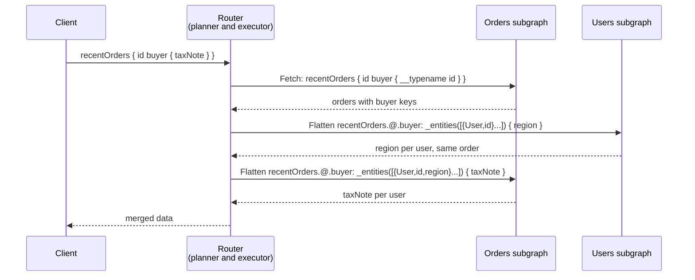

# Distributed GraphQL at Enterprise Scale: Apollo Federation v2 (@key, @external, @requires, _entities Resolver) and Router Query Plan Execution

> [!summary] Claim
> Federation lets independent teams own different fields of the same type because every subgraph answers `Query._entities(representations)` with one entity per representation, in the same order, and the router turns each cross-subgraph field into a planned `Fetch` hop, so the latency of an operation is the depth of its query plan and not the number of its fields.

Part of [GraphQL JSON RPC and Event APIs](README.md) in [API Engineering](../README.md).

## TL;DR

- Mechanism: each subgraph is an ordinary GraphQL server plus `Query._service { sdl }` and `Query._entities(representations: [_Any!]!): [_Entity]!`; the router composes the SDLs into a supergraph, plans every operation as `Fetch`, `Flatten`, `Sequence`, and `Parallel` nodes, and calls `_entities` for each cross-subgraph hop.
- Contract rule: `_entities` must return one list item per representation, in the exact input order, with `null` for an entity that does not exist (Subgraph Specification, Understanding Query._entities).
- Trap: the reference resolver runs once per representation, so a naive `resolve_reference` that queries a database turns one client query into an N+1 cascade inside the subgraph; Strawberry 0.340.0 calls it in a plain loop with no batching.
- Portability fact: Strawberry 0.340.0 emits `@link` to Federation `v2.11` by default and accepts `2.0` to `2.11`; the Apollo Router (Rust native planner) and composition (Rust since Federation 2.15) are the reference runtime, and the lab planner in this note is a teaching model, not a re-implementation.
- When not to use it: one team, one deploy unit, or a graph that a modular monolith serves with in-process calls; federation adds a router hop, a composition step, and a serial network hop per plan level.

## Mental model



The router receives one operation and asks which subgraph owns each field.
`recentOrders` belongs to Orders, so the first `Fetch` goes there and additionally asks for `__typename` and the `@key` fields of `buyer`, because those become the entity representations.
`taxNote` is owned by Orders but declared `@requires(fields: "region")`, and `region` is `@external` there, so the plan must detour through Users to fetch `region` before Orders can compute `taxNote`.
Each detour is a `Flatten` node that calls `_entities` on one subgraph with a list of representations and merges the returned list back into the response at a path, where `@` means "every element of the preceding list".
The three arrows labelled `Fetch` and `Flatten` are strictly sequential because each needs the previous result; independent root fields run in a `Parallel` node.

## How it works

### The subgraph contract

An Apollo Federation 2 subgraph is any GraphQL server that satisfies four requirements (Subgraph Specification, intro).
It must add a fixed set of definitions to its schema, resolve the `Query._service` introspection field, provide a mechanism for resolving entity fields through `Query._entities`, and apply `@link` to the schema.

The additions (Subgraph Specification, Subgraph schema additions) are, in essence:

```graphql
union _Entity                       # generated: every object type with @key
scalar _Any
scalar FieldSet
type _Service { sdl: String! }
extend type Query {
  _entities(representations: [_Any!]!): [_Entity]!
  _service: _Service!
}
directive @key(fields: FieldSet!, resolvable: Boolean = true) repeatable on OBJECT | INTERFACE
directive @external on FIELD_DEFINITION | OBJECT
directive @requires(fields: FieldSet!) on FIELD_DEFINITION
directive @provides(fields: FieldSet!) on FIELD_DEFINITION
directive @shareable repeatable on OBJECT | FIELD_DEFINITION
```

The `_Entity` union is the only addition that must be generated: it has to list every entity type, and the specification says a subgraph with no entities should define neither `_Entity` nor `Query._entities`.
The specification also says `_Entity` must exclude types whose `@key` sets `resolvable: false` (Subgraph Specification, Defining the _Entity union).
Strawberry 0.340.0 does not follow that exclusion; section "Worked example" shows the lab proving it.

`@link` is how a schema declares it is a Federation 2 schema.
`extend schema @link(url: "https://specs.apollo.dev/federation/v2.3", import: ["@key", "@shareable"])` imports directives by name; an unimported directive stays available with the `federation__` prefix, for example `@federation__shareable` (Federation Directives, Importing directives).
The absence of `@link` marks a Federation 1 schema (Federation Directives, The @link directive).
In Federation 1 every non-origin subgraph had to `extend` the entity; Federation 2 does not require type extensions at all (Federation Directives, @extends).

A router that composes dynamically fetches each subgraph's SDL by running `query { _service { sdl } }`, and that SDL must include directives (Subgraph Specification, Enhanced introspection with Query._service).
Composition can also run ahead of time with managed federation or `rover supergraph compose` (Federation Directives, @override arguments).

### Entity representations and `_entities`

An entity is an object type with at least one `@key`; only object types can be entities, and from Federation 2.3 an `interface` can also carry `@key` (Entities intro; Federation Directives, @key).
A representation is a JSON object that has `__typename` plus every field of one of the entity's keys:

```json
{ "__typename": "Product", "upc": "B00005N5PF" }
```

`_Any` is serialized as a generic JSON object so one `_entities` call can mix entity types with different shapes (Subgraph Specification, Understanding Query._entities).
The router's request uses inline fragments because the field returns the `_Entity` union:

```graphql
query ($_representations: [_Any!]!) {
  _entities(representations: $_representations) {
    ... on Product { reviews { description } }
  }
}
```

The resolver contract is short and strict (Subgraph Specification, Resolving Query._entities).
Build an empty list; for each representation read `__typename`, pass the whole representation to the library's mechanism for that type, append the result; return the list in the same order.
Entries may be `null` when no entity exists.
That `null` is legal only because the field type is `[_Entity]!`, a non-null list of nullable items.

Strawberry implements this in `Schema.entities_resolver` (strawberry-graphql 0.340.0 strawberry/federation/schema.py, `Schema.entities_resolver`).
Reading the source shows these exact behaviors:

- It is a synchronous loop over `enumerate(representations)`; there is no batching, so `resolve_reference` is called once per representation.
- It does `representation.pop("__typename")`, which mutates the input dict; the remaining keys become keyword arguments to `resolve_reference`.
- It looks the type up with `self.schema_converter.type_map[type_name]`, so an unknown or missing `__typename` raises `KeyError` outside the per-item `try`, and the whole `_entities` field fails.
- If the callee's argument names include `info`, it injects `kwargs["info"] = info`.
- Any exception inside `resolve_reference(**kwargs)` is caught and stored as that item's result, so only that list index becomes `null` with an error whose path ends in the index.
- If the type has no `resolve_reference`, it builds the object from the representation with `convert_argument`, which is how `resolvable: false` stubs and plain key-only types resolve.
- `_get_entity_type` collects entity types by walking the query, mutation, subscription, and extra `types`, then sorts them by type name to build `_Entity`; a type counts as an entity if any of its directives is a `Key`, regardless of `resolvable`.
- `_service.sdl` is `print_schema(self)`, and the default `federation_version` is `"2.11"` (strawberry-graphql 0.340.0 strawberry/federation/schema.py, `Schema.__init__`) with `"2.0"` to `"2.11"` accepted (strawberry-graphql 0.340.0 strawberry/federation/versions.py, `FEDERATION_VERSIONS`).

### Keys

`@key(fields: "id")` declares that a subgraph can identify an instance by `id`, and `resolvable` (default `true`) says whether this subgraph also has a reference resolver for it (Federation Directives, @key).
A stub with `resolvable: false` lets a subgraph return a type owned elsewhere without contributing fields; the router never plans a hop into that subgraph for that key.
A key may be compound (`"username domain"`), nested (`"id organization { id }"`), or repeated (`@key(fields: "id") @key(fields: "sku")`) (Define Advanced Keys).
With several keys the planner picks the most efficient usable set; with `@key(fields: "id") @key(fields: "id sku")` the second key is effectively ignored because `id` alone suffices.
A key cannot include fields that return a union or interface or fields that take arguments, and nullable key fields are discouraged because the entity may not resolve (Entities intro, Key field limitations).
Key fields are automatically `@shareable` (Federation Directives, @shareable).
A reference resolver for a multi-key entity chooses its lookup by which key fields are present in the representation (Define Advanced Keys).

### `@external`, `@requires`, `@provides`, `@shareable`, `@override`

`@external` says "this subgraph knows the field exists but cannot resolve it" and is always paired with `@requires` or `@provides` (Federation Directives, @external).
`@requires(fields: "size weight")` marks a computed field whose inputs live elsewhere: the router first obtains `size` and `weight` from the owning subgraph, then sends them inside the representation to this subgraph, where they appear on the object the resolver receives (Contribute and Reference Entity Fields, How the router processes computed entity fields).
Composition fails with `REQUIRES_FIELDS_MISSING_EXTERNAL` if a required field is not declared `@external` (Federation Error Codes).
`@provides(fields: "name")` is the inverse optimization: a subgraph that can resolve an `@external` field only at one query path says so, which can remove a hop at that path (Federation Directives, @provides).
By default exactly one subgraph may resolve a field; `@shareable` (repeatable in 2.2 and later) lets several resolve it, giving the planner a choice, and the resolvers must behave identically, including the same default values and the same errors in the same scenario (Resolve another subgraph's fields, Ensure resolver consistency).
`@override(from: "Products")` moves a field to another subgraph; Federation 2.7 adds progressive `@override` with a `label: "percent(<n>)"` form for gradual rollout (Federation Directives, @override; Federation Changelog, v2.7; `OVERRIDE_LABEL_INVALID` in Federation Error Codes).

Other directives that matter at scale, with the Federation version that introduced each (Federation Changelog, per-version "Introduced" entries):

| Directive | Since | Purpose |
|---|---|---|
| `@interfaceObject` | 2.3 | contribute fields to every implementation of another subgraph's entity interface |
| `@authenticated`, `@requiresScopes` | 2.5 | authentication and JWT scope requirements enforced by the router |
| `@policy` | 2.6 | authorization policies evaluated by Rhai script or coprocessor |
| `@context`, `@fromContext` | 2.8 | pass a field of a parent type into a child field argument |
| `@cost`, `@listSize` | 2.9 | weights for the router's demand control |

Federation 2.9 and later reject `@authenticated`, `@requiresScopes`, and `@policy` on interfaces and interface fields (Federation Directives, @authenticated).

### Composition

Composition merges subgraph schemas into one supergraph schema and fails if any valid operation could not be resolved.
The three core rules (Composition Rules):

1. Multiple subgraphs cannot define the same object field unless it is `@shareable`.
2. A shared field needs compatible return and argument types in every subgraph.
3. If several subgraphs define a type, every field of it must be resolvable by every valid operation that includes the type.

Object, union, and interface types merge by union of their parts (Composition Rules, Merging types from multiple subgraphs).
Making a shared type an entity is one of the documented fixes for an unresolvable field, because entities can have different fields per subgraph as long as each defines the key.
Four error codes the lab reproduces, with the documented meaning (Federation Error Codes):

| Code | Meaning |
|---|---|
| `INVALID_FIELD_SHARING` | a field that is non-shareable in at least one subgraph is resolved by multiple subgraphs |
| `EXTERNAL_MISSING_ON_BASE` | a field is `@external` in a subgraph but has no non-external declaration in any other subgraph |
| `KEY_INVALID_FIELDS` | the `fields` argument of `@key` is invalid (bad syntax, unknown fields) |
| `REQUIRES_FIELDS_MISSING_EXTERNAL` | `@requires` names a field that is not `@external` |

Federation 2.15 (July 2026, minimum router 2.16.0) rewrote composition in Rust and made several checks stricter; for example, the `_FieldSet` scalar no longer coerces non-string values, and applying a merged directive to an `@external` field now produces `MERGED_DIRECTIVE_APPLICATION_ON_EXTERNAL` (Federation Changelog, v2.15), a code the error reference lists as existing since v2.0.0 (Federation Error Codes) (as of 2026-11).

### The router and the query plan

A client request crosses four services in the Apollo Router (Router Request Lifecycle).
The HTTP server turns the HTTP request into a `RouterRequest`; the Router service then handles Automatic Persisted Queries, parses the GraphQL JSON, and validates the operation; the Supergraph service calls the query planner; the Execution service runs the plan by calling one Subgraph service per `Fetch`; each Subgraph service makes the HTTP request.
On the way back the Execution service formats responses, "removing unneeded data and propagating nulls", before the stream goes out.
See [[GraphQL-Field-Level-Authorization-and-Partial-Error-Null-Bubbling]] for why that null propagation turns one failed entity into a bigger hole, and [[Automatic-Persisted-Queries-APQ-and-Edge-CDN-Caching-for-GraphQL]] for the APQ step.

A query plan is a tree of nodes (Query Plans):

| Node | Meaning |
|---|---|
| `Fetch(service)` | run an operation on one subgraph; for entities the body is `{ representation } => { fields }` and means "call `_entities`" |
| `Sequence` | children run serially in order |
| `Parallel` | children are independent and may run concurrently |
| `Flatten(path)` | always inside a `Sequence`; merge the child `Fetch` result into earlier data at `path`, where `@` means "each element of the preceding list" |
| `Defer` | a primary block plus deferred blocks for `@defer` |
| `Skip` / `Include` | branch at runtime on `@skip` or `@include` variables |

The planner's inputs are the operation, the supergraph schema, the planner version (tied to the router version), the router configuration (progressive overrides, coprocessor logic), and directive usage; a change to any of them can change the plan for an identical operation (Query Planning Best Practices, Understanding query plan determinism).
That is why the guidance says `@shareable` on root `Query` fields risks traffic shifting between subgraphs when subgraphs are added or removed or the router is upgraded, since plans carry no guarantee across versions, even if no operation changed.
Extensive `@shareable` use can also grow the number of candidate plans exponentially because the planner searches for the shortest path (Query Planning Best Practices, Use shared types and fields judiciously).
The router expands an interface or union into its implementing types and sends `... on EmailChannel` fragments to the subgraph that owns each implementation, which is why removing an implementing type requires publishing the schema change before deploying the subgraph that stops serving it.

The native planner is Rust code in the router, the default since router 1.59.0, and the JavaScript planner is removed in router 2.x (Native Query Planner) (as of 2026-11).
Apollo reports, from its own tests, a 10x median improvement in planning time, 2.9x in router CPU, and 2.2x in router memory, and says the generated subgraph operations may change with each release, so do not depend on their exact shape.
Two planner limits exist (Query Planning Best Practices, Tuning query planner limits): `experimental_plans_limit` defaults to `10000` and, when exceeded, prunes branches and returns a valid but possibly suboptimal plan; `experimental_paths_limit` defaults to no limit and, when set and exceeded, aborts with `QueryPlanComplexityExceeded`.

Plans are cached per router in an in-memory LRU of 512 entries by default, and the router pre-plans a share of cached queries when a new schema loads (30 percent of the queries already in the cache by default, or a fixed count set by `supergraph.query_planning.warmed_up_queries`); with a GraphOS Enterprise plan the router can also share plans through Redis (Query Plan Caching).
Apollo's own framing is that caching buys stability more than speed, with a 2x to 10x saving only in extreme cases (Query Plan Caching, Performance improvements vs. stability).
To see a plan, enable `plugins: experimental.expose_query_plan: enabled: true` and send `Apollo-Expose-Query-Plan: true` to get `extensions.queryPlan` with the data, or `dry-run` to plan without calling subgraphs (needs router 1.61.0 or 2.x); `--dev` mode enables the plugin automatically (Query Planning Best Practices, Using the router's query plan exposure features).

### Execution, partial failure, and traffic shaping

Router timeouts default to 30 seconds for client requests and for each subgraph request; a router-level timeout returns `504`, a router rate-limit hit returns `503`, but a subgraph timeout returns a GraphQL-compliant `200` so the router can return partial data from the other fetches (Traffic Shaping, Timeouts).
Set the router timeout above the subgraph timeouts so the router has time to build the error response.
Subgraph rate limits are per subgraph, not per backend host, and the router sets `accept-encoding` on every subgraph request while compressing request bodies only when `compression` is configured (`gzip`, `br`, `deflate`); `br` is not supported by Apollo Server subgraphs (Traffic Shaping, Compression).
Router-to-subgraph HTTP/2 is `experimental_http2: enable` by default.
Client batching is off by default; with `batching.enabled: true` and `maximum_size`, a batch over the limit fails entirely with `BATCH_LIMIT_EXCEEDED`, a batch counts as one request for rate and concurrency limits, and entity caching and query deduplication do not apply to batched queries (Query Batching) (as of 2026-11).
See [[GraphQL-Security-Query-Depth-Complexity-Cost-Analysis-and-Batch-Limits]] for the cost side.

### The lab router

The lab builds the same pipeline at toy scale so each rule above is a failing test if it is broken.
Two Strawberry subgraphs run behind `httpx.ASGITransport`: Users owns `User.id name region`, Orders contributes `orders` and `taxNote` (`@requires(fields: "region")`, `region` `@external`).
`Router.compose_from_subgraphs` runs `{ _service { sdl } }` on each, parses the SDL with graphql-core, and `compose` applies four rules with the Apollo error codes above.
`Planner` builds fetch groups: one root group per owning subgraph and one entity group per `(subgraph, path, type)`; a field the current subgraph cannot resolve is placed in the owner's entity group, the key fields are added to the parent selection, and `@requires` fields are placed recursively, which creates the detour.
Groups get a level equal to 1 plus the maximum level of their dependencies; each level becomes a `Sequence` step and groups in one level become a `Parallel` node.
Execution runs each level in an `asyncio.TaskGroup`, collects target objects at each `Flatten` path, de-duplicates representations before the call, and merges the returned list back by index.
The planner is a teaching model: it picks the first owner in name order, supports only plain query fields with no aliases, fragments, variables, or nested key sets, and does not search for the cheapest plan.
The Apollo Router de-duplicates too: it collects representations into an `IndexSet` after projecting each entity onto the fetch node's `requires` selection (the key fields plus any `@requires` inputs), keeps every originating path, and writes each returned entity back to all of them in `FetchNode::response_at_path` (apollo-router 2.19.1 apollo-router/src/query_planner/fetch.rs, `Variables::new`) (as of 2026-11).

## Numbers and limits

| Quantity | Value | Source or measurement |
|---|---|---|
| Plan cache size (in-memory LRU) | 512 entries default | Query Plan Caching, In-memory caching (as of 2026-11) |
| Plan cache warm-up | 30 percent of cached queries by default, or a fixed `warmed_up_queries` count | Query Plan Caching, Cache warm-up (as of 2026-11) |
| `experimental_plans_limit` | `10000` default, prunes silently | Query Planning Best Practices (as of 2026-11) |
| `experimental_paths_limit` | no limit default, aborts with `QueryPlanComplexityExceeded` | Query Planning Best Practices (as of 2026-11) |
| Router and subgraph timeout | 30 s default; router timeout returns `504`, subgraph timeout returns `200` | Traffic Shaping (as of 2026-11) |
| Router rate-limit rejection | `503` | Traffic Shaping (as of 2026-11) |
| Client batch `maximum_size` | `null` (unlimited) default; over-limit batch fails with `BATCH_LIMIT_EXCEEDED`; most batches are under 10 | Query Batching (as of 2026-11) |
| Native vs JS planner | 10x median planning time, 2.9x CPU, 2.2x memory, Apollo's own measurement | Native Query Planner (as of 2026-11) |
| Plan cache saving | 2x to 10x plan creation time in extreme cases | Query Plan Caching (as of 2026-11) |
| Federation 2.15 (LTS) | July 2026, minimum router 2.16.0 | Federation Changelog (as of 2026-11) |
| Strawberry federation versions | `2.0` to `2.11`, default `2.11` | strawberry 0.340.0 strawberry/federation/schema.py, `Schema.__init__` |
| Lab: fetches for `recentOrders { id buyer { taxNote } }` | 3 (`orders` root, `users` entity, `orders` entity), 2 representations each hop for 4 orders | measured, see Worked example |
| Lab: reference-resolver calls for 3 identical representations | 3 (no batching) | `test_strawberry_calls_resolve_reference_once_per_representation`, CPython 3.14.6, macOS arm64 |
| Lab: 22 tests | 0.42 s wall time | `uv run --frozen pytest <test file> -v -p no:cacheprovider`, pytest 9.2.0, CPython 3.14.6, macOS 27.3 arm64 (Darwin 27.3.0), single run by the second verifier on 2026-11-26, not a benchmark |

## Portability

| Axis | Result | Proof |
|---|---|---|
| CPython 3.14.6 | 22 passed | ran here, see Worked example |
| CPython 3.12, 3.13, 3.15, 3.15t | not run | lab matrix legs are paused by the maintainer's instruction of 2026-11-11; no claim is made |
| Strawberry 0.340.0 | `_entities` loop, `pop("__typename")`, `@link` `v2.11` default | source read at the installed version, plus lab tests |
| Strawberry vs spec on `resolvable: false` | stub type stays in `union _Entity` | `test_strawberry_keeps_resolvable_false_type_in_entity_union` on 3.14.6; spec text says it should be excluded |
| graphql-core 3.3.2 | `FieldNode.directives` and `ObjectTypeDefinitionNode.directives` may be `None`, not `()` | lab failure on first run, fixed with `or ()` |
| Apollo Server `__resolveReference` | same contract, passes the representation as first argument | Subgraph Specification, Providing a mechanism for fetching entities |
| Uvicorn, Hypercorn, Granian | not run; lab uses in-process `httpx.ASGITransport` | no claim |
| HTTP/1.1, HTTP/2, HTTP/3 | lab has no wire HTTP; router to subgraph HTTP/2 is `experimental_http2: enable` by default | Traffic Shaping (as of 2026-11) |
| Apollo Router planner | native Rust since 1.59.0 default, JS removed in 2.x | Native Query Planner (as of 2026-11) |

## Worked example

The implementation is [implementation](../labs/src/api_labs/f20_graphql_json_rpc_and_event_apis/apollo_federation_entities_and_planning.py) and the test is [test](../labs/tests/f20_graphql_json_rpc_and_event_apis/test_distributed_graphql_apollo_federation_v2_entities_and_subgraph_planning.py).

Simplified excerpt of the Orders subgraph entity: `region` is external, and `taxNote` fails loudly if the router did not honour `@requires`.

```python
@strawberry.federation.type(keys=["id"], name="User")
class OrdersUser:
    id: strawberry.ID
    region: str | None = strawberry.federation.field(external=True, default=None)

    @classmethod
    def resolve_reference(cls, info: Info, id: strawberry.ID, region: str | None = None) -> OrdersUser:
        info.context.reference_calls.append(str(id))
        return cls(id=id, region=region)

    @strawberry.federation.field(requires=["region"])
    def tax_note(self) -> str:
        if self.region is None:
            raise ValueError("region missing: the router did not honour @requires")
        return "VAT 20%" if self.region == "EU" else "no VAT"
```

Simplified excerpt of the planner step that creates the `@requires` detour:

```python
def _place(self, cursor, sel):
    ...
    owner = owners[0]                      # first owner in name order: a teaching shortcut
    key = next(k for k in owner_type.keys if k.resolvable and all(local(f) for f in k.fields))
    cursor.node.child("__typename")        # ask the parent fetch for the key
    for key_field in key.fields:
        cursor.node.child(key_field)
    entity = self._group(owner, cursor.path, cursor.type_name, key=key.fields)
    entity.depends_on.add(cursor.group.id)
    for required in definition.requires:   # @requires: place the external field first
        provider = self._place(cursor, Sel(required))
        entity.depends_on.add(provider.id)
        entity.extra_inputs.append(required)
```

Excerpt of the captured output of `{ _service { sdl } }` on the Orders subgraph (CPython 3.14.6, strawberry-graphql 0.340.0); the `Order`, `Query`, `_Any`, and `_Service` definitions are omitted:

```graphql
schema @link(url: "https://specs.apollo.dev/federation/v2.11", import: ["@external", "@key", "@requires"]) {
  query: Query
}

type User @key(fields: "id") {
  id: ID!
  region: String @external
  orders: [Order!]!
  taxNote: String! @requires(fields: "region")
}

union _Entity = User
```

The full SDL also contains `Order`, `Query` with `_entities(representations: [_Any!]!): [_Entity]!` and `_service`, `scalar _Any`, and `type _Service`.

Captured plan and the three subgraph request bodies (as `httpx` 0.28.1 serialized them) for `{ recentOrders { id buyer { taxNote } } }` (4 orders, 2 distinct buyers):

```text
QueryPlan {
  Sequence {
    Fetch(service: "orders") { { recentOrders { id buyer { __typename id } } } },
    Flatten(path: "recentOrders.@.buyer") {
      Fetch(service: "users") {
        { ... on User { __typename id } } =>
        { ... on User { region } }
      },
    },
    Flatten(path: "recentOrders.@.buyer") {
      Fetch(service: "orders") {
        { ... on User { __typename id region } } =>
        { ... on User { taxNote } }
      },
    },
  },
}
orders {"query":"query { recentOrders { id buyer { __typename id } } }","variables":null}
users  {"query":"query($representations: [_Any!]!) { _entities(representations: $representations) { ... on User { region } } }","variables":{"representations":[{"__typename":"User","id":"1"},{"__typename":"User","id":"2"}]}}
orders {"query":"query($representations: [_Any!]!) { _entities(representations: $representations) { ... on User { taxNote } } }","variables":{"representations":[{"__typename":"User","id":"1","region":"EU"},{"__typename":"User","id":"2","region":"US"}]}}
```

The second `_entities` call carries `region` inside the representation: that is the `@requires` contract on the wire.
The plan text format follows the Apollo documentation; the lab prints `__typename` first in key selections and does not claim the Apollo planner orders fields the same way.

Test run, from `labs/`: `uv run --frozen pytest tests/f20_graphql_json_rpc_and_event_apis/test_distributed_graphql_apollo_federation_v2_entities_and_subgraph_planning.py -v -p no:cacheprovider` on CPython 3.14.6, pytest 9.2.0, macOS 27.3 arm64 (`T` stands for that test file path):

```text
collected 22 items

T::test_orders_subgraph_sdl_declares_key_external_and_requires PASSED [  4%]
T::test_entities_keeps_representation_order_and_nulls_missing_entities PASSED [  9%]
T::test_strawberry_calls_resolve_reference_once_per_representation PASSED [ 13%]
T::test_bad_typename_fails_the_whole_entities_field[representation0-Nope] PASSED [ 18%]
T::test_bad_typename_fails_the_whole_entities_field[representation1-__typename] PASSED [ 22%]
T::test_resolve_reference_error_is_isolated_to_its_item PASSED [ 27%]
T::test_tax_note_fails_when_representation_lacks_the_required_region PASSED [ 31%]
T::test_strawberry_keeps_resolvable_false_type_in_entity_union PASSED [ 36%]
T::test_composition_rejects_unshared_fields_defined_in_two_subgraphs PASSED [ 40%]
T::test_composition_allows_key_fields_in_every_subgraph PASSED [ 45%]
T::test_composition_reports_the_apollo_error_code[... EXTERNAL_MISSING_ON_BASE] PASSED [ 50%]
T::test_composition_reports_the_apollo_error_code[... REQUIRES_FIELDS_MISSING_EXTERNAL] PASSED [ 54%]
T::test_composition_reports_the_apollo_error_code[... KEY_INVALID_FIELDS] PASSED [ 59%]
T::test_router_composes_ownership_from_service_sdl PASSED [ 63%]
T::test_plan_joins_users_to_orders_through_an_entities_flatten PASSED [ 68%]
T::test_plan_runs_independent_root_fields_in_parallel PASSED [ 72%]
T::test_plan_for_requires_detours_through_the_owner_of_the_external_field PASSED [ 77%]
T::test_plan_rejects_fields_no_subgraph_defines PASSED [ 81%]
T::test_execute_stitches_entity_fields_from_two_subgraphs PASSED [ 86%]
T::test_router_deduplicates_representations_before_calling_the_subgraph PASSED [ 90%]
T::test_requires_sends_the_external_value_in_the_representation PASSED [ 95%]
T::test_unknown_entity_leaves_its_field_null_without_hiding_the_others PASSED [100%]

============================== 22 passed in 0.42s ==============================
```

The three composition-code rows are shortened with `...` here; the real ids spell out both SDL inputs.
These tests have not been mutation-checked (that step is paused by the 2026-11-11 instruction).

## Pitfalls

> [!warning] The reference resolver is the N+1 site
> Trigger: `resolve_reference` does one database or HTTP call per representation, and the router sends one representation per entity in a list.
> Symptom: a 50-item list becomes 50 lookups inside the subgraph; Strawberry 0.340.0 makes this explicit by looping synchronously with no batching, and the lab shows 3 calls for 3 identical representations.
> Fix: batch inside the subgraph with a loader scoped to the request, see [[The-GraphQL-N-Plus-1-Problem-and-DataLoader-Tick-Batching-Internals]]; the Apollo entities guide says reference resolvers "account for N+1 issues (typically via data loaders)" (Entities intro).

> [!warning] Strawberry mutates the representations it is given
> Trigger: a test or a caller passes the same dict object several times, for example `[rep] * 3`.
> Symptom: the first item pops `__typename`, the second raises `KeyError: '__typename'`, and the whole `_entities` field fails with `data: null` and error path `["_entities"]`; reproduced by the verifier with `[rep] * 3` on CPython 3.14.6.
> Fix: build one dict per representation; in production each JSON-decoded item is its own object, so the trap is mostly in tests and in in-process callers.

> [!warning] A bad representation fails the whole call, a bad entity fails one item
> Trigger: unknown `__typename`, or missing `__typename`, versus an exception inside `resolve_reference`.
> Symptom: the former returns `data: null` with one error; the latter returns `null` at one list index and an error with path `["_entities", 1]`.
> Fix: validate at the router and in subgraph tests, and treat per-item errors as data loss for that entity only.
> Lab: `test_bad_typename_fails_the_whole_entities_field`, `test_resolve_reference_error_is_isolated_to_its_item`.

> [!warning] `@requires` without the external value
> Trigger: calling the Orders subgraph's `_entities` for `taxNote` without `region`, for example a hand-written test, a stale supergraph, or a client that bypasses the router.
> Symptom: the resolver sees `None` for the external field; the lab raises `region missing: the router did not honour @requires` as a field error.
> Fix: make the resolver fail loudly as the lab does instead of computing with a default, and publish the subgraph schema and deploy the resolver change in the order Apollo documents for `@requires` migrations (Query Planning Best Practices, `@requires` directive).

> [!warning] Migration order for `@requires` and interface implementations
> Trigger: changing a field used by `@requires`, or removing an implementing type, in one step.
> Symptom: in-flight plans send representations or `... on EmailChannel` fragments the subgraph no longer accepts, so operations fail validation at the subgraph.
> Fix: for `@requires`, deploy a resolver that accepts both old and new source fields, change the registered schema, then remove the old one, or switch the subgraph URL atomically; for interfaces, publish the schema without the type first, then deploy (Query Planning Best Practices, Manage interface migrations).

> [!warning] `@shareable` on root fields makes traffic depend on the router version
> Trigger: marking `Query` fields `@shareable` so any subgraph can serve them.
> Symptom: the planner may route the same operation to a different subgraph after a router upgrade or a new subgraph, and the lists those fields return may differ in order or content (Query Planning Best Practices, Use shared types and fields judiciously).
> Fix: keep root fields single-owner; use `@shareable` for value types and entity fields whose resolvers are provably identical.

> [!warning] Batch limit and cache interplay
> Trigger: enabling client batching with a low `maximum_size`, or expecting entity caching to help batched requests.
> Symptom: one oversized batch fails entirely with `BATCH_LIMIT_EXCEEDED`; batched queries bypass query deduplication and entity caching (Query Batching).
> Fix: size `maximum_size` a little above the largest batch your clients send, using the `apollo.router.operations.batching.size` metric.

## Security and robustness

- `_entities` and `_service` are public fields on every subgraph.
  A caller who can reach a subgraph directly can ask for any entity by key and read the SDL, so subgraphs must be reachable only from the router (network policy, mTLS, or a shared secret header).
  This is OWASP API1:2023 Broken Object Level Authorization and API9:2023 Improper Inventory Management in practice (OWASP API Security Top 10 2023).
- Authorization must hold on the `_entities` path, not only on the parent field that led to it: the router's `@authenticated`, `@requiresScopes`, and `@policy` (Federation 2.5 and later) enforce at the router, and the subgraph should still check ownership in `resolve_reference`.
  See [[GraphQL-Field-Level-Authorization-and-Partial-Error-Null-Bubbling]].
- API4:2023 Unrestricted Resource Consumption: federation multiplies work.
  One client operation becomes a plan with several fetches, and one `_entities` call carries many representations.
  Use `@cost` and `@listSize` (2.9) for demand control, request limits at the router, and the batching cap; see [[GraphQL-Security-Query-Depth-Complexity-Cost-Analysis-and-Batch-Limits]].
- Planning itself is a resource: set `experimental_plans_limit` to bound memory, and `experimental_paths_limit` to fail fast on pathological operations with `QueryPlanComplexityExceeded` rather than let them dominate the planner (Query Planning Best Practices).
- Representations are untrusted input from the router's point of view of the subgraph.
  Validate key types and reject unknown extra fields; in Strawberry an extra key becomes an unexpected keyword argument to `resolve_reference(**kwargs)`, so that item becomes `null` with a `TypeError` at path `["_entities", 1]` (one-off verifier run on CPython 3.14.6; not covered by a lab test).
- Timeout hierarchy is a robustness control: router timeout above subgraph timeouts, or the router cannot return a partial `200` with errors (Traffic Shaping).
- Treat plan text and `Apollo-Expose-Query-Plan` as debug surface: the plugin is `experimental` and enabled automatically in `--dev`, so confirm it is off in production unless gated.

## The principal's view

Federation is an organizational tool first and a technical one second.
It earns its cost when many teams own different slices of the same domain objects and the alternative is a central graph team that becomes the bottleneck for every change.
The decisions a staff-plus engineer makes: where entity boundaries sit, which subgraph owns each field, who owns the router and composition pipeline, and how many serial hops a hot path is allowed.
Every `@key` boundary a hot query crosses adds a serial network round trip, so the plan depth is the latency budget; design the schema so the common screens resolve in one or two levels and push computed fields into the subgraph that owns their inputs instead of reaching for `@requires`.
`@requires`, `@interfaceObject`, and `@shareable` are sharp: each can create plans that look fine in review and degrade later, which is why Apollo recommends schema proposals, checks on plan size, and warm caches.
The downside is a new critical-path component (the router), a composition step in CI that can block a team's deploy, and cross-team schema governance.
Choose differently when there is one team (a single GraphQL server or a modular monolith), when the consumers are services (gRPC or REST composition at a BFF), or when real-time event flow dominates; see [[Architectural-Paradigm-Selection-REST-vs-gRPC-vs-GraphQL-vs-JSON-RPC-vs-Events]].
Subgraph-level DataLoader discipline and an SLO per plan level matter more than which router you run.

## Interview questions

> [!question] L5: What does a subgraph have to expose so a router can use it, and what is a representation?
>
> > [!success]- Answer
> > It needs `Query._service { sdl }` so composition can read its schema, and `Query._entities(representations: [_Any!]!): [_Entity]!` so the router can fetch entity fields directly.
> > It also needs the `_Entity` union, the federation directives, and `@link` to a Federation 2 spec version.
> > A representation is a JSON object with `__typename` plus all fields of one of the entity's `@key`s, for example `{"__typename": "Product", "upc": "B00005N5PF"}`.
> >
> > Follow-up: Why is the return type `[_Entity]!` and not `[_Entity!]!`?

> [!question] L5: What does `@key(fields: "id", resolvable: false)` mean and when do you use it?
>
> > [!success]- Answer
> > It says this subgraph references the entity by `id` but has no reference resolver for it, so the router must not plan a hop into this subgraph to resolve other fields.
> > You use it for stubs: a Reviews subgraph returns `author: User` with only the key.
> > The specification says such types are left out of `_Entity`; Strawberry 0.340.0 still lists them, which the lab proves.
> >
> > Follow-up: What breaks if you leave `resolvable` at its default on a stub that has no resolver?

> [!question] L6: Predict the output: if the Users `resolve_reference` returns `None` for unknown ids, what does `_entities` return for ids `2`, `9`, `1`, and in what order does `resolve_reference` run?
>
> > [!success]- Answer
> > The result is `{"_entities": [{"id": "2", "name": "Grace"}, None, {"id": "1", "name": "Ada"}]}` with `errors` equal to `None`.
> > Order is preserved and the unknown entity is a `null` at index 1, which is legal because items are nullable.
> > `resolve_reference` runs for `"2"`, `"9"`, `"1"` in that order, once each.
> > This is `test_entities_keeps_representation_order_and_nulls_missing_entities`.
> >
> > Follow-up: What changes in the response if the second representation has `"__typename": "Nope"` instead?

> [!question] L6: Debug this API: why does a Strawberry subgraph test pass with one representation but fail with `KeyError: '__typename'` when written as `reps = [{"__typename": "User", "id": "1"}] * 3`?
>
> > [!success]- Answer
> > `[x] * 3` repeats the same dict object three times.
> > `Schema.entities_resolver` calls `representation.pop("__typename")`, so the first iteration removes the key from the shared object and the second iteration raises `KeyError`, which is outside the per-item `try` and fails the whole `_entities` field with path `["_entities"]`.
> > Build three separate dicts; the lab test does `[{"__typename": "User", "id": "1"} for _ in range(3)]`.
> >
> > Follow-up: Would this happen with representations decoded from a real JSON request, and why?

> [!question] L6: Walk through how the router plans `{ recentOrders { id buyer { taxNote } } }` when `taxNote` is `@requires(fields: "region")` in Orders and `region` lives in Users.
>
> > [!success]- Answer
> > Fetch `recentOrders { id buyer { __typename id } }` from Orders.
> > Then a `Flatten` at `recentOrders.@.buyer` calls Users `_entities` with `{__typename, id}` representations and selects `region`.
> > Then a second `Flatten` calls Orders `_entities` with `{__typename, id, region}` and selects `taxNote`.
> > Three sequential fetches, so plan depth is 3 even though the client asked for two fields.
> >
> > Follow-up: How would you cut the depth, and what is the cost of each option?

> [!question] L6: What happens at composition when two subgraphs both define `type Position { x: Int! y: Int! }` with no directives, and what are the fixes?
>
> > [!success]- Answer
> > Composition fails with `INVALID_FIELD_SHARING` for each field, because by default exactly one subgraph may resolve a field.
> > Fixes: mark the type or fields `@shareable` in every subgraph that defines them, or make the type an entity with a `@key` so key fields are shared automatically and other fields have one owner.
> > The lab proves both: two `INVALID_FIELD_SHARING` codes without `@shareable`, a clean composition with it.
> >
> > Follow-up: A third subgraph adds `z: Int!` to `Position`; why does composition fail again, and how does `@inaccessible` help a staged rollout?

> [!question] L7+: What is your position when a product team wants `@shareable` on `Query.products` so two subgraphs can serve it?
>
> > [!success]- Answer
> > Against it by default.
> > Shared root fields let the planner pick either subgraph, and the plan can change with router version or when subgraphs are added, shifting traffic without any operation change (Query Planning Best Practices).
> > They also assume both subgraphs return the same data in the same order, which rarely holds for dynamic lists.
> > Prefer one owner for root fields; use `@shareable` for value types and for entity fields whose resolvers are identical, and watch planning metrics when adding it.
> >
> > Follow-up: How would you verify a plan did not change after a router upgrade?

> [!question] L7+: Where do you look and what do you do when p99 doubled after a schema change that only added `@requires` to one field?
>
> > [!success]- Answer
> > A new `@requires` adds a detour: one more `Fetch` and a serial level for every operation that selects that field, and it can enlarge planning too.
> > Compare plans before and after with `Apollo-Expose-Query-Plan: dry-run` against the same router configuration, check `apollo.router.query_planning.plan.duration` and `apollo.router.query_planning.plan.evaluated_plans`, and look at the hot subgraph's `_entities` batch sizes and N+1 behavior.
> > Mitigations: move the computed field to the subgraph that owns the inputs, make the external field `@shareable` where both can resolve it, or deploy with the documented migration order.
> >
> > Follow-up: What guard would you add to CI to catch this before production?

> [!question] L7+: How would you make federated entity resolution safe against a caller who reaches a subgraph directly?
>
> > [!success]- Answer
> > Remove the path: subgraphs accept traffic only from the router (network policy and mTLS or a shared secret), and the public edge never routes to a subgraph.
> > Then defense in depth: `resolve_reference` checks the caller's right to the entity, using identity the router forwards, because `_entities` skips the parent field's checks.
> > Disable or restrict `_service` exposure where the topology allows it, rate-limit `_entities` representation counts, and alert on direct subgraph access.
> >
> > Follow-up: Which OWASP API Security 2023 categories does a leaked `_entities` field map to?

## Related

Prerequisites: [[Automatic-Persisted-Queries-APQ-and-Edge-CDN-Caching-for-GraphQL]]

Next: [[JSON-RPC-2-0-Specification-Batching-Notifications-and-Error-Codes]]

See also: [[GraphQL]], [[GraphQL-Specification-September-2025-SDL-AST-and-Execution-Engine]], [[Strawberry-GraphQL-with-FastAPI-Types-Context-Mutations-and-Subscriptions]], [[The-GraphQL-N-Plus-1-Problem-and-DataLoader-Tick-Batching-Internals]], [[GraphQL-Field-Level-Authorization-and-Partial-Error-Null-Bubbling]], [[GraphQL-Security-Query-Depth-Complexity-Cost-Analysis-and-Batch-Limits]], [[Architectural-Paradigm-Selection-REST-vs-gRPC-vs-GraphQL-vs-JSON-RPC-vs-Events]]

- Lab: `labs/tests/f20_graphql_json_rpc_and_event_apis/test_distributed_graphql_apollo_federation_v2_entities_and_subgraph_planning.py`

## Further reading

- [Apollo Federation Subgraph Specification](https://www.apollographql.com/docs/graphos/reference/federation/subgraph-spec) - the normative list of schema additions, `_entities` resolution steps, and `@link`.
- [Federation directives reference](https://www.apollographql.com/docs/graphos/reference/federation/directives) - every directive, its arguments, and the Federation version that introduced it.
- [Composition rules](https://www.apollographql.com/docs/graphos/reference/federation/composition-rules) - why shared fields fail and the documented fixes.
- [Query plans](https://www.apollographql.com/docs/graphos/reference/federation/query-plans) - node types, `Flatten` paths, and the `=>` entity fetch syntax.
- [Federation error codes](https://www.apollographql.com/docs/graphos/schema-design/federated-schemas/reference/errors) - the composition codes the lab reproduces.
- [Query planning best practices](https://www.apollographql.com/docs/graphos/routing/query-planning/query-planning-best-practices.md) - planner inputs, limits, and migration orders.
- [Router request lifecycle](https://www.apollographql.com/docs/graphos/routing/request-lifecycle.md) - the four services between client and subgraph.
- [Traffic shaping](https://www.apollographql.com/docs/graphos/routing/performance/traffic-shaping.md) - timeouts, rate limits, compression, and status codes.
- [OWASP API Security Top 10 2023](https://owasp.org/API-Security/editions/2023/en/0x11-t10/) - the risk categories used in the security section.
