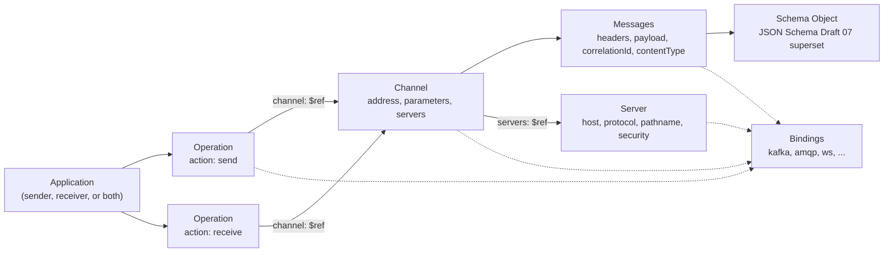

# Event-Driven API Contracts with AsyncAPI 3.1.0 (January 2026): Channels, Operations (send/receive), Messages, and Multi-Protocol Bindings (Kafka, AMQP, WebSockets)

> [!summary] Claim
> An AsyncAPI 3.1.0 document describes what one application does with messages: reusable channels hold addresses and messages, operations say whether the application `send`s or `receive`s on a channel, and everything protocol specific lives in bindings, while payloads are validated as JSON Schema Draft 07 (not 2020-12) unless a `schemaFormat` says otherwise.

Part of [GraphQL JSON RPC and Event APIs](README.md) in [API Engineering](../README.md).

## TL;DR

- Mechanism: `channels` (address plus `messages`) and `operations` (`action: send | receive` plus a `$ref` to a channel) are separate maps, so one channel can be sent to by one application and received from by another, and protocol facts sit in `bindings` objects keyed by protocol name.
- Contract rule: every message on a channel MUST be valid against one, and only one, of that channel's message definitions, and an operation's `messages` MUST be a subset of its own channel's messages.
- Trap: the AsyncAPI Schema Object is a superset of JSON Schema Draft 07, so 2020-12 keywords such as `unevaluatedProperties` and `dependentRequired` are silently ignored and `$ref` siblings are dropped; the seed of this note had this wrong.
- Portability: 3.1.0 (2026-01-31) differs from 3.0.0 mainly by the `ros2` binding, and the drafter's run passed the lab unchanged on CPython 3.12.13, 3.13.18, 3.14.6, 3.14.10, and 3.15.2 (only 3.14.6 was re-run in verification); the free-threaded leg could not be installed here.
- Do not use it as a runtime enforcement layer or as a substitute for an event envelope: it is a description, the meta-schema misses several semantic rules, and envelope attributes belong to [[CloudEvents-1-0-2-Envelope-Structured-vs-Binary-Content-Modes-and-Schema-Registries|CloudEvents]].

## Mental model



The application is the subject of the document: its operations are the only place where direction exists, and `send` or `receive` is always from that application's point of view.
Each operation points at a channel with a `$ref`, so the channel is a neutral, shareable place where messages live, and the same channel can be the target of a `send` in one document and a `receive` in another.
A channel lists the messages it may carry and the servers it is available on, and a message carries the schemas, the content type, and the correlation rule.
Dotted edges are bindings: Kafka partitions, AMQP exchange types, and WebSocket handshake queries are attached at the level they describe (server, channel, operation, or message) and never leak into the neutral core.

## How it works

### Lineage: 2.x, 3.0.0, 3.1.0

- In 2.x a channel held `publish` and `subscribe` operations whose meaning was relative to the client of the API, which the project's own migration guide says consistently caused confusion.
  3.0.0 (2023-12-05) replaced them with `action: send | receive` from the described application's own point of view and made channels reusable across documents (AsyncAPI migration guide to v3; GitHub release v3.0.0).
- 3.1.0 was released on 2026-01-31 (GitHub release v3.1.0).
  The release notes call it a minor release with no breaking changes, and its only listed feature is the ROS 2 binding.
- A text diff of `spec/asyncapi.md` between the `v3.0.0` and `v3.1.0` tags shows these substantive changes:
  - a `ros2` key is added to the server, channel, operation, and message Bindings Objects (now 20 protocol keys each);
  - the Operation Object `messages` description gains a note that omitting the property means all channel messages and that `[]` means none;
  - the Operation Trait Object may no longer contain `messages` (3.0.0 excluded only `action`, `channel`, and `traits`);
  - the Server Object gains the sentence "This object MAY be extended with Specification Extensions";
  - the Message Example Object `payload` type changes from `Map[string, any]` to `any`;
  - the default schema format media types move from `version=3.0.0` to `version=3.1.0`;
  - the specification-extension pattern changes from `^x-[\w\d\-\_]+$` to `^x-[\w\d\.\x2d_]+$`, which now admits `.`;
  - examples are corrected so operation `messages` point into `#/channels/<id>/messages/<id>` instead of `/components/messages/...`, which the subset rule forbids.
- Reading the diff, the operation trait change can invalidate a 3.0.0 document whose operation trait carries `messages`; that is my inference from the text, not a statement by the maintainers.
- `3.0.1` exists as a GitHub release named `v3.0.1 - INVALID` whose body says there were no spec changes and that it shipped only for a converter library update (GitHub releases API).
  Pin `asyncapi: 3.0.0` or `3.1.0`.

### The document and its root object (AsyncAPI 3.1.0 spec, AsyncAPI Object)

- Required root fields are `asyncapi` and `info` (`title`, `version`); `id`, `servers`, `defaultContentType`, `channels`, `operations`, and `components` are optional.
- Everything defined in the document MUST be used by the implemented application, except the Components Object, whose entries MAY or MAY NOT be used (File Structure).
  Hence `operations` is "the operations this application MUST implement", and reusable operations that an application may skip belong in `components/operations`.
- The `asyncapi` string is `major.minor.patch`, tooling is told to ignore the patch, and the spec promises that a minor increment "should not interfere with operations of tooling developed to a lower minor version" (AsyncAPI Version String).
  The official JSON Schema at `spec-json-schemas` `schemas/3.1.0.json` is stricter: validating a `3.0.0` document against it fails with `'3.1.0' was expected` (observed, see Worked example).
- The format is JSON or YAML; YAML 1.2 is recommended, and YAML tags MUST be limited to the JSON Schema ruleset and map keys to scalar strings, to keep JSON/YAML round trips lossless (Format).
- The spec says it is NOT RECOMMENDED to derive a receiver document from a sender document by flipping `action`, because the receiving channel need not be the sending channel, the `summary`, `description`, and operation id may stop making sense, and infrastructure may forward between a read-only and a write-only channel (Introduction).

### Servers

- A Server Object requires `host` (may include the port) and `protocol`, and optionally `protocolVersion`, `pathname`, `description`, `title`, `summary`, `variables`, `security`, `tags`, `externalDocs`, and `bindings` (Server Object).
- `host` and `pathname` support `{variable}` substitution from `variables`, each with `enum`, `default`, `description`, and `examples` (Server Variable Object).
- A channel selects its servers with `servers: [$ref]`; in the root `channels` map these MUST point into the root `servers` map, and absent or empty means "available on all servers" (Channel Object, `servers`).
  That is how one document describes the same application on Kafka for events, AMQP for audit, and a WebSocket for browsers, as in the lab's `order_document`.
- `security` lists alternatives and only one needs to be satisfied; an operation's `security` must be satisfied in addition to the server's (Server Object, Operation Object).
  The Security Scheme `type` enum has 13 values: `userPassword`, `apiKey`, `X509`, `symmetricEncryption`, `asymmetricEncryption`, `httpApiKey`, `http`, `oauth2`, `openIdConnect`, `plain`, `scramSha256`, `scramSha512`, `gssapi`.
  The SASL-style values are what make the scheme list useful for brokers rather than only HTTP.

### Channels

- `address` is an optional `string | null`: typically a topic name, routing key, event type, or path.
  `null` or absent MUST be read as "unknown", for addresses assigned at runtime; query parameters and fragments SHALL NOT appear in it, and bindings carry them instead (Channel Object, `address`).
- Address expressions are `{name}` in curly braces, and `parameters` MUST be present only when the address has expressions and MUST contain every one of them (Channel Address Expressions, Parameters Object).
  A Parameter Object has `enum`, `default`, `description`, `examples`, and a `location` runtime expression for where the value is found in a message.
- `messages` maps ids to Message Objects, and every message sent to the channel MUST be valid against one and only one of them (Channel Object, `messages`).
  The "one and only one" wording is `oneOf` semantics: two overlapping message schemas on one channel make every overlapping message ambiguous.
- Channel ids and message ids are case sensitive and tools MAY use them as identifiers, so the spec recommends programming-style names.

### Operations

- An Operation Object requires `action` (`send` or `receive`) and `channel`, a Reference Object (Operation Object).
  `send` means the application sends to the channel; `receive` means it expects messages from the channel.
- A root operation MUST point at a channel in the root `channels` map and MUST NOT point into `components`; an operation inside `components/operations` MAY point anywhere.
- `messages` is a list of `$ref`s that MUST be a subset of the channel's messages and MUST NOT point into `components/messages`.
  3.1.0 adds that omitting the property includes every channel message and that `[]` means none.
  A consumer operation without `messages` therefore accepts all current and future messages added to the channel.
- `reply` makes the operation request-reply: `reply.address` is an Operation Reply Address Object with a `location` runtime expression such as `$message.header#/replyTo`, and `reply.channel` points at a root channel.
  When `reply.address` is set, the referenced channel's own `address` MUST be `null` or absent, because the real address is computed per request (Operation Reply Object).
- `traits` apply reusable fragments, see below, and the Operation Trait Object may not carry `action`, `channel`, `messages`, or `traits`.

### Messages

- A Message Object has `headers`, `payload`, `correlationId`, `contentType`, `name`, `title`, `summary`, `description`, `tags`, `externalDocs`, `bindings`, `examples`, and `traits` (Message Object).
- `headers` is a schema that MUST be a map and MUST NOT define the protocol headers; Kafka record headers or AMQP properties that the protocol itself defines go in bindings, and the application's own metadata goes in `headers`.
- `contentType` MUST be a specific media type and defaults to the root `defaultContentType`; if a message cannot be decoded with it, parsers use their own default (Default Content Type).
- `correlationId` holds a `location` runtime expression, for example `$message.header#/correlationId` or `$message.payload#/messageId` (Correlation ID Object).
- Message Trait Objects may contain any message property except `payload` and `traits`, so payload reuse goes through `components/schemas` and not through traits.

### Components, identifiers, info, and examples

- The Components Object has 19 fixed fields, each a map of reusable objects: `schemas`, `servers`, `channels`, `operations`, `messages`, `securitySchemes`, `serverVariables`, `parameters`, `correlationIds`, `replies`, `replyAddresses`, `externalDocs`, `tags`, `operationTraits`, `messageTraits`, `serverBindings`, `channelBindings`, `operationBindings`, and `messageBindings` (Components Object, counted from the field table).
  Entries have no effect unless something outside `components` references them, and their keys MUST match `^[a-zA-Z0-9\.\-_]+$`, so `my.org.User` is legal and `my org` is not.
  `components/schemas` entries that are plain Schema Objects are assumed to use `application/vnd.aai.asyncapi+json;version=<asyncapi>` as their `schemaFormat`.
- The root `id` is an optional application identifier that MUST conform to RFC 3986 URI syntax, and a URN (RFC 8141) is RECOMMENDED so the identity survives the application ceasing to exist (Identifier).
- The Info Object requires `title` and `version`, where `version` is the application API version and not the specification version; it also has `description`, `termsOfService` (an absolute URL), `contact`, `license`, `tags`, and `externalDocs` (Info Object).
  Properties that are absolute URLs follow RFC 3986 Section 4.3 (Absolute URLs).
- A Message Example Object MUST contain `headers` and/or `payload`, plus optional `name` and `summary`; `headers` MUST validate against the message's `headers` schema and `payload` against its `payload` schema (Message Example Object).
  An `examples` entry is therefore a testable fixture, and checking each one against its message is a cheap CI assertion.
- A Security Scheme Object adds scheme-specific required fields: `name` and `in` (`query`, `header`, `cookie`) for `httpApiKey`, `in` (`user`, `password`) for `apiKey`, `scheme` for `http`, `flows` for `oauth2`, and `openIdConnectUrl` for `openIdConnect`; the OAuth Flows Object offers `implicit`, `password`, `clientCredentials`, and `authorizationCode`, each an OAuth Flow Object with `authorizationUrl` and `tokenUrl` where the flow needs them (Security Scheme Object, OAuth Flows Object, OAuth Flow Object).
  `scopes` on a scheme use an empty array to mean no scopes are needed.
- Most objects "MAY be extended with Specification Extensions", fields that start with `x-`; 3.1.0 widened the allowed key pattern to admit `.` (see Lineage).

### References: JSON Reference, not JSON Schema `$ref`

- A Reference Object is a JSON Reference with the single field `$ref`, and any extra properties SHALL be ignored (Reference Object).
- The spec states that reference resolution follows JSON Reference and not JSON Schema, and that a Schema Object's `$ref` follows the Reference Object rules (Schema Object).
- Pointers are RFC 6901: `~` must be followed by `0` or `1`, and decoding applies `~1` to `/` before `~0` to `~`, so `~01` decodes to `~1` and not to `/` (RFC 6901 Section 3, Section 4).
  A reference inside a URI fragment is percent-decoded first (RFC 6901 Section 6).
  The lab's `parse_pointer` and `ref_pointer` implement this and `test_json_pointer_decodes_tilde_one_before_tilde_zero` pins the order.
- Because root operations may only reference `#/channels/...`, the reference graph is a small, checkable DAG: operation -> channel -> messages, and operation `messages` -> channel messages.

### Traits and the merge mechanism

- Traits "MUST be merged with the target object using the JSON Merge Patch algorithm in the same order they are defined", and "a property on a trait MUST NOT override the same property on the target object" (Traits Merge Mechanism).
- JSON Merge Patch is RFC 7386 `MergePatch(Target, Patch)`: if the patch is an object, each member is merged recursively, a `null` member deletes the name, and any non-object patch replaces the target; arrays are therefore replaced and never concatenated (RFC 7386 Section 2).
  The spec links RFC 7386, which RFC 7396 obsoletes with the same `MergePatch` pseudocode.
- The reference parser applies the traits first, in order, and the object itself last, so object fields win over all traits and a later trait wins over an earlier one (asyncapi/parser-js master, `packages/parser/src/custom-operations/apply-traits.ts`, `applyTraitsToObjectV3`, fetched 2026-11-26).
  It merges key by key, `value[key] = mergePatch(value[key], trait[key])` (`packages/parser/src/utils.ts`, `mergePatch`), so a top-level `null` on the object is stored as `null` instead of deleting the key; `null` deletes only inside nested objects.
  The lab's `apply_traits` merges whole objects as RFC 7386 does, so a top-level `null` deletes the key, and it additionally drops the `traits` key so that applying it twice is the identity (lab policy; the parser keeps the key).
- Consequences: `tags` in an object replace `tags` from every trait, an object-level `null` removes a trait-supplied field under strict RFC 7386 (and becomes `null` in parser-js), and the order of the `traits` array is part of the contract.

### The Schema Object, schema formats, and the Draft 07 baseline

- "This object is a superset of the JSON Schema Specification Draft 07", with an AsyncAPI vocabulary adding `discriminator`, `externalDocs`, and `deprecated`; `default` is stricter than in JSON Schema and MUST conform to the `type` at the same level (Schema Object).
  The keyword list in the spec is Draft 07: `if/then/else`, `readOnly`, `writeOnly`, `additionalItems`, `propertyNames`, and `contains`.
  `$defs`, `prefixItems`, `unevaluatedProperties`, and `dependentRequired` are 2019-09 or 2020-12 keywords and are not in it.
- `pattern` SHOULD be an ECMA 262 regular expression; Python's `jsonschema` evaluates it with `re.search` (jsonschema 4.26.0 jsonschema/_keywords.py, pattern), so a pattern that behaves differently in ECMA 262 and in `re` can pass in one validator and fail in another.
- The Multi Format Schema Object `{schemaFormat, schema}` selects the dialect.
  Implementations MUST support the AsyncAPI Schema Object (`application/vnd.aai.asyncapi;version=3.1.0`, `+json`, `+yaml`) and JSON Schema Draft 07 (`application/schema+json;version=draft-07`, `+yaml`).
  They are RECOMMENDED to support Avro 1.9.0, the OpenAPI 3.0.0 Schema Object, RAML 1.0, and Protocol Buffers 2 and 3; custom values are allowed but optional.
- When `schemaFormat` is missing it defaults to the AsyncAPI media type with the document's own version, and `$ref`s inside a non-default schema must stay in the same format.
  Non-JSON schemas such as Protobuf and XSD MUST be inlined as a string, while Avro is inlined as an object.
- The lab validates with `Draft7Validator` against a registry that holds the whole document, after rewriting each in-document `$ref` to `urn:asyncapi:document#...`, and it raises `UnsupportedSchemaFormat` for any other format instead of passing silently.

### Runtime expressions

- The grammar is `expression = "$message" "." source`, `source = header-reference | payload-reference`, `header-reference = "header" ["#" fragment]`, `payload-reference = "payload" ["#" fragment]`, with `fragment` an RFC 6901 JSON Pointer (Runtime Expression).
- Expressions preserve the type of the referenced value, so `$message.payload#/n` on `{"n": 7}` yields the integer `7`.
- They are used by `correlationId.location`, `reply.address.location`, and `parameters.<name>.location`.
  The grammar does not say which headers `header` means: the Message Object's `headers` schema MUST NOT define protocol headers, yet the spec's own example `$message.header#/MQMD/CorrelId` reads the IBM MQ `MQMD` protocol header, so a tool cannot validate a header expression against the `headers` schema alone.

### Bindings

- A binding "MUST define protocol-specific information only" (Bindings definition), and each of the four Bindings Objects (server, channel, operation, message) is a fixed-field map keyed by protocol name: `http`, `ws`, `kafka`, `anypointmq`, `amqp`, `amqp1`, `mqtt`, `mqtt5`, `nats`, `jms`, `sns`, `solace`, `sqs`, `stomp`, `redis`, `mercure`, `ibmmq`, `googlepubsub`, `pulsar`, and (new in 3.1.0) `ros2`.
- The binding definitions live in a separate repository (`asyncapi/bindings`) with their own versions; the READMEs fetched from `master` on 2026-11-26 declare Kafka `0.5.0`, AMQP `0.3.0`, and WebSockets `0.1.0`, and every non-reserved binding object in them says "This object MUST contain only the properties defined above", except the Kafka server binding, which has no such sentence (the lab rejects unknown Kafka server fields anyway, as lab policy).
  The official 3.1.0 JSON Schema bundles Kafka bindings `0.3.0`, `0.4.0`, and `0.5.0`, so `bindingVersion` is a real compatibility axis.

| Level | Kafka (0.5.0) | AMQP 0-9-1 (0.3.0) | WebSockets (0.1.0) |
|---|---|---|---|
| Server | `schemaRegistryUrl`, `schemaRegistryVendor` | reserved, MUST NOT contain properties | reserved |
| Channel | `topic`, `partitions`, `replicas`, `topicConfiguration` | `is` (`queue` or `routingKey`, default `routingKey`), `exchange{name,type,durable,autoDelete,vhost}`, `queue{name,durable,exclusive,autoDelete,vhost}` | `method` (`GET` or `POST`), `query`, `headers` |
| Operation | `groupId`, `clientId` (Schema Objects) | `expiration`, `userId`, `cc`, `priority`, `deliveryMode` (1 or 2), `mandatory`, `bcc`, `timestamp`, `ack` | reserved |
| Message | `key`, `schemaIdLocation`, `schemaIdPayloadEncoding`, `schemaLookupStrategy` | `contentEncoding`, `messageType` | reserved |
| What a channel is | a topic, whose `partitions` bound consumer parallelism | a routing key on an exchange, or a queue | the single connection, because WebSockets has no virtual channels |

- Kafka: `topicConfiguration` mirrors topic configs (`cleanup.policy` limited to `delete` and `compact`, `retention.ms`, `retention.bytes`, `delete.retention.ms`, `max.message.bytes`) plus vendor keys such as `confluent.key.schema.validation`.
  `schemaIdLocation`, `schemaIdPayloadEncoding`, and `schemaLookupStrategy` MUST NOT be specified unless a `schemaRegistryUrl` is set at server level, and `schemaRegistryVendor` MUST NOT appear without `schemaRegistryUrl`.
  The Confluent example says `schemaIdLocation: payload` with `schemaIdPayloadEncoding: '4'` and describes it as "the first 4 bytes in payload", but the Confluent wire format puts a version byte (`0` for the schema ID format) at offset 0 and the big-endian 4-byte schema ID at bytes 1-4, so the id is not the first 4 bytes (Confluent Platform documentation, "Formats, Serializers, and Deserializers for Schema Registry on Confluent Platform", wire format, fetched 2026-11-26).
  The same page documents a header format with a 16-byte schema GUID in `__key_schema_id` or `__value_schema_id`, which maps to `schemaIdLocation: header`.
- AMQP: `exchange` applies when `is` is `routingKey` and `queue` when `is` is `queue`; names MUST NOT exceed 255 characters.
  The AMQP 0-9-1 specification limits a short string to 255 octets of UTF-8 behind an 8-bit length (AMQP 0-9-1 specification Section 4.2.5.3), so 255 characters of non-ASCII text can exceed the limit; the lab counts octets.
- WebSockets: the channel binding describes the HTTP handshake (`method`, `query`, `headers`), and `query` and `headers` MUST be object schemas with `properties`.
  RFC 6455 requires the opening handshake method to be `GET` with HTTP version at least 1.1 (RFC 6455 Section 4.1, client requirements item 2), so the binding's `POST` value cannot be performed by a conforming client; the lab reports it as a warning.
  Over HTTP/2 the handshake is Extended CONNECT with a `:protocol` pseudo-header of `websocket`, negotiated with a SETTINGS parameter (RFC 8441 Section 3, Section 4, Section 5), which the binding does not model.

### Validation layers

- Layer 1 is the official JSON Schema (`spec-json-schemas`, draft-07, `$id` `http://asyncapi.com/definitions/3.1.0/asyncapi.json`, `required: [asyncapi, info]`, `additionalProperties: false`), which checks shape and enums.
- Layer 2 is semantics the schema cannot or does not express: root operations pointing into `components`, `parameters` matching address expressions, the `messages` subset rule, reply-address exclusivity, runtime expression grammar, and binding value rules such as Kafka topic names.
- Layer 3 is conformance of real messages to the declared schemas, with the "one and only one" rule.
- The lab implements layers 2 and 3 and the cross-check in Worked example shows what layer 1 misses.

## Numbers and limits

| Quantity | Value | Source or measurement |
|---|---|---|
| AsyncAPI 3.1.0 release | 2026-01-31 | GitHub release `v3.1.0` (as of 2026-11) |
| AsyncAPI 3.0.0 release | 2023-12-05 | GitHub release `v3.0.0` |
| Protocol keys per Bindings Object | 20 in 3.1.0 (the 3.0.0 to 3.1.0 diff adds only the `ros2` rows) | spec text, counted from the four tables |
| Security Scheme `type` values | 13 | spec, Security Scheme Object |
| Components Object fixed fields | 19, keys matching `^[a-zA-Z0-9\.\-_]+$` | spec, Components Object, counted from the field table |
| Schema formats an implementation MUST support | 2 (AsyncAPI Schema Object, JSON Schema Draft 07) | spec, Multi Format Schema Object |
| Kafka topic name | 1 to 249 characters of `[a-zA-Z0-9._-]`, not `.` or `..` | Apache Kafka trunk `Topic.java`, `MAX_NAME_LENGTH`, `LEGAL_CHARS`, fetched 2026-11-26 |
| Kafka `max.message.bytes` default | `1048588` = `1024 * 1024 + 12` | `ServerLogConfigs.MAX_MESSAGE_BYTES_DEFAULT` and `Records.LOG_OVERHEAD` (8 + 4), trunk |
| AMQP 0-9-1 short string | 255 octets, 8-bit length prefix | AMQP 0-9-1 specification Section 4.2.5.3 |
| AMQP 0-9-1 exchange and queue name domains | length assert `127` and regexp `^[a-zA-Z0-9-_.:]*$` in the XML spec, versus "MUST NOT exceed 255 characters" in the binding | `amqp0-9-1.xml` domains `exchange-name`, `queue-name`; AMQP binding README |
| AMQP `deliveryMode` | `1` transient or `2` persistent | binding README; XML field label "non-persistent (1) or persistent (2)" |
| WebSocket handshake | `GET`, HTTP version >= 1.1 | RFC 6455 Section 4.1 |
| Binding versions | Kafka 0.5.0, AMQP 0.3.0, WebSockets 0.1.0 | READMEs on `master`, fetched 2026-11-26 |
| Lab suite | 37 tests, `37 passed in 0.96s` | measured in verification 2026-11-26: CPython 3.14.6, macOS 27.3 arm64 (Darwin 27.3.0), `uv run --frozen pytest tests/f20_graphql_json_rpc_and_event_apis/test_event_driven_apis_and_asyncapi_3_1_0_specification.py -q`; wall time varies run to run |
| Official 3.1.0 JSON Schema on the lab reference document | 0 errors; rejects `action: publish`, missing `info.version`, `partitions: 0`, ws `method: PUT`, unknown AMQP exchange type | one-off script, see Worked example |

## Portability

| Axis | Result | Proof |
|---|---|---|
| CPython 3.12.13 | 37 passed | `uv run --frozen --python 3.12`, drafter's run; not re-run in verification (lab checks paused) |
| CPython 3.13.18 | 37 passed | drafter's run, Homebrew interpreter (present here at 3.13.18); not re-run |
| CPython 3.14.6 | 37 passed | re-run in verification, the workspace interpreter |
| CPython 3.14.10 | 37 passed | drafter's run, Homebrew interpreter (present here at 3.14.10); not re-run |
| CPython 3.15.2 | 37 passed | drafter's run, Homebrew interpreter (present here at 3.15.2); not re-run |
| CPython 3.15.2t (free-threaded) | not run | no 3.15.2t interpreter here; `uv` resolved `3.15t` to 3.15.0b3 and the frozen sync failed because `psycopg-binary==3.3.8` has no wheel for it |
| `jsonschema` 4.26.0, `referencing` 0.37.0 | pinned in `uv.lock`, used by every leg | `labs/pyproject.toml` |
| Python regex versus ECMA 262 `pattern` | differs by engine; the lab only uses anchors and digits | spec Schema Object; `jsonschema/_keywords.py` uses `re.search` |
| Kafka binding versions | 0.3.0, 0.4.0, 0.5.0 are bundled in the 3.1.0 JSON Schema | `schemas/3.1.0.json` definitions, fetched 2026-11-26 |
| WebSockets over HTTP/1.1 | `GET` plus `Upgrade` | RFC 6455 Section 4.1 |
| WebSockets over HTTP/2 | Extended CONNECT with `:protocol: websocket` | RFC 8441 Section 4, Section 5 |
| WebSockets over HTTP/3 | Extended CONNECT with `:protocol`, same semantics as RFC 8441, `SETTINGS_ENABLE_CONNECT_PROTOCOL` = `0x08`; the binding does not model it | RFC 9220 Section 3 |
| Servers (Uvicorn, Hypercorn, Granian) | not applicable: the lab opens no sockets and defines no server | in-process unit tests |

## Worked example

The implementation is split in three modules: [implementation](../labs/src/api_labs/f20_graphql_json_rpc_and_event_apis/asyncapi_document.py) (references, traits, structure rules, expressions, payload conformance), [bindings](../labs/src/api_labs/f20_graphql_json_rpc_and_event_apis/asyncapi_bindings.py) (Kafka, AMQP, WebSocket rules), and [example document](../labs/src/api_labs/f20_graphql_json_rpc_and_event_apis/asyncapi_example.py).
The test is [test](../labs/tests/f20_graphql_json_rpc_and_event_apis/test_event_driven_apis_and_asyncapi_3_1_0_specification.py).

The reference document describes one application with three servers and five channels.
Simplified excerpt of `asyncapi_example.py`:

```python
"channels": {
    "orderPlaced": {
        "address": "orders.{region}.placed",
        "servers": [_ref("#/servers/kafka")],
        "parameters": {"region": {"enum": ["eu", "us"], "default": "eu"}},
        "messages": {
            "orderPlaced": _ref("#/components/messages/orderPlaced"),
            "orderCancelled": _ref("#/components/messages/orderCancelled"),
        },
        "bindings": {"kafka": {"partitions": 12, "replicas": 3,
                               "topicConfiguration": {"cleanup.policy": ["delete"]}}},
    },
    ...
},
"operations": {
    "publishOrderPlaced": {"action": "send", "channel": _ref("#/channels/orderPlaced"),
                           "messages": [_ref("#/channels/orderPlaced/messages/orderPlaced")]},
    "consumeOrderPlaced": {"action": "receive", "channel": _ref("#/channels/orderPlaced")},
    ...
}
```

The traits merge, simplified excerpt of `asyncapi_document.py`:

```python
def merge_patch(target, patch):
    """RFC 7386 Section 2 MergePatch."""
    if not isinstance(patch, dict):
        return copy.deepcopy(patch)
    result = copy.deepcopy(target) if isinstance(target, dict) else {}
    for name, value in patch.items():
        if value is None:
            result.pop(name, None)
        else:
            result[name] = merge_patch(result.get(name), value)
    return result

def apply_traits(document, node, forbidden):
    merged = {}
    for raw in node.get("traits", []):
        trait = deref(document, raw)
        if forbidden & trait.keys():
            raise TraitError(...)
        merged = merge_patch(merged, trait)
    return merge_patch(merged, {k: v for k, v in node.items() if k != "traits"})
```

The dialect gap, simplified excerpt of a test:

```python
schema = {"type": "object", "properties": {"a": {}},
          "unevaluatedProperties": False, "dependentRequired": {"a": ["b"]}}
instance = {"a": 1, "extra": 2}
assert draft7_accepts_but_2020_12_rejects(schema, instance)
assert schema_errors(document, schema, instance) == []
```

Captured run (CPython 3.14.6, macOS 27.3 arm64, from `labs/`, re-run in verification on 2026-11-26):

```text
$ uv run --frozen pytest tests/f20_graphql_json_rpc_and_event_apis/test_event_driven_apis_and_asyncapi_3_1_0_specification.py -q
.....................................                                    [100%]
37 passed in 0.96s
```

In the drafter's run, the same command with `UV_PROJECT_ENVIRONMENT` set per interpreter printed `37 passed` on CPython 3.12.13, 3.13.18, 3.14.10, and 3.15.2 as well as on the default 3.14.6 environment; verification re-ran only the 3.14.6 leg because lab checks are paused.

Captured output of a one-off snippet (not part of the lab) that runs the lab's `apply_traits`:

```text
>>> apply_traits({}, {"description": "mine", "tags": [{"name": "own"}],
...     "traits": [{"name": "A", "description": "from A", "tags": [{"name": "a"}]},
...                {"name": "B", "summary": "from B"}]}, MESSAGE_TRAIT_FORBIDDEN)
{'name': 'B', 'description': 'mine', 'tags': [{'name': 'own'}], 'summary': 'from B'}
```

Cross-check against the official schema.
A one-off script, kept outside the lab because the 416 KB schema is fetched from `spec-json-schemas` `master` on 2026-11-26, validated the reference document and several broken variants with `Draft7Validator` and a `referencing` registry, and printed the lab's `validate_document` rule ids next to each result (simplified excerpt):

```python
reg = Registry().with_resource(schema["$id"], Resource.from_contents(schema, default_specification=DRAFT7))
v = Draft7Validator(schema, registry=reg)
errors = sorted({e.message[:110] for e in v.iter_errors(doc)})
```

```text
reference document errors: [] | lab: []
action=publish errors: 1 | lab: ['operation.action']
no info.version errors: 1 | lab: ['info.required']
op channel -> components (spec says MUST NOT): [] | lab: ['operation.channel.not-root']
kafka partitions 0: 1 | lab: ['kafka.channel.positive']
ws method PUT: 1 | lab: ['ws.channel.method']
missing channel parameter: 0 | lab: ['channel.parameter.missing']
kafka topic 'a b': 0 | lab: ['kafka.channel.topic']
amqp exchange type broadcast: 1 | lab: ['amqp.channel.exchange-type']
asyncapi 3.0.0: ["'3.1.0' was expected"] | lab: ['asyncapi.version.minor']
```

Reading the result: the official schema catches enum and numeric-bound errors, but three rules the lab enforces pass it silently (root operation pointing into `components`, a missing channel parameter, and a Kafka topic with a space), which is why layer 2 exists.
Mutation testing of the lab tests was not run, by the drafter or in verification: the user paused lab checks on 2026-11-11, so the claim that each test fails when its mechanism is removed rests on test design, not on a recorded mutation.

## Pitfalls

> [!warning] Assuming JSON Schema 2020-12
> Trigger: a payload schema uses `unevaluatedProperties: false`, `dependentRequired`, `prefixItems`, or `$defs`, copied from OpenAPI 3.1 habits.
> Symptom: a validator that follows the AsyncAPI default dialect accepts `{"id": "x", "role": "admin"}` and returns `[]` (captured with the lab's `schema_errors` in a one-off snippet), while a 2020-12 validator rejects it; `test_default_schema_dialect_is_draft_07_so_2020_12_keywords_are_ignored` pins the same gap with `{"a": 1, "extra": 2}`.
> Fix: write `additionalProperties: false` and `required`, or declare `schemaFormat: application/schema+json;version=draft-07` explicitly and keep to Draft 07 keywords; the seed of this note claimed 2020-12 and was wrong.

> [!warning] `$ref` siblings are dropped
> Trigger: `{"$ref": "#/components/schemas/Small", "minimum": 100}`.
> Symptom: the sibling `minimum` is ignored by Draft 07 and by the Reference Object rule, so `3` validates and the intent is lost (`test_sibling_keywords_of_ref_are_ignored_in_draft_07`).
> Fix: wrap with `allOf: [{"$ref": ...}, {...}]`.

> [!warning] Deriving the receiver document from the sender document
> Trigger: copying a document and flipping `action` from `send` to `receive`.
> Symptom: `operationId`, `summary`, and channel assumptions stay describing the other side, and the spec calls this NOT RECOMMENDED because the two applications may use different channels or an intermediary (Introduction).
> Fix: keep one document per application and share channels and messages through `components` or external `$ref`s.

> [!warning] Omitting `messages` on a consumer operation
> Trigger: a `receive` operation without `messages`, then a new message type is added to the channel.
> Symptom: per 3.1.0 the operation now implicitly includes the new message, so a consumer that validates against "all operation messages" must handle or reject it, and an overlap with an existing message breaks the one-and-only-one rule (`test_exactly_one_message_must_match_an_incoming_message`).
> Fix: list `messages` explicitly for consumers, and use `[]` only when you mean none.

> [!warning] Pointing an operation at a component channel
> Trigger: `channel: {$ref: '#/components/channels/shared'}` in the root `operations`.
> Symptom: the official JSON Schema accepts it (observed above), but the spec forbids it, and tooling that walks the root maps can lose the operation.
> Fix: run a semantic validator such as the lab's `validate_document` rule `operation.channel.not-root`, or reference a root channel that itself is a `$ref` to a component.

> [!warning] Trait semantics surprise
> Trigger: a `tags` list on the object and another on a trait, or a trait ordering change.
> Symptom: the object's `tags` replace the trait's (RFC 7386 replaces arrays), a later trait overrides an earlier one, and an object-level `null` deletes a trait's field in the lab (`test_object_null_removes_a_trait_property_and_arrays_are_not_concatenated`) but is kept as `null` by parser-js, which merges key by key.
> Fix: treat the `traits` order as part of the contract and keep traits to scalar and object fields.

> [!warning] Binding values that look valid but are not implementable
> Trigger: a WebSocket channel binding with `method: POST`, a Kafka `topic` containing `/`, AMQP names of 128 two-byte characters.
> Symptom: the binding text allows `POST`, but RFC 6455 Section 4.1 needs `GET`; Kafka rejects topic names outside `[a-zA-Z0-9._-]`, which the official schema did not catch; AMQP names over 255 octets cannot be encoded as a short string.
> Fix: validate bindings with rules such as `ws.channel.post-handshake`, `kafka.channel.topic`, and `amqp.channel.name-length`.

> [!warning] Stale or inconsistent binding documentation
> Trigger: copying binding applicability tables literally.
> Symptom: the AMQP operation table lists `ack` as applying to "Subscribe", a 2.x term, and lists `mandatory` and `bcc` as `receive`, although `mandatory` is a `basic.publish` field in the AMQP 0-9-1 XML (observed in `amqp0-9-1.xml`); the Kafka channel `topic` is described as "if different from channel name", while 3.x channels have an `address`; the AMQP XML asserts name length 127 while the binding says 255.
> Fix: treat the README as a hint, check against the protocol's own specification, and record your own rule when the two disagree; the lab flags a `topic` only on its own legality, not on whether it equals the `address`.

> [!warning] Pinning `3.0.1`
> Trigger: tooling or documents that use `asyncapi: 3.0.1`.
> Symptom: the release is named `v3.0.1 - INVALID` and shipped with no spec change.
> Fix: use `3.0.0` or `3.1.0`, and note that the official 3.1.0 JSON Schema rejected a `3.0.0` document with `'3.1.0' was expected`, so bump the field and the tooling together.

No public production incident specific to AsyncAPI documents was found and verified for this draft, so none is cited; every pitfall above is a reproduced or source-quoted behavior.

## Security and robustness

- Treat the document as untrusted input in any tool that consumes third-party specs: a `$ref` may name an external file or URL, and a resolver that fetches it becomes an SSRF and local-file-read primitive.
  The lab refuses anything that does not start with `#`; a production resolver needs an allow-list of schemes and hosts, a size cap, and a depth cap (the lab caps `$ref` chains at 32 hops).
- YAML parsing hazards apply: the spec restricts tags to the JSON Schema ruleset and keys to scalar strings, so a parser that accepts arbitrary tags or non-string keys has left the contract (Format).
- A schema is a security control only if the validator enforces it: under Draft 07, `unevaluatedProperties: false` does nothing, so an extra `role` field reaches the handler.
  This is the event-driven form of OWASP API Security Top 10 2023 API3:2023 Broken Object Property Level Authorization (owasp.org, fetched 2026-11-26).
  Close object schemas with `additionalProperties: false` and re-validate at the consumer, not only at the producer.
- Declared `security` is documentation, not enforcement: the broker or gateway enforces authentication, and the lab does not check it.
  The 13 scheme types include SASL mechanisms (`plain`, `scramSha256`, `scramSha512`, `gssapi`) and `X509`; a document that declares `plain` over a non-TLS server is a finding for review (design advice, not a spec rule).
- Regex `pattern` uses ECMA 262 in the spec and `re.search` in Python, so an untrusted pattern in a document can be a ReDoS vector for the validating service; bound validation time and input size.
- Size limits: Kafka's default `max.message.bytes` is `1048588`, so a producer that serializes larger than the topic allows fails at the broker, and a document that declares a higher `max.message.bytes` than the broker configuration lies.
- Multiple matching messages are a robustness bug: a consumer that picks the first match processes ambiguous input differently from one that picks the last, so enforce "one and only one" in CI.
- Idempotency and poisoned input are consumer concerns, covered in [[Idempotent-Event-Consumers-Inbox-Pattern-and-Poison-Message-DLQs]].

## The principal's view

- Decision: use AsyncAPI as the contract-first source of truth for event interfaces that cross a team boundary and that more than one consumer depends on, and keep it out of the runtime path.
  Generate documentation, client stubs, and CI conformance tests from it; do not make the service load it to decide what to accept.
- What it buys: one reviewable file per application with channels, operations, and message schemas, a way to lint breaking changes in CI, and one vocabulary across Kafka, AMQP, and WebSockets.
  What it costs: a second source of truth that drifts unless generated from or checked against code, and a tooling ecosystem that implements the 3.x semantics unevenly.
- Compatibility policy: decide that adding a message to a channel or dropping the `messages` list from an operation is a breaking change for consumers, that adding an optional payload field is not, and that closing an object schema (`additionalProperties: false`) makes optional additions breaking for strict consumers.
  Layer the Schema Registry for the binary encodings on top; the envelope and `schemaId` conventions are in [[CloudEvents-1-0-2-Envelope-Structured-vs-Binary-Content-Modes-and-Schema-Registries]].
- When to choose differently: for a synchronous resource API use OpenAPI; for typed RPC with streaming use gRPC; for a wire-level envelope that crosses organizations use CloudEvents, optionally described by AsyncAPI; for browser push compare the transports in [[Real-Time-Push-Protocols-Compared-WebSockets-vs-SSE-vs-HTTP-2-3-Streaming-vs-Long-Polling]]; for webhook-style integration read [[HTTP-Callback-Subscriptions-WebSub-and-Async-Request-Reply-Patterns]].
  The cross-paradigm matrix is [[Architectural-Paradigm-Selection-REST-vs-gRPC-vs-GraphQL-vs-JSON-RPC-vs-Events]].
- Organizational point: assign one owner per channel and one document per application, publish documents in a catalog, and run the semantic checks of layer 2 in CI, because the official JSON Schema alone passed three rules the spec states.

## Interview questions

> [!question] L5: In an AsyncAPI 3.1.0 document, what does `action: receive` mean, and from whose point of view?
>
> > [!success]- Answer
> > It means the application that the document describes expects to receive messages from the referenced channel.
> > The direction is always the described application's own, which is the 3.0.0 change that replaced the 2.x `publish` and `subscribe` operations.
> > Another application describes the same channel with `action: send`, and both documents can share the channel definition.
> >
> > Follow-up: Why does the spec say not to derive a receiver document from a sender document by flipping `action`?

> [!question] L5: Where do Kafka partition counts and consumer group ids go, and why not in the core objects?
>
> > [!success]- Answer
> > `partitions`, `replicas`, and `topicConfiguration` go in the `kafka` channel binding, and `groupId` and `clientId` go in the `kafka` operation binding.
> > The core objects are protocol-neutral, and a binding "MUST define protocol-specific information only".
> > The consumer group belongs to the operation because it is how one application consumes, not a property of the topic.
> >
> > Follow-up: What does `partitions` tell you about how many parallel consumers a group can use?

> [!question] L5: Predict the output of `apply_traits` for this node.
>
> ```python
> node = {"description": "mine", "tags": [{"name": "own"}],
>         "traits": [{"name": "A", "description": "from A", "tags": [{"name": "a"}]},
>                    {"name": "B", "summary": "from B"}]}
> print(apply_traits({}, node, MESSAGE_TRAIT_FORBIDDEN))
> ```
>
> > [!success]- Answer
> > It prints `{'name': 'B', 'description': 'mine', 'tags': [{'name': 'own'}], 'summary': 'from B'}`.
> > The traits merge in order, so trait `B`'s `name` overrides trait `A`'s, and then the object itself is merged last, so its `description` and `tags` win.
> > The `tags` arrays are replaced, not concatenated, because RFC 7386 replaces any non-object value.
> >
> > Follow-up: What would change if the object had `"description": null`?

> [!question] L6: Debug this API: why does the consumer accept `{"id": "x", "role": "admin"}` although the payload schema says `unevaluatedProperties: false`, and what is the fix?
>
> ```yaml
> payload:
>   type: object
>   properties:
>     id: {type: string}
>   unevaluatedProperties: false
> ```
>
> > [!success]- Answer
> > The default AsyncAPI Schema Object is a superset of JSON Schema Draft 07, which does not define `unevaluatedProperties`, so a Draft 07 validator ignores it and returns no errors (`[]` in the lab).
> > A 2020-12 validator would reject the same instance, so the bug is a dialect mismatch, not a validator defect.
> > Replace it with `additionalProperties: false`, which produces `Additional properties are not allowed ('role' was unexpected)`, or declare the dialect explicitly through a Multi Format Schema Object.
> >
> > Follow-up: Which keywords other than `unevaluatedProperties` are silently ignored under Draft 07?

> [!question] L6: Why are channels and operations separate maps, and what rules tie them together?
>
> > [!success]- Answer
> > Separation lets one channel be shared by a sender and a receiver, and lets one document hold several operations on a channel without repeating its address and messages.
> > The ties are that a root operation's `channel` MUST be a `$ref` into root `channels`, its `messages` MUST be a subset of that channel's messages, and a reply channel's `address` MUST be `null` when `reply.address` is set.
> > The official JSON Schema checks only that these are Reference Objects, so a semantic validator must check the pointers.
> >
> > Follow-up: What happens to a consumer operation without `messages` when a new message is added to the channel?

> [!question] L6: What does the spec require, and how do you detect a violation, when two messages on one channel have payload schemas that both accept the incoming JSON?
>
> > [!success]- Answer
> > Every message sent to a channel MUST be valid against one and only one message in the map, so two matches are a contract violation.
> > Validate a sample against every candidate message and require exactly one match, as the lab's `match_message` does, raising on zero or several matches.
> > Fix overlap by adding a discriminating constant or `required` field to each payload.
> >
> > Follow-up: Does the same rule apply to an operation's `messages` list?

> [!question] L7+: Design the CI gate that stops a breaking change to an AsyncAPI contract on a shared Kafka topic.
>
> > [!success]- Answer
> > Run the official JSON Schema for shape and a semantic validator for the rules it misses, then diff the new document against the last released one.
> > Classify as breaking: a removed or renamed message, a message added to a channel read by consumers without explicit `messages`, a removed required field, a narrowed enum, a tightened `additionalProperties`, a changed `topic` or `address`, and a changed `groupId`.
> > Add conformance tests that replay recorded sample messages against the new schemas under Draft 07, and pin `bindingVersion` so a binding upgrade is reviewed.
> > Accept that this checks the description and that the Schema Registry still decides what the broker accepts.
> >
> > Follow-up: How does the compatibility mode of a schema registry relate to the diff rules?

> [!question] L7+: When would you describe an event stream with AsyncAPI, with CloudEvents, or with both?
>
> > [!success]- Answer
> > AsyncAPI describes the interface of an application: channels, operations, messages, and servers.
> > CloudEvents standardizes the envelope attributes of a single event, so it describes what is on the wire for one record.
> > Use both when many producers share a bus: CloudEvents for uniform attributes and routing, and AsyncAPI to document which channels carry which `type`s and schemas.
> > Use AsyncAPI alone for a closed system with one message format per channel.
> >
> > Follow-up: Where does the correlation identifier live in each, and how do runtime expressions reach it?

> [!question] L7+: Is a WebSocket channel binding with `method: POST` valid, and what do you do about it?
>
> > [!success]- Answer
> > It is valid against the binding text, which allows `GET` or `POST`, but RFC 6455 Section 4.1 requires the opening handshake to be a `GET` over HTTP/1.1 or later.
> > Over HTTP/2, RFC 8441 uses Extended CONNECT with `:protocol` set to `websocket`, which neither value expresses.
> > Treat `POST` as a design smell, use `GET`, put authentication in `headers` or `query`, and add a lint rule, as the lab's `ws.channel.post-handshake` warning does.
> >
> > Follow-up: What does the channel represent in the WebSockets binding, given that WebSockets has no virtual channels?

## Related

Prerequisites: [[JSON-RPC-2-0-Specification-Batching-Notifications-and-Error-Codes]]

Next: [[CloudEvents-1-0-2-Envelope-Structured-vs-Binary-Content-Modes-and-Schema-Registries]]

See also: [[02-Programming-Languages/Python/Python-Backend-Interview-Prep/08-Microservices-and-Messaging]]

Siblings: [[Idempotent-Event-Consumers-Inbox-Pattern-and-Poison-Message-DLQs]], [[Real-Time-Push-Protocols-Compared-WebSockets-vs-SSE-vs-HTTP-2-3-Streaming-vs-Long-Polling]], [[HTTP-Callback-Subscriptions-WebSub-and-Async-Request-Reply-Patterns]], [[Architectural-Paradigm-Selection-REST-vs-gRPC-vs-GraphQL-vs-JSON-RPC-vs-Events]]

- Lab: `labs/tests/f20_graphql_json_rpc_and_event_apis/test_event_driven_apis_and_asyncapi_3_1_0_specification.py`

## Further reading

- [AsyncAPI Specification 3.1.0](https://raw.githubusercontent.com/asyncapi/spec/v3.1.0/spec/asyncapi.md): the normative text every rule in this note cites.
- [AsyncAPI 3.1.0 release notes](https://www.asyncapi.com/blog/release-notes-3.1.0): what changed (ROS 2) and the no-breaking-change statement.
- [Migrating to AsyncAPI v3](https://www.asyncapi.com/docs/migration/migrating-to-v3): why `publish` and `subscribe` became `send` and `receive`.
- [AsyncAPI bindings: Kafka](https://raw.githubusercontent.com/asyncapi/bindings/master/kafka/README.md), [AMQP](https://raw.githubusercontent.com/asyncapi/bindings/master/amqp/README.md), [WebSockets](https://raw.githubusercontent.com/asyncapi/bindings/master/websockets/README.md): the per-protocol field definitions.
- [AsyncAPI 3.1.0 JSON Schema](https://raw.githubusercontent.com/asyncapi/spec-json-schemas/master/schemas/3.1.0.json): the shape-level validator and its limits.
- [parser-js apply-traits.ts](https://raw.githubusercontent.com/asyncapi/parser-js/master/packages/parser/src/custom-operations/apply-traits.ts): how the reference parser orders trait merges.
- [RFC 7386](https://www.rfc-editor.org/rfc/rfc7386.html): JSON Merge Patch, the traits merge algorithm.
- [RFC 6901](https://www.rfc-editor.org/rfc/rfc6901.html): JSON Pointer escaping used by `$ref` and runtime expressions.
- [RFC 6455](https://www.rfc-editor.org/rfc/rfc6455.html), [RFC 8441](https://www.rfc-editor.org/rfc/rfc8441.html), and [RFC 9220](https://www.rfc-editor.org/rfc/rfc9220.html): the WebSocket handshake over HTTP/1.1, HTTP/2, and HTTP/3.
- [AMQP 0-9-1 specification](https://www.rabbitmq.com/resources/specs/amqp0-9-1.pdf): short string limits and the `basic.publish` fields.
- [Apache Kafka Topic.java](https://raw.githubusercontent.com/apache/kafka/trunk/clients/src/main/java/org/apache/kafka/common/internals/Topic.java): the topic naming rules the lab mirrors.
