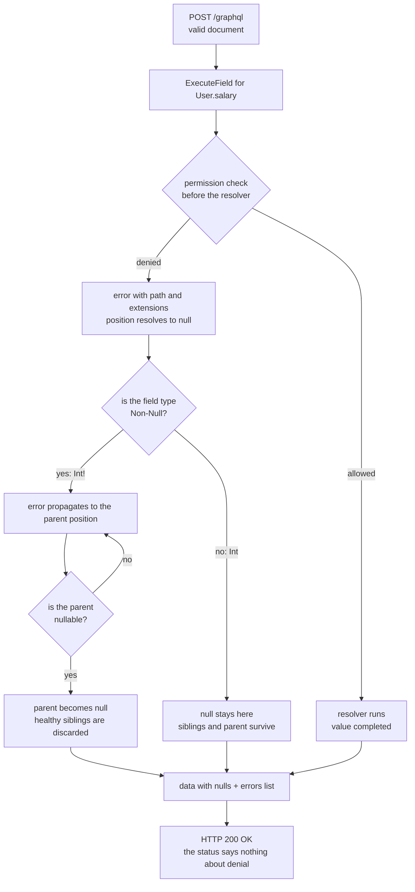

# Field-Level Authorization in GraphQL, Non-Null (!) Error Bubbling Traps, and Why Partial Success Returns HTTP 200

> [!summary] Claim
> A field-level authorization denial in GraphQL is an execution error, so its blast radius is decided by the schema's nullability, not by the permission check: a denied `Int!` field nulls its nearest nullable ancestor (possibly the whole `data`), a denied `Int` field nulls only itself, and in every case the transport still answers `200 OK` because the specification defines no HTTP mapping and the draft over-HTTP specification calls this outcome a partial response.

Part of [GraphQL JSON RPC and Event APIs](README.md) in [API Engineering](../README.md).

## TL;DR

- Mechanism: a permission check runs inside `ExecuteField` before the resolver, a denial raises an error that graphql-core locates with a `path`, and `CompleteValue` then nulls that response position and, if its type is `Non-Null`, propagates the error to the parent position (GraphQL September 2025 Sections 6.4 and 6.4.4).
- Contract rule: model every field that has a per-viewer rule as nullable, because "Since Non-Null response positions cannot be null, execution errors are propagated to be handled by the parent response position" (Section 6.4.4), and keep `Non-Null` for structural guarantees such as `id`.
- Trap: `salary: Int!` plus a denied viewer turns "hide one field" into "delete the parent object", and with `[User!]!` into `"data": null` for the whole response, while the status is still `200`; the opposite trap, `fail_silently=True`, makes a denial indistinguishable from a real `null`.
- Portability fact: the lab proves all of this in-process on Strawberry 0.340.0, graphql-core 3.3.2, and CPython 3.14.6 only; the algorithm is normative in the specification, but the status code, the error `extensions`, and what siblings still execute are implementation choices.
- When not to use it: do not put the only authorization boundary in the GraphQL layer; the authoritative check belongs in the domain layer, and the field guard is a deny-by-default backstop and a response-shaping tool.

## Mental model



The check sits between argument coercion and the resolver, so a denied field never computes its value (the lab trace contains `check:salary` but not `resolve:salary`).
A denial is not a special response class: it is one more execution error, so it follows the single null algebra of Section 6.4.4, and the only thing the schema author controls is how far the null travels.
Following the `Int` branch loses one value and produces one entry in `errors`; following the `Int!` branch walks up the response tree until it meets a nullable position, which for `strictMe: StrictUser!` is the whole `data` entry, because `data` itself is the last nullable position.
Both branches end in the same HTTP envelope, because HTTP status is a transport concern that the GraphQL specification leaves undefined, so a dashboard that reads only the status code sees a healthy `200` for a denial, a partial result, and a total failure.

## How it works

### 1. Where the check runs: between argument coercion and the resolver

`ExecuteField` is exactly three steps: coerce arguments, `ResolveFieldValue`, then `CompleteValue` (GraphQL September 2025 Section 6.4, `ExecuteField`).
The specification says nothing about authorization: a search of the fetched September 2025 text finds no occurrence of "authoriz", "permission", or "access control", and graphql.org calls authorization something the specification is "intentionally silent" about and recommends delegating it to the business logic layer (graphql.org Learn, Best Practices and Authorization pages, fetched 2026-11).
So a field guard is an implementation hook placed around `ResolveFieldValue`, and the two hooks that matter in Strawberry 0.340.0 are different mechanisms:

- A field extension.
  `PermissionExtension` is a `FieldExtension` attached to one field; its `resolve` (sync path) and `resolve_async` (async path) loop over the field's permission instances, call `has_permission(source, info, **kwargs)`, and call `next_` only if every one returned `True` (strawberry 0.340.0 strawberry/permission.py, `PermissionExtension.resolve`, `PermissionExtension.resolve_async`).
  Passing `permission_classes=[...]` to `strawberry.field` is the older spelling: `StrawberryField.__init__` instantiates each class and appends `PermissionExtension(permission_instances, use_directives=False)` (strawberry 0.340.0 strawberry/types/field.py, `StrawberryField.__init__`), and the `PermissionExtension` docstring itself calls that automatic addition "deprecated behaviour".
- A schema extension.
  A `SchemaExtension` that overrides `resolve` is collected into a graphql-core `MiddlewareManager` per request (strawberry 0.340.0 strawberry/schema/schema.py, `Schema._get_middleware_manager`), and graphql-core wraps every field's resolver with it in `Executor.execute_field` via `self.middleware_manager.get_field_resolver(resolve_fn)` (graphql-core 3.3.2 graphql/execution/executor.py, `Executor.execute_field`).
  That is the only hook that sees every field, including fields whose author forgot to add a guard, which is why the lab's deny-by-default policy lives there.

The two compose: the lab's `salary` fields carry a field-level guard, and the `DenyByDefault` extension can be added to a schema on top without changing a resolver.

### 2. A denial is an error object with a path

`BasePermission.on_unauthorized` builds `self.error_class(self.message or "")`, merges `error_extensions` into `error.extensions`, and raises it; `error_class` defaults to `StrawberryGraphQLError`, a plain `GraphQLError` subclass (strawberry 0.340.0 strawberry/permission.py, `BasePermission.on_unauthorized`; strawberry/exceptions/__init__.py, `StrawberryGraphQLError`).
A permission without a `message` therefore yields an error whose message is the empty string, which the lab proves (`test_a_permission_without_a_message_raises_an_error_with_an_empty_message`).
The raised error has no `path` yet.
graphql-core's `Executor.handle_field_error` calls `located_error(raw_error, to_nodes(field_details_list), path.as_list())`, and `located_error` builds a new `GraphQLError(message, nodes, source, positions, path, original_error)` (graphql-core 3.3.2 graphql/execution/executor.py, `Executor.handle_field_error`; graphql/error/located_error.py, `located_error`).
Custom `extensions` survive that re-wrap because `GraphQLError.__init__` copies `extensions` from the underlying error when none are passed (graphql-core 3.3.2 graphql/error/graphql_error.py, `GraphQLError.__init__`), which is why `{"code": "FORBIDDEN"}` appears in the lab's response.
The error then has the shape Section 7.1.6 requires: `message`, `locations` when attributable to the document, and a `path` of response names and 0-based list indices "since it represents a path in the response, not in the request".
Section 7.1.6 gives the `path` its purpose: it "allows clients to identify whether a null resolved result is a true value or the result of an execution error", and the lab's `forbidden_paths` helper is that rule applied to a denial.

### 3. The null algebra and the blast radius

Section 6.4.4 states the rules the lab exercises, grouped here by effect rather than in the specification's paragraph order (the specification states rule 6 before the propagation paragraphs quoted in rules 2 and 3):

1. An execution error is handled "as though the response position at which the error occurred resolved to null", and the error is added to `errors`.
2. If a position resolves to null and its type is `Non-Null`, "then an execution error is raised at that position", and "Since Non-Null response positions cannot be null, execution errors are propagated to be handled by the parent response position".
3. If the parent may be null it resolves to null, "otherwise if it is a Non-Null type, the execution error is further propagated".
4. A `List` of `Non-Null` items with one null item resolves to null as a whole list, and a wrapping `Non-Null` continues the propagation.
5. "If every response position from the root of the request to the source of the execution error has a Non-Null type, then the "data" entry in the execution result should be null."
6. Only one error per response position is added: "only one error should be added to the errors list per response position".

graphql-core 3.3.2 implements propagation with ordinary exceptions.
`handle_field_error` raises the located error when `self.error_propagation and is_non_null_type(return_type)`; otherwise it calls `self.collected_errors.add(error, path)` and the caller returns `None` for that position (graphql-core 3.3.2 graphql/execution/executor.py, `Executor.handle_field_error`).
A raised error unwinds to the enclosing `execute_field` (or `complete_list_item_value` for a list item), whose own `except Exception` calls `handle_field_error` again with the parent's type, so each hop applies rule 2 or 3.
`CollectedErrors.add` implements rule 6: it skips an error when the position or any ancestor is already recorded as nulled, and its docstring says the check "should be unnecessary for implementations able to implement actual cancellation" (graphql-core 3.3.2 graphql/execution/executor.py, `CollectedErrors.add`, `CollectedErrors.has_nulled_position`).

The lab holds the guarded field fixed and varies only the ancestors; every row is an executed query for the `analyst` role (CPython 3.14.6):

| Query | Schema position of the failing field | `data` | Errors |
|---|---|---|---|
| `{ strictMe { name salary } }` | `strictMe: StrictUser!`, `salary: Int!` | `null` | 1, path `["strictMe", "salary"]` |
| `{ strictLookup(id: 1) { name salary } }` | `strictLookup: StrictUser` (nullable) | `{"strictLookup": null}` | 1 |
| `{ strictTeam { name salary } }` | `[StrictUser!]!` | `null` | 1, path `["strictTeam", 0, "salary"]` |
| `{ strictDirectory { name salary } }` | `[StrictUser!]` (nullable list) | `{"strictDirectory": null}` | 1 |
| `{ strictRoster { name salary } }` | `[StrictUser]!` (nullable items) | `{"strictRoster": [null, null, null]}` | 3, one per index |
| `{ nullableMe { name salary } }` | `salary: Int` | `{"nullableMe": {"name": "user-1", "salary": null}}` | 1 |
| `{ silentMe { name salary } }` | `salary: Int`, `fail_silently=True` | `{"silentMe": {"name": "user-1", "salary": null}}` | 0 |

The `strictLookup` row is the sharpest teaching case: the denied field is one of two requested, the other (`name`) resolved successfully (its resolver ran, per the trace), and the response still contains neither, because the null replaced the whole object.
The `strictRoster` row shows the other direction of the same rule: nullable items absorb each error individually, so three items yield three errors and three `null` entries, not one.
The seed's claim, that a nullable field behind `PermissionExtension` "isolates partial data", is the `nullableMe` row.

### 4. Which siblings still run

Section 6.3.3 ("Errors and Non-Null Types") says that after a non-null error propagates, "any sibling response positions which have not yet executed or have not yet yielded a value may be cancelled to avoid unnecessary work".
It is a "may", so what runs is implementation behavior, and the lab observed it with resolver traces:

- Synchronous resolvers: the query `{ strictMe { salary name } }` produced the trace `["check:salary"]`, and `{ strictMe { name salary } }` produced `["resolve:name", "check:salary"]`.
  So field order in the client's document decides whether a sibling resolver (and its database call) runs at all.
  The mechanism is in `Executor.execute_fields`: it loops over the grouped field set calling `execute_field`, and a non-null failure raises out of the loop, so later entries are never started (graphql-core 3.3.2 graphql/execution/executor.py, `Executor.execute_fields`).
- Async permissions: with an `async def has_permission` the lab's `asyncStrictTeam(size: 3) { salary name }` showed three `check:salary` entries and three `resolve:name` entries in the trace, no `resolve:salary`, and exactly one error, path `["asyncStrictTeam", 0, "salary"]`.
  The checks were started for all three items before the first failure unwound.
  graphql-core awaits multiple pending fields with `gather_with_cancel`, whose docstring says the first exception is propagated and "all pending awaitables in the sequence will be cancelled", and `settle_in_background` drains awaitables so their errors are observed (graphql-core 3.3.2 graphql/pyutils/gather_with_cancel.py, `gather_with_cancel`; graphql/execution/executor.py, `Executor.settle_in_background`).
  The lab does not isolate which of those two mechanisms produced the single error, so the note claims only the observed trace.

The practical rule: never rely on a sibling resolver having run or not run in a response that also contains a propagated error, and keep resolvers side-effect free (Section 6.3.4 already requires non-mutation fields to be "side effect-free and idempotent").

### 5. `fail_silently`: removing the error, and the signal with it

`PermissionExtension(..., fail_silently=True)` replaces the error with a value: `_on_unauthorized` returns `[]` when `return_empty_list` is set and `None` otherwise (strawberry 0.340.0 strawberry/permission.py, `PermissionExtension._on_unauthorized`).
`apply` runs when the schema is built and refuses the option on a field that is neither optional nor a list, raising `PermissionFailSilentlyRequiresOptionalError` ("Cannot use fail_silently=True with a non-optional or non-list field"), which the lab proves by building a schema with `salary: int` and `fail_silently=True` (`test_fail_silently_on_a_non_null_field_is_rejected_when_the_schema_is_built`).
From reading `apply`, any list field, an `Optional[List[...]]` or a non-null `List[...]`, gets `return_empty_list = True`, so it returns `[]` rather than `None`, which means a non-null list such as `[User!]!` is accepted with `fail_silently=True`; the lab does not exercise a list field with this option.
The cost is stated in the maintainers' own guide: "Clients will no longer be able to distinguish between a permission error and an empty result", and the guide suggests the `@skip` or `@include` directives as an alternative (strawberry.rocks Permissions guide, "Silent errors", fetched 2026-11).
The lab shows the consequence: `silentMe` returns `{"salary": null}` with no `errors` key, `classify` says `ok`, `draft_status` says `200`, and `forbidden_paths` is empty, exactly as for a record whose salary is genuinely missing.
The permission check still ran (`check:salary` is in the trace) and the resolver did not (`resolve:salary` is absent), so the data was protected; only the signal was lost.

### 6. The check must fail closed: two real advisories

`resolve` is a boolean gate, and a gate that evaluates truthiness can be bypassed by a value that is always truthy.
Two published Strawberry advisories are exactly that:

- GHSA-pfvf-fwfp-25mp (CVE-2026-107728, severity high, CVSS 7.5): on the synchronous path `PermissionExtension.resolve()` evaluated the result of `has_permission()` for truthiness, `supports_sync` classified a permission as asynchronous only when it was declared `async def`, so a plain `def` returning a coroutine passed the check even when the coroutine would resolve to `False`.
  Vulnerable range `>= 0.217.0, <= 0.326.0`, patched in 0.326.1 (GitHub advisory and NVD record for CVE-2026-107728, fetched 2026-11).
- GHSA-xh55-3p42-7v2h (severity medium, CVSS 4.8): "Strawberry granted access whenever a permission's `has_permission` returned a truthy value", including a generator, an async generator, or any non-boolean object; patched in 0.338.0, where "`has_permission` must now return, or resolve to, a boolean" and any other value raises `PermissionReturnedNonBooleanError`; the advisory notes this is a breaking change for permissions that returned a user object or `None` (GitHub advisory, fetched 2026-11).

The installed 0.340.0 code carries both fixes.
`resolve` raises `PermissionReturnedAwaitableInSyncContextError` when `inspect.isawaitable(has_permission)` and `PermissionReturnedNonBooleanError` when the result is not `isinstance(..., bool)`, and its comments say it must "fail closed instead" of leaking the field (strawberry 0.340.0 strawberry/permission.py, `PermissionExtension.resolve`).
The lab reproduces both shapes against 0.340.0 and asserts denial: a plain `def` returning a coroutine (`test_a_sync_permission_returning_an_awaitable_fails_closed`) and a permission returning the truthy string `"yes"` (`test_a_permission_returning_a_truthy_non_bool_fails_closed_and_names_itself`, whose message check shows the permission's class name appears in the client-visible error).
Note the interaction with section 3: a field that fails closed this way is also an execution error, so on an `Int!` field it also bubbles.

### 7. Deny by default: a policy keyed by schema coordinate

OWASP API5:2023 prescribes that the "enforcement mechanism(s) should deny all access by default, requiring explicit grants to specific roles for access to every function" (OWASP API Security Top 10 2023, API5 How To Prevent).
Per-field decorators are allow by default: a field with no extension is public, and the lab's `OpenUser.salary` returns the salary to the `analyst` role (`test_an_unguarded_field_is_default_allow`).
The lab's `DenyByDefault` is a `SchemaExtension.resolve` that computes the schema coordinate `f"{info.parent_type.name}.{info.field_name}"`, looks it up in a policy table, and raises a `GraphQLError` with `extensions` `{"code": "FORBIDDEN", "coordinate": ...}` unless the role is listed or the entry is `"*"`.
Root fields (`info.path.prev is None`) and meta-fields (names starting with `__`) are exempt, so `__typename` still resolves.
Two tests prove it is a real default: with the full policy, `analyst` is denied `OpenUser.salary` and `admin` reads the object; with a policy subclass that lacks the `OpenUser.salary` entry, even `admin` is denied (`test_deny_by_default_fails_closed_for_a_field_added_without_a_policy_entry`), which is the property that catches a newly added sensitive field.
Schema coordinates are the specification's unique, human-readable identifier for a schema element, "intended to be used by tools to reference types, fields, and other schema element", with a logging lookup key as one named example (Section 2.14; see also the sibling note [[GraphQL-Specification-September-2025-SDL-AST-and-Execution-Engine]]).
The price is one policy lookup per resolved field per request, and the lab counted 1000 permission checks for a 1000-item list (see Numbers and limits); no latency is claimed.

### 8. What the client sees: masking, status, and the SDL

Masking.
`MaskErrors` by default masks every error with the message `"Unexpected error."`; its `anonymise_error` builds a new `GraphQLError(message=..., nodes, source, positions, path, original_error=None)` and passes no `extensions` (strawberry 0.340.0 strawberry/extensions/mask_errors.py, `MaskErrors.anonymise_error`).
The lab confirms the consequence: with the default `MaskErrors`, the denial keeps its `path` but loses both the message and `extensions.code`, so `forbidden_paths` is empty and a client cannot tell a denial from a crash.
The hook for this is `should_mask_error`, a predicate on the `GraphQLError`; a service that wants to hide internals but keep denials must return `False` for denial errors.

Status.
Strawberry builds the body in `process_result` with `"data": result.data` always present (strawberry 0.340.0 strawberry/http/__init__.py, `process_result`), and the FastAPI router answered `200` with `Content-Type: application/json` for the lab's four outcomes: success, partial, total failure, and a validation error (`test_http_status_is_200_for_every_outcome_so_the_body_must_be_classified`).
Sources converge on a `2xx` for an executed operation: RFC 9110 Section 15.3.1 defines the content of a `200` to a `POST` as "the status of, or results obtained from, the action"; graphql.org says a response with non-null `data` gets a `2xx` "even if the response includes errors, since HTTP does not yet have a status code representing 'partial success'"; and the GraphQL-over-HTTP draft's example "Field errors encountered during execution" says to answer `200 OK` "even if a GraphQL execution error is raised"; the same draft in Section 5.4 instead recommends `294` for any result with both `data` and `errors`, so the draft is internally inconsistent on this point (as of 2026-11).
The draft's non-normative Partial success note (Section 6.1) explains `294`: it is not registered with IANA, clients that do not know it "must treat it as equivalent to 200 OK" under RFC 9110 Section 15, and "294 might be handled differently from 200" by infrastructure, particularly caching.
The status codes the draft does reserve for the request level are `401`, `403`, or similar when "the client is not permitted to issue the GraphQL request" (draft Section 5.4); that fits request-level authentication, and RFC 9110 Section 15.5.2 attaches a `WWW-Authenticate` obligation to a `401`, which a field-level denial inside a multi-field response cannot satisfy.
RFC 9110 Section 15.5.4 notes that an origin server wishing to hide the existence of a forbidden resource "MAY instead respond with a status code of 404", the HTTP analogue of returning `null` for a field the viewer may not know exists.

SDL and introspection.
A guarded field also publishes the guard: with `use_directives=True` (the default) `PermissionExtension.apply` appends the permission's schema directive to the field, and the lab's printed schema contains `directive @isAdmin on FIELD_DEFINITION` and `salary: Int! @isAdmin`; the same name appears in `__schema { directives { name } }`, while the per-field application is not visible through introspection, whose `__Field` type has no applied-directives member (September 2025 Section 4.2.3; `test_the_permission_directive_name_leaks_through_sdl_and_introspection`).
Introspection also lists the `salary` field of `StrictUser` to an `analyst` who cannot read it, so field existence is public unless introspection is restricted (see [[GraphQL-Security-Query-Depth-Complexity-Cost-Analysis-and-Batch-Limits]]).

### 9. Logging: one error record per denial

Strawberry logs every execution error: `BaseSchema._process_errors` calls `process_errors`, which calls `StrawberryLogger.error(error, execution_context)` for each, and that is `logger.error(error, exc_info=error.original_error)` on the `strawberry.execution` logger (strawberry 0.340.0 strawberry/schema/base.py, `BaseSchema.process_errors`; strawberry/utils/logging.py, `StrawberryLogger.error`).
The lab counted five error records for five denials in `nullableTeam(size: 5)` and one for `strictTeam(size: 5)` (`test_every_denial_is_logged_at_error_level_by_strawberry`), so a routine authorization denial is an ERROR-level log line per field per object unless `process_errors` is overridden.

### 10. Turning propagation off: `@experimental_disableErrorPropagation`

graphql-core 3.3.2 defines `GraphQLDisableErrorPropagationDirective` named `experimental_disableErrorPropagation` for `QUERY`, `MUTATION`, and `SUBSCRIPTION`, and `Executor.__init__` sets `self.error_propagation = not any(directive.name.value == ... for directive in operation.directives or ())` (graphql-core 3.3.2 graphql/type/directives.py; graphql/execution/executor.py, `Executor.__init__`).
It is not in `specified_directives`, so a schema must list it, and the fetched September 2025 text does not contain it.
With it, `{ strictMe { name salary } }` returned `{"strictMe": {"name": "user-1", "salary": null}}` plus the error, a `null` inside an `Int!` position, which breaks the guarantee clients generated code from (`test_disabling_error_propagation_returns_null_inside_a_non_null_field`).
Strawberry 0.340.0 does not register the directive, so the same query is a request error, `Unknown directive` (`test_the_strawberry_schema_rejects_the_disable_directive_as_unknown`).
Treat it as a graphql-core experiment, not something to build a contract on.

## Numbers and limits

| Quantity | Value | Source |
|---|---|---|
| Errors for a denied `Int` field over a 1000-item list | 1000 errors, 1000 permission checks, 158928 bytes of compact JSON | measured by a one-off probe calling the lab, `nullableTeam(size: 1000) { salary }`, role `analyst`, CPython 3.14.6, macOS 27.3 arm64 |
| Same list, 50 items and 1 item | 50 errors and 7928 bytes; 1 error and 195 bytes | measured, same probe |
| Errors for a denied `Int!` field over the same list shapes | 1 error, 1 permission check, 163 bytes for 1, 50, and 1000 items | measured, same probe, `strictTeam(size: N) { salary }` |
| `{ strictMe { salary } }` for `analyst` | 159 bytes, `"data": null`, 1 error | measured, same probe |
| Error records logged for 5 denials | 5 for `nullableTeam(size: 5)`, 1 for `strictTeam(size: 5)` | measured by `test_every_denial_is_logged_at_error_level_by_strawberry` |
| `max_coercion_errors` default | 50 (variable coercion, not execution errors) | (graphql-core 3.3.2 graphql/execution/execute.py, `execute`); the sibling note [[GraphQL-Specification-September-2025-SDL-AST-and-Execution-Engine]] |
| Validation `max_errors` default | 100 (validation errors, not execution errors) | (graphql-core 3.3.2 graphql/validation/validate.py, `validate`) |
| Cap on execution errors per response | none in graphql-core 3.3.2 or Strawberry 0.340.0 | the 1000-error measurement above; a search of both installed packages for `max_` limits finds error caps only for variable coercion and validation; other servers not checked |
| Status for `data` present with `errors` | `200` (draft Section 5.4.1 example), `294` (draft Section 5.4), `2xx` (graphql.org) | GraphQL over HTTP draft, fetched 2026-11; draft status, not a standard |
| Status for a request error, per the draft | `400` for unparseable JSON or document, `422` for a malformed GraphQL-over-HTTP request, validation, operation ambiguity, or variable coercion | GraphQL over HTTP draft Section 5.4 (as of 2026-11) |
| Strawberry truthy-awaitable bypass | `>= 0.217.0, <= 0.326.0`, fixed 0.326.1, CVSS 7.5 | GHSA-pfvf-fwfp-25mp, CVE-2026-107728 |
| Strawberry truthy-non-boolean bypass | `< 0.338.0`, fixed 0.338.0 (released 2026-10-26), CVSS 4.8 | GHSA-xh55-3p42-7v2h |
| Lab tests | 25 passed in 0.45 s (wall time, single run, not a benchmark) | measured: `uv run --frozen pytest <module> -q`, CPython 3.14.6, macOS 27.3 arm64 |

The bytes are the length of `json.dumps(body, separators=(",", ":"))` of the response body the lab built with Strawberry's `process_result`; they are not HTTP wire sizes and exclude headers and compression.
The 1000-error row is the amplification argument in numbers: one request of a few dozen bytes elicits an error list that grows linearly with the list size, while a non-null shape caps it at one.
No latency or throughput numbers are claimed.

## Portability

| Axis | Result | Evidence |
|---|---|---|
| CPython 3.14.6 (workspace interpreter) | all 25 tests pass | measured, macOS 27.3 arm64 |
| CPython 3.12, 3.13, 3.15, 3.15t (free-threaded) | not run | the maintainer paused matrix runs for this draft (2026-11-11 brief); no result is inferred from 3.14.6 |
| Strawberry 0.340.0 versus earlier | different for the permission gate | before 0.326.1 an awaitable result passed the sync gate, before 0.338.0 any truthy non-boolean passed (GHSA-pfvf-fwfp-25mp, GHSA-xh55-3p42-7v2h); the lab ran only 0.340.0 |
| graphql-core 3.3.2 | propagation, `CollectedErrors`, and the experimental directive as described | read in the installed source, lab ran only 3.3.2 |
| graphql-js, Apollo Server, gqlgen, others | not tested | Sections 6.4.4 and 7.1 are normative, but which siblings still execute and what `extensions` look like are not |
| Servers (Uvicorn, Hypercorn, Granian) | not applicable | the lab drives the ASGI app in-process; the response is built before any server code runs |
| HTTP/1.1, HTTP/2, HTTP/3 | not applicable | the specification says requests "do not require any specific serialization format or transport mechanism" (Section 6) and the draft is version agnostic as far as this note read it |
| `application/graphql-response+json` and `294` | not implemented by Strawberry 0.340.0 | the lab observed `application/json` and `200` for every outcome |
| Container legs (Debian Trixie, Alpine musl) | not run | no containers were used for this draft |

## Worked example

The implementation is [implementation](../labs/src/api_labs/f20_graphql_json_rpc_and_event_apis/graphql_field_level_authorization_and_partial_error_null_bubbling.py) and the test is [test](../labs/tests/f20_graphql_json_rpc_and_event_apis/test_graphql_field_level_authorization_and_partial_error_null_bubbling.py).
One Strawberry schema exposes the same guarded `salary` in four shapes: `StrictUser` (`Int!`), `NullableUser` (`Int`), `SilentUser` (`Int`, `fail_silently=True`), and `OpenUser` (`Int!`, no guard).
Authentication is faked by a role header, which a real service must never trust.

The permission, and the two field shapes that differ (simplified excerpt of the lab module):

```python
class IsAdmin(BasePermission):
    message = "salary is restricted"
    error_extensions = {"code": "FORBIDDEN"}

    def has_permission(self, source: Any, info: Info, **kwargs: Any) -> bool:
        info.context.trace.append(f"check:{info.field_name}")
        return info.context.role == "admin"


@strawberry.type(name="StrictUser")
class StrictUser(UserBase):
    @strawberry.field(extensions=admin_only())          # salary: Int!
    def salary(self, info: Info) -> int:
        info.context.trace.append("resolve:salary")
        return self.employee.salary


@strawberry.type(name="NullableUser")
class NullableUser(UserBase):
    @strawberry.field(extensions=admin_only())          # salary: Int
    def salary(self, info: Info) -> int | None:
        info.context.trace.append("resolve:salary")
        return self.employee.salary
```

The deny-by-default gate (simplified excerpt):

```python
class DenyByDefault(SchemaExtension):
    policy: ClassVar[Mapping[str, frozenset[str]]] = FIELD_POLICY

    def resolve(self, _next, root, info, *args, **kwargs):
        is_root_field = info.path.prev is None
        if not is_root_field and not info.field_name.startswith("__"):
            coordinate = f"{info.parent_type.name}.{info.field_name}"
            allowed = self.policy.get(coordinate, frozenset())
            if ANY_ROLE not in allowed and info.context.role not in allowed:
                raise GraphQLError(
                    "not authorized",
                    extensions={"code": "FORBIDDEN", "coordinate": coordinate},
                )
        return _next(root, info, *args, **kwargs)
```

The client-side classifier that replaces the status code (simplified excerpt of `classify`):

```python
errors = body.get("errors") or []
if not errors:
    return "ok"
if any("path" not in error for error in errors):
    return "request-error"          # Strawberry also sends "data": null for these
return "partial" if body.get("data") is not None else "total-failure"
```

The tests, grouped by the claim each proves:

| Claim | Test |
|---|---|
| `Int!` denial deletes the root `data`, resolver never runs | `test_denied_non_null_salary_wipes_the_whole_data_and_never_runs_the_resolver` |
| A nullable parent absorbs the bubble and loses `name` | `test_nullable_parent_absorbs_the_bubble_and_loses_its_healthy_fields` |
| Blast radius follows the nearest nullable ancestor | `test_bubbling_stops_at_the_nearest_nullable_ancestor_not_before` |
| `Int` isolates the denial | `test_nullable_salary_isolates_the_denial_and_keeps_sibling_fields` |
| `fail_silently` hides the signal, not the protection | `test_fail_silently_hides_the_denial_from_the_response_but_still_runs_the_check` |
| Silent denial equals real null | `test_a_silent_denial_looks_like_a_real_null_but_a_loud_one_does_not` |
| `fail_silently` rejected on `Int!` at build time | `test_fail_silently_on_a_non_null_field_is_rejected_when_the_schema_is_built` |
| Field order decides whether a sync sibling runs | `test_a_failed_non_null_field_stops_later_sync_siblings_from_resolving` |
| Async: checks start for all, one error | `test_async_permissions_start_every_sibling_check_but_record_only_one_error` |
| Error count scales for nullable, stays 1 for non-null | `test_error_count_scales_with_list_size_for_nullable_but_stays_one_for_non_null` |
| One ERROR log per denial | `test_every_denial_is_logged_at_error_level_by_strawberry` |
| Status is `200` for every outcome | `test_http_status_is_200_for_every_outcome_so_the_body_must_be_classified` |
| `MaskErrors` drops the code | `test_mask_errors_hides_the_message_and_drops_the_forbidden_code` |
| Fail-closed gate, both CVE shapes | `test_a_sync_permission_returning_an_awaitable_fails_closed`, `test_a_permission_returning_a_truthy_non_bool_fails_closed_and_names_itself` |
| Directive name leaks via SDL and introspection | `test_the_permission_directive_name_leaks_through_sdl_and_introspection` |
| Default allow, then deny by default | `test_an_unguarded_field_is_default_allow`, `test_deny_by_default_guards_a_field_that_has_no_guard_of_its_own`, `test_deny_by_default_fails_closed_for_a_field_added_without_a_policy_entry` |
| Experimental directive | `test_disabling_error_propagation_returns_null_inside_a_non_null_field`, `test_the_strawberry_schema_rejects_the_disable_directive_as_unknown` |

Captured test run, from `labs/` with `uv run --frozen pytest tests/f20_graphql_json_rpc_and_event_apis/test_graphql_field_level_authorization_and_partial_error_null_bubbling.py -q`, CPython 3.14.6, macOS 27.3 (Darwin 27.3.0, arm64), strawberry-graphql 0.340.0, graphql-core 3.3.2, fastapi 0.162.0, httpx 0.28.1, pytest 9.2.0:

```text
.........................                                                [100%]
25 passed in 0.45s
```

Captured one-off probe output (a throwaway script calling the lab module, same interpreter), role `analyst` unless noted; each line is the response body Strawberry serializes:

```text
{ strictMe { name salary } }
  {"data": null, "errors": [{"message": "salary is restricted", "locations": [{"line": 1, "column": 19}], "path": ["strictMe", "salary"], "extensions": {"code": "FORBIDDEN"}}]}
  trace ['resolve:name', 'check:salary']
{ strictMe { salary name } }
  {"data": null, "errors": [{"message": "salary is restricted", "locations": [{"line": 1, "column": 14}], "path": ["strictMe", "salary"], "extensions": {"code": "FORBIDDEN"}}]}
  trace ['check:salary']
{ strictLookup(id: 1) { name salary } }
  {"data": {"strictLookup": null}, "errors": [{"message": "salary is restricted", "locations": [{"line": 1, "column": 30}], "path": ["strictLookup", "salary"], "extensions": {"code": "FORBIDDEN"}}]}
{ nullableMe { name salary } }
  {"data": {"nullableMe": {"name": "user-1", "salary": null}}, "errors": [{"message": "salary is restricted", "locations": [{"line": 1, "column": 21}], "path": ["nullableMe", "salary"], "extensions": {"code": "FORBIDDEN"}}]}
{ silentMe { name salary } }
  {"data": {"silentMe": {"name": "user-1", "salary": null}}}
{ strictMe { name salary } }   (role admin)
  {"data": {"strictMe": {"name": "user-1", "salary": 100001}}}
```

The same query over HTTP with `httpx.ASGITransport` (captured by a one-off probe, role `analyst` in the `x-viewer-role` header):

```text
200 application/json {"data":null,"errors":[{"message":"salary is restricted","locations":[{"line":1,"column":19}],"path":["strictMe","salary"],"extensions":{"code":"FORBIDDEN"}}]}
```

Mutation testing was not run: the 2026-11-11 brief paused it, so that each test is discriminating rests on reading each assertion against the mechanism it names, not on a mutation run; see `report.md`.

## Pitfalls

> [!warning] `Int!` on a field that has a per-viewer rule
> Trigger: a field is declared non-null (`salary: Int!`) for type-safety, then a field guard or a feature flag is added later.
> Symptom: for a viewer who may not read it, the parent object, or the whole `data`, becomes `null` while the other requested fields were resolved and discarded, and the status is `200` (lab: `{ strictMe { name salary } }` returns `"data": null`).
> Fix: make every field that can be denied, hidden, or fail independently nullable, and use `Non-Null` for structural guarantees such as `id`; graphql.org gives the same reason for nullable-by-default: "authorization can often be granular, where individual fields within a request can have different authorization rules" (graphql.org Schema Design, Nullability).

> [!warning] `fail_silently=True` as the default way to hide a field
> Trigger: the front end complains about error banners, so denials are turned into `null`.
> Symptom: support cannot tell "no salary on record" from "you may not see it", monitoring sees no authorization failures, and an attacker's probing leaves no trace in `errors`.
> Fix: keep the loud error with `extensions.code`, or let the client avoid the field with `@skip` or `@include`, as the Strawberry guide recommends; if you must hide, record the denial in a server-side metric rather than nowhere.

> [!warning] A permission check that evaluates truthiness
> Trigger: a custom `has_permission` returns a coroutine from a plain `def`, a generator, a user object, or any non-boolean.
> Symptom: the protected field runs for everyone; this is GHSA-pfvf-fwfp-25mp (CVE-2026-107728, `>= 0.217.0, <= 0.326.0`) and GHSA-xh55-3p42-7v2h (`< 0.338.0`).
> Fix: upgrade, return a real `bool` (wrap with `bool(...)`) or use `async def`, and add a test that a denying permission denies, as the lab does for the awaitable and truthy-string shapes (0.340.0 fails closed and raises an error that names the permission class).

> [!warning] A broader rule shadows a stricter field rule
> Trigger: an authorization framework evaluates a type-level rule and a field-level rule and silently keeps only one.
> Symptom: in `@neo4j/graphql` from 5.2.0, when a type-level `@authentication` on `Query` or `Mutation` and a field-level `@authentication` on a root custom-resolver field of that type were both declared, "only the type-level rule is evaluated and the field-level rule is silently discarded", so a non-admin token could call an admin-only field (NVD CVE-2026-19869, CWE-639, as of 2026-11; the NVD entry was still "Awaiting Analysis").
> Fix: test the most restrictive combination per field with the weakest valid credential, and prefer one policy table evaluated in one place, as `DenyByDefault` does, over several overlapping directive systems.

> [!warning] `MaskErrors` erasing the denial code
> Trigger: `MaskErrors` is added to stop internal exception messages leaking.
> Symptom: with the default predicate every error, including a deliberate denial, becomes `"Unexpected error."` with no `extensions`, so clients show a generic failure and `forbidden_paths` is empty (lab: `test_mask_errors_hides_the_message_and_drops_the_forbidden_code`).
> Fix: pass a `should_mask_error` that returns `False` for your denial errors (or for errors with a known `extensions.code`) and mask only unexpected exceptions.

> [!warning] Alerting on the HTTP status
> Trigger: SLOs, retries, and circuit breakers are keyed on `4xx` and `5xx`.
> Symptom: a total denial, a partial result, and a validation error are all `200` (lab: four outcomes, four `200`s), so none of them move an error-rate graph.
> Fix: classify the body (`errors` present, `data` null or not, `path` present or not) in a gateway or client interceptor, emit the outcome as a metric label, and treat the `294` and `application/graphql-response+json` recommendations as a draft to adopt deliberately (as of 2026-11), after checking that every proxy and cache in the path handles an unregistered `294`.

> [!warning] Per-object, per-field checks over a large list
> Trigger: a nullable guarded field on a list of 1000 objects.
> Symptom: 1000 permission checks, 1000 `errors` entries, 158928 compact JSON bytes in the lab, and 1000 ERROR log lines from `strawberry.execution`; the response grows with the client's list size, not the server's work budget.
> Fix: decide authorization once per request or per type where the rule allows, batch policy lookups the way [[The-GraphQL-N-Plus-1-Problem-and-DataLoader-Tick-Batching-Internals]] batches data loads, cap list sizes and aliases per [[GraphQL-Security-Query-Depth-Complexity-Cost-Analysis-and-Batch-Limits]], and override `process_errors` so routine denials log at a lower level.

> [!warning] Relying on sibling resolvers running, or not running, after a non-null failure
> Trigger: a resolver with a side effect or an expensive call sits next to a field that can fail.
> Symptom: with sync resolvers, `{ strictMe { salary name } }` never calls the `name` resolver while `{ strictMe { name salary } }` does (lab traces), so cost, cache warming, and audit logs depend on the client's field order.
> Fix: keep resolvers idempotent and side-effect free (Section 6.3.4), and write audit records in the permission check, not in a resolver that may be skipped.

## Security and robustness

- Threat model.
  The attacker is an authenticated low-privilege caller, or an unauthenticated one if the root is open, who chooses the selection set; GraphQL lets them request any property of any reachable object, which OWASP names under API3:2023 Broken Object Property Level Authorization ("For other protocols such as GraphQL, it may require crafted requests to specify which properties should be returned").
  A field guard addresses property-level reads; object-level access (BOLA) and function-level access (BFLA, mutations) are separate checks, covered in [[Defeating-BOPLA-and-Mass-Assignment-API3-2023-Strict-Input-Output-Schemas]], [[Defeating-BFLA-API5-2023-Function-Level-Guards-and-Deny-By-Default-Routers]], and [[Where-Authorization-Lives-Gateway-Middleware-vs-Domain-and-Query-Layer]].
- Single source of truth.
  graphql.org recommends that "Authorization logic should be delegated to the business logic layer, not the GraphQL layer" because duplicating it per entry point lets users "see different data depending on which API they use".
  The field guard then calls the domain layer's decision; it does not reimplement it.
- Deny by default.
  Add a schema-wide gate (section 7) so a new field is denied until a policy entry exists, and test it with a schema that has no entry.
- Denial oracle.
  An error versus a value distinguishes "forbidden" from "allowed" for a given object, and, for an object-level denial reported as an error, from "does not exist".
  Where existence itself is sensitive, return `null` for both (the HTTP analogue is RFC 9110 Section 15.5.4's `404` for hiding), and accept the loss of the signal for the client (section 5).
- Error content.
  A permission without `message` returns an empty string, and a misconfigured permission puts its class name into the response (`'ReturnsTruthyString' returned a value of type 'str'` style messages); use `MaskErrors` with a predicate rather than leaving raw exception text on the wire.
- Introspection and SDL.
  `isAdmin` appears in `__schema.directives` and in printed SDL; field names such as `salary` are visible to everyone.
  If the names are sensitive, restrict introspection and do not publish SDL that contains applied authorization directives.
- Amplification.
  Errors are per position, uncapped in the versions tested, and logged per error; combine alias and list-size limits with an error-count cap in the response layer.
- Transport authentication is a different problem.
  The Strawberry advisory list also includes an "Authentication bypass via legacy graphql-ws WebSocket subprotocol" (GHSA-vpwc-v33q-mq89, CVE-2026-35523, `<= 0.312.2`, fixed in 0.312.3, published 2026-04-04 per the GitHub advisory list); field guards run only after the connection layer has authenticated the caller, so verify the transport separately.
- Defense in depth.
  Layers: transport authentication, domain-layer authorization, field guard with deny-by-default, `MaskErrors` with a denial-preserving predicate, depth and cost limits, per-error logging at the right level, and a test per field for the weakest credential.

## The principal's view

The architectural decision is which layer owns the nullability contract and which owns the authorization decision, and they are different layers.
Authorization is a domain decision; nullability is a client contract; the field guard is the translation between them, and getting the translation wrong is the incident.

- Nullability policy.
  A rule such as "a field is `Non-Null` only if it is structurally always present for every viewer, and every field with a rule, a remote dependency, or a feature flag is nullable" is cheap to lint in schema review.
  Its downside is that clients must handle `null` and read `errors` to explain it, so generated types become wider, which is the reason teams reach for `Int!` in the first place; the experimental `@experimental_disableErrorPropagation` and the proposals for semantic nullability exist because of that pain, but graphql-core 3.3.2's version breaks the type guarantee (section 10), and this note did not verify any ratified specification text for them.
- Where the check lives.
  Put the decision in the domain layer so REST, gRPC, jobs, and GraphQL agree, keep a deny-by-default policy gate in GraphQL as a backstop that catches a forgotten field, and accept the cost of one lookup per field.
  The alternative, per-resolver checks only, is the default-allow design that the lab's `OpenUser` demonstrates and that CVE-2026-19869 and the two Strawberry advisories show failing in the wild.
- Error contract.
  Standardize `extensions.code` (`FORBIDDEN`, `UNAUTHENTICATED`) and a masked-error predicate that preserves it, publish how clients tell a denial from an absence (a `path` match on an error with that code), and decide per field whether silence is acceptable; the default should be loud.
- Status code policy.
  Keeping `200` plus a body classifier is the compatible choice and what Strawberry 0.340.0 does; adopting `application/graphql-response+json` with `294` gives intermediaries a signal at the cost of an unregistered status code and infrastructure that "might" treat it differently (draft Section 6.1), and the draft itself is inconsistent about whether an execution error is `200` or `294`.
  Choose one for the whole company, put the classification in the gateway, and emit the outcome as a metric label either way.
- When to choose differently.
  If the dominant requirement is a few well-known resources with strict per-resource authorization and cacheable responses, REST or gRPC removes the whole class of "which field failed and how far does the null travel" problems; see [[Architectural-Paradigm-Selection-REST-vs-gRPC-vs-GraphQL-vs-JSON-RPC-vs-Events]].
  If you stay on GraphQL and federate, the nullability contract must hold across subgraphs, which is the subject of [[Distributed-GraphQL-Apollo-Federation-v2-Entities-and-Subgraph-Planning]].
- Organizational trade-off.
  A central policy table needs an owner and a review step for every new field, which slows feature teams by a small constant, and in exchange a sensitive field cannot ship unguarded by accident.

## Interview questions

> [!question] L5: Why does a GraphQL request that was denied access to a field still return `200 OK`?
>
> > [!success]- Answer
> > The GraphQL specification defines no HTTP mapping, and a denied field is an execution error, which the specification handles as partial data plus an `errors` list, not as a failed request (Sections 6.4.4 and 7.1.6).
> > RFC 9110 Section 15.3.1 says the content of a `200` to a `POST` is "the status of, or results obtained from, the action", and graphql.org says a response with non-null `data` gets a `2xx` because HTTP has no partial-success status.
> > The GraphQL-over-HTTP draft recommends `294` for `data` plus `errors` in Section 5.4, but its own example says `200 OK`, and it is a draft (as of 2026-11).
> > Clients and monitors must read the body.
> >
> > Follow-up: When is a non-`2xx` status correct for a GraphQL request?

> [!question] L5: Predict the output of `{ team { name salary } }` for a non-admin when `salary` is a guarded `Int` and `team` returns two users.
> The schema is `type User { name: String! salary: Int }` and `type Query { team: [User!]! }`.
>
> > [!success]- Answer
> > `salary` is nullable, so each denial is absorbed at its own position.
> > `data` is `{"team": [{"name": "user-1", "salary": null}, {"name": "user-2", "salary": null}]}`.
> > `errors` has two entries, with `path` `["team", 0, "salary"]` and `["team", 1, "salary"]`.
> > The lab's `nullableTeam` produced this shape (one error per item).
> > If `salary` were `Int!`, the first error would null its `User!` item, then the `[User!]!` list, then the non-null `team` field, so `data` would be `null` with a single error.
> >
> > Follow-up: What changes if `team` were declared `[User!]` instead of `[User!]!`?

> [!question] L5: What happens to the rest of the object when a viewer is denied a guarded `salary: Int!` field, and what is the fix?
>
> > [!success]- Answer
> > The denial raises an error at a `Non-Null` position, so it propagates to the parent, which becomes `null` if nullable and propagates further if not (Section 6.4.4).
> > Healthy sibling fields such as `name` are discarded with the parent, even though their resolvers may have run.
> > The fix is to make the guarded field nullable, so the null stops at the field and the parent survives.
> > `Non-Null` belongs on structural fields such as `id`.
> >
> > Follow-up: Why is `fail_silently=True` rejected at schema build time on a `Non-Null` scalar field but accepted on a `Non-Null` list?

> [!question] L6: Debug this API: after a release the mobile app shows an empty team screen for contractors only, the dashboard shows 0% errors, and the logs show one `salary is restricted` error per request, so what is wrong?
> The release changed `salary: Int` to `salary: Int!` in `type Employee`, and the query is `{ team { name salary } }` with `team: [Employee!]!`.
>
> > [!success]- Answer
> > Contractors fail the salary guard, `salary` is now non-null, so the error nulls the `Employee` item, then the `[Employee!]!` list, then the non-null `team` field, and `data` becomes `null`.
> > The status is `200`, so the dashboard, which keys on HTTP status, sees nothing; the single error per request matches the lab, where a non-null shape records one error however long the list is.
> > Fix: revert `salary` to nullable, add a schema-review lint that rejects `Non-Null` on guarded fields, classify the response body in the gateway so a `data: null` with `path` errors counts as a failure, and add a test that runs the query as the weakest role.
> >
> > Follow-up: How would you detect this class of change in CI before release?

> [!question] L6: Where should field-level authorization live in a Strawberry service, and why not only in the resolver?
>
> > [!success]- Answer
> > The decision belongs in the domain layer so every entry point agrees (graphql.org recommends delegating to the business logic layer).
> > In GraphQL, attach it with `PermissionExtension` per field and add a `SchemaExtension.resolve` that denies any schema coordinate with no policy entry.
> > A resolver-only check is default-allow: a field added without it is public, and the lab's `OpenUser.salary` leaks to `analyst`.
> > The cost of the central gate is one policy lookup per resolved field.
> >
> > Follow-up: Which fields should be exempt from the central gate, and why?

> [!question] L6: After `MaskErrors` is enabled to stop leaking exception text, clients stop showing the "request access" page, so what happened and how do you fix it?
>
> > [!success]- Answer
> > The default `should_mask_error` returns `True` for every error, and `anonymise_error` rebuilds the error with the message `"Unexpected error."` and no `extensions`, so the `FORBIDDEN` code is gone while the `path` remains.
> > Pass a predicate that returns `False` for denial errors (for example, errors whose `extensions.code` is `FORBIDDEN`) and masks everything else.
> > Then add a test that asserts the code reaches the client.
> >
> > Follow-up: What information in a denial message is itself sensitive?

> [!question] L6: When is `fail_silently=True` acceptable, and what do you lose?
>
> > [!success]- Answer
> > It is acceptable when the existence of the field or object must not be revealed and the client has another way to know what to render, or when the client uses `@skip` or `@include` to avoid the field.
> > You lose the signal: a client cannot distinguish a denial from a genuine `null` or an empty list, monitoring sees no denial, and the Strawberry guide says so explicitly.
> > The data is still protected (the lab shows the check ran and the resolver did not).
> > Record denials server-side if you hide them in the response.
> >
> > Follow-up: What does `fail_silently` return for an optional list field, and for an optional scalar?

> [!question] L7+: Design the HTTP status policy for a company-wide GraphQL gateway given that `200` hides partial failure and `294` is unregistered.
>
> > [!success]- Answer
> > Keep one rule for the company and move classification to the gateway: parse the body, derive an outcome (`ok`, `partial`, `total-failure`, `request-error`) from `errors`, `data`, and `path`, and emit it as a metric label and a structured log field.
> > Strawberry 0.340.0 sends `"data": null` for request errors too, so key on missing `path`, not on a missing `data` entry.
> > If you adopt the draft's `application/graphql-response+json` and `294`, first test every proxy, cache, and client for an unknown status, since RFC 9110 Section 15 only guarantees treatment as `x00`, and the draft warns infrastructure may differ.
> > The compatible default is `200` plus body classification; adopt `294` as an opt-in per client.
> >
> > Follow-up: How does the policy change for persisted queries and `GET` requests?

> [!question] L7+: How do you bound the 1000 errors and 1000 ERROR log lines that one request over a 1000-item list with a guarded nullable field produces, without weakening authorization?
>
> > [!success]- Answer
> > The lab measured 1000 errors, 1000 checks, and 158928 compact JSON bytes, versus 1 error and 163 bytes for the non-null shape, so the amplification is linear in the list size.
> > Bound the input first (list-size and alias limits, cost analysis), then decide authorization per request or per type where the rule allows it, and batch policy lookups like a DataLoader batches reads.
> > Cap or aggregate the errors in the response layer and lower the log level for routine denials by overriding `process_errors`.
> > Do not switch the field to `Non-Null` to shrink the errors, because that trades amplification for the blast radius of section 3.
> >
> > Follow-up: What is the relation between this problem and the batching limits in the security sibling note?

> [!question] L7+: What does `@experimental_disableErrorPropagation` change, and would you build a client contract on it?
>
> > [!success]- Answer
> > It is a graphql-core 3.3.2 operation directive that sets `Executor.error_propagation` to false, so a non-null failure stays at its own position and the response can contain `null` inside an `Int!` field.
> > It is not in `specified_directives`, it is not in the September 2025 text, and Strawberry 0.340.0 rejects it as an unknown directive.
> > A client contract built on it breaks the guarantee that generated types rely on, so treat it as an experiment; use nullable fields for guarded data instead.
> >
> > Follow-up: What would a standard opt-out need to specify to be safe for generated clients?

## Related

Prerequisites: [[GraphQL-Security-Query-Depth-Complexity-Cost-Analysis-and-Batch-Limits]]

Next: [[Automatic-Persisted-Queries-APQ-and-Edge-CDN-Caching-for-GraphQL]]

See also: [[GraphQL]], [[GraphQL-Specification-September-2025-SDL-AST-and-Execution-Engine]], [[Strawberry-GraphQL-with-FastAPI-Types-Context-Mutations-and-Subscriptions]], [[The-GraphQL-N-Plus-1-Problem-and-DataLoader-Tick-Batching-Internals]], [[Distributed-GraphQL-Apollo-Federation-v2-Entities-and-Subgraph-Planning]], [[Architectural-Paradigm-Selection-REST-vs-gRPC-vs-GraphQL-vs-JSON-RPC-vs-Events]], [[Defeating-BOPLA-and-Mass-Assignment-API3-2023-Strict-Input-Output-Schemas]], [[Defeating-BFLA-API5-2023-Function-Level-Guards-and-Deny-By-Default-Routers]], [[Where-Authorization-Lives-Gateway-Middleware-vs-Domain-and-Query-Layer]], [[Authorization-Models-Scopes-RBAC-ABAC-and-Zanzibar-ReBAC]], [[Atomic-vs-Partial-Batch-Execution-and-207-Multi-Status]], [[Error-Taxonomy-Retryability-and-Client-Contract-Design]], [[In-Process-Testing-of-ASGI-Apps-with-HTTPX-ASGITransport]]

- Lab: `labs/tests/f20_graphql_json_rpc_and_event_apis/test_graphql_field_level_authorization_and_partial_error_null_bubbling.py`

## Further reading

- [GraphQL specification, September 2025](https://spec.graphql.org/September2025/): Sections 3.12, 6.3.3, 6.4, 6.4.4, 7.1.1, 7.1.3, and 7.1.6 define the null algebra, the single error per position, and the response shapes this note relies on.
- [GraphQL over HTTP, current working draft](https://graphql.github.io/graphql-over-http/draft/): Section 5.4 status codes, Section 5.4.1 examples, and Section 6.1 on `294`; a draft, not a standard (as of 2026-11).
- [RFC 9110, HTTP Semantics](https://www.rfc-editor.org/rfc/rfc9110.html): Section 15.3.1 (`200`), Section 15 on unrecognized status codes, Sections 15.5.2, 15.5.4, and 15.5.5 (`401`, `403`, `404`).
- [graphql.org, Authorization](https://graphql.org/learn/authorization/): the maintainers' guidance to delegate authorization to the business logic layer.
- [graphql.org, Schema Design (Nullability)](https://graphql.org/learn/schema-design/): why every field is nullable by default, with granular authorization named as a reason.
- [graphql.org, Serving over HTTP](https://graphql.org/learn/serving-over-http/): status code guidance for partial success.
- [OWASP API3:2023 Broken Object Property Level Authorization](https://owasp.org/API-Security/editions/2023/en/0xa3-broken-object-property-level-authorization/): the property-level threat for GraphQL.
- [OWASP API5:2023 Broken Function Level Authorization](https://owasp.org/API-Security/editions/2023/en/0xa5-broken-function-level-authorization/): the deny-by-default principle.
- [Strawberry permissions guide](https://strawberry.rocks/docs/guides/permissions): `PermissionExtension`, `fail_silently`, and the maintainers' warning about silent errors.
- [Strawberry MaskErrors](https://strawberry.rocks/docs/extensions/mask-errors): `should_mask_error` and the default masking behavior.
- [GHSA-pfvf-fwfp-25mp](https://github.com/strawberry-graphql/strawberry/security/advisories/GHSA-pfvf-fwfp-25mp): the truthy-awaitable permission bypass (CVE-2026-107728).
- [GHSA-xh55-3p42-7v2h](https://github.com/strawberry-graphql/strawberry/security/advisories/GHSA-xh55-3p42-7v2h): the truthy-non-boolean permission bypass, fixed in 0.338.0.
- [NVD CVE-2026-19869](https://nvd.nist.gov/vuln/detail/CVE-2026-19869): a field-level `@authentication` rule discarded in `@neo4j/graphql`.
