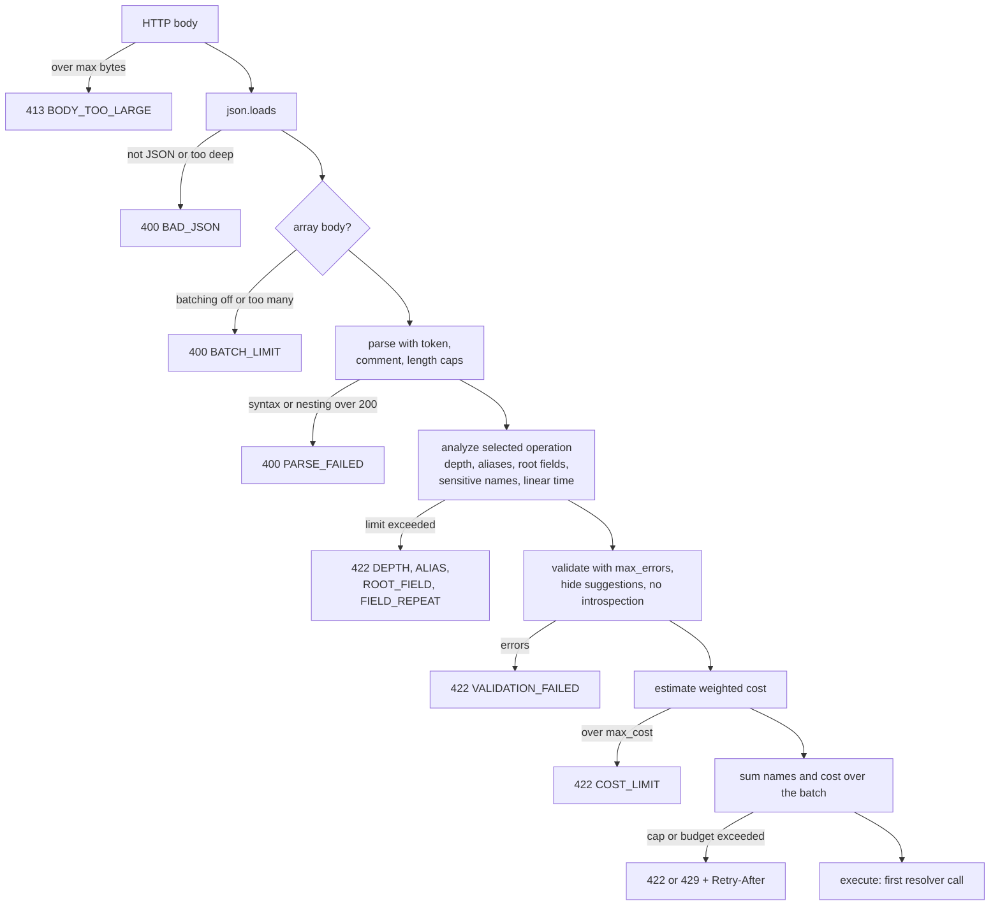

# Hardening GraphQL in Production: AST Depth Limits, Weighted Query Complexity Cost Analysis, Alias/Batching Brute-Force Caps, and Disabling Introspection

> [!summary] Claim
> A GraphQL endpoint is one URL whose per-request work the client chooses, so production hardening is a pre-execution pipeline that caps bytes, tokens, nesting, aliases, repeated sensitive fields, batch size, and a weighted cost estimate, charges that cost to a per-client budget, and treats introspection and `Did you mean` hints as discovery leaks, where every check must itself be linear in the document and none may run a resolver.

Part of [GraphQL JSON RPC and Event APIs](README.md) in [API Engineering](../README.md).

## TL;DR

- Mechanism: parse with token, comment, and length caps, analyze the selected operation with fragments expanded in linear time (depth, aliases, root fields, repeated sensitive fields), validate, price the operation as `size * (weight + children)`, charge a per-client token bucket, and only then execute; a 343-byte 15-level query costs 65,536 resolver calls unprotected (measured here) and zero when rejected.
- Contract rule: limits apply per HTTP request, not per operation, and the sensitive-field cap and the cost charge must be summed across every entry of a batch, because 100 batched single-`login` operations pass any per-operation alias limit.
- Trap: the limiters are attack surface too, because Strawberry 0.340.0's `QueryDepthLimiter` and `MaxAliasesLimiter` revisit a shared fragment once per path, so an 800-byte 20-level fragment DAG took 2.03 s and 0.89 s of CPU (measured, CPython 3.14.6) while graphql-core's own rules took 2 ms.
- Portability fact: the pipeline order and every number here are measured on CPython 3.14.6 with graphql-core 3.3.2 and Strawberry 0.340.0 only; three graphql-core advisories and two Strawberry limiter advisories were fixed in releases the pins already contain (as of 2026-11), and no other interpreter or server was run.
- When not to use it: when every client is first-party, a trusted-document allowlist removes the whole class of arbitrary queries and the estimator becomes a second line; when the API is public and the schema has unbounded fan-out, consider whether GraphQL is the right surface at all.

## Mental model



The diagram is ordered by cost to the server, cheapest first.
Byte and JSON checks cost nothing that scales with the schema, the parser limits bound the memory of the token list, and the analyzer touches each definition once, so none of them depends on how many paths the fragments could expand to.
Validation comes next because the weighted cost needs a valid, acyclic document, and the standard rules are what guarantee that.
The estimator then prices the operation, and only the aggregate over a whole HTTP request is charged against the budget.
Every red box leaves the backend untouched, which the lab asserts with a resolver counter and a login-attempt list rather than by inspecting responses.

## How it works

### Why GraphQL needs this at all

GraphQL execution is defined per field and per object, and a selection set may nest as deep as the schema has cycles (GraphQL September 2025 Section 6.4).
The specification requires that only requests which pass validation are executed (GraphQL September 2025 Section 6.1.1), and it says nothing about how expensive a valid request may be.
graphql.org states the consequence directly: the specification gives no guidelines for query complexity analysis or rate limits, so a server has to add them (https://graphql.org/learn/security/, "Query complexity analysis").
The cyclic schema in the lab (`User.friends` returns `[User!]!`) shows the shape.
A 15-level `friends(first: 2)` chain is 343 bytes and 126 lexer tokens, and it caused 65,536 resolver calls in 0.243 s with in-memory resolvers (scratch run with `execute_sync` on CPython 3.14.6, macOS 27.3 arm64; the lab test asserts the closed form for 8 levels, 512 calls).
The count is `1 + (f**d - 1) / (f - 1) + f**d` for `d` levels of `first: f`, so `first: 10` at 15 levels is 1,111,111,111,111,112 (about 1.1e15) calls by the same formula, which was evaluated and not run.
The OWASP cheat sheet gives the same two attack shapes, deep nesting through a cycle (`album { songs { album { ... } } }`) and an amount argument such as `first: 99999999` (OWASP GraphQL Cheat Sheet, "Query Limiting (Depth & Amount)").

The second amplifier is the alias.
A response key must be unique, and the spec merges selections that share a response key so that they execute once (GraphQL September 2025 Section 6.3.2, "Field Collection": "multiple references to fields with the same response name will only be executed once").
An alias gives each copy its own response key, so 100 aliased `login` fields are 100 executions.
Top-level mutation fields run serially, each to completion before the next, in the order of the collected fields map (GraphQL September 2025 Sections 6.2.2 and 6.3.4), so all 100 guesses run one after another inside one HTTP request.
The lab's unprotected run asserts 100 recorded login attempts and response keys `a0` to `a99` in order; the key order follows field order, so the serial execution itself is the specification's guarantee and is not separately observed by the test.
PortSwigger describes the same bypass of per-request rate limiters (https://portswigger.net/web-security/graphql, "Bypassing rate limiting using aliases"), and OWASP lists the array form as the batching attack: "This attack will likely bypass existing rate limits in tools like Nginx or other proxies/gateways since they rely on looking at the raw number of requests" (OWASP GraphQL Cheat Sheet, "Batching Attacks").

### Pipeline order and why it is ordered that way

The lab's `prepare` is the whole pipeline for one operation (see Worked example).
Three ordering rules fall out of the failure modes below.
First, anything that bounds the input must run before anything whose cost grows with the input, so size, token, and comment caps run in `parse`, before the analyzer.
Second, the analyzer is schema-free and linear, so it runs before `validate`; this bounds what validation sees, and the next section shows why that matters.
Third, the weighted cost needs field types and a cycle-free document, so it runs after `validate` and never on an invalid document.

`validate` in graphql-core 3.3.2 instantiates every rule before it visits the document (`visitors: list[Visitor] = [rule(context) for rule in rules]` in graphql-core 3.3.2 graphql/validation/validate.py, `validate`), and only then constructs its `FragmentNestingVisitor` and inserts it first.
A rule that does its work in `__init__` therefore runs before any specified rule has visited the document.
Strawberry 0.340.0 does exactly that: `DepthLimitValidator.__init__` calls `determine_depth` for every operation (strawberry 0.340.0 strawberry/extensions/query_depth_limiter.py, `create_validator`), and `AddValidationRules` appends the rule class to the rules tuple (strawberry 0.340.0 strawberry/extensions/add_validation_rules.py, `AddValidationRules.on_operation`).
So a custom limiter written this way sees the raw document before fragment definedness and cycles have been checked.
That is why the lab's analyzer is written to tolerate both (next section).

### Parser limits: bytes, tokens, comments, nesting

`parse` in graphql-core 3.3.2 accepts `max_lexical_tokens`, `max_comments`, `max_source_length`, and a deprecated `max_tokens` (graphql-core 3.3.2 graphql/language/parser.py, `parse` and `Parser.__init__`).
Its docstring states why: "Parsing happens before validation so even invalid queries can burn lots of CPU time and memory", and the parser's cost is linear in lexical tokens but "in extreme cases it becomes quadratic due to memory exhaustion" (`parse` docstring).
`max_source_length` is checked in code points before lexing, and it covers comments and long tokens that a token count would miss (`Parser.__init__`).
Comments need their own limit because the lexer allocates and links a `Token` for every comment even though the parser never returns it: "Comments are ignored by the parser but retained as tokens" (`parse` docstring, `max_comments`).
GHSA-r77w-qph3-7vf8 (CVE-2026-75508) records that `max_tokens` once ignored comment tokens: a 38 MB comment-padded document allocated about 92 MB of extra memory under `max_tokens=5`, fixed in graphql-core 3.2.12 and 3.3.0rc1 (as of 2026-11).
The advisory adds that such a payload (`# c\n` repeated) compresses extremely well and that the framework decompresses it in memory before the parser is reached, so a body-size limit applied to the compressed request does not see it; the cap therefore has to apply to the decompressed bytes that reach the parser.
In 3.3.2 the replacement is a pair, `max_lexical_tokens` for real tokens and `max_comments` for comments, and `max_tokens` is documented as deprecated and as also counting comments (`parse` docstring).
Strawberry's `MaxTokensLimiter` sets the deprecated `parse_options["max_tokens"]` (strawberry 0.340.0 strawberry/extensions/max_tokens.py, `MaxTokensLimiter.on_operation`), so it covers comments in the pinned release.

Nesting inside one definition is capped by the parser at `MAX_NESTING_DEPTH = 200` (graphql-core 3.3.2 graphql/language/parser.py, `MAX_NESTING_DEPTH` and `Parser._enter_nesting`).
Measured on CPython 3.14.6: 200 nested selection sets parse, 201 raise `Syntax Error: Document is nested too deeply. Parsing aborted.`, and 5,000 raise the same error rather than `RecursionError`.
The comment in the source says PyPy does not handle a stack overflow in JIT-compiled code reliably, so the parser stops well below PyPy's stack limit on all interpreters "so that they all accept the same input".
Two consequences follow.
A `max_depth` above 200 is meaningless for a single definition, and the lab test asserts that the parser still refuses 201 levels with `max_depth=10_000`.
The limit applies per definition, so a chain of fragments can still go deeper, which `validate` handles with a separate guard: `FragmentNestingVisitor` computes fragment nesting without recursion and raises `RecursionError` above the same 200, which `validate` converts to `Validation aborted.` (graphql-core 3.3.2 graphql/validation/validate.py, `FragmentNestingVisitor` and `validate`).

### Depth: what to count and how to count it in linear time

Depth here is the number of nested field levels, counting leaf fields, with root fields at level 1; `{ me { id } }` has depth 2 and `{ me { friends { friends { id } } } }` has depth 4.
Inline fragments add no level, because they select no field.
A spread contributes `level + depth(target)`, where `level` is the number of fields enclosing the spread.
Tools disagree on the definition.
Strawberry's `QueryDepthLimiter`, a port of `stems/graphql-depth-limit` (file header, strawberry 0.340.0 strawberry/extensions/query_depth_limiter.py), counts only fields that have a selection set and returns `0` for a leaf, and it skips fields whose name starts with `__` (`determine_depth`, calling `is_introspection_key` from strawberry 0.340.0 strawberry/extensions/utils.py).
Measured on Strawberry 0.340.0: with `max_depth=1`, `{user{name}}` passes and `{user{friends{name}}}` is rejected; with `max_depth=2` the second passes and a third `friends` level is rejected.
So Strawberry's `max_depth=N` allows what the lab calls depth `N+1`, and a number copied between tools is off by one.

The lab's `analyze` scans each definition once with an explicit stack (`scan_selection_set`), then merges fragments in memoized post-order with an explicit DFS stack, so the work is `O(document size + spreads)` and never recursive.
A spread that closes a cycle or names a missing fragment contributes nothing in `_expand`; the standard rules report both (GraphQL September 2025 Sections 5.5.2.1 and 5.5.2.2).
Cycles matter because the spec says an operation could "infinitely spread or infinitely execute on cycles in the underlying data" (GraphQL September 2025 Section 5.5.2.2), and a limiter that walks spreads without a visited set recurses until the interpreter raises `RecursionError`.
GHSA-qfwv-87qj-98xq (CVE-2026-47706) is exactly that bug in Strawberry's `QueryDepthLimiter`, affecting `>= 0.71.0, <= 0.315.6` and fixed in 0.315.7 (as of 2026-11).

The pinned 0.340.0 limiter does carry a visited set, but it is path-local: `visited_fragments | {fragment_name}` creates a new set per spread (strawberry 0.340.0 strawberry/extensions/query_depth_limiter.py, `determine_depth`), and `MaxAliasesLimiter` does the same in `count_fields_with_alias` (strawberry 0.340.0 strawberry/extensions/max_aliases.py).
A cycle is cut, but a diamond is re-walked once per path.
A fragment DAG where each of `n` fragments spreads the next one twice has `2**n` paths.
Measured with `graphql.validate` and only the one rule (`query_depth_limiter.create_validator(50, None)` or `max_aliases.create_validator(1000)`), one run each timed with `time.perf_counter`, CPython 3.14.6, macOS 27.3 arm64, rerun by the fact-check on 2026-11-26:

| Levels | Document | graphql-core spec rules | Strawberry depth rule | Strawberry alias rule |
| --- | --- | --- | --- | --- |
| 12 | 488 bytes | 0.002 s | 0.007 s | 0.003 s |
| 16 | 644 bytes | 0.001 s | 0.117 s | 0.046 s |
| 18 | 722 bytes | 0.002 s | 0.491 s | 0.192 s |
| 20 | 800 bytes | 0.002 s | 2.028 s | 0.885 s |

The time doubles per level, and graphql-core's rules stay flat because they memoize by fragment name (scratch run, not in the lab; the sizes are the lengths of the generated documents).
Each document is `n` fragments of the form `fragment F0 on User { ...F1 ...F1 }`, a last fragment `{ name }`, and `{ user { ...F0 } }`.
Through `schema.execute_sync` with `QueryDepthLimiter` installed, the 22-level document (878 bytes) took 8.27 s (one run).
The lab asserts the mechanism without timing: `test_strawberry_depth_limiter_revisits_shared_fragments_exponentially` counts calls to `determine_depth` and requires the count to grow by more than 3.5x from 8 to 10 levels.
The executor is not exposed to this, because `CollectFields` carries a `visitedFragments` set and visits each fragment once per selection set (GraphQL September 2025 Section 6.3.2).
I found no advisory for this shape in the GitHub advisory list for `strawberry-graphql` (9 entries, as of 2026-11), and I did not report it upstream; it is a measurement of the pinned release, not a published CVE.
The latest release, 0.341.3 on PyPI (as of 2026-11), has a byte-identical `determine_depth` and the same `visited_fragments | {fragment_name}` in `count_fields_with_alias` (strawberry 0.341.3 strawberry/extensions/query_depth_limiter.py and strawberry/extensions/max_aliases.py, read at the release tag, not run).
The lab's `analyze` handles the same 40-level DAG (about 1.1e12 expanded occurrences of `name`) in 0.2 ms and counts them with big integers, and `test_fragment_dag_analysis_is_linear_not_exponential` fails fast if the scanner is called more than 200 times.

Strawberry's depth rule also has two behaviors worth knowing.
It keys results by operation name, so it analyzes every operation in the document, not the selected one (`get_queries_and_mutations`).
An undefined fragment raises `KeyError` inside `__init__`; in 0.340.0 the schema turns that into a single error whose message is the bare `'Missing'` (measured).
A chain of 400 fragments surfaced `maximum recursion depth exceeded` as the client-visible error, and a chain of 300 surfaced `Validation aborted.` (measured, consistent with graphql-core's nesting guard firing first); both leak Python internals and neither is a clean `Cannot spread fragment` message.

What a depth limit does not do: it says nothing about breadth, so `{ users(first: 100) { friends(first: 100) { posts(first: 100) { id } } } }` is depth 4 and costs 1,010,100 in the lab's model (asserted).
graphql.org makes the same point and recommends "a separate smaller limit to how deeply lists can be nested" (https://graphql.org/learn/security/, "Depth limiting").
The Apollo blog describes choosing a limit from the client: the deepest query their own client used had 7 levels, so they set 10 (https://www.apollographql.com/blog/securing-your-graphql-api-from-malicious-queries, "Depth Limiting").
That method is sound and is the one to copy: measure your real clients, then add headroom.

### Breadth: aliases, root fields, and repeated sensitive fields

Three counters, in increasing order of usefulness for abuse.
The alias count (`Profile.aliases`) is cheap and catches the 100-alias payload, but a legitimate client aliases freely, so the cap has to be generous (the lab default is 15 and is not a recommendation).
The root-field count (`Profile.top_fields`) bounds fan-out at the top, including fields reached through spreads at the root.
The repeated-name count (`Profile.names`) is the one that defeats brute force: it counts how many times a field name such as `login` appears anywhere in the expanded operation, aliased or not, and `Limits.sensitive_field_limits` caps it.
It is the in-code form of OWASP's second mitigation, "Prevent batching for sensitive objects" (OWASP GraphQL Cheat Sheet, "Mitigating Batching Attacks").

Counting must follow fragments, and it must count each spread.
GHSA-fr49-mhgj-crfc (CVE-2026-47707) records that Strawberry's `MaxAliasesLimiter` counted aliases statically and missed their multiplication by spread count; it affected `>= 0.172.0, <= 0.315.6` and was fixed in 0.315.7 (as of 2026-11).
The advisory's payload spreads a 10-alias fragment under 10 aliased fields and gets 100 `a` aliases past a limit of 20.
In 0.340.0 the limiter counts through spreads, and the lab test `test_aliases_in_a_reused_fragment_are_counted_once_per_spread` asserts `10 + 10 * 10 = 110` for that shape.
The count is an over-estimate of executed work, which is the safe direction: the executor merges identical response keys, so two spreads of one fragment execute the shared aliases once (GraphQL September 2025 Section 6.3.2), but they still count twice.

Only the selected operation executes (GraphQL September 2025 Section 6.1, `GetOperation`), so only it should be charged.
The lab's `select_operation` follows `GetOperation` and `analyze` walks only fragments reachable from it.
Strawberry 0.340.0's `MaxAliasesLimiter` sums aliases over all operations in the document: with `max_alias_count=3`, a document holding a 4-alias `Heavy` and a 1-field `Light` was rejected even with `operation_name="Light"` (measured).
That is a false positive, not a bypass, but it breaks clients that ship one document with many operations.

None of these counters limits what an attacker does across requests.
They bound one request; the login rate limit that stops credential stuffing belongs in the authentication layer, keyed by account and not by HTTP request (see [[Multi-Tier-Rate-Limiting-Quotas-Concurrency-Limits-and-Cost-Budgets]]).

### Weighted cost: the formula and where it is wrong

The lab prices a validated operation as `cost(field) = size * (weight + cost(children))`.
`size` is 1 for a non-list field and the requested list size for a list field.
`weight` comes from `CostModel`: an explicit `"Type.field"` entry such as `"Mutation.login": 50`, else `object_weight` (1) for a composite return type and 0 for a scalar.
Results the tests assert: `users(first: 10) { friends(first: 5) { id } }` costs `10 * (1 + 5 * 1) = 60`; `users { id }` costs 10 because the schema default for `first` is 10; a `login` mutation costs 50; fragment cost is charged at every spreading field (`users(first: 10) { ...P }` with a `posts(first: 4)` fragment is `10 * (1 + 4 * 1) = 50`).
I also ran `query Q($n: Int) { users(first: $n) { friends(first: 5) { id } } }` and got 18 with `{"n": 3}`, 600 with no variables, and 0 with `{"n": -4}` (scratch run).

The list size is resolved in this order, and each step is conservative.
A literal `IntValueNode`; else a variable value supplied with the request if it is an `int` and not a `bool` (JSON `true` must not become 1); else the argument's schema default; else `assumed_list_size` (100).
Any `first`, `last`, or `limit` argument that is present but is not a literal or a usable variable falls back to the assumption, never to 1.
In graphql-core 3.3.2 an SDL default built by `build_schema` is held on `argument.ast_node.default_value` while `GraphQLArgument.default_value` is `Undefined` (measured: `Undefined`, with an `IntValueNode` on the AST node), so an estimator that reads only `default_value` silently prices `users { id }` at the assumed 100 instead of 10; the lab reads both and a failing test caught this during development.
Code-first schemas such as Strawberry set `default_value` directly.

Why a pre-execution estimate is useful and where it is wrong.
It is useful because it is deterministic, needs no resolver, and returns a number that can feed a budget; GitHub's primary limit works this way and exposes the number back as `rateLimit { cost }` (https://docs.github.com/en/graphql/overview/rate-limits-and-node-limits-for-the-graphql-api, "Returning the point value of a query").
It is wrong in four known ways.
It trusts the list-size argument, so a resolver that ignores `first` or applies a larger default fetches more than it was charged for.
It prices scalar fields at 0 by default, so an expensive computed scalar costs nothing until it is given a weight.
It counts objects, not database queries, so a `DataLoader` that collapses N+1 (see [[The-GraphQL-N-Plus-1-Problem-and-DataLoader-Tick-Batching-Internals]]) lowers the real database cost but not the estimate, and the estimate still tracks response size and serialization CPU.
It treats introspection fields as a flat weight of 1 and does not descend into them, so with `allow_introspection=True` the depth cap and the introspection toggle are the only controls on `__schema`.
It also ignores `@skip` and `@include`, which only over-estimates.

How the real systems differ, with the numbers from their documentation (as of 2026-11).
GitHub: every connection must carry `first` or `last` in 1-100, a call cannot request more than 500,000 total nodes, and points for the primary limit are the number of requests needed to fill each connection divided by 100 and rounded, minimum 1; the documented example is 5,101 requests, 51 points, and a 22,060-node example for the node limit.
The primary limit is 5,000 points per hour for users, and GitHub states that exceeding it still returns status `200` with an error and `x-ratelimit-remaining: 0`.
Secondary limits cap the GraphQL endpoint at 2,000 points per minute; separately, under "Timeouts", a request that GitHub takes more than 10 s to process is terminated and may answer `502` or `504`, and after a timeout "additional points will be deducted from your primary rate limit for the next hour".
Shopify documents a leaky bucket for most APIs: each request adds marbles, the bucket drains continuously at the API's restore rate, and a full bucket returns a throttle error (https://shopify.dev/docs/api/usage/limits, "The leaky bucket algorithm"); the per-API cost figures live on separate pages that I did not fetch.
`graphql-query-complexity` chains estimators and takes the first numeric answer, raises if none answers, and has `maxQueryNodes` defaulting to 10,000 so the analysis itself is bounded (https://github.com/slicknode/graphql-query-complexity README, usage block).
The Apollo blog's `@cost` example with multipliers gave `max: 750, actual: 1010319` for its evil query.
Apollo Server's `maxRecursiveSelections` computes the selection count with named fragments recursively inlined "without actually inlining", errors above 10,000,000 when set to `true`, runs before any provided validation rule, and is off by default (Apollo Server API reference, `maxRecursiveSelections`, as of 2026-11).

### The budget: charging cost, answering 429

An estimate only limits one request.
The lab charges it to a per-client token bucket, `CostBudget`, with a capacity, a continuous refill, and an injectable clock.
`try_spend` refills `min(capacity, tokens + elapsed * rate)`, spends if the cost fits, and otherwise returns `ceil((cost - tokens) / rate)` whole seconds.
That value becomes `Retry-After` on a `429` (RFC 6585 Section 4; RFC 9110 Section 10.2.3, where the field value is either an HTTP-date or `delay-seconds`, a non-negative integer).
The invariant is `max_cost <= capacity`: a request priced above the capacity can never be paid for, so `Retry-After` would be a lie, and `build_app` raises `ValueError` at startup instead.
The test uses a fake clock: capacity 100, rate 10 per second, two requests of cost 60, the second answers `429` with `Retry-After: 2` (`(60 - 40) / 10`), and after the clock advances 2 s it passes.
Identity is the part the lab fakes: it keys on `request.client.host`, which is a proxy address behind a load balancer and trivially rotated by an attacker, so a real deployment keys on the authenticated principal and on the address for anonymous traffic (see [[Rate-Limiting-Algorithms-Token-Bucket-Leaky-Bucket-and-Sliding-Window]] and [[Standard-RateLimit-Headers-IETF-Draft-and-429-Retry-After-Semantics]]).
The bucket is a plain `dict`, so it is correct for one event loop and wrong for several workers; a multi-process deployment moves the state to Redis (see [[Token-Aware-Rate-Limiting-Pre-Flight-Reservation-and-Post-Stream-Reconciliation]]).

Status codes follow the GraphQL-over-HTTP draft where it is specific.
The draft says a request that does not pass validation SHOULD get `422`, a document that cannot be parsed SHOULD get `400`, an oversized POST body SHOULD get `413`, and a mutation over `GET` MUST be refused with a 4xx, with `405` and an `Allow` header as the example (GraphQL over HTTP, Current Working Draft, 5.4 Status Codes and the GET section, retrieved 2026-11).
`400` is "Bad Request" (RFC 9110 Section 15.5.1), `413` is "Content Too Large" and MAY close the connection (RFC 9110 Section 15.5.14), and `422` is "Unprocessable Content" (RFC 9110 Section 15.5.21).
The draft is a working draft, so treat those SHOULDs as direction, not as a frozen contract.
A rejection with no `data` entry is a request error, so a 4xx is correct; the opposite choice, `200` with an `errors` array, hides attack traffic from a WAF and from latency dashboards that bucket by status.

### Batching: two forms, one rule

There are two things people call batching.
A JSON array of operations in one POST body is not defined by the GraphQL-over-HTTP draft; I found no mention of batching in the fetched text.
A single document with several named operations is defined by the spec, but only one of them executes per request (GraphQL September 2025 Section 6.1), and graphql.org still lists it as something to cap (https://graphql.org/learn/security/, "Breadth and batch limiting").
OWASP API4:2023 lists "Number of operations to perform in a single API client request (e.g. GraphQL batching)" among the limits whose absence makes an API vulnerable, and its scenario 2 is an array of 999 `uploadPic` mutations that bypasses a per-request rate limit and a per-image size check.

The implementations that ship this agree on the default: off.
Apollo Server's `allowBatchedHttpRequests` defaults to `false`, and an array body then raises `Operation batching disabled` (Apollo Server API reference, as of 2026-11).
Strawberry 0.340.0 refuses arrays unless `StrawberryConfig.batching_config` is set, answering `400` with `Batching is not enabled`, and with it set answers `400` with `Too many operations` above `max_operations`; streaming transports refuse batches outright (strawberry 0.340.0 strawberry/http/base.py, `_validate_batch_request`; strawberry/schema/config.py, `BatchingConfig`).
Both cap the count of operations and nothing else.
That is the gap the lab closes: its batch handling prepares every entry, then sums the per-name counts and the cost over the entries that passed, applies the sensitive cap to the sum, and charges the budget once for the total.
Without the sum, 100 batched `mutation { login(...) }` requests are 100 operations each with one `login`, and every per-operation limit passes.
`test_single_login_operations_still_hit_the_per_request_sensitive_cap` pins it: one `login` in a batch runs, and three are rejected with `FIELD_REPEAT_LIMIT` with no attempt recorded.

A rejected entry does not block its neighbours: the lab returns `200` with a per-entry `errors` array for that index and executes the rest, while a batch-level violation (disabled, over the cap, empty, over budget, aggregate sensitive cap) rejects the whole request.
That is a design choice, not a standard.
The alternative, all-or-nothing, is simpler to reason about and is what the cost charge already does.

### Introspection and suggestions

Introspection is two meta-fields on the query root, `__schema` and `__type(name:)` (GraphQL September 2025 Section 4.2), and `__typename` is a separate meta-field available in any selection set (GraphQL September 2025 Section 4.1).
`NoSchemaIntrospectionCustomRule` reports every field whose named return type is an introspection type (graphql-core 3.3.2 graphql/validation/rules/custom/no_schema_introspection.py, `NoSchemaIntrospectionCustomRule.enter_field`).
Measured: `{ __schema { queryType { name } } }` produced two errors, one for `__schema` and one for `queryType`, `__type` is blocked, and `{ __typename }` is allowed because it returns `String`.
Its docstring says the rule "is optional and is not part of the Validation section of the GraphQL Specification" and that disabling introspection "does not reflect best practices and should only be done if absolutely necessary".
Strawberry's `DisableIntrospection` is this rule wrapped in `AddValidationRules` (strawberry 0.340.0 strawberry/extensions/disable_introspection.py).

Disabling introspection removes the convenient listing and leaves the schema guessable.
Validation errors carry suggestions: on the lab schema, `{ usr { id } }` gives `Cannot query field 'usr' on type 'Query'. Did you mean 'user' or 'users'?` (measured, graphql-core 3.3.2).
The OWASP cheat sheet says to consider turning that off when introspection is off, and PortSwigger notes that Clairvoyance recovers a schema from suggestions (https://portswigger.net/web-security/graphql, "Suggestions").
graphql.org says disabling introspection can be used as a form of "security through obscurity" that "will not be sufficient to entirely obscure a GraphQL API by itself", and that "even with introspection disabled, an attacker could ultimately infer the shape of an entire schema by running numerous operations with incorrect field names"; it recommends trusted documents and authorization instead (https://graphql.org/learn/security/, "Introspection" and "Error messages").
In graphql-core 3.3.2 `validate` takes `hide_suggestions`, and the lab passes it; in Strawberry 0.340.0 `validate_document` calls `validate(schema, document, validation_rules)` with no such argument (strawberry 0.340.0 strawberry/schema/schema.py, `validate_document`), and a measurement confirms it: a schema with `DisableIntrospection` still answered `{ helo }` with `Did you mean 'hello'?`.
Apollo Server exposes `hideSchemaDetailsFromClientErrors` (default `false`, recommended on in production) and defaults `introspection` to on unless `NODE_ENV` is `production` (Apollo Server API reference, as of 2026-11).
If you run Strawberry and need suggestions off, the lab's approach is a custom execution path or a wrapper that rewrites validation error messages; I did not test a Strawberry-native way and none is documented in the files I read.

Introspection and the depth limit interact.
The standard introspection query from graphql-core 3.3.2 has depth 15 under the lab's definition (scratch run), so `max_depth=8` rejects it when `allow_introspection=True`, which breaks GraphiQL, code generators, and schema-diff CI jobs against a staging endpoint.
Strawberry avoids this by skipping `__` fields in its depth rule.
The lab does not exempt them, and `test_the_standard_introspection_query_is_deeper_than_a_typical_depth_limit` records the interaction rather than hiding it; either exempt introspection roots from the depth count or allow it only for an authenticated internal role.

### Validation is attack surface

Limits that run on the parsed document do not protect validation.
The graphql-core advisories say so in their own words: GHSA-vj8h-fx38-h3vc (CVE-2026-75507) notes that "query-depth limiters, complexity analyzers and cost estimators all operate on the parsed document after validation, and the malicious document is trivially shallow (depth 3, complexity 1)".
That advisory is a quadratic blow-up in `OverlappingFieldsCanBeMerged`: a 364 KB document that gzips to a few KB occupied a core for 319 s on graphql-core 3.2.8, CPython 3.12, Linux x86_64 (advisory text, as of 2026-11), fixed in 3.2.12 and 3.3.0rc1.
It is the same family as CVE-2023-26144 in `graphql` (graphql-js) `16.3.0` up to but excluding `16.8.1`, where "insufficient checks in the OverlappingFieldsCanBeMergedRule.ts file" degrade performance on large queries (NVD, published 2023-09-20).
Pinned graphql-core 3.3.2 meters the rule with `MAX_COMPLEXITY_BUDGET = 500_000` and aborts the whole validation when it is spent (graphql-core 3.3.2 graphql/validation/rules/overlapping_fields_can_be_merged.py).
I ran the advisory's generator on 3.3.2: `n=50, m=50` (46,113 bytes) validated in 0.071 s and `n=200, m=100` (364,413 bytes) in 0.246 s, both returning the single error `Validation aborted.` instead of a result, against 5.2 s and 319 s in the advisory's own table (measured here, one run each, CPython 3.14.6, macOS 27.3 arm64; the advisory's times are for graphql-core 3.2.8 on CPython 3.12, Linux x86_64).
So a patched library turns a CPU burn into a fast rejection, and the byte and token caps keep the budget from being the only defense.

Two more validation-phase issues are worth knowing.
`validate` stops after `max_errors`, which defaults to 100 because "Attackers can send pathologically invalid queries to induce a DoS attack" (graphql-core 3.3.2 graphql/validation/validate.py, `validate`); the lab sets it to 10, and a test sends 150 unknown fields and expects exactly 10 `Cannot query field` messages plus `Too many validation errors`.
GHSA-mpqx-q82w-9x46 (CVE-2026-119286) records that in `>= 3.3.0a3, < 3.3.1` the aborted-validation error was a shared module-level instance whose growing traceback kept every aborted request's frames alive, about 124 KiB each on CPython 3.12, so memory grew until the worker was killed; 3.3.1 builds a new error per abort and clears its traceback, which the pinned 3.3.2 source shows (`error.__context__ = None` and `error.with_traceback(None)`).
That one is reachable with 101 unknown fields and no authentication, which is why `max_errors` alone is not the whole story: the version of the library matters.

Other engines show the same class.
The graphql-java report that became CVE-2022-37734 sends `query {__typename @aa}` with thousands of directives; the reporter's table in issue 2888 shows 5,000 directives at 445 ms and 70,000 at 6,788 ms, and states that `MaxQueryDepthInstrumentation` and `MaxQueryComplexityInstrumentation` do not help (reporter's measurements, not run here); NVD lists fixed versions 19.0, 18.3, and 17.4.
CVE-2023-28867 is a crafted query that causes stack consumption in graphql-java before 20.1 (fixed 20.1, 19.4, 18.4, 17.5, per NVD).
The lesson for design is the same each time: bound the input size before the parser and keep the dependency patched, because the limits in this note are not a substitute for either.

### Timeouts, trusted documents, and what the limits cannot do

An application-level timeout bounds the damage of an estimate that was wrong.
The OWASP cheat sheet warns that timeouts "may not activate until a malicious query has already consumed excessive resources" and that infrastructure timeouts "are often inaccurate and can be bypassed more easily" than application-level ones (OWASP GraphQL Cheat Sheet, "Timeouts").
GitHub applies a 10 s server timeout and charges extra points afterwards (GitHub docs, "Timeouts"), which turns the timeout into a signal that feeds back into the budget.
For first-party clients, trusted documents remove arbitrary queries entirely: "a document allowlist is likely to be a more effective solution" than disabling introspection or hiding errors (https://graphql.org/learn/security/, "Recap"); the mechanism, and why it is not available to public APIs, is in [[Automatic-Persisted-Queries-APQ-and-Edge-CDN-Caching-for-GraphQL]].
Field and object authorization is a separate control that no limit replaces (see [[GraphQL-Field-Level-Authorization-and-Partial-Error-Null-Bubbling]]).

## Numbers and limits

| Quantity | Value | Source or measurement |
| --- | --- | --- |
| Unprotected 15-level `friends(first: 2)` chain | 343 bytes, 126 tokens, 65,536 resolver calls, 0.243 s | scratch run, CPython 3.14.6, macOS 27.3 arm64, in-memory resolvers; 8 levels (512 calls) is asserted in the lab |
| 100-alias `login` mutation | 5,892 bytes, 1,403 lexer tokens | scratch run, same machine; the lab cap of 4,000 tokens and 8,192 bytes lets it through to the alias check |
| `parse` nesting limit | 200 selection-set levels per definition | graphql-core 3.3.2 graphql/language/parser.py, `MAX_NESTING_DEPTH`; 201 rejected (measured) |
| `validate` default `max_errors` | 100 | graphql-core 3.3.2 graphql/validation/validate.py, `validate` |
| `OverlappingFieldsCanBeMerged` budget | 500,000 units, then `Validation aborted.` | graphql-core 3.3.2 graphql/validation/rules/overlapping_fields_can_be_merged.py, `MAX_COMPLEXITY_BUDGET` |
| Advisory PoC (n=200, m=100, 364 KB) | 319 s on 3.2.8; 0.246 s on 3.3.2 | advisory GHSA-vj8h-fx38-h3vc; the second figure measured here, CPython 3.14.6, macOS 27.3 arm64 |
| Strawberry depth rule on a 20-level, 800-byte fragment DAG | 2.028 s (alias rule 0.885 s, spec rules 0.002 s) | scratch run, `graphql.validate` with one rule, CPython 3.14.6, macOS 27.3 arm64 |
| JSON nesting bomb, `[` repeated | 20,000 levels parse, 100,000 raise `RecursionError` | scratch run, `json.loads`, CPython 3.14.6; the lab test uses 500,000 levels |
| Lab default caps | body 16,384 B, source 8,192, tokens 4,000, comments 50, depth 8, aliases 15, root fields 10, `login` x1, cost 1,000, batch 5 | `Limits` in the lab; defaults for the tests, not recommendations |
| Lab cost, `users(first:100){friends(first:100){posts(first:100){id}}}` | 1,010,100 | asserted by `test_shallow_wide_query_is_rejected_by_cost_not_by_depth` |
| GitHub node limit | 500,000 nodes per call; `first`/`last` in 1-100 | GitHub docs, "Node limit" (as of 2026-11) |
| GitHub primary limit | 5,000 points/hour for users; points = requests / 100, rounded, minimum 1 | GitHub docs (as of 2026-11) |
| GitHub GraphQL secondary limit | 2,000 points per minute for the GraphQL endpoint | GitHub docs, "Secondary rate limits" (as of 2026-11) |
| GitHub request timeout | 10 s, then `502` or `504` and extra primary-limit points | GitHub docs, "Timeouts" (as of 2026-11) |
| Apollo `maxRecursiveSelections` | 10,000,000 when `true`; default off | Apollo Server API reference (as of 2026-11) |
| Apollo `allowBatchedHttpRequests` | default `false` | Apollo Server API reference (as of 2026-11) |
| `graphql-query-complexity` `maxQueryNodes` | default 10,000 | project README |
| Apollo blog example | deepest client query 7, limit 10; evil query `max: 750, actual: 1010319` | Apollo blog, undated in the fetched text |

## Portability

The user paused the lab matrix on 2026-11-11, so one interpreter ran and every other cell below is a statement about sources, not a result.

| Axis | Result | Evidence |
| --- | --- | --- |
| CPython 3.14.6 on macOS 27.3 arm64 | 46 of 46 lab tests pass (rerun by the fact-check, 2026-11-26) | ran: `uv run --frozen pytest tests/f20_graphql_json_rpc_and_event_apis/test_graphql_security_query_depth_complexity_cost_analysis_and_batch_limits.py -v` |
| CPython 3.12.16, 3.13.18, 3.15.2, 3.15.2t | not run | matrix paused; the JSON nesting threshold and `RecursionError` behavior depend on the interpreter, so `test_a_json_nesting_bomb_is_a_400_not_a_500` was only observed on 3.14.6 |
| Free-threaded 3.15.2t | not run | `CostBudget` keeps a plain `dict` and does a read-modify-write per call, so a threaded server needs a lock (design note, not tested) |
| graphql-core 3.3.2 | verified | source read and lab run |
| graphql-core 3.2.x | not run | the DoS fixes above landed in 3.2.12; `max_lexical_tokens`, `max_comments`, `max_source_length`, `MAX_NESTING_DEPTH`, and `validate(..., hide_suggestions=)` are present at the v3.2.14 tag and absent at v3.2.12 and v3.2.13 (src/graphql/language/parser.py and src/graphql/validation/validate.py, read at each tag), so the lab's `prepare` needs graphql-core >= 3.2.14 on the 3.2 line |
| graphql-core `>= 3.3.0a3, < 3.3.1` | vulnerable to GHSA-mpqx-q82w-9x46 | advisory (as of 2026-11) |
| Strawberry 0.340.0 | verified | source read; two limiter behaviors measured (DAG fan-out, all-operations alias sum) |
| Strawberry `<= 0.315.6` | vulnerable to GHSA-qfwv-87qj-98xq and GHSA-fr49-mhgj-crfc | advisories, fixed in 0.315.7 (as of 2026-11) |
| Strawberry 0.341.3 (latest on PyPI, as of 2026-11) | not run | source read at the tag: `determine_depth` is byte-identical, `count_fields_with_alias` keeps the path-local set, and strawberry/schema/schema.py still passes no `hide_suggestions` |
| Uvicorn 0.54.0, Hypercorn 0.18.0, Granian 2.8.7 | not run | the lab app is called in process through `httpx.ASGITransport`; each server has its own header and body limits that this note did not read, so the body cap here is an application-layer cap only |
| HTTP/1.1, HTTP/2, HTTP/3 | not run | every check sits above the transport; a compressed or multiplexed request reaches the app as one decoded body, and the advisory on comment padding says the framework decompresses before the parser, so cap decoded bytes |

## Worked example

Implementation: [implementation](../labs/src/api_labs/f20_graphql_json_rpc_and_event_apis/graphql_security_query_depth_complexity_cost_analysis_and_batch_limits.py).
Test: [test](../labs/tests/f20_graphql_json_rpc_and_event_apis/test_graphql_security_query_depth_complexity_cost_analysis_and_batch_limits.py).

The module has no network access and one dependency beyond graphql-core, Starlette for the in-process app.
`Backend.resolve` counts every resolver call and records every `login` attempt, which is what lets a test say "before a single resolver ran".

Simplified excerpt of the analyzer (docstring shortened, imports omitted):

```python
def scan_selection_set(selection_set: SelectionSetNode) -> Scan:
    scan = Scan()
    stack: list[tuple[SelectionSetNode, int]] = [(selection_set, 0)]
    while stack:
        current, level = stack.pop()
        for selection in current.selections:
            if isinstance(selection, FieldNode):
                scan.depth = max(scan.depth, level + 1)
                scan.names[selection.name.value] += 1
                if selection.alias is not None:
                    scan.aliases += 1
                if level == 0:
                    scan.top_fields += 1
                if selection.selection_set is not None:
                    stack.append((selection.selection_set, level + 1))
            elif isinstance(selection, InlineFragmentNode):
                stack.append((selection.selection_set, level))
            elif isinstance(selection, FragmentSpreadNode):
                scan.spreads.append((selection.name.value, level))
    return scan


def _expand(scan: Scan, resolved: Mapping[str, Profile]) -> Profile:
    depth, aliases, top = scan.depth, scan.aliases, scan.top_fields
    names = Counter(scan.names)
    for spread, level in scan.spreads:
        target = resolved.get(spread)
        if target is None:
            continue
        depth = max(depth, level + target.depth)
        aliases += target.aliases
        if level == 0:
            top += target.top_fields
        names.update(target.names)
    return Profile(depth, aliases, top, names)
```

`analyze` runs an explicit-stack DFS from the selected operation's spreads, appends fragments to `order` when all their targets are done, and calls `_expand` in that order, so each fragment is scanned and merged exactly once and a back edge is cut instead of followed.

Simplified excerpt of the cost estimator and the pipeline:

```python
    def field(self, node: FieldNode, parent: GraphQLNamedType | None) -> int:
        name = node.name.value
        if name == "__typename":
            return 0
        definition = (
            parent.fields.get(name)
            if isinstance(parent, GraphQLObjectType | GraphQLInterfaceType)
            else None
        )
        if parent is None or definition is None:
            return self.model.object_weight
        named = cast("GraphQLNamedType", get_named_type(definition.type))
        default = self.model.object_weight if is_composite_type(named) else 0
        weight = self.model.weights.get(f"{parent.name}.{name}", default)
        size = self.list_size(node, definition) if _is_list(definition) else 1
        children = self.selection_set(node.selection_set, named) if node.selection_set else 0
        return size * (weight + children)


def prepare(schema, limits, model, query, operation_name=None, variables=None) -> Prepared:
    values = variables or {}
    try:
        document = parse(
            query,
            max_lexical_tokens=limits.max_lexical_tokens,
            max_comments=limits.max_comments,
            max_source_length=limits.max_source_length,
        )
    except GraphQLSyntaxError as error:
        raise Rejected(400, "PARSE_FAILED", error.message) from None
    operation = select_operation(document, operation_name)
    profile = analyze(document, operation)
    enforce_structure(profile, limits)
    rules = [*specified_rules]
    if not limits.allow_introspection:
        rules.append(NoSchemaIntrospectionCustomRule)
    errors = validate(
        schema,
        document,
        rules,
        max_errors=limits.max_validation_errors,
        hide_suggestions=limits.hide_suggestions,
    )
    if errors:
        raise Rejected(422, "VALIDATION_FAILED", "; ".join(error.message for error in errors))
    cost = estimate_cost(schema, model, document, operation, values)
    if cost > limits.max_cost:
        raise Rejected(422, "COST_LIMIT", f"cost {cost} exceeds {limits.max_cost}")
    return Prepared(document, operation, profile, cost, operation_name, values)
```

The type annotations on `prepare` are shortened in the excerpt; the file has the full signature.

Excerpt of two tests, verbatim from the test file including their decorators (the seed's two claims):

```python
@pytest.mark.unit
@pytest.mark.asyncio
async def test_cyclic_15_level_query_is_rejected_before_any_resolver_runs() -> None:
    rig = make_rig()
    response = await post(rig, {"query": friends_chain(15, 2)})
    assert response.status_code == 422
    assert response.headers["content-type"].startswith("application/graphql-response+json")
    assert code_of(response) == "DEPTH_LIMIT"
    assert rig.backend.resolver_calls == 0


@pytest.mark.unit
@pytest.mark.asyncio
async def test_hundred_alias_login_brute_force_is_rejected_before_any_login_runs() -> None:
    rig = make_rig()
    response = await post(rig, {"query": login_aliases(100)})
    assert response.status_code == 422
    assert code_of(response) == "ALIAS_LIMIT"
    assert rig.backend.login_attempts == []
    assert rig.backend.resolver_calls == 0
```

Captured output, command `uv run --frozen pytest tests/f20_graphql_json_rpc_and_event_apis/test_graphql_security_query_depth_complexity_cost_analysis_and_batch_limits.py -v` from `labs/`, CPython 3.14.6, Darwin 27.3.0 (macOS 27.3 arm64), pytest 9.2.0, rerun by the fact-check on 2026-11-26.
The node-id prefix `tests/f20_graphql_json_rpc_and_event_apis/test_graphql_security_query_depth_complexity_cost_analysis_and_batch_limits.py::` is elided from each line for width; everything else is verbatim.

```text
collected 46 items

test_cyclic_15_level_query_is_rejected_before_any_resolver_runs PASSED [  2%]
test_unprotected_cyclic_query_costs_an_exponential_number_of_resolver_calls PASSED [  4%]
test_depth_counts_levels_hidden_behind_fragments PASSED [  6%]
test_depth_is_unchanged_by_inline_fragments PASSED [  8%]
test_fragment_cycle_is_a_clean_rejection_not_a_crash PASSED [ 10%]
test_undefined_fragment_is_a_clean_rejection PASSED [ 13%]
test_fragment_dag_analysis_is_linear_not_exponential PASSED [ 15%]
test_strawberry_depth_limiter_revisits_shared_fragments_exponentially PASSED [ 17%]
test_hundred_alias_login_brute_force_is_rejected_before_any_login_runs PASSED [ 19%]
test_without_caps_all_hundred_guesses_run_serially_in_order PASSED [ 21%]
test_sensitive_field_cap_stops_brute_force_even_with_loose_alias_limits PASSED [ 23%]
test_aliases_in_a_reused_fragment_are_counted_once_per_spread PASSED [ 26%]
test_only_the_selected_operation_is_analyzed_and_executed PASSED [ 28%]
test_root_field_count_is_capped_through_fragments PASSED [ 30%]
test_cost_multiplies_list_sizes_through_nesting PASSED [ 32%]
test_cost_reads_variables_and_assumes_the_worst_when_unknown PASSED [ 34%]
test_cost_uses_the_schema_default_when_the_argument_is_omitted PASSED [ 36%]
test_a_weighted_mutation_costs_its_weight PASSED [ 39%]
test_shallow_wide_query_is_rejected_by_cost_not_by_depth PASSED [ 41%]
test_fragment_cost_is_charged_at_every_spreading_field PASSED [ 43%]
test_budget_charges_cost_and_answers_429_with_retry_after PASSED [ 45%]
test_budget_is_tracked_per_client PASSED [ 47%]
test_a_max_cost_above_the_bucket_capacity_is_refused_at_startup PASSED [ 50%]
test_batching_is_off_by_default PASSED [ 52%]
test_batch_size_is_capped_and_an_empty_batch_is_refused PASSED [ 54%]
test_single_login_operations_still_hit_the_per_request_sensitive_cap PASSED [ 56%]
test_batch_cost_is_summed_against_the_budget PASSED [ 58%]
test_a_rejected_batch_entry_does_not_block_its_neighbours PASSED [ 60%]
test_introspection_is_blocked_but_typename_is_not PASSED [ 63%]
test_introspection_works_when_explicitly_allowed PASSED [ 65%]
test_did_you_mean_suggestions_leak_field_names_until_hidden PASSED [ 67%]
test_the_standard_introspection_query_is_deeper_than_a_typical_depth_limit PASSED [ 69%]
test_oversized_documents_and_token_floods_fail_at_the_parser PASSED [ 71%]
test_comment_padding_is_bounded_separately_from_tokens PASSED [ 73%]
test_the_parser_refuses_nesting_beyond_200_levels_whatever_the_depth_limit PASSED [ 76%]
test_validation_errors_are_capped PASSED [ 78%]
test_oversized_body_is_413_before_json_parsing PASSED [ 80%]
test_body_without_content_length_is_capped_while_streaming PASSED [ 82%]
test_a_json_nesting_bomb_is_a_400_not_a_500 PASSED [ 84%]
test_every_rejection_path_leaves_the_backend_untouched[payload0] PASSED [ 86%]
test_every_rejection_path_leaves_the_backend_untouched[payload1] PASSED [ 89%]
test_every_rejection_path_leaves_the_backend_untouched[payload2] PASSED [ 91%]
test_every_rejection_path_leaves_the_backend_untouched[payload3] PASSED [ 93%]
test_every_rejection_path_leaves_the_backend_untouched[payload4] PASSED [ 95%]
test_every_rejection_path_leaves_the_backend_untouched[payload5] PASSED [ 97%]
test_every_rejection_path_leaves_the_backend_untouched[payload6] PASSED [100%]

============================== 46 passed in 0.46s ==============================
```

Three things went wrong during development and were fixed by the tests, which is why they are worth keeping.
The first run failed the alias test with a `400`: the 100-alias payload is 1,403 tokens and the draft cap was 1,000, so the parser limit fired before the alias limit, and the default became 4,000.
An estimator that read `GraphQLArgument.default_value` priced `users { id }` at 100 instead of 10 (see the cost section).
`FieldNode.arguments` is `None` and not an empty tuple when a field has no arguments in graphql-core 3.3.2, which raised `TypeError: 'NoneType' object is not iterable` in the estimator until it iterated `node.arguments or ()`.
The lab's tests were not mutation-tested, because the user paused those checks on 2026-11-11; the tests are written to fail if their mechanism is removed, and that has not been demonstrated by running a mutant.

## Pitfalls

> [!warning] A depth limit alone leaves breadth and cost open
> Trigger: `QueryDepthLimiter(max_depth=10)` is the only control.
> Symptom: `{ users(first: 100) { friends(first: 100) { posts(first: 100) { id } } } }` is depth 4 and prices at 1,010,100, and a 100-alias `login` mutation is depth 2.
> Fix: add the alias, root-field, repeated-name, and cost checks in this note; graphql.org says depth, breadth, and batch limits "don't provide a way to declare that a particular field is computationally expensive" (https://graphql.org/learn/security/, "Rate limiting").

> [!warning] The limiter is exponential on a fragment DAG
> Trigger: a custom or library rule that carries a path-local visited set, as Strawberry 0.340.0's `QueryDepthLimiter` and `MaxAliasesLimiter` do (`visited_fragments | {fragment_name}`).
> Symptom: an 800-byte document with 20 levels of double spreads takes 2.028 s in the depth rule and 0.885 s in the alias rule while the standard rules take 2 ms, and the time doubles per added level.
> Fix: memoize per fragment name and merge in post-order, as `analyze` does, or cap the expanded selection count the way Apollo's `maxRecursiveSelections` does; verify any third-party limiter against a diamond fragment before trusting it.

> [!warning] A limiter that assumes a valid document crashes on an invalid one
> Trigger: the rule runs before the standard rules (custom rules instantiated in `validate` do their work in `__init__`), and the document has a fragment cycle or an undefined fragment.
> Symptom: GHSA-qfwv-87qj-98xq (CVE-2026-47706) is unbounded recursion on a cycle in Strawberry `<= 0.315.6`; in 0.340.0 an undefined fragment surfaces as the message `'Missing'` and a 400-fragment chain as `maximum recursion depth exceeded` (measured).
> Fix: iterate with an explicit stack, cut cycles, ignore missing targets, and let the specified rules produce the user-facing error (GraphQL September 2025 Sections 5.5.2.1 and 5.5.2.2).

> [!warning] Alias counting that ignores spreads or counts the wrong operation
> Trigger: counting aliases once per fragment definition, or summing across every operation in the document.
> Symptom: GHSA-fr49-mhgj-crfc (CVE-2026-47707) let 100 aliases through a limit of 20 in Strawberry `<= 0.315.6`; in 0.340.0 a document whose unselected operation has 4 aliases is rejected under a limit of 3 even when the selected operation has none (measured).
> Fix: count per spread over the selected operation only, as `test_aliases_in_a_reused_fragment_are_counted_once_per_spread` and `test_only_the_selected_operation_is_analyzed_and_executed` assert.

> [!warning] Per-operation caps on a sensitive field, with batching enabled
> Trigger: `max_aliases=15` and `max_batch_size=100`, with each batch entry holding one `login`.
> Symptom: every entry passes every per-operation limit and 100 guesses run in one HTTP request, the OWASP API4:2023 scenario 2 shape.
> Fix: cap the sensitive field per request across all entries (`enforce_sensitive` on the summed `Counter`), charge the summed cost once, and rate-limit credential attempts by account in the auth layer.

> [!warning] Introspection off, suggestions on
> Trigger: `DisableIntrospection` on Strawberry 0.340.0, or `NoSchemaIntrospectionCustomRule` with `hide_suggestions=False`.
> Symptom: `{ helo }` answers `Cannot query field 'helo' on type 'Query'. Did you mean 'hello'?` (measured), which Clairvoyance-style tools use to rebuild the schema (PortSwigger, "Suggestions").
> Fix: pass `hide_suggestions=True` where the engine supports it, mask validation messages otherwise, and treat introspection as obscurity and not as access control (graphql.org, "Introspection").

> [!warning] Validation-phase CPU and memory that no AST limiter sees
> Trigger: a shallow document with repeated inline fragments (GHSA-vj8h-fx38-h3vc, CVE-2026-75507), or 101 unknown fields (GHSA-mpqx-q82w-9x46, CVE-2026-119286), or comment padding (GHSA-r77w-qph3-7vf8, CVE-2026-75508).
> Symptom: one core pinned for minutes, or worker memory growing by about 124 KiB per request until an OOM kill, with a depth-3, cost-1 document.
> Fix: cap decoded bytes, tokens, and comments before the parser, pin graphql-core at a release that contains the fixes (3.3.1 or later for the memory leak, 3.2.12 or 3.3.0rc1 or later for the other two, as of 2026-11), and keep `max_errors` low.

> [!warning] A depth cap that breaks introspection clients
> Trigger: `max_depth=8` with `allow_introspection=True`.
> Symptom: GraphiQL, code generators, and schema-check jobs fail with `DEPTH_LIMIT`, because graphql-core 3.3.2's standard introspection query has depth 15 under the lab's counting.
> Fix: exempt introspection roots from the depth count, as Strawberry does for `__` fields, or serve introspection only to an internal role; the lab records the conflict in a test.

> [!warning] Trusting the list-size argument, or defaulting a missing one to 1
> Trigger: an estimator that treats a missing or variable `first` as 1, or a resolver that ignores `first`.
> Symptom: a request is charged for one row and returns thousands; `first: 99999999` passes if no cap exists.
> Fix: resolve literal, then variable, then schema default, then a high assumption, reject negatives to 0, require a bounded argument on every list field as GitHub does (`first` or `last` in 1-100), and enforce the same bound inside the resolver.

> [!warning] Retry-After for a cost that can never be paid
> Trigger: `max_cost` larger than the bucket capacity.
> Symptom: the client gets `429` with a finite `Retry-After`, waits, and is refused again forever.
> Fix: enforce `max_cost <= capacity` at startup, as `build_app` does and `test_a_max_cost_above_the_bucket_capacity_is_refused_at_startup` asserts.

## Security and robustness

Threat model, by attacker goal and the control that answers it:

| Goal | Shape | Control in this note | Residual risk |
| --- | --- | --- | --- |
| Exhaust CPU or memory with one request | deep cycle, wide aliases, huge list size, fragment DAG | byte, token, comment caps; linear analyzer; depth, alias, cost caps; patched graphql-core | an estimate that trusts `first` while a resolver ignores it; expensive scalars at weight 0 |
| Exhaust validation | inline-fragment quadratic, many invalid fields, comment padding | caps before parse; `max_errors`; library at a fixed release | unknown future rule-complexity bugs |
| Brute-force credentials or OTPs | 100 aliases, array batch, many requests | sensitive-field cap per request; batch off by default; summed cost; per-account attempt limits in auth | distributed guessing across many accounts and addresses |
| Enumerate objects | aliased `user(id:)` fields, batching | alias and cost caps; authorization on every object | slow low-rate enumeration within budget |
| Discover the schema | introspection, `Did you mean` hints, field brute force | introspection rule; `hide_suggestions`; trusted documents; authorization | a determined attacker with many probes (graphql.org states this explicitly) |
| Amplify through the transport | gzip-compressed padding, chunked bodies, JSON nesting | cap on decoded bytes, streaming cap, `RecursionError` handled as `400` | server-level limits not read here |

OWASP API4:2023 is the category: "Unrestricted Resource Consumption", whose list of missing limits includes execution timeouts, maximum allocable memory, and the GraphQL-specific "Number of operations to perform in a single API client request (e.g. GraphQL batching)" (https://owasp.org/API-Security/editions/2023/en/0xa4-unrestricted-resource-consumption/).
For the REST-shaped counterpart of payload and depth guards, see [[Unrestricted-Resource-Consumption-API4-2023-Payload-Depth-and-Limit-Guards]], and for the full threat map see [[OWASP-API-Security-Top-10-2023-Complete-Threat-Model]].

Input validation edges the lab handles on purpose.
`variables` must be an object, `operationName` a string or null, `query` a string, and each batch entry a JSON object; each violation is a `422 BAD_REQUEST` and not a `500`.
A `bool` is never a list size, because JSON `true` is a Python `int`.
A body without `Content-Length` is capped while streaming, and a declared `Content-Length` over the cap is refused before reading.
The JSON parser is wrapped for `RecursionError` as well as `ValueError`, because on CPython 3.14.6 a 100,000-level bracket bomb raises `RecursionError` (scratch run), which is not a `ValueError` and would otherwise be a `500`.
A mutation over `GET` is out of scope for the lab, which only registers `POST`; the GraphQL-over-HTTP draft requires refusing it with a 4xx (`405` with `Allow` as the example).

Defense in depth, in the order an attacker meets it: network rate limiting and body caps at the edge, the pipeline here in the application, resolver-level bounds on list sizes and statement timeouts at the data layer, per-account throttles in the auth service, authorization on every field, and monitoring that records estimated cost next to actual latency so the model can be corrected.
The pipeline is deliberately not an authorization layer: a cheap query that reads another tenant's data passes every check here.

## The principal's view

The decision is which of three postures the API takes, and it is made by who the clients are.
For first-party clients only, ship trusted documents: an allowlist of operation hashes makes arbitrary queries impossible, depth and cost limits become a second line for regressions, and introspection can stay on in staging and off in production.
For a public or partner API, accept arbitrary queries and own a cost model: weights per field, list-size rules, a per-principal budget, and a public document that tells clients how cost is computed, as GitHub does.
For an API with unbounded relationship fan-out and no appetite for a cost model, the honest answer may be a REST or gRPC surface with fixed pages (see [[Architectural-Paradigm-Selection-REST-vs-gRPC-vs-GraphQL-vs-JSON-RPC-vs-Events]]).
The Apollo blog's own advice applies to the middle posture: try to crash a staging API with a nasty query first, because the schema may not have the nested relationships that make cost analysis worth its upkeep.

Organizational trade-offs, each with its downside.
Enforcement in the application sees aliases, fragments, and variables, which a gateway generally cannot without GraphQL-aware parsing; the downside is that every service that serves GraphQL must carry and patch the pipeline, and a federated graph needs the cost model at the router and each subgraph (see [[Distributed-GraphQL-Apollo-Federation-v2-Entities-and-Subgraph-Planning]]).
A cost model is a contract that rots: weights drift from real resolver cost, so someone must own them, and the review that adds a field must add its weight.
Rolling limits out without breaking clients needs a shadow mode that records what would have been rejected before enforcement; the lab has no shadow mode and a production version should.
Limits that are too tight page the on-call as client regressions, and limits that are too loose do nothing, so tune from client telemetry, as the Apollo blog did with its 7-level client and limit of 10.
Library choice is a security decision: the advisories in this note show that the limiters and the engine both had bugs in 2026, so budget for upgrades and for a canary test with the shapes in this note's lab (DAG, comment padding, 101 invalid fields) in CI.

## Interview questions

> [!question] L5: A team caps query depth at 10 and still sees 100 `login` attempts in one request, so why does the cap not stop them and what is the smallest fix?
>
> > [!success]- Answer
> > Depth measures nesting, and 100 aliased `login` fields are depth 2.
> > An alias gives each copy its own response key, so the executor runs all 100 instead of merging them (GraphQL September 2025 Section 6.3.2), and mutation fields run serially (Section 6.3.4).
> > The smallest fix is a per-request cap on how many times a sensitive field name may appear after fragment expansion, which the lab does with `sensitive_field_limits={"login": 1}`.
> >
> > Follow-up: Why is an alias-count cap alone a weaker fix than a per-field cap?

> [!question] L5: With introspection disabled, why does `{ __typename }` still work, and does that matter?
>
> > [!success]- Answer
> > `NoSchemaIntrospectionCustomRule` reports fields whose named return type is an introspection type, and `__typename` returns `String`.
> > The spec defines `__typename` as a separate meta-field available in any selection set (GraphQL September 2025 Section 4.1), and clients rely on it for fragments on unions.
> > It leaks only a type name that the query already implies, so it is not a meaningful disclosure.
> >
> > Follow-up: Which remaining feature leaks field names even with the rule on?

> [!question] L5: Predict the output: with the lab's `CostModel` and a schema where `users(first: Int = 10): [User!]!` and `friends(first: Int = 10): [User!]!`, what do `query Q($n: Int) { users(first: $n) { friends(first: 5) { id } } }` cost with variables `{"n": 3}`, with no variables, and with `{"n": true}`?
>
> > [!success]- Answer
> > With `{"n": 3}` the cost is `3 * (1 + 5 * (1 + 0)) = 18`.
> > With no variables the list size falls back to `assumed_list_size = 100`, so `100 * (1 + 5) = 600`.
> > With `{"n": true}` the value is a `bool`, which the estimator refuses as a size, so it is also 600.
> > I ran the first two (18 and 600); the `bool` case is asserted by `test_cost_reads_variables_and_assumes_the_worst_when_unknown` on its single-level query.
> >
> > Follow-up: Why must the fallback be a large number and not 1?

> [!question] L6: Debug this API: a Strawberry server runs `QueryDepthLimiter(max_depth=10)` and `MaxAliasesLimiter(max_alias_count=15)` and still pins a core for seconds on a 1 KB request that passes both, so what is the likely request and how do you confirm it?
>
> > [!success]- Answer
> > The likely request is a fragment diamond: a chain of fragments each spreading the next one twice, which has `2**n` paths and is only a few hundred bytes.
> > Strawberry 0.340.0 keeps a path-local visited set, so both limiters re-walk shared fragments once per path, and the time doubles per level (2.028 s and 0.885 s at 20 levels here, against 2 ms for graphql-core's own rules).
> > Confirm by timing `graphql.validate` with only one limiter rule on that document, or count calls to `determine_depth` as `test_strawberry_depth_limiter_revisits_shared_fragments_exponentially` does.
> > Fix with a memoized, post-order analyzer, a cap on expanded selections, and a byte cap, because the limiter cannot be trusted to bound itself.
> >
> > Follow-up: Why does the executor not suffer the same blow-up on that document?

> [!question] L6: Why does the lab estimate cost after `validate` but run depth and aliases before it?
>
> > [!success]- Answer
> > Cost needs field types and a cycle-free document with defined fragments, and `validate` is what guarantees both.
> > Depth, alias, and name counts need no types and are linear, so running them first bounds the document that `validate` must process.
> > That matters because validation itself has had CPU and memory bugs (GHSA-vj8h-fx38-h3vc, GHSA-mpqx-q82w-9x46) that no limit on the parsed document can stop.
> > The analyzer must therefore tolerate cycles and undefined fragments, because it sees them first.
> >
> > Follow-up: What would break if the analyzer recursed through fragment spreads?

> [!question] L6: Batching is enabled with a cap of 20 operations, so how do you design the limits so 20 single-`login` operations cannot brute-force a password?
>
> > [!success]- Answer
> > Aggregate across the request: sum each field name's count over all entries and apply the sensitive cap to the sum, as the lab's `enforce_sensitive` does on a `Counter`.
> > Charge the total estimated cost to the budget once, so 20 expensive entries cost 20 times as much as one.
> > Treat a rejected entry as an error at its index and let the others run, or reject the whole batch; pick one and document it.
> > Add a per-account attempt counter in the authentication layer, because an attacker can also use 20 separate requests.
> >
> > Follow-up: Why is turning batching off by default (Apollo, Strawberry) the safer starting point than a high cap?

> [!question] L6: Why is `max_cost <= capacity` a startup invariant for a token-bucket budget?
>
> > [!success]- Answer
> > A request priced above the capacity can never accumulate enough tokens, because the bucket refills only up to its capacity.
> > Returning `429` with `Retry-After` for it would invite a retry that can never succeed (RFC 9110 Section 10.2.3 defines `Retry-After` as "how long the user agent ought to wait before making a follow-up request").
> > Failing at startup surfaces the configuration error before traffic does.
> >
> > Follow-up: What should a client do after a `429` with `Retry-After: 2` and a cost of 60 against a bucket at 40?

> [!question] L7: You own a public GraphQL API with 30 services behind it, so how do you design the cost model so it stays honest over three years?
>
> > [!success]- Answer
> > Make cost a schema property reviewed with the field: a weight table or directive next to the type, with a required bounded argument on every list field.
> > Record estimated cost next to actual latency and rows per request, and alert when the ratio drifts, because the estimate trusts list-size arguments and defaults scalars to 0.
> > Run new limits in shadow mode first, publish the formula to clients as GitHub does, and give each principal a budget so one tenant cannot spend another's.
> > Keep the estimator in one shared library with a canary suite (fragment diamond, comment padding, 101 invalid fields) so an upgrade cannot silently regress it.
> > The downside is organizational: someone owns the weights, and a federated graph needs the model at the router and each subgraph.
> >
> > Follow-up: When would you replace the model with trusted documents?

> [!question] L7: A security review says "disable introspection and we are done." What do you answer?
>
> > [!success]- Answer
> > Disabling introspection removes a convenience and not the schema: validation hints (`Did you mean`) and field brute force rebuild it, which graphql.org states as "an attacker could ultimately infer the shape of an entire schema".
> > It is worth doing in production as one layer, together with `hide_suggestions` (graphql-core 3.3.2) or an equivalent, which Strawberry 0.340.0 does not expose.
> > Real protection is authorization on every field and, for first-party clients, a trusted-document allowlist.
> > The cost of the obscurity layer is tooling: depth limits and introspection interact, so staging and CI need an internal role that can introspect.
> >
> > Follow-up: What does the rule not block that a reviewer would still call introspection?

> [!question] L7: Your depth and complexity limits pass a pen test, yet a single 360 KB request pins a CPU core; where do you look?
>
> > [!success]- Answer
> > Look at the validation phase: limits that run on the parsed document never constrain it, and the standard `OverlappingFieldsCanBeMerged` rule was quadratic (GHSA-vj8h-fx38-h3vc, CVE-2026-75507; CVE-2023-26144 in graphql-js).
> > The document is shallow and has complexity 1, and it gzips to a few kilobytes, so body-size limits on the compressed stream miss it.
> > Controls are a decoded-byte cap, a token cap, a library release that meters the rule (graphql-core 3.3.2 aborts at a budget of 500,000), and `max_errors`.
> > Add the shape to CI as a canary.
> >
> > Follow-up: Why is a 5-minute timeout at the load balancer a poor answer here?

## Related

Prerequisites: [[The-GraphQL-N-Plus-1-Problem-and-DataLoader-Tick-Batching-Internals]]

Next: [[GraphQL-Field-Level-Authorization-and-Partial-Error-Null-Bubbling]]

See also: [[GraphQL]], [[02-Programming-Languages/Python/Python-Backend-Interview-Prep/07-Auth-and-Security]], [[GraphQL-Specification-September-2025-SDL-AST-and-Execution-Engine]], [[Strawberry-GraphQL-with-FastAPI-Types-Context-Mutations-and-Subscriptions]], [[Automatic-Persisted-Queries-APQ-and-Edge-CDN-Caching-for-GraphQL]], [[JSON-RPC-2-0-Specification-Batching-Notifications-and-Error-Codes]], [[Unrestricted-Resource-Consumption-API4-2023-Payload-Depth-and-Limit-Guards]], [[Multi-Tier-Rate-Limiting-Quotas-Concurrency-Limits-and-Cost-Budgets]], [[Rate-Limiting-Algorithms-Token-Bucket-Leaky-Bucket-and-Sliding-Window]], [[Standard-RateLimit-Headers-IETF-Draft-and-429-Retry-After-Semantics]], [[OWASP-API-Security-Top-10-2023-Complete-Threat-Model]], [[Architectural-Paradigm-Selection-REST-vs-gRPC-vs-GraphQL-vs-JSON-RPC-vs-Events]], [[Distributed-GraphQL-Apollo-Federation-v2-Entities-and-Subgraph-Planning]]

- Lab: `labs/tests/f20_graphql_json_rpc_and_event_apis/test_graphql_security_query_depth_complexity_cost_analysis_and_batch_limits.py`

## Further reading

- [GraphQL September 2025 specification](https://spec.graphql.org/September2025/): Sections 4 (introspection), 5.5.2.2 (fragment cycles), 6.1 (`GetOperation` and validation before execution), 6.3.2 (field collection merges equal response keys), 6.3.4 (serial mutations).
- [graphql.org: Security](https://graphql.org/learn/security/): the official statement of depth, breadth, batch, complexity, introspection, and error-message guidance, and its caveat that obscurity is not protection.
- [GraphQL over HTTP, working draft](https://graphql.github.io/graphql-over-http/draft/): the status codes (`400`, `413`, `422`) and the rule against mutations over `GET`.
- [OWASP GraphQL Cheat Sheet](https://cheatsheetseries.owasp.org/cheatsheets/GraphQL_Cheat_Sheet.html): batching attacks, the three mitigations, and the suggestion leak.
- [OWASP API4:2023 Unrestricted Resource Consumption](https://owasp.org/API-Security/editions/2023/en/0xa4-unrestricted-resource-consumption/): the category and the array-of-mutations scenario.
- [PortSwigger Web Security Academy: GraphQL API vulnerabilities](https://portswigger.net/web-security/graphql): alias rate-limit bypass and suggestion-based schema recovery.
- [GitHub GraphQL rate limits and node limits](https://docs.github.com/en/graphql/overview/rate-limits-and-node-limits-for-the-graphql-api): a production cost model with a published formula.
- [Shopify API limits](https://shopify.dev/docs/api/usage/limits): the leaky bucket description.
- [Apollo Server API reference](https://www.apollographql.com/docs/apollo-server/api/apollo-server): `introspection`, `hideSchemaDetailsFromClientErrors`, `maxRecursiveSelections`, `allowBatchedHttpRequests`.
- [RFC 9110](https://www.rfc-editor.org/rfc/rfc9110.html): Sections 10.2.3 (`Retry-After`), 15.5.1, 15.5.14, 15.5.21.
- [RFC 6585](https://www.rfc-editor.org/rfc/rfc6585.html): Section 4, `429 Too Many Requests`.
- GitHub advisories for `graphql-core` and `strawberry-graphql` (GHSA-vj8h-fx38-h3vc, GHSA-r77w-qph3-7vf8, GHSA-mpqx-q82w-9x46, GHSA-fr49-mhgj-crfc, GHSA-qfwv-87qj-98xq): the primary records of the limiter and validation bugs discussed here.
