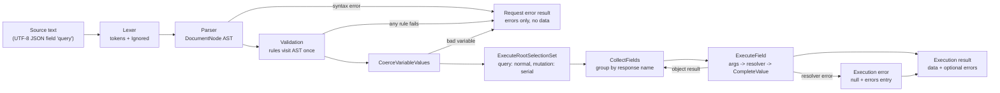

# GraphQL (September 2025 Specification) Internals: Schema Definition Language (SDL), Document AST Validation, and Breadth-First Resolver Execution

> [!summary] Claim
> A GraphQL request is a four-stage pipeline (lex and parse to an AST, validate the AST against the schema, coerce variables, then collect and execute fields), the September 2025 edition separates "request errors" (no `data` key) from "execution errors" (partial `data` plus `errors`), and the only ordering guarantee it gives resolvers is that top-level mutation fields run serially while everything else may run in any order, so "breadth-first" describes how async executors happen to schedule sibling fields, not a rule of the specification.

Part of [GraphQL JSON RPC and Event APIs](README.md) in [API Engineering](../README.md).

## TL;DR

- Mechanism: `parse` turns source text into a `DocumentNode`, `validate` walks that AST once with all rules in parallel, `CoerceVariableValues` runs, then `CollectFields` groups selections by response name and `ExecuteCollectedFields` resolves each group, recursing through `CompleteValue` (GraphQL September 2025 Sections 2, 5, 6.1 to 6.4).
- Contract rule: parse errors, validation errors, an ambiguous operation, and variable coercion failures are request errors and the response must not contain `data`; resolver and result-coercion failures are execution errors and yield partial `data` plus a non-empty `errors` list (Sections 7.1.1, 7.1.3, 7.1.6).
- Trap: the specification says nothing about HTTP, so `200 OK` with an `errors` array is normal; and the lab shows both graphql-core 3.3.2 and Strawberry 0.340.0 emit `"data": null` on request errors, which a strict reading of Section 7.1.3 forbids.
- Portability fact: the algorithms are transport-agnostic and serialization-agnostic (Section 7.2), so this note's lab proves behavior in-process on CPython 3.14.6 only; the other CPython matrix legs were not run (see Portability).
- When not to use it: do not pick GraphQL where a fixed, cacheable, resource-shaped contract is enough; see [[Architectural-Paradigm-Selection-REST-vs-gRPC-vs-GraphQL-vs-JSON-RPC-vs-Events]].

## Mental model



The top row is everything that can fail before any resolver runs; each failure there short-circuits to a request error result with no `data`.
Execution begins at the root selection set, whose fields are collected into an ordered map keyed by response name, then each entry is executed: arguments are coerced, the resolver is called, and `CompleteValue` either coerces a leaf or loops back to `CollectFields` for the sub-selection of an object result.
A resolver exception does not stop the walk; it nulls that response position, appends an entry to `errors`, and, if the position was non-null, propagates the null to the nearest nullable ancestor (Section 6.4.4).

## How it works

### 1. Source text, tokens, and the AST

A document is a sequence of Unicode scalar values (U+0000 to U+D7FF and U+E000 to U+10FFFF); the lexer first produces tokens and Ignored tokens, then the parser builds an AST from the tokens only (GraphQL September 2025 Section 2, "Lexical Analysis & Syntactic Parse"; Section 2.1 for the code point range).
Ignored tokens are white space (U+0009 and U+0020), line terminators, comments (`#` to end of line), commas, and a byte order mark (U+FEFF), all semantically insignificant (Sections 2.1.1 to 2.1.6).
Commas being ignored is deliberate: non-significant commas "ensure that the absence or presence of a comma does not meaningfully alter the interpreted syntax of the document" (Section 2.1.4), and the lab proves it by comparing location-free ASTs of `{a,b}` and `{ a  # comment` newline `b ,,, }`.
Lexical lookahead restrictions give maximal-munch behavior: `123` cannot be the tokens `12` and `3` because an `IntValue` may not be followed by a `Digit` (Section 2, "Lexical Analysis & Syntactic Parse").
Punctuators are `! $ & ( ) ... : = @ [ ] { | }` (Section 2.1.7).

graphql-core 3.3.2 implements this in `graphql/language/lexer.py` and `graphql/language/parser.py`, where `parse(source, no_location=False, max_tokens=None, ..., max_lexical_tokens=None, max_comments=None, max_source_length=None)` returns a `DocumentNode` (graphql-core 3.3.2 graphql/language/parser.py, parse).
Its docstring states the cost model: parser CPU and memory are linear in the number of lexical tokens, quadratic in extreme cases, and parsing happens before validation, so even invalid queries burn CPU; the three limits reject a document with `Syntax Error: Document contains more than N tokens. Parsing aborted.`, `... more than N comments ...`, or `Source contains more than N code points. Parsing aborted.` (graphql-core 3.3.2 graphql/language/parser.py, parse docstring; lab test `test_parser_enforces_token_comment_and_length_limits`).

A document has three kinds of top-level definition: `OperationDefinitionNode`, `FragmentDefinitionNode`, and, for documents that carry schema, type-system definitions and extensions; only the first two are executable, and an executable document needs at least one operation (Section 2.3).
A selection set holds `FieldNode`, `FragmentSpreadNode`, and `InlineFragmentNode`; a `FieldNode` carries an optional alias, arguments, directives, and an optional sub-selection (Sections 2.4 to 2.9).
In the lab, `document_outline("{ a ...F } fragment F on Query { b }")` returns `["OperationDefinitionNode", "FragmentDefinitionNode"]`.
The September 2025 grammar also lets an operation carry a description (`OperationDefinition : Description? OperationType Name? ...`, Section 2.4), which must not affect execution, validation, or the response (Section 2.2), and that is why graphql-core 3.3.2's `OperationDefinitionNode.to_dict()` includes a `description` key (observed in the lab's probe output as `'description': None`).

### 2. SDL: the type system as a document

The Schema Definition Language is the type-system half of the same grammar: `schema`, `scalar`, `type`, `interface`, `union`, `enum`, `input`, `directive`, and their `extend` forms (Section 3).
Type-system documents are not executable: "a document containing TypeSystemDefinitionOrExtension is invalid for execution" (Section 5.1.1, Executable Definitions), so a document mixing an operation with `extend type Query { c: Int }` fails validation; graphql-core 3.3.2 reports `The 'Query' definition is not executable.` (graphql-core 3.3.2 graphql/validation/rules/executable_definitions.py, `ExecutableDefinitionsRule`; lab case in `test_validation_rules_reject_invalid_documents`).
Rules worth knowing exactly:

- Root operation types: the `query` root is required and must be an Object type; `mutation` and `subscription` are optional; if provided the three must be three different types (Section 3.3.1).
- Descriptions are strings written immediately before a definition, should be Markdown (CommonMark), and are exposed by introspection (Sections 2.2 and 3.2).
- `Int` is a signed 32-bit integer; an input outside -2^31 to 2^31 - 1 should raise a request error and a result outside it should raise an execution error (the specification says "should", not "must"); `Float` is a finite IEEE 754 double so `NaN` and `Infinity` are execution errors; `ID` serializes as a string (Sections 3.5.1, 3.5.2, 3.5.5).
- `@oneOf` (Section 3.13.5) marks an input object as a OneOf Input Object: exactly one field must be set and non-null (Section 3.10.1); introspection exposes it as `__Type.isOneOf`.
- `@deprecated` must not appear on a required argument or input field (Section 3.13.3); `@specifiedBy(url:)` documents a custom scalar and must not appear on built-in scalars (Section 3.13.4).
- A schema coordinate such as `Query.hello(name:)` or `@deprecated(reason:)` is a string that uniquely names one schema element, intended for tooling such as per-field usage logs (Section 2.14).

The lab builds its schema with `graphql.build_schema(SDL)` and proves the directive survives a print round trip (`input BookRef @oneOf` appears in `print_schema` output) and that `resolve_schema_coordinate(SCHEMA, "Query.hello(name:)")` resolves to a `FieldArgument` (`test_schema_coordinates_resolve_to_schema_elements`).

### 3. Validation: one AST walk, many rules

Section 5 lists the rules a request must pass: ExecutableDefinitions, operation-type existence, unique and lone-anonymous operations, single root field for subscriptions, field selections, field merging, leaf selections, argument names, uniqueness and requiredness, fragment declarations (unique, type exists, composite, used), fragment spreads (defined, no cycles, possible), value correctness, directives (defined, valid location, unique per location), and variables (unique, input types, defined, used, usage allowed).
Validation exists because "An invalid request is still technically executable, and will always produce a stable result as defined by the algorithms in the Execution section, however that result may be ambiguous, surprising, or unexpected" (Section 5 introduction).
The lab proves the first half: executing `{ nope a }` without validation returns `{"data": {"a": 1}, "errors": null}` because `ExecuteCollectedFields` skips any entry whose field type is not defined (Section 6.3.3, "If fieldType is defined"), so the unknown field vanishes silently (`test_invalid_document_is_still_executable_without_validation`).

Four rules carry the non-obvious algorithms:

- Field Selection Merging (Section 5.3.2): `FieldsInSetCanMerge` requires that any two selections with the same response name have the same response shape (`SameResponseShape` compares nullability, list-ness, and leaf types recursively); and if the parent types are equal or either is not an Object type, they must also have identical field names and identical argument sets, so `{ a: b a }` is invalid because the alias `a` selects `b` once and `a` once.
  Fields on different Object types may differ in name and arguments but not in shape (spec Example 130 versus Counter Example 131).
- Fragment cycles (Section 5.5.2.2): `DetectFragmentCycles` follows spread edges and fails when a spread repeats on the current path; without it execution would spread infinitely.
- Variable usage (Section 5.8.5): `IsVariableUsageAllowed` and `AreTypesCompatible` allow a nullable variable into a non-null position only if the variable has a non-null default or the argument or input field at that location has a default; in the September 2025 edition `IsNonNullPosition` also treats every field of a OneOf Input Object literal as a non-null position.
- Subscriptions (Section 5.2.4.1): `CollectSubscriptionFields` must find exactly one root field, which must not be an introspection field, and must not see `@skip` or `@include` at the root, because validation runs without access to runtime variables.

graphql-core 3.3.2 implements this as `validate(schema, document_ast, rules=None, max_errors=None, ...)`: it asserts the schema is valid, defaults `rules` to `specified_rules` and `max_errors` to 100, builds one `TypeInfo`, instantiates every rule, and calls `visit(document_ast, TypeInfoVisitor(type_info, ParallelVisitor(visitors)), ...)` so all rules share a single traversal; past the limit it raises `ValidationAbortedError` and appends `Too many validation errors, error limit reached. Validation aborted.` (graphql-core 3.3.2 graphql/validation/validate.py, validate).
`specified_rules` (graphql-core 3.3.2 graphql/validation/specified_rules.py) starts with `ExecutableDefinitionsRule, KnownOperationTypesRule, UniqueOperationNamesRule, LoneAnonymousOperationRule, SingleFieldSubscriptionsRule, ...`, also contains four `@defer`/`@stream` rules that the September 2025 edition does not define, and ends with `*recommended_rules`, which is `(MaxIntrospectionDepthRule,)`; so the default `validate` already runs `MaxIntrospectionDepthRule`, although a comment in that file says these rules "aren't part of the spec but they are strongly encouraged".
`OverlappingFieldsCanBeMergedRule` keeps comparison caches because, in the source's own words, memoizing "can dramatically improve the performance of this validator" (graphql-core 3.3.2 graphql/validation/rules/overlapping_fields_can_be_merged.py, `RuleContext`).

The lab parametrizes 14 rejecting documents and asserts the message of each (for example `Cannot query field 'nope' on type 'Query'`, `Cannot spread fragment 'F' within itself`, `Fragment 'G' is never used`, and `Fields 'a' conflict because 'b' and 'a' are different fields`), plus one valid document that must produce `[]`.
A service may skip validation for a request it has validated before, or that was validated at development time and has not changed since (Sections 5 and 6.1.1); that is the specification basis for persisted queries, covered in [[Automatic-Persisted-Queries-APQ-and-Edge-CDN-Caching-for-GraphQL]].

### 4. Request execution and variable coercion

`ExecuteRequest(schema, document, operationName, variableValues, initialValue)` calls `GetOperation`, then `CoerceVariableValues`, then dispatches on operation type (Section 6.1).
`GetOperation` raises a request error if `operationName` is null and the document has more than one operation, or if the name is not found (lab: `Must provide operation name if query contains multiple operations.`, and `operation_name="B"` runs only `{ b }`).

`CoerceVariableValues` (Section 6.1.2) has four branches per variable definition: no value provided and a default exists (including `null`) -> coerce the default; non-null type and no value or `null` -> request error; value provided and `null` -> `null`; otherwise coerce or raise a request error.
Section 6.1.2 notes that this algorithm "is very similar to CoerceArgumentValues()" (Section 6.4.1), which raises execution errors instead and has one subtle branch: if an argument is a variable and the variable was not provided, the argument falls back to the argument default.
The lab proves the distinction between an omitted variable and an explicit `null`: with `query($n: String) { hello(name: $n) }` and `variable_values={}` the response is `{"data": {"hello": "hello world"}}` (the field default `"world"` applies) but with `{"n": None}` it is `{"data": {"hello": "hello None"}}` (`test_omitted_variable_uses_argument_default_but_explicit_null_does_not`).
A OneOf variable with two keys fails in coercion before any resolver runs: `Variable '$r' has invalid value: Within OneOf Input Object type 'BookRef', exactly one field must be specified, and the value for that field must be non-null.`, and that response has no `data` key (`test_oneof_variable_with_two_keys_is_a_request_error`).
The same input as a literal fails earlier, in validation: `ValuesOfCorrectTypeRule` calls `validate_input_literal`, which holds the OneOf check (graphql-core 3.3.2 graphql/validation/rules/values_of_correct_type.py, `ValuesOfCorrectTypeRule`; graphql/utilities/validate_input_value.py, `validate_input_literal`; lab test `test_oneof_literal_with_two_fields_fails_validation`).

### 5. CollectFields: grouping before executing

Before a selection set runs it is converted to a collected fields map: an ordered map from response name (alias, else field name) to the ordered set of field selections that share it (Section 6.3.2).
`CollectFields(objectType, selectionSet, variableValues, visitedFragments)` applies, per selection and in this order: `@skip(if:)` (skip when true), `@include(if:)` (skip unless true), then by kind: a `Field` is appended to its response-name entry; a `FragmentSpread` is skipped if its name is already in `visitedFragments`, otherwise added to that set, looked up, tested with `DoesFragmentTypeApply`, and its fields merged in; an `InlineFragment` is merged in if it has no type condition or `DoesFragmentTypeApply` is true.
`DoesFragmentTypeApply` is identity for an Object type, "is an implementation of" for an Interface, and "is a possible type of" for a Union.
Two consequences are testable:

- A named fragment spread twice contributes once, because of `visitedFragments` (`test_collect_fields_visits_a_named_fragment_once`).
- Fields with the same response name run once, and their sub-selections are merged by `CollectSubfields` so `{ a { subfield1 } ...ExampleFragment } fragment ExampleFragment on Query { a { subfield2 } b }` resolves `a` once with both subfields (Section 6.3.2, Examples 201 and 202); lab test `test_collect_fields_matches_spec_example_201` runs the same shape adapted to the lab schema, `{ a { y } ...F } fragment F on Query { a { w } b }`, and shows `a` maps to two `FieldNode`s and `b` to one.

The response key order is the collected order: the specification says ordered serializations "should preserve the order of requested fields as defined by CollectFields()" and JSON should preserve it textually (Section 7.2.2), and the lab checks `{ b a ...F } fragment F on Query { hello b }` yields keys `["b", "a", "hello"]` in both the transcribed algorithm and the real response (`test_response_key_order_follows_collect_fields_order`).
The lab's `spec_collect_fields` is a transcription of the algorithm over graphql-core's AST; graphql-core's own implementation lives in `graphql/execution/collect_fields.py` (`collect_fields`, `should_include_node`, `does_fragment_condition_match`) and also tracks `@defer` usage, which the September 2025 edition does not include.

### 6. ExecuteCollectedFields, serial versus normal, and "breadth-first"

`ExecuteQuery` calls `ExecuteRootSelectionSet(..., "normal")`; `ExecuteMutation` calls it with `"serial"`; `Subscribe` creates a source event stream and runs `ExecuteSubscriptionEvent` (normal) per event (Sections 6.2.1 to 6.2.3).
The specification's wording on ordering is exact and weak: "Normally the executor can execute the entries in a collected fields map in whatever order it chooses (normally in parallel)... the execution order must not affect the result" (Section 6.3.4).
Only the top-level fields of a mutation are serial: "the selections in the top most selection set will be executed in serial order"; each field's own sub-selection is then executed normally (Section 6.3.4, Examples 204 to 206).
That is a significant limit: fields nested under a mutation's payload may run concurrently, so they must stay side-effect free.

graphql-core 3.3.2 maps this to two methods on `Executor`.
`execute_fields_serially` folds the grouped field set with `async_reduce`, completing each entry before starting the next.
`execute_fields` calls `execute_field` for every entry in a loop; synchronous results are stored directly, awaitables are collected, and if there is more than one it awaits them together with `gather_with_cancel`, while a single awaitable skips the gather "to avoid the overhead of parallelization" (graphql-core 3.3.2 graphql/execution/executor.py, `Executor.execute_fields_serially`, `Executor.execute_fields`).
`Executor.execute_operation` chooses serial execution only for mutations unless the caller overrides it with `serially` (its docstring: "root fields are executed serially only for mutations").

What the lab observed, with trace markers written by the resolvers themselves (CPython 3.14.6):

| Query | Resolver mode | Trace |
|---|---|---|
| `{ a b }` | async, one `sleep(0)` each | `a:start, b:start, a:end, b:end` |
| `mutation { setA setB }` | async | `setA:start, setA:end, setB:start, setB:end` |
| `{ x { y } z { w } }` | async | `x:start, z:start, x:end, y:start, z:end, w:start, y:end, w:end` |
| `{ x { y } z { w } }` | sync | `x, y, z, w` |

So "breadth-first" is half true.
Siblings in one selection set start before any of them finishes (rows 1 and 3), but this is not level-by-level: `y` starts as soon as its parent `x` completes, before sibling `z` has ended, because each field's completion continues independently once awaited.
With synchronous resolvers the same query is plainly depth-first (row 4), because `execute_field` completes a synchronous result, including its sub-selection, before the loop moves on.
The title's phrase is therefore an executor scheduling property (asyncio interleaving of per-field coroutines), not something the September 2025 specification promises; relying on it for correctness is a bug, and the only order you may rely on is the serial mutation root.

### 7. Field completion, null propagation, and errors

`ExecuteField` coerces arguments, calls `ResolveFieldValue`, then `CompleteValue` (Section 6.4).
`CompleteValue` unwraps `Non-Null` (a null result raises an execution error), returns `null` for a null result, maps over `List`, calls `CoerceResult` for scalars and enums, and for Object, Interface, and Union types resolves the runtime type, calls `CollectSubfields`, and recurses (Section 6.4.3).
`Handling Execution Errors` (Section 6.4.4) defines the null algebra: an error at a position is handled as if that position resolved to `null` and is added to `errors` once; if the position is `Non-Null` the error propagates to the parent position; a `Non-Null` item in a list nulls the whole list; if every position from the root to the error is `Non-Null`, `data` is `null`.
Only one error is recorded per response position (the "must not be further affected" rule, Section 6.4.4), and once a non-null error propagates, sibling positions that have not yet yielded a value "may be cancelled to avoid unnecessary work" (Section 6.3.3, "Errors and Non-Null Types").

graphql-core 3.3.2 implements the single-error rule in `CollectedErrors.add`, which refuses to record an error if its path or any ancestor path already has an error recorded as nulled, and propagation in `Executor.handle_field_error`, which raises the located error when the return type is non-null and error propagation is enabled, and otherwise records it (graphql-core 3.3.2 graphql/execution/executor.py, `CollectedErrors.add`, `Executor.handle_field_error`).
The `add` method's docstring notes the ancestor check "should be unnecessary for implementations able to implement actual cancellation".

The lab uses a `Book` whose `title` resolver raises for the second of three books:

- With `books: [Book!]!` and `title: String!`, `{ books { title } }` returns `data: null` and exactly one error with `path: ["books", 1, "title"]`.
- With `maybeBooks: [Book]`, `{ maybeBooks { title } }` returns `data: {"maybeBooks": [{"title": "Dune"}, null, {"title": "Emma"}]}` and the same single error at `["maybeBooks", 1, "title"]`.

Deeper treatment of the non-null trap and authorization is in [[GraphQL-Field-Level-Authorization-and-Partial-Error-Null-Bubbling]].

### 8. Result format, request errors versus execution errors

An execution result is a map with `data` (always present) and, only if errors were raised, a non-empty `errors` list, plus optional `extensions` (Section 7.1.1).
A request error result is a map with a non-empty `errors` list, must not contain `data`, and may contain `extensions` (Section 7.1.3).
Each error has a required `message`, `locations` (1-based `line` and `column`) when attributable to the document, `path` (strings for response names, 0-based integers for list indices, using aliases) when attributable to a response position, and optional `extensions`; additional top-level error entries "should not" be added (Section 7.1.6, Counter Example 212).
In the September 2025 edition "execution error" replaces the older "field error" ("In previous versions of this specification execution error was called field error", Section 7.1.6).
Execution and request result maps "must not contain any entries other than those described above", and clients must ignore unknown entries (Section 7.1.8).

The lab's `execute_request` classifies outcomes the way the specification does: syntax errors, validation errors, an ambiguous operation, and variable coercion failures all return `{"errors": [...]}` with no `data`; a successful run returns `{"data": {"a": 1}}` (`test_request_error_result_has_no_data_key_but_execution_result_does`).
It distinguishes variable coercion failures from execution errors by the absence of `path` on every error with `data` `None`, which is a lab heuristic and not a graphql-core API.
graphql-core's own `ExecutionResult.formatted` does not make this distinction: for `{ a` it returns `{'data': None, 'errors': [...]}` (observed; `test_graphql_core_formatted_result_keeps_data_null_on_request_error`).
Strawberry 0.340.0 builds its HTTP body in `process_result` with `"data": result.data` unconditionally, so a validation failure is serialized as `{"data":null,"errors":[...]}` (strawberry 0.340.0 strawberry/http/__init__.py, `process_result`; observed in `test_strawberry_validation_error_is_http_200_with_data_null`).
Distinguishing the two classes on the client by `"data" in body` therefore works for a conforming server but misclassifies these two libraries; distinguishing by `data is None` plus the presence of `path` on the errors is what works in practice.

### 9. Transport: what the specification does not say

The specification defines no HTTP mapping, status codes, or media types; "GraphQL does not require a specific serialization format" (Section 7.2) and JSON is "the most common serialization format" (Section 7.2.1).
The separate GraphQL-over-HTTP specification is, as fetched on 2026-11-21, a "Current Working Draft": it defines the `application/graphql-response+json` media type (Sections 3.1 and 5.1), says `GET` must not execute mutations and the server must answer with a 4xx (405 recommended, Section 4.3), requires a 4xx or 5xx for any request error result (400 for unparseable JSON or document, 422 for validation failure, an ambiguous operation, or variable coercion failure), recommends `200` when `data` is present without `errors`, and recommends a not-yet-IANA-registered `294` whenever both `data` (even if null) and `errors` are present (GraphQL over HTTP draft, Section 5.4).
Treat those as a draft recommendation, not a standard (as of 2026-11), and note that the draft itself says `294` "might be handled differently from 200" by infrastructure (Section 6.1).
Strawberry 0.340.0 on FastAPI 0.162.0 does none of that for execution outcomes: the lab shows `200` for a validation error, for partial success, and for a fully bubbled non-null error, and `400` only for malformed HTTP bodies (empty JSON object, non-object `variables`, a non-JSON body), where the draft would use `400` only for the non-JSON body and `422` for the two bodies that parse as JSON but are not well-formed GraphQL-over-HTTP requests (Section 5.4).
The wire bytes for a validation failure from the lab's app, captured by a one-off probe, are:

```json
{"data":null,"errors":[{"message":"Cannot query field 'nope' on type 'Query'.","locations":[{"line":1,"column":3}]}]}
```

The Strawberry type and mutation surface is in [[Strawberry-GraphQL-with-FastAPI-Types-Context-Mutations-and-Subscriptions]]; transport selection for subscriptions is in [[Real-Time-Push-Protocols-Compared-WebSockets-vs-SSE-vs-HTTP-2-3-Streaming-vs-Long-Polling]].

### 10. Introspection

Introspection is the schema queried through GraphQL itself (September 2025 Section 4).
Names the introspection system needs are prefixed with `__`, and every other name in a type system must not start with `__` (Section 4, "Reserved Names").
`__typename: String!` is a meta-field allowed in any selection set on an Object, Interface, or Union except at the root of a subscription; it returns the concrete Object type name at execution time and is not listed in a type's `fields` (Section 4.1).
`__schema: __Schema!` and `__type(name: String!): __Type` are implicit meta-fields on the query root type (Section 4.2); the `__Schema`, `__Type`, `__Field`, `__InputValue`, `__EnumValue`, and `__Directive` types are defined in Sections 4.2.1 to 4.2.6.
Every introspection type has a `description` field that may use Markdown (Section 4, "First Class Documentation").
This is why `isOneOf` in this lab is read through `__type(name: "BookRef") { isOneOf }`, and why the Section 5.2.4.1 ban on introspection fields at a subscription root and the `MaxIntrospectionDepthRule` guard in graphql-core are both about the same meta-fields.
Introspection exposes the whole schema to any caller, so disabling or restricting it is a deployment decision, not a specification feature; see Security and robustness.

## Numbers and limits

| Quantity | Value | Source |
|---|---|---|
| `Int` range | -2^31 to 2^31 - 1; input outside is a request error, result outside is an execution error | GraphQL September 2025 Section 3.5.1 |
| `Float` | finite IEEE 754 double; `NaN` and `Infinity` raise an execution error | GraphQL September 2025 Section 3.5.2 |
| Subscription root fields | exactly 1, and no `@skip` or `@include` at the root | GraphQL September 2025 Section 5.2.4.1 |
| `validate` default `max_errors` | 100, then `Too many validation errors, error limit reached. Validation aborted.` | graphql-core 3.3.2 graphql/validation/validate.py, `validate` |
| `execute` default `max_coercion_errors` | 50 | graphql-core 3.3.2 graphql/execution/execute.py, `execute` signature |
| `parse` limits | `max_lexical_tokens`, `max_comments`, `max_source_length` all default `None` (unlimited) | graphql-core 3.3.2 graphql/language/parser.py, `parse` |
| Lab tests | 41 passed in 2.27 s (wall time, single run, not a benchmark) | measured 2026-11-21 by the verify pass: `uv run --frozen pytest <module> -q`, CPython 3.14.6, macOS 27.3 arm64 (`uname -r` 27.3.0), graphql-core 3.3.2, strawberry-graphql 0.340.0, fastapi 0.162.0 |
| Lab parser-limit demo | `{ a b c } # x` plus a comment rejects at 3 tokens, 1 comment, or 5 code points | measured by `test_parser_enforces_token_comment_and_length_limits`, same environment |
| Sibling concurrency, 2 async fields | trace `a:start, b:start, a:end, b:end` | measured by `test_query_root_fields_execute_concurrently`, same environment |
| Serial mutation, 2 async fields | trace `setA:start, setA:end, setB:start, setB:end` | measured by `test_mutation_root_fields_execute_serially`, same environment |
| `GET` mutation status in the HTTP draft | a 4xx is required, 405 recommended | GraphQL over HTTP draft Sections 4.3 and 5.4 (draft, as of 2026-11) |

No latency or throughput numbers are claimed: the lab asserts event order, not time.

## Portability

| Axis | Result | Evidence |
|---|---|---|
| CPython 3.14.6 (workspace interpreter) | all 41 tests pass | measured: `uv run --frozen pytest ... -q`, macOS 27.3 arm64 |
| CPython 3.12, 3.13, 3.14.10, 3.15.2, 3.15.2t | not run | the maintainer paused matrix runs for this draft (2026-11-11 instruction in the job brief); do not infer results from 3.14.6 |
| graphql-core 3.3.2 versus other 3.x | unknown | the lab pins only what `uv.lock` resolves; behavior of `parse` limits, `error_propagation`, and `MaxIntrospectionDepthRule` is specific to 3.3.2 |
| Other implementations (graphql-js, Apollo, gqlgen) | not tested | the algorithms in Section 6 are normative, scheduling is not |
| Servers (Uvicorn, Hypercorn, Granian) | not applicable | the lab drives the ASGI app in-process with `httpx.ASGITransport`; no server code is exercised |
| HTTP/1.1, HTTP/2, HTTP/3 | not applicable | GraphQL September 2025 defines no transport (Section 7.2); the GraphQL over HTTP draft is transport-version agnostic as far as this note read it |
| Process-global state | Strawberry replaces `isOneOf` | see Pitfalls; measured by `test_importing_strawberry_replaces_the_global_is_one_of_introspection_resolver` |

## Worked example

The implementation is [implementation](../labs/src/api_labs/f20_graphql_json_rpc_and_event_apis/graphql_spec_engine.py), with the Strawberry app in [Strawberry app](../labs/src/api_labs/f20_graphql_json_rpc_and_event_apis/graphql_strawberry_app.py), and the test is [test](../labs/tests/f20_graphql_json_rpc_and_event_apis/test_graphql_specification_september_2025_sdl_ast_and_execution_engine.py).

The tracing root value is the core of the proof (simplified excerpt of `Resolvers._step`):

```python
def _step(self, name: str, value: Any) -> Any:
    if not self.asynchronous:
        self.trace.append(name)
        return value

    async def run() -> Any:
        self.trace.append(f"{name}:start")
        await asyncio.sleep(0)          # yield once so siblings can interleave
        self.trace.append(f"{name}:end")
        return value

    return run()
```

The request pipeline that separates request errors from execution errors (simplified excerpt of `execute_request`):

```python
try:
    document = parse(source)
except GraphQLError as error:
    return {"errors": [error.formatted]}                 # request error: no data
validation_errors = validate(schema, document)
if validation_errors:
    return {"errors": [e.formatted for e in validation_errors]}
outcome = execute(schema, document, root_value=root_value, ...)
result = await outcome if isawaitable(outcome) else outcome
errors = result.errors or []
if result.data is None and errors and all(e.path is None for e in errors):
    return {"errors": [e.formatted for e in errors]}     # variable coercion failure
response = {"data": result.data}
if errors:
    response["errors"] = [e.formatted for e in errors]
return response
```

The tests that prove the ordering claims (simplified excerpt):

```python
@pytest.mark.unit
@pytest.mark.asyncio
async def test_query_root_fields_execute_concurrently() -> None:
    root = Resolvers(asynchronous=True)
    await execute_request(SCHEMA, "{ a b }", root_value=root)
    assert root.trace == ["a:start", "b:start", "a:end", "b:end"]

@pytest.mark.unit
@pytest.mark.asyncio
async def test_mutation_root_fields_execute_serially() -> None:
    root = Resolvers(asynchronous=True)
    await execute_request(SCHEMA, "mutation { setA setB }", root_value=root)
    assert root.trace == ["setA:start", "setA:end", "setB:start", "setB:end"]
```

Captured test run, from `labs/` with `uv run --frozen pytest tests/f20_graphql_json_rpc_and_event_apis/test_graphql_specification_september_2025_sdl_ast_and_execution_engine.py -q`, CPython 3.14.6, macOS 27.3 (arm64), graphql-core 3.3.2, strawberry-graphql 0.340.0, fastapi 0.162.0:

```text
.........................................                                [100%]
41 passed in 2.27s
```

Captured one-off probe output (a throwaway script calling the lab module, same interpreter) for the nesting and error behavior:

```text
nested async ['x:start', 'z:start', 'x:end', 'y:start', 'z:end', 'w:start', 'y:end', 'w:end']
nested sync ['x', 'y', 'z', 'w']
{ books { title } } {"data": null, "errors": [{"message": "title unavailable", "locations": [{"line": 1, "column": 11}], "path": ["books", 1, "title"]}]}
{ maybeBooks { title } } {"data": {"maybeBooks": [{"title": "Dune"}, null, {"title": "Emma"}]}, "errors": [{"message": "title unavailable", "locations": [{"line": 1, "column": 16}], "path": ["maybeBooks", 1, "title"]}]}
{ a {"errors": [{"message": "Syntax Error: Expected Name, found <EOF>.", "locations": [{"line": 1, "column": 4}]}]}
{ nope } {"errors": [{"message": "Cannot query field 'nope' on type 'Query'.", "locations": [{"line": 1, "column": 3}]}]}
```

Mutation testing for this lab was skipped under the maintainer's 2026-11-11 pause, in both the draft and the verify pass, so the claim that each test is discriminating rests on reading, not on a mutation run; see `report.md`.
The verify pass reran the probe above on 2026-11-21 on the same interpreter and got byte-identical output.

## Pitfalls

> [!warning] Treating `200 OK` as "the query worked"
> Trigger: a dashboard, retry policy, or circuit breaker keys on HTTP status.
> Symptom: the lab shows Strawberry 0.340.0 returning `200` for a validation failure, for a partial result, and for a fully bubbled non-null error, so every one of those is invisible to status-based alerting.
> Fix: record GraphQL outcome from the body (`errors` present, `data` null, error `path`), and if you want status codes, follow the GraphQL over HTTP draft knowingly (400 and 422 for request errors, `294` when `errors` accompanies `data`) with the `application/graphql-response+json` media type, remembering it is a draft (as of 2026-11).

> [!warning] Classifying request errors by the absence of `data`
> Trigger: a client or gateway uses `"data" not in body` to detect a request error, as Section 7.1.3 would permit.
> Symptom: graphql-core 3.3.2 `ExecutionResult.formatted` and Strawberry 0.340.0 `process_result` both emit `"data": null` for parse and validation errors, so the check never fires.
> Fix: treat `data is None` with errors lacking `path` as a request error, or normalize at the edge; verified by `test_graphql_core_formatted_result_keeps_data_null_on_request_error` and `test_strawberry_validation_error_is_http_200_with_data_null`.

> [!warning] Assuming resolvers run level by level or in order
> Trigger: a resolver at depth 2 reads state written by a depth-1 sibling, or a nested field of a mutation payload has side effects.
> Symptom: with async resolvers, `y` starts before sibling `z` finishes; with sync resolvers the order is depth-first; both are legal because Section 6.3.4 allows any order except the serial mutation root.
> Fix: make every non-root field side-effect free and idempotent; put ordered side effects in separate top-level mutation fields.

> [!warning] Executing without validating
> Trigger: a service memoizes or skips validation (permitted by Section 6.1.1) and the schema later changes.
> Symptom: the lab's `{ nope a }` executes and returns `{"a": 1}` with no error, silently dropping the removed field; a client that renamed a field sees a missing key rather than a failure.
> Fix: only skip validation for documents hashed and validated against the current schema version, as trusted-document or persisted-query systems do.

> [!warning] Importing Strawberry changes introspection for every graphql-core schema in the process
> Trigger: any code path that constructs a `strawberry.Schema` in a process that also uses plain graphql-core schemas.
> Symptom: strawberry 0.340.0's `Schema._extend_introspection` assigns a new `isOneOf` resolver on the shared `__Type` introspection type; for a schema built from SDL, `__type(name: "BookRef") { isOneOf }` returns `false` although the SDL says `@oneOf` (lab: `False` after the import, `True` in a probe that imports only `graphql_spec_engine`).
> Fix: do not mix Strawberry and plain graphql-core schemas in one process when you depend on `isOneOf`, or define OneOf inputs through Strawberry; the test documents the side effect so an upgrade that removes it is noticed.

> [!warning] Putting 64-bit identifiers in `Int`
> Trigger: a database `bigint` key exposed as `Int`.
> Symptom: values at or above 2^31 are execution errors on output (Section 3.5.1), nulling the field.
> Fix: use `ID` or a `String`-serialized custom scalar with `@specifiedBy`.

> [!warning] Validation and parser cost are attacker-controlled, and the library defaults have been wrong before
> Trigger: a public endpoint runs `parse` and `validate` with default settings on graphql-core, or on graphql-js before 16.8.1, and relies on depth or cost limiters or body-size limits for protection.
> Symptom: three GitHub advisories, all published 2026-10 (read on 2026-11-21 through the GitHub advisories API), describe denial of service in exactly the pre-execution stages this note walks through.
> `CVE-2026-75507` (`GHSA-vj8h-fx38-h3vc`, high): the `OverlappingFieldsCanBeMerged` rule is quadratic and in the worst case `O(n^2 * m^2)`, a 364 KB document measured about 319 s of CPU in validation on graphql-core 3.2.8, and depth and cost analyzers run after validation so they never see it; affected `>= 3.0.0, < 3.2.12` and `>= 3.3.0a1, < 3.3.0rc1`.
> It builds on the same rule as `CVE-2023-26144` (`GHSA-9pv7-vfvm-6vr7`, medium), the graphql-js report for `>= 16.3.0, < 16.8.1`, whose memoization the newer advisory says is keyed by named fragments and so misses inline fragments.
> `CVE-2026-75508` (`GHSA-r77w-qph3-7vf8`, high): the parser's `max_tokens` did not count comment tokens, so a 38.1 MB comment-padded document with `max_tokens=5` added about 92 MB of resident memory; affected `>= 3.2.3, < 3.2.12` and `>= 3.3.0a3, < 3.3.0rc1`.
> `CVE-2026-119286` (`GHSA-mpqx-q82w-9x46`, high): `validate()` re-raised one shared module-level `ValidationAbortedError`, so each aborted validation (a document with more than `max_errors` errors, for example 101 unknown fields) appended frames to its traceback and leaked about 124 KiB per request on CPython 3.12; affected `>= 3.3.0a3, < 3.3.1`.
> Fix: run graphql-core 3.3.2 or later (the version this lab pins is above every patched release named here), keep the explicit `max_lexical_tokens`, `max_comments`, and `max_source_length` limits and the 100-error cap, bound the decompressed body size before parsing (the advisories note these payloads compress to a few kilobytes), and enforce a validation time budget at the edge.
> Evidence from the installed source: graphql-core 3.3.2 `validate` now creates a new `ValidationAbortedError` per abort and clears `__context__` and the traceback (its comments say so), and `parse` documents `max_tokens` as deprecated and counting comments, with `max_comments` enforced independently (graphql-core 3.3.2 graphql/validation/validate.py, `validate`; graphql/language/parser.py, `parse` docstring).
> The lab does not reproduce these attacks; the advisory figures are the advisories' own measurements, not lab numbers.

## Security and robustness

- Validation and parsing are themselves attack surface (see the advisories in Pitfalls): keep graphql-core patched, and enforce a CPU or time budget on `validate` at the edge because the specification defines no cost bound for it.
- Parse before you validate, and bound the parse: parsing is linear in tokens and unbounded by default, so set `max_lexical_tokens`, `max_comments`, and `max_source_length` in graphql-core, and cap the HTTP body size at the proxy; the lab proves each limit rejects an over-limit document.
- Bound validation output: graphql-core's default 100-error cap stops a hostile document from producing unbounded error arrays; keep it, and consider lowering it for public endpoints.
- Do not leak the schema through errors: validation messages include suggestions (`Did you mean 'f' or 'g'?`, observed in a lab probe), and graphql-core exposes `hide_suggestions` on `validate` and `execute`; resolver exceptions surface their raw message (`title unavailable`, `must failed` in the lab), so mask internal exception text before it reaches `errors`.
- Mutations over `GET` break the safe-method semantics of HTTP, so caches, prefetchers, and cross-site links can trigger them; the HTTP draft requires a 4xx and recommends 405 (Section 4.3), and separately warns that "simple request" media types such as `application/x-www-form-urlencoded` open the server to CSRF (Section 6.2.3).
- Depth, cost, alias, and batch limits are not part of the specification and are covered in [[GraphQL-Security-Query-Depth-Complexity-Cost-Analysis-and-Batch-Limits]]; `MaxIntrospectionDepthRule` (in `recommended_rules`, which `specified_rules` includes, so it runs by default) is the one such guard graphql-core ships.
- `@skip` and `@include` use variables at execution time but validation cannot see them, so a cost analyzer must treat both branches as reachable.
- Authorization belongs in resolvers or a field-level layer, never in validation, because validation runs on the document and has no principal; see [[GraphQL-Field-Level-Authorization-and-Partial-Error-Null-Bubbling]].
- OWASP API Security risks that map directly: unrestricted resource consumption (unbounded documents and aliases) and security misconfiguration (introspection and verbose errors left on); this note does not enumerate the OWASP list further because the list was not fetched for this draft.

## The principal's view

The decision is not "GraphQL or REST" but where you want the contract to live and who pays for flexibility.
GraphQL moves query planning, over-fetch control, and field-level evolution to the client, and moves cost control, caching, authorization, and observability to the server team, which must now police a language instead of a route table.
That trade is worth it for many heterogeneous clients against a graph of related entities, and not worth it for a few stable clients, file transfer, or high-throughput machine-to-machine calls where [[Architectural-Paradigm-Selection-REST-vs-gRPC-vs-GraphQL-vs-JSON-RPC-vs-Events]] favors gRPC or plain HTTP resources.

Concrete choices for a staff-plus engineer:

- Pin the edition and the engine: the September 2025 specification, graphql-core 3.3.2, and Strawberry 0.340.0 are the versions this note read, and behaviors such as `data: null` on request errors are library choices that can change on upgrade.
- Decide the error contract at the edge: either normalize to the specification's request-error shape and the HTTP draft's status codes, or document that clients must read the body; do not leave it implicit.
- Treat validation as a deploy-time artifact where possible: trusted documents let you validate once, reject everything else, and skip the parse and validate cost at runtime ([[Automatic-Persisted-Queries-APQ-and-Edge-CDN-Caching-for-GraphQL]]).
- Budget for the N+1 consequence of field-by-field execution before launch ([[The-GraphQL-N-Plus-1-Problem-and-DataLoader-Tick-Batching-Internals]]), and for composition if more than one team owns the graph ([[Distributed-GraphQL-Apollo-Federation-v2-Entities-and-Subgraph-Planning]]).
- Organizational cost: schema review becomes a standing process, because a field is a promise to every client and deprecation (`@deprecated`) is the only sanctioned removal path.

## Interview questions

> [!question] L5: What are the stages a GraphQL server runs before it calls the first resolver, and which of them produce a response with no `data` key?
>
> > [!success]- Answer
> > The server lexes and parses the document into an AST, validates the AST against the schema, selects the operation, and coerces variable values.
> > A failure in any of those four is a request error, and the specification says the response must contain `errors` and must not contain `data` (Section 7.1.3).
> > Resolver exceptions and result-coercion failures happen later, are execution errors, and produce partial `data` plus `errors`.
> >
> > Follow-up: Which popular libraries in this lab deviate from the "no `data`" rule, and how do you detect request errors anyway?

> [!question] L5: Why is a GraphQL document with `{ nope a }` rejected by a server, and what happens if validation is skipped?
>
> > [!success]- Answer
> > `FieldsOnCorrectType` rejects `nope` because `Query` has no such field.
> > If validation is skipped, `ExecuteCollectedFields` only executes entries whose field type is defined (Section 6.3.3), so the lab returned `{"data": {"a": 1}}` with no error.
> > The unknown field disappears silently, which is why the specification says to execute only requests known to be valid.
> >
> > Follow-up: When is it legitimate to skip validation at runtime?

> [!question] L5: Explain `Int` versus `ID` for a database `bigint` primary key.
>
> > [!success]- Answer
> > `Int` is 32-bit signed; an output at or above 2^31 should raise an execution error and an input outside the range should raise a request error (Section 3.5.1).
> > `ID` serializes as a string and is the right type for opaque or 64-bit identifiers; a custom scalar with `@specifiedBy` is the other option.
> >
> > Follow-up: What does the client see when a non-null `Int` field hits the overflow?

> [!question] L6: Predict the output: with `type Query { maybeBooks: [Book] }`, `type Book { title: String! }`, and three books where the second `title` resolver raises `ValueError("title unavailable")`, what does `{ maybeBooks { title } }` return, and what changes if the field is `maybeBooks: [Book!]!`?
>
> > [!success]- Answer
> > It returns `{"data": {"maybeBooks": [{"title": "Dune"}, null, {"title": "Emma"}]}, "errors": [{"message": "title unavailable", "locations": [{"line": 1, "column": 16}], "path": ["maybeBooks", 1, "title"]}]}`.
> > The non-null `title` nulls its `Book` object, and because list items are nullable the null stops there (Section 6.4.4).
> > With `[Book!]!` the null cannot stop at the item, the list is nulled, and the non-null field nulls `data` entirely, with the same single error and path `["books", 1, "title"]` (lab output).
> >
> > Follow-up: How many entries does `errors` have if two sibling titles in the same list fail, and why?

> [!question] L6: For `{ x { y } z { w } }` with async resolvers, is `y` guaranteed to start after `z` finishes? What about with synchronous resolvers?
>
> > [!success]- Answer
> > No guarantee in either case; Section 6.3.4 allows any order for normal execution.
> > In graphql-core 3.3.2 with async resolvers the lab trace was `x:start, z:start, x:end, y:start, z:end, ...`, so `y` started before `z` ended.
> > With sync resolvers it was `x, y, z, w`, plain depth-first.
> > Relying on either order is a bug; only the top-level mutation fields are serial.
> >
> > Follow-up: Where does graphql-core choose between `execute_fields` and `execute_fields_serially`?

> [!question] L6: Debug this API: a Strawberry service on FastAPI shows 0 percent `5xx` and 100 percent `200` in the dashboard, yet clients report broken pages and logs show requests like `{ nope }`; what is happening and what do you change?
>
> > [!success]- Answer
> > Validation failures and fully bubbled non-null errors are returned as `200` with `{"data": null, "errors": [...]}`, so status-based metrics see success (lab: `test_strawberry_validation_error_is_http_200_with_data_null`).
> > Add a metric from the body (any `errors`, `data is None`, error `path` presence), log the operation name and error class, and, if clients can handle it, move to the GraphQL over HTTP draft's status codes (400 for syntax, 422 for validation) with the `application/graphql-response+json` media type.
> > Also alert on the share of requests that fail validation, since that signals schema drift or probing.
> >
> > Follow-up: Why does the HTTP draft recommend `294` for partial success, and why is that risky?

> [!question] L6: Why must validation reject `{ a: b a }`, and how does the rule differ for `... on Dog { volume: barkVolume } ... on Cat { volume: meowVolume }`?
>
> > [!success]- Answer
> > Both selections share response name `a` but select different fields, so the response key would be ambiguous; `FieldsInSetCanMerge` requires identical field names and arguments when the parent types are equal (Section 5.3.2).
> > For the `Dog` and `Cat` pair the parent types are different Object types that can never both apply to one runtime object, so differing field names are allowed as long as `SameResponseShape` holds (spec Example 130 and Counter Example 131).
> >
> > Follow-up: What breaks if `barkVolume` is `Int` and `meowVolume` is `String`?

> [!question] L7+: A mutation payload type has a field `audit` whose resolver writes a log row, and the mutation has two top-level fields; which fields are serialized and which can race?
>
> > [!success]- Answer
> > The two top-level mutation fields run serially in document order; each is completed, including its sub-selection, before the next starts (Section 6.3.4, Example 205).
> > Inside one payload, sibling fields such as `audit` and others are executed normally, so they may run concurrently and in any order.
> > Nested side effects therefore race with their siblings; move the write into its own top-level mutation field or into the parent mutation resolver.
> >
> > Follow-up: What does the specification require of subscription root fields, and why can validation not allow `@skip` there?

> [!question] L7+: You must serve GraphQL to untrusted clients, so using only the lab's mechanisms and the specification, list the pre-execution controls and what each bounds.
>
> > [!success]- Answer
> > Cap the HTTP body size at the proxy.
> > Set `max_lexical_tokens`, `max_comments`, and `max_source_length` on `parse` to bound parse CPU and memory.
> > Keep `validate`'s 100-error cap and the `MaxIntrospectionDepthRule` from `recommended_rules`, which the default `specified_rules` already includes; do not drop it when passing a custom `rules` list.
> > Hide suggestions and mask resolver exception messages to avoid schema and internals leakage.
> > Add depth and cost analysis and trusted documents, which are outside the specification (see the security sibling note).
> > None of these bound execution cost by themselves, because validation cannot know list sizes or resolver cost.
> >
> > Follow-up: Why can validation never bound the work of `{ users { friends { friends { name } } } }`?

> [!question] L7+: Why does importing Strawberry change `__type(name: "BookRef") { isOneOf }` for an unrelated SDL schema, and how would you notice it in production?
>
> > [!success]- Answer
> > strawberry 0.340.0 `Schema._extend_introspection` replaces `type_map["__Type"].fields["isOneOf"]` with a new `GraphQLField(GraphQLBoolean)` and sets its `resolve`, and graphql-core's introspection types are module-level objects (`introspection_types` in graphql/type/introspection.py, with `fields` a `cached_property`) shared by every schema in the process, so the replacement resolver, which returns `False` for any type without a `strawberry-definition` extension, applies to all of them.
> > The lab asserts the resolver qualname and the `False` result; in production you would see tooling that lists OneOf inputs reporting none for a non-Strawberry schema.
> > Keep one engine per process or define OneOf inputs through Strawberry, and pin a test like the lab's so an upgrade is noticed.
> >
> > Follow-up: What other process-global state in a Python GraphQL stack could cause cross-schema effects?

## Related

Prerequisites: [[gRPC-Health-Checking-Protocol-Server-Reflection-and-Graceful-Stop]]

Next: [[Strawberry-GraphQL-with-FastAPI-Types-Context-Mutations-and-Subscriptions]]

See also: [[GraphQL]], [[The-GraphQL-N-Plus-1-Problem-and-DataLoader-Tick-Batching-Internals]], [[GraphQL-Security-Query-Depth-Complexity-Cost-Analysis-and-Batch-Limits]], [[GraphQL-Field-Level-Authorization-and-Partial-Error-Null-Bubbling]], [[Automatic-Persisted-Queries-APQ-and-Edge-CDN-Caching-for-GraphQL]], [[Distributed-GraphQL-Apollo-Federation-v2-Entities-and-Subgraph-Planning]], [[Architectural-Paradigm-Selection-REST-vs-gRPC-vs-GraphQL-vs-JSON-RPC-vs-Events]], [[JSON-RPC-2-0-Specification-Batching-Notifications-and-Error-Codes]], [[Real-Time-Push-Protocols-Compared-WebSockets-vs-SSE-vs-HTTP-2-3-Streaming-vs-Long-Polling]]

- Lab: `labs/tests/f20_graphql_json_rpc_and_event_apis/test_graphql_specification_september_2025_sdl_ast_and_execution_engine.py`

## Further reading

- [GraphQL specification, September 2025 Edition](https://spec.graphql.org/September2025/): the normative text for every Section cited here, especially Sections 5, 6.3, 6.4, and 7.1.
- [GraphQL over HTTP, current working draft](https://graphql.github.io/graphql-over-http/draft/): the draft HTTP mapping, media type, and status code guidance (a draft, as of 2026-11).
- [GHSA-vj8h-fx38-h3vc](https://github.com/advisories/GHSA-vj8h-fx38-h3vc), [GHSA-r77w-qph3-7vf8](https://github.com/advisories/GHSA-r77w-qph3-7vf8), [GHSA-mpqx-q82w-9x46](https://github.com/advisories/GHSA-mpqx-q82w-9x46), and [GHSA-9pv7-vfvm-6vr7](https://github.com/advisories/GHSA-9pv7-vfvm-6vr7): the upstream advisories for validation and parser denial of service cited in Pitfalls.
- graphql-core 3.3.2 source, `graphql/execution/executor.py`, `graphql/validation/validate.py`, `graphql/language/parser.py`: the executor, validator, and parser behind every lab observation (read from the pinned install, not fetched from a URL).
- strawberry-graphql 0.340.0 source, `strawberry/http/__init__.py` and `strawberry/schema/schema.py`: where `"data": null` on request errors and the global `isOneOf` introspection override come from (read from the pinned install).
