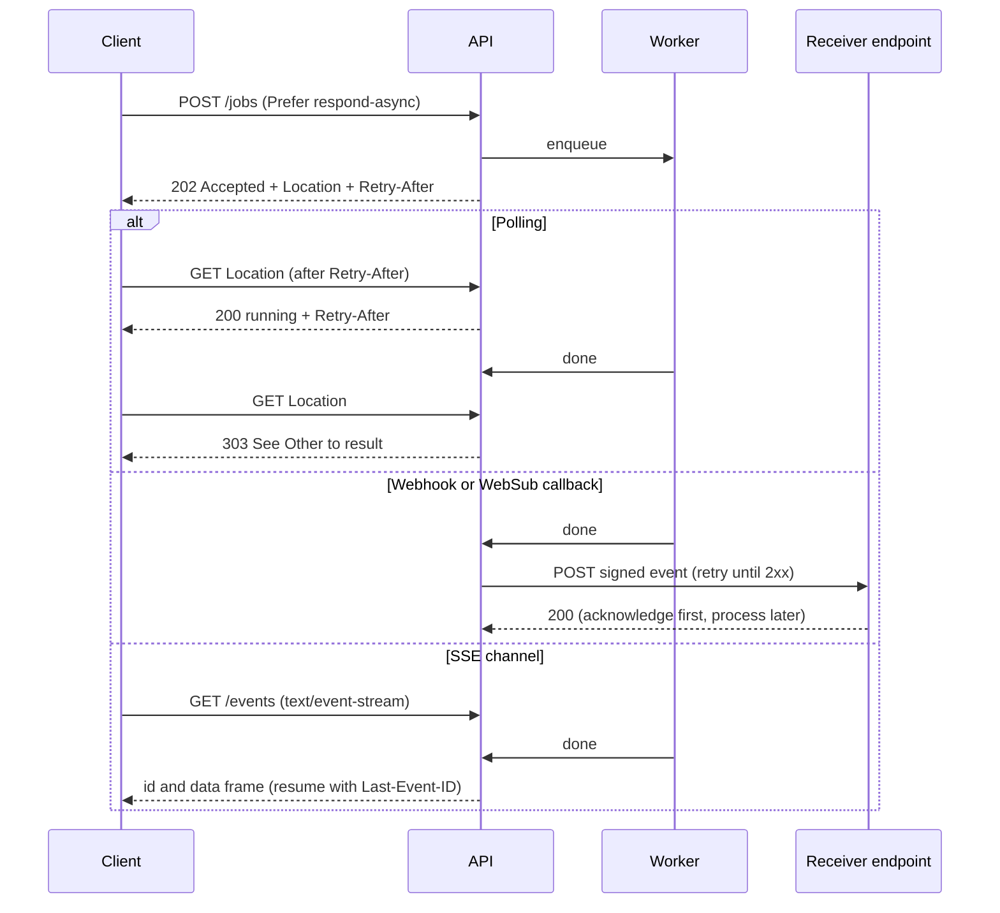

# Asynchronous Request-Reply Topologies: Polling vs Webhooks vs Callback URLs vs SSE Notification Channels

> [!summary] Claim
> An operation that outlives one HTTP exchange needs a durable status resource first and a notification channel second: polling, a signed webhook, a verified WebSub callback, or an SSE stream only decide how fast and how cheaply the client learns what the resource already says, so never make the push channel the only source of truth.

Part of [GraphQL JSON RPC and Event APIs](README.md) in [API Engineering](../README.md).

## TL;DR

- Mechanism: the server answers the first request with `202 Accepted` plus a `Location` status resource, then the client learns of completion by polling that resource, by receiving a `POST` on a callback URL (webhook or WebSub), or by reading a `text/event-stream` response.
- Contract rule: delivery is at-least-once and unordered, success is a `2xx` within a short deadline, redirects count as failures, and the receiver must verify a signature over the raw bytes, deduplicate on a stable message id, and acknowledge before it processes.
- Trap: signing or verifying a re-serialised JSON body, and doing real work before the `2xx`, are the two defects behind most "webhooks are flaky" reports.
- Portability: the lab ran only on CPython 3.14.6 (macOS arm64); the HTTP semantics come from RFC 9110, RFC 7240, the W3C WebSub Recommendation, and the WHATWG HTML Standard, so they do not depend on the Python version, but the other matrix cells were not run.
- Do not use any of these for bidirectional low-latency traffic (use WebSockets, see [[Real-Time-Push-Protocols-Compared-WebSockets-vs-SSE-vs-HTTP-2-3-Streaming-vs-Long-Polling]]), for high-fanout internal event flow (use a broker, see [[Event-Driven-APIs-and-AsyncAPI-3-1-0-Specification]]), or for a consumer that cannot expose an inbound endpoint and cannot hold a connection (poll).

## Mental model



All four topologies share the first two arrows: the request is accepted for processing and the answer is a pointer, not a result (RFC 9110 Section 15.3.3).
Polling puts the clock on the client, so cost grows with how often it asks and latency is bounded by the gap between asks.
A webhook or WebSub callback puts the clock on the provider, so cost is one request per event plus retries, and latency is near zero unless the receiver is down, in which case it is set by the retry schedule.
An SSE stream keeps one response open, so cost is one request plus keepalive comments, and a dropped connection is healed by replaying from `Last-Event-ID`.
The status resource from the first arrow stays authoritative in every branch, which is what makes a lost callback or a missed frame recoverable.

## How it works

### The shared first step: `202`, `Location`, `Retry-After`

`202 Accepted` means "accepted for processing, but the processing has not been completed" and "there is no facility in HTTP for re-sending a status code from an asynchronous operation" (RFC 9110 Section 15.3.3).
The same section says the representation sent with a `202` "ought to describe the request's current status and point to (or embed) a status monitor", which is the status resource.
The specification does not say how the pointer is expressed.
RFC 9110 Section 10.2.2 says the relationship a `Location` value has to the request "is defined by the combination of request method and status code semantics" and spells it out only for `201` (the created resource) and `3xx` (the redirect target), so using `Location` on a `202` is a convention, shown in the `Prefer: respond-async` example (RFC 7240 Section 4.1) and in the Azure Architecture Center pattern.
RFC 7240 Section 4.1 itself says "whether and how any given server supports asynchronous responses is an implementation-specific detail".
Document the convention in your API description rather than assuming clients know it.

`Prefer: respond-async` lets a client state that it can handle a `202` (RFC 7240 Section 4.1), and `Prefer: wait=N` gives the server an upper bound before it should switch to asynchronous processing (RFC 7240 Section 4.3).
Both preferences may be ignored, so a client must handle either a synchronous `200` or a `202` from the same request.
The lab's `JobService` answers short jobs inline with `200` unless `respond-async` is present, and a `202` otherwise (the test `test_short_jobs_answer_inline_unless_the_client_prefers_respond_async`).
Google's AIP-151 takes the same split but wraps it in a type: a long-running method returns a `google.longrunning.Operation`, whose fields are `name`, `metadata`, a boolean `done`, and a `result` oneof of `error` or `response` (googleapis `google/longrunning/operations.proto`, `message Operation`, read on 2026-11-26), and AIP-151 gives "10 seconds" as the rule of thumb for what counts as a significant amount of time.
See [[Long-Running-Operations-202-Accepted-and-Operation-Resources-AIP-151]] for the operation-resource design and [[Asynchronous-Job-Result-Expiration-Cancellation-and-Wait-Semantics]] for expiry and cancellation; this note covers how completion is announced.

The `Retry-After` field carries either an HTTP-date or a non-negative integer of seconds (`Retry-After = HTTP-date / delay-seconds`, RFC 9110 Section 10.2.3).
RFC 9110 defines its meaning with `503` and with `3xx`; the same section's grammar is what polling APIs reuse on `202` and on a `200` that says "still running", and RFC 6585 Section 4 says a `429` may include it.
The lab parses both forms in `parse_retry_after` and rejects `soon`, `-5`, and `1.5` (the test `test_retry_after_accepts_delay_seconds_and_http_date`).

A create call is a `POST`, and `POST` is not idempotent: RFC 9110 Section 9.2.2 lists `PUT`, `DELETE`, and the safe methods as idempotent and says an idempotent request "can be repeated automatically if a communication failure occurs".
A client whose `202` was lost cannot tell whether the job exists, so the lab's `POST /jobs` accepts an `Idempotency-Key` header, replays the same `Location` for the same key and body, and answers `422` with `application/problem+json` for the same key and a different body (the test `test_idempotency_key_replays_the_same_job_and_rejects_a_changed_body`).
The `422` choice is this lab's design, not a quote from a specification.
See [[Atomic-Idempotency-Phases-and-Failure-Recovery-Across-Network-Drops]] and [[Idempotent-Request-Identification-and-Request-ID-Correlation-AIP-155]].

Errors use RFC 9457 problem details: the canonical form is a JSON object identified by the `application/problem+json` media type, with the members `type`, `status`, `title`, `detail`, and `instance` (RFC 9457 Section 3 and Section 3.1).
The Azure pattern suggests considering the same format for a failed operation's `error` field.
See [[Problem-Details-for-HTTP-APIs-RFC-9457]].

### Topology 1: polling the status resource

The wire exchange the lab produces for a 30 second job is:

```
POST /jobs HTTP/1.1
Prefer: respond-async
Content-Type: application/json

{"duration": 30}

HTTP/1.1 202 Accepted
Location: /jobs/job-1
Retry-After: 30
Content-Type: application/json

{"id": "job-1", "status": "running"}
```

While the work runs, `GET /jobs/job-1` returns `200` with `{"id": "job-1", "status": "running"}` and a `Retry-After` that counts down: `20` ten seconds in, then `1` at 29.5 seconds because the lab rounds up and never advertises `0` (the test `test_retry_after_counts_down_and_never_drops_below_one_second`).
When the work is done, the status resource answers `303 See Other` with `Location: /jobs/job-1/result`, and the client issues `GET` on that URL.
Azure recommends `303` over `302` here: `303` "instructs the client to issue a GET request to the redirect URL, regardless of the original request method", whereas `302` "doesn't guarantee a method change" and some clients replay the original method, which can duplicate a `POST` (Azure Async Request-Reply pattern, "Problems and considerations").
RFC 9110 Section 15.4.4 defines `303` as an indirect response to the original request that the user agent retrieves with `GET` or `HEAD`, applicable to any method, and "primarily used to allow the output of a POST action to redirect the user agent".
The Azure document also lists the fields a status body should carry: `status` from a documented set of terminal and non-terminal values, `createdAt`, `lastUpdatedAt`, an optional `percentComplete`, and an `error` object, and it suggests a `DELETE` on the status resource for cancellation and an `Expires` header for the retention window.

After the retention window the lab answers `410 Gone`, not `404`, for a job it knows it removed, and `404` for an id it never issued.
RFC 9110 Section 15.5.11 says `410` signals the condition "is likely to be permanent" and that a server that cannot tell should use `404`; keeping a tombstone set is what lets the server tell (the test `test_result_expires_to_410_gone_while_an_unknown_job_is_404`).
The cost is a tombstone per expired job, so bound the set by age in production.

Cost model.
A client polling with delays `first`, `first*factor`, ... clamped at `cap` hits the server at the cumulative sums of that sequence.
For `first=1`, `factor=2`, `cap=30` the poll times are 1, 3, 7, 15, 31, 61, 91 seconds, so a job finishing at 90 seconds costs 7 requests, 6 of them empty, and is noticed 1 second late; a fixed 5 second interval costs 18 requests, 17 empty, and is noticed on time (the tests `test_exponential_backoff_polling_finds_a_90_second_job_in_7_requests` and `test_fixed_interval_polling_spends_more_requests_than_backoff`).
Worst-case lateness is the current delay, so it is bounded by `cap`; total requests for a long job grow as roughly `T/cap` once the delay saturates.
The server can do better than any client-side schedule because it knows the remaining time, which is why the `Retry-After` on each `200` should be computed, not constant.
When many clients poll one resource, add jitter: the lab's `jittered(delay, fraction, rng)` spreads a delay over `[delay*(1-fraction), delay*(1+fraction)]` so that clients released by the same `Retry-After` do not return in the same millisecond.

### Topology 2: webhooks and callback URLs

A webhook is an HTTP callback: the provider sends a `POST` to a URL the consumer registered (Standard Webhooks, "What are Webhooks?": "a sort of a 'reverse API'").
Three registration styles exist, and they differ in who owns the URL lifecycle.

- Static endpoint subscription: the consumer registers an endpoint once and chooses event types, as with Stripe, whose documentation calls a registered endpoint an "event destination" and allows up to 16 of them (Stripe webhooks documentation, as of 2026-11), and GitHub webhooks.
  Standard Webhooks recommends letting consumers pick event types so the provider filters.
- Per-request callback URL: the caller passes a URL in the create request and gets a single notification for that operation.
  This is the callback variant of async request-reply.
  It needs the same SSRF and verification treatment as a registered endpoint because the URL is attacker-chosen input (see Security and robustness).
- Verified subscription with a hub: WebSub, covered below, adds intent verification, leases, and discovery.

Delivery semantics that all providers converge on, with the sources:

- Success is `2xx`; everything else is a failure, including redirects, timeouts, and connection resets (Standard Webhooks, "Delivery success and failure"; WebSub Section 7: "subscribers MUST NOT use HTTP redirects for moving subscriptions").
- The response deadline is short: GitHub terminates the connection after 10 seconds and counts the delivery as failed (GitHub, "Respond within 10 seconds", as of 2026-11); Standard Webhooks recommends a sender timeout between 15 and 30 seconds.
- Retries are the provider's job and span days: Stripe retries live-mode deliveries "for up to three days with an exponential back off" (Stripe webhooks documentation, "Automatic retries", as of 2026-11); the Standard Webhooks example schedule is 10 attempts at 0 s, 5 s, 5 min, 30 min, 2 h, 5 h, 10 h, 14 h, 20 h, and 24 h gaps, totalling 75 hours 35 minutes 5 seconds, which the lab asserts as `sum(STANDARD_WEBHOOKS_SCHEDULE) == 272105`.
- Status codes steer the sender: `410` disables the endpoint, `429`, `502`, and `504` mean throttle, a `retry-after` header "should be taken into consideration when scheduling the next attempt", and consistent long-term failure should trigger notification over another channel, with endpoint disablement recommended (Standard Webhooks, "Delivery success and failure" and "Deliverability and reliability").
- Delivery is at-least-once and unordered: Stripe says endpoints "might occasionally receive the same event more than once", that events can share a `created` second so it cannot order them, and that you should track event ids and fetch missing objects from the API (Stripe webhooks documentation, "Handle duplicate events" and ordering note).
- Acknowledge before processing: Stripe says to "quickly return a successful status code (2xx) before any complex logic", and GitHub suggests a queue so the handler responds and processes in the background.

The lab's `WebhookSender.deliver` implements exactly this policy, and its tests pin each rule:

| Rule | Lab test |
| --- | --- |
| Same `webhook-id`, fresh `webhook-timestamp` and signature on each attempt, waits 5 s then 300 s | `test_sender_retries_with_the_same_id_a_fresh_timestamp_and_the_schedule` |
| `410` stops delivery and flags the endpoint disabled; a `301` is a failure and is not followed | `test_sender_stops_on_410_and_never_follows_a_redirect` |
| A transport error counts as a retryable failure | `test_sender_treats_a_transport_error_as_a_retryable_failure` |
| `Retry-After` can lengthen but never shorten the scheduled wait | `test_retry_after_can_lengthen_but_never_shorten_the_schedule` |
| A permanently failing endpoint costs 10 attempts and the whole 75 h 35 m 5 s | `test_a_permanently_failing_endpoint_exhausts_the_whole_75_hour_schedule` |
| A lost acknowledgement causes a duplicate that the receiver absorbs | `test_a_lost_acknowledgement_causes_a_duplicate_that_the_receiver_absorbs` |

The last row is the central at-least-once fact.
The receiver processed the first delivery and its `200` was lost, so the sender retried; only the `webhook-id` deduplication in `WebhookReceiver` keeps the effect single.
Deduplication must therefore be durable and checked before the side effect, which is the inbox pattern in [[Idempotent-Event-Consumers-Inbox-Pattern-and-Poison-Message-DLQs]]; the lab's in-memory `seen` set only models the contract.
Standard Webhooks suggests keeping ids "in redis for 5 minutes", which is only enough if the sender's retry window is shorter than that, so size the dedup horizon to the sender's full retry schedule, 75 hours in the example above.

Payload shape is a separate decision.
Standard Webhooks recommends a JSON body with `type` (dot-delimited, such as `contact.created`), `timestamp` (when the event occurred, not when it was delivered), and `data`, and keeping payloads small, "usually smaller than 20kb".
A thin payload carries only identifiers and makes the consumer fetch current state, which tolerates reordering and stale data; a full payload saves a round trip but can arrive out of date.
Envelope standards, including `ce-` headers and structured mode, are in [[CloudEvents-1-0-2-Envelope-Structured-vs-Binary-Content-Modes-and-Schema-Registries]].

#### Signing: what the bytes are

Standard Webhooks (specification header "Version: 1.0.0", read 2026-11-26) signs `msg_id.timestamp.payload`, three fields joined by full stops, with HMAC-SHA256 and sends the result as `v1,` followed by the base64 digest.
Three headers carry the metadata: `webhook-id` (stable across retries, usable as an idempotency key), `webhook-timestamp` (integer seconds, refreshed per attempt), and `webhook-signature` (a space-delimited list, so two keys can sign the same delivery during rotation).
A symmetric key is 24 to 64 bytes and the specification says to compare with a constant-time function.
The specification says the message id and timestamp should not be user controlled, "or at the very least not be allowed to include any `.`", because the dot is the field delimiter (Standard Webhooks, "Signature scheme"); the lab makes that a hard rule and refuses such an id in `sign_message` and the verifier turns it into a `WebhookVerificationError` (the tests `test_a_dot_in_the_message_id_is_refused_because_it_would_blur_the_field_boundary` and `test_missing_or_tampered_headers_are_verification_errors`).
An asymmetric variant, `v2a` with ed25519 over the SHA-256 of `endpoint_id.msg_id.timestamp.payload`, is specified but not implemented in the lab.

The lab verifier, simplified excerpt:

```python
def verify_message(keys, headers, payload, *, now, tolerance=300) -> str:
    msg_id = headers["webhook-id"]
    presented = headers["webhook-signature"].split(" ")
    timestamp = int(headers["webhook-timestamp"])
    if tolerance <= 0:
        raise ValueError("tolerance must be positive; zero would disable the replay check")
    if abs(now - timestamp) > tolerance:
        raise WebhookVerificationError("timestamp outside tolerance")
    try:
        expected = [sign_message(k, msg_id, timestamp, payload).encode() for k in keys]
    except ValueError as exc:
        raise WebhookVerificationError("malformed webhook-id") from exc
    matched = False
    for candidate in expected:
        for signature in presented:
            matched |= hmac.compare_digest(candidate, signature.encode())
    if not matched:
        raise WebhookVerificationError("no valid signature")
    return msg_id
```

Two details matter.
`payload` is the raw request bytes: the test `test_verification_must_see_the_raw_bytes_not_a_reserialised_parse` shows that `{"a":1,"b":2}` and `{"a": 1, "b": 2}` verify differently.
In Starlette that means `await request.body()` (starlette 1.10.0 starlette/requests.py, `Request.body`) and never `await request.json()` followed by `json.dumps`; Stripe makes the same demand ("Stripe requires the raw body of the request to perform signature verification").
The timestamp window is checked in both directions (`now=1300` passes, `1301` and `699` fail for a signature made at 1000 with tolerance 300), and a tolerance of zero raises `ValueError` because Stripe documents that zero "disables the recency check entirely" in its libraries; a verifier should refuse the footgun rather than inherit it.
Stripe's default tolerance is 5 minutes and it tells integrators to keep clocks synchronised with NTP (Stripe webhooks documentation, "Preventing replay attacks").

Compare the WebSub signature, `X-Hub-Signature: sha256=<hex>`, an HMAC over the body only with the `hub.secret` as key (WebSub Section 7.1).
It has no timestamp and no id, so a captured delivery can be replayed indefinitely; the specification concedes that "this signature only ensures that the payload was not forged" and that headers should not be considered safe unless the callback uses HTTPS (WebSub Section 7.1.2).
It also notes that "most hubs sign with SHA-1" despite its weakness (Section 7.1.1) and that "a minimum of SHA-256 should be used" when the callback is not HTTPS or TLS may be compromised (Section 8.3); the lab subscriber accepts `sha256`, `sha384`, and `sha512` and drops a correctly computed `sha1` signature as weak (the test `test_subscriber_drops_forged_unsigned_and_sha1_distributions_but_acks_them`).
Stripe signs a timestamp together with the payload in its `Stripe-Signature` header and generates a new timestamp and signature on every retry, which is the same design as `webhook-timestamp`.

### Topology 3: WebSub

WebSub is the W3C Recommendation that standardises the verified-subscription style (page header: "W3C Recommendation 02 June 2026", as of 2026-11; earlier drafts were called PubSubHubbub 0.3 and 0.4).
It has three roles: a publisher that owns a topic URL, a hub that implements both sides of the protocol and fans content out, and subscribers identified by a callback URL (WebSub Section 1 defines them, Section 3.1.1 names the three).
A subscription's unique key is the tuple `(topic URL, subscriber callback URL)`, and subscriptions have expiration times "akin to DHCP leases" (WebSub Section 1).

**Discovery** (WebSub Section 4).
The subscriber fetches the topic with `GET` or `HEAD` and MUST look for HTTP `Link` headers first, where the publisher SHOULD send at least one `rel="hub"` and exactly one `rel="self"`; only if there are none does it look at embedded `<link>` elements in the feed or HTML.
The `self` URL, not the URL the subscriber fetched, becomes `hub.topic` (WebSub Section 5.1).
The `self` URL should offer a single representation because the hub cannot know what `Accept` the subscriber used; content negotiation is done by returning a different `self` per `Accept` or `Accept-Language` (WebSub Section 4.1).
Security consideration: a `<link>` in a page body could be planted by a user, so the specification suggests discovery only in `<head>` (WebSub Section 8.1).

**Subscribe** (WebSub Section 5.1).
The subscriber `POST`s `application/x-www-form-urlencoded`, UTF-8, with `hub.callback`, `hub.mode` (`subscribe` or `unsubscribe`), `hub.topic`, and optionally `hub.lease_seconds` (a positive decimal integer) and `hub.secret` (cryptographically random, "less than 200 bytes").
The callback "SHOULD be an unguessable unique URL" (a capability URL), SHOULD use HTTPS, may carry its own query string, and should differ per hub and per renewal (WebSub Section 5.1.1).
The hub answers `202 Accepted` immediately: "the HTTP response MUST NOT depend on the process or outcome of verification or validation" (WebSub Section 5.1.2).
A hub that cannot serve the request may redirect with `307` or `308` and a `Location`.
Re-requesting an active subscription is how a lease is renewed, and the new request overrides the old state "only once the action is verified"; if verification fails the previous state must be left unchanged (WebSub Section 5.1).

**Verify intent** (WebSub Section 5.3).
To stop an attacker subscribing a victim, the hub sends `GET` to the callback with `hub.mode`, `hub.topic`, `hub.challenge` (random, and restricted to the characters `+ - . / 0-9 = A-Z _ a-z`), and for `subscribe` also `hub.lease_seconds`, appended after any existing query string (WebSub Section 5.1.1 requires the hub to preserve it).
The subscriber must check that the mode and topic match a pending request, then answer `2xx` with a body equal to the challenge; otherwise `404` (WebSub Section 5.3.1).
Any other status, or a `2xx` with a different body, means verification failed.
The wire exchange in the lab, as asserted by `test_subscription_request_is_202_and_only_active_after_intent_verification`:

```
POST / HTTP/1.1
Content-Type: application/x-www-form-urlencoded

hub.mode=subscribe&hub.callback=https%3A%2F%2Fsubscriber.example%2Fcb%2Ftok-8f3a1c&hub.topic=https%3A%2F%2Fpublisher.example%2Ffeed&hub.lease_seconds=600

HTTP/1.1 202 Accepted

GET /cb/tok-8f3a1c?hub.mode=subscribe&hub.topic=https%3A%2F%2Fpublisher.example%2Ffeed&hub.challenge=challenge-0001&hub.lease_seconds=600 HTTP/1.1

HTTP/1.1 200 OK
Content-Type: application/octet-stream
X-Content-Type-Options: nosniff

challenge-0001
```

The subscriber responds with `application/octet-stream` and `X-Content-Type-Options: nosniff` because echoing an attacker-controlled string into a response is a reflected XSS vector, and the specification credits an XSS report for this requirement (WebSub Section 8.2 and Appendix A, Acknowledgements).
It should also bound the challenge length and reject binary data (WebSub Section 8.2); the lab uses the hub's own permitted character set from Section 5.3 as the pattern `[+\-./0-9=A-Z_a-z]{1,200}` and returns `404` for `<script>alert(1)</script>` (the test `test_subscriber_refuses_unknown_tokens_unsafe_challenges_and_serves_octet_stream`).
A denial arrives the same way, as a `GET` with `hub.mode=denied`, and the specification says the hub MAY deny at any point, even after acceptance (WebSub Section 5.2).
The specification explains why verification is a `GET` and distribution a `POST`: it lets one callback URL tell the two apart without inspecting a body (WebSub Section 5.3.1, note).

**Leases** (WebSub Section 5.3.1 and Section 8.2).
The hub chooses `hub.lease_seconds`, "MUST enforce lease expirations, and MUST NOT issue perpetual lease durations" (Section 5.3.1); it "SHOULD enforce short lived hub.lease_seconds (10 days is a good default)" (Section 8.2).
The subscriber must renew before the lease elapses.
In the lab, a requested `99999999` is capped to `MAX_LEASE_SECONDS = 864_000`, a publish one second before expiry delivers, and a publish at expiry removes the subscription instead (the test `test_lease_is_capped_at_ten_days_and_enforced_at_publish_time`).

**Distribute** (WebSub Section 7).
The hub `POST`s the full topic content with the topic's `Content-Type`, plus a `Link` header containing `rel="hub"` and `rel="self"`, which the subscriber must not use to identify the subscription because those are topic metadata.
For Atom and RSS the hub may drop already-delivered entries.
A `2xx` is success, a `410` may end the subscription, any other code is a failure, and "the hub MUST keep the subscription active until the end of the lease duration" while retrying "up to self-imposed limits".
The subscriber's `2xx` should mean receipt, not completion.
The lab covers each branch: signed delivery with the `Link` header (`test_distribution_is_signed_links_hub_and_self_and_reaches_the_subscriber`), retry then success, and a subscription that survives retry exhaustion and is healed by the next publish (`test_failed_deliveries_are_retried_and_the_subscription_survives_exhaustion`), `410` termination (`test_a_410_from_the_subscriber_terminates_the_subscription`), and redirect-as-failure (`test_a_redirect_from_the_callback_is_a_failure_and_is_not_followed`).
Forged or unsigned distributions are acknowledged and dropped, because the specification allows a `2xx` for an invalid signature so as to "prevent brute-force attempts of the signature" (WebSub Section 7.1.2).

**Publish** is deliberately unspecified: "The specific mechanism for the publisher to inform the hub is left unspecified", with some public hubs using a `POST` of `hub.mode=publish` and `hub.url` (WebSub Section 6).
**Migration** of a topic is done by redirecting the old topic URL; renewals re-run discovery and land on the new `self` and hub (WebSub Section 6.1).

What WebSub buys over a bare webhook is the verified opt-in, a standard lease so dead subscribers expire on their own, and discovery so one URL leads to the hub.
What it costs is a hub to run and a two-leg handshake.
The hub is also an SSRF primitive, because verification is a server-side `GET` to a caller-chosen URL; the lab hub therefore calls `validate_callback_url` before it queues anything.

### Topology 4: SSE as the notification channel

Server-Sent Events turn one long `GET` into a stream of events (WHATWG HTML Standard, section 9.2).
The response is `Content-Type: text/event-stream`, always UTF-8.
The client treats any status other than `200`, or any other content type, as a failed connection (WHATWG 9.2.2, constructor step 15.3) that it will not retry (9.2.3); `204 No Content` is the documented way to tell a client to stop reconnecting, and `301` and `307` redirects work "as with normal HTTP requests" (9.2.1).
A stream is a series of blocks separated by a blank line.
Within a block, a line starting with `:` is a comment, and the fields are `event`, `data`, `id`, and `retry`.
A field value loses one leading space, so `data:test` and `data: test` are the same; multiple `data` lines are joined with a line feed; an `id` containing U+0000 is ignored; `retry` must be ASCII digits and sets the reconnection time, which is in milliseconds (9.2.2); and an event still unterminated when the connection closes "is not dispatched" (WHATWG 9.2.5 for the grammar and line endings, 9.2.6 for these rules).
The lab's `parse_stream` implements these rules and its test pins each one, including that the last event id persists across events until the server sets another.

What the lab server sends for a log holding two events (assertions in `test_reconnect_with_last_event_id_replays_only_the_gap`):

```
HTTP/1.1 200 OK
Content-Type: text/event-stream; charset=utf-8
Cache-Control: no-store
X-Accel-Buffering: no

retry: 3000

id: 1
event: status
data: queued

id: 2
event: status
data: running

: keep-alive

```

Resume is the feature that makes SSE a safe notification channel.
When the connection drops, the user agent waits the reconnection time (optionally longer, "exponential backoff" if the previous attempt failed), then reconnects with `Last-Event-ID` set to the last event id string it saw (WHATWG 9.2.3 and 9.2.4).
The server replays everything after that id.
The lab's `EventLog.since` does so, and a garbage `Last-Event-ID` replays from the start.
When the log is closed and the client's id is the last one, the lab answers `204`, so a client that has seen the terminal event does not reconnect forever (the test `test_a_finished_stream_answers_204_so_the_browser_stops_reconnecting`).

Resume has two failure modes the protocol does not solve.
First, the server must retain events long enough: if the buffer has evicted the id the client presents, the client silently misses events unless the server detects the gap and sends a full-state snapshot or an explicit resync event; the lab log is unbounded, so it does not model eviction.
Second, ids must be totally ordered per stream, because the header carries one id and the server must derive a position from it; the lab uses a monotonically increasing integer rendered as a string.

Operational details from the specification and from `sse-starlette 3.6.0` (`sse_starlette/sse.py`, class `EventSourceResponse`):

- Idle proxies drop connections, so authors should send a comment line "every 15 seconds or so" (WHATWG 9.2.7); `EventSourceResponse` has `DEFAULT_PING_INTERVAL = 15`.
- Buffering proxies hold bytes back, so `EventSourceResponse` sets `Cache-Control: no-store` unless the caller overrides it, `Connection: keep-alive`, and `X-Accel-Buffering: no`; the lab's hand-written `notification_app` sets the first and last.
- HTTP chunking by an unaware layer "can have unexpected negative effects" (WHATWG 9.2.7).
- Per-server connection limits hurt pages that open several `EventSource` objects to one domain (WHATWG 9.2.7); over HTTP/2 the recommendation is that `SETTINGS_MAX_CONCURRENT_STREAMS` be "no smaller than 100" (RFC 9113 Section 6.5.2).
- The `EventSource` constructor takes a URL and an options dictionary whose only member is `withCredentials` (WHATWG 9.2.2), so there is no option for a custom request header; token authentication must use cookies, a token in the URL, or a `fetch`-based client, and a URL token leaks into logs, which is the same capability-URL trade-off as a WebSub callback.

The framing code is also a security boundary.
`encode_event` splits `data` on `\r\n`, `\r`, and `\n` and emits one `data:` line per piece, and refuses an `id` or event name containing CR, LF, or NUL.
The test `test_multi_line_data_becomes_data_lines_and_never_injects_a_field` feeds `x\n\nevent: evil\nid: 999` and shows that it parses back as a single `message` event with the hostile text as data, not as an injected `event` and `id`.

SSE is not a webhook replacement for server-to-server delivery: it needs the consumer to hold a connection to the provider, and RFC 9205 Section 4.15 lists why HTTP/2 server push is no substitute: it is hop by hop, so it may not work through proxies and CDNs, and there is no browser API for it.
It is the right channel when the consumer is a browser or a client behind NAT that cannot expose an endpoint but can open a connection.
The protocol-level comparison with WebSockets, HTTP/2 streaming, and long polling is in [[Real-Time-Push-Protocols-Compared-WebSockets-vs-SSE-vs-HTTP-2-3-Streaming-vs-Long-Polling]].

### Choosing among the four

| Question | Polling | Webhook or callback URL | WebSub | SSE |
| --- | --- | --- | --- | --- |
| Who needs an inbound endpoint | Nobody | Consumer | Subscriber and hub | Nobody (consumer opens the connection) |
| Latency after completion | Up to the current poll gap | Near zero when the receiver is up, the retry gap when it is down | As webhook, hub adds a hop | Near zero while connected, reconnect delay after a drop |
| Requests per operation (90 s job, lab model) | 7 (backoff) or 18 (5 s fixed) | 1 healthy, 3 with 200 s of downtime | As webhook plus the handshake | 1, or 2 after a drop, plus 6 keepalive comments |
| Replay after downtime | The status resource | Provider retry schedule, then manual replay | Hub retry within the lease | `Last-Event-ID`, bounded by the buffer |
| Ordering | By construction (current state) | Not guaranteed | Not guaranteed | Per stream, by `id` |
| Fan-out | Each client polls | One `POST` per endpoint | Hub fans out per subscription | One response per client |

The webhook "3 with 200 s of downtime" figure is the lab's `webhook(10.0, STANDARD_WEBHOOKS_SCHEDULE, receiver_up_at=210.0)`: attempts at 10 s, 15 s, and 315 s, so latency is 305 s, dominated by the gap in the retry schedule, not by when the receiver recovered.
The SSE row is `sse(90.0, drop_at=88.0, reconnect_delay=3.0)`, which reconnects at 91 s and so notices the completion 1 second late.
These are outputs of the lab's closed-form functions, not measurements of a real network.

The robust production pattern combines channels: emit a thin webhook or SSE event as a hint, keep the status resource as the source of truth, and run a slow reconciliation poll that catches any lost notification.
Stripe's guidance is the same shape: track event ids to dedupe, and "use the API to retrieve any missing objects".

## Numbers and limits

| Quantity | Value | Source or measurement |
| --- | --- | --- |
| `Retry-After` forms | HTTP-date or non-negative integer seconds | RFC 9110 Section 10.2.3 |
| `429` may carry `Retry-After`; response must not be cached | Yes, `MUST NOT` be stored by a cache | RFC 6585 Section 4 |
| Rule-of-thumb threshold for "long-running" | 10 seconds | AIP-151 |
| GitHub webhook response deadline | 10 seconds, then the delivery fails | GitHub docs, "Respond within 10 seconds" (as of 2026-11) |
| Recommended sender request timeout | 15 to 30 seconds | Standard Webhooks, "Request timeouts" |
| Recommended payload size | Usually under 20 kB | Standard Webhooks, "Payload size" |
| Symmetric signing key size | 24 to 64 bytes | Standard Webhooks, signature scheme table |
| Example retry schedule | 10 attempts, 75 h 35 min 5 s in total (272105 s) | Standard Webhooks; asserted by `test_standard_webhooks_schedule_spans_75_hours_35_minutes_5_seconds` |
| Stripe live-mode retry horizon | Up to three days, exponential back-off | Stripe webhooks documentation (as of 2026-11) |
| Stripe default signature tolerance | 5 minutes | Stripe webhooks documentation, "Preventing replay attacks" (as of 2026-11) |
| Stripe secret roll overlap | Up to 7 days | Stripe webhooks documentation (as of 2026-11) |
| WebSub `hub.secret` size | Less than 200 bytes (lab limit 199) | WebSub Section 5.1; `test_hub_validates_the_subscription_request_parameters` |
| WebSub lease | Hub must enforce expiry; 10 days suggested default | WebSub Sections 5.3.1 and 8.2; lab cap 864000 s |
| WebSub verification response media type | `application/octet-stream` with `X-Content-Type-Options: nosniff` | WebSub Section 8.2 |
| SSE keepalive comment interval | About 15 seconds | WHATWG 9.2.7; `sse-starlette 3.6.0` `DEFAULT_PING_INTERVAL = 15` |
| HTTP/2 concurrent streams (recommendation) | Not smaller than 100 | RFC 9113 Section 6.5.2 |
| `httpx 0.28.1` default timeout and redirects | 5 seconds; `follow_redirects=False` | (httpx 0.28.1 httpx/_config.py, `DEFAULT_TIMEOUT_CONFIG = Timeout(timeout=5.0)`); (httpx 0.28.1 httpx/_client.py, `BaseClient.__init__`) |
| Polling a 90 s job, `first=1 factor=2 cap=30` | 7 requests, 6 empty, 1.0 s late | Lab, `test_exponential_backoff_polling_finds_a_90_second_job_in_7_requests` |
| Polling a 90 s job, fixed 5 s | 18 requests, 17 empty, 0.0 s late | Lab, `test_fixed_interval_polling_spends_more_requests_than_backoff` |
| Lab suite | 65 tests passed in 0.30 s (wall time varies run to run) | `uv run --frozen pytest ...`, CPython 3.14.6, macOS 27.3 (Darwin 27.3.0 arm64), verifier rerun 2026-11-26 |

## Portability

| Dimension | Cell | Evidence |
| --- | --- | --- |
| CPython 3.14.6 (the workspace interpreter) | 65 passed | Lab run, command in Worked example |
| CPython 3.12, 3.13, 3.15, 3.15 free-threaded | Not run | Lab matrix checks were paused by the user on 2026-11-11 for this job |
| Library versions | `starlette 1.10.0`, `httpx 0.28.1`, `sse-starlette 3.6.0` (source read, not exercised by the lab) | `labs/pyproject.toml` pins; installed under `labs/.venv` |
| In-process ASGI transport | The lab never opens a socket, so server buffering, TCP keepalive, and TLS behavior are not exercised | Design of the lab |
| Uvicorn 0.54.0 | HTTP/1.1 through `h11` or `httptools`; HTTP/2 only with the optional `zttp` package (`http2=True` plus `http="zttp"`); on `httptools`, a response without `content-length` or `transfer-encoding` gets `transfer-encoding: chunked`, which is how an SSE stream is framed; the `zttp` HTTP/2 path strips `connection`, `keep-alive`, `proxy-connection`, `transfer-encoding`, and `upgrade` from responses | Installed source read, not run: (uvicorn 0.54.0 `uvicorn/config.py`, `Config.load`); (uvicorn 0.54.0 `uvicorn/protocols/http/httptools_impl.py`, response start handling); (uvicorn 0.54.0 `uvicorn/protocols/http/zttp_h2_impl.py`, `FORBIDDEN_HEADERS`) |
| Hypercorn 0.18.0 | Ships `h11`, `h2`, and `h3` protocol modules and a `--quic-bind` option for a UDP socket; the QUIC layer imports `aioquic` | Installed source read, not run: (hypercorn 0.18.0 `hypercorn/protocol/`, `hypercorn/__main__.py`, `hypercorn/protocol/quic.py`) |
| Granian 2.8.7 | `--http` accepts `auto`, `1`, or `2`; the CLI has no HTTP/3 option | Installed source read, not run: (granian 2.8.7 `granian/constants.py`, `HTTPModes`; `granian/cli.py`) |
| HTTP/1.1 | `Last-Event-ID` and chunking cautions come from the WHATWG text | WHATWG 9.2.4 and 9.2.7 |
| HTTP/2 | Concurrent-stream recommendation of at least 100; `Connection` and the other connection-specific fields must not be sent | RFC 9113 Sections 6.5.2 and 8.2.2 |
| HTTP/3 over QUIC | A message containing connection-specific fields is malformed, so the `Connection: keep-alive` header that `sse-starlette` always sets (`EventSourceResponse.__init__`, 3.6.0) must be dropped by the server layer before it reaches a client on HTTP/2 or HTTP/3; the SSE grammar and `Last-Event-ID` are defined over HTTP semantics and do not change | RFC 9114 Section 4.2; RFC 9113 Section 8.2.2; WHATWG 9.2; the lab did not exercise any HTTP/3 stack |
| Provider behavior (GitHub, Stripe) | Dated as of 2026-11 and changes without a version number | Vendor documentation |

The protocol semantics (`202`, `303`, `Retry-After`, the WebSub parameters, the SSE grammar) are defined by specifications and are not implementation-specific.
The Python-specific details that can vary between interpreter releases are limited here: `email.utils.parsedate_to_datetime` for the `Retry-After` HTTP-date, `ipaddress` for the SSRF guard, and `hmac.compare_digest`.
The SSRF guard unwraps an IPv4-mapped IPv6 address by hand with `ipv4_mapped` before testing it, so it does not rely on how a given `ipaddress` release classifies `::ffff:127.0.0.1`; a one-line check (`ipaddress.ip_address('::ffff:127.0.0.1').is_global`) printed `False`, with `is_loopback` `True`, on CPython 3.12.13, 3.13.18, and 3.14.6 on this machine (2026-11-26), and `100.64.0.1` printed `is_global` `False` and `is_private` `False` on all three.

## Worked example

The implementation is [implementation](../labs/src/api_labs/f20_graphql_json_rpc_and_event_apis/http_callback_subscriptions_websub_and_async_request_reply_patterns.py) and the test is [test](../labs/tests/f20_graphql_json_rpc_and_event_apis/test_http_callback_subscriptions_websub_and_async_request_reply_patterns.py).
It is about 850 lines and has no network and no sleeping: a `ManualClock` supplies time, `httpx.ASGITransport` connects the hub to the subscriber and the client to each service in process, and `httpx.MockTransport` scripts a receiver's status codes.

The pieces, in file order: a closed-form cost model (`poll`, `webhook`, `sse`); `parse_retry_after` and the retry schedule; Standard Webhooks `sign_message`, `verify_message`, `WebhookReceiver`, and `WebhookSender`; `validate_callback_url`; `WebSubHub` and `WebSubSubscriber`; `JobService` with `poll_job`; and `encode_event`, `parse_stream`, `EventLog`, and `notification_app`.

Simplified excerpt of the job create path, the part that decides sync versus async and replays an idempotency key:

```python
async def _create(self, request: Request) -> Response:
    raw = await request.body()
    duration = float(json.loads(raw)["duration"])
    key = request.headers.get("idempotency-key")
    if key is not None and key in self._idempotency:
        fingerprint, job_id = self._idempotency[key]
        if fingerprint != raw:
            return _problem(422, "Unprocessable Content", "Idempotency-Key reused, new body")
        job = self._jobs[job_id]
    else:
        prefers = [t.strip().lower() for t in request.headers.get("prefer", "").split(",")]
        if duration <= self._sync_limit and "respond-async" not in prefers:
            return JSONResponse({"status": "succeeded", "result": {"duration": duration}})
        job_id = f"job-{len(self._jobs) + len(self._gone) + 1}"
        job = Job(job_id, duration, self._clock() + duration)
        self._jobs[job_id] = job
        if key is not None:
            self._idempotency[key] = (raw, job_id)
    return JSONResponse(
        {"id": job.job_id, "status": "running"},
        status_code=202,
        headers={"location": f"/jobs/{job.job_id}", "retry-after": self._retry_after(job)},
    )
```

Simplified excerpt of WebSub intent verification on the hub side:

```python
async def _verify(self, request: PendingRequest) -> None:
    challenge = self._challenge()
    params = {"hub.mode": request.mode, "hub.topic": request.topic, "hub.challenge": challenge}
    if request.mode == "subscribe":
        params["hub.lease_seconds"] = str(request.lease_seconds)
    response = await self._client.get(append_query(request.callback, params))
    if not (200 <= response.status_code < 300 and response.content == challenge.encode()):
        return  # verification failed: leave the previous state untouched
    ...
```

Simplified excerpt of the well-behaved polling client, which sleeps exactly the advertised time and follows `303` with `GET`:

```python
for _ in range(max_polls):
    response = await client.get(location)
    requests += 1
    if response.status_code == 303:
        final = await client.get(response.headers["location"])
        requests += 1
        return PollTrace(requests, tuple(waits), final.json())
    if response.status_code != 200 or response.json()["status"] != "running":
        return PollTrace(requests, tuple(waits), None)
    wait = float(response.headers["retry-after"])
    waits.append(wait)
    clock.advance(wait)
```

The captured run, from the `labs/` directory of this job:

```
$ uv run --frozen pytest tests/f20_graphql_json_rpc_and_event_apis/test_http_callback_subscriptions_websub_and_async_request_reply_patterns.py -q
.................................................................        [100%]
65 passed in 0.30s
```

Environment: CPython 3.14.6, macOS 27.3 (Darwin 27.3.0 arm64), `pytest 9.2.0` with `pytest-asyncio 1.4.1.post1`, rerun by the verifier on 2026-11-26 against the current lab files.
The 65 includes 16 parametrised SSRF cases.
Mutation checks were skipped under the instruction that paused lab checks, so the claim that each test is discriminating rests on reading the assertions, not on a mutation run.

## Pitfalls

> [!warning] Signature mismatch from re-serialising the body
> Trigger: the handler parses the JSON (`await request.json()`) and verifies a signature over `json.dumps(data)`.
> Symptom: a fraction of deliveries fail verification, those whose original bytes differ in whitespace or key order from the re-serialised form; the test `test_verification_must_see_the_raw_bytes_not_a_reserialised_parse` reproduces it with two spellings of the same object.
> Fix: verify over `await request.body()` first, then parse; Standard Webhooks calls this "a very common failure mode" and Stripe requires the raw body.

> [!warning] Doing the work before the `2xx`
> Trigger: the handler calls a database or a third party before returning.
> Symptom: the provider's deadline elapses (GitHub terminates the connection after 10 seconds), the delivery is marked failed, and the retry arrives while the first attempt is still running, so the work runs twice.
> Fix: verify, deduplicate, enqueue, return `200`, then process, as the lab receiver does; make the processing idempotent anyway because the queue can redeliver.

> [!warning] Treating a redirect or a `3xx` as acceptable
> Trigger: the registered callback URL moved and answers `301` or `307`.
> Symptom: the provider counts every delivery as failed (WebSub: "subscribers MUST NOT use HTTP redirects"; Standard Webhooks: redirects are failures), retries for days, and disables the endpoint.
> Fix: update the registered URL; in a sender, leave redirect following off (`httpx` defaults to `follow_redirects=False`), which also closes a redirect-based SSRF path.

> [!warning] Assuming ordered, exactly-once delivery
> Trigger: handler logic assumes `invoice.paid` arrives after `invoice.created` and only once.
> Symptom: duplicates double-apply, and reordering overwrites newer state with older.
> Fix: key on the stable `webhook-id` or event id, and on a version or fetch current state from the API; Stripe says not to rely on `created` for ordering because events can share a second.

> [!warning] A retried `POST` creates a second job
> Trigger: the `202` is lost, the client retries `POST /jobs`.
> Symptom: two jobs run and the client polls only one.
> Fix: an `Idempotency-Key` that replays the same `Location` (the lab test above), because `POST` is not idempotent (RFC 9110 Section 9.2.2).
> Also answer completion with `303`, not `302`, so a client does not replay the `POST` on the redirect (Azure Async Request-Reply pattern).

> [!warning] An SSE stream that proxies buffer or time out
> Trigger: the stream is quiet for longer than a proxy's idle timeout, or an intermediary buffers the response.
> Symptom: events arrive in bursts or the connection drops silently and clients reconnect together.
> Fix: a comment frame about every 15 seconds (WHATWG 9.2.7), `Cache-Control: no-store` and `X-Accel-Buffering: no` as `sse-starlette` sets them, `id` on every event so reconnects resume, and a jittered `retry:` value so a restart does not produce a synchronised reconnect storm (the specification allows clients to add backoff but does not require it).

> [!warning] Newline injection into the SSE framing
> Trigger: user text is written into `data:` or `event:` without splitting on line breaks.
> Symptom: a value containing a blank line ends the block and a following `event:` or `id:` line is parsed as protocol, letting a user forge events or reset `Last-Event-ID`.
> Fix: split `data` on every line break and reject CR, LF, and NUL in `id` and `event`, as `encode_event` does.

> [!warning] A subscription endpoint as an SSRF gadget
> Trigger: the API fetches a URL a customer supplied (webhook registration, per-request callback, WebSub `hub.callback`).
> Symptom: the provider's network position is used to reach cloud metadata or internal services; OWASP API7:2023 names webhooks as a source of attacker-supplied URLs, and Standard Webhooks says webhook implementations "are especially vulnerable".
> Recorded cases, all from the NVD: Atlassian Bitbucket Server webhooks from 5.4.0 before 7.3.1 let remote attackers read the content of internal network resources (CVE-2020-14170, published 2020-07-09); GitLab, when requests to the internal network for webhooks were enabled, was exploitable by an unauthenticated attacker from version 10.5 onward even with registration disabled (CVE-2021-22175, published 2021-06-11); and TypeBot before 3.16.0 validated only the URL string, so a hostname that resolved to `127.0.0.1`, `169.254.169.254`, or private space passed validation and was fetched by the backend (CVE-2026-34207, published 2026-05-22), which is the resolve-then-connect gap described under Security and robustness.
> Fix: see Security and robustness; validate before queueing, and connect only to an address you validated.

> [!warning] A lease that silently lapses
> Trigger: the subscriber does not renew before `hub.lease_seconds` and the hub enforces expiry.
> Symptom: deliveries stop with no error on either side.
> Fix: renew early, and run the reconciliation poll that would notice missing events; the specification requires hubs to enforce expiry (WebSub Section 5.3.1).

> [!warning] A hop-by-hop `Connection` header on an SSE response over HTTP/2 or HTTP/3
> Trigger: the application or a library sets `Connection: keep-alive` on the stream, as `sse-starlette 3.6.0` does unconditionally, and the stream is served over HTTP/2 or HTTP/3.
> Symptom: a server that forwards the field emits a message that the peer must treat as malformed, so the stream fails to open.
> Fix: use a server that removes connection-specific fields on the way out (Uvicorn 0.54.0's `zttp` HTTP/2 path does, by source reading) and do not rely on the header; RFC 9113 Section 8.2.2 and RFC 9114 Section 4.2 both forbid sending it.

Only the SSRF pitfall cites recorded vulnerabilities; the other pitfalls cite the specifications and vendor documentation that state the rule, and no postmortem of a named webhook outage was fetched for this note.

## Security and robustness

Threat model, by asset:

| Threat | Where | Control | Lab proof |
| --- | --- | --- | --- |
| Forged delivery | Receiver endpoint | HMAC over the raw bytes, constant-time compare, reject on mismatch | `test_replay_outside_the_tolerance_window_is_rejected_in_both_directions`, `test_receiver_acknowledges_first_dedupes_redelivery_and_rejects_forgery` |
| Replay of a captured delivery | Receiver | Signed timestamp with a tolerance, plus dedupe on a signed id | Same tests; the WebSub body-only HMAC lacks this |
| Weak hash | WebSub subscriber | Accept SHA-256 or stronger only | `test_subscriber_drops_forged_unsigned_and_sha1_distributions_but_acks_them` |
| Unsolicited subscription | Hub and subscriber | Intent verification with a random challenge; the subscriber answers only for a mode and topic it initiated | `test_unsolicited_subscription_is_202_then_dies_at_verification`, `test_unsubscribe_needs_the_same_verification_as_subscribe` |
| Reflected XSS through the challenge echo | Subscriber | `application/octet-stream`, `nosniff`, bounded charset and length | `test_subscriber_refuses_unknown_tokens_unsafe_challenges_and_serves_octet_stream` |
| SSRF through a callback URL | Hub or sender | Scheme and address validation before queueing, no redirects, address pinning at connect time | `test_ssrf_guard_refuses_every_route_to_an_internal_address`, `test_hub_refuses_ssrf_callbacks_before_queueing_any_verification` |
| Callback URL discovery | Subscriber | Unguessable per-subscription path (capability URL) | The `tok-8f3a1c` path; unknown token returns `404` |
| Resource exhaustion by slow receivers | Provider | Timeouts, per-endpoint retry caps, disable after sustained failure | Retry exhaustion tests; policy from Standard Webhooks |
| Resource exhaustion by many streams | SSE server | Per-client connection caps and idle timeouts | Not exercised by the lab |
| Event injection | SSE server | Line-break splitting, `id` and event-name validation | `test_multi_line_data_becomes_data_lines_and_never_injects_a_field` |

The SSRF guard deserves detail because the failures are in the corners.
`validate_callback_url` requires `https` unless told otherwise, refuses userinfo, resolves non-literal hosts through an injected resolver, and rejects the URL if any resolved address is not global unicast, so a host that resolves to one public and one private address is refused (`mixed.example`).
It rejects non-canonical numeric hosts (`2130706433`, `0x7f.1`, `127.1`) by looking at the last label, because a system resolver may read them as IPv4 while `ipaddress` does not, and it unwraps `::ffff:127.0.0.1` before classifying.
It also rejects the shared address space `100.64.0.0/10`, which `ipaddress` treats as not global.
The residual risk is time-of-check to time-of-use: if the guard resolves a name and the HTTP client resolves it again, DNS can return a different address the second time.
The fix is to connect to the address you validated while sending the original `Host` and TLS server name, or to send all egress through a filtering proxy; Standard Webhooks recommends such a proxy (it links Stripe's open-source `smokescreen`) and putting webhook workers in a private subnet that cannot reach internal services.
The full DNS-pinning treatment is in [[Preventing-SSRF-API7-2023-DNS-Pinning-and-Private-CIDR-Socket-Guards]]; the lab guard is a validation function, not a pinned connector.

Other controls and boundaries:

- Use HTTPS for callbacks and registration: the HMAC proves integrity but not confidentiality (Standard Webhooks, "Enforcing HTTPS"); WebSub says headers are not safe unless the callback uses HTTPS (Section 7.1.2) and strongly recommends HTTPS for all requests (Section 8).
- Do not put secrets in the callback URL query for authentication beyond a capability token, and do not log full callback URLs, because capability URLs are bearer secrets; GitHub warns against sensitive information in the payload URL.
- Allow-list the provider's source addresses where the provider publishes them (GitHub exposes `GET /meta`), and expect the list to change.
- Rotate secrets with overlap: send several signatures (`webhook-signature` is a list) or accept several keys (Stripe's roll allows up to 7 days of two active secrets); `test_verification_accepts_either_key_during_rotation_and_rejects_strangers` shows both old and new keys verifying during the overlap.
- Keep one symmetric key per endpoint; Standard Webhooks says reusing keys across customers "can lead to security issues".
- Verify cheaply before any other work, since the signature check is the cost an attacker can impose on you with no credentials; bound the body size before reading it.
- OWASP API risks in play: API7:2023 SSRF for every customer-supplied URL, API4:2023 Unrestricted Resource Consumption for open streams and retries, and API10:2023 Unsafe Consumption of APIs for trusting a webhook payload without verification; see [[OWASP-API-Security-Top-10-2023-Complete-Threat-Model]].
- Surface failures to the consumer: a dashboard of failed deliveries and a manual replay, which Standard Webhooks calls "immensely important" for recovering from a long outage.

## The principal's view

The decision is not "polling or webhooks".
It is to make the status resource the contract and treat every notification channel as an optimisation on top of it.
A job resource with a stable id, a state machine, a retention rule, and a cancel verb costs little and makes every channel recoverable; the Azure pattern and AIP-151 both converge on it.
From that base, add channels by consumer type: polling for everyone by default, SSE for browser or NAT-bound clients that want live progress, signed webhooks for server-to-server consumers, and WebSub only when you publish public feeds that many unknown third parties follow and you are prepared to operate or adopt a hub.

The organisational trade-off is who carries the operational load.
Polling is the cheapest to build and puts load on you proportional to client count times poll rate, which you shape with `Retry-After` and rate limits (see [[Atomic-Idempotency-Phases-and-Failure-Recovery-Across-Network-Drops]] and the resilience folder).
Webhooks move the load to the provider: you own a delivery platform with a durable queue, a retry schedule that spans days, per-endpoint health and auto-disable, secret rotation, a replay API, an egress proxy for SSRF, and a delivery log.
That is a product with its own on-call, and [[Project-5-Transactional-Outbox-and-Signed-Webhook-Delivery-Engine-with-OpenTelemetry]] is the build of it; start it from a transactional outbox so an event is never lost between the database commit and the enqueue.
If you cannot staff that, offer polling and SSE and let large customers ask for webhooks.

Choose a different mechanism when the shape changes.
For bidirectional or sub-second interactive traffic use WebSockets.
For high-fanout internal flow with ordering and replay, use a broker or log and a schema registry; the Azure document itself says to consider a message broker when a client collects many results with latency requirements.
For typed internal calls, gRPC streaming avoids the callback entirely.
For contract tooling on any of these, see [[Event-Driven-APIs-and-AsyncAPI-3-1-0-Specification]], and for the paradigm-level decision see [[Architectural-Paradigm-Selection-REST-vs-gRPC-vs-GraphQL-vs-JSON-RPC-vs-Events]].

Two rules to hold the line on in review.
Every notification payload must be reproducible from the status resource, so a consumer that missed it loses nothing.
Every callback URL a customer supplies is hostile input and goes through the same guard, whether it arrives as a registration, a per-request field, or a WebSub `hub.callback`.

## Interview questions

> [!question] L5: What does `202 Accepted` promise, and what must the response contain to make it useful?
>
> > [!success]- Answer
> > It promises only that the request was accepted for processing, not that it will succeed (RFC 9110 Section 15.3.3).
> > There is no HTTP facility to re-send the eventual status code, so the body should describe current status and point to a status monitor.
> > In practice that is a `Location` header to a status resource and a `Retry-After` hint, a convention rather than a rule, because RFC 9110 Section 10.2.2 spells out the meaning of `Location` only for `201` and `3xx`.
> >
> > Follow-up: Why does the Azure pattern prefer `303` over `302` when the status resource redirects to the result?

> [!question] L5: A client polls a status endpoint every second for a job that takes ten minutes.
> Name two server-side changes that reduce the load.
>
> > [!success]- Answer
> > Return a computed `Retry-After` on each `200 running` response so well-behaved clients sleep until near completion.
> > Rate limit with `429` and `Retry-After` for clients that ignore it.
> > Offer a push channel (webhook or SSE) so most clients do not poll at all.
> > The lab shows exponential backoff cutting a 90 second job from 18 requests (5 second fixed polling) to 7.
> >
> > Follow-up: What is the worst-case lateness of backoff polling, and what bounds it?

> [!question] L5: Why must a webhook receiver return `2xx` before doing its real work?
>
> > [!success]- Answer
> > The sender has a short deadline, 10 seconds for GitHub, and treats a timeout as failure.
> > A timeout triggers a retry while the first attempt may still be running, so the work executes twice.
> > Verify the signature, deduplicate, enqueue, acknowledge, then process.
> >
> > Follow-up: What new failure appears if the process crashes between the acknowledgement and the processing, and how does an inbox table address it?

> [!question] L6: Predict the output.
> ```python
> outcome = poll(90.0, backoff_delays(1.0, 2.0, 30.0), horizon=600.0)
> print(outcome.requests, outcome.empty, outcome.latency)
> ```
>
> > [!success]- Answer
> > It prints `7 6 1.0`.
> > The delays are 1, 2, 4, 8, 16, 30, 30, so the polls land at 1, 3, 7, 15, 31, 61, and 91 seconds.
> > The first six see a running job, the seventh at 91 seconds sees it done, one second after it finished at 90.
> >
> > Follow-up: What changes if `cap` is 60 instead of 30?

> [!question] L6: Debug this API. A FastAPI webhook handler fails signature verification for some deliveries but not others.
> ```python
> @app.post("/webhook")
> async def hook(request: Request) -> Response:
>     data = await request.json()
>     body = json.dumps(data).encode()
>     verify_message(KEYS, request.headers, body, now=int(time.time()))
>     ...
> ```
>
> > [!success]- Answer
> > The handler verifies a re-serialised body, not the bytes that were signed.
> > `json.dumps` inserts spaces after separators by default, so a sender that minified its JSON produces a different string, and key order or number formatting can differ as well.
> > Verify over `await request.body()`, then parse that same byte string.
> > The lab test `test_verification_must_see_the_raw_bytes_not_a_reserialised_parse` is this bug in miniature.
> >
> > Follow-up: What else in this snippet is wrong if the sender retries on a timeout?

> [!question] L6: A hub verifies a subscription by `GET`ting `hub.challenge` and the subscriber echoes it.
> Why is the echo a security risk, and what does the subscriber do about it?
>
> > [!success]- Answer
> > The response body contains an attacker-influenced string, which is a reflected injection vector if a browser renders it as HTML.
> > The subscriber must serve the echo with a safe media type such as `application/octet-stream` and `X-Content-Type-Options: nosniff`, and should limit the challenge length and reject binary data (WebSub Section 8.2).
> > It must also answer `404` unless the mode and topic match a subscription it actually requested, which stops an attacker subscribing the victim.
> >
> > Follow-up: Why does WebSub use `GET` for verification and `POST` for distribution on the same URL?

> [!question] L6: An SSE client reconnects after a deploy and misses events.
> What does `Last-Event-ID` give you, and what does it not?
>
> > [!success]- Answer
> > The browser sends the last event id it saw (WHATWG 9.2.4), so the server can replay everything after it.
> > It does not make the server retain events: if the buffer evicted that id, the client silently skips the gap unless the server detects it and sends a snapshot or resync event.
> > It also does not stop a client reconnecting after the stream is complete; the server must answer `204` to end reconnection.
> >
> > Follow-up: How would you detect that the requested id is older than the oldest retained event?

> [!question] L7+: Design the delivery path for a payments webhook that must not lose events across a 12 hour receiver outage.
>
> > [!success]- Answer
> > Write the event to an outbox in the same database transaction as the state change, so no event is lost between commit and enqueue.
> > A dispatcher reads the outbox, signs per attempt with a stable `webhook-id` and fresh timestamp, and retries on a multi-day schedule with jitter, as the 75 hour example schedule does.
> > Treat `410` as endpoint disablement, honour `Retry-After`, never follow redirects, and send through an egress proxy that blocks internal addresses.
> > Provide a delivery log and manual replay, and expose the status resource so the consumer can reconcile after the outage.
> > Note that with the example schedule an outage of 200 seconds yields latency of 305 seconds, because the next attempt is gated by the schedule, not by recovery.
> >
> > Follow-up: How do you keep one slow or dead endpoint from delaying delivery to healthy ones?

> [!question] L7+: When would you choose WebSub over per-tenant webhooks, and what do you take on?
>
> > [!success]- Answer
> > Choose WebSub when many unknown subscribers follow a public topic, you want verified opt-in, standard leases so abandoned subscribers expire, and discovery by `Link` header, as with feeds.
> > You take on a hub: asynchronous intent verification, lease enforcement, retries within the lease, and an SSRF guard on the verification `GET`.
> > You also inherit weaker signing, a body-only HMAC with no timestamp, so add replay protection at the transport layer or use a scheme that signs id and timestamp.
> > For authenticated tenants with contracts and per-tenant secrets, a Standard Webhooks style endpoint subscription is simpler.
> >
> > Follow-up: How does the subscriber discover which hub to use, and why does the order of discovery mechanisms matter?

> [!question] L7+: A customer registers `https://attacker.example/` and DNS for that name returns a public address at validation and `169.254.169.254` at delivery.
> What failed, and how do you fix it?
>
> > [!success]- Answer
> > The validation and the connection resolved the name independently, a time-of-check to time-of-use gap, so the checked address was not the connected address.
> > Resolve once, validate every returned address, and connect to that validated address while preserving the `Host` header and TLS server name.
> > Better, send all egress through a filtering proxy and run delivery workers in a subnet with no route to internal services.
> > Disable redirect following, because a redirect from a validated host can point inward.
> >
> > Follow-up: Which numeric host spellings of `127.0.0.1` does the lab guard reject, and why does it reject them by label instead of by parsing?

## Related

Prerequisites: [[Real-Time-Push-Protocols-Compared-WebSockets-vs-SSE-vs-HTTP-2-3-Streaming-vs-Long-Polling]]

Next: [[Architectural-Paradigm-Selection-REST-vs-gRPC-vs-GraphQL-vs-JSON-RPC-vs-Events]]

See also: [[02-Programming-Languages/Python/Python-Backend-Interview-Prep/05-REST-API-Design]], [[02-Programming-Languages/Python/Python-Backend-Interview-Prep/08-Microservices-and-Messaging]], [[Long-Running-Operations-202-Accepted-and-Operation-Resources-AIP-151]], [[Asynchronous-Job-Result-Expiration-Cancellation-and-Wait-Semantics]], [[Problem-Details-for-HTTP-APIs-RFC-9457]], [[Atomic-Idempotency-Phases-and-Failure-Recovery-Across-Network-Drops]], [[Idempotent-Request-Identification-and-Request-ID-Correlation-AIP-155]], [[Idempotent-Event-Consumers-Inbox-Pattern-and-Poison-Message-DLQs]], [[CloudEvents-1-0-2-Envelope-Structured-vs-Binary-Content-Modes-and-Schema-Registries]], [[Event-Driven-APIs-and-AsyncAPI-3-1-0-Specification]], [[Preventing-SSRF-API7-2023-DNS-Pinning-and-Private-CIDR-Socket-Guards]], [[OWASP-API-Security-Top-10-2023-Complete-Threat-Model]], [[Project-5-Transactional-Outbox-and-Signed-Webhook-Delivery-Engine-with-OpenTelemetry]]

- Lab: `labs/tests/f20_graphql_json_rpc_and_event_apis/test_http_callback_subscriptions_websub_and_async_request_reply_patterns.py`

## Further reading

- WebSub, W3C Recommendation (https://www.w3.org/TR/websub/): the discovery, verification, lease, and signature rules the hub and subscriber follow.
- RFC 9110 Sections 9.2.2, 10.2.2, 10.2.3, 15.3.3, 15.4.4, and 15.5.11: the semantics of `202`, `Location`, `Retry-After`, `303`, `410`, and idempotent methods.
- RFC 7240 Sections 4.1 and 4.3: the `Prefer: respond-async` and `wait` preferences.
- RFC 9457: the problem details format for failed operations.
- RFC 6585 Section 4: `429 Too Many Requests` and its `Retry-After`.
- RFC 9113 Section 6.5.2: the concurrent-streams recommendation that bounds many SSE streams on one connection.
- RFC 9205 Section 4.15: why HTTP/2 server push is a poor fit for notifications.
- RFC 9114 Section 4.2 and RFC 9113 Section 8.2.2: the ban on connection-specific fields that constrains SSE headers over HTTP/2 and HTTP/3.
- WHATWG HTML Standard, Server-sent events, section 9.2: the `EventSource` processing model, `Last-Event-ID`, parsing rules, and authoring notes.
- Standard Webhooks specification (https://raw.githubusercontent.com/standard-webhooks/standard-webhooks/main/spec/standard-webhooks.md): the signing scheme, headers, retry schedule, status policy, and SSRF guidance used throughout.
- Azure Architecture Center, Asynchronous Request-Reply pattern: the `202` plus `Location` plus `Retry-After` plus `303` design and its pitfalls.
- Google AIP-151, Long-running operations, and `google/longrunning/operations.proto`: the typed operation resource, its field list, and the 10 second rule of thumb.
- Stripe webhooks documentation and GitHub webhook best practices: the production behavior of two large senders, dated as of 2026-11.
- OWASP API Security Top 10 2023, API7 Server Side Request Forgery: the threat model for customer-supplied URLs.
- NVD entries CVE-2020-14170, CVE-2021-22175, and CVE-2026-34207: recorded webhook SSRF vulnerabilities behind the SSRF pitfall.
