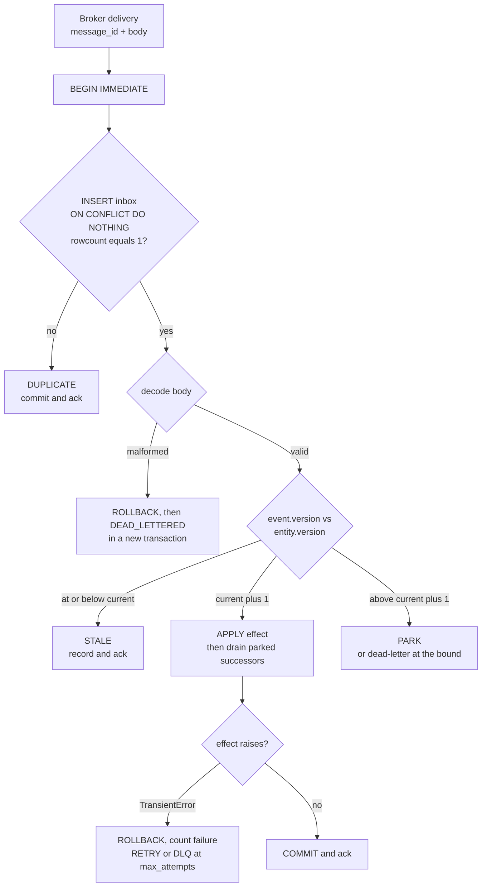

# Consuming Asynchronous Events Safely: The Transactional Inbox Pattern, Out-of-Order Version Guards, and Dead-Letter Queue (DLQ) Escalation

> [!summary] Claim
> An at-least-once consumer is correct only if one database transaction records the message id, checks the entity version, applies the effect, and clears the retry state, so that duplicates are dropped, early events wait, stale events are discarded, and unprocessable events leave the stream through a dead-letter table instead of blocking it.

Part of [GraphQL JSON RPC and Event APIs](README.md) in [API Engineering](../README.md).

## TL;DR

- Mechanism: insert `(consumer_group, message_id)` into an inbox table with `ON CONFLICT DO NOTHING` inside the same transaction as the business effect; a conflict means "already done", so ack and drop.
- Contract rule: ack the broker only after the transaction commits; every decision (apply, duplicate, stale, parked, dead-lettered) is made inside that transaction, and the message id must be stable across every redelivery.
- Trap: the inbox answers "have I seen this message", not "is this the newest state"; a replay with a fresh `message_id` sails past it, so ordering needs a separate per-entity version guard, and a gap needs a bounded parking area.
- Portability fact: the lab runs on SQLite 3.53.1 with `BEGIN IMMEDIATE`; the same SQL shape (`ON CONFLICT ... DO NOTHING`) is documented for PostgreSQL, but broker attempt counters (SQS `maxReceiveCount`, Pub/Sub max delivery attempts, Service Bus `MaxDeliveryCount`, RabbitMQ `delivery-limit`) differ in what they count, so keep your own attempt counter.
- Do not use it when the write is naturally idempotent (a keyed overwrite with a version check is enough), when the downstream is a Kafka topic that Kafka transactions already cover, or when the effect is an external call that no local transaction can roll back.

## Mental model



Every delivery enters one write transaction.
The first statement claims the message id; if another transaction already committed that id, the insert changes zero rows and the delivery is a duplicate that costs one index probe.
If the claim wins, the body is decoded, and a body that can never be decoded is a permanent failure that rolls back and is recorded as a dead letter in a second, short transaction.
A valid event is then compared with the entity's stored version: at or below it is stale, exactly one above it is applied (and any parked successors are drained in the same transaction), and further ahead it is parked until the gap fills.
A transient failure in the effect rolls everything back, including the claim, so the next delivery starts clean; only the attempt counter survives, because it is written in its own transaction.
The broker is acked for every outcome except `RETRY`, and the ack happens strictly after `COMMIT`.

## How it works

### Why delivery is at-least-once, and where the duplicates come from

The brokers and runtimes cited below all document at-least-once delivery as their reliable mode: a message is not lost, and it may be delivered more than once.

- Amazon SQS standard queues "ensure at-least-once message delivery, but due to the highly distributed architecture, more than one copy of a message might be delivered, and messages may occasionally arrive out of order" (SQS Developer Guide, Amazon SQS standard queues).
- The Apache Kafka design document walks the consumer through the two orderings: save the position then process gives at-most-once, process then save the position gives at-least-once, and "the first few messages it receives will already have been processed" after a crash (Apache Kafka 4.1 documentation, Design, Message Delivery Semantics).
- AWS Lambda event source mappings "process each event at least once, and duplicate processing of records can occur" (AWS Lambda Developer Guide, Using Lambda to process records from Amazon Kinesis Data Streams, Polling and batching streams).
- Pat Helland states the failure window directly: "The database is updated and then the message is acknowledged. In a failure, this is restarted and the message is processed again", because delivery "is not directly coupled to the update of the durable data other than through application action" (Helland, Life beyond Distributed Transactions, section "Most Applications Use At-Least-Once Messaging").

There are four independent sources of a duplicate, and an inbox must survive all of them:

1. Crash after the commit and before the ack.
   The effect is durable; the broker never learned that.
   The lab models this with `lose_ack` (`test_lost_ack_after_commit_redelivers_as_duplicate`).
2. Slow processing.
   In SQS the visibility timeout starts when a message is delivered; if the message is not deleted before it expires, "the message becomes visible again in the queue and can be retrieved by another consumer", and SQS "doesn't guarantee that a message won't be delivered more than once within the visibility timeout period" (SQS Developer Guide, Amazon SQS visibility timeout, sections "Setting and adjusting the visibility timeout" and "Understanding visibility timeout in standard and FIFO queues").
   The first consumer may still be running when the second starts, so duplicates can be concurrent, not only sequential.
3. Group rebalance.
   A Kafka consumer that does not call `poll()` within `max.poll.interval.ms` "is considered failed and the group will rebalance in order to reassign the partitions to another member" (kafka `CommonClientConfigs.MAX_POLL_INTERVAL_MS_DOC` on trunk), and the new owner resumes from the last committed offset.
4. Duplicate publication.
   A transactional-outbox relay "might, for example, crash after publishing a message but before recording the fact that it has done so", so "a message consumer must be idempotent" (microservices.io, Transactional outbox, Result context).
   The producer side is covered in [[Transactional-Outbox-Pattern-Solving-Dual-Writes-Between-DB-and-Events]]; this note is the consuming side of that contract.

Broker-side deduplication narrows the fourth window (duplicate publication) but cannot close the first.
SQS FIFO deduplicates only sends: "If you retry the `SendMessage` action within the 5-minute deduplication interval, Amazon SQS doesn't introduce any duplicates into the queue" (SQS Developer Guide, Exactly-once processing in Amazon SQS).
Google Pub/Sub exactly-once delivery is scoped to pull subscriptions ("Only the pull subscription type supports exactly-once delivery") and holds "within a cloud region", and it still redelivers when an ack fails: "If the acknowledgment request fails, the clients can expect a re-delivery" (Pub/Sub, Exactly-once delivery, Exactly-once delivery support in client libraries), and "A redelivered message retains the same message ID between redelivery attempts" (same page, Redelivery versus duplicate; see also Regional considerations).
The retained message ID is the property the whole pattern depends on.
A consumer-side dedup key works only if redeliveries carry the same id.

### The inbox transaction

The inbox is a table whose primary key is the dedup key.
Chris Richardson's formulation is the reference: "After starting the database transaction, the message handler inserts the message's ID into the `PROCESSED_MESSAGE` table. Since the `(subscriberId, messageID)` is the `PROCESSED_MESSAGE` table's primary key the INSERT will fail if the message has been already processed successfully" (microservices.io, Idempotent Consumer, Solution).
The lab keeps the same shape and adds the consumer group as the first key column, so two consumers of one stream do not suppress each other (`test_inbox_key_is_scoped_by_consumer_group`).

```python
SCHEMA = """
CREATE TABLE IF NOT EXISTS inbox (
    consumer_group TEXT NOT NULL,
    message_id     TEXT NOT NULL,
    outcome        TEXT NOT NULL,
    PRIMARY KEY (consumer_group, message_id)
);
CREATE TABLE IF NOT EXISTS entities (
    consumer_group TEXT NOT NULL,
    entity_id      TEXT NOT NULL,
    version        INTEGER NOT NULL,
    balance        INTEGER NOT NULL,
    PRIMARY KEY (consumer_group, entity_id)
);
CREATE TABLE IF NOT EXISTS parked (
    consumer_group TEXT NOT NULL,
    entity_id      TEXT NOT NULL,
    version        INTEGER NOT NULL,
    message_id     TEXT NOT NULL,
    amount         INTEGER NOT NULL,
    PRIMARY KEY (consumer_group, entity_id, version)
);
CREATE TABLE IF NOT EXISTS attempts (
    consumer_group TEXT NOT NULL,
    message_id     TEXT NOT NULL,
    failures       INTEGER NOT NULL,
    last_error     TEXT NOT NULL,
    PRIMARY KEY (consumer_group, message_id)
);
CREATE TABLE IF NOT EXISTS dead_letters (
    consumer_group TEXT NOT NULL,
    message_id     TEXT NOT NULL,
    body           BLOB NOT NULL,
    reason         TEXT NOT NULL,
    error          TEXT NOT NULL,
    attempts       INTEGER NOT NULL,
    PRIMARY KEY (consumer_group, message_id)
);
"""
```

*Simplified excerpt: lines 19-57 of `inbox_consumer.py`, verbatim; the `parked`, `attempts`, and `dead_letters` tables are explained below.*

The claim is a single statement, and its result is decided by the database, not by a prior `SELECT`.
SQLite documents upserts as "an ordinary INSERT statement that is followed by one or more ON CONFLICT clauses" and added the syntax in version 3.24.0 (SQLite, UPSERT, section 4 History).
"If the insert operation would cause the conflict target uniqueness constraint to fail, then the insert is omitted and the corresponding DO NOTHING or DO UPDATE operation is performed instead" (SQLite, UPSERT, section 2 Description).
PostgreSQL's `INSERT` documents the same clause, and for `RETURNING` the current docs (as of 2026-11) state "Only rows that were successfully inserted, updated, or selected will be returned" (PostgreSQL, INSERT, Description; "selected" refers to the `ON CONFLICT DO SELECT` form), so `INSERT ... ON CONFLICT DO NOTHING RETURNING 1` returns a row if and only if this transaction won the claim.
Python's `sqlite3` exposes the SQLite equivalent: `Cursor.rowcount` is "the number of modified rows for INSERT, UPDATE, DELETE, and REPLACE statements" (CPython 3.14 docs, `sqlite3`, `Cursor.rowcount`), so `rowcount == 1` means the claim succeeded.

```python
    def handle(self, delivery: Delivery) -> Outcome:
        try:
            try:
                with _transaction(self._conn):
                    return self._process(delivery)
            except PermanentError as exc:
                return self._dead_letter(delivery, "permanent", str(exc))
            except TransientError as exc:
                return self._record_failure(delivery, str(exc))
        except sqlite3.OperationalError as exc:
            if exc.sqlite_errorname == "SQLITE_BUSY":
                return Outcome.RETRY
            raise

    def _process(self, delivery: Delivery) -> Outcome:
        if not self._claim(delivery.message_id, "pending"):
            return Outcome.DUPLICATE
        outcome = self._guard(delivery.message_id, decode(delivery.body))
        self._set_outcome(delivery.message_id, outcome)
        self._conn.execute(
            "DELETE FROM attempts WHERE consumer_group = ? AND message_id = ?",
            (self._group, delivery.message_id),
        )
        return outcome

    def _claim(self, message_id: str, outcome: str) -> bool:
        cursor = self._conn.execute(
            "INSERT INTO inbox (consumer_group, message_id, outcome) VALUES (?, ?, ?) "
            "ON CONFLICT (consumer_group, message_id) DO NOTHING",
            (self._group, message_id, outcome),
        )
        return cursor.rowcount == 1
```

*Simplified excerpt: lines 188-219 of `inbox_consumer.py`, verbatim.*

Three details carry the correctness:

- `connect()` opens the connection with `isolation_level=None`, which under the default `autocommit=LEGACY_TRANSACTION_CONTROL` means "disable opening transactions implicitly" (CPython 3.14 docs, `sqlite3`, `Connection.isolation_level`), so the consumer, not the driver, owns `BEGIN` and `COMMIT`.
  The transaction is `BEGIN IMMEDIATE`: "IMMEDIATE causes the database connection to start a new write immediately, without waiting for a write statement. The BEGIN IMMEDIATE might fail with SQLITE_BUSY if another write transaction is already active on another database connection" (SQLite, Transaction, section 2.2).
  A plain `BEGIN` would let two consumers both read "version 5" and then race to upgrade, and the loser fails with `SQLITE_BUSY` after having done its work.
  Taking the write lock first makes the read-compare-write sequence atomic.
- A lock timeout is not a delivery failure.
  `handle()` maps `SQLITE_BUSY` (checked by `sqlite_errorname`, added in CPython 3.11) to `Outcome.RETRY` without touching the attempt counter, so contention can never push a healthy message into the dead-letter table (`test_concurrent_writer_is_refused_by_the_database_lock_not_double_applied`).
- The effect and the inbox row share one commit.
  If the effect raises, `_transaction` issues `ROLLBACK`, which discards the claim as well, so the redelivery is processed instead of being dropped as a duplicate (`test_failed_handler_rolls_back_inbox_row_and_effect`).

The failure the inbox removes is easy to reproduce without it.
`naive_handler` applies the amount on every delivery; one lost ack turns a `+10` into `+20` (`test_consumer_without_inbox_double_applies_after_lost_ack` asserts `raw_balance(conn) == 20`).

### What the message id must be

The inbox is only as good as its key.
CloudEvents 1.0.2 defines `id` as "Identifies the event. Producers MUST ensure that `source` + `id` is unique for each distinct event. If a duplicate event is re-sent (e.g. due to a network error) it MAY have the same `id`. Consumers MAY assume that Events with identical `source` and `id` are duplicates" (CloudEvents 1.0.2 spec, REQUIRED Attributes, `id`).
Note the asymmetry: a re-sent event "MAY" keep its `id`.
A producer that mints a new `id` per publish attempt silently disables every consumer's dedup, so the id belongs to the business fact (assigned when the outbox row is written), not to the transport attempt.
Key the inbox on `(source, id)` or on a producer-scoped id, never on the broker's own delivery handle; an ack handle or receipt handle changes on every receive.
The envelope itself is the sibling note [[CloudEvents-1-0-2-Envelope-Structured-vs-Binary-Content-Modes-and-Schema-Registries]].

Helland's framing of why this is state, not plumbing: "To ensure the idempotent processing of messages that are not naturally idempotent, the entity must remember they have been processed. This knowledge is state" (Helland, section "Remembering Messages as State"), and "Most durable duplicate elimination is done on queues with a coarser granularity than the entity" (Helland, footnote 14).
The inbox is that remembered state, kept next to the data it protects so that the two commit together.

### Ordering: the version guard

The inbox cannot order anything.
Two different messages for the same entity are different keys, and a stale event that was re-published with a new `message_id` is, to the inbox, brand new (`test_stale_event_with_new_message_id_is_recorded_and_dropped`).
Brokers also give weaker ordering than people assume: SQS standard queues "make a best-effort attempt to maintain the order in which messages are sent" (SQS Developer Guide, Amazon SQS standard queues), and SQS FIFO orders only within a message group, where "When a message with a message group ID is in-flight, subsequent messages in that group are not made available until the in-flight message is either deleted or the visibility timeout expires" (SQS Developer Guide, visibility timeout, Understanding visibility timeout in standard and FIFO queues).
Kafka orders within a partition and its consumer can "deliberately rewind back to an old offset and re-consume data" (Kafka 4.1 documentation, Design, Consumer Position).
A consumer therefore needs its own ordering invariant, and it needs a producer-assigned, per-entity, monotonically increasing `version` to state it.

The lab's `entities` row stores the last applied version.
`_guard` compares the event version with it and has two modes, selected per consumer group:

- `GuardMode.SNAPSHOT`: events carry full state.
  Anything at or below the stored version is `STALE`; anything above overwrites (`_SET_SQL`).
  Order does not matter and no parking table is needed, and version 3 arriving before versions 1 and 2 makes the latter two stale (`test_snapshot_mode_keeps_the_newest_version_in_any_order`).
- `GuardMode.SEQUENTIAL`: events carry deltas (`_ADD_SQL`), so skipping one corrupts the balance.
  Only `current + 1` may apply.
  A higher version is parked in `parked`, keyed `(consumer_group, entity_id, version)`; after each apply, `_drain` loops, applying the parked successor of the version just applied until none remains, all inside the same transaction.

```python
    def _guard(self, message_id: str, event: Event) -> Outcome:
        current = self._version(event.entity_id)
        if event.version <= current:
            return Outcome.STALE
        if self._mode is GuardMode.SEQUENTIAL and event.version > current + 1:
            return self._park(message_id, event)
        self._apply(event)
        if self._effect is not None:
            self._effect(event)
        if self._mode is GuardMode.SEQUENTIAL:
            self._drain(event.entity_id)
        return Outcome.APPLIED

    def _apply(self, event: Event) -> None:
        sql = _ADD_SQL if self._mode is GuardMode.SEQUENTIAL else _SET_SQL
        self._conn.execute(sql, (self._group, event.entity_id, event.version, event.amount))

    def _park(self, message_id: str, event: Event) -> Outcome:
        row = self._conn.execute(
            "SELECT COUNT(*) FROM parked WHERE consumer_group = ? AND entity_id = ?",
            (self._group, event.entity_id),
        ).fetchone()
        if int(row[0]) >= self._max_parked:
            raise PermanentError(f"gap_overflow: {self._max_parked} events already parked")
        cursor = self._conn.execute(
            "INSERT INTO parked (consumer_group, entity_id, version, message_id, amount) "
            "VALUES (?, ?, ?, ?, ?) ON CONFLICT (consumer_group, entity_id, version) DO NOTHING",
            (self._group, event.entity_id, event.version, message_id, event.amount),
        )
        return Outcome.PARKED if cursor.rowcount == 1 else Outcome.STALE

    def _drain(self, entity_id: str) -> None:
        """Apply parked successors of the version just applied, in the same transaction."""
        while True:
            version = self._version(entity_id) + 1
            row = self._conn.execute(
                "SELECT message_id, amount FROM parked "
                "WHERE consumer_group = ? AND entity_id = ? AND version = ?",
                (self._group, entity_id, version),
            ).fetchone()
            if row is None:
                return
            self._apply(Event(entity_id, version, int(row[1])))
            self._set_outcome(str(row[0]), Outcome.APPLIED)
            self._conn.execute(
                "DELETE FROM parked WHERE consumer_group = ? AND entity_id = ? AND version = ?",
                (self._group, entity_id, version),
            )
```

*Simplified excerpt: lines 234-281 of `inbox_consumer.py`, verbatim.*

The invariants, each backed by a test, are:

1. `entities.version` equals the number of contiguous versions applied, so a stored balance is always the sum of a prefix of the stream (`test_early_event_is_parked_then_drained_in_version_order` ends at `(3, 111)` for the reverse order 3, 2, 1, and `test_shuffled_duplicated_stream_converges_to_exact_state` covers a seeded random order).
2. A `parked` row exists only for a version above `entities.version + 1`, and `_drain` removes the row it applies, so after any commit no parked row has version `entities.version + 1`.
3. Only one message can park a given version.
   The loser is recorded `stale` (`test_second_message_claiming_a_parked_version_loses`), so two conflicting claims for one version cannot both apply later.
4. The parked set per entity is bounded.
   At `max_parked` rows the next early event raises `PermanentError("gap_overflow: ...")` and is dead-lettered (`test_gap_beyond_the_parking_bound_is_dead_lettered`), which prevents a lost version from turning the parking table into an unbounded queue.

`test_shuffled_duplicated_stream_converges_to_exact_state` drives 60 versions plus 90 random duplicates through a seeded shuffle and requires `(60, sum(amounts))`, 90 `DUPLICATE` outcomes, and an empty parking table.

The guard needs two things from the producer that the consumer cannot invent: the version must be assigned in the same transaction that changes the entity (the same atomicity the outbox gives), and it must be contiguous for `SEQUENTIAL` mode.
A version drawn from a source that can skip numbers produces a permanent gap, and a gap parks every later event until the bound dead-letters them.
Use `SNAPSHOT` semantics whenever the event can carry the whole state; it tolerates gaps by construction, which is why it is the safer default for read-model projections.

### Failure taxonomy and DLQ escalation

The consumer classifies every failure before it chooses a path, because the two classes need opposite treatment.

- `PermanentError`: every redelivery will repeat it.
  In the lab this is a body that fails `decode` (not UTF-8, not a JSON object, empty `entity_id`, `version` that is `true` or below 1, a non-integer `amount`), a violated invariant raised by the effect, or `gap_overflow`.
  The message is dead-lettered on the first occurrence (`test_poison_body_is_dead_lettered_without_blocking_its_neighbours`).
- `TransientError`: a later delivery may succeed (timeout, lock, downstream 503).
  The consumer rolls back, increments a persisted counter, returns `RETRY`, and dead-letters with reason `max_attempts` when `failures >= max_attempts` (default 5; `test_transient_failure_retries_then_dead_letters_at_max_attempts`).
  A recovery deletes the counter in the success transaction (`test_transient_failure_that_recovers_clears_its_attempt_counter`).

`decode` is strict on purpose.
`isinstance(True, int)` is `True` in Python, so a JSON `true` would pass a naive integer check and become version `1`; the lab rejects booleans explicitly.

```python
    def _record_failure(self, delivery: Delivery, error: str) -> Outcome:
        with _transaction(self._conn):
            if self._inbox_outcome(delivery.message_id) is not None:
                return Outcome.DUPLICATE
            self._conn.execute(
                "INSERT INTO attempts (consumer_group, message_id, failures, last_error) "
                "VALUES (?, ?, 1, ?) ON CONFLICT (consumer_group, message_id) "
                "DO UPDATE SET failures = failures + 1, last_error = excluded.last_error",
                (self._group, delivery.message_id, error),
            )
            if self._failures(delivery.message_id) < self._max_attempts:
                return Outcome.RETRY
            return self._dead_letter_in_transaction(delivery, "max_attempts", error)

    def _dead_letter(self, delivery: Delivery, reason: str, error: str) -> Outcome:
        with _transaction(self._conn):
            return self._dead_letter_in_transaction(delivery, reason, error)

    def _dead_letter_in_transaction(self, delivery: Delivery, reason: str, error: str) -> Outcome:
        if not self._claim(delivery.message_id, Outcome.DEAD_LETTERED.value):
            return Outcome.DUPLICATE
        self._conn.execute(
            "INSERT INTO dead_letters (consumer_group, message_id, body, reason, error, attempts) "
            "VALUES (?, ?, ?, ?, ?, ?)",
            (
                self._group,
                delivery.message_id,
                delivery.body,
                reason,
                error,
                max(self._failures(delivery.message_id), 1),
            ),
        )
        self._conn.execute(
            "DELETE FROM attempts WHERE consumer_group = ? AND message_id = ?",
            (self._group, delivery.message_id),
        )
        return Outcome.DEAD_LETTERED
```

*Simplified excerpt: lines 283-320 of `inbox_consumer.py`, verbatim.*

The counter lives in the consumer's own database, in its own committed transaction, for a reason: the failed attempt's main transaction was rolled back, so nothing else would remember it.
`_record_failure` re-checks the inbox inside its transaction and returns `DUPLICATE` if another consumer finished the message meanwhile.
Dead-lettering claims the id in the inbox with outcome `dead_lettered` and inserts the original body, reason, last error, and attempt count into `dead_letters`, in one transaction.
The inbox row is what makes a later broker redelivery of the same dead letter drop as `DUPLICATE` instead of looping.
It is also why a fix needs `redrive`, which deletes the dead letter, its inbox row, and its attempt row so the next delivery is processed:

```python
    def redrive(self, message_id: str) -> Delivery:
        """Remove a dead letter and its inbox row so the next delivery is processed, not dropped."""
        with _transaction(self._conn):
            row = self._conn.execute(
                "SELECT body FROM dead_letters WHERE consumer_group = ? AND message_id = ?",
                (self._group, message_id),
            ).fetchone()
            if row is None:
                raise KeyError(message_id)
            for sql in _REDRIVE_DELETES:
                self._conn.execute(sql, (self._group, message_id))
        return Delivery(message_id, bytes(row[0]))
```

*Simplified excerpt: lines 336-347 of `inbox_consumer.py`, verbatim.*

`test_dead_lettered_redelivery_is_dropped_until_redrive_clears_the_inbox` proves both halves: the second delivery is `DUPLICATE` while the dead letter stands, and `APPLIED` after `redrive`.

#### What brokers count, and why the lab keeps its own counter

Every broker has a native dead-letter path, and each counts something slightly different, so none of them can replace a consumer-side classification.

| Broker | Native DLQ trigger | What the counter counts | Source |
| --- | --- | --- | --- |
| SQS | Redrive policy `maxReceiveCount` on the source queue | Receives: "the number of times a consumer can receive a message from a source queue before it is moved"; a receive whose visibility timeout expires therefore counts like a failed one (inferred, not stated) | SQS DLQ page, "Using policies for dead-letter queues" |
| Pub/Sub | Dead-letter topic on the subscription, max delivery attempts 5 to 100, default 5 | Approximate; "might forward a message after fewer attempts than configured, or ... a few more"; may "reset to zero" | Pub/Sub dead-letter topics, "How maximum delivery attempts are calculated" |
| Azure Service Bus | `MaxDeliveryCount`, default 10; reason `MaxDeliveryCountExceeded` | Incremented when a peek-locked delivery is "explicitly abandoned or the lock has expired"; "can't be disabled"; `MaxDeliveryCount` is the .NET SDK `QueueProperties` property for it | Service Bus dead-letter queues, "Maximum delivery count"; Azure.Messaging.ServiceBus `QueueProperties.MaxDeliveryCount` |
| RabbitMQ quorum queue | `delivery-limit`, default 20 since 4.0; reason `delivery_limit` | `x-delivery-count`; from 4.3.0 (released 2026-04-23) the limit uses `delivery-count`, not `acquired-count`, so a `basic.nack` requeue no longer counts, while the new `x-acquired-count` header counts every acquisition | RabbitMQ quorum queues (4.3 versioned docs), Poison Message Handling; RabbitMQ 4.3.0 release notes; RabbitMQ Dead Letter Exchanges for the reason |
| Kafka consumer | None in the broker | Nothing; DLQ is a client concern (Spring `DeadLetterPublishingRecoverer`, Kafka Connect `errors.deadletterqueue.topic.name`) | Spring Kafka, Handling Exceptions; KIP-298 |

Two consequences follow.
A broker counter conflates "my handler is broken" with "my handler is slow": an SQS or Service Bus message whose handler outlives the visibility timeout or lock accumulates receives without ever failing, and it can be dead-lettered while a healthy consumer is still working on it.
And counter semantics change between versions (RabbitMQ 4.3 changed what increments the limit, as of 2026-11), so a policy tuned on one release can behave differently on the next.
The consumer-side counter measures what you care about, handler failures, and the broker limit stays as the backstop for the failure class the consumer cannot classify (see the pitfall on unclassified exceptions).

The dead-letter destination is a design decision.
SQS requires the DLQ to be in the same account and region, and its retention behaves differently from the source queue: for standard queues "the enqueue timestamp is unchanged", so a message that spent 1 day in the source queue and lands in a DLQ with 4-day retention "is deleted from the dead-letter queue after 3 days", while for FIFO the timestamp resets (SQS DLQ page, Understanding message retention periods).
Service Bus never expires DLQ content ("There's no automatic cleanup of the DLQ") and does not allow dead-lettering a message from a DLQ (Service Bus dead-letter queues).
RabbitMQ's default dead-lettering is at-most-once: "messages can be lost if the target queue is not available to accept messages", whereas quorum queues support at-least-once dead-lettering with internal publisher confirms (RabbitMQ Dead Letter Exchanges, Safety, Re-Publishing with Publisher Confirms), and a dead-letter cycle is dropped "if there was no rejection in the entire cycle" (same page, Dead-letter cycle).
The lab keeps the dead letter in the same database as the inbox because that is the only place where "mark as handled" and "preserve the evidence" can commit atomically; a real broker DLQ publish plus ack is two systems, so a crash between them either loses the message (ack first) or duplicates it into the DLQ (publish first), and the second is harmless only because the DLQ consumer is also idempotent.

Retry timing is a separate axis from classification.
Spring Kafka's `DefaultErrorHandler` takes a `BackOff` and a recoverer; `new FixedBackOff(0L, 2L)` recovers "after 3 failures, with no back off", and `FixedBackOff.UNLIMITED_ATTEMPTS` "causes (effectively) infinite retries" (Spring Kafka reference, Handling Exceptions, `DefaultErrorHandler`).
Kafka Connect's KIP-298 retries "starting with a fixed duration (value of 300ms) and with exponential backoff", caps the delay at `errors.retry.delay.max.ms` (default 60000) with jitter "once this limit is reached to prevent any thundering herd issues", and is limited by `errors.retry.timeout` (default 0, so no retry unless configured); `errors.tolerance=none` fails on the first error, which KIP-298 keeps as the default behavior, and `all` tolerates failures.
The DLQ is for sink connectors only ("Dead Letter Queue (for Sink Connectors only)") and can annotate records with `__connect.errors.topic`, `__connect.errors.partition`, and `__connect.errors.offset` headers when `errors.deadletterqueue.context.headers.enable` is `true` (default `false`) (KIP-298).
Retry budgeting and jitter are covered in [[Retries-Exponential-Backoff-Full-vs-Decorrelated-Jitter-and-Stamina]] and [[Retry-Budgets-and-Preventing-Cascading-Retry-Amplification-Storms]]; the lab does not delay, because a deterministic test has no clock.

### Why a head-of-line poison message is the dangerous case

Ordered consumption turns one bad message into an outage.
In SQS FIFO the next message in a group is withheld while one is in flight, and AWS warns: "Don't use a dead-letter queue with a FIFO queue if you don't want to break the exact order of messages or operations" (SQS DLQ page, Note).
The same logic applies to a Kafka partition: an unlimited retry of the head record keeps that partition from advancing (derived from retry-in-place behavior, not separately tested).
The lab's `SEQUENTIAL` mode has the same shape from the inside: if version 2 is dead-lettered as malformed, versions 3 and up park behind the gap until `max_parked` is exceeded, and then they dead-letter too.
The lab has no skip-marker for that case; the operator path is to fix and `redrive` the poison event, and a production system would add an explicit "tombstone this version" operation so that one corrupt event does not freeze its entity.
This follows from reading `_guard`, not from a captured run.

### Kafka's own answer, and how it relates

Kafka states the same constraint as the inbox pattern in different words: "When writing to an external system, the limitation is in the need to coordinate the consumer's position with what is actually stored as output. The classic way of achieving this would be to introduce a two-phase commit ... This can be handled more simply and generally by letting the consumer store its offset in the same place as its output" (Kafka 4.1 documentation, Design, Message Delivery Semantics).
An offset stored with the output is a watermark inbox: one integer per partition, cheap, and exact as long as one consumer owns the partition and delivery is in offset order.
The message-id inbox costs a row per message and needs pruning, but it works across partitions, brokers, and republished events, and it survives a producer that re-sends the same fact at a new offset.
For Kafka-to-Kafka pipelines the documented route is transactions: the producer sets `transactional.id`, the consumer must set `isolation.level=read_committed` and `enable.auto.commit=false`, and offsets commit atomically with the output (Kafka 4.1 documentation, Design, Using Transactions).
Defaults matter here: `isolation.level` defaults to `read_uncommitted` and `enable.auto.commit` to `true` (kafka `ConsumerConfig` on trunk, `DEFAULT_ISOLATION_LEVEL` and the `ENABLE_AUTO_COMMIT_CONFIG` definition), so a default consumer is at-least-once with possible reads of aborted data.
Kafka also notes that the common case needs nothing extra: with a primary key, "receiving the same message twice just overwrites a record with another copy of itself" (Kafka 4.1 documentation, Design, Message Delivery Semantics), which Helland calls natural idempotence.

### Choosing the mechanism

| Situation | Mechanism | Cost | Failure it does not cover |
| --- | --- | --- | --- |
| Write is a keyed overwrite with the full state | Version-guarded upsert (`SNAPSHOT`) | One compare per event, no extra table | A delta-style event; an out-of-order event that carries no version |
| Write is a delta (`balance += amount`) | Inbox plus contiguous version guard (`SEQUENTIAL`) | One inbox row per message, a parking table, pruning | A lost version stalls the entity until the bound dead-letters successors |
| Kafka input, Kafka output | Transactions, `read_committed`, offsets in the transaction | Broker-side transaction coordination | External side effects outside Kafka |
| Kafka input, database output | Offset stored in the output transaction, or inbox | One row per partition or per message | Partition reassignment if the offset table is not per partition |
| Effect is an external HTTP call | Downstream idempotency key (see [[Idempotency-Key-Header-Specification-and-State-Machine-Draft-08]]) plus inbox for local state | One key per call | A downstream that ignores the key |
| Producer-side duplicate suppression only (SQS FIFO deduplication id) | Broker deduplication | Free | Redelivery after a consumer-side lost ack |

The HTTP-push variant of the same problem, where the producer calls the consumer's endpoint, is in [[Webhook-Consumer-Engineering-Signature-Verification-Replay-Windows-and-Idempotency]] and [[HTTP-Callback-Subscriptions-WebSub-and-Async-Request-Reply-Patterns]]; [[Atomic-Idempotency-Phases-and-Failure-Recovery-Across-Network-Drops]] covers the request-side phases.

### Operating it

- Inbox retention must exceed the longest window in which a duplicate can arrive: the broker retention (SQS retains up to 1,209,600 s, 14 days, default 4 days (SQS Developer Guide, Amazon SQS message quotas)), the DLQ retention (which should exceed it), and any deliberate replay.
  An inbox pruned at 24 hours is correct only if nothing can redeliver after 24 hours.
  Deliberate replay is the case that breaks naive pruning: a Kafka consumer that rewinds an offset re-sends messages whose ids you already pruned, or whose ids you kept and now drop.
- Alarm on three depths, not one: dead letters (rate and age), parked rows (age of the oldest, which signals a lost version), and attempt rows (a long tail means a flapping dependency).
  SQS exposes `ApproximateAgeOfOldestMessage` for the DLQ; for a table DLQ, `MIN(created_at)` is the equivalent, and the lab omits timestamps to stay deterministic.
- Treat redrive as a deploy: fix, then `redrive` a small batch, then the rest, and record who ran it.

## Numbers and limits

| Quantity | Value | Source or measurement |
| --- | --- | --- |
| SQS standard queue delivery | at-least-once, may be out of order | SQS Developer Guide, Amazon SQS standard queues (as of 2026-11) |
| SQS FIFO send deduplication interval | 5 minutes | SQS Developer Guide, Exactly-once processing in Amazon SQS (as of 2026-11) |
| SQS default visibility timeout | 30 seconds; maximum 12 hours from first receive, and extending does not reset it | SQS Developer Guide, visibility timeout (as of 2026-11) |
| SQS in-flight limit, standard queues | approximately 120,000 | SQS Developer Guide, visibility timeout (as of 2026-11) |
| SQS message retention | default 4 days; minimum 60 s; maximum 1,209,600 s (14 days) | SQS Developer Guide, message quotas (as of 2026-11) |
| SQS redrive allow policy `byQueue` | up to 10 source queues | SQS DLQ page (as of 2026-11) |
| SQS standard queue, `maxReceiveCount` above 3 | a message "received 3 or more times without being deleted" is moved to the back of the same queue | SQS DLQ page (as of 2026-11) |
| Pub/Sub max delivery attempts | default 5, minimum 5, maximum 100; approximate; counter may reset to zero | Pub/Sub dead-letter topics (as of 2026-11) |
| Service Bus `MaxDeliveryCount` | default 10; cannot be disabled | Service Bus dead-letter queues (as of 2026-11) |
| Service Bus Standard tier message quota | 256 KB; a long `DeadLetterDescription` can push a message over it | Service Bus dead-letter queues (as of 2026-11) |
| RabbitMQ quorum `delivery-limit` | default 20 since 4.0; `x-delivery-limit=-1` restores the 3.13.x no-limit behavior ("not recommended") | RabbitMQ quorum queues (main branch of the docs, as of 2026-11) |
| Kafka consumer `max.poll.records` | 500 | kafka `ConsumerConfig.DEFAULT_MAX_POLL_RECORDS`, trunk (as of 2026-11) |
| Kafka consumer `max.poll.interval.ms` | 300000 | kafka `ConsumerConfig` definition, trunk (as of 2026-11) |
| Kafka Connect error retry (KIP-298) | `errors.retry.timeout` 0, `errors.retry.delay.max.ms` 60000, initial delay 300 ms, DLQ replication factor 3 | KIP-298 (design values; check your release) |
| Lambda Kinesis batching | window up to 5 minutes; payload limit 6 MB | AWS Lambda Developer Guide, Kinesis (as of 2026-11) |
| SQLite upsert syntax | added in 3.24.0 (2018-06-04); multiple `ON CONFLICT` clauses and `DO UPDATE` without a target in 3.35.0 (2021-03-12) | SQLite, UPSERT, section 4 History |
| Lab defaults | `max_attempts=5`, `max_parked=100`, `busy_timeout=5.0` s | `inbox_consumer.py` constructor and `connect` |
| Lab run, 22 tests | 22 passed in 1.05 s | measured by the independent verifier: `uv run --frozen pytest ... -q -p no:cacheprovider`, CPython 3.14.6, SQLite 3.53.1, macOS 27.3 arm64 (`uname -r` 27.3.0), 2026-11-26 |

The 1.05 s figure is the whole pytest session, including creating a SQLite file per test; it is a smoke-test duration, not a throughput benchmark.
This note makes no throughput claim for the inbox; the cost model is one extra indexed insert per message plus the retention work, and it has not been measured here.

## Portability

| Dimension | Variant | Status | Evidence |
| --- | --- | --- | --- |
| CPython | 3.14.6 | Ran: 22 passed | `pytest -q` run on 2026-11-26 (macOS 27.3 arm64) |
| CPython | 3.12.16, 3.13.18, 3.14.10, 3.15.2, 3.15.2t | Not run in this pass | The lab-check pause of 2026-11-11 forbids repeated runs; no claim is made for these |
| CPython | 3.11 and later | `sqlite_errorname` exists | "Added in version 3.11" (CPython docs, `sqlite3`); `StrEnum` also needs 3.11 |
| CPython | 3.15 | `sqlite3.connect` parameters after `database` are keyword-only | "Changed in version 3.15" (CPython docs); the lab passes `timeout` and `isolation_level` by keyword, so it matches, but it was not run on 3.15 |
| SQLite | 3.53.1 (the library linked into the 3.14.6 build used) | Ran | `sqlite3.sqlite_version` printed in the same session |
| SQLite | 3.24.0 to 3.34 | Upsert exists, but `DO UPDATE` needs a conflict target | SQLite UPSERT, History: the generalization arrived in 3.35.0; the lab always names a target |
| PostgreSQL | current docs | `INSERT ... ON CONFLICT DO NOTHING ... RETURNING` documented; lab SQL not run on it | PostgreSQL INSERT docs; the lab test suite is SQLite only |
| Brokers | SQS, Pub/Sub, Service Bus, RabbitMQ, Kafka | Semantics from vendor documentation, not run | See the broker table above |
| Servers (Uvicorn, Hypercorn, Granian) | not applicable | The pattern is transport-agnostic and the lab has no HTTP surface | By construction |
| HTTP/1.1, HTTP/2, HTTP/3 | not applicable | Push delivery over HTTP is a sibling topic | [[HTTP-Callback-Subscriptions-WebSub-and-Async-Request-Reply-Patterns]] |

The free-threaded build is the one cell worth a future run: each `InboxConsumer` owns one `sqlite3.Connection`, and the `connect` signature in the CPython docs defaults `check_same_thread=True`, so a connection must stay on its creating thread; one consumer per thread is the safe shape, and a shared consumer would need its own lock.

## Worked example

The implementation is [implementation](../labs/src/api_labs/f20_graphql_json_rpc_and_event_apis/inbox_consumer.py) and its test is [test](../labs/tests/f20_graphql_json_rpc_and_event_apis/test_idempotent_event_consumers_inbox_pattern_and_poison_message_dlqs.py).
Everything is in-process and deterministic: one SQLite file per test, an in-memory `Broker` that re-queues unacknowledged deliveries at the tail, and a `pump` loop that delivers until the queue is empty.

```python
class Broker:
    """In-memory at-least-once queue: unacknowledged deliveries come back at the tail."""

    def __init__(self, deliveries: Iterable[Delivery]) -> None:
        self._queue = deque(deliveries)
        self.redeliveries = 0

    def receive(self) -> Delivery | None:
        return self._queue.popleft() if self._queue else None

    def requeue(self, delivery: Delivery) -> None:
        self.redeliveries += 1
        self._queue.append(delivery)


def pump(
    broker: Broker,
    handle: Callable[[Delivery], Outcome],
    *,
    lose_ack: Callable[[Delivery, Outcome], bool] = lambda _d, _o: False,
    max_steps: int = 10_000,
) -> list[tuple[str, Outcome]]:
    """Deliver until the queue is empty; `RETRY` or a lost ack puts the delivery back."""
    trace: list[tuple[str, Outcome]] = []
    for _ in range(max_steps):
        delivery = broker.receive()
        if delivery is None:
            return trace
        outcome = handle(delivery)
        trace.append((delivery.message_id, outcome))
        if outcome is Outcome.RETRY or lose_ack(delivery, outcome):
            broker.requeue(delivery)
    raise RuntimeError("pump did not converge")
```

*Simplified excerpt: lines 376-408 of `inbox_consumer.py`, verbatim; `Broker` and `pump` model at-least-once delivery.*

The decisive tests, verbatim:

```python
@pytest.mark.unit
def test_lost_ack_after_commit_redelivers_as_duplicate(conn: sqlite3.Connection) -> None:
    consumer = InboxConsumer(conn, GROUP)
    broker = Broker([msg("m1", 1, 10)])
    trace = pump(broker, consumer.handle, lose_ack=lose_first_ack("m1"))
    assert trace == [("m1", Outcome.APPLIED), ("m1", Outcome.DUPLICATE)]
    assert broker.redeliveries == 1
    assert consumer.state("acct-1") == (1, 10)
```

```python
@pytest.mark.unit
def test_consumer_without_inbox_double_applies_after_lost_ack(conn: sqlite3.Connection) -> None:
    handler = naive_handler(conn, GROUP)
    pump(Broker([msg("m1", 1, 10)]), handler, lose_ack=lose_first_ack("m1"))
    assert raw_balance(conn) == 20
```

```python
@pytest.mark.unit
def test_early_event_is_parked_then_drained_in_version_order(conn: sqlite3.Connection) -> None:
    consumer = InboxConsumer(conn, GROUP)
    assert consumer.handle(msg("m3", 3, 100)) is Outcome.PARKED
    assert consumer.handle(msg("m2", 2, 10)) is Outcome.PARKED
    assert consumer.state("acct-1") == (0, 0)
    assert consumer.parked_count("acct-1") == 2
    assert consumer.handle(msg("m1", 1, 1)) is Outcome.APPLIED
    assert consumer.state("acct-1") == (3, 111)
    assert consumer.parked_count("acct-1") == 0
    assert {consumer.inbox_outcome(m) for m in ("m1", "m2", "m3")} == {"applied"}
```

```python
@pytest.mark.unit
def test_transient_failure_retries_then_dead_letters_at_max_attempts(
    conn: sqlite3.Connection,
) -> None:
    def failing(_event: Event) -> None:
        raise TransientError("downstream 503")

    consumer = InboxConsumer(conn, GROUP, effect=failing, max_attempts=3)
    trace = pump(Broker([msg("m1", 1, 10)]), consumer.handle)
    assert [o for _, o in trace] == [Outcome.RETRY, Outcome.RETRY, Outcome.DEAD_LETTERED]
    (dead,) = consumer.dead_letters()
    assert (dead.reason, dead.attempts, dead.error) == ("max_attempts", 3, "downstream 503")
    assert consumer.state("acct-1") == (0, 0)
```

```python
@pytest.mark.unit
def test_concurrent_writer_is_refused_by_the_database_lock_not_double_applied(
    tmp_path: Path,
) -> None:
    path = str(tmp_path / "shared.db")
    other = InboxConsumer(connect(path, busy_timeout=0.0), GROUP)
    delivery = msg("m1", 1, 10)
    seen: list[Outcome] = []

    def race(_event: Event) -> None:
        seen.append(other.handle(delivery))

    winner = InboxConsumer(connect(path), GROUP, effect=race)
    assert winner.handle(delivery) is Outcome.APPLIED
    assert seen == [Outcome.RETRY]
    assert other.handle(delivery) is Outcome.DUPLICATE
    assert winner.state("acct-1") == (1, 10)
```

The test module covers 22 cases:

| Test | Behavior it pins |
| --- | --- |
| `test_duplicate_delivery_is_applied_once` | second delivery of one id is `DUPLICATE`, state `(1, 10)` |
| `test_lost_ack_after_commit_redelivers_as_duplicate` | crash-after-commit redelivery produces `APPLIED` then `DUPLICATE` |
| `test_consumer_without_inbox_double_applies_after_lost_ack` | the baseline without an inbox ends at 20, not 10 |
| `test_failed_handler_rolls_back_inbox_row_and_effect` | a transient failure leaves no inbox row and no state |
| `test_early_event_is_parked_then_drained_in_version_order` | versions 3, 2, 1 arrive; state is `(3, 111)` |
| `test_shuffled_duplicated_stream_converges_to_exact_state` | 60 versions, 90 duplicates, seeded shuffle |
| `test_stale_event_with_new_message_id_is_recorded_and_dropped` | version guard catches what the inbox cannot |
| `test_second_message_claiming_a_parked_version_loses` | only one message may park a version |
| `test_snapshot_mode_keeps_the_newest_version_in_any_order` | snapshot mode keeps `(3, 300)` |
| `test_gap_beyond_the_parking_bound_is_dead_lettered` | `max_parked=2` dead-letters the third early event |
| `test_poison_body_is_dead_lettered_without_blocking_its_neighbours` | neighbours still apply, dead letter keeps the body |
| `test_decode_rejects_malformed_bodies_as_permanent` (6 cases) | bytes, array, empty id, boolean version, version 0, float amount |
| `test_transient_failure_retries_then_dead_letters_at_max_attempts` | `RETRY`, `RETRY`, `DEAD_LETTERED` with reason `max_attempts` |
| `test_transient_failure_that_recovers_clears_its_attempt_counter` | no attempt rows remain after recovery |
| `test_dead_lettered_redelivery_is_dropped_until_redrive_clears_the_inbox` | `DUPLICATE`, then `APPLIED` after `redrive` |
| `test_concurrent_writer_is_refused_by_the_database_lock_not_double_applied` | a second writer gets `RETRY`, then `DUPLICATE` |
| `test_inbox_key_is_scoped_by_consumer_group` | two groups both apply one id |

Command and captured output (run from `labs/`, CPython 3.14.6, SQLite 3.53.1, macOS 27.3 arm64, 2026-11-26):

```console
$ uv run --frozen pytest tests/f20_graphql_json_rpc_and_event_apis/test_idempotent_event_consumers_inbox_pattern_and_poison_message_dlqs.py -q -p no:cacheprovider
......................                                                   [100%]
22 passed in 1.05s
```

Mutation testing, the shell matrix, containers, coverage, and the format, lint, and type-check runs were skipped by the lab-check pause of 2026-11-11, so no mutation result is claimed here; the assertions are written to fail if the claimed behavior were absent, but that was not demonstrated by breaking the mechanism.

Known limits of the lab, read from the code:

- `effect` runs for the event that arrived, not for parked events that `_drain` applies later, so a failing downstream cannot be simulated for a drained event.
  A real consumer routes both paths through one apply function.
- `effect` runs inside the database transaction.
  It models a database-local side effect; an external call would not roll back with it.
- Exceptions other than `PermanentError`, `TransientError`, and `SQLITE_BUSY` propagate out of `handle()` with the transaction rolled back and no counter incremented, so the broker would redeliver such a message indefinitely unless its own limit applies.
- There is no timestamp on `parked`, `attempts`, or `dead_letters`, so age-based alarms are not modeled.

## Pitfalls

> [!warning] Check-then-act deduplication outside the transaction
> Trigger: the handler runs `SELECT ... WHERE id = ?`, applies the effect, then writes the id in a separate commit.
> Symptom: a crash between the commit of the effect and the write of the id double-applies (the `naive_handler` baseline ends at 20 instead of 10), and two consumers that receive one message after a visibility-timeout expiry both pass the `SELECT`.
> Fix: claim the id with one `INSERT ... ON CONFLICT DO NOTHING` inside the effect's transaction and branch on whether the row was inserted (`rowcount == 1`, or a returned row on PostgreSQL).

> [!warning] Unstable message ids
> Trigger: the producer or the outbox relay mints a fresh id for each publish attempt, or the consumer keys on a broker receipt handle.
> Symptom: duplicates never collide in the inbox, so every retry of the producer double-applies.
> CloudEvents only says a re-sent event "MAY have the same `id`" (CloudEvents 1.0.2 spec, `id`), and the outbox relay "might publish a message more than once" (microservices.io, Transactional outbox).
> Fix: assign the id when the business fact is written, reuse it on every publish, and key the inbox on `(source, id)`.

> [!warning] Dedup by message id mistaken for ordering
> Trigger: a replay or a producer retry re-publishes an old fact under a new id after newer facts were applied.
> Symptom: the inbox accepts it as new and overwrites newer state.
> Without the guard the lab's `replay-of-v1` delta would be applied a second time.
> Fix: carry a per-entity monotonic version, compare it in the same transaction, and record the stale event as handled.

> [!warning] A version gap turns the parking table into a stuck queue
> Trigger: a version is never delivered (a poison event dead-lettered, a producer that skips numbers, or a dropped publish).
> Symptom: in `SEQUENTIAL` mode every later event for that entity parks, then dead-letters once `max_parked` is reached; the entity's balance freezes.
> Fix: assign contiguous versions in the producer's transaction, bound and age-alarm the parked set, and provide an operator tombstone for a version that is known to be lost.
> Prefer `SNAPSHOT` events where possible.

> [!warning] Trusting the broker's delivery counter
> Trigger: a handler that is merely slow, or a broker release that changes what is counted.
> Symptom: a healthy message is dead-lettered (SQS counts every receive without a delete, and Service Bus increments the count when a lock expires), or a failing one is retried longer than expected (Pub/Sub's count is approximate and can reset to zero; RabbitMQ 4.3 stopped counting `basic.nack` returns toward `delivery-limit`).
> Fix: persist a consumer-side failure counter for classified failures, and use the broker limit only as a backstop; size visibility timeouts and locks above the p99 handler time.

> [!warning] DLQ evidence expires or is never looked at
> Trigger: DLQ retention shorter than the source queue's, or no alarm on DLQ depth.
> Symptom: in SQS standard queues the enqueue timestamp is unchanged, so a message that spent 1 day in the source and then lands in a DLQ with 4-day retention is deleted after 3 days (SQS DLQ page); Service Bus DLQs never clean up, so they grow until someone notices.
> Fix: set DLQ retention above the source retention, alarm on depth and on the age of the oldest dead letter, and assign an owner and a redrive runbook.

> [!warning] Dead letter blocks its own redrive
> Trigger: the inbox row written at dead-letter time stays when the message is republished after a fix.
> Symptom: the redelivered message is dropped as `DUPLICATE` and the fix appears to do nothing.
> Fix: redrive in one transaction that deletes the dead letter, the inbox row, and the attempt row (`InboxConsumer.redrive`), then republish.

> [!warning] Inbox pruned inside the replay window
> Trigger: the inbox keeps 24 hours of ids while the broker retains 4 to 14 days, or an operator replays a topic.
> Symptom: a message redelivered after the prune applies a second time.
> Fix: tie inbox retention to the longest of broker retention, DLQ retention, and the replay policy, or replace the id set with a version guard for entities that carry versions.

> [!warning] Ordered stream plus a DLQ
> Trigger: a FIFO queue or a partition with a dead-letter path.
> Symptom: dead-lettering one event lets its successors apply first, which breaks the order the stream promised; the SQS guidance is explicit ("Don't use a dead-letter queue with a FIFO queue if you don't want to break the exact order of messages or operations").
> Fix: either keep the message and block the key (accept the stall and page a human), or make the guard order-independent and let the DLQ be a side channel.

## Security and robustness

- Treat the envelope as untrusted input.
  OWASP API10:2023 Unsafe Consumption of APIs, which warns that "Developers tend to trust data received from third-party APIs more than user input" (Is the API Vulnerable?), applies by analogy to event consumers: a body is data from another system, so `decode` validates type, range, and shape before any effect, and it rejects `bool` as an integer.
  Verify signatures or broker-level authentication before claiming the id, so an unauthenticated sender cannot burn ids; see [[Webhook-Consumer-Engineering-Signature-Verification-Replay-Windows-and-Idempotency]] for the HTTP-push version.
- Scope the dedup key to the authenticated producer.
  If `message_id` alone is the key, any sender that can publish can pre-claim another producer's id and make the genuine event drop as `DUPLICATE`.
  Key on `(source, id)`, as CloudEvents' uniqueness rule requires, and on the consumer group.
- Bound every table an attacker can grow.
  OWASP API4:2023 Unrestricted Resource Consumption covers unbounded storage and processing: `max_parked` bounds the parking table per entity, `max_attempts` bounds retries, and the dead-letter table needs a size and age policy plus a body-size cap.
  An attacker who can publish one poison event per second can fill a DLQ at that rate.
- Poison messages are a cheap denial of service against ordered streams; classify early so a malformed body is dead-lettered on its first delivery and never retried.
- A DLQ is a data store.
  It holds raw bodies, often personal data, and error text.
  Service Bus guidance recommends putting the exception type in `DeadLetterReason` and the stack trace in `DeadLetterDescription`, which can leak internals to whoever reads the DLQ, and it warns that this "might result in some messages exceeding the 256 KB quota limit for the Standard tier".
  Apply the access control and retention you would apply to the source topic, and log error classes rather than payloads.
- Redrive is a privileged replay.
  Gate it by role, record who ran it and which ids, and rate-limit it so a mass redrive cannot become a self-inflicted load test.
- Defense in depth: broker limit (`maxReceiveCount`, `MaxDeliveryCount`, `delivery-limit`) plus consumer counter plus parked bound plus alarms.
  Each catches a failure class the others miss.
- Multi-tenant consumers should include the tenant in the entity key, so version counters and parked rows of different tenants never mix.

## The principal's view

The architectural decision is where the consumer's correctness boundary sits.
The default I would set for a platform is: the event contract is at-least-once with a stable `id`, a per-entity `version` where order matters, and "consumers must be idempotent" written into the contract, because the alternative is each team rediscovering the double-apply after its first lost ack.
Inside that contract, prefer the cheapest mechanism that is correct:

1. Make the write naturally idempotent (a keyed overwrite, a set insert) and the problem vanishes; Helland and Kafka's own documentation both start here.
2. If the event is full state, use a version-guarded upsert and no inbox at all.
3. If the event is a delta or triggers a non-idempotent local effect, use the inbox in the effect's transaction, with a contiguous version when order matters.
4. If the effect crosses a system boundary, push the idempotency key to that boundary; an inbox in your database cannot make someone else's API safe.

The organizational trade-off is that the inbox moves cost from the producer to every consumer: each consuming team owns a table, a retention job, a DLQ, an alarm, and a redrive runbook.
A shared library and a platform-owned runbook amortize that; leaving each team to improvise yields consumers that look correct until the first broker redelivery.
The DLQ in particular needs an owner and an SLO (maximum age of the oldest dead letter), otherwise it is a trash can that quietly holds customer-affecting failures.

When to choose differently:

- Kafka in, Kafka out: use transactions and `read_committed` rather than building an inbox.
- High-volume analytics where a duplicate is a rounding error: dedup at query time and skip the write amplification.
- A strictly ordered, single-consumer stream: store the offset with the output, which is an inbox with one row per partition.
- A multi-writer consumer on SQLite: the single-writer lock serializes everything, so this lab's design is a teaching shape; on PostgreSQL the same claim is an `INSERT ... ON CONFLICT DO NOTHING`, which this note documents but did not run.

Related decisions live in [[Architectural-Paradigm-Selection-REST-vs-gRPC-vs-GraphQL-vs-JSON-RPC-vs-Events]] and [[Event-Driven-APIs-and-AsyncAPI-3-1-0-Specification]], which is where the delivery guarantees of a channel are published.

## Interview questions

> [!question] L5: A consumer reads a message, updates the database, then acks, and the process dies right after the commit; what happens, and how do you make the handler safe?
>
> > [!success]- Answer
> > The broker never saw the ack, so it redelivers, and the handler runs the update a second time.
> > Make the handler idempotent: insert `(consumer_group, message_id)` into an inbox table with `ON CONFLICT DO NOTHING` in the same transaction as the update, and treat a zero-row insert as "already done" and ack.
> > The lab's `test_lost_ack_after_commit_redelivers_as_duplicate` shows the sequence `APPLIED`, `DUPLICATE` with state `(1, 10)`; the no-inbox baseline ends at 20.
> >
> > Follow-up: why must the inbox insert be in the same transaction as the update?

> [!question] L5: Why is the inbox primary key `(consumer_group, message_id)` and not `message_id` alone?
>
> > [!success]- Answer
> > Two consumer groups read the same stream and each must process every message once; a key on `message_id` alone would make the second group see a duplicate that the first group created.
> > `test_inbox_key_is_scoped_by_consumer_group` applies one id in `billing` and in `search`, then drops a repeat in `billing` only.
> > Microservices.io uses `(subscriberId, messageID)` for the same reason.
> >
> > Follow-up: what else would you add to the key when several producers publish into one topic?

> [!question] L5: What does this snippet print, given a fresh `billing` consumer on an empty database?
>
> ```python
> consumer = InboxConsumer(conn, "billing")
> a = consumer.handle(Delivery("m3", encode("acct-1", 3, 100)))
> b = consumer.handle(Delivery("m2", encode("acct-1", 2, 10)))
> c = consumer.handle(Delivery("m1", encode("acct-1", 1, 1)))
> print(a, b, c, consumer.state("acct-1"), consumer.parked_count("acct-1"))
> ```
>
> > [!success]- Answer
> > `a` and `b` are `Outcome.PARKED` because versions 3 and 2 are ahead of an entity at version 0.
> > `c` is `Outcome.APPLIED`: version 1 applies, and `_drain` then applies parked versions 2 and 3 in the same transaction.
> > The state is `(3, 111)` and nothing is left parked, exactly the assertions of `test_early_event_is_parked_then_drained_in_version_order`.
> > Because `Outcome` is a `StrEnum`, `print` shows the values, and the captured line (CPython 3.14.6, 2026-11-26) is `parked parked applied (3, 111) 0`.
> >
> > Follow-up: what does `c` return if `m2` had instead been dead-lettered as malformed?

> [!question] L6: Debug this handler, which passes unit tests but double-applies in production.
>
> ```python
> def handle(msg):
>     if db.execute("SELECT 1 FROM inbox WHERE id = ?", (msg.id,)).fetchone():
>         return ack(msg)
>     apply_effect(msg)          # commits its own transaction
>     db.execute("INSERT INTO inbox (id) VALUES (?)", (msg.id,))
>     db.commit()
>     return ack(msg)
> ```
>
> > [!success]- Answer
> > There are two bugs.
> > The effect and the inbox write commit separately, so a crash between them applies the effect without recording it and the redelivery applies it again.
> > The `SELECT` followed by `INSERT` is check-then-act: two consumers that receive the same message (for example after a visibility-timeout expiry) both see no row and both apply.
> > Fix it with one transaction that starts with `INSERT ... ON CONFLICT DO NOTHING`, branch on whether a row was inserted, and apply the effect only if it was.
> >
> > Follow-up: with the fixed code, what happens if `apply_effect` raises an exception that is not caught?

> [!question] L6: Why does an inbox that deduplicates by message id still need a version guard?
>
> > [!success]- Answer
> > The inbox only recognizes ids it has seen; a stale fact re-published under a new id is new to it, and it would overwrite newer state.
> > `test_stale_event_with_new_message_id_is_recorded_and_dropped` applies versions 1 and 2, then delivers `replay-of-v1` with a new id and gets `STALE` with state still `(2, 15)`.
> > Out-of-order delivery is also legal (SQS standard is best-effort ordered), so deltas need `current + 1` gating and parking, and snapshots need only a greater-than check.
> >
> > Follow-up: when can you drop the inbox and keep only the version guard?

> [!question] L6: A handler occasionally takes longer than the SQS visibility timeout; what breaks, and how does the design cope?
>
> > [!success]- Answer
> > The message becomes visible again and a second consumer receives it while the first is still running; SQS does not guarantee a message is not delivered more than once within the timeout window.
> > Both reach the claim statement; the database lets exactly one transaction commit it, and the other sees a conflict (a duplicate) or, on SQLite, `SQLITE_BUSY` from `BEGIN IMMEDIATE`, which the lab maps to `RETRY` without counting a failure.
> > Also size the timeout above the p99 handler time and extend it with `ChangeMessageVisibility` for long work, remembering the 12-hour ceiling.
> >
> > Follow-up: why does the lab not count `SQLITE_BUSY` toward `max_attempts`?

> [!question] L6: Where would you put the attempt counter, and why not rely on the broker's receive count?
>
> > [!success]- Answer
> > In the consumer's own store, written in a transaction that survives the rollback of the failed attempt, because that is the only place that knows the failure was the handler's.
> > Broker counters count receives or lock expiries, so a slow but healthy handler accumulates them, and some are approximate (Pub/Sub may reset to zero) or change across releases (RabbitMQ 4.3).
> > Keep the broker limit as a backstop for exceptions the consumer fails to classify.
> >
> > Follow-up: what does the lab do with an exception that is neither `PermanentError` nor `TransientError`?

> [!question] L7+: Design the poison-message policy for an ordered per-entity delta stream where one malformed event must not freeze the account and nothing may apply out of order.
>
> > [!success]- Answer
> > Classify at decode time so a structurally bad event is dead-lettered on its first delivery, not retried.
> > The hard part is that a dead-lettered event leaves a version gap, and in `SEQUENTIAL` mode every successor parks.
> > So the design needs an explicit resolution for the gap: either fix and redrive the event (the redrive clears the inbox row), or an authorized tombstone that advances the entity past that version with an audit record.
> > Bound parking (`max_parked`) so a lost version cannot grow memory, alarm on the age of the oldest parked row, and prefer producer-side validation plus snapshot events so that gaps do not matter.
> > The lab implements redrive and the bound but not the tombstone.
> >
> > Follow-up: how do you prevent an operator tombstone from hiding a real data-loss bug?

> [!question] L7+: Your team runs Kafka consumers writing to PostgreSQL; argue for an inbox table versus storing the offset in the same transaction.
>
> > [!success]- Answer
> > Offset-in-transaction is the cheaper, exact solution when one consumer owns each partition and order is the partition's order: one row per partition, no pruning, and it is the approach the Kafka design document recommends for external stores.
> > It does not recognize a producer that re-sent the same fact at a new offset, it must be correct across rebalances (the offset row is per partition and read inside the transaction), and it is no help for events that arrive from several topics.
> > A message-id inbox handles those cases at the cost of a row per message, a pruning job, and a retention policy tied to replay.
> > Choose offsets when the stream is single-source and ordered, the inbox when ids are the real identity or when sources are multiple, and add a version guard in either case if order within an entity matters.
> >
> > Follow-up: how does read_committed isolation change which messages the consumer can see?

> [!question] L7+: A dead-lettered message was fixed and republished but the consumer keeps dropping it; diagnose why.
>
> > [!success]- Answer
> > The inbox row written at dead-letter time still says `dead_lettered`, so the republished message with the same id is a `DUPLICATE`.
> > The lab shows this directly: the second delivery returns `DUPLICATE`, and only after `redrive("m1")` removes the dead letter, inbox row, and attempt row does the next delivery return `APPLIED`.
> > The operational rule is that redrive is a single transaction that clears all consumer state for the id, then republishes the original body.
> >
> > Follow-up: how would you make redrive safe to run twice?

## Related

Prerequisites: [[CloudEvents-1-0-2-Envelope-Structured-vs-Binary-Content-Modes-and-Schema-Registries]]

Next: [[Real-Time-Push-Protocols-Compared-WebSockets-vs-SSE-vs-HTTP-2-3-Streaming-vs-Long-Polling]]

See also: [[02-Programming-Languages/Python/Python-Backend-Interview-Prep/08-Microservices-and-Messaging]], [[Transactional-Outbox-Pattern-Solving-Dual-Writes-Between-DB-and-Events]], [[Atomic-Idempotency-Phases-and-Failure-Recovery-Across-Network-Drops]], [[Webhook-Consumer-Engineering-Signature-Verification-Replay-Windows-and-Idempotency]], [[Event-Driven-APIs-and-AsyncAPI-3-1-0-Specification]], [[HTTP-Callback-Subscriptions-WebSub-and-Async-Request-Reply-Patterns]], [[Architectural-Paradigm-Selection-REST-vs-gRPC-vs-GraphQL-vs-JSON-RPC-vs-Events]], [[Optimistic-vs-Pessimistic-Locking-Version-ID-Col-and-FOR-UPDATE-SKIP-LOCKED]], [[Transaction-Isolation-Levels-and-Concurrency-Anomalies-in-APIs]]

- Lab: `labs/tests/f20_graphql_json_rpc_and_event_apis/test_idempotent_event_consumers_inbox_pattern_and_poison_message_dlqs.py`

## Further reading

- [Helland, Life beyond Distributed Transactions: an Apostate's Opinion (CIDR 2007)](https://www.cidrdb.org/cidr2007/papers/cidr07p15.pdf): the origin of "remember messages as state" and of idempotence as an application duty.
- [microservices.io, Pattern: Idempotent Consumer](http://microservices.io/patterns/communication-style/idempotent-consumer.html): the `PROCESSED_MESSAGES` table the inbox generalizes.
- [microservices.io, Pattern: Transactional outbox](http://microservices.io/patterns/data/transactional-outbox.html): the producer-side contract that makes consumer idempotence necessary.
- [Apache Kafka 4.1 documentation, Design](https://kafka.apache.org/41/design/design/): message delivery semantics, offsets stored with output, and transactions.
- [KIP-298: Error Handling in Connect](https://cwiki.apache.org/confluence/spaces/KAFKA/pages/80453065/KIP-298+Error+Handling+in+Connect): the retry, tolerance, and dead-letter queue design for sink connectors.
- [Spring Kafka, Handling Exceptions](https://docs.spring.io/spring-kafka/reference/kafka/annotation-error-handling.html): `DefaultErrorHandler`, `BackOff`, and `DeadLetterPublishingRecoverer`.
- [Amazon SQS dead-letter queues](https://docs.aws.amazon.com/AWSSimpleQueueService/latest/SQSDeveloperGuide/sqs-dead-letter-queues.html): `maxReceiveCount`, redrive allow policy, and retention behavior.
- [Amazon SQS visibility timeout](https://docs.aws.amazon.com/AWSSimpleQueueService/latest/SQSDeveloperGuide/sqs-visibility-timeout.html): why a slow handler produces concurrent duplicates.
- [Google Pub/Sub dead-letter topics](https://docs.cloud.google.com/pubsub/docs/dead-letter-topics) and [exactly-once delivery](https://docs.cloud.google.com/pubsub/docs/exactly-once-delivery): approximate attempt counting and the redelivery-versus-duplicate distinction.
- [Azure Service Bus dead-letter queues](https://learn.microsoft.com/en-us/azure/service-bus-messaging/service-bus-dead-letter-queues): `MaxDeliveryCount`, reasons, and the no-cleanup rule. The [.NET `QueueProperties.MaxDeliveryCount`](https://learn.microsoft.com/en-us/dotnet/api/azure.messaging.servicebus.administration.queueproperties.maxdeliverycount) reference confirms the identifier and that expiry of a peek lock increments it.
- [RabbitMQ Dead Letter Exchanges](https://www.rabbitmq.com/docs/dlx) and [quorum queues](https://www.rabbitmq.com/docs/quorum-queues): `x-death`, at-least-once dead-lettering, and `delivery-limit`. The [RabbitMQ 4.3.0 release notes](https://github.com/rabbitmq/rabbitmq-server/releases/tag/v4.3.0) (2026-04-23) are the primary record of the `delivery-count` change.
- [CloudEvents 1.0.2 specification](https://github.com/cloudevents/spec/blob/v1.0.2/cloudevents/spec.md): the `id` and `source` uniqueness contract that makes consumer dedup possible.
- [SQLite, Transaction](https://www.sqlite.org/lang_transaction.html) and [UPSERT](https://www.sqlite.org/lang_upsert.html): `BEGIN IMMEDIATE` and `ON CONFLICT` semantics the lab relies on.
- [PostgreSQL, INSERT](https://www.postgresql.org/docs/current/sql-insert.html): `ON CONFLICT DO NOTHING` and `RETURNING` for the production port.
- [OWASP API4:2023 Unrestricted Resource Consumption](https://owasp.org/API-Security/editions/2023/en/0xa4-unrestricted-resource-consumption/) and [API10:2023 Unsafe Consumption of APIs](https://owasp.org/API-Security/editions/2023/en/0xaa-unsafe-consumption-of-apis/): the threat classes that apply to consumers.
