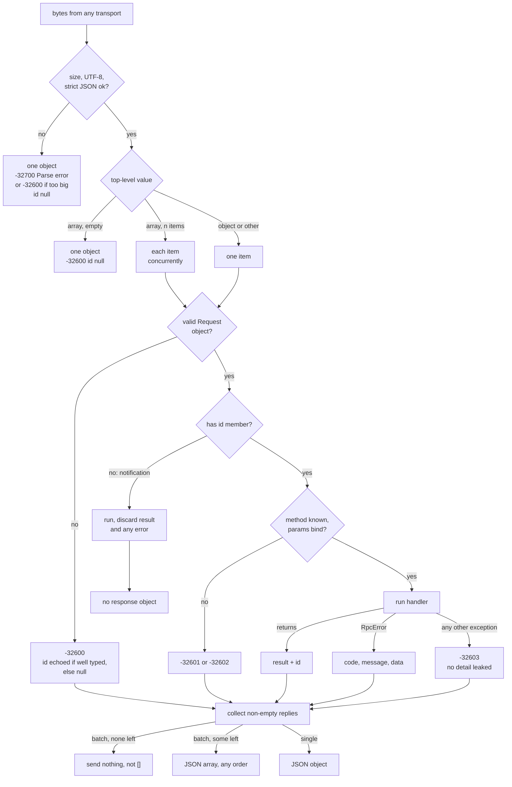

# JSON-RPC 2.0 in Depth: Request/Response Envelope, Positional vs Named params, Notifications (No id), Batch Arrays, and Standard Error Codes (-32700 to -32603)

> [!summary] Claim
> JSON-RPC 2.0 is a transport-free envelope whose whole contract is five rules - a request without `id` is a notification and gets no reply, every other request gets exactly one response carrying exactly one of `result` or `error`, a batch is an array answered by an array that omits the notifications and is never empty, a failure of the batch itself is a single object, and five fixed codes classify what went wrong - so a correct server is a validator plus a strict state machine, and nearly every real bug lives in a case the five rules leave to the implementation.

Part of [GraphQL JSON RPC and Event APIs](README.md) in [API Engineering](../README.md).

## TL;DR

- Mechanism: a request is `{"jsonrpc":"2.0","method":...,"params":...,"id":...}`; the server validates the envelope, binds `params` by position (array) or by name (object), runs the method, and emits `{"jsonrpc":"2.0","result":...,"id":...}` or `{"jsonrpc":"2.0","error":{"code","message","data"},"id":...}` `(JSON-RPC 2.0 Sections 4 and 5)`.
- Contract rule: omit `id` and the call is a notification, which "MUST NOT" be answered even on error, including inside a batch; a batch of only notifications returns nothing at all, never `[]`; an unparseable or empty batch returns one object, not an array `(JSON-RPC 2.0 Sections 4.1 and 6)`.
- The trap: the five codes are not enough for an application, `-32768..-32000` is reserved, and "Invalid params" versus "Internal error" is decided by where the `TypeError` was raised, not by its type; a server that maps every `TypeError` to `-32602` blames the client for its own bug.
- Portability fact: the specification is transport-agnostic and defines no HTTP mapping, so status codes, content types, framing, and cancellation come from the carrier (the historical HTTP draft, LSP `Content-Length` framing, MCP newline or Streamable HTTP), and MCP removed batching in `2025-06-18` `(as of 2026-11)`.
- When not to use it: do not pick JSON-RPC when you need caching, content negotiation, resource identity, streaming results, or schema-first tooling; see [[Architectural-Paradigm-Selection-REST-vs-gRPC-vs-GraphQL-vs-JSON-RPC-vs-Events]].

## Mental model



Everything above the `ITEM` diamond is decided before any application code runs, and none of it depends on the transport.
The first split is whether the whole message is usable at all: a message that is not valid JSON, or is an empty array, produces exactly one error object with `"id": null`, because there is no request to take an `id` from.
Past that split each element of a batch is handled independently, so one malformed element yields one `-32600` entry while its neighbours still run.
The second split is the presence of the `id` member, not its value: notifications are decided syntactically, run for their side effects, and are silent even when they fail.
The last step is bookkeeping: a batch whose replies are all absent sends nothing, because the specification forbids an empty array.

## How it works

### The envelope and the five rules

The specification is one short page, "Origin Date: 2010-03-26 (based on the 2009-05-24 version)", updated 2013-01-04 `(JSON-RPC 2.0, header)`.
It describes itself as "stateless, light-weight" and "transport agnostic in that the concepts can be used within the same process, over sockets, over http, or in many various message passing environments" `(JSON-RPC 2.0 Section 1)`.
A Request object has four members `(JSON-RPC 2.0 Section 4)`:

| Member | Rule |
|---|---|
| `jsonrpc` | "MUST be exactly "2.0"" |
| `method` | A String; names starting with `rpc.` are reserved for "rpc-internal methods and extensions" |
| `params` | "A Structured value" (Array or Object), and "This member MAY be omitted" |
| `id` | "MUST contain a String, Number, or NULL value if included"; if absent, the request "is assumed to be a notification" |

Two footnotes qualify `id`: the value "SHOULD normally not be Null" because "this specification uses a value of Null for Responses with an unknown id", and Numbers "SHOULD NOT contain fractional parts" because "many decimal fractions cannot be represented exactly as binary fractions" `(JSON-RPC 2.0 Section 4, notes [1] and [2])`.
Both are SHOULDs, so a validator must accept `id: null` and `id: 1.5`; the lab does, and echoes them unchanged.
A server cannot tell "request with `id: null`" from "error response for an unknown id" by the `id` alone, which is the practical reason to avoid it.

A Response has `jsonrpc`, an `id`, and "Either the result member or error member MUST be included, but both members MUST NOT be included" `(JSON-RPC 2.0 Section 5)`.
`result` is "REQUIRED on success", so a method that returns nothing still answers `"result": null`; omitting the member makes the message neither a success nor an error.
The response `id` "MUST be the same as the value of the id member in the Request Object", and "If there was an error in detecting the id in the Request object (e.g. Parse error/Invalid Request), it MUST be Null" `(JSON-RPC 2.0 Section 5)`.

The Error object has an integer `code`, a `message` that "SHOULD be limited to a concise single sentence", and an optional `data` whose value "is defined by the Server" `(JSON-RPC 2.0 Section 5.1)`.
The codes are a closed table `(JSON-RPC 2.0 Section 5.1)`:

| `code` | `message` | Meaning in the specification |
|---|---|---|
| `-32700` | Parse error | Invalid JSON was received by the server; an error occurred while parsing the JSON text |
| `-32600` | Invalid Request | The JSON sent is not a valid Request object |
| `-32601` | Method not found | The method does not exist or is not available |
| `-32602` | Invalid params | Invalid method parameter(s) |
| `-32603` | Internal error | Internal JSON-RPC error |
| `-32000` to `-32099` | Server error | Reserved for implementation-defined server-errors |

"The error codes from and including -32768 to -32000 are reserved for pre-defined errors", any code in that range "not defined explicitly" is "reserved for future use", and "The remainder of the space is available for application defined errors" `(JSON-RPC 2.0 Section 5.1)`.
The lab encodes this as three bands: the five standard codes, the `-32099..-32000` server band, and everything outside `-32768..-32000`; a handler that raises `RpcError(-32100, ...)` is forging a reserved code and the dispatcher replaces it with `-32603` (lab `Dispatcher._checked`).
The specification also says the codes are "nearly the same as those suggested for XML-RPC" `(JSON-RPC 2.0 Section 5.1)`, which explains why `-32700` and its neighbours appear in unrelated protocols.

### Positional and named params

`params` "MUST be provided as a Structured value. Either by-position through an Array or by-name through an Object" `(JSON-RPC 2.0 Section 4.2)`.
By-position means "containing the values in the Server expected order"; by-name means "member names that match the Server expected parameter names", where "The names MUST match exactly, including case", and "The absence of expected names MAY result in an error being generated" `(JSON-RPC 2.0 Section 4.2)`.
The specification does not say what an extra name does, so that is an implementation decision.
The lab binds with `inspect.Signature.bind(*params)` for arrays and `bind(**params)` for objects, so an extra name, a missing name, a wrong count, and `{"Minuend": 1}` against `minuend` all fail identically with `-32602`.

The binding step is deliberately separate from the call.
If the lab instead wrapped the call in `try: handler(*args) except TypeError: -32602`, a bug inside the handler (`value + "x"` on an integer) would raise `TypeError` and be reported to the client as `-32602 Invalid params`, which is a lie with a wrong retry policy: the client "fixes" correct params forever.
Binding first and calling second gives `-32602` exactly for the cases where the call could not have started `(lab test_type_error_raised_inside_a_handler_is_internal_error_not_invalid_params)`.

`params: null` is not allowed by the grammar (Structured value, "MAY be omitted"), and the lab answers it with `-32600`.
Real implementations vary here, and the specification's silence on `null` versus absent is a known interoperability seam; the choice is documented, not standardized.
MCP narrows further: its message models type `params` as an object or absent, `dict[str, Any] | None`, so positional arrays are not representable `(mcp-types 2.3.0 mcp_types/jsonrpc.py, JSONRPCRequest)`.

### Notifications

"A Notification is a Request object without an "id" member" and "The Server MUST NOT reply to a Notification, including those that are within a batch request" `(JSON-RPC 2.0 Section 4.1)`.
The next sentence is the cost: "Notifications are not confirmable by definition, since they do not have a Response object to be returned. As such, the Client would not be aware of any errors (like e.g. "Invalid params","Internal error")" `(JSON-RPC 2.0 Section 4.1)`.
So a notification is at-most-once, unacknowledged, and unobservable on failure; use it for logs, progress, and cancellation hints, not for anything whose loss you must detect.

The decision is by member presence.
The lab computes `notification = "id" not in request`, after validation.
That ordering matters: the specification's own example `{"jsonrpc": "2.0", "method": 1, "params": "bar"}` has no `id` and still gets a `-32600` response with `"id": null` `(JSON-RPC 2.0 Section 7)`.
A server cannot know the sender "lacks interest" in a message it cannot parse as a request, so malformed notification-shaped input is answered, and only well-formed notifications are silent.
Once past validation, every failure of a notification (unknown method, bad params, handler exception) is swallowed; the lab logs handler exceptions server-side so silence does not mean invisible to operators.

The lab awaits a notification's handler before the transport reply is produced, so side effects have completed when the HTTP `204` is sent.
The alternative, scheduling it and returning at once, lowers latency but can lose the work at shutdown and breaks ordering guarantees between a notification and the next request on the same connection.
The specification does not choose; the carrier usually does.
Over stdio or a socket the question is moot (nothing is sent back), while over HTTP the server must still say something: the historical HTTP draft specifies `204` for notifications `(JSON-RPC over HTTP Section 3.6.1)`, and MCP's Streamable HTTP specifies `202 Accepted` with no body for a posted notification or response `(MCP 2025-11-25 transports, Sending Messages to the Server)`.

### Batch

"To send several Request objects at the same time, the Client MAY send an Array filled with Request objects" `(JSON-RPC 2.0 Section 6)`.
The server "should respond with an Array containing the corresponding Response objects, after all of the batch Request objects have been processed", with a Response "for each Request object, except that there SHOULD NOT be any Response objects for notifications" `(JSON-RPC 2.0 Section 6)`.
Two sentences define the concurrency model: "The Server MAY process a batch rpc call as a set of concurrent tasks, processing them in any order and with any width of parallelism", and responses "MAY be returned in any order within the Array", so "The Client SHOULD match contexts ... based on the id member within each Object" `(JSON-RPC 2.0 Section 6)`.
There is no atomicity, no ordering, and no dependency between items; it is a bag of independent calls in one message.
For the atomic and partial-success alternatives, see [[Atomic-vs-Partial-Batch-Execution-and-207-Multi-Status]].

Three shape rules need exact handling `(JSON-RPC 2.0 Section 6)`:

- "If the batch rpc call itself fails to be recognized as an valid JSON or as an Array with at least one value, the response from the Server MUST be a single Response object", so invalid JSON gives one `-32700` object and `[]` gives one `-32600` object, not arrays.
- "If there are no Response objects contained within the Response array as it is to be sent to the client, the server MUST NOT return an empty Array and should return nothing at all", so an all-notification batch is silent.
- Elements are judged one by one: `[1]` yields an array with one `-32600`, and `[1,2,3]` yields an array with three `(JSON-RPC 2.0 Section 7)`.

The specification has no nested batches.
An element that is itself an array is "not a valid Request object", so it becomes an element-level `-32600`; the lab never recurses, which also removes a stack-depth amplification vector.
Duplicate `id` values inside one batch are not addressed; the lab answers each item and echoes the same `id` twice, which makes client-side correlation ambiguous.
Clients must therefore generate unique ids per batch.

### Parsing: what "valid JSON" has to mean

Parse error means "Invalid JSON was received by the server" `(JSON-RPC 2.0 Section 5.1)`, and the standard library parser accepts several things RFC 8259 does not.
CPython `json.loads` understands `NaN`, `Infinity`, and `-Infinity` by default (`parse_constant` falls back to `_CONSTANTS`) `(CPython 3.14.6 Lib/json/decoder.py, JSONDecoder.__init__)`, while RFC 8259 says values "that cannot be represented in the grammar below (such as Infinity and NaN) are not permitted" `(RFC 8259 Section 6)`.
A literal `1e400` parses to `inf` (observed, see Numbers), so a `float` slips past a naive check.
`json.loads` on `bytes` runs encoding detection, so UTF-16 input is accepted and a UTF-8 BOM is silently stripped by decoding as `utf-8-sig` `(CPython 3.14.6 Lib/json/__init__.py, detect_encoding)`, but "JSON text exchanged between systems that are not part of a closed ecosystem MUST be encoded using UTF-8", and "Implementations MUST NOT add a byte order mark (U+FEFF) to the beginning of a networked-transmitted JSON text", though parsers "MAY ignore the presence of a byte order mark" `(RFC 8259 Section 8.1)`.
RFC 8259 Section 4 adds that "The names within an object SHOULD be unique", that behaviour on duplicates "is unpredictable", and that "Many implementations report the last name/value pair only" `(RFC 8259 Section 4)`.
Section 9 allows parsers to "set limits on the size of texts that it accepts" and "on the maximum depth of nesting" `(RFC 8259 Section 9)`.

The lab turns all of this into the single `-32700` or `-32600` outcome the specification needs:

1. Reject a message over `max_request_bytes` with `-32600` and `data: {"max_request_bytes": n}`, before decoding.
2. Decode with `bytes.decode("utf-8")`, which rejects invalid UTF-8 and UTF-16, and keeps a BOM as `U+FEFF`, which `json.loads` then refuses (`Unexpected UTF-8 BOM`, observed).
3. Pass `parse_constant` and `parse_float` hooks that raise on `NaN`, `Infinity`, and overflowing floats.
4. Count bracket nesting outside string literals with a linear regex scan and refuse text deeper than `max_depth` (default `64`) with `-32600` and `data: {"max_depth": n}`, before `json.loads` runs, so the outcome does not depend on how the interpreter build handles deep recursion (see Numbers and Portability).
5. Catch `ValueError` (which includes `json.JSONDecodeError`) and `RecursionError` as `-32700`; with the depth gate in place `RecursionError` only appears when a caller raises `max_depth` beyond the interpreter's capacity.
6. Optionally use `object_pairs_hook` to refuse duplicate member names with `-32600`, because a duplicated `id` or `method` is a classic way to make two parsers in a proxy chain disagree.

### Serialization failures are results, not crashes

A handler can return something JSON cannot carry.
The lab renders each response with `json.dumps(..., allow_nan=False)` inside the per-item `try`, so a `set`, a circular list, or `float("nan")` becomes `-32603` for that item only and the rest of the batch survives.
With the default `allow_nan=True`, CPython would write the bare token `NaN`, which is not JSON (observed: `{"x": NaN}`), and every strict client would fail to parse the whole batch reply.
Each item is rendered to a string, and the batch reply is assembled as `"[" + ",".join(parts) + "]"`, so no second full serialization is needed.

### The client half: correlation

A client sends ids, receives an array in any order, and joins on `id`.
The lab's `correlate(sent_ids, reply)` returns a `by_id` map, the `missing` ids (a server may drop an item it could not attribute), and `unmatched` responses (typically the `id: null` `-32600` entries for items the client could not have formed validly).
If the reply is a single object instead of an array the batch was rejected as a whole, and `correlate` raises `BatchRejectedError` carrying that object.
Silence (`None`) means either all notifications or a transport failure; only the carrier can distinguish them.

### JSON-RPC 1.0 and what 2.0 changed

JSON-RPC 1.0 requests have `method`, an Array `params`, and an `id` "of any type"; responses always carry both `result` and `error`, with `error` "null if there was no error"; and a notification is a request whose `id` "Must be null" `(JSON-RPC 1.0 Sections 1.1 to 1.3)`.
2.0 makes `result` and `error` mutually exclusive and absent rather than `null`, represents a notification by omitting `id`, adds the `jsonrpc` version member, structured `params` by name, batches, and the code table `(JSON-RPC 2.0 Sections 3 to 6)`.
Section 3 invites compatibility handling: "Most 2.0 implementations should consider trying to handle 1.0 objects", and a 2.0 message is recognizable by `"jsonrpc": "2.0"` `(JSON-RPC 2.0 Section 3)`.
The lab does not: a message without exact `jsonrpc` is `-32600`, and the `1.0` notification convention `"id": null` is read as a request, which is the spec-consistent reading (see Pitfalls).

### Mapping to a transport

JSON-RPC 2.0 defines no HTTP binding.
The historical, never-finalized draft `JSON-RPC over HTTP` (2008-01-15, an extension to a 1.2 proposal, not to 2.0) says `Content-Type` "SHOULD be 'application/json-rpc' but MAY be 'application/json' or 'application/jsonrequest'", success is `200`, a notification is `204`, and errors map to HTTP statuses: `-32700` to `500`, `-32600` to `400`, `-32601` to `404`, `-32602` to `500`, `-32603` to `500`, and the server band to `500` `(JSON-RPC over HTTP Sections 3.3 and 3.6)`.
Modern practice, and the lab, differ: a JSON-RPC error is carried in a `200` body, because the HTTP exchange succeeded and the application-level result is in the envelope; for a batch no single status could describe mixed outcomes anyway.
The lab keeps HTTP statuses for HTTP-level faults only: `405` with `Allow: POST` for a wrong method (RFC 9110 requires `Allow` in a `405` `(RFC 9110 Section 15.5.6)`, and Starlette sets it in `Route.handle` `(starlette 1.10.0 starlette/routing.py, Route.handle)`), `415` for a media type other than `application/json` `(RFC 9110 Section 15.5.16)`, `413` for an over-limit body `(RFC 9110 Section 15.5.14)`, and `204` for an all-silent exchange `(RFC 9110 Section 15.3.5)`.
The cost of the `200` convention is that gateways, retries, and monitors that key on status see every failure as success; see Pitfalls and [[Error-Taxonomy-Retryability-and-Client-Contract-Design]].

Other carriers pick their own framing.
LSP 3.17 frames each message with a `Content-Length` header (required) and an optional `Content-Type` (default `application/vscode-jsonrpc; charset=utf-8`), the two parts separated by `\r\n`, with two `\r\n` sequences before the content, and states that it "always uses "2.0" as the jsonrpc version" `(LSP 3.17 Base Protocol)`.
LSP adds its own codes: it re-lists the five standard ones and adds `ServerNotInitialized` `-32002`, `UnknownErrorCode` `-32001`, `RequestCancelled` `-32800`, `ContentModified` `-32801`, `ServerCancelled` `-32802`, and `RequestFailed` `-32803`, with `jsonrpcReservedErrorRangeStart` `-32099` and `jsonrpcReservedErrorRangeEnd` `-32000`, plus its own band `lspReservedErrorRangeStart` `-32899` to `lspReservedErrorRangeEnd` `-32800` `(LSP 3.17 Response Message)`.
Note that the LSP cancellation codes sit below `-32768`, outside the reserved range, so they are legal application codes.
LSP also states that "A processed notification message must not send a response back", and that a cancelled request "still needs to return from the server and send a response back", because every request needs one reply `(LSP 3.17 Notification Message, Cancellation Support)`.
MCP `2025-11-25` tightens the base: "Requests MUST include a string or integer ID", "Unlike base JSON-RPC, the ID MUST NOT be null", and the id "MUST NOT have been previously used by the requestor within the same session"; for a notification "The receiver MUST NOT send a response" `(MCP 2025-11-25 basic, Requests and Notifications)`.
The current MCP revision is `2026-07-28` `(MCP versioning, as of 2026-11)`; it keeps the not-null rule but narrows uniqueness to in-flight ids, which "MUST NOT match the ID of any other request the sender has issued and not yet received a response for" `(MCP 2026-07-28 basic, Requests)`, because that revision removed protocol-level sessions `(MCP 2026-07-28 Streamable HTTP)`.
MCP removed batching in `2025-06-18` ("Remove support for JSON-RPC batching") `(MCP 2025-06-18 changelog, Major changes)`, and its Streamable HTTP POST body is "a single JSON-RPC request, notification, or response" `(MCP 2025-11-25 transports, Sending Messages to the Server)`; in `2026-07-28` it is "a single JSON-RPC request or notification" and "The client MUST NOT send JSON-RPC responses" `(MCP 2026-07-28 Streamable HTTP)`.
Its stdio transport delimits messages with newlines that "MUST NOT contain embedded newlines", and all messages "MUST be UTF-8 encoded" `(MCP 2025-11-25 transports)`.
The pinned `mcp-types 2.3.0` models reflect this: `RequestId = Annotated[int, Field(strict=True)] | str` declares a strict integer or a string (observed: `TypeAdapter(RequestId)` rejects `True`, `1.0`, and `1.5`, and the JSON texts `true` and `1.0`), and a comment records "the 2026-07-28 spec's allocation policy" for the server-error band: `-32000..-32019` implementation-defined, `-32020..-32099` reserved for spec-defined codes, and `-32002`, `-32042` "reserved-never-reused" `(mcp-types 2.3.0 mcp_types/jsonrpc.py, RequestId and the error-code constants)`.

## Numbers and limits

| Quantity | Value | Source |
|---|---|---|
| Standard error codes | `-32700`, `-32600`, `-32601`, `-32602`, `-32603` | `(JSON-RPC 2.0 Section 5.1)` |
| Reserved code range | `-32768` to `-32000` inclusive | `(JSON-RPC 2.0 Section 5.1)` |
| Implementation-defined server errors | `-32000` to `-32099` | `(JSON-RPC 2.0 Section 5.1)` |
| Interoperable JSON integer range | `[-(2**53)+1, (2**53)-1]` | `(RFC 8259 Section 6)` |
| Spec revisions | 2.0 origin 2010-03-26 "based on the 2009-05-24 version", updated 2013-01-04 | `(JSON-RPC 2.0 header)` |
| Spec-mandated batch size limit | none; the specification sets no maximum | `(JSON-RPC 2.0 Section 6)` |
| Lab default `max_request_bytes` | `1,048,576` | lab `Limits`, a design choice, not from the specification |
| Lab default `max_batch_size` | `100`, inclusive (3 allowed, 4 refused at limit 3) | lab `Limits`, test `test_batch_size_limit_is_inclusive` |
| Lab default `max_depth` | `64`, inclusive (3 allowed, 4 refused at limit 3); brackets inside string literals do not count | lab `Limits`, tests `test_max_depth_is_inclusive_and_ignores_brackets_inside_strings` and `test_nesting_beyond_max_depth_is_refused_without_calling_the_parser`; RFC 8259 Section 9 permits a depth limit |
| Lab default `max_concurrency` | `16`; at `1` a two-method rendezvous deadlocks | lab `Limits`, test `test_concurrency_limit_of_one_serializes_and_so_the_rendezvous_deadlocks` |
| Interpreter nesting behavior without the lab gate | 100,000 `[` raise `RecursionError` in `json.loads`, unclosed or balanced, on uv CPython 3.12.13, 3.13.18, 3.14.6, 3.15.0b3, and 3.15.0b3t; on Homebrew CPython 3.14.10 and 3.15.2 the balanced 100,000-deep text parses and the unclosed one gives `JSONDecodeError`; 200,000 raises `RecursionError` on all seven | measured 2026-11-26 with a scratch script (`python -I jsonfacts.py` per interpreter), macOS-27.3-arm64, `sys.getrecursionlimit()` is `1000` on both 3.14 builds; this is why the lab counts depth itself |
| Integer-string limit | `sys.int_info.default_max_str_digits` is `4300`; `json.loads` of a 4,301-digit integer raises `ValueError` "Exceeds the limit (4300 digits) for integer string conversion" | measured 2026-11-26, same scratch script, all seven interpreters above |
| Lab suite | `91 passed in 0.56s` | measured 2026-11-26 after adding the depth gate, CPython 3.14.6, macOS-27.3-arm64, `uv run --frozen pytest -p no:cacheprovider` |

The `2**53` line matters for ids and results: a 64-bit database key above that value does not survive a client that parses JSON numbers as IEEE 754 doubles, so large ids belong in strings `(RFC 8259 Section 6)`.
CPython additionally limits integer-string conversion to 4,300 digits by default and raises a plain `ValueError`, not `json.JSONDecodeError`, past it (measured, see the table), which is why the lab catches `ValueError` broadly.

## Portability

| Leg | Result |
|---|---|
| CPython 3.14.6 (workspace `.venv`), macOS-27.3-arm64 | Lab: `91 passed in 0.56s` (Worked example); `ruff format --check`, `ruff check`, `mypy`, and `pyright` each run once on the two lab files after the depth-gate change: all clean |
| CPython 3.12.13, 3.13.18, 3.15.0b3 (uv builds) | Lab not run (lab checks paused by instruction on 2026-11-11); the scratch `json` facts script gave identical results to 3.14.6 on each: `NaN` accepted, duplicate last-wins, UTF-16 and UTF-8-BOM bytes accepted, a BOM in `str` refused with `Unexpected UTF-8 BOM (decode using utf-8-sig)`, `1e400` gives `inf`, `json.dumps` writes `NaN`, 100,000-deep nesting raises `RecursionError` |
| CPython 3.14.10 and 3.15.2 (Homebrew builds) | Scratch script identical except depth: a bare `json.loads` parses a balanced 100,000-deep array there (cause, build flags or C stack size, not isolated), which broke the lab's earlier reliance on `RecursionError`; with the `max_depth` gate, `Dispatcher.handle` on 100,000 unclosed `[`, 100,000 balanced `[`/`]`, and 100,000 repeated `{"a":` returned the same `-32600` with `data: {"max_depth": 64}` on both builds (direct `Dispatcher.handle` run, workspace site-packages on the path); the pytest file itself was not run on them |
| CPython 3.15.2t free-threaded | Not run: only `3.15.0b3` free-threaded is installed here, where the scratch script matched the uv builds; the lab's per-call `asyncio.Semaphore` shares no module state, so a race is not expected, but the lab is untested there |
| `type RequestId = ...` statement | Lab uses PEP 695 `type` aliases, which need CPython >= 3.12; `requires-python` is `>=3.12`; untested on 3.12 here |
| Uvicorn, Hypercorn, Granian | Not run; the endpoint is a plain ASGI app, and its `204` and `405` behavior was proven in-process with `httpx.ASGITransport` only |
| HTTP/1.1, HTTP/2, HTTP/3 | Not run; the envelope is body-level, and RFC 9110 semantics for `204`, `405`, `413`, `415` are version-independent |
| Other JSON-RPC carriers | LSP `Content-Length` framing, MCP newline framing and `202` rule, and the historical HTTP draft are cited from their documents, not implemented or run in the lab |
| JSON parsers other than CPython `json` | Not run; the NaN, BOM, duplicate-name, and depth behaviors are parser-specific, so re-verify when `orjson` (pinned `3.13.0`) or `msgspec` replaces `json.loads` |

## Worked example

The implementation is [implementation](../labs/src/api_labs/f20_graphql_json_rpc_and_event_apis/json_rpc_dispatcher.py) and the test is [test](../labs/tests/f20_graphql_json_rpc_and_event_apis/test_json_rpc_2_0_specification_batching_notifications_and_error_codes.py).
The test replays every example in Section 7 of the specification, then checks each edge case in this note against a deliberately broken alternative.
Excerpts below are labelled simplified; the files are the source of truth.

Simplified excerpt of `Dispatcher.handle`, the whole message-level state machine:

```python
async def handle(self, raw: bytes | str) -> str | None:
    data = raw if isinstance(raw, bytes) else raw.encode("utf-8", errors="surrogatepass")
    if len(data) > self.limits.max_request_bytes:
        return standard_error(INVALID_REQUEST, data={"max_request_bytes": ...})
    try:
        text = data.decode("utf-8")
        if _nesting_depth(text) > self.limits.max_depth:
            return standard_error(INVALID_REQUEST, data={"max_depth": ...})
        payload = json.loads(
            text,
            object_pairs_hook=hook,            # _reject_duplicates, or None
            parse_constant=_reject_constant,   # NaN, Infinity, -Infinity
            parse_float=_parse_float,          # 1e400 -> inf -> ValueError
        )
    except _DuplicateMemberError:
        return standard_error(INVALID_REQUEST)
    except (ValueError, RecursionError):
        return standard_error(PARSE_ERROR)
    gate = asyncio.Semaphore(self.limits.max_concurrency)
    batch = _as_batch(payload)
    if batch is None:
        return await self._dispatch_one(payload, gate)
    if not batch:
        return standard_error(INVALID_REQUEST)          # [] -> one object
    if len(batch) > self.limits.max_batch_size:
        return standard_error(INVALID_REQUEST, data={"max_batch_size": ...})
    parts = await asyncio.gather(*(self._dispatch_one(item, gate) for item in batch))
    replies = [part for part in parts if part is not None]
    return "[" + ",".join(replies) + "]" if replies else None   # never "[]"
```

Simplified excerpt of the per-item path, where notifications, error mapping, and the binding-before-calling rule live:

```python
async def _dispatch_one(self, item: Any, gate: asyncio.Semaphore) -> str | None:
    if not isinstance(item, dict):
        return standard_error(INVALID_REQUEST)
    request_id = _detect_id(request)            # echo only a well-typed id, else None
    if not _is_valid_request(request):
        return standard_error(INVALID_REQUEST, request_id)
    notification = "id" not in request          # decided by presence, after validation
    try:
        result = await self._invoke(request, gate)
        if notification:
            return None
        return _render({"jsonrpc": "2.0", "result": result, "id": request_id})
    except RpcError as exc:
        error = self._checked(exc)              # no forging reserved codes
    except Exception:
        logger.exception("method %r failed", request["method"])
        error = RpcError(INTERNAL_ERROR, STANDARD_MESSAGES[INTERNAL_ERROR])
    return None if notification else error_text(error, request_id)
```

Output captured from one real run of a throwaway script that registers `subtract`, `sum`, `notify_hello`, and `get_data` and feeds the specification's mixed batch (`PYTHONPATH=src uv run --frozen python demo.py` from `labs/`, CPython 3.14.6, macOS-27.3-arm64, 2026-11-26; each reply is the exact string `Dispatcher.handle` returned; the verifier's independent rerun printed the same eight lines byte for byte):

```text
batch       [{"jsonrpc":"2.0","result":7,"id":"1"},{"jsonrpc":"2.0","result":19,"id":"2"},{"jsonrpc":"2.0","error":{"code":-32600,"message":"Invalid Request"},"id":null},{"jsonrpc":"2.0","error":{"code":-32601,"message":"Method not found"},"id":"5"},{"jsonrpc":"2.0","result":["hello",5],"id":"9"}]
empty       {"jsonrpc":"2.0","error":{"code":-32600,"message":"Invalid Request"},"id":null}
[1]         [{"jsonrpc":"2.0","error":{"code":-32600,"message":"Invalid Request"},"id":null}]
all-notify  None
NaN param   {"jsonrpc":"2.0","error":{"code":-32700,"message":"Parse error"},"id":null}
dup id      {"jsonrpc":"2.0","error":{"code":-32600,"message":"Invalid Request"},"id":null}
bad names   {"jsonrpc":"2.0","error":{"code":-32602,"message":"Invalid params"},"id":3}
null id     {"jsonrpc":"2.0","result":1,"id":null}
```

The `batch` line has five replies for six requests: the notification `notify_hello` is gone, and the invalid element `{"foo": "boo"}` produced the `-32600` entry with `"id": null`, exactly as the specification's example shows.

The test run, from `labs/`:

```text
$ uv run --frozen pytest tests/f20_graphql_json_rpc_and_event_apis/test_json_rpc_2_0_specification_batching_notifications_and_error_codes.py -q
........................................................................ [ 81%]
................                                                         [100%]
91 passed in 0.56s
```

CPython 3.14.6, macOS-27.3-arm64, 2026-11-26 (run with `-p no:cacheprovider` added to leave no cache; the file had 88 tests before the depth gate was added).
The first run of this file had one failure, which was a mistake in the test, not the dispatcher: the parametrized value `-31999` is outside the reserved range `-32768..-32000`, so the dispatcher correctly let it through; the test now uses `-32604` for the forging case and `-31999` for the allowed case.

What the tests pin down, each chosen so the named behavior's absence would fail it:

- `test_specification_section_7_examples` replays 13 of the request/response pairs of Section 7 and compares decoded JSON, including `None` for the silent ones; the two invalid-JSON examples have their own test.
- `test_notification_runs_the_handler_but_sends_no_reply` checks the side effect happened (a recorder list) and that nothing was returned.
- `test_type_error_raised_inside_a_handler_is_internal_error_not_invalid_params` fails if the implementation maps `TypeError` around the call instead of binding first.
- `test_batch_items_run_concurrently` needs two handlers that each wait for the other, so it passes only if the batch runs concurrently, and `test_concurrency_limit_of_one_serializes_and_so_the_rendezvous_deadlocks` proves the semaphore is real by timing out.
- `test_undecodable_or_non_json_input_is_parse_error` includes UTF-16 and BOM bytes, `NaN`, `Infinity`, and `1e400`, each of which a bare `json.loads` would accept.
- `test_nesting_beyond_max_depth_is_refused_without_calling_the_parser` feeds 100,000-deep arrays and objects and expects `-32600` with `data.max_depth`, so it passes on every interpreter build, and `test_max_depth_is_inclusive_and_ignores_brackets_inside_strings` pins the boundary and that bracket characters and an escaped quote inside a string do not count.
- `test_unterminated_string_scan_is_linear_not_quadratic` feeds 400,000 escaped quotes after an opening quote; a regex whose string branch can fail would rescan from every quote and effectively never finish (a hang, not an assertion, is the failure signal).
- `test_http_call_is_200_json_and_notification_is_204_with_no_body` and its siblings run the Starlette app through `httpx.ASGITransport` with no socket.

Mutation testing was not run by the drafter or the verifier: the user paused lab checks on 2026-11-11, so discrimination is argued from the test construction above and not demonstrated by breaking the code.

## Pitfalls

> [!warning] A `TypeError` from inside the handler reported as "Invalid params"
> Trigger: the dispatcher calls `handler(*params)` in a `try` that maps `TypeError` to `-32602`.
> Symptom: a handler bug returns `-32602` to the client, which treats it as its own mistake and never retries or alerts, while server dashboards show no errors.
> Fix: validate the arity and names first (here `Signature.bind`), call second, and map anything raised by the call to `-32603` with the details only in server logs.

> [!warning] Answering notifications, or answering a failed notification
> Trigger: an implementation always writes a response, for example `{"result":null,"id":null}` for a call without `id`, or an error for a notification with an unknown method.
> Symptom: strict clients and peers on a bidirectional channel (LSP, MCP) treat an unexpected `id: null` message as a protocol violation or match it to nothing; over a socket it also doubles message volume.
> Fix: decide silence from `"id" not in request` after validation, and keep failed notifications server-side only; the specification says "MUST NOT reply" even inside a batch `(JSON-RPC 2.0 Section 4.1)`.

> [!warning] `[]` for an all-notification batch, or an array for `[]`
> Trigger: `return json.dumps(replies)` unconditionally, or handling an empty top-level array as a batch with zero items.
> Symptom: HTTP clients parse `[]` fine but spec-conformant peers reject it ("MUST NOT return an empty Array"); the reverse bug returns `[ {-32600} ]` for `[]` where a single object is required `(JSON-RPC 2.0 Section 6)`.
> Fix: return nothing when no replies remain, and a single `-32600` object for an empty array.

> [!warning] `200 OK` hides every JSON-RPC failure from the infrastructure
> Trigger: errors carried in the body of a `200`, which is common and what the lab does.
> Symptom: load balancer health checks, retry middleware, circuit breakers, and SLO dashboards that look at status codes report a healthy service while every call fails; conversely a `5xx` mapping makes a proxy retry a non-idempotent call.
> Fix: emit metrics and logs from the JSON-RPC layer keyed by `error.code` and `method`, decide a retry policy per method, and if you must signal at HTTP level follow a documented mapping, such as the historical draft's, consistently and only for single (non-batch) requests.

> [!warning] Booleans and floats accepted as `id`
> Trigger: validating `id` with `isinstance(x, (int, str))` in Python, where `True` is an `int`.
> Symptom: `{"id": true}` is accepted and echoed as `true`, and a client dictionary keyed by `1` also matches `True` and `1.0` (`1 == True == 1.0`, and their hashes are equal), so two distinct requests can collide.
> Fix: reject `bool` explicitly, and consider restricting ids to strings and integers as MCP does.

> [!warning] Duplicate JSON members and parser differential
> Trigger: a gateway validates one parser's view of `{"method":"read","method":"admin"}` while the backend uses another (RFC 8259 calls duplicates "unpredictable" and notes many implementations keep the last).
> Symptom: authorization applied to the first value, execution of the last.
> Fix: refuse duplicate names at the edge (the lab's default, `-32600`), and make the gateway and the service share one strict parser; see [[Single-Pass-JSON-Validation-Model-Validate-JSON-vs-JSON-Loads]].

> [!warning] Clients that treat `id: null` as a notification, or servers that treat it as one
> Trigger: a 1.0 client sends notifications as `"id": null` `(JSON-RPC 1.0 Section 1.3)` to a 2.0 server.
> Symptom: the 2.0 server answers every one (`id: null` is a request there), so a one-way event stream produces a reply stream nobody reads, and the replies' `id: null` collide with real unknown-id errors.
> Fix: treat 1.0 peers as a separate endpoint or an explicit compatibility mode; the specification only says implementations "should consider trying to handle 1.0 objects" `(JSON-RPC 2.0 Section 3)`.

> [!warning] A synchronous handler blocks every request on the event loop
> Trigger: registering a blocking function (database driver, `requests`) with an `async` dispatcher that calls it inline, as the lab's `handler(*bound.args, ...)` does for non-awaitables.
> Symptom: a batch of 16 "concurrent" calls runs serially and the p99 of unrelated requests rises with batch size.
> Fix: run blocking handlers in an executor or declare them `async`, and bound concurrency per process, not per request, because the lab's semaphore is created per message.

## Security and robustness

Threat model: the endpoint accepts attacker-controlled bytes, fans one request into up to `max_batch_size` method invocations, and runs application code in each.
Map it to OWASP API Security 2023: API4 (unrestricted resource consumption) for batch amplification, API1 and API5 (object and function level authorization) for per-method checks, and API8 (security misconfiguration) for verbose errors `(OWASP API Security Top 10 2023)`.

- Amplification: a batch is N calls for one HTTP request, so a per-request rate limiter undercounts by a factor of N; charge each item against the limiter, cap `max_batch_size`, and cap bytes before parsing (the lab checks the size before decoding).
  The same brute-force shape exists in GraphQL aliases, see [[GraphQL-Security-Query-Depth-Complexity-Cost-Analysis-and-Batch-Limits]].
- Authorization is per method and per item: authenticate once per HTTP request but authorize every `(caller, method, params)` tuple inside the batch, otherwise one permitted call can carry forbidden siblings.
  The dispatcher in this note has no auth layer, by design; put it in `_invoke`'s caller.
- Errors must not leak: `-32603` carries no exception text (test `test_internal_error_hides_the_exception_text` asserts a secret string is absent), and `data` is an opt-in field the handler sets on purpose.
- Reserved codes: handlers cannot emit undefined reserved codes such as `-32100` or `-32604` (they become `-32603`), but the lab deliberately lets a handler raise any of the five standard codes, so `RpcError(-32700, ...)` from a handler is passed through (observed); a client therefore cannot assume `-32700` always means a parse failure unless the server also refuses `-32700` and `-32600` from handlers.
- Parser hardening: strict UTF-8, rejection of `NaN` and `Infinity`, duplicate-name rejection, and catching `RecursionError` together close the common parser-differential and crash paths; the lab enforces an explicit `max_depth` (default `64`) before parsing because interpreter behavior is not portable (a balanced 100,000-deep array parses in a bare `json.loads` on Homebrew CPython 3.14.10 and 3.15.2, measured); the scan is a regex over the decoded text, so it costs one extra linear pass, and its string branch must never be able to fail or an attacker gets quadratic rescans.
- Method allow-listing: the registry is a dict lookup on an exact string, never `getattr`, so `__class__` or `rpc.discover` cannot reach internals; `rpc.`-prefixed names are refused at registration `(JSON-RPC 2.0 Section 8)`.
- Idempotency: notifications and retried requests can execute twice; for state-changing methods require a client-supplied idempotency key in `params`, see [[Idempotency-Key-Header-Specification-and-State-Machine-Draft-08]].
- Cancellation and timeouts: the specification has none; LSP layers `$/cancelRequest` and still requires a response for the cancelled request `(LSP 3.17 Cancellation Support)`, and a server needs its own per-call deadline, see [[Timeout-Taxonomy-Connect-Read-Write-Pool-and-Deadline-Propagation]].
- Not covered here: TLS, CORS, and CSRF for browser-reachable `POST` endpoints; a `text/plain` `POST` is the CORS-simple request, which is why the lab insists on `application/json` with a `415`.

## The principal's view

JSON-RPC is the cheapest correct protocol for a command channel between two parties that share a team or a release train: tool protocols (LSP, MCP), editor and agent plumbing, node and blockchain admin APIs, and internal control planes.
Its virtues are a tiny spec, trivial implementations in any language, transport independence, and bidirectional symmetry; its price is everything HTTP would have given for free.
There is no method-level caching, no resource identity, no content negotiation, no standard pagination or streaming, no schema, and no status-code-based observability, so you rebuild each of them or live without them.

The decision rule: choose JSON-RPC when the interaction is verb-shaped, the peers are known, the same envelope must run over several transports (stdio, WebSocket, HTTP), and you control both ends.
Choose REST when intermediaries and caches matter, gRPC when you need typed streaming and deadlines, GraphQL when clients shape reads, and events when consumers are decoupled in time; the comparison is in [[Architectural-Paradigm-Selection-REST-vs-gRPC-vs-GraphQL-vs-JSON-RPC-vs-Events]] and the push transports in [[Real-Time-Push-Protocols-Compared-WebSockets-vs-SSE-vs-HTTP-2-3-Streaming-vs-Long-Polling]].

Organizational trade-offs: the five codes are too coarse to be a contract, so publish an application error registry (codes, `data` schema, retryability) in the band `-32099..-32000` or above the reserved range, and version it like any API; define a schema for each method's `params` and `result` (OpenRPC, "a standard, programming language-agnostic interface description for JSON-RPC 2.0 APIs" `(OpenRPC Specification)`, or plain JSON Schema) because the envelope gives you none; and decide the HTTP status policy once, because it is hard to change after clients depend on it.
Batching is a latency optimization with a failure-semantics cost: items are independent and unordered, so the moment a caller needs atomicity or ordering it has outgrown the batch, and the right move is a purpose-built bulk method, see [[Atomic-vs-Partial-Batch-Execution-and-207-Multi-Status]].
The strongest signal that a protocol decision was right is that MCP kept the single-message envelope and dropped batching `(MCP 2025-06-18 changelog)`: the part that was hard to make safe and hard to correlate was the part that went.

## Interview questions

> [!question] L5: What distinguishes a notification from a request, and what must the server do with a failing one?
>
> > [!success]- Answer
> > A notification is a Request object with no `id` member; the decision is by presence, not by value.
> > The server must not reply to it, even when it is inside a batch and even when the method is unknown, the params are invalid, or the handler throws.
> > The only exception in practice is a message too malformed to be a Request at all, such as `{"jsonrpc":"2.0","method":1}`, which the specification's own example answers with `-32600` and `id: null`.
> > Server-side logging is the only place a failed notification is visible.
> >
> > Follow-up: Is a request with `"id": null` a notification, given that it is answered with `id: null` and the specification discourages the value?

> [!question] L5: List the five standard error codes and say when each applies.
>
> > [!success]- Answer
> > `-32700` Parse error: the bytes are not valid JSON (response `id` is `null`).
> > `-32600` Invalid Request: valid JSON that is not a valid Request object, or an empty batch.
> > `-32601` Method not found: no such method, including reserved `rpc.` names you do not implement.
> > `-32602` Invalid params: the arguments cannot be bound to the method's signature.
> > `-32603` Internal error: the method started and failed, or its result could not be serialized.
> > Codes `-32000` to `-32099` are for server-defined errors, and `-32768` to `-32000` is otherwise reserved.
> >
> > Follow-up: Which code range is free for application-defined errors?

> [!question] L6: Predict the output of this batch against a server that has `a` (returns `1`) and `b` registered: `[{"jsonrpc":"2.0","method":"a","id":1},{"jsonrpc":"2.0","method":"b"},[],5]`.
>
> > [!success]- Answer
> > The reply is an array of three objects: `{"jsonrpc":"2.0","result":1,"id":1}`, then `{"jsonrpc":"2.0","error":{"code":-32600,"message":"Invalid Request"},"id":null}` for the `[]` element, then the same `-32600` object for `5`.
> > The `b` notification runs but produces no entry, so there are three replies for four elements.
> > The inner `[]` is an element that is not a Request object, not an empty batch, so it is an element-level `-32600` inside an array reply, while a top-level `[]` would be a single object.
> > This follows the specification's `[1]` and `[1,2,3]` examples and the lab's `test_nested_batch_element_is_invalid_request_not_recursion`; running this exact message through `Dispatcher.handle` (CPython 3.14.6, 2026-11-26) printed those three objects in that order.
> >
> > Follow-up: Which part of the reply could legally change if the server returned replies in completion order, and how must a client cope?

> [!question] L6: Debug this API: an HTTP JSON-RPC endpoint returns `200` with `[]` for a batch of two notifications, and a strict client library throws on it, so what is the bug and the right response?
>
> > [!success]- Answer
> > The specification says that when no Response objects remain the server "MUST NOT return an empty Array and should return nothing at all" `(JSON-RPC 2.0 Section 6)`.
> > The bug is `json.dumps(replies)` with no check for an empty list.
> > Over HTTP the right wire form is an empty body, which this note's endpoint sends as `204 No Content` (the historical draft also uses `204` for notifications).
> > Add a regression test where every item is a notification and assert the reply is `None`, as `test_all_notification_batch_sends_nothing_rather_than_an_empty_array` does.
> >
> > Follow-up: What should the same endpoint return for a top-level `[]`, given that the batch rules differ from the all-notification case?

> [!question] L6: Why does the lab bind params with `Signature.bind` instead of catching `TypeError` around the call?
>
> > [!success]- Answer
> > A `TypeError` raised inside the handler is indistinguishable from one raised by a bad call if you catch it around the invocation.
> > That would report a server bug as `-32602`, steering the client to "fix" valid arguments and hiding the incident from server metrics.
> > Binding first fails only when the arguments cannot match the signature, so `-32602` means "the call never started".
> > Everything raised after the call begins maps to `-32603` with no detail in the response.
> >
> > Follow-up: What does binding by signature still miss, and where should that check live?

> [!question] L6: A client sends a batch of 100 items. Your service rate-limits at 10 requests per second per client, so what goes wrong and what do you change?
>
> > [!success]- Answer
> > The limiter counts one HTTP request while the server runs 100 method calls, so the effective limit is 1,000 calls per second.
> > Charge the limiter per item (or by estimated cost), cap `max_batch_size`, and cap request bytes before parsing.
> > Return a single `-32600` with `data` naming the limit when the cap is exceeded, as the lab does, and consider a `429` at the HTTP layer only for the rate-limit case.
> > Also bound per-process concurrency across requests, because the lab's semaphore only bounds one message.
> >
> > Follow-up: How does GraphQL expose the same amplification hole, and where is it covered in this vault?

> [!question] L7+: Why does MCP forbid `id: null` and reuse of ids, and why did it drop batching, when the base specification allows both?
>
> > [!success]- Answer
> > `id: null` is already the value for "id could not be detected" in error responses, so allowing it in requests makes an error response ambiguous with a reply to a real request.
> > Reusing an id within a session lets a late response be attributed to the wrong request, which matters on a long-lived bidirectional channel with cancellation.
> > MCP `2025-11-25` requires ids unique within a session and not null `(MCP 2025-11-25 basic, Requests)`, `2026-07-28` keeps not-null and narrows uniqueness to ids still awaiting a response after dropping protocol-level sessions `(MCP 2026-07-28 basic, Requests)`, and MCP removed batching in `2025-06-18` `(MCP 2025-06-18 changelog)`; the changelog states what changed, not why, so the rationale for batching removal is inference (independent unordered items with a single combined reply are hard to cancel, stream, and attribute).
> > The generalization: tighten the base protocol where a long-lived stateful channel makes ambiguity costly.
> >
> > Follow-up: What does that cost an implementation that wants to speak both generic JSON-RPC and MCP?

> [!question] L7+: You must expose the same method set over HTTP, WebSocket, and stdio, so what is shared and what must differ per transport?
>
> > [!success]- Answer
> > Share the dispatcher: validation, binding, notification semantics, batch assembly, error mapping, and limits are transport-free, as `Dispatcher.handle` is.
> > Per transport you decide framing (HTTP body, WebSocket message, newline-delimited or `Content-Length` frames as LSP uses), the silence representation (`204` or `202` over HTTP, nothing on a socket), size limits and slow-reader backpressure, authentication, and cancellation.
> > Do not let transport status codes carry JSON-RPC meaning unless you document a mapping, because batches cannot be summarized by one status.
> > On a bidirectional channel the same envelope also carries server-initiated requests, so request ids need a namespace per direction.
> >
> > Follow-up: Where do you enforce per-caller rate limits when one frame can carry many calls?

> [!question] L7+: Design the error-code registry for a public JSON-RPC API that must be retried safely by generic client libraries.
>
> > [!success]- Answer
> > Keep the five standard codes for protocol faults and put application errors outside `-32768..-32000`, or in `-32099..-32000` if you mimic server errors, never in undefined reserved codes.
> > For each code define the `message`, the `data` schema, whether it is retryable, and whether the call may have executed (a timeout or `-32603` after side effects is ambiguous).
> > Require an idempotency key in `params` for mutating methods so that retry after an ambiguous failure is safe.
> > Treat `-32700`, `-32600`, `-32601`, and `-32602` as non-retryable, `-32603` as retryable only for idempotent methods, and publish the table with the schema.
> > Version the registry, and never reuse a retired code, as MCP's allocation comment does for `-32002` and `-32042` `(mcp-types 2.3.0 mcp_types/jsonrpc.py)`.
> >
> > Follow-up: Where do you carry the retryability bit, given that the envelope has no field for it?

## Related

Prerequisites: [[Distributed-GraphQL-Apollo-Federation-v2-Entities-and-Subgraph-Planning]]

Next: [[Event-Driven-APIs-and-AsyncAPI-3-1-0-Specification]]

See also: [[02-Programming-Languages/Python/Python-Backend-Interview-Prep/05-REST-API-Design]], [[Architectural-Paradigm-Selection-REST-vs-gRPC-vs-GraphQL-vs-JSON-RPC-vs-Events]], [[Atomic-vs-Partial-Batch-Execution-and-207-Multi-Status]], [[GraphQL-Security-Query-Depth-Complexity-Cost-Analysis-and-Batch-Limits]], [[Real-Time-Push-Protocols-Compared-WebSockets-vs-SSE-vs-HTTP-2-3-Streaming-vs-Long-Polling]], [[Error-Taxonomy-Retryability-and-Client-Contract-Design]], [[Problem-Details-for-HTTP-APIs-RFC-9457]], [[Idempotency-Key-Header-Specification-and-State-Machine-Draft-08]], [[Single-Pass-JSON-Validation-Model-Validate-JSON-vs-JSON-Loads]], [[Timeout-Taxonomy-Connect-Read-Write-Pool-and-Deadline-Propagation]]

- Lab: `labs/tests/f20_graphql_json_rpc_and_event_apis/test_json_rpc_2_0_specification_batching_notifications_and_error_codes.py`

## Further reading

- [JSON-RPC 2.0 Specification](https://www.jsonrpc.org/specification): the whole contract; Section 6 (batch) and Section 7 (examples) are the conformance suite.
- [JSON-RPC over HTTP (historical draft, 2008)](https://www.jsonrpc.org/historical/json-rpc-over-http.html): the only published HTTP status mapping, and why it is not what modern servers do.
- [JSON-RPC 1.0 Specification (2005 archive)](https://www.jsonrpc.org/specification_v1): the `id: null` notification convention and always-present `result` and `error`.
- [RFC 8259, The JavaScript Object Notation (JSON) Data Interchange Format](https://www.rfc-editor.org/rfc/rfc8259.html): Sections 4, 6, 8.1, and 9 define the duplicate-name, number, encoding, and limit behavior a Parse error rests on.
- [RFC 9110, HTTP Semantics](https://www.rfc-editor.org/rfc/rfc9110.html): Sections 15.3.5, 15.5.6, 15.5.14, and 15.5.16 for the `204`, `405`, `413`, and `415` the endpoint uses.
- [Language Server Protocol 3.17, Base Protocol](https://microsoft.github.io/language-server-protocol/specifications/lsp/3.17/specification/): the largest deployed JSON-RPC 2.0 framing, error-code extension, and cancellation model.
- [Model Context Protocol 2025-11-25, Base Protocol](https://modelcontextprotocol.io/specification/2025-11-25/basic): the strict profile (`id` not null, no reuse, no reply to notifications) and the `2025-06-18` changelog that removed batching; the current revision is `2026-07-28` (as of 2026-11).
- [OWASP API Security Top 10 2023](https://owasp.org/API-Security/editions/2023/en/0x11-t10/): the API1, API4, API5, and API8 categories the security section maps batching and errors to.
- [OpenRPC Specification](https://spec.open-rpc.org/): the interface description format for JSON-RPC 2.0 method schemas the envelope lacks.
