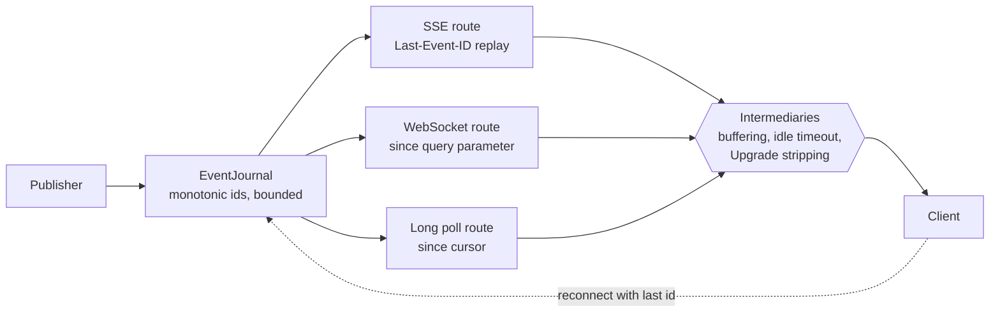

# Real-Time API Transport Selection: WebSockets (RFC 6455) vs Server-Sent Events (SSE) vs HTTP/2-3 Streaming vs Long Polling Across Proxies and Firewalls

> [!summary] Claim
> Pick the transport by who must talk and by the weakest hop on the path: `SSE` over HTTP/2 is the default for one-way push because it is ordinary HTTP that resumes by `Last-Event-ID`, `WebSocket` is justified only for low-latency bidirectional or binary traffic, long polling is the fallback that survives every intermediary, and none of the four is reliable until the server keeps a replay journal and sends a heartbeat more often than the shortest idle timeout on the path.

Part of [GraphQL JSON RPC and Event APIs](README.md) in [API Engineering](../README.md).

All volatile facts in this note are dated `(as of 2026-11)`.
Behavior claims about libraries are checked against the exact releases pinned in the lab workspace.
Lab runs were made on CPython 3.14.6 only; see Portability for what was not run.

## TL;DR

- Mechanism: every transport turns "the server speaks first" into one long-lived HTTP exchange, where long polling sends one complete response per delivery (RFC 6202 Section 2.1), SSE and chunked streaming frame events inside one open response (WHATWG HTML 9.2.5, RFC 9112 Section 7.1), and `WebSocket` leaves HTTP after a `101` upgrade for its own masked frames (RFC 6455 Sections 4.2.2 and 5.2).
- Contract rule: delivery is resumable only if the server assigns monotonic ids, keeps a bounded replay journal, and answers a stale or future cursor with an explicit reset, which SSE supports natively through `Last-Event-ID` (WHATWG HTML 9.2.3), long polling needs a `since` parameter for, and `WebSocket` leaves entirely to the application.
- Trap: the failure is almost never the protocol but a middlebox, because buffering proxies hold SSE events, a 60 s `proxy_read_timeout` or Application Load Balancer idle timeout cuts quiet streams, and a proxy that drops the hop-by-hop `Upgrade` and `Connection` headers breaks the `WebSocket` handshake (RFC 9110 Section 7.6.1).
- Portability fact: HTTP/2 forbids `Connection` and `Upgrade` and has no `101` (RFC 9113 Sections 8.2.2 and 8.6), so `WebSocket` rides HTTP/2 and HTTP/3 only through extended `CONNECT` (RFC 8441, RFC 9220), while SSE needs nothing new but every open stream holds one `SETTINGS_MAX_CONCURRENT_STREAMS` slot (RFC 9113 Section 5.1.2).
- When not to use it: skip `WebSocket` for one-way notifications that SSE can carry, skip SSE for high-rate or binary client-to-server streams, skip long polling when each response carries one event (the roughly 160-byte request and response head measured in the lab dominates), and skip held-open connections for server-to-server delivery where a signed webhook (see [[HTTP-Callback-Subscriptions-WebSub-and-Async-Request-Reply-Patterns]]) fits.

## Mental model



All three transports are adapters over one journal, which is what the lab builds: a publisher appends to a bounded log with monotonic ids, and each route replays from the client's cursor and then follows live entries.
The hexagon is where production fails, not the protocol: an intermediary can buffer the stream, close it after an idle period, or refuse the upgrade, and the client then sees a dropped connection with no error from the server.
The dotted arrow is the contract that makes the failure survivable: the client reconnects carrying the id of the last event it fully received, and the journal either replays the gap or says the cursor is unusable.
Transports that cannot express that arrow natively (`WebSocket`) must reinvent it in the application protocol, which is the main hidden cost of choosing them.

## How it works

### The four mechanisms

HTTP is request and response, so every "push" technique holds a request open or reverses roles after leaving HTTP.
RFC 6202 (informational, 2011) defines the two classical techniques and their costs, and the vocabulary is still the right one.

**Long polling** (RFC 6202 Section 2.1).
The client sends a request, the server defers the response until an event or a timeout, and the client immediately sends the next request.
Every delivery is a complete HTTP message with a full header set, which RFC 6202 Section 2.2 lists as "Header Overhead".
The same section gives the latency bound: average latency is close to one network transit, but the maximum is over three transits (response, next request, response), because after each response the server must wait for the next request before it can speak again.
Under load it degrades gracefully: events queue and "might be delivered in a batch within a single long poll response" (RFC 6202 Section 2.2, "Graceful Degradation"), which the lab reproduces in `test_events_published_between_polls_are_batched_into_the_next_response`.
Because each response is a complete message, intermediaries treat it as normal traffic, and RFC 6202 Section 5.3 notes that most proxies work well with long polling for exactly that reason.
The timeout must stay below the shortest proxy timeout on the path: RFC 6202 Section 5.5 reports a browser default of 300 s, experiments that succeeded at 120 s, and recommends 30 s as the safer value.
It also says caching "is always intentionally suppressed" with `Cache-Control: no-cache` (Section 5.6); the lab route sends `Cache-Control: no-store`, which is the stricter directive.

**HTTP streaming** (RFC 6202 Section 3.1).
The server sends part of a response and keeps the response open.
On HTTP/1.1 that is `Transfer-Encoding: chunked`, where each chunk is a hexadecimal size, `CRLF`, the data, and `CRLF`, and a chunk of size zero ends the body (RFC 9112 Section 7.1).
RFC 9112 Section 7.1 also warns that HTTP/1.1 "does not define any means to limit the size of a chunked response such that an intermediary can be assured of buffering the entire response".
RFC 6202 Section 3.2 lists the consequences: there is no requirement for an intermediary "to immediately forward a partial response", so a buffering intermediary defeats streaming; chunk boundaries cannot be used as message delimiters because proxies may "re-chunk"; and clients need not expose partial bodies to the application.
So the application must frame its own messages inside the stream, for example newline-delimited JSON or the SSE event format.
On HTTP/2 and HTTP/3 chunked coding does not exist; the body is a series of `DATA` frames (RFC 9113 Section 8.1, RFC 9114 Section 4.1) and the end is signalled by `END_STREAM` or a stream `FIN` instead of a zero-size chunk.
For browsers, `fetch()` can read a response incrementally, and request bodies can also stream, but the rule is `duplex: "half"`: the MDN `Request.duplex` page (last modified 2026-11-13) says "The browser must send the entire request before processing the response", and a Chrome for Developers article (last updated 2020-07-22) adds that streaming requests are rejected on HTTP/1.x.
No per-browser support claim is made here: the MDN compatibility table is rendered by JavaScript and was not read, so check it before relying on request streaming in Safari or Firefox.
That is the practical ceiling of "bidirectional HTTP streaming" in a browser: one streaming request plus a second request for the response, linked by an id.
Outside browsers, HTTP/2 and gRPC streaming are fully bidirectional, which is the subject of [[Architectural-Paradigm-Selection-REST-vs-gRPC-vs-GraphQL-vs-JSON-RPC-vs-Events]].

**Server-Sent Events** (WHATWG HTML Standard 9.2, as of 2026-11).
SSE is HTTP streaming with a standardized event format and a browser API, `EventSource`.
Its value is not the transport, it is the three behaviors the standard specifies and long polling or raw streaming leave to you: a line-oriented wire format, automatic reconnection, and resume through the `Last-Event-ID` request header.
The details that bite are covered in the next subsection.

**WebSocket** (RFC 6455).
A client sends an HTTP/1.1 `GET` with `Upgrade: websocket`, `Connection: Upgrade`, `Sec-WebSocket-Key`, and `Sec-WebSocket-Version: 13`.
The server replies `101 Switching Protocols` with `Upgrade: websocket`, `Connection: Upgrade`, and `Sec-WebSocket-Accept`, which is the base64 of the SHA-1 of the key concatenated with the GUID `258EAFA5-E914-47DA-95CA-C5AB0DC85B11` (RFC 6455 Sections 1.3 and 4.2.2).
The accept value proves that the server received and understood the handshake, so that "the server doesn't accept connections that are not WebSocket connections", which stops an attacker from tricking a WebSocket server with packets crafted through `XMLHttpRequest` or a form submission (RFC 6455 Section 1.3).
After the `101` the same TCP connection carries WebSocket frames (next subsection) and HTTP semantics are gone.

### SSE in detail: wire format, parser, and reconnection

The event stream is UTF-8 text with the media type `text/event-stream`, lines ending in `CRLF`, `LF`, or a bare `CR`, and blocks separated by a blank line (WHATWG HTML 9.2.5).
The interpreting algorithm (WHATWG HTML 9.2.6) has the following behaviors, each one exercised by a lab test:

- A line starting with `:` is a comment and is ignored.
  This is the heartbeat primitive.
- A line `field: value` removes exactly one leading space from the value.
  A line with no colon is a field name with an empty value, so a bare `data` line contributes an empty data line.
- `data` lines accumulate, each followed by `LF`, and dispatch removes the final `LF`.
  The WHATWG examples therefore give `"YHOO\n+2\n10"` for three data lines, and the stream `data`, blank, `data`, `data`, blank, `data:` dispatches `""` and `"\n"` and discards the unterminated last block.
- An event is dispatched only at the blank line.
  "Once the end of the file is reached, any pending data must be discarded", so a connection cut mid-event delivers nothing for that event.
- `id` sets the last-event-id buffer unless the value contains `U+0000`; an `id` line with no value resets it to the empty string.
  Dispatch copies the buffer into the event source's last event ID string even when the event itself is empty, and the value persists until the server changes it.
- `retry` sets the reconnection time only if the value is all ASCII digits.
  `event` sets the type, which defaults to `message`.
- One leading BOM is stripped by the UTF-8 decode; a BOM later in the stream makes the first field name unrecognizable and the line is ignored.

The processing model (WHATWG HTML 9.2.3) defines reconnection.
A response with status other than `200` or a `Content-Type` other than `text/event-stream` fails the connection permanently, while a network error or normal end of stream makes the user agent "reestablish the connection": the state goes to `CONNECTING`, an `error` event fires, the user agent waits the reconnection time (initially an implementation-defined value "probably in the region of a few seconds"), and then sends the request again with `Last-Event-ID` if the last event ID string is non-empty.
The standard allows an exponential backoff on top ("Optionally, wait some more"), but does not require it.
A `204 No Content` tells the client to stop reconnecting (WHATWG HTML 9.2.1), and `301` and `307` redirects are followed.
The `EventSource` constructor takes only a URL and `withCredentials` (WHATWG HTML 9.2.2), so a browser page cannot set an `Authorization` header, a method, or a body; authentication is by cookie or by a credential in the URL, which is a design constraint that pushes teams to `fetch`-based SSE clients.
The authoring notes (WHATWG HTML 9.2.7) say legacy proxies "drop HTTP connections after a short timeout" and recommend "a comment line ... every 15 seconds or so", warn that chunking applied by a different layer can hurt reliability, and warn about per-server connection limits when several pages each open an `EventSource`.

The lab parser `SseParser` implements this algorithm incrementally, and the interesting engineering is in chunk boundaries: a `CR` at the end of one network chunk may be the first half of a `CRLF`, a multi-byte UTF-8 character may be split, and the BOM may arrive in a one-byte chunk.
`test_every_chunking_of_the_stream_parses_the_same` feeds the same stream in steps of 1, 2, 3, and 5 bytes for each line-ending style and requires identical events.

`sse-starlette 3.6.0` is the pinned server-side library.
`EventSourceResponse.__init__` (sse_starlette/sse.py) sets `Cache-Control: no-store` unless the caller supplies one, always sets `Connection: keep-alive` and `X-Accel-Buffering: no`, and pings every `DEFAULT_PING_INTERVAL = 15` seconds with a comment event (`_ping`); `ping=0` disables pings and the `__call__` code does not even start the ping task in that case.
`ServerSentEvent.encode` (sse_starlette/event.py) writes `CRLF` line ends by default (`DEFAULT_SEPARATOR = "\r\n"`), strips line breaks from `id` and `event` values, and splits multi-line `data` into several `data:` lines.
It does not reject `U+0000` in an `id`, which a conforming client would ignore (WHATWG HTML 9.2.6), so ids should come from a trusted counter.
`enable_compression` raises `NotImplementedError` ("Compression is not supported for SSE streams."), and the source documents two invariants tied to upstream issues: the module docstring says `HEAD` "is answered with headers and an empty body; the stream never starts" because streaming an endless generator on `HEAD` ends up "wedging keep-alive connections" (Issue #218), and the `_ping` docstring says the ping task "must NOT be started when `ping_interval == 0`" because the loop "would busy-spin" (Issue #206).
The upstream release notes (GitHub releases of `sysid/sse-starlette`, read 2026-11-26) date the guards: the `ping=0` fix is "fix: disable keep-alive pings when ping=0 (#206)" in `v3.4.9` (2026-09-03), and the `HEAD` fix is "fix: do not stream on HEAD requests" (pull request 220, with follow-ups in pull request 229) in `v3.6.0` (2026-10-25), so `3.6.0` is the first release with both.
Disconnect handling differs from plain Starlette: `StreamingResponse.__call__` (starlette 1.10.0 starlette/responses.py) on ASGI `spec_version >= 2.4` just awaits `stream_response` and converts an `OSError` from `send` into `ClientDisconnect`, while below 2.4 it races `listen_for_disconnect` against the stream; `EventSourceResponse` deliberately keeps `_listen_for_disconnect` running so it can call `client_close_handler_callable` and stop the ping task.
For the deeper treatment of the SSE code path see [[Server-Sent-Events-SSE-Protocol-Last-Event-ID-and-SSE-Starlette]] and [[ASGI-HTTP-and-Disconnect-Event-Lifecycle]].

### WebSocket in detail: frames, masking, control frames, close, and limits

The base frame (RFC 6455 Section 5.2) is 2 bytes of header: `FIN`, three `RSV` bits, a 4-bit opcode, a `MASK` bit, and a 7-bit length.
A length of 126 means a 16-bit length follows, 127 means a 64-bit length follows (most significant bit zero), and "the minimal number of bytes MUST be used", so encoding 124 as `126, 0, 124` is illegal.
The masking key adds 4 bytes and is present on every client-to-server frame (RFC 6455 Section 5.3).
Opcodes are `0x0` continuation, `0x1` text, `0x2` binary, `0x8` close, `0x9` ping, `0xA` pong.
`RSV` bits must be zero unless a negotiated extension defines them; `permessage-deflate` uses `RSV1` (RFC 7692 Section 6).

Masking exists to protect intermediaries, not endpoints.
RFC 6455 Section 10.3 describes an experiment in which attackers made an `Upgrade` connection look like HTTP and sent bytes that resembled a `GET` for a widely used script, poisoning "a nonzero percentage of deployed intermediaries"; masking every client frame with an unpredictable key means a page script cannot control the bytes on the wire.
Server-to-client frames are not masked because the attacker cannot forge the request that would make a response look cacheable (same section).
The lab encoder `encode_ws_frame` reproduces every example in RFC 6455 Section 5.7 byte for byte and is cross-checked against `wsproto 1.3.2` (`FrameProtocol.send_data` in wsproto/frame_protocol.py) in both directions for seven payload sizes from 0 to 65,536 bytes (0, 1, 125, 126, 1000, 65,535, 65,536), which cover every length-encoding boundary.

Fragmentation (RFC 6455 Section 5.4) lets a sender split a message into frames, with `FIN` clear on all but the last and opcode `0x0` on continuations.
"Unless specified otherwise by an extension, frames have no semantic meaning", and an intermediary "might coalesce and/or split frames", so a receiver must never depend on frame boundaries, only on message boundaries.
Control frames may be interleaved inside a fragmented message, must have a payload of at most 125 bytes, and must not be fragmented (Sections 5.4 and 5.5); the lab encoder and decoder both enforce this.

Ping and pong (RFC 6455 Sections 5.5.2 and 5.5.3) are the protocol-level keepalive: a ping must be answered with a pong carrying the same data, an endpoint "MAY elect to send a Pong frame for only the most recently processed Ping", and an unsolicited pong is a one-way heartbeat.
The browser API does not expose them: the WHATWG WebSockets Standard Section 5 says Ping and Pong frames "are not currently exposed in the API" and that user agents "must not use pings or unsolicited pongs to aid the server", so the server must send its own pings and a browser app that wants to detect a dead link needs an application-level heartbeat.
The `websockets` Keepalive and latency guide (stable docs, labelled 17.3 when fetched, as of 2026-11) says the same from the server side: browsers "can fail to notice that a WebSocket connection is broken for an extended period of time", the `WebSocket` object then does not fire `close`, and a reconnection mechanism never starts.
The API does offer `bufferedAmount`, the bytes queued by `send()` but not yet transmitted (WHATWG WebSockets Standard, `bufferedAmount`), which is polling-based sender feedback and not receiver backpressure.

Closing is a two-message handshake (RFC 6455 Section 5.5.1): the endpoint that receives a close frame must send one back, then the server closes TCP first so it holds `TIME_WAIT` (Section 7.1.1).
Status codes (Section 7.4.1): `1000` normal, `1001` going away, `1002` protocol error, `1003` unacceptable data type, `1007` inconsistent data such as invalid UTF-8 in a text message, `1008` policy violation, `1009` message too big, `1011` unexpected server condition.
`1005` (no status present), `1006` (abnormal closure with no close frame), and `1015` (TLS failure) are reserved and "MUST NOT be set as a status code in a Close control frame"; they exist only so an API can report what happened locally.
Starlette follows that: `WebSocketDisconnect.__init__` defaults to `code=1000`, `WebSocket.close` defaults to `code=1000`, and `WebSocket.send` turns an `OSError` from the server into `WebSocketDisconnect(code=1006)` (starlette 1.10.0 starlette/websockets.py).
Codes `3000` to `3999` are for libraries and frameworks and `4000` to `4999` are private use (Section 7.4.2), which is where application codes such as "token expired" belong.

Servers must cap sizes: RFC 6455 Section 10.4 says an implementation "SHOULD impose a limit on frame sizes and the total message size after reassembly", because a peer can send a single frame claiming `2**60` bytes or an endless run of small fragments.
The shipped defaults differ by an order of magnitude: `websockets 17.4` `serve` has `max_size=2**20` (1 MiB) and `max_queue=16`, `uvicorn 0.54.0` `Config.__init__` has `ws_max_size=16 * 1024 * 1024`, `ws_max_queue=32`, `ws_ping_interval=20.0`, `ws_ping_timeout=20.0`, and `ws_per_message_deflate=True`, and `hypercorn 0.18.0` `Config` has `websocket_max_message_size = 16 * 1024 * 1024` with `websocket_ping_interval = None`, so Hypercorn sends no pings unless you configure them.

The handshake is also where the origin is checked.
Browsers send `Origin` on a WebSocket handshake so the server can refuse cross-origin use by page scripts (RFC 6455 Section 1.3), and the refusing is the server's job: "If the server does not validate the origin, it will accept connections from anywhere", and the server that does not want a connection must return an error such as `403 Forbidden` (RFC 6455 Section 4.2.2, with Section 10.2).
Authentication is whatever HTTP offers at handshake time (cookies, HTTP auth, TLS client auth; Section 10.5), which means a cookie-authenticated WebSocket without an `Origin` check is vulnerable to cross-site WebSocket hijacking.
The lab route `ws_endpoint` runs `origin_allowed` before `accept`, denies with a real `403` through the ASGI `websocket.http.response` extension when the server advertises it and falls back to `websocket.close` otherwise; `uvicorn 0.54.0` `asgi_send` (uvicorn/protocols/websockets/websockets_impl.py) maps a close before accept to `HTTP 403`.
`test_a_websocket_handshake_from_an_unlisted_or_missing_origin_gets_403` checks an evil origin and an absent one.

### Handshake through intermediaries: the hop-by-hop problem

`Connection` and `Upgrade` are hop-by-hop.
A recipient proxy "MUST parse a received Connection header field before a message is forwarded and, for each connection-option in this field, remove any header or trailer field(s) from the message with the same name" and then drop `Connection` itself (RFC 9110 Section 7.6.1), and `Upgrade` is on its list of fields to remove (same section).
RFC 9110 Section 7.8 says a sender of `Upgrade` must also send an `Upgrade` connection option in the `Connection` header field so that intermediaries do not forward it, and that a server "MAY ignore a received Upgrade header field", so an upgrade can never be insisted on.
A reverse proxy therefore has to opt in explicitly.
The nginx WebSocket docs say that because `Upgrade` is hop-by-hop "it is not passed from a client to proxied server", and give `proxy_set_header Upgrade $http_upgrade;` and `proxy_set_header Connection "upgrade";`, plus a `map` variant that sends `Connection: close` when no `Upgrade` was requested (as of 2026-11, with a note that `proxy_http_version 1.1;` was required before nginx 1.29.7 because the default was 1.0 and became 1.1 in 1.29.7, per the `ngx_http_proxy_module` docs).
Envoy has the equivalent switch as `upgrade_configs` on the HTTP connection manager or per route, and its docs note that buffering "is generally not compatible with upgrades" (Envoy HTTP upgrades docs, as of 2026-11).
The lab proves the failure mode on the receiving end: if the `Connection: Upgrade` option is rewritten to `Connection: keep-alive`, `wsproto 1.3.2` `H11Handshake._process_connection_request` raises `RemoteProtocolError: Missing header, 'Connection: Upgrade'` (`test_a_proxy_that_drops_the_connection_upgrade_option_breaks_the_handshake`).
The related header-handling pitfalls are in [[Hop-by-Hop-vs-End-to-End-Headers-and-Connection-Header-Abuse]].

### WebSocket and SSE over HTTP/2 and HTTP/3

HTTP/2 "does not support the 101 (Switching Protocols) informational status code" (RFC 9113 Section 8.6) and an endpoint "MUST NOT generate an HTTP/2 message containing connection-specific header fields", including `Connection`, `Keep-Alive`, `Transfer-Encoding`, and `Upgrade` (Section 8.2.2).
RFC 8441 fixes this with an opt-in: the server sends `SETTINGS_ENABLE_CONNECT_PROTOCOL` (code `0x8`, initial value 0) with value 1 (RFC 8441 Sections 3 and 9.1), and then the client may send a `CONNECT` request with a new `:protocol` pseudo-header set to `websocket`, plus `:scheme`, `:path`, and `:authority`, and the `Sec-WebSocket-*` fields except `Sec-WebSocket-Key` and `Sec-WebSocket-Accept`, because that functionality "has been superseded by the :protocol pseudo-header field" (Sections 4 and 5).
The server answers `200`, and the stream then carries ordinary WebSocket frames as `DATA`; orderly close is `END_STREAM` and abort is `RST_STREAM` with `CANCEL` (Section 5).
RFC 9220 Section 3 ports the same mechanism to HTTP/3 with the same setting value `0x08`, tells a server that gets an unknown `:protocol` to answer `501 Not Implemented`, and maps close to a stream `FIN` and abort to `H3_REQUEST_CANCELLED`.
RFC 8441 Section 7 keeps forward proxies unchanged: a client behind an HTTP proxy still uses a plain `CONNECT` to tunnel, and the HTTP version inside the tunnel decides which handshake is used.

The lab shows both sides of this with the real `h2 4.4.1` state machine.
`h2_websocket_over_extended_connect` refuses to open the tunnel until the server's `SETTINGS` carries `ENABLE_CONNECT_PROTOCOL = 1`, sends `CONNECT` with `:protocol = websocket`, and the server sees exactly those pseudo-headers and none of `connection`, `upgrade`, or `sec-websocket-key`; then a masked text frame travels as `DATA` and decodes to `b"hi"`.
A subtle library behavior, verified by `test_h2_silently_strips_the_legacy_upgrade_headers_and_rejects_them_inbound`: `h2` does not raise when an application passes `connection: upgrade` and `upgrade: websocket` to `send_headers`, because `normalize_outbound_headers` runs `_strip_connection_headers` after lowercasing names and trimming whitespace, and that step drops every name in `CONNECTION_HEADERS` (h2 4.4.1 h2/utilities.py, `normalize_outbound_headers`), so the legacy WebSocket handshake over HTTP/2 degrades silently into a plain `GET` that a server will answer with an ordinary response.
Inbound, a header block that carries them is a protocol error: `_reject_connection_header` raises `ProtocolError: Connection-specific header field present`.
Server support in the pinned stack (as of 2026-11): `hypercorn 0.18.0` `H2Protocol.__init__` advertises `ENABLE_CONNECT_PROTOCOL: 1` and `_create_stream` hands any `CONNECT` request to a `WSStream` in both `hypercorn/protocol/h2.py` and `hypercorn/protocol/h3.py`, `aioquic 1.7.2` `H3Connection._get_local_settings` always includes `Setting.ENABLE_CONNECT_PROTOCOL: 1`, and `uvicorn 0.54.0` `Config.load` serves HTTP/2 only with the separate `zttp` package (`http2=True` raises `ValueError` unless `http="zttp"`), which is not installed here, so Uvicorn over HTTP/2 was not tested.
On the browser side, Chrome Platform Status lists "WebSockets over HTTP/2" (RFC 8441) as enabled by default since Chrome 91, "only used for secure WebSockets requests, and only when there is already an HTTP/2 connection where the server has already advertised support" (as of 2026-11), so a `wss` connection to an edge that does not advertise the setting takes the classic HTTP/1.1 `Upgrade` handshake on its own connection.
No other browser and no CDN edge was checked or exercised for this note, so the edge inventory in The principal's view has to record it per path.

SSE needs no such machinery, and HTTP/2 helps it in two ways and hurts it in one.
It helps because one connection multiplexes many streams, so the HTTP/1.1 per-origin connection limit stops being the constraint: MDN states that without HTTP/2 SSE "suffers from a limitation to the maximum number of open connections ... set to a very low number (6)" per browser and domain, marked "Won't fix" in Chrome and Firefox, and that with HTTP/2 the maximum simultaneous streams "is negotiated between the server and the client (defaults to 100)" (as of 2026-11, page last modified 2026-09-03).
It also removes the need for chunked coding and gives per-stream flow control (RFC 9113 Section 6.9).
It hurts because streams in the open or half-closed states "count toward the maximum number of streams" (RFC 9113 Section 5.1.2), and an SSE stream stays open, so a limit chosen for short requests is consumed by long-lived ones.
`h2_sse_streams(server_max_concurrent=3, attempts=5)` shows it with the real state machine: three streams open, and the fourth `send_headers` raises `TooManyStreamsError` ("Max outbound streams is 3, 3 open", `h2 4.4.1`).
RFC 9113 Section 6.5.2 recommends a value "no smaller than 100"; the h2 library comments that the unbounded protocol default is "a dangerous default" and sets its own local default to 100 (h2/connection.py, `H2Connection.__init__`), and `hypercorn 0.18.0` uses `h2_max_concurrent_streams = 100`.

HTTP/3 changes the failure model rather than the API.
Framing is a `DATA` frame with a type byte and a variable-length integer length (RFC 9114 Section 7.2.1), so the header is 2, 3, or 5 bytes in the lab depending on size (RFC 9000 Section 16 gives the 1, 2, 4, or 8 byte integer ranges).
Liveness moves to the QUIC layer: the connection is silently closed when idle longer than the minimum of both endpoints' `max_idle_timeout` (RFC 9000 Section 10.1), and an endpoint can send a `PING` frame to defer it (Section 10.1.2), so a heartbeat design must account for which layer the middlebox times out.
UDP is the new firewall problem: RFC 9114 Section 3.1 says "Connectivity problems (e.g., blocking UDP) can result in a failure to establish a QUIC connection; clients SHOULD attempt to use TCP-based versions of HTTP in this case", and the endpoint is advertised through `Alt-Svc: h3=":50781"` (Section 3.1.1, RFC 7838), so any real deployment keeps the HTTP/1.1 and HTTP/2 paths working and treats HTTP/3 as an optimization.
See [[Alt-Svc-and-HTTP-Version-Negotiation]] and [[QUIC-Transport-Streams-and-Connection-Migration-RFC-9000]].

### Intermediaries: what actually kills a quiet or streaming connection

The following defaults come from vendor documentation fetched for this note (as of 2026-11), and each is configurable.

- nginx `proxy_buffering` defaults to `on`: the response is saved into buffers and a temporary file, and with buffering off "the response is passed to a client synchronously, immediately as it is received"; a backend can switch it per response with the `X-Accel-Buffering` header, which is why `sse-starlette` always sets `X-Accel-Buffering: no`.
  `proxy_read_timeout` defaults to 60 s and is measured "only between two successive read operations", so any byte, including an SSE comment, resets it.
  The WebSocket page adds that the connection "will be closed if the proxied server does not transmit any data within 60 seconds" unless the backend sends WebSocket ping frames.
- Envoy route `timeout` defaults to 15 s and "spans between the point at which the entire downstream request ... has been processed and when the upstream response has been completely processed", with 0 disabling it.
  An endless SSE response never completes, so by that definition the 15 s default bounds it; the route docs say a value of 0 disables the route timeout, so a route that serves SSE needs `timeout: 0s` (read from the `route_components.proto` reference, not exercised against a running Envoy).
  `stream_idle_timeout` defaults to 5 minutes and is reset by each header or data event on the stream, and when it fires the stream is reset (or answered `408` if no upstream headers arrived).
  The per-route `idle_timeout` has no default, falls back to the connection-manager `stream_idle_timeout` when unset, and a value of 0 "will completely disable the route's idle timeout, even if a connection manager stream idle timeout is configured".
- AWS Application Load Balancer connection idle timeout defaults to 60 s (range 1 to 4000 s) and AWS says "Application Load Balancers do not support HTTP/2 PING frames.
  These do not reset the connection idle timeout", so an HTTP/2 ping heartbeat toward an ALB does nothing; only data bytes count.
  AWS also recommends an application idle timeout larger than the load balancer's, or the load balancer may reuse a connection the application has closed and return `502`.
- Cloudflare proxies WebSockets with no extra configuration and "will close a WebSocket connection when no data is transmitted in either direction for a period of time", with the value configurable only for Enterprise accounts and not stated on the page; it tells you to implement a client-side heartbeat, and it may restart servers and so terminate WebSockets during releases.
  Its Proxy Read Timeout, the wait for the origin to send an HTTP response, is 125 s by default and produces error `524`.

The common conclusion is `safe_heartbeat_interval`, a one-line policy the lab encodes and tests: with idle timeouts of 60 s, 125 s, and 300 s on the path, send something every `min(timeouts) / 2 = 30 s`.
Half is a margin for loss and scheduling jitter, not a protocol constant.
The SSE standard's "every 15 seconds or so" is the same idea with a smaller margin; for long polling the equivalent is a server-side hold time below the shortest timeout, which RFC 6202 puts at 30 s.
The timeout and retry interactions between tiers are the subject of [[Proxy-and-Application-Timeout-and-Retry-Interaction-Hazards]] and [[Keep-Alive-Timeout-Races-Between-Reverse-Proxies-and-Origins]].

### Resumable delivery: the journal

Resumption is a server obligation for every transport, and the lab's `EventJournal` is the minimum viable form.
Entries get monotonic integer ids; a deque of fixed capacity holds the newest; `since(last_id)` returns everything newer and sets `gap` when the cursor is older than the oldest retained entry or newer than the newest.
The second condition matters: after a server restart the journal starts again at 1, and a client that still holds id 40 would wait forever for id 41 if the server treated "future cursor" as "nothing new".
`test_a_cursor_from_a_restarted_server_is_a_gap_not_an_endless_wait` pins that, and `follow` turns a gap into a `Reset` marker that the SSE route emits as `event: reset` and the WebSocket route as `{"type": "reset"}`, after which the client must rebuild from a snapshot.
Using an epoch or a random stream id in the cursor is the production hardening; the lab uses plain integers to keep the invariant visible.
The central test (see Worked example) cuts the SSE byte stream at every one of its 66 possible offsets and requires that parser state plus a `Last-Event-ID` reconnect reconstructs the sequence exactly once, which is only true because the parser dispatches on the blank line and records the id at dispatch.

Long polling gets the same guarantee from its cursor: the response carries `cursor` and `reset`, and the next request sends `since=<cursor>`; `test_long_poll_timeout_is_a_200_with_no_events_and_the_same_cursor` keeps the cursor unchanged across a timeout so that an idle poll loop is harmless.
Choosing `200` with an empty list for a timeout follows RFC 6202 Section 5.4, which says the server responds `200 OK` when "a particular event, status, or timeout has occurred" and carries the timeout in the body; a bare `204` is the common alternative but then the client cannot tell an idle timeout from a proxy-generated empty response.

`WebSocket` gives no resume at all, so the lab route accepts `?since=<id>` and replays through the same `follow` generator.
That is application design, not protocol, and it is the main reason a "WebSocket for notifications" project quietly grows a bespoke reliability layer.

### Backpressure and fan-out

A push transport has one slow-consumer problem and three places to hold the data.
The `websockets` Memory and buffers guide (stable docs, labelled 17.3 when fetched, as of 2026-11) describes three levels of buffering (TCP buffers, I/O library buffers, and the library's own incoming-message queue bounded by `max_size` times `max_queue`) and gives the rule: buffers "should be sized to absorb bursts"; when they are almost always full the extra memory brings no benefit and "latency degrades as well", which it calls bufferbloat, and increasing I/O library buffers "can also backfire because it delays backpressure".
For its asyncio server, `send()` waits when the write buffer is above the high-water mark (`write_limit`, default `2**15`) and so applies backpressure to the sending coroutine.
The decision that matters to the API is what to do with one subscriber that cannot keep up, and there are only two honest answers: drop the oldest data and tell the client (so it can resync from the journal), or disconnect it.
Buffering without bound is the third answer, and it lets one slow client grow memory without limit.
The lab's `Subscriber` makes the policy explicit (`SlowConsumerPolicy.DROP_OLDEST` keeps the newest N and counts `dropped`; `DISCONNECT` closes at capacity and refuses further offers).
For SSE the same applies through the ASGI `send` await, and `sse-starlette` adds an optional `send_timeout` that raises `SendTimeoutError` for a stalled client (`_send_with_timeout`).
Background reading on how an awaited `send` propagates TCP windows is in [[End-to-End-Backpressure-TCP-Windows-ASGI-Send-Await-and-Bounded-Queues]] and [[ASGI-WebSockets-Lifecycle-Subprotocols-and-Backpressure]].

### Subprotocols and WebTransport

A WebSocket carries opaque messages, so the application contract has to be named in the handshake.
The client lists candidates in `Sec-WebSocket-Protocol`, and "the server needs to include the same field and one of the selected subprotocol values in its response for the connection to be established" (RFC 6455 Section 1.9, non-normative; the normative rules are in Sections 4.1 and 4.2.2).
The same section recommends names that contain a domain, such as `chat.example.com`, and says a backward-incompatible change is a new name (`v2.bookings.example.net`), which makes the subprotocol string the place to version a WebSocket API; the browser constructor accepts the candidate list (WHATWG WebSockets Standard, as in Security and robustness).
The lab route does not negotiate a subprotocol and its JSON messages have no version, which is a simplification a production API should not copy.

WebTransport is the protocol designed to replace the compromises above for browsers.
`draft-ietf-webtrans-http3-17` (WebTransport over HTTP/3, an Active Internet-Draft with its datatracker page last updated 2026-11-02, so not an RFC as of 2026-11) describes "unidirectional streams, bidirectional streams, and datagrams, all multiplexed within the same HTTP/3 connection", negotiated by a `SETTINGS_WT_ENABLED` setting the server sends.
The consequences for selection are the opposite of SSE's: it needs HTTP/3 or an HTTP/2 binding, so UDP reachability and edge support decide whether it works at all, and every guarantee in this note about reconnection, resume, and heartbeats still has to be built by the application.
This note makes no claim about browser or edge support for it and recommends it only as a design to track; the lab does not exercise it.

### Compression

`permessage-deflate` (RFC 7692) compresses each message and flags it with `RSV1` on the first frame (Section 6).
Negotiation parameters control memory: `server_no_context_takeover` and `client_no_context_takeover` stop an endpoint from keeping the LZ77 window between messages, and `server_max_window_bits` and `client_max_window_bits` take values 8 to 15, where absence means a window of up to 32,768 bytes (Section 7.1).
The `websockets` Memory and buffers guide (17.3 stable docs) states the cost for its asyncio implementation: 64 KiB per connection with default compression settings and 14 KiB with compression disabled.
That is 50 KiB per connection, or about 5 GB across a hundred thousand connections (simple multiplication, not a measurement), which is why compression is a capacity decision and not a free default; note that Uvicorn enables it by default (`ws_per_message_deflate=True`).
Section 8 of RFC 7692 warns of "a known exploit when history-based compression is combined with a secure transport" (it cites CRIME), so do not compress messages that mix attacker-controlled and secret data.
Compression is also a denial-of-service surface: the NVD description of CVE-2018-1000518 (published 2018-06-26) names `websockets` 4 for CWE-409, improper handling of highly compressed data, a memory-exhaustion denial of service by a crafted frame unless configured with `compression=None`, and says it "appears to have been fixed in 5".
SSE and long polling use ordinary HTTP content coding instead, and `sse-starlette` refuses to compress SSE outright, because a compressor that buffers destroys event latency.

## Numbers and limits

Overheads are per message, measured by encoding the real objects in the lab (`ws_overhead`, `sse_overhead`, `h1_chunk_overhead`, `h2_data_overhead`, `h3_data_overhead`, `long_poll_overhead`) on CPython 3.14.6, Darwin 27.3.0, and they exclude TLS, TCP, IP, HPACK, QUIC packet framing, and the application's own JSON envelope.
The SSE columns add the event framing (8 bytes: the 6-byte `data: ` prefix and the 2-byte blank line, with `LF` line ends) to the transport framing of the carrying HTTP version.

| Payload bytes | WS server to client | WS client to server | SSE event only | SSE in HTTP/1.1 chunk | SSE in HTTP/2 `DATA` | SSE in HTTP/3 `DATA` | Long poll request plus response head |
| --- | --- | --- | --- | --- | --- | --- | --- |
| 16 | 2 | 6 | 8 | 14 | 17 | 10 | 161 |
| 128 | 4 | 8 | 8 | 14 | 17 | 11 | 162 |
| 1024 | 4 | 8 | 8 | 15 | 17 | 11 | 163 |

The long-poll column is a floor: the lab response head has only `Content-Type`, `Cache-Control`, and `Content-Length` and the request only `Host` and `Accept`, while real traffic adds `Date`, `Server`, `Vary`, cookies, and authorization headers.
The ratio of the long-poll floor to an HTTP/2 `DATA` frame header for a 128-byte message is 162 to 9, about 18 to 1, and RFC 6202 Section 2.2 is the specification-level statement of the same trade.
`sse-starlette` writes `CRLF` and an `id:` line, so one event costs more than the table: the captured wire for `alpha`, `beta`, `gamma` is 65 bytes for 14 payload bytes, which is 17 bytes of framing for `alpha` (`id: 1\r\n` 7, `data: ` 6, `\r\n\r\n` 4).

| Quantity | Value | Source or measurement |
| --- | --- | --- |
| WebSocket header | 2 bytes, 4 bytes for lengths 126 to 65,535, 10 bytes above; plus 4 bytes when masked | RFC 6455 Section 5.2, lab `ws_header_size` |
| WebSocket control frame payload | at most 125 bytes, never fragmented | RFC 6455 Section 5.5 |
| HTTP/2 frame header | 9 octets; default maximum payload 16,384 | RFC 9113 Sections 4.1 and 4.2, lab `h2_data_overhead` |
| HTTP/2 initial flow-control window | 65,535 octets per stream and per connection | RFC 9113 Section 6.9.2 |
| HTTP/2 concurrent streams | recommended `SETTINGS_MAX_CONCURRENT_STREAMS` at least 100; unbounded by default | RFC 9113 Section 6.5.2 |
| HTTP/1.1 SSE connections per browser and domain | 6 | MDN, as of 2026-11 |
| HTTP/1.1 chunk framing | hex size digits plus 4 bytes (`CRLF` twice) | RFC 9112 Section 7.1, lab (6 bytes for 100 bytes) |
| HTTP/3 `DATA` header | 2 bytes up to 63, 3 bytes for 64 to 16,383, 5 bytes at 16,384 | RFC 9114 Section 7.2.1, RFC 9000 Section 16, lab test |
| SSE heartbeat | comment line "every 15 seconds or so"; `sse-starlette` default 15 s | WHATWG HTML 9.2.7, sse-starlette 3.6.0 `DEFAULT_PING_INTERVAL` |
| Long-poll hold time | 30 s safer, 120 s seen working, 300 s browser default | RFC 6202 Section 5.5 |
| nginx `proxy_read_timeout` | 60 s | nginx `ngx_http_proxy_module` docs, as of 2026-11 |
| ALB connection idle timeout | 60 s default, 1 to 4000 s; HTTP/2 `PING` does not reset it | AWS docs, as of 2026-11 |
| Cloudflare Proxy Read Timeout | 125 s default (error `524`), WebSocket idle timeout not published | Cloudflare docs pages updated 2026-07 and 2026-08 |
| Envoy | route `timeout` 15 s, `stream_idle_timeout` 5 min | Envoy docs (1.41 development), as of 2026-11 |
| WebSocket ping | `websockets` 20 s interval and 20 s timeout; Uvicorn 20 s and 20 s; Hypercorn none | websockets 17.4, uvicorn 0.54.0, hypercorn 0.18.0 source |
| WebSocket max message | `websockets` 1 MiB; Uvicorn 16 MiB; Hypercorn 16 MiB | same sources |
| Per-connection memory, `websockets` asyncio | 64 KiB default, 14 KiB without compression | `websockets` Memory and buffers guide (stable docs labelled 17.3, as of 2026-11); not measured here |
| Lab test run | 77 tests in 0.90 s | measured by the verifier, command in Worked example, macOS 27.3 arm64 (Darwin 27.3.0), CPython 3.14.6 |

## Portability

| Axis | Result | Evidence |
| --- | --- | --- |
| CPython 3.14.6 | 77 of 77 lab tests pass | ran: `uv run --frozen pytest` on this machine, Darwin 27.3.0 |
| CPython 3.12.16, 3.13.18, 3.14.10, 3.15.2, 3.15.2t | not run | the user paused lab checks on 2026-11-11, so no cell is claimed for them |
| Free-threaded 3.15.2t | not run | the journal and parser are single-loop, single-thread designs; the lab makes no thread-safety claim |
| Starlette 1.10.0, sse-starlette 3.6.0, h2 4.4.1, wsproto 1.3.2, h11 0.16.0, aioquic 1.7.2 | verified | the pinned installs were read and exercised by the lab |
| HTTP/1.1 | handshake verified with `wsproto`; chunk framing verified with `h11` | lab tests |
| HTTP/2 | extended `CONNECT`, stream slots, header stripping verified with `h2` | lab tests, RFC 8441, RFC 9113 |
| HTTP/3 over QUIC | `DATA` framing verified with `aioquic.h3.connection.encode_frame`; no QUIC handshake or WebSocket-over-HTTP/3 session was run | lab test; RFC 9220 and `aioquic` `_get_local_settings` read |
| Uvicorn 0.54.0 | WebSocket limits and the `403` close-before-accept path read; no server was started | source read; HTTP/2 needs `zttp`, not installed |
| Hypercorn 0.18.0 | advertises `ENABLE_CONNECT_PROTOCOL`, routes `CONNECT` to a WebSocket stream on HTTP/2 and HTTP/3 | source read; not run |
| Granian 2.8.7 | WebSockets on by default (`--ws/--no-ws`, default `True`); HTTP/2 `max_concurrent_streams = 200` and `keep_alive_interval = None` (no HTTP/2 pings) by default; WebSocket message limits and extended `CONNECT` live in the compiled Rust core and no claim is made about them | `granian/cli.py` and `granian/http.py`, `HTTP2Settings`, read; not run |
| Browsers | `EventSource` marked supported in all current engines in the WHATWG page; Chrome uses RFC 8441 since Chrome 91 for `wss` on an HTTP/2 connection that advertised the setting; request streaming status from a 2020 article | WHATWG page and Chrome Platform Status (as of 2026-11); request streaming is stale, not rechecked |
| Cloud edges | defaults dated as of 2026-11 in Numbers and limits | vendor docs; no edge was exercised |

## Worked example

Implementation: [implementation](../labs/src/api_labs/f20_graphql_json_rpc_and_event_apis/real_time_push_protocols_compared_websockets_vs_sse_vs_http_2_3_streaming_vs_long_polling.py).
Test: [test](../labs/tests/f20_graphql_json_rpc_and_event_apis/test_real_time_push_protocols_compared_websockets_vs_sse_vs_http_2_3_streaming_vs_long_polling.py).

The module has six parts: byte-exact WebSocket framing (`encode_ws_frame`, `decode_ws_frame`, `websocket_accept`), an SSE formatter and incremental parser (`format_sse`, `SseParser`), the journal (`EventJournal`, `follow`, `Subscriber`), real-library overhead probes, an HTTP/2 probe for stream slots and extended `CONNECT`, and one Starlette app (`build_app`) that serves the same journal over `/sse`, `/poll`, and `/ws`, plus `POST /publish`.
Everything is in-process: ASGI tests drive the app with raw `receive` and `send` callables or `httpx.ASGITransport`, WebSocket tests use Starlette's `TestClient`, and no socket is bound, so every test is marked `unit`.

Excerpt 1, verbatim from the implementation: the generator that both the SSE route and the WebSocket route consume.

```python
async def follow(journal: EventJournal, last_id: int) -> AsyncGenerator[JournalEntry | Reset]:
    """Replay what the client missed, then follow live; shared by the SSE and WebSocket routes."""
    cursor = last_id
    replay = journal.since(cursor)
    while True:
        if replay.gap:
            yield Reset(journal.last_id)
            cursor = journal.last_id
        for entry in replay.entries:
            yield entry
            cursor = entry.id
        replay = await journal.wait_after(cursor, None)
```

Excerpt 2, simplified excerpt (two methods of `SseParser`, dedented and joined): the field-processing and dispatch steps, which are the whole of the WHATWG field rules.

```python
def _process_line(self, line: str) -> SseEvent | None:
    if not line:
        return self._dispatch()
    if line.startswith(":"):
        return None
    name, _, value = line.partition(":")
    value = value.removeprefix(" ")
    if name == "event":
        self._event_type = value
    elif name == "data":
        self._data.append(value)
    elif name == "id":
        if "\0" not in value:
            self._id_buffer = value
    elif name == "retry" and _ASCII_DIGITS.fullmatch(value):
        self.reconnection_time_ms = int(value)
    return None


def _dispatch(self) -> SseEvent | None:
    self.last_event_id = self._id_buffer
    if not self._data:
        self._event_type = ""
        return None
    event = SseEvent("\n".join(self._data), self._event_type or "message", self.last_event_id)
    self._data, self._event_type = [], ""
    return event
```

Excerpt 3, verbatim: the HTTP/2 probe behind the stream-slot claim.

```python
def h2_sse_streams(server_max_concurrent: int, attempts: int) -> StreamSlots:
    """Open long-lived `GET` streams until the client hits the server's concurrency limit."""
    client, server = _h2_pair({SettingCodes.MAX_CONCURRENT_STREAMS: server_max_concurrent})
    accepted = 0
    for attempt in range(1, attempts + 1):
        stream_id = client.get_next_available_stream_id()
        try:
            client.send_headers(
                stream_id,
                [
                    (":method", "GET"),
                    (":scheme", "https"),
                    (":authority", "t"),
                    (":path", "/events"),
                    ("accept", "text/event-stream"),
                ],
            )
        except h2.exceptions.TooManyStreamsError:
            return StreamSlots(accepted, attempt)
        accepted += 1
    _pump(client, server)
    return StreamSlots(accepted, None)
```

Excerpt 4, verbatim from the test: cut the stream at every byte, reconnect with the id the parser had recorded, and require exactly-once delivery.

```python
@pytest.mark.unit
@pytest.mark.asyncio
async def test_a_cut_at_every_byte_then_last_event_id_loses_and_repeats_nothing() -> None:
    journal = await journal_with(*EVENTS)
    app = build_app(journal, allowed_origins=ALLOWED, ping_interval=0)
    reference = (await read_stream(app, "/sse", stop=lambda b: sse_count(b) == 3)).body
    assert parse_all(reference) == EVENTS
    for cut in range(len(reference) + 1):
        parser = SseParser()
        delivered = [e.data for e in parser.feed(reference[:cut])]
        headers = (
            [(b"last-event-id", parser.last_event_id.encode())] if parser.last_event_id else []
        )
        remaining = len(EVENTS) - len(delivered)
        resumed = await read_stream(
            app,
            "/sse",
            headers=headers,
            stop=at_least(remaining),
            window_s=0.05 if remaining == 0 else 5.0,
        )
        assert delivered + parse_all(resumed.body) == EVENTS, f"cut at byte {cut}"
```

Captured output, command `uv run --frozen pytest tests/f20_graphql_json_rpc_and_event_apis/test_real_time_push_protocols_compared_websockets_vs_sse_vs_http_2_3_streaming_vs_long_polling.py -v -p no:cacheprovider` from `labs/`, CPython 3.14.6, macOS 27.3 arm64 (Darwin 27.3.0), pytest 9.2.0, rerun by the verifier on 2026-11-26.
The header lines and the node-id prefix `tests/f20_graphql_json_rpc_and_event_apis/test_real_time_push_protocols_compared_websockets_vs_sse_vs_http_2_3_streaming_vs_long_polling.py::` are elided from each line for width; everything else is verbatim.

```text
test_accept_key_matches_the_rfc_6455_example PASSED [  1%]
test_rfc_6455_section_5_7_example_frames_are_reproduced_byte_for_byte PASSED [  2%]
test_header_size_steps_at_the_length_encoding_boundaries[0-2] PASSED [  3%]
test_header_size_steps_at_the_length_encoding_boundaries[125-2] PASSED [  5%]
test_header_size_steps_at_the_length_encoding_boundaries[126-4] PASSED [  6%]
test_header_size_steps_at_the_length_encoding_boundaries[65535-4] PASSED [  7%]
test_header_size_steps_at_the_length_encoding_boundaries[65536-10] PASSED [  9%]
test_masking_adds_four_bytes_hides_the_payload_and_round_trips PASSED [ 10%]
test_encoder_agrees_with_wsproto_in_both_directions[0] PASSED [ 11%]
test_encoder_agrees_with_wsproto_in_both_directions[1] PASSED [ 12%]
test_encoder_agrees_with_wsproto_in_both_directions[125] PASSED [ 14%]
test_encoder_agrees_with_wsproto_in_both_directions[126] PASSED [ 15%]
test_encoder_agrees_with_wsproto_in_both_directions[1000] PASSED [ 16%]
test_encoder_agrees_with_wsproto_in_both_directions[65535] PASSED [ 18%]
test_encoder_agrees_with_wsproto_in_both_directions[65536] PASSED [ 19%]
test_decoder_needs_every_byte_before_it_reports_a_frame PASSED [ 20%]
test_control_frames_are_limited_to_125_bytes_and_cannot_fragment PASSED [ 22%]
test_decoder_rejects_non_minimal_lengths_and_reserved_bits PASSED [ 23%]
test_wsproto_handshake_completes_with_the_rfc_accept_value PASSED [ 24%]
test_a_proxy_that_drops_the_connection_upgrade_option_breaks_the_handshake PASSED [ 25%]
test_h2_silently_strips_the_legacy_upgrade_headers_and_rejects_them_inbound PASSED [ 27%]
test_websocket_over_extended_connect_uses_a_pseudo_header_and_data_frames PASSED [ 28%]
test_extended_connect_is_refused_until_the_server_opts_in PASSED [ 29%]
test_each_open_sse_stream_holds_one_h2_concurrency_slot_until_it_ends PASSED [ 31%]
test_format_sse_emits_the_documented_field_lines PASSED [ 32%]
test_format_sse_rejects_values_that_would_corrupt_the_stream[bad0] PASSED [ 33%]
test_format_sse_rejects_values_that_would_corrupt_the_stream[bad1] PASSED [ 35%]
test_format_sse_rejects_values_that_would_corrupt_the_stream[bad2] PASSED [ 36%]
test_format_sse_rejects_values_that_would_corrupt_the_stream[bad3] PASSED [ 37%]
test_data_round_trips_including_empty_and_trailing_newline[] PASSED [ 38%]
test_data_round_trips_including_empty_and_trailing_newline[a] PASSED [ 40%]
test_data_round_trips_including_empty_and_trailing_newline[a\nb] PASSED [ 41%]
test_data_round_trips_including_empty_and_trailing_newline[a\n] PASSED [ 42%]
test_data_round_trips_including_empty_and_trailing_newline[\n] PASSED [ 44%]
test_data_round_trips_including_empty_and_trailing_newline[ lead] PASSED [ 45%]
test_data_round_trips_including_empty_and_trailing_newline[trail ] PASSED [ 46%]
test_data_round_trips_including_empty_and_trailing_newline[\u65e5\u672c\u8a9e \xe9] PASSED [ 48%]
test_a_bare_cr_inside_data_comes_back_as_lf PASSED [ 49%]
test_whatwg_example_streams_dispatch_exactly_the_events_the_standard_lists PASSED [ 50%]
test_an_event_is_not_dispatched_until_its_blank_line_arrives PASSED [ 51%]
test_every_chunking_of_the_stream_parses_the_same[lf] PASSED [ 53%]
test_every_chunking_of_the_stream_parses_the_same[crlf] PASSED [ 54%]
test_every_chunking_of_the_stream_parses_the_same[cr] PASSED [ 55%]
test_only_a_leading_bom_is_stripped PASSED [ 57%]
test_nul_ids_and_non_numeric_retry_values_are_ignored PASSED [ 58%]
test_last_event_id_survives_events_without_an_id_field PASSED [ 59%]
test_journal_replays_after_the_cursor_and_flags_an_evicted_cursor PASSED [ 61%]
test_a_cursor_from_a_restarted_server_is_a_gap_not_an_endless_wait PASSED [ 62%]
test_follow_yields_a_reset_marker_before_replaying_after_a_gap PASSED [ 63%]
test_sse_response_headers_disable_caching_and_proxy_buffering PASSED [ 64%]
test_a_cut_at_every_byte_then_last_event_id_loses_and_repeats_nothing PASSED [ 66%]
test_without_last_event_id_a_reconnect_replays_what_was_already_delivered PASSED [ 67%]
test_an_evicted_cursor_makes_the_sse_stream_start_with_a_reset_event PASSED [ 68%]
test_idle_sse_streams_carry_comment_heartbeats_that_clients_never_see PASSED [ 70%]
test_with_pings_disabled_an_idle_sse_stream_sends_no_bytes PASSED [ 71%]
test_long_poll_answers_at_once_when_a_backlog_exists_and_forbids_caching PASSED [ 72%]
test_long_poll_holds_the_request_open_until_a_publish_arrives PASSED [ 74%]
test_long_poll_timeout_is_a_200_with_no_events_and_the_same_cursor PASSED [ 75%]
test_events_published_between_polls_are_batched_into_the_next_response PASSED [ 76%]
test_a_poll_with_an_evicted_cursor_asks_the_client_to_reset PASSED [ 77%]
test_websocket_pushes_the_backlog_then_live_events PASSED [ 79%]
test_a_client_message_on_one_websocket_reaches_another_connection PASSED [ 80%]
test_a_websocket_handshake_from_an_unlisted_or_missing_origin_gets_403 PASSED [ 81%]
test_origin_policy_is_case_insensitive_and_strict_about_missing_headers PASSED [ 83%]
test_overhead_of_each_streaming_transport_follows_its_specification[16] PASSED [ 84%]
test_overhead_of_each_streaming_transport_follows_its_specification[125] PASSED [ 85%]
test_overhead_of_each_streaming_transport_follows_its_specification[126] PASSED [ 87%]
test_overhead_of_each_streaming_transport_follows_its_specification[1024] PASSED [ 88%]
test_http3_data_header_grows_with_the_varint_length[63-2] PASSED [ 89%]
test_http3_data_header_grows_with_the_varint_length[64-3] PASSED [ 90%]
test_http3_data_header_grows_with_the_varint_length[16383-3] PASSED [ 92%]
test_http3_data_header_grows_with_the_varint_length[16384-5] PASSED [ 93%]
test_long_polling_pays_a_full_request_and_response_head_per_delivery PASSED [ 94%]
test_drop_oldest_keeps_the_newest_entries_and_counts_the_loss PASSED [ 96%]
test_disconnect_policy_closes_the_subscriber_instead_of_buffering_without_bound PASSED [ 97%]
test_heartbeat_interval_is_half_the_shortest_idle_timeout_on_the_path PASSED [ 98%]
test_full_jitter_spreads_a_reconnecting_fleet_within_the_cap PASSED [100%]
============================== 77 passed in 0.90s ==============================
```

Captured output of the overhead table (first four lines of a throwaway script, not part of the lab, that prints `ws_overhead(n, masked=False)`, `ws_overhead(n, masked=True)`, `sse_overhead(n)`, `sse_overhead(n)` plus each of `h1_chunk_overhead`, `h2_data_overhead`, and `h3_data_overhead` on the `n + 8`-byte event, and `long_poll_overhead(b"x" * n, 1)`), run with `uv run --frozen python -I` from `labs/` on the same machine:

```text
payload  ws_s2c ws_c2s sse(LF) sse+h1chunk sse+h2DATA sse+h3DATA longpoll(req+resp)
     16       2      6       8          14         17         10      161
    128       4      8       8          14         17         11      162
   1024       4      8       8          15         17         11      163
```

Captured wire for the journal `alpha`, `beta`, `gamma` served by `EventSourceResponse` with pings disabled (status `200`, response headers `cache-control: no-store`, `connection: keep-alive`, `x-accel-buffering: no`, `content-type: text/event-stream; charset=utf-8`):

```text
b'id: 1\r\ndata: alpha\r\n\r\nid: 2\r\ndata: beta\r\n\r\nid: 3\r\ndata: gamma\r\n\r\n'  (65 bytes)
```

The drafter's first full run failed two tests, both mistakes in the tests and not in the module: a long-poll timeout test used `since=7` against an empty journal, which the journal correctly reports as a future cursor with `reset: true` and cursor 0, and an overhead-ratio assertion required 20 to 1 when the measured ratio is 18 to 1.
The passing run above is the verifier's independent rerun of the fixed tests; the SSE wire capture above was also re-captured by the verifier and is byte-identical (65 bytes, same four headers).
Mutation checks were not run by the drafter or the verifier (lab checks are paused), so "every test fails if its behavior is absent" is a design intent here, not a proven property; the tests were written to compare against independent references (RFC byte vectors, `wsproto`, `h2`, `h11`, literal expected bytes) so that a broken implementation cannot agree with itself.

## Pitfalls

> [!warning] A buffering proxy turns SSE into batch delivery
> Trigger: SSE or chunked streaming behind a reverse proxy with response buffering on (nginx `proxy_buffering` defaults to `on`).
> Symptom: events arrive in bursts or only when the response ends, and the browser shows a long `CONNECTING` or a stalled stream.
> Fix: send `X-Accel-Buffering: no` (what `sse-starlette 3.6.0` does) or set `proxy_buffering off` for that location, keep buffering filters such as Envoy's buffer filter off the route, and note that RFC 6202 Section 3.2 says the HTTP spec never required intermediaries to forward partial responses.

> [!warning] A quiet stream is killed by the shortest idle timeout
> Trigger: no bytes for 60 s through nginx (default `proxy_read_timeout`) or an Application Load Balancer (default idle timeout), 15 s through an Envoy route with the default `timeout` for a response that never completes, or the unpublished Cloudflare WebSocket idle limit.
> Symptom: the client reconnects every minute, or a WebSocket closes with `1006` and no close frame, with nothing in the application logs.
> Fix: send data on a schedule below `min(timeouts) / 2`; an SSE comment line or a WebSocket ping both count for nginx, but AWS documents that an HTTP/2 `PING` frame does not reset the ALB idle timer, so use data bytes there.
> Raise the timeouts on the path to what the product needs, and set the application's idle timeout above the load balancer's to avoid `502`.

> [!warning] The WebSocket handshake fails behind a proxy that does not pass `Upgrade`
> Trigger: a reverse proxy that treats `Connection` and `Upgrade` as hop-by-hop and forwards neither (RFC 9110 Section 7.6.1; nginx without `proxy_set_header Upgrade` and `Connection`).
> Symptom: the backend never sees an upgrade, answers a normal response or a handshake error, and the browser reports a failed WebSocket connection; against `wsproto` the error is `Missing header, 'Connection: Upgrade'`.
> Fix: configure the proxy to forward the upgrade explicitly, on every tier, and test with a real handshake through the whole path; on HTTP/2 edges check whether the edge advertises `SETTINGS_ENABLE_CONNECT_PROTOCOL`.

> [!warning] Open SSE streams eat the connection and stream budget
> Trigger: an SSE endpoint opened by many tabs over HTTP/1.1 (6 connections per browser and domain), or over HTTP/2 with a server that set `SETTINGS_MAX_CONCURRENT_STREAMS` low.
> Symptom: ordinary API calls from the same page hang behind the long-lived streams, or new streams are refused (`TooManyStreamsError` in the lab with a limit of 3).
> Fix: serve streaming and API traffic over HTTP/2 with a limit of at least 100 (RFC 9113 Section 6.5.2), share one `EventSource` across tabs with a shared worker (WHATWG HTML 9.2.7), and give streaming a dedicated hostname if you must stay on HTTP/1.1.

> [!warning] Reconnect without a cursor duplicates or loses events
> Trigger: a client or server that does not use `Last-Event-ID` or a `since` cursor, a journal smaller than the longest outage, or a server restart that reuses ids.
> Symptom: duplicates after a network blip, a silent gap after a deploy, or a client that waits forever on an id the new server never reaches.
> Fix: monotonic ids from a durable source, a bounded journal sized for the outage you accept, an explicit `reset` for an evicted or future cursor (lab `Reset`), and a client that rebuilds from a snapshot on `reset`.
> The lab shows the duplicate case: without the header a reconnect replays all three events.

> [!warning] Browser WebSockets cannot detect a dead peer on their own
> Trigger: a mobile client loses connectivity without a TCP reset, so no `close` event fires.
> Symptom: the UI looks connected and receives nothing; reconnection logic never runs.
> Fix: the server sends pings (RFC 6455 Section 5.5.2), and the page implements an application-level heartbeat with a deadline, because the WebSocket API does not expose ping and pong (WHATWG WebSockets Standard Section 5; `websockets` keepalive docs).

> [!warning] Cross-site WebSocket hijacking through a missing `Origin` check
> Trigger: a cookie-authenticated WebSocket endpoint that accepts any `Origin`.
> Symptom: a page on another site opens a socket as the logged-in user and reads or sends messages, because the browser attaches the cookies and nothing but the server's own `Origin` check refuses the handshake (RFC 6455 Sections 1.3 and 4.2.2).
> Incidents: Jenkins 2.217 through 2.441 did not validate `Origin` on its CLI WebSocket endpoint (CVE-2024-23898, Jenkins advisory SECURITY-3315, 2024-01-24), and the advisory says that where the victim's browser does not default `SameSite` to `Lax` the session cookie is sent with the cross-site request, so an attacker can run CLI commands up to Groovy scripting, fixed in 2.442 by performing origin validation; Gitpod before release-2022.11.2.16 had the same class because "the Origin header is not restricted" on its JSONRPC WebSocket server (CVE-2023-0957, NVD, 2023-03-03).
> Fix: allowlist `Origin` before `accept` and answer `403` (RFC 6455 Sections 4.2.2 and 10.2), use per-connection tokens or `SameSite` cookies as defense in depth (see [[CSRF-in-Cookie-Authenticated-APIs-SameSite-Double-Submit-and-Fetch-Metadata]]), and decide explicitly what a missing `Origin` means for non-browser clients (the lab denies it by default).

> [!warning] Unbounded per-connection buffers
> Trigger: a publisher that outruns one consumer, with an unbounded queue per subscriber.
> Symptom: memory grows with the slowest client and latency degrades for everyone ("bufferbloat" in the `websockets` memory guide).
> Related resource-exhaustion incidents: a request with more headers than `server.maxHeadersCount` could crash a Node.js `ws` server (CVE-2024-37890, GitHub advisory GHSA-3h5v-q93c-6h6q, fixed in `ws` 8.17.1 with backports to 7.5.10, 6.2.3, and 5.2.4), and `websockets` 4 could be sent "a specially crafted frame" that exhausted memory through highly compressed data unless configured with `compression=None` (CVE-2018-1000518, NVD, which says it appears to have been fixed in 5).
> Fix: bound the queue and pick a policy, drop-oldest with a resync signal or disconnect (lab `Subscriber`), and bound the ASGI `send` await with a timeout (`sse-starlette` `send_timeout`).

> [!warning] Library defaults that surprise you
> Trigger: `h2` used to build an HTTP/2 client that sends `connection: upgrade`; `sse-starlette` used with a `HEAD` route before `3.6.0` or with `ping=0` before `3.4.9`; Hypercorn with no WebSocket ping interval; Uvicorn compression left on.
> Symptom: the handshake silently becomes a plain `GET` (the h2 library strips connection-specific headers on send), an SSE endpoint wedges keep-alive connections on `HEAD` (Issue #218 in the sse-starlette source docstring, fixed in `v3.6.0`), the ping loop busy-spins with `ping=0` (Issue #206, fixed in `v3.4.9`), idle sockets are never probed, or 50 KiB of extra memory per connection.
> Fix: read the defaults in the Numbers table, assert the behavior in a test like the ones here, and pin the library versions.

## Security and robustness

Threat model: an untrusted page in a victim's browser, an untrusted client on the network, an untrusted or buggy intermediary, and a slow or malicious consumer.

- Cross-site WebSocket hijacking is the transport-specific one and is closed by the `Origin` allowlist above.
  SSE is subject to CORS like `fetch`, and `withCredentials` controls whether cookies are sent (WHATWG HTML 9.2.2).
- Authentication is a handshake-time decision: cookies, HTTP auth, or TLS client auth (RFC 6455 Section 10.5).
  `EventSource` cannot set an `Authorization` header and a browser `WebSocket` cannot either (its constructor takes a URL and subprotocols only, WHATWG WebSockets Standard), so teams put credentials in the URL query string, and RFC 9110 Section 17.9 says why that is unwise: "Many servers, proxies, and user agents log or display the target URI in places where it might be visible to third parties", so it is "unwise to include information within a URI that is sensitive".
  Prefer a short-lived single-use ticket obtained over an authenticated `POST`, or a `fetch`-based SSE client where you can set headers.
- Authorization must be re-checked on the data path: a long-lived stream outlives the token that opened it, so revalidate or close on token expiry (a `4000`-range close code is the right signal for WebSocket) and filter every pushed event by the subscriber's permission, which is the broken object level authorization class (see [[Defeating-BOLA-API1-2023-Tenant-Scoped-Queries-and-PostgreSQL-RLS]]).
- Resource consumption is OWASP API4:2023, Unrestricted Resource Consumption, and every push transport is a resource-consumption surface: cap connections per user, message size (RFC 6455 Section 10.4 requires a limit), queue depth, and subscriptions per connection, and rate-limit reconnects.
  RFC 6202 Section 6 says the large number of open connections "could more easily lead to denial-of-service (DoS) attacks".
  See [[Unrestricted-Resource-Consumption-API4-2023-Payload-Depth-and-Limit-Guards]].
- Masking and cache poisoning (RFC 6455 Section 10.3) is an infrastructure threat, and the only implementer action is to use a library that masks every client frame with an unpredictable key; never hand-roll a client with a constant key.
  The lab's `apply_mask` is for teaching and tests, not for production clients.
- Transport confidentiality: use `wss`, RFC 6455 Section 10.6 says implementations MUST support TLS and SHOULD employ it.
- Input validation: text frames must be valid UTF-8 and a violation fails the connection (RFC 6455 Sections 5.6 and 8.1, close code `1007`); the lab decoder rejects reserved bits, non-minimal lengths, and oversized or fragmented control frames; SSE event fields must not contain line breaks (`format_sse` raises, and `sse-starlette` strips them), because an unsanitized `event` or `id` value is a stream-injection primitive.
- Compression and secrets: do not enable `permessage-deflate` on streams that mix attacker-controlled input with secrets (RFC 7692 Section 8).
- Graceful shutdown: a deploy ends every long-lived connection at once, so expect a reconnect storm.
  Jitter the client backoff (lab `reconnect_delay`, full jitter) and drain with a close code that tells clients to reconnect (`1001` going away), as in [[Graceful-Shutdown-SIGTERM-Drain-Windows-and-Kubernetes-PreStop-Hooks]] and [[Retries-Exponential-Backoff-Full-vs-Decorrelated-Jitter-and-Stamina]].
  `sse-starlette` has a cooperative shutdown grace period for the same purpose (`shutdown_grace_period`).

## The principal's view

The decision is not "which protocol is fastest", it is which failure modes the organization can operate.
Default to SSE over HTTP/2 for server-to-client push: it is plain HTTP, so authentication, rate limiting, tracing, WAF rules, and per-request logging from the existing edge all apply, and the client gets reconnection and resume for free from the standard.
Its costs are one-directionality, UTF-8 text only (binary must be encoded, with base64 adding about a third), the missing `Authorization` header in the browser API, and the per-connection stream budget.
Choose `WebSocket` when the client must stream to the server at a rate where one `POST` per message is too expensive, when the traffic is binary or latency-critical in both directions (collaborative editing, games, terminal sessions), or when you are bound to a protocol that already uses it.
Pay for it knowingly: you now own a second protocol with its own authentication and authorization at handshake time, an `Origin` policy, application-level heartbeats, an application-level resume protocol, sticky or stateful load balancing, connection draining on deploy, and observability that no longer sees one request per message.
Choose long polling when the path is hostile (corporate proxies that break streams, an edge you do not control) or the update rate is low, and keep it as the automatic fallback behind either of the others; it is the only mechanism whose every delivery is a complete, cacheable-in-principle HTTP message that any intermediary must handle correctly.
Do not mix transports within a feature without a shared journal, because then each transport invents its own resume semantics and ids; the lab's single `EventJournal` behind three routes is the pattern.

The organizational trade-off is who carries the pager for connection state.
A stateless request tier scales by adding replicas; a connection tier holds memory per client (tens of KiB per `WebSocket` connection in the `websockets` library alone), needs a deploy strategy that does not disconnect everyone at once, and often deserves its own service and its own capacity plan.
Buying that tier (a managed pub/sub or a push gateway) is frequently cheaper than owning it once the replay, fan-out, and reconnection-storm requirements are written down, and the replay journal then lives in the vendor's product or in a durable log you already run; choosing it is an architecture decision, not a library one.
Pick a different paradigm when the consumer is a server: signed webhooks with retries and an inbox on the receiver ([[HTTP-Callback-Subscriptions-WebSub-and-Async-Request-Reply-Patterns]], [[Idempotent-Event-Consumers-Inbox-Pattern-and-Poison-Message-DLQs]]) beat a held-open connection for server-to-server delivery; use an event contract such as AsyncAPI ([[Event-Driven-APIs-and-AsyncAPI-3-1-0-Specification]]) when many producers and consumers need a documented channel model; use gRPC streaming when both ends are your own services and HTTP/2 end to end is guaranteed; and for GraphQL subscriptions see [[Strawberry-GraphQL-with-FastAPI-Types-Context-Mutations-and-Subscriptions]], where the transport (WebSocket or SSE) is a deployment choice under the same selection rules.
Write the decision down with the edge inventory next to it: which tiers are on the path, each tier's idle timeout and buffering default, whether the edge speaks HTTP/2 and advertises extended `CONNECT`, and what the heartbeat interval is as a result.

## Interview questions

> [!question] L5: Why does an SSE endpoint need server-side code for `Last-Event-ID`, given that the browser reconnects automatically?
>
> > [!success]- Answer
> > The standard makes the client send the `Last-Event-ID` header on reconnect, but it does not make the server remember anything.
> > Without a journal of recent events and a replay that starts after the given id, the reconnect starts at "now" and everything published during the gap is lost.
> > The lab measures the other half: a reconnect without the header replays all three events, so the id mechanism is what prevents duplicates.
> >
> > Follow-up: What should the server do when the id is older than the oldest event it still holds, and what happens if ids restart after a deploy?

> [!question] L5: What problem does client-to-server masking in RFC 6455 solve, and why are server frames not masked?
>
> > [!success]- Answer
> > It protects deployed intermediaries, not the endpoints.
> > An attacker script could otherwise make the bytes after an `Upgrade` look like an HTTP `GET` and poison caching proxies that mis-parse the tunnel (RFC 6455 Section 10.3).
> > A fresh unpredictable 32-bit key per frame stops the script from choosing the bytes on the wire.
> > Server-to-client data is not masked because forging a response to a request the attacker cannot forge is not a useful attack.
> >
> > Follow-up: Why must the payload of a frame be immutable once its transmission has started?

> [!question] L5: Why can the classic WebSocket handshake not be used on an HTTP/2 connection, and what replaces it?
>
> > [!success]- Answer
> > HTTP/2 has no `101` status and forbids the `Connection` and `Upgrade` headers (RFC 9113 Sections 8.2.2 and 8.6).
> > RFC 8441 adds `SETTINGS_ENABLE_CONNECT_PROTOCOL` and an extended `CONNECT` request with a `:protocol` pseudo-header of `websocket`, and the stream carries normal frames afterward.
> > A client must not use it until the server advertises the setting, and `Sec-WebSocket-Key` and `Sec-WebSocket-Accept` are no longer used.
> > RFC 9220 does the same for HTTP/3.
> >
> > Follow-up: What does the `h2` library do if you pass `upgrade: websocket` to `send_headers`, and why is that dangerous?

> [!question] L6: Predict the output of `SseParser().feed(b"id: 7\ndata: a\ndata: b\n\ndata\n\ndata:x")` and the parser's `last_event_id`.
>
> > [!success]- Answer
> > Two events: `SseEvent(data='a\nb', event='message', last_event_id='7')` and `SseEvent(data='', event='message', last_event_id='7')`, and `last_event_id` is `'7'` (this was run in the lab).
> > The first block joins two `data` lines with a newline.
> > The second block is a bare `data` line, which is a field with an empty value, so an event with empty data is dispatched and the id persists.
> > The final `data:x` has no blank line after it, so it is discarded at end of stream.
> >
> > Follow-up: What would change if the stream started with a UTF-8 byte order mark, and what if the BOM appeared before the second block?

> [!question] L6: Debug this API: a dashboard behind nginx shows prices in bursts every minute or so, and after a quiet minute the page reconnects and misses ticks, and the app is a Starlette endpoint that yields SSE, so what is wrong?
>
> > [!success]- Answer
> > Two independent defaults are at work.
> > Bursts are response buffering: `proxy_buffering` is `on`, so nginx holds data in buffers until they fill or the response ends; the fix is `proxy_buffering off` for the location or `X-Accel-Buffering: no` from the app.
> > The minute-long cutoff is `proxy_read_timeout 60s` firing on a quiet stream, so the app needs a comment heartbeat every 15 to 30 seconds, and the reconnect misses ticks because the endpoint has no journal and ignores `Last-Event-ID`.
> > Add ids, a bounded replay buffer, and a `reset` event for a cursor that fell off the buffer.
> >
> > Follow-up: The same dashboard moves behind an ALB and you switch the heartbeat to HTTP/2 `PING` frames; why does it still drop?

> [!question] L6: Choose a transport for each: a live order book to a browser, a chat room, a build-log tail, and a notification badge on a mobile web page behind a corporate proxy.
>
> > [!success]- Answer
> > The order book is high-rate one-way push of small messages, so SSE over HTTP/2 if text is acceptable, or `WebSocket` if the payload is binary or the browser must also send subscriptions at a high rate.
> > The chat room needs low-latency client-to-server messages too, so `WebSocket` with an application-level resume cursor.
> > The log tail is one-way and resumable by offset, which is SSE with `id` as the byte or line offset.
> > The badge is low-rate and the path is hostile, so long polling with a 30 second hold and a cursor, or SSE with polling as an automatic fallback.
> > In each case the deciding facts are direction, rate, payload type, and the shortest idle timeout and buffering behavior on the path.
> >
> > Follow-up: What would make you add a shared journal behind all of them?

> [!question] L6: Why is the `h2_sse_streams` result of "3 accepted, the fourth refused" a production concern and not a toy?
>
> > [!success]- Answer
> > Every open or half-closed stream counts toward `SETTINGS_MAX_CONCURRENT_STREAMS` (RFC 9113 Section 5.1.2), and an SSE stream stays open for as long as the user keeps the page.
> > A limit sized for short requests is therefore consumed by long streams, and the next `fetch` on that connection is refused or queued.
> > RFC 9113 Section 6.5.2 recommends at least 100 for that reason, and one stream per tab multiplies the demand.
> >
> > Follow-up: How do you detect that streams, not CPU, are the bottleneck on a connection?

> [!question] L7+: A deploy restarts every pod and 400,000 clients reconnect within seconds, so how do you design the protocol and the client so the service survives it?
>
> > [!success]- Answer
> > Make the reconnect cheap and spread it out.
> > Clients use full-jitter exponential backoff (the lab's `reconnect_delay` draws uniformly from zero to the capped exponential), servers drain with `1001` or an SSE `retry:` value that includes a random component, and the load balancer limits new connections per second so the pool warms gradually.
> > Resumption must be O(1) per client: ids from a shared durable log, a bounded replay window so a stale cursor gets a `reset` and a snapshot rather than an unbounded replay, and the snapshot path rate-limited and cached.
> > Rolling deploys with connection draining and `maxSurge` avoid losing all connections at once.
> >
> > Follow-up: How would the answer change if the journal is per-node in memory, as in the lab, and which part of the cursor would you add?

> [!question] L7+: Your edge is an ALB in front of an ECS service, so what keepalive strategy do you design for a WebSocket and an SSE endpoint, and what do you test before launch?
>
> > [!success]- Answer
> > Measure the shortest idle timeout on the path: the ALB's default is 60 seconds and AWS says it ignores HTTP/2 `PING`, so the heartbeat must be data bytes, a WebSocket ping frame or an SSE comment, every 30 seconds or less, and the application idle timeout must exceed the load balancer's to avoid `502` from reused dead connections.
> > A browser WebSocket cannot send pings, so the page needs an application heartbeat with a deadline and a reconnect, and the server sends its own pings.
> > Before launch, test through the real edge: a handshake, a 90 second idle period on each endpoint, a forced server restart to exercise resume and `reset`, a slow-consumer client to exercise the backpressure policy, and an HTTP/2 client with the stream limit set low.
> >
> > Follow-up: What do you do about a corporate proxy that buffers SSE and that you do not control?

> [!question] L7+: A team proposes WebSocket for everything because "it is real time and bidirectional", so what is the counter-argument and what evidence would change your mind?
>
> > [!success]- Answer
> > Most of their traffic is probably one-way and low-rate, where SSE gives the same latency on infrastructure they already operate, with reconnection and resume built into the standard.
> > WebSocket takes them out of HTTP semantics: no per-message auth or rate limiting at the edge, an `Origin` policy to maintain, a bespoke resume protocol, sticky routing, heartbeat plumbing in the browser, and harder observability.
> > Evidence that would change the answer: a measured need for high-rate client-to-server streaming or binary frames, a latency budget that a `POST` per message cannot meet, or an existing protocol (such as a GraphQL subscription transport) that already requires it.
> > The cost of choosing wrong is asymmetric, because moving from SSE to WebSocket is straightforward when the journal and ids already exist.
> >
> > Follow-up: How would you build the system so the transport can change without changing the event contract?

## Related

Prerequisites: [[Idempotent-Event-Consumers-Inbox-Pattern-and-Poison-Message-DLQs]]

Next: [[HTTP-Callback-Subscriptions-WebSub-and-Async-Request-Reply-Patterns]]

See also: [[04-System-Design/04-APIs-and-Protocols/README]], [[02-Programming-Languages/Python/Python-Backend-Interview-Prep/04-FastAPI]], [[Architectural-Paradigm-Selection-REST-vs-gRPC-vs-GraphQL-vs-JSON-RPC-vs-Events]], [[Event-Driven-APIs-and-AsyncAPI-3-1-0-Specification]], [[Strawberry-GraphQL-with-FastAPI-Types-Context-Mutations-and-Subscriptions]], [[Server-Sent-Events-SSE-Protocol-Last-Event-ID-and-SSE-Starlette]], [[ASGI-WebSockets-Lifecycle-Subprotocols-and-Backpressure]], [[Hop-by-Hop-vs-End-to-End-Headers-and-Connection-Header-Abuse]], [[HTTP-2-Binary-Framing-and-Stream-State-Machine]], [[HTTP-3-Framing-and-QPACK-Header-Compression-RFC-9114]], [[Alt-Svc-and-HTTP-Version-Negotiation]], [[End-to-End-Backpressure-TCP-Windows-ASGI-Send-Await-and-Bounded-Queues]], [[Proxy-and-Application-Timeout-and-Retry-Interaction-Hazards]], [[Envoy-Proxy-Internals-Listeners-Filter-Chains-HCM-and-Clusters]], [[OWASP-API-Security-Top-10-2023-Complete-Threat-Model]]

- Lab: `labs/tests/f20_graphql_json_rpc_and_event_apis/test_real_time_push_protocols_compared_websockets_vs_sse_vs_http_2_3_streaming_vs_long_polling.py`

## Further reading

- RFC 6455, The WebSocket Protocol: Sections 1.3, 4.2.2, 5.2 to 5.5, 7.4, 10 are the contract for framing, close, origin, and masking.
- RFC 8441, Bootstrapping WebSockets with HTTP/2: the extended `CONNECT` and `SETTINGS_ENABLE_CONNECT_PROTOCOL` that replace `Upgrade`.
- RFC 9220, Bootstrapping WebSockets with HTTP/3: the same mechanism for QUIC, including the `501` rule.
- RFC 7692, Compression Extensions for WebSocket: `permessage-deflate` parameters and the CRIME warning in Section 8.
- RFC 6202, Known Issues and Best Practices for the Use of Long Polling and Streaming in Bidirectional HTTP: the cost model and the timeout guidance, still the clearest statement of the trade-offs.
- RFC 9110 Sections 7.6.1 and 7.8, and RFC 9112 Section 7.1: hop-by-hop fields, `Upgrade`, and chunked coding, which explain what a proxy may do to your stream.
- RFC 9113 Sections 4.1, 5.1.2, 6.5.2, 6.9, 8.2.2, 8.6: HTTP/2 framing, stream concurrency, flow control, and the removal of `Upgrade`.
- RFC 9114 Sections 3.1 and 7.2.1, RFC 9000 Sections 10.1 and 16, RFC 7838: HTTP/3 discovery and fallback, `DATA` framing, QUIC idle timeout, and variable-length integers.
- WHATWG HTML Standard, Server-sent events (9.2): the normative event stream grammar, parsing, and reconnection algorithm.
- WHATWG WebSockets Standard: the browser API, `bufferedAmount`, and the statement that ping and pong are not exposed.
- nginx `ngx_http_proxy_module` and WebSocket proxying docs, Envoy HTTP upgrades and `HttpConnectionManager` references, AWS Application Load Balancer attributes, Cloudflare WebSockets and error `524` pages: the intermediary defaults this note dates `(as of 2026-11)`.
- `websockets` documentation, Keepalive and latency and Memory and buffers: the practical numbers behind heartbeats and per-connection memory.

