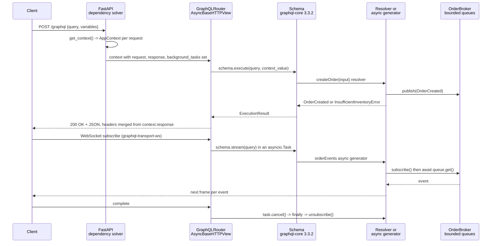

# Building Type-Safe GraphQL APIs in Python with Strawberry (0.340.0) and FastAPI: @strawberry.type, Input Mutations, Union Errors, and WebSocket Subscriptions

> [!summary] Claim
> Strawberry turns annotated dataclasses into a GraphQL schema, and its `GraphQLRouter` mounts that schema in FastAPI as three routes on one path (`GET`, `POST`, WebSocket); the design is sound only if the context object is built per request, expected domain failures are union members rather than exceptions, and every subscription generator owns a `finally` that releases its subscriber slot.

Part of [GraphQL JSON RPC and Event APIs](README.md) in [API Engineering](../README.md).
Versions in this note: `strawberry-graphql` 0.340.0, `graphql-core` 3.3.2, `fastapi` 0.162.0, `starlette` 1.10.0 (as of 2026-11).

## TL;DR

- Mechanism: `@strawberry.type` and `@strawberry.input` wrap a class in `dataclasses.dataclass(kw_only=True)` and register it for conversion to a `graphql-core` type, `GraphQLRouter` is an `APIRouter` whose context getter is a FastAPI dependency, and each WebSocket `subscribe` message becomes an `asyncio.Task` that drives `schema.stream` over your async generator.
- Contract rule: model expected business outcomes (`InsufficientInventoryError`, `QuantityInvalid`) as members of a result union, so the client sees them as typed data with HTTP `200 OK`; reserve the top-level `errors` array for bugs and request-level failures.
- The trap: `BaseContext` instances are mutated by the router (`request`, `response`, `background_tasks`), so a getter that returns one shared object lets concurrent requests overwrite each other's request; the lab shows two requests with `x-tenant: A` and `x-tenant: B` both answering `B`.
- Portability fact: Strawberry enables both `graphql-transport-ws` and the legacy `graphql-ws` subprotocol by default, and the legacy one had an authentication bypass fixed in 0.312.3 (GHSA-vpwc-v33q-mq89); pass `subscription_protocols=[GRAPHQL_TRANSPORT_WS_PROTOCOL]` unless you need legacy clients.
- When not to use it: when subscriptions must survive worker restarts, fan out across processes, or replay missed events, because the in-process async generator has no durability; put a broker behind it or use an event API (see [[Event-Driven-APIs-and-AsyncAPI-3-1-0-Specification]]).

## Mental model



HTTP requests pass through the FastAPI dependency solver first, which builds the context and lets the router attach the live `Request`, the sub-`Response` and `BackgroundTasks`; only then does the router call `schema.execute`.
A mutation resolver runs your domain function and returns one union member, which `graphql-core` resolves to a concrete type by class.
A WebSocket takes a different path: the router accepts the socket, negotiates a subprotocol, and hands the connection to a protocol handler that spawns one task per operation.
The subscription generator is that task's source stream, so cancelling the task (client `complete`, disconnect, or shutdown) raises `CancelledError` inside the generator at its current `await`, and the `finally` block is the only place the broker slot is released.

## How it works

### 1. Types are dataclasses

`@strawberry.type` calls `_wrap_dataclass`, which applies `dataclasses.dataclass(kw_only=True)` to the class (strawberry-graphql 0.340.0 strawberry/types/object_type.py, `_wrap_dataclass`).
`kw_only=True` makes construction keyword-only (`Order(id=..., tenant=..., sku=..., quantity=...)`); separately from that flag, every field annotation must be resolvable at schema-build time, because the converter reads the evaluated types.
That is why the lab keeps `from collections.abc import AsyncGenerator` at runtime with a `# noqa: TC003` even under `from __future__ import annotations`: Strawberry evaluates the string annotations to find the yielded type.
Field names are converted by the schema's name converter, so `create_order` becomes `createOrder` and `subscriber_count` becomes `subscriberCount` (the lab asserts the printed SDL).
`strawberry.Info[AppContext, None]` is a generic dataclass; a `__class_getitem__` shim accepts one or two type arguments because the typevar default for the root type cannot be omitted on its own (strawberry-graphql 0.340.0 strawberry/types/info.py, `Info.__class_getitem__`).
The `info` parameter is detected by its annotation and is not exposed as a GraphQL argument.

### 2. Input objects and variable coercion

`@strawberry.input` produces a GraphQL `input` type.
Order of events for `mutation Create($i: CreateOrderInput!)`:
1. `graphql-core` coerces the variable `$i` against the input type, before any Strawberry code runs; a missing `quantity` or the string `"two"` for `Int!` fails here.
2. Only coerced values reach `convert_arguments`, which rebuilds the dictionary into the `CreateOrderInput` dataclass and maps GraphQL names back to Python names (strawberry-graphql 0.340.0 strawberry/types/arguments.py, `convert_arguments` and `convert_argument`).
3. The resolver is called with a typed object, so `data.quantity` is an `int` by construction.

The wire result of step 1 failing is a request error: HTTP `200 OK`, `data: null`, one entry in `errors` whose message starts with `Variable '$i' has invalid value` and which carries no `path`, because no field was executing; the resolver never runs and the store is untouched (lab test `test_input_type_violations_are_rejected_before_the_resolver_runs`).
Type checking is structural only: `quantity: int` does not forbid `0` or `-5`, so a business rule such as `quantity >= 1` belongs in the domain function and its failure belongs in the result union (`QuantityInvalid`).
Strawberry also distinguishes an omitted argument from `null` with the `UNSET` sentinel (`convert_argument` returns `UNSET` for an unset value); use it for partial-update inputs, where `None` means "clear" and `UNSET` means "leave alone".
0.340.0 also exports `strawberry.Maybe[T]` (typed `Some[T] | None`) for the same job: an omitted input field arrives as `None`, a sent value as `Some(value)`, and only `Maybe[T | None]` accepts an explicit `null` (as `Some(None)`), while `Maybe[int]` rejects `null` with `cannot be explicitly set to null` (strawberry-graphql 0.340.0 strawberry/types/maybe.py, `Maybe` and `Some`; strawberry/types/arguments.py, `convert_argument`; verified by one `execute_sync` run on CPython 3.14.6, not part of the lab).

### 3. The context getter is a FastAPI dependency

`GraphQLRouter` inherits from both `AsyncBaseHTTPView` and `APIRouter`, and its constructor registers three handlers on the same `path`: `handle_http_get`, `handle_http_post` and `websocket_endpoint` (strawberry-graphql 0.340.0 strawberry/fastapi/router.py, `GraphQLRouter.__init__`).
Each handler declares `context: Context = Depends(self.context_getter)`.
`self.context_getter` is built by `__get_context_getter`, which wraps your getter in an inner `dependency` function whose rewritten signature makes your getter a sub-dependency (`custom_context = Depends(custom_getter)`) alongside FastAPI-provided `BackgroundTasks`, `HTTPConnection` and `Response` (strawberry-graphql 0.340.0 strawberry/fastapi/router.py, `GraphQLRouter.__get_context_getter`).
What the wrapper does with your return value:

| Your getter returns | Result |
|---|---|
| a `BaseContext` subclass instance | the router sets `.request`, `.background_tasks`, `.response` on that same object and returns it |
| a `dict` | a new dict `{request, background_tasks, response, **yours}`; your keys win on collision |
| `None` | a plain dict with the three keys |
| anything else | `InvalidCustomContext` is raised |

Because the object is mutated in place, a getter that returns a module-level or closure-level instance shares those three attributes across all in-flight requests.
The lab proves it with `LeakyContext`: request A (`x-tenant: A`) suspends on an `asyncio.Event`, request B (`x-tenant: B`) overwrites `context.request`, and when the gate opens both resolvers read `B` (test `test_shared_context_instance_leaks_the_last_request_into_earlier_ones`, asserting `("B", "B")` for the shared getter and `("A", "B")` for a per-request one).
The getter itself obeys normal FastAPI dependency rules: an `async def` getter runs on the event loop, a plain `def` getter runs in the threadpool (fastapi 0.162.0 fastapi/dependencies/utils.py, `solve_dependencies`, which calls `run_in_threadpool` for non-coroutine callables), and parameters such as `Annotated[str, Header()]` are parsed and validated by FastAPI before the GraphQL layer sees the request.
For a WebSocket the same dependency runs with `request` being a `WebSocket`, so `BaseContext.request` is typed `Request | WebSocket | None` and must be narrowed before use; `connection_params` is assigned by the protocol handler at `connection_init` (`BaseContext.connection_params` is a class attribute, strawberry-graphql 0.340.0 strawberry/fastapi/context.py).
`ctx.response.headers[...] = ...` in a mutation reaches the client because `create_response` copies the sub-response's raw headers onto the response it builds and reuses its status code (strawberry-graphql 0.340.0 strawberry/fastapi/router.py, `GraphQLRouter.create_response`); the lab asserts `x-order-id: ord-1`.
`BackgroundTasks` follow FastAPI's rule: if the returned response has no `background`, FastAPI attaches the dependency's tasks (fastapi 0.162.0 fastapi/routing.py, the `raw_response.background` assignment in `get_request_handler`); this note does not exercise it in the lab.

### 4. Mutations that return unions

`CreateOrderResult = Annotated[OrderCreated | InsufficientInventoryError | QuantityInvalid, strawberry.union("CreateOrderResult")]` prints as `union CreateOrderResult = OrderCreated | InsufficientInventoryError | QuantityInvalid` (asserted by the lab).
Resolution of the concrete member at runtime is done by the union's type resolver, `StrawberryUnion.get_type_resolver` (strawberry-graphql 0.340.0 strawberry/types/union.py):
1. objects wrapped with `strawberry.cast` resolve to the cast type;
2. for a Strawberry-decorated instance, it walks the union's member types first, then every known type, and returns the first whose definition `is_implemented_by(root)`;
3. if no definition matches, or the root is not a Strawberry object at all, it tries each member's `is_type_of`;
4. a result that is not a union member raises `UnallowedReturnTypeForUnion`, and a non-Strawberry object with no `is_type_of` raises `WrongReturnTypeForUnion`.

Those exceptions are programmer errors: the lab returns an `InsufficientInventoryError` from a field typed `OrderCreated | QuantityInvalid` and sees `data: null` and an `errors[0].message` naming `InsufficientInventoryError` (test `test_union_resolver_returning_a_non_member_type_is_a_field_error`).
Mutation root fields execute serially in document order, while query fields may run in parallel (GraphQL September 2025 Section 6.2.2: the mutation root selection set "should be executed serially"; Section 6.3.4 Normal and Serial Execution requires each entry to complete before the next starts, while normal execution may resolve fields in any order, normally in parallel).
Serial execution orders side effects between top-level mutation fields only; it does not make `create_order` atomic with other requests, so the lab's check-then-decrement is safe only because the resolver has no `await` between reading and writing `stock` (a real store needs a transaction or conditional update, see [[GraphQL-Field-Level-Authorization-and-Partial-Error-Null-Bubbling]] for how errors propagate when it does not).

Three ways to report a failure, with what the client sees:

| Mechanism | Wire shape | Use for |
|---|---|---|
| union member | `data.createOrder.__typename == "InsufficientInventoryError"`, no `errors` | expected domain outcomes the client must branch on |
| raised exception | `errors[0].message` set, `data` null or nulled field, null bubbles to the nearest nullable parent | bugs, infrastructure faults |
| `Schema(exception_handlers=[...])` | exception converted into a union member returned by the field | translating a library exception into a typed member without `try` in every resolver |

`exception_handlers` is new enough that you should verify it against your pinned version: in 0.340.0 `Schema.__init__` accepts `exception_handlers: Iterable[ExceptionHandler[Any]]`, a handler class is declared as `strawberry.ExceptionHandler[ExcType, ErrorType]` with a `handle(exception, *, field, info)` method, returning `None` declines and re-raises, and subscriptions never convert exceptions (strawberry-graphql 0.340.0 strawberry/schema/exception_handlers.py, `ExceptionHandler`; strawberry/schema/schema_converter.py, `_get_field_exception_handlers`).
The lab does not execute this feature; it is documented here from the source only.

A client must select the members it wants.
Selecting `... on OrderCreated { ... }` alone and receiving a different member yields an object with no fields from the unselected fragments, so every mutation document should include `__typename` and a fragment per member, as the lab's `CREATE` document does.
An alternative that avoids per-member fragments is a shared `interface Error { message: String! }`; no extra resolver code is needed, because for every object type that implements an interface Strawberry 0.340.0 generates an `is_type_of` that honours `strawberry.cast` and otherwise falls back to `isinstance` (strawberry-graphql 0.340.0 strawberry/schema/schema_converter.py, `_get_is_type_of`).
The trade-off is contractual: the interface fixes the field set every error member must carry, so changing it touches all implementers at once; the lab does not use it.

### 5. HTTP behavior of the router

`AsyncBaseHTTPView.run` is the single entry for HTTP and WebSocket (strawberry-graphql 0.340.0 strawberry/http/async_base_view.py, `AsyncBaseHTTPView.run`).
For HTTP it: builds the request adapter; takes the sub-response; resolves the context; rejects methods other than `GET` and `POST` (`405`); serves the IDE for `GET` with no `query` parameter when `Accept` contains `text/html` or `*/*` (`BaseView.should_render_graphql_ide`) and `404` if `graphql_ide` is `None`; parses the body; and executes.
Observed in the lab (all HTTP via `httpx.ASGITransport`):

| Request | Status | Body |
|---|---|---|
| `POST` valid query | `200` | `{"data": ...}` |
| GraphQL validation error (`{ nope }`) | `200` | `errors[0].message == "Cannot query field 'nope' on type 'Query'."` |
| `GET ?query=mutation{...}` | `400` | text `mutations are not allowed when using GET`, store unchanged |
| `POST` JSON array | `400` | text `Batching is not enabled` |
| `POST` body `{` | `400` | text `Unable to parse request body as JSON` |
| `POST` `text/plain` | `400` | text `Unsupported content type` |
| `PUT` | `405` | FastAPI route table (no `PUT` handler) |

Batching is off unless the schema's `config.batching_config` is set, and then a list longer than `max_operations` is refused with `Too many operations` (strawberry/http/base.py, `_validate_batch_request`); batched operations run concurrently through `asyncio.gather` (async_base_view.py, `execute_operation`).
Compare the GraphQL-over-HTTP draft, which for responses using `application/graphql-response+json` says a result with no `data` entry MUST get a 4xx or 5xx status, a result with both `data` (even `null`) and `errors` SHOULD get the draft's proposed partial-success status `294`, and recommends `405` for a mutation via `GET`, `415` for an unsupported request `Content-Type`, `422` for a document that fails validation, and `400` for unparseable JSON (GraphQL over HTTP draft, Section 5.4 Status Codes, fetched 2026-11).
Strawberry 0.340.0 always writes `media_type="application/json"` in `create_response`, so it follows the legacy `200`-with-errors convention and uses `400` for the mutation-over-`GET` and content-type cases; clients and gateways that key on status codes must not assume the draft's table.

### 6. Subscriptions: from spec to task

GraphQL September 2025 Section 6.2.3 defines `Subscribe` as `CreateSourceEventStream` followed by `MapSourceToResponseEvent`: your resolver produces the source stream, each source value becomes the root value of an ordinary execution of the selection set, a source stream that ends completes the response stream, and cancelling the response stream cancels the source (Section 6.2.3.3 Unsubscribe).
`graphql-core` 3.3.2 implements this in `subscribe` and `map_async_iterable` (graphql-core 3.3.2 graphql/execution/execute.py, `subscribe`; graphql/execution/async_iterables.py, `map_async_iterable`, which wraps the source in `aclosing` so the generator is closed when the mapped stream is).
Strawberry's `Schema._stream` calls it for subscription operations and wraps each result with the extension hooks; for queries and mutations received over a streaming transport it yields one result and finishes, or, for `@defer` and `@stream`, an initial result followed by the incremental patches (strawberry-graphql 0.340.0 strawberry/schema/schema.py, `Schema._stream` and `_stream_non_subscription`).
In `_stream`, an exception escaping the stream iteration is converted into a final result with `data: None` and one error, after which the stream ends.

The WebSocket subprotocol layer is `BaseGraphQLTransportWSHandler` (strawberry-graphql 0.340.0 strawberry/subscriptions/protocols/graphql_transport_ws/handlers.py):

| Event | Server behavior | Evidence |
|---|---|---|
| socket accepted | starts a connection-init timer task (`connection_init_wait_timeout`, default 1 minute); expiry closes `4408` `Connection initialisation timeout` | source, `on_request_accepted` and `handle_connection_init_timeout`; not run in the lab |
| `connection_init` | payload must be a JSON object else close `4400`; a second one closes `4429` `Too many initialisation requests`; stores payload in `context.connection_params`; calls `view.on_ws_connect(context)`; `ConnectionRejectionError` closes `4403` `Forbidden` (the error's payload is not sent on this protocol); otherwise sends `connection_ack` | lab: `4429`, `4403` |
| `subscribe` before ack | close `4401` `Unauthorized` | lab |
| `subscribe` with a live id | close `4409` `Subscriber for <id> already exists` | lab |
| `subscribe` over the cap | `error` frame `Subscription limit reached` for that id, connection stays open | lab |
| `subscribe` ok | `asyncio.create_task(run_operation)`, registers the id | lab |
| each result | `next` frame `{"id", "type": "next", "payload": {"data", "errors"?, "extensions"?}}` | lab |
| pre-execution validation error | `error` frame with the list of errors, id freed, no `complete` | lab (`Cannot query field 'nope' on type 'Subscription'.`) |
| GraphQL syntax error, or an unresolvable operation (`CannotGetOperationTypeError`) | close `4400` with the error text | source, `_get_pre_execution_close_reason`; not run |
| stream ends | `complete` frame; the id is removed before the frame is sent | lab: id reusable |
| client `complete` | `cleanup_operation`: pop the id and `task.cancel()`; does not await the task | lab: `finally` ran |
| `ping` | `pong` | lab |
| unknown message type, non-JSON, non-text frame | close `4400` | source, `handle_message`, `handle` |
| disconnect or handler exit | `shutdown`: cancel the init timer, cancel every operation, then await each task so `finally` blocks complete | lab: count returns to 0 |

The close codes `4400`, `4401`, `4403`, `4408`, `4409`, `4429` come from the `graphql-ws` protocol document, and RFC 6455 Section 7.4.2 reserves `4000-4999` for private use by prior agreement between applications, which is exactly what that document is (graphql-ws PROTOCOL.md, ConnectionInit, Subscribe, Invalid message sections).
`4406` `Subprotocol not acceptable` is Strawberry's own: `run` accepts the socket with whichever subprotocol it picked (possibly `None`) and then closes with `4406` if it is neither `graphql-transport-ws` nor `graphql-ws` (strawberry/http/async_base_view.py, `run`); the lab asserts it.
Subprotocol selection intersects the client's `Sec-WebSocket-Protocol` list with the server's and keeps the client's order (strawberry/fastapi/router.py, `pick_websocket_subprotocol`; RFC 6455 Section 4.2.2 says the server selects at most one).

The handler never sends a server-initiated `ping`; it only answers.
`keep_alive` and `keep_alive_interval` are passed only to the legacy `graphql-ws` handler (`run`), so for `graphql-transport-ws` a client that needs liveness must send `ping` itself.

Back-pressure is implicit: `operation.send_next` awaits `websocket.send_json`, and the operation task does not pull the next item from your generator until that send completes.
A slow client therefore stalls only its own task, but whatever sits upstream of the generator keeps accumulating.
The lab's `OrderBroker` makes the policy explicit: each subscriber has a bounded `asyncio.Queue` (default 16) and, when it is full, `publish` drops the oldest queued event and increments `dropped`, so the publisher (the mutation) never blocks on a slow reader (test `test_broker_drops_oldest_event_when_a_subscriber_queue_is_full`, which publishes four events to a size-2 queue and reads `o2, o3` with `dropped == 2`).
Dropping is one policy; the alternatives are disconnecting the slow consumer or blocking the publisher, and each should be chosen deliberately.

Subscriptions are also available over plain HTTP.
Adding `GRAPHQL_SSE_PROTOCOL` or `MULTIPART_SUBSCRIPTION_PROTOCOL` to `subscription_protocols` enables a transport selected by the request's `Accept` header: `text/event-stream` (events `next` and `complete`, `Cache-Control: no-cache, no-transform`, `X-Accel-Buffering: no`, comment heartbeat every 15 s) or `multipart/mixed` with `subscriptionSpec=1.0` (heartbeat every 5 s) (strawberry/http/streaming.py, `SSETransport` and `MultipartSubscriptionTransport`; strawberry/http/base.py, `BaseView.stream_transport_classes_by_protocol`).
The default `subscription_protocols` contains only the two WebSocket subprotocols, and these HTTP transports are not exercised by the lab.

### 7. Authentication and origin for the socket

A browser `WebSocket` cannot set arbitrary request headers: the constructor is `new WebSocket(url, protocols)`, and the only page-controlled handshake header it emits is `Sec-WebSocket-Protocol` (WHATWG WebSockets Standard, `new WebSocket(url, protocols)` constructor steps and "establish a WebSocket connection"), so the common pattern is a token in the `connection_init` payload, checked in `on_ws_connect`.
The lab's `OrdersRouter.on_ws_connect` raises `ConnectionRejectionError` when `connection_params["token"]` is wrong, which becomes close code `4403` before any `subscribe` is accepted.
Cookies, by contrast, ride the handshake automatically, which is why origin checking matters: RFC 6455 Section 10.2 says a server not meant to process input from any web page SHOULD verify `Origin` and respond to the handshake with `403 Forbidden` if it is unacceptable (Section 4.2.2 repeats that a server that does not wish to accept the connection MUST return an HTTP error code such as `403` and abort the handshake).
Strawberry 0.340.0 does this before calling any application hook: `_check_websocket_origin` allows a handshake with no `Origin` header (non-browser clients), a `Sec-Fetch-Site: same-origin` request, an origin whose host and port match `Host` (scheme ignored, so TLS terminated at a proxy still counts as same-origin; `is_same_origin` in strawberry/http/websocket_origin.py), or an origin in `allowed_origins` (or any if the list contains `"*"`), and otherwise logs a warning and `reject_websocket` closes with `1008` before `accept`, which an ASGI server turns into an HTTP `403` response to the handshake (strawberry/http/async_base_view.py, `_check_websocket_origin`; strawberry/fastapi/router.py, `reject_websocket`; RFC 6455 Section 7.4.1 defines `1008` as a policy violation).
The lab asserts `1008` for `https://evil.example`, success for a same-host origin, and success once the origin is listed in `allowed_origins`.

## Numbers and limits

| Quantity | Value | Source or measurement |
|---|---|---|
| `connection_init_wait_timeout` default | 1 minute | strawberry 0.340.0 `GraphQLRouter.__init__` (`timedelta(minutes=1)`) |
| `max_subscriptions_per_connection` default | 100, counts every in-flight operation on the connection, queries and mutations included | strawberry 0.340.0 `__init__`; handler comment in `handle_subscribe` |
| `subscription_protocols` default | `("graphql-transport-ws", "graphql-ws")` | strawberry 0.340.0 `GraphQLRouter.__init__` |
| legacy `keep_alive` | `False`; `keep_alive_interval` default 1 (seconds) | strawberry 0.340.0 `__init__`; applies to `graphql-ws` only |
| SSE heartbeat | 15 s (`SSE_HEARTBEAT_INTERVAL`) | strawberry/http/streaming.py |
| multipart subscription heartbeat | 5 s (`MULTIPART_SUBSCRIPTION_HEARTBEAT_INTERVAL`) | strawberry/http/streaming.py |
| `max_coercion_errors` | 50 (graphql-core `subscribe` default) | graphql-core 3.3.2 graphql/execution/execute.py |
| private-use WebSocket close codes | `4000-4999` | RFC 6455 Section 7.4.2 |
| lab broker queue | 16 events per subscriber (constructor default), drop-oldest | `OrderBroker.__init__` in the lab |
| lab suite | 28 passed in 1.04 s | measured: `uv run --frozen pytest ... -q -p no:cacheprovider`, CPython 3.14.6, macOS 27.3 (Darwin 27.3.0) arm64, one run by the fact-checker (the draft's run reported 1.33 s) |

The 1.04 s figure is wall-clock for the whole module including FastAPI app construction per test; it is a smoke number, not a benchmark, and no per-request latency or throughput is claimed.

## Portability

| Dimension | Variant | Status |
|---|---|---|
| CPython | 3.14.6 | ran: 28 passed (command and output in the worked example) |
| CPython | 3.12, 3.13, 3.15, 3.15t | not run: lab checks were paused on 2026-11-11, so no cell is claimed; the code uses `X \| Y` unions at runtime inside `Annotated`, which needs 3.10 or newer, and the workspace declares `requires-python >=3.12,<3.16` |
| strawberry-graphql | 0.340.0 | ran (pinned in `labs/pyproject.toml`); behavior of other point releases is not claimed |
| Legacy `graphql-ws` | pre-0.312.3 lacked the `connection_init` gate | GHSA-vpwc-v33q-mq89, fixed in 0.312.3; lab uses only `graphql-transport-ws` |
| Starlette `TestClient` | WebSocket handshake rejection surfaces as `WebSocketDisconnect` with code `1008` | ran; real servers return an HTTP `403` to the handshake (comment in `reject_websocket`; RFC 6455 Section 10.2), not run against a server here |
| ASGI servers | Uvicorn, Hypercorn, Granian | not run: the lab is in-process ASGI only; no server-specific behavior is claimed |
| HTTP/1.1 | WebSocket subscriptions use the HTTP/1.1 `Upgrade` handshake | RFC 6455 Section 4 |
| HTTP/2 | WebSocket needs Extended CONNECT: server advertises `SETTINGS_ENABLE_CONNECT_PROTOCOL`, client sends `CONNECT` with `:protocol` `websocket` | RFC 8441 Sections 3 to 5; not run |
| HTTP/3 | not covered | no source read; do not assume |
| HTTP POST and SSE or multipart transports | version-agnostic request/response over any HTTP version the server speaks | source reading only; SSE and multipart not exercised |

## Worked example

Implementation: [implementation](../labs/src/api_labs/f20_graphql_json_rpc_and_event_apis/strawberry_orders_api.py).
Test: [test](../labs/tests/f20_graphql_json_rpc_and_event_apis/test_strawberry_graphql_with_fastapi_types_context_mutations_and_subscriptions.py).

The full implementation file, byte-identical to the lab:

```python
"""Strawberry 0.340.0 `GraphQLRouter` in FastAPI: typed context, union payloads, subscriptions.

One schema, four mechanisms worth proving:

* `@strawberry.type` / `@strawberry.input` classes become SDL types and input objects.
* `create_order` returns a union, so an expected domain failure is data
  (`InsufficientInventoryError`) and not an entry in the top-level `errors` array.
* `AppContext` subclasses `strawberry.fastapi.BaseContext`; the router overwrites `request`,
  `response` and `background_tasks` on whatever object the context getter returns, so the getter
  must build a fresh object per request (`LeakyContext` shows the cost of not doing so).
* `Subscription.order_events` is an async generator fed by `OrderBroker`; its `finally` block runs
  when the client sends `complete` or disconnects.
"""

from __future__ import annotations

import asyncio
from collections.abc import AsyncGenerator  # noqa: TC003 - Strawberry resolves it at runtime
from typing import TYPE_CHECKING, Annotated, Any, Final, cast

import strawberry
from fastapi import FastAPI, Header
from strawberry.exceptions import ConnectionRejectionError
from strawberry.extensions import MaskErrors
from strawberry.fastapi import BaseContext, GraphQLRouter
from strawberry.types.unset import UNSET, UnsetType

if TYPE_CHECKING:
    from collections.abc import Sequence

WS_TOKEN: Final = "lab-ws-token-NOT-A-REAL-SECRET"  # noqa: S105 - lab placeholder, not a credential


class OrderBroker:
    """Fan-out of order events to bounded per-subscriber queues; the slowest reader loses events."""

    def __init__(self, maxsize: int = 16) -> None:
        self._maxsize = maxsize
        self._queues: set[asyncio.Queue[OrderCreated]] = set()
        self.dropped = 0

    @property
    def subscriber_count(self) -> int:
        return len(self._queues)

    def subscribe(self) -> asyncio.Queue[OrderCreated]:
        queue: asyncio.Queue[OrderCreated] = asyncio.Queue(maxsize=self._maxsize)
        self._queues.add(queue)
        return queue

    def unsubscribe(self, queue: asyncio.Queue[OrderCreated]) -> None:
        self._queues.discard(queue)

    def publish(self, event: OrderCreated) -> None:
        for queue in self._queues:
            if queue.full():
                queue.get_nowait()  # drop the oldest event instead of blocking the publisher
                self.dropped += 1
            queue.put_nowait(event)


class Store:
    """In-memory inventory per tenant and the orders created so far."""

    def __init__(self) -> None:
        self.stock: dict[str, dict[str, int]] = {
            "acme": {"WIDGET": 5, "GADGET": 0},
            "globex": {"WIDGET": 1},
        }
        self.orders: list[Order] = []
        self.broker = OrderBroker()


class AppContext(BaseContext):
    """Per-request context; `request`, `response` and `background_tasks` come from `BaseContext`."""

    def __init__(self, store: Store, tenant: str) -> None:
        super().__init__()
        self.store = store
        self.tenant = tenant


@strawberry.type
class Order:
    id: strawberry.ID
    tenant: str
    sku: str
    quantity: int


@strawberry.input
class CreateOrderInput:
    sku: str
    quantity: int


@strawberry.type
class OrderCreated:
    order: Order


@strawberry.type
class InsufficientInventoryError:
    sku: str
    requested: int
    available: int


@strawberry.type
class QuantityInvalid:
    message: str


CreateOrderResult = Annotated[
    OrderCreated | InsufficientInventoryError | QuantityInvalid,
    strawberry.union("CreateOrderResult"),
]


def create_order(store: Store, tenant: str, data: CreateOrderInput) -> CreateOrderResult:
    """Domain logic with no GraphQL in it: validate, reserve stock, record, publish."""
    if data.quantity < 1:
        return QuantityInvalid(message="quantity must be >= 1")
    stock = store.stock.setdefault(tenant, {})
    available = stock.get(data.sku, 0)
    if available < data.quantity:
        return InsufficientInventoryError(
            sku=data.sku, requested=data.quantity, available=available
        )
    stock[data.sku] = available - data.quantity
    order = Order(
        id=strawberry.ID(f"ord-{len(store.orders) + 1}"),
        tenant=tenant,
        sku=data.sku,
        quantity=data.quantity,
    )
    store.orders.append(order)
    created = OrderCreated(order=order)
    store.broker.publish(created)
    return created


@strawberry.type
class Query:
    @strawberry.field
    def inventory(self, info: strawberry.Info[AppContext, None], sku: str) -> int:
        return info.context.store.stock.get(info.context.tenant, {}).get(sku, 0)

    @strawberry.field
    def orders(self, info: strawberry.Info[AppContext, None]) -> list[Order]:
        tenant = info.context.tenant
        return [o for o in info.context.store.orders if o.tenant == tenant]

    @strawberry.field
    def whoami(self, info: strawberry.Info[AppContext, None]) -> str:
        return info.context.tenant

    @strawberry.field
    def subscriber_count(self, info: strawberry.Info[AppContext, None]) -> int:
        return info.context.store.broker.subscriber_count

    @strawberry.field
    def request_path(self, info: strawberry.Info[AppContext, None]) -> str:
        request = info.context.request
        return request.url.path if request is not None else ""


@strawberry.type
class Mutation:
    @strawberry.mutation
    def create_order(
        self, info: strawberry.Info[AppContext, None], input: CreateOrderInput
    ) -> CreateOrderResult:
        ctx = info.context
        result = create_order(ctx.store, ctx.tenant, input)
        if isinstance(result, OrderCreated) and ctx.response is not None:
            ctx.response.headers["x-order-id"] = str(result.order.id)
        return result

    @strawberry.mutation
    def explode(self) -> str:
        raise RuntimeError("db password=hunter2 refused connection")


@strawberry.type
class Subscription:
    @strawberry.subscription
    async def order_events(
        self, info: strawberry.Info[AppContext, None], sku: str | None = None
    ) -> AsyncGenerator[OrderCreated, None]:
        broker = info.context.store.broker
        tenant = info.context.tenant
        queue = broker.subscribe()
        try:
            while True:
                event = await queue.get()
                if event.order.tenant == tenant and (sku is None or event.order.sku == sku):
                    yield event
        finally:
            broker.unsubscribe(queue)

    @strawberry.subscription
    async def countdown(self, start: int = 3) -> AsyncGenerator[int, None]:
        for value in range(start, 0, -1):
            yield value


class OrdersRouter(GraphQLRouter[AppContext]):
    """Adds token auth to `connection_init`: browsers cannot set headers on a WebSocket."""

    async def on_ws_connect(self, context: AppContext) -> UnsetType | dict[str, object] | None:
        params = context.connection_params
        token = cast("dict[str, object]", params).get("token") if isinstance(params, dict) else None
        if token != WS_TOKEN:
            raise ConnectionRejectionError({"reason": "bad token"})
        ack: UnsetType = UNSET
        return ack


def build_schema(*, mask_errors: bool = False) -> strawberry.Schema:
    extensions: list[Any] = [MaskErrors] if mask_errors else []
    return strawberry.Schema(
        query=Query, mutation=Mutation, subscription=Subscription, extensions=extensions
    )


def build_app(
    store: Store | None = None,
    *,
    mask_errors: bool = False,
    graphql_ide: str | None = "graphiql",
    allowed_origins: Sequence[str] = (),
    max_subscriptions_per_connection: int | None = 100,
) -> tuple[FastAPI, Store]:
    """Mount the router at `/graphql`; the context getter is a FastAPI dependency."""
    shared = store or Store()

    async def get_context(x_tenant: Annotated[str, Header()] = "acme") -> AppContext:
        return AppContext(shared, x_tenant)  # a fresh object per request

    router = OrdersRouter(
        build_schema(mask_errors=mask_errors),
        context_getter=get_context,
        graphql_ide=graphql_ide,  # type: ignore[arg-type]
        allowed_origins=allowed_origins,
        max_subscriptions_per_connection=max_subscriptions_per_connection,
    )
    app = FastAPI()
    app.include_router(router, prefix="/graphql")
    return app, shared


class LeakyContext(BaseContext):
    """Anti-pattern: one shared instance, so the router's per-request writes race."""

    def __init__(self) -> None:
        super().__init__()
        self.gate = asyncio.Event()


@strawberry.type
class LeakyQuery:
    @strawberry.field
    async def tenant_after_gate(self, info: strawberry.Info[LeakyContext, None]) -> str:
        await info.context.gate.wait()
        request = info.context.request
        return request.headers.get("x-tenant", "?") if request is not None else "?"


def build_leaky_app(*, per_request: bool) -> tuple[FastAPI, LeakyContext]:
    """`per_request=False` returns one shared `LeakyContext` from the getter (the bug)."""
    shared = LeakyContext()

    def get_context() -> LeakyContext:
        if per_request:
            fresh = LeakyContext()
            fresh.gate = shared.gate  # same gate so the test can release both requests together
            return fresh
        return shared

    router = GraphQLRouter[LeakyContext](
        strawberry.Schema(query=LeakyQuery), context_getter=get_context
    )
    app = FastAPI()
    app.include_router(router, prefix="/graphql")
    return app, shared
```

Verbatim excerpt of three of the 28 tests (the file is `from __future__ import annotations` with the helpers `client_for`, `gql`, `create`, `init`, `subscribe`, `wait_until` defined above them):

```python
@pytest.mark.unit
@pytest.mark.asyncio
async def test_domain_failure_is_data_with_http_200_and_no_errors_key() -> None:
    app, store = build_app()
    async with client_for(app) as client:
        resp = await create(client, "GADGET", 2)
    body = resp.json()
    assert resp.status_code == 200
    assert "errors" not in body
    assert body["data"]["createOrder"] == {
        "__typename": "InsufficientInventoryError",
        "sku": "GADGET",
        "requested": 2,
        "available": 0,
    }
    assert store.orders == []
    assert "x-order-id" not in resp.headers
```

```python
@pytest.mark.unit
def test_subscription_receives_mutation_events_and_complete_unsubscribes() -> None:
    app, store = build_app()
    with (
        TestClient(app) as client,
        client.websocket_connect("/graphql", subprotocols=[SUBPROTOCOL]) as ws,
    ):
        init(ws)
        subscribe(ws, "1", "subscription { orderEvents { order { id sku } } }")
        assert wait_until(lambda: store.broker.subscriber_count == 1)
        resp = client.post(
            "/graphql", json={"query": CREATE, "variables": {"i": {"sku": "WIDGET", "quantity": 1}}}
        )
        assert resp.json()["data"]["createOrder"]["__typename"] == "OrderCreated"
        assert ws.receive_json() == {
            "id": "1",
            "type": "next",
            "payload": {"data": {"orderEvents": {"order": {"id": "ord-1", "sku": "WIDGET"}}}},
        }
        ws.send_json({"id": "1", "type": "complete"})
        assert wait_until(lambda: store.broker.subscriber_count == 0)
```

```python
@pytest.mark.unit
@pytest.mark.asyncio
async def test_shared_context_instance_leaks_the_last_request_into_earlier_ones() -> None:
    results: dict[bool, tuple[str, str]] = {}
    for per_request in (False, True):
        app, shared = build_leaky_app(per_request=per_request)
        async with client_for(app) as client:
            q = {"query": "{ tenantAfterGate }"}
            first = asyncio.create_task(client.post("/graphql", json=q, headers={"x-tenant": "A"}))
            await asyncio.sleep(0.05)
            second = asyncio.create_task(client.post("/graphql", json=q, headers={"x-tenant": "B"}))
            await asyncio.sleep(0.05)
            shared.gate.set()
            a, b = await first, await second
        results[per_request] = (
            a.json()["data"]["tenantAfterGate"],
            b.json()["data"]["tenantAfterGate"],
        )
    assert results[True] == ("A", "B")
    assert results[False] == ("B", "B")
```

Reading the subscription test: the WebSocket runs on the `TestClient` portal's event loop thread, so the test thread polls `store.broker.subscriber_count` with `wait_until` before posting the mutation, because `subscribe` only registers the queue after the operation task has started.
Without that wait the mutation could publish before the subscriber exists, and the event would be lost by design.

Captured output (one run by the fact-checker, `labs/`, macOS 27.3 Darwin 27.3.0 arm64, CPython 3.14.6 from `uv run --frozen`, as of 2026-11-26):

```text
$ uv run --frozen pytest tests/f20_graphql_json_rpc_and_event_apis/test_strawberry_graphql_with_fastapi_types_context_mutations_and_subscriptions.py -q -p no:cacheprovider
............................                                             [100%]
28 passed in 1.04s
```

A single run of `ruff format --check`, `ruff check`, `mypy` and `pyright` on the two lab files passed with no findings.
Mutation testing, the shell matrix and coverage were not performed (instruction of 2026-11-11), so the claim that each test fails when its mechanism is removed is by construction (each asserts the concrete value or side effect named in its title) and not by executed mutation.

## Pitfalls

> [!warning] Shared context object
> Trigger: `context_getter` returns an instance created outside the function.
> Symptom: under concurrency, resolvers read another request's `request`, `response` or `background_tasks`; the lab returns `("B", "B")` for two requests that sent `A` and `B`.
> Fix: construct the context inside the getter every time and keep per-process state (store, broker) in a separate object the context references.

> [!warning] Enabling both WebSocket subprotocols without checking the legacy handler
> Trigger: relying on `on_ws_connect` for authentication while the default `subscription_protocols` includes `graphql-ws`.
> Symptom: GHSA-vpwc-v33q-mq89 (CVE-2026-35523): up to 0.312.2 the legacy handler processed `start` messages without a completed `connection_init`, skipping `on_ws_connect` entirely; the client chooses the subprotocol through `Sec-WebSocket-Protocol`.
> Fix: be on 0.312.3 or newer and set `subscription_protocols=[GRAPHQL_TRANSPORT_WS_PROTOCOL]` if no legacy clients exist.

> [!warning] No per-connection subscription cap
> Trigger: accepting unlimited `subscribe` messages on one connection.
> Symptom: GHSA-hv3w-m4g2-5x77 (CVE-2026-35526): each message allocated a task and an async generator without bound, giving linear memory growth and event loop saturation; fixed in 0.312.3.
> Fix: keep `max_subscriptions_per_connection` set (default 100 in 0.340.0), remembering it counts queries and mutations sent over the socket too; the lab proves the limit as an `error` frame with `Subscription limit reached`.

> [!warning] Completed subscriptions still counted against the cap
> Trigger: legacy `graphql-ws` with a cap and one-shot subscriptions on a long-lived socket.
> Symptom: GHSA-m952-2w3f-6r8h (CVE-2026-107727, as printed in the advisory record): completed operations stayed in the handler's task map, so later subscriptions received `Subscription limit reached`; fixed in 0.327.2.
> Fix: upgrade; the lab's finite-subscription test shows the `graphql-transport-ws` handler frees the id when `complete` is sent.

> [!warning] Subscriber slot never released
> Trigger: a subscription generator that registers with a broker but has no `try`/`finally`, or a `finally` that awaits something that can hang.
> Symptom: `subscriberCount` grows with every disconnect, memory grows, and the broker keeps filling dead queues.
> Fix: acquire and release in the same generator with `try`/`finally`, and keep the `finally` synchronous; `shutdown` in the handler awaits each cancelled task, so a blocking `finally` delays connection teardown.

> [!warning] Expecting `HTTP 4xx` for a GraphQL failure
> Trigger: a gateway, retry policy or SLO that keys on status codes.
> Symptom: validation errors, variable coercion failures and exceptions all arrive as `200 OK`; only transport-level problems (bad JSON, unsupported content type, mutation over `GET`, batching disabled) are `400`, and an unsupported method is `405`.
> Fix: alert on the `errors` array and on `__typename` values of error union members, not on status codes, and do not assume the GraphQL-over-HTTP draft's status table.

> [!warning] Leaking exception text
> Trigger: a resolver raises with internal detail, such as `RuntimeError("db password=hunter2 refused connection")` in the lab.
> Symptom: the message is returned verbatim in `errors[0].message` with HTTP `200`.
> Fix: add the `MaskErrors` extension (message becomes `Unexpected error.` and the `path` stays, as the lab asserts) or a `should_mask_error` predicate that lets known safe errors through.

> [!warning] Permission classes returning awaitables
> Trigger: a plain `def has_permission` returning a coroutine.
> Symptom: GHSA-pfvf-fwfp-25mp (CVE-2026-107728): on the synchronous resolve path the awaitable is truthy, so a denied check passes; fixed in 0.326.1.
> Fix: declare `has_permission` with `async def` when it awaits, and see [[GraphQL-Field-Level-Authorization-and-Partial-Error-Null-Bubbling]].

## Security and robustness

- Threat model, HTTP: CSRF through content types a browser form can send.
  GHSA-79gp-q4wv-33fr (CVE-2024-47082) records that multipart upload support enabled by default made Strawberry's HTTP views CSRF-able before 0.243.0; in 0.340.0 `multipart_uploads_enabled` defaults to `False` in the router, so `parse_http_body` accepts only `application/json` (and the `GET` query-string form) and answers `Unsupported content type` otherwise.
  Enable multipart only with an explicit CSRF defense, see [[CSRF-in-Cookie-Authenticated-APIs-SameSite-Double-Submit-and-Fetch-Metadata]].
- Threat model, WebSocket: cross-site WebSocket hijacking when authentication rides cookies.
  Defense in depth is the origin check (RFC 6455 Section 10.2) plus a token in `connection_init` that a foreign page cannot read, plus authorization in resolvers using `info.context.tenant`; the lab's subscription filter drops other tenants' events using the context, not a client-supplied argument.
- Resource limits: `max_subscriptions_per_connection`, `connection_init_wait_timeout` (a socket that never sends `connection_init` is closed after one minute), and a bounded per-subscriber queue.
  Per-connection limits do not cap the number of connections; limit those at the server or gateway.
  Query depth, cost and alias limits are a separate layer, see [[GraphQL-Security-Query-Depth-Complexity-Cost-Analysis-and-Batch-Limits]].
- Introspection and IDE: the default `graphql_ide="graphiql"` serves an HTML page on `GET` with `Accept: text/html`; set `graphql_ide=None` in production, after which that request is `404` (lab).
  GHSA-x97m-qp5c-w9xj (CVE-2026-45739) concerns the bundled GraphiQL writing values from its headers editor (for example `Authorization`) into the page URL query string in 0.288.4 through 0.315.3, fixed in 0.315.4.
- Error masking: use `MaskErrors`; union error members must carry only fields safe to show (`sku`, `requested`, `available` in the lab, not stack traces).
- OWASP API Security 2023 mapping: API1 Broken Object Level Authorization (a resolver that ignores `info.context.tenant`), API4 Unrestricted Resource Consumption (subscription flooding, unbounded queues), API8 Security Misconfiguration (IDE enabled, both subprotocols enabled, wildcard `allowed_origins`); see [[OWASP-API-Security-Top-10-2023-Complete-Threat-Model]].
- Robustness: the in-process broker is lost on restart and sees only events published in the same process; with several workers a mutation handled by worker 1 never reaches a subscriber on worker 2, so production needs an external pub/sub behind the generator, with the generator consuming from it.

## The principal's view

The decision is whether GraphQL subscriptions are the right delivery mechanism, and whether Strawberry's code-first model is the right schema authority.
Code-first Strawberry keeps resolvers, types and Python domain code in one language and makes mypy and pyright part of the schema contract, at the cost that the SDL is a build artifact: the schema registry, federation (see [[Distributed-GraphQL-Apollo-Federation-v2-Entities-and-Subgraph-Planning]]) and client codegen must be fed from a printed schema in CI, and a refactor of a Python class name is a breaking API change unless the GraphQL name is pinned with `name=`.
Union results shift error modeling into the schema, which makes clients branch exhaustively and makes expected failures visible in codegen, but each new error member is a client-visible schema addition, so treat the union as an evolving enum of outcomes and add members additively.
For subscriptions, the organizational trade-off is state: a WebSocket subscription pins a connection, a task and a queue to one process, so deploys, autoscaling and load balancer idle timeouts become part of the API contract.
Choose a different mechanism when events must be durable, replayable or consumed by non-browser services: use an event API with a broker (see [[Real-Time-Push-Protocols-Compared-WebSockets-vs-SSE-vs-HTTP-2-3-Streaming-vs-Long-Polling]] and [[Architectural-Paradigm-Selection-REST-vs-gRPC-vs-GraphQL-vs-JSON-RPC-vs-Events]]), and keep GraphQL for the read and command surface.
Resolve the N+1 cost of nested object fields with batching before exposing the schema broadly, see [[The-GraphQL-N-Plus-1-Problem-and-DataLoader-Tick-Batching-Internals]].
Pin the library: this stack changed security behavior (origin checks, subscription caps, legacy protocol gating) across the 0.3xx series, so upgrades need a changelog read and a contract test run, not a blind bump.

## Interview questions

> [!question] L5: Why does `createOrder` return a union with `InsufficientInventoryError` instead of raising an exception?
>
> > [!success]- Answer
> > An out-of-stock result is an expected outcome that the client must handle, so it belongs in the schema as typed data.
> > A union member arrives with HTTP `200 OK`, no `errors` array, and fields (`sku`, `requested`, `available`) the client can render, as the lab test shows.
> > A raised exception becomes `errors[0].message`, nulls the field, and cannot carry structured fields, so it suits bugs and infrastructure faults.
> >
> > Follow-up: What must every client document include so that a new error member does not break it?

> [!question] L5: What HTTP status and body does Strawberry 0.340.0 return for `GET /graphql?query=mutation{...}`?
>
> > [!success]- Answer
> > It returns `400` with the plain text `mutations are not allowed when using GET`, and the mutation does not run (lab test asserts the store is unchanged).
> > The GraphQL-over-HTTP draft recommends `405` instead, so a client or gateway should not depend on either code.
> >
> > Follow-up: Why is refusing mutations over `GET` a safety rule and not only a convention?

> [!question] L5: Predict the output when two concurrent requests (`x-tenant: A` and `x-tenant: B`) hit a field that awaits a shared `asyncio.Event` and then returns `info.context.request.headers.get("x-tenant")`, and the context getter returns one shared `LeakyContext`: what do the two responses contain once the event is set?
>
> > [!success]- Answer
> > Both responses contain `B`.
> > The router assigns `request` on the shared object for each request, so the later request overwrites the earlier one while the first resolver is suspended; the lab asserts `("B", "B")`.
> > With a fresh context per request the same test yields `("A", "B")`.
> >
> > Follow-up: Which attributes does the router overwrite, and why does a `dict` context not have this problem?

> [!question] L6: Debug this API: after clients disconnect `subscriberCount` keeps rising and memory grows, and the resolver is `queue = broker.subscribe(); while True: yield await queue.get()`, so what is wrong and how do you prove the fix?
>
> > [!success]- Answer
> > The generator has no `try`/`finally`, so nothing calls `broker.unsubscribe(queue)` when the task is cancelled.
> > On `complete` or disconnect the handler cancels the operation task, `CancelledError` is raised at `await queue.get()`, and the generator exits without releasing the queue.
> > Wrap the loop in `try`/`finally` and assert in a test that `subscriber_count` returns to zero after `complete` and after socket close, as the lab does with `wait_until`.
> >
> > Follow-up: Why does the handler's `shutdown` await the cancelled tasks, and what happens if your `finally` blocks?

> [!question] L6: How do you authenticate a WebSocket subscription served by `GraphQLRouter`, and what stops a malicious web page from using a victim's cookies?
>
> > [!success]- Answer
> > Put a token in the `connection_init` payload and override `on_ws_connect` to raise `ConnectionRejectionError` for a bad one, which closes with `4403`.
> > For cookies, the origin check runs before `accept`: a cross-origin `Origin` not in `allowed_origins` is rejected with `1008` before any hook is called, which an ASGI server turns into a `403` handshake response (RFC 6455 Section 10.2).
> > A token that a foreign page cannot read is the second layer.
> >
> > Follow-up: Why does an absent `Origin` header pass the check, and is that safe?

> [!question] L6: What happens when a client reuses operation id `1` for a second `subscribe` after the first one finished, and when it does so while the first is still running?
>
> > [!success]- Answer
> > After a natural `complete`, the handler removes the id before sending the frame, so the id is reusable; the lab runs a finite subscription twice on id `7`.
> > While the first is live, the server closes the socket with `4409 Subscriber for 1 already exists`, as the protocol requires.
> >
> > Follow-up: What does `cleanup_operation` do when the client sends `complete`, and why does it not await the task?

> [!question] L7: A mutation on worker 1 must reach subscribers connected to worker 2, so how do you redesign the broker and what failure modes remain?
>
> > [!success]- Answer
> > Replace the in-process fan-out with an external pub/sub (a broker topic or stream) that each worker consumes into its own per-subscriber bounded queues; the generator keeps its `try`/`finally` against the local queue.
> > Remaining failure modes: a worker restart drops its subscribers and any events during the gap unless the stream supports replay with a cursor, slow consumers still need an explicit policy (drop oldest, disconnect, or block), and ordering is only per partition or topic.
> > If clients need replay or durability, an event API is the better contract than a GraphQL subscription.
> >
> > Follow-up: Which delivery guarantee does the GraphQL specification promise for subscriptions?

> [!question] L7: A security review finds the service accepts the legacy `graphql-ws` subprotocol and uses `on_ws_connect` for auth, so what do you check and change?
>
> > [!success]- Answer
> > Confirm the version is at least 0.312.3, because GHSA-vpwc-v33q-mq89 let the legacy handler skip `connection_init` and so skip `on_ws_connect`.
> > Then set `subscription_protocols=[GRAPHQL_TRANSPORT_WS_PROTOCOL]` unless legacy clients are proven to exist, keep `max_subscriptions_per_connection` set, and add a test that sends `subscribe` before `connection_init` and expects close `4401`.
> >
> > Follow-up: Why is a per-connection cap not a substitute for a limit on connection count?

> [!question] L7: Your platform team wants every API to follow the GraphQL-over-HTTP draft status codes but this service runs Strawberry 0.340.0, so what do you tell them?
>
> > [!success]- Answer
> > Strawberry 0.340.0 returns `application/json` with `200` for validation and execution errors and `400` for the mutation-over-`GET`, bad content type and bad JSON cases, whereas the draft (Section 5.4) uses `application/graphql-response+json` and statuses such as `405`, `415`, `422`, and `294` for partial success.
> > Options: accept the divergence and document it, add a thin ASGI middleware that remaps statuses (accepting the cost of parsing responses), or move that edge to a gateway that implements the draft.
> > Because the draft is still a draft (as of 2026-11), pin behavior with contract tests rather than assuming either side.
> >
> > Follow-up: What breaks for clients that treat a `200` with `data: null` as success?

## Related

Prerequisites: [[GraphQL-Specification-September-2025-SDL-AST-and-Execution-Engine]]

Next: [[The-GraphQL-N-Plus-1-Problem-and-DataLoader-Tick-Batching-Internals]]

See also: [[GraphQL]], [[02-Programming-Languages/Python/Python-Backend-Interview-Prep/04-FastAPI]]

- [[GraphQL-Field-Level-Authorization-and-Partial-Error-Null-Bubbling]]
- [[GraphQL-Security-Query-Depth-Complexity-Cost-Analysis-and-Batch-Limits]]
- [[Automatic-Persisted-Queries-APQ-and-Edge-CDN-Caching-for-GraphQL]]
- [[Distributed-GraphQL-Apollo-Federation-v2-Entities-and-Subgraph-Planning]]
- [[Real-Time-Push-Protocols-Compared-WebSockets-vs-SSE-vs-HTTP-2-3-Streaming-vs-Long-Polling]]
- [[Architectural-Paradigm-Selection-REST-vs-gRPC-vs-GraphQL-vs-JSON-RPC-vs-Events]]
- [[Event-Driven-APIs-and-AsyncAPI-3-1-0-Specification]]
- [[ASGI-WebSockets-Lifecycle-Subprotocols-and-Backpressure]]
- [[Dependency-Injection-Engine-DAG-Resolution-and-Use-Cache-Mechanics]]
- [[CSRF-in-Cookie-Authenticated-APIs-SameSite-Double-Submit-and-Fetch-Metadata]]
- [[OWASP-API-Security-Top-10-2023-Complete-Threat-Model]]
- Lab: `labs/tests/f20_graphql_json_rpc_and_event_apis/test_strawberry_graphql_with_fastapi_types_context_mutations_and_subscriptions.py`

## Further reading

- GraphQL specification, September 2025, Section 6.2.3 Subscription and Section 6.2.2 Mutation: the source stream and response stream algorithms and the serial execution rule this note relies on.
- GraphQL over HTTP draft, Section 5.4 Status Codes: the status code table that Strawberry 0.340.0 does not follow, and the `405` rule for mutations over `GET`.
- graphql-ws `PROTOCOL.md`: the `graphql-transport-ws` message set and the `4400` to `4429` close codes the handler implements.
- RFC 6455 Section 7.4.2 and Section 10.2: private-use close code range and the `Origin` verification rule behind `allowed_origins`.
- WHATWG WebSockets Standard, the `WebSocket` constructor: why a browser can pass only subprotocols, not headers, so tokens go in `connection_init`.
- RFC 8441 Sections 3 to 5: WebSocket over HTTP/2 with `SETTINGS_ENABLE_CONNECT_PROTOCOL` and Extended CONNECT.
- Strawberry security advisories GHSA-vpwc-v33q-mq89, GHSA-hv3w-m4g2-5x77, GHSA-m952-2w3f-6r8h, GHSA-pfvf-fwfp-25mp, GHSA-79gp-q4wv-33fr, GHSA-x97m-qp5c-w9xj: the real incidents behind the subscription, permission, CSRF and GraphiQL defaults.
- strawberry-graphql 0.340.0 source: `strawberry/fastapi/router.py`, `strawberry/http/async_base_view.py`, `strawberry/subscriptions/protocols/graphql_transport_ws/handlers.py`, `strawberry/types/union.py`.
