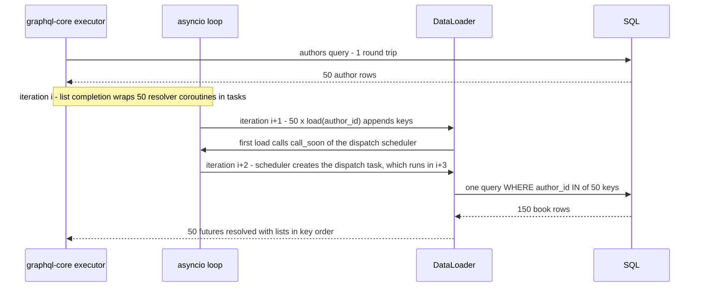

# How GraphQL Resolvers Trigger N+1 Query Cascades and How DataLoader Event-Loop Tick Coalescing Collapses Them to O(1) Queries

> [!summary] Claim
> A GraphQL executor calls one resolver per field per object, so a list of N parents costs N child queries unless the resolvers hand their keys to a per-request `DataLoader`, which holds every `load()` made inside one short event-loop window and issues a single `WHERE key IN (...)` query, turning the cost from O(objects) into O(depth).

Part of [GraphQL JSON RPC and Event APIs](README.md) in [API Engineering](../README.md).

## TL;DR

- Mechanism: the executor completes a list by starting one resolver coroutine per item in the same loop iteration, and `DataLoader.load()` appends each key to the current `Batch` and schedules one dispatch, so 50 `load()` calls become one batch function call with 50 keys.
- Contract rule: the batch function must return exactly one result per key, in key order, with a failure marked as an exception value at that key's index; the loader checks only the length, never the order.
- Trap: the window is two event-loop iterations (measured here), so a resolver that awaits one `load()` and then does more async work before the next `load()` lands in a later batch, and a loader that outlives the request leaks cache and authorization across users.
- Portability fact: Strawberry `0.340.0` schedules dispatch with `loop.call_soon` plus `create_task`, while the reference JavaScript `DataLoader` uses `process.nextTick` after the promise job queue drains, and `asyncio.eager_task_factory` shrinks the Python window by one iteration (measured on CPython 3.14.6 only).
- When not to use it: when one parent has a bounded child set that a `JOIN` or `selectinload` can fetch in the parent query, when per-parent `LIMIT` or ranking needs a window function, or when the downstream is not batchable at all.

## Mental model



The executor first runs the root `authors` resolver, which costs one round trip and returns 50 objects.
`complete_iterable_value` then walks the list, gets one awaitable per item (each author's subfield execution, which includes the `Author.books` resolver), and passes them to `gather_with_cancel`, which wraps each in a task, so all 50 item executions start in the same loop iteration.
Each resolver calls `loader.load(id)`, which returns a future immediately; the first call creates a `Batch` and queues a scheduler callback, and the next 49 calls only append to that batch.
The scheduler creates the dispatch task, which marks the batch dispatched, calls the batch function once with all 50 keys, and resolves each future in key order.
The cost is therefore one query per depth level of the selection set, not one per object.

## How it works

### Why N+1 exists: the execution model

GraphQL execution is defined per field and per object.
`ExecuteField` resolves one field on one object (GraphQL September 2025 Section 6.4), and list completion applies `CompleteValue` to each item of a list (GraphQL September 2025 Section 6.4.3).
Fields of a selection set may run "in whatever order it chooses (normally in parallel)" (GraphQL September 2025 Section 6.3.4), and only top-level mutation fields are serial (GraphQL September 2025 Sections 6.2.2 and 6.3.4).
The spec sets no storage contract, so a resolver cannot see its siblings.
A resolver `Author.books(self)` that runs `SELECT ... WHERE author_id = ?` is correct in isolation, and a list of 50 authors makes the executor call it 50 times.
The result is `1 + N` queries for two levels and `1 + N + N*M` for three, where concurrency only overlaps the round trips and never reduces the count.
The graphql.org performance guide names the same shape ("N+1 Problem") and points to batching with a DataLoader (https://graphql.org/learn/performance/).

How graphql-core 3.3.2 starts the siblings matters for batching.
`execute_fields` and `complete_iterable_value` collect the awaitables and, with more than one, await `gather_with_cancel(...)` (graphql-core 3.3.2 graphql/execution/executor.py, `Executor.execute_fields` and `Executor.complete_iterable_value`).
`gather_with_cancel` (graphql-core 3.3.2 graphql/pyutils/gather_with_cancel.py) calls `ensure_future` on every awaitable and then `gather`, so every resolver coroutine becomes a task that first runs in the same following loop iteration.
With exactly one awaitable the executor awaits it directly "to avoid the overhead of parallelization", which does not change batching because there is only one key.
Sequential mutation fields go through `execute_fields_serially` and cannot batch across each other by design (GraphQL September 2025 Section 6.3.4).

### The DataLoader algorithm in Strawberry 0.340.0

All of this is in one 306-line file (strawberry 0.340.0 strawberry/dataloader.py), byte-identical (`cmp`) to the GitHub tag `0.340.0`, to the pinned install, and to the tag `0.341.2`, the latest release on PyPI (as of 2026-11).
`DataLoader.load` first consults the cache; on a miss it creates a future on the loop and calls `get_current_batch`:

```python
def get_current_batch(loader: DataLoader) -> Batch:
    batch = loader.batch
    if batch is not None and batch.tasks and not should_create_new_batch(loader, batch):
        return batch

    batch = loader.batch = Batch()

    dispatch(loader, batch)

    return batch


def dispatch(loader: DataLoader, batch: Batch) -> None:
    def _schedule() -> None:
        batch._dispatch_task = create_task(dispatch_batch(loader, batch))
        batch._dispatch_task.add_done_callback(
            lambda _: setattr(batch, "_dispatch_task", None)
        )

    loader.loop.call_soon(_schedule)
```

(strawberry 0.340.0 strawberry/dataloader.py, `get_current_batch` and `dispatch`)

A batch is reused while it is not dispatched and under `max_batch_size`; otherwise a new `Batch` is created and a dispatch is queued with `loop.call_soon`.
`dispatch_batch` sets `batch.dispatched = True` as its first statement, collects `[task.key for task in batch.tasks]`, returns early when the batch is empty or when every future is already cancelled, awaits `loader.load_fn(keys)`, and then resolves futures pairwise.
A result list whose length differs from the batch raises `WrongNumberOfResultsReturned` (strawberry 0.340.0 strawberry/exceptions/__init__.py), which is set as the exception on every future of the batch.
A `BaseException` instance at index `i` becomes `set_exception` on the future for key `i`; every other value becomes `set_result`.

### Why the window is two loop iterations

`call_soon` runs callbacks "at the next iteration of the event loop", in registration order (Python asyncio-eventloop docs, `loop.call_soon`).
`BaseEventLoop._run_once` reads `ntodo = len(self._ready)` and runs only that many handles, so a handle queued during an iteration runs in the next one (CPython 3.14.6 Lib/asyncio/base_events.py, `_run_once`).
If the first `load()` happens in iteration `i`, `_schedule` runs in `i+1` and calls `create_task`, whose first step runs in `i+2`, where `dispatch_batch` sets `dispatched = True`.
Any `load()` that reaches `get_current_batch` before that step joins the batch.
The lab measures the boundary: a second `load()` issued after zero or one `await asyncio.sleep(0)` joins the batch, and one issued after two does not (`test_batch_window_is_two_event_loop_iterations`, CPython 3.14.6).
Under `asyncio.eager_task_factory`, `create_task` runs `dispatch_batch` synchronously inside `_schedule`, so the dispatch lands one iteration earlier and the measured window shrinks to a single iteration: zero hops joins, one hop does not (`test_eager_task_factory_shrinks_the_window_by_one_iteration`).
The eager factory is a Python 3.12 feature (Python asyncio-task docs, `eager_task_factory`: "Added in version 3.12").
Resolver fan-out still batches under the eager factory, because all 50 tasks run their first step, and so call `load()`, during list completion before any dispatch (`test_resolvers_still_batch_under_the_eager_task_factory`).

The reference JavaScript implementation reaches the same effect differently: on Node it schedules with `enqueuePostPromiseJob`, which calls `process.nextTick(fn)` from the `then` callback of a cached resolved promise, so dispatch runs after the promise microtask queue drains; without `process.nextTick` it falls back to `setImmediate`, then to `setTimeout` (graphql/dataloader src/index.js on `main`, `enqueuePostPromiseJob`, as of 2026-11).
Its README calls this "a single frame of execution (a single tick of the event loop)" and says it "ensures no additional latency", which matches the Python design: no timer, no sleep, only a loop hop.
The JavaScript constructor option `batchScheduleFn` lets a caller replace the scheduler with a timer; Strawberry has no equivalent hook.

### Cache, errors, and invalidation

Strawberry's cache stores futures keyed by `cache_key_fn(key)` (default: the key itself), so a repeated key inside one batch appears once in the keys list, and a repeated key after the batch returns the already resolved future (strawberry 0.340.0 strawberry/dataloader.py, `DefaultCache`, `DataLoader.load`).
`cache=False` removes both effects and the duplicates reach the batch function (`test_cache_dedupes_repeated_keys_inside_a_batch`).
`clear`, `clear_many`, and `clear_all` drop entries; `prime` and `prime_many` insert resolved futures and also resolve matching pending tasks that have not yet been dispatched (`DataLoader.prime_many`).
The cache is an unbounded `dict` for the loader's lifetime, which is safe only because the loader is meant to die with the request.

Failure semantics differ between implementations.
In Strawberry, if `load_fn` raises, every future in the batch gets that exception, and the cache is not cleared, so a later `load()` of the same key returns the failed future without calling `load_fn` again (`test_a_failed_batch_fails_every_key_and_stays_cached`).
The JavaScript `failedDispatch` calls `loader.clear(batch.keys[i])` for each key before rejecting, and its README says "If a batch load fails ... the requested values will not be cached" while an `Error` returned for one key is cached.
Cache hits also differ: JavaScript queues a resolver for each cache hit on the batch's `cacheHits` list and runs them "in the same micro-task as freshly loaded values" (graphql/dataloader src/index.js on `main`, `resolveCacheHits`), so dependent loads stay aligned, while Strawberry returns the cached future immediately (`DataLoader.load`).
In Strawberry this splits a dependent load: with key `1` already cached and key `2` fresh, two concurrent chains `second.load(await first.load(k))` call the second loader's batch function twice, `[[10], [20]]`, on both the default asyncio loop and uvloop 0.23.0 (scratch probe on CPython 3.14.6, macOS 27.3 arm64, not in the lab; the JavaScript side was read, not run).

The ordering contract is the dangerous one.
The loader checks `len(values) == len(batch)` and nothing else, so a batch function that returns rows in database order silently attaches author 2's books to author 1 (`test_loader_trusts_result_order_and_checks_only_the_length`).
The fix is the helper in the lab, `group_in_key_order`, which builds a mapping and emits `grouped.get(key, [])` for each requested key.
Cancellation is handled: when every waiting future is cancelled before the dispatch task runs, `dispatch_batch` returns without calling `load_fn`, and `Batch._on_future_done` cancels a pending dispatch task when all futures are cancelled (`test_cancelling_every_waiter_before_dispatch_skips_the_query`, which exercises the window before dispatch).

### The lab in one place

`NaiveSource.books_for` runs `WHERE books.author_id = ?` per call.
`BatchedSource` owns two loaders, `books` and `reviews`, whose batch functions run `WHERE ... IN (...)` and regroup rows by key.
`QueryLog` listens to SQLAlchemy's `before_cursor_execute` on `engine.sync_engine` and records each statement and its parameter count, so the query count is the length of a list, not a guess.

## Numbers and limits

Every row marked "measured" was produced by the lab test named in the last column on CPython 3.14.6, Darwin 27.3.0 (arm64), `strawberry-graphql 0.340.0`, `graphql-core 3.3.2`, `SQLAlchemy 2.1.8`, `aiosqlite 0.22.1`, in-memory SQLite.

| Quantity | Value | Source |
| --- | --- | --- |
| Statements, 50 authors x 3 books, naive resolvers | 51 (1 + 50) | measured, `test_naive_resolvers_issue_one_query_per_parent` |
| Statements, same query with `DataLoader` | 2, bind parameters `[0, 50]` | measured, `test_dataloader_collapses_the_cascade_to_two_queries` |
| Statements, authors -> books -> reviews, naive | 201 (1 + 50 + 150) | measured, `test_cost_is_one_query_per_depth_level_with_loaders` |
| Statements, same three levels with loaders | 3, parameters `[0, 50, 150]` | measured, same test |
| `max_batch_size=40`, 100 authors | 4 statements, parameters `[0, 40, 40, 20]` | measured, `test_max_batch_size_bounds_the_in_list_in_sql` |
| `max_batch_size=20`, 50 loads in one tick | batches of 20, 20, 10 | measured, `test_max_batch_size_splits_one_tick_into_several_batches` |
| Batch window, default task factory | `load()` joins after 0 or 1 `sleep(0)`, misses after 2 | measured, `test_batch_window_is_two_event_loop_iterations` |
| Batch window, `eager_task_factory` | joins after 0, misses after 1 | measured, `test_eager_task_factory_shrinks_the_window_by_one_iteration` |
| Waiter loop `await loader.load(k)` for 5 keys | 5 batches of one key | measured, `test_awaiting_each_load_in_a_loop_defeats_batching` |
| SQLite bind-variable limit | 32766 on SQLite 3.53.1 under the lab interpreter (CPython 3.14.6 from uv); 250000 on SQLite 3.54.1 under Homebrew CPython 3.15.2 | measured once with `sqlite3.Connection.getlimit(sqlite3.SQLITE_LIMIT_VARIABLE_NUMBER)` in a scratch command, not in the lab; 32766 is the compile-time default after SQLite 3.32.0 (sqlite.org Limits, Section 17), so the value depends on how the library was built |
| asyncpg bind arguments per statement | at most 32767, else `InterfaceError` | asyncpg 0.32.0 asyncpg/protocol/prepared_stmt.pyx, `_encode_bind_msg` |
| PostgreSQL `Bind` parameter count field | `Int16` | PostgreSQL 19 protocol docs, Message Formats, `Bind (F)` (as of 2026-11) |
| SQLAlchemy `selectinload` chunk | 500 parents per `IN` | SQLAlchemy 2.1.8 sqlalchemy/orm/strategies.py, `_SelectInLoader._chunksize` |
| SQLAlchemy `QueuePool` defaults | `pool_size=5`, `max_overflow=10`, `timeout=30.0` | SQLAlchemy 2.1.8 sqlalchemy/pool/impl.py, `QueuePool.__init__` |

Reading the table: the saving is exactly `N` queries per list level, but the latency saving is smaller than the count suggests.
Three levels with loaders still cost three sequential round trips, because the books batch cannot start before the authors query returns and the reviews batch cannot start before the books batch returns.
The lab does not measure wall-clock time, and no latency figure here is claimed.

## Portability

| Axis | Result | Evidence |
| --- | --- | --- |
| CPython 3.14.6 | 20 of 20 lab tests pass | ran: `uv run --frozen pytest ...` on this machine |
| CPython 3.12.16, 3.13.18, 3.15.2, 3.15.2t | not run | the user paused the matrix on 2026-11-11, so no cell is claimed; `eager_task_factory` exists from 3.12 (Python asyncio-task docs) |
| Free-threaded 3.15.2t | not run, and `DataLoader` has no locks | the design assumes one loop thread, which asyncio itself requires: "An event loop runs in a thread ... and executes all callbacks and Tasks in its thread" and "Almost all asyncio objects are not thread safe" (Python asyncio-dev docs, Concurrency and Multithreading), so a loader must never be shared across loops or threads on any build |
| Strawberry 0.340.0 | verified | `cmp` against the GitHub tag showed identical bytes; the pinned install was read |
| Strawberry 0.341.2 | same `dataloader.py` | `cmp` of `strawberry/dataloader.py` at tags `0.340.0` and `0.341.2` showed identical bytes; 0.341.2 is the latest PyPI release, 2026-11-07 (as of 2026-11); the lab was not run on it |
| SQLAlchemy 2.1.8 | verified | the lab ran on it |
| SQLAlchemy 2.0.57 | not run | the `sqlalchemy20` group exists, but I did not run the lab on it |
| JavaScript `dataloader` | differs on scheduling, cache hits, failed-batch caching | read `src/index.js` on `main` (as of 2026-11) |
| uvloop 0.23.0 | same window as the default loop | scratch probe on CPython 3.14.6: a second `load()` after 0, 1, and 2 `sleep(0)` gave `[[0, 1]]`, `[[0, 1]]`, `[[0], [1]]` under both `asyncio.run` and `uvloop.run`; not in the lab |
| Uvicorn, Hypercorn, Granian | not run | the servers only choose the loop: Uvicorn `loop` is one of `none`, `auto`, `asyncio`, `uvloop`, `zuvloop` (uvicorn 0.54.0 uvicorn/config.py, `LoopFactoryType`), Hypercorn `worker_class` is `asyncio`, `uvloop`, or `trio` (hypercorn 0.18.0 hypercorn/run.py, `run`), and Granian offers `asyncio`, `rloop`, `uvloop`, `winloop` plus a `rust` task implementation (granian 2.8.7 granian/constants.py, `Loops` and `TaskImpl`); the asyncio and uvloop windows are measured above, `rloop` and the `rust` task implementation were not, and Strawberry's `DataLoader` calls `asyncio.get_event_loop`, `create_future`, and `call_soon` (strawberry 0.340.0 strawberry/dataloader.py, `DataLoader.loop` and `dispatch`), so it needs an asyncio loop and the `trio` worker cannot host it |
| HTTP/1.1, HTTP/2, HTTP/3 | no effect | batching happens inside one request's execution, below the transport; no HTTP-version test was needed or run |

## Worked example

Implementation: [implementation](../labs/src/api_labs/f20_graphql_json_rpc_and_event_apis/the_graphql_n_plus_1_problem_and_dataloader_tick_batching_internals.py).
Test: [test](../labs/tests/f20_graphql_json_rpc_and_event_apis/test_the_graphql_n_plus_1_problem_and_dataloader_tick_batching_internals.py).

Simplified excerpt of the implementation, omitting imports and the second loader:

```python
class BatchedSource:
    def __init__(self, factory: SessionFactory, *, max_batch_size: int | None = None) -> None:
        self._factory = factory
        self.books = DataLoader[int, list[BookRecord]](
            load_fn=self._load_books, max_batch_size=max_batch_size
        )

    async def _load_books(self, author_ids: list[int]) -> list[list[BookRecord]]:
        async with self._factory() as session:
            statement = (
                select(BookRow).where(BookRow.author_id.in_(author_ids)).order_by(BookRow.id)
            )
            rows = [_book_record(row) for row in (await session.scalars(statement))]
        return group_in_key_order(author_ids, rows, lambda book: book.author_id)

    async def books_for(self, author_id: int) -> list[BookRecord]:
        return await self.books.load(author_id)


@strawberry.type
class Author:
    id: int
    name: str

    @strawberry.field
    async def books(self, info: Info[Context, None]) -> list[Book]:
        records = await info.context.source.books_for(self.id)
        return [Book(id=record.id, title=record.title) for record in records]
```

The resolver is identical for both strategies; only the `DataSource` in the per-request `Context` changes, which is what makes the comparison honest.
`build_context(factory, batched=...)` is called once per request.

Simplified excerpt of the central test:

```python
async def test_dataloader_collapses_the_cascade_to_two_queries(db: Database) -> None:
    data = await run_query(AUTHORS_AND_BOOKS, build_context(db.session_factory, batched=True))
    assert len(data["authors"]) == 50
    assert len(db.log.statements) == 2
    assert "FROM authors" in db.log.statements[0]
    assert "WHERE books.author_id IN (" in db.log.statements[1]
    assert db.log.parameter_counts == [0, 50]
```

Captured output, command `uv run --frozen pytest tests/f20_graphql_json_rpc_and_event_apis/test_the_graphql_n_plus_1_problem_and_dataloader_tick_batching_internals.py -v` from `labs/`, CPython 3.14.6, Darwin 27.3.0, pytest 9.2.0.
The node-id prefix `tests/f20_graphql_json_rpc_and_event_apis/test_the_graphql_n_plus_1_problem_and_dataloader_tick_batching_internals.py::` is elided from each line for width; everything else is verbatim.

```text
collected 20 items

test_naive_resolvers_issue_one_query_per_parent PASSED [  5%]
test_dataloader_collapses_the_cascade_to_two_queries PASSED [ 10%]
test_both_strategies_return_identical_data PASSED [ 15%]
test_cost_is_one_query_per_depth_level_with_loaders PASSED [ 20%]
test_max_batch_size_bounds_the_in_list_in_sql PASSED [ 25%]
test_loads_issued_in_one_tick_coalesce_into_one_batch PASSED [ 30%]
test_awaiting_each_load_in_a_loop_defeats_batching PASSED [ 35%]
test_batch_window_is_two_event_loop_iterations PASSED [ 40%]
test_eager_task_factory_shrinks_the_window_by_one_iteration PASSED [ 45%]
test_resolvers_still_batch_under_the_eager_task_factory PASSED [ 50%]
test_max_batch_size_splits_one_tick_into_several_batches PASSED [ 55%]
test_cache_dedupes_repeated_keys_inside_a_batch PASSED [ 60%]
test_loader_trusts_result_order_and_checks_only_the_length PASSED [ 65%]
test_an_exception_value_fails_only_its_own_key PASSED [ 70%]
test_a_failed_batch_fails_every_key_and_stays_cached PASSED [ 75%]
test_cancelling_every_waiter_before_dispatch_skips_the_query PASSED [ 80%]
test_clear_forces_a_refetch_and_prime_skips_the_fetch PASSED [ 85%]
test_a_loader_stays_bound_to_the_first_event_loop_it_serves PASSED [ 90%]
test_a_loader_per_request_never_serves_another_requests_cache PASSED [ 95%]
test_a_process_wide_loader_serves_stale_data_to_later_requests PASSED [100%]

============================== 20 passed in 8.66s ==============================
```

The drafter's first run of this file failed two tests: `strawberry.fastapi` raised `InvalidCustomContext` because a plain dataclass is not a valid custom context.
`Context` became a `BaseContext` subclass; the passing run above is the independent verifier's rerun on 2026-11-21.
This also surfaced a real constraint: the router writes `request`, `background_tasks`, and `response` onto the context object (strawberry 0.340.0 strawberry/fastapi/router.py, `dependency`), so a context object shared across requests is mutated by every one of them.

## Pitfalls

> [!warning] Awaiting loads one at a time
> Trigger: a resolver or helper does `for id in ids: await loader.load(id)`.
> Symptom: N batches of one key each, the query count is back to N+1 and the loader only adds overhead (`test_awaiting_each_load_in_a_loop_defeats_batching`).
> Fix: start every load before awaiting, with `loader.load_many(ids)` or `asyncio.gather(*(loader.load(i) for i in ids))`, so the keys arrive in one window.

> [!warning] A loader that outlives the request
> Trigger: a module-level or application-scoped `DataLoader`, or a `BatchedSource` stored outside the per-request context.
> Symptom: a later request returns values memoized by an earlier one, including after a write, and a user can read data loaded under another user's permissions (`test_a_process_wide_loader_serves_stale_data_to_later_requests`).
> Fix: build loaders in the per-request context, as the JavaScript README directs ("create a new DataLoader per request"); the Strawberry docs say the default cache "is per-request", which is true only if you create the loader per request, since the cache lives on the loader instance.

> [!warning] A batch function that does not honor the order contract
> Trigger: returning rows in database order, or a `dict`, or dropping keys with no rows.
> Symptom: values attached to the wrong keys with no error when the lengths happen to match, or `WrongNumberOfResultsReturned` when they do not (`test_loader_trusts_result_order_and_checks_only_the_length`).
> Fix: always build a mapping and emit one entry per requested key, an empty list or `None` for a miss, as `group_in_key_order` does.

> [!warning] A failed batch is cached
> Trigger: `load_fn` raises once, for example on a transient error or an oversized `IN` list.
> Symptom: every key in that batch fails, and in Strawberry 0.340.0 a retry of the same key within the request returns the same failure without a new query (`test_a_failed_batch_fails_every_key_and_stays_cached`).
> Fix: scope the loader to the request so the blast radius is one request, call `clear` or `clear_many` on the keys before a deliberate retry, and keep the `IN` list bounded with `max_batch_size`.

> [!warning] Loader bound to the first event loop
> Trigger: a `DataLoader` created at import time and used under more than one loop, which is common in tests that call `asyncio.run` repeatedly.
> Symptom: the `loop` property caches the first loop it sees, so a later cache miss on a new key raises `RuntimeError: Event loop is closed`, while a cache hit silently returns the old value (`test_a_loader_stays_bound_to_the_first_event_loop_it_serves`).
> Fix: create the loader inside the running loop, per request.

> [!warning] Unbounded `IN` lists
> Trigger: a list field or alias fan-out that produces thousands of distinct keys in one tick.
> Symptom: the batch becomes a statement with thousands of bind parameters; asyncpg rejects more than 32767 arguments with `InterfaceError` (asyncpg 0.32.0 asyncpg/protocol/prepared_stmt.pyx, `_encode_bind_msg`), and the whole batch fails.
> Fix: set `max_batch_size`; with 100 authors and `max_batch_size=40` the lab issues `IN` lists of 40, 40, and 20 (`test_max_batch_size_bounds_the_in_list_in_sql`).
> SQLAlchemy's own `selectinload` chunks at 500 parents for the same reason (SQLAlchemy 2.1.8 sqlalchemy/orm/strategies.py, `_SelectInLoader._chunksize`), which is a reasonable default to copy.

> [!warning] Fixing the count and breaking the pool
> Trigger: the naive path on a real network database, where 50 concurrent resolvers each open a session.
> Symptom: `QueuePool` allows 5 pooled plus 10 overflow connections and makes further callers wait up to 30 seconds (SQLAlchemy 2.1.8 sqlalchemy/pool/impl.py, `QueuePool.__init__`), so the N+1 cascade also exhausts the pool; the lab uses a single shared in-memory connection and does not reproduce this.
> Fix: batch so a request holds one connection per level; never share one `AsyncSession` across concurrent resolvers.

> [!warning] Mistaking the window for a guarantee
> Trigger: relying on two loop iterations as a contract, or enabling `asyncio.eager_task_factory` globally.
> Symptom: work that did batch on the default factory stops batching because the dispatch fires one iteration sooner (`test_eager_task_factory_shrinks_the_window_by_one_iteration`).
> Fix: start all loads in one synchronous pass, as list completion does, and keep a query-count assertion in CI.

## Security and robustness

- Cross-user data leak: a shared loader cache is an authorization bypass, because the cache key is only the entity id and the first caller's permissions decide what is cached; build the loader with the current user in scope, and see [[GraphQL-Field-Level-Authorization-and-Partial-Error-Null-Bubbling]] for where checks belong relative to the loader (the relevant OWASP API Security Top 10 2023 categories are API1:2023 Broken Object Level Authorization and API3:2023 Broken Object Property Level Authorization, per https://api-security.owasp.org/editions/2023/en/0x11-t10).
- Resource exhaustion (OWASP API4:2023 Unrestricted Resource Consumption): batching removes the N+1 amplification but concentrates load into one large statement, so an attacker who controls the number of distinct keys controls the `IN` size, so cap it with `max_batch_size` and bound depth, aliases, and cost with the limits in [[GraphQL-Security-Query-Depth-Complexity-Cost-Analysis-and-Batch-Limits]].
- Alias fan-out dedupes: repeating the same key in aliases collapses to one batch entry through the cache, but distinct keys do not, so alias limits remain necessary.
- Error isolation: return an exception value for a per-key failure so one bad key does not fail its neighbours, and let a transport-level failure fail the batch, because the executor turns each failed future into a field error and null-bubbling applies as usual.
- Parameterization: build `IN` lists only through bound parameters, as SQLAlchemy `in_()` does; never interpolate keys into SQL, because the keys originate in client-controlled arguments.
- Cache keys that are mutable or unhashable (a `list`) fail in the dict-based `DefaultCache`; use a tuple or a `cache_key_fn` (the Strawberry docs describe `cache_key_fn`), and include every argument that changes the result, such as a filter or a page size, in the key.
- Tests: assert the statement count of the hot queries in CI, as the lab does; a regression to N+1 is otherwise invisible until production latency shows it.

## The principal's view

DataLoader is a runtime fix for a structural property of GraphQL, resolvers that cannot see their siblings, and it is the right default for any graph resolved against a per-key data source.
The decision is not whether to batch but where the batching lives.
For ORM-backed graphs, the alternative is to plan from the selection set: Strawberry exposes `info.selected_fields` (strawberry 0.340.0 strawberry/types/info.py, `Info.selected_fields`), which lets a root resolver add `selectinload` or a join so that children arrive with the parent.
Planning is cheaper in round trips when the child set is bounded and known, but it couples the root resolver to the schema below it and breaks down when a child field is owned by another team or service.
DataLoader keeps ownership local: each field resolves itself, and the platform guarantees the loader contract.

What I would standardize across teams:

- one loader per entity and access pattern, defined in the data-access layer, constructed once per request in the context factory, with a documented key, a documented missing-key result, and a `max_batch_size` chosen from the database's parameter limit;
- a shared helper that enforces the length and order contract, because the loader does not;
- a query-count budget per operation, asserted in tests and exported as a metric next to latency;
- a rule that loaders are never module-level, backed by a test like the stale-cache test above.

The trade-offs are real.
Batching does not cut the number of sequential round trips, which equals the depth of the selection set, so deep graphs stay slow and need other levers (persisted operations, a depth limit, denormalization, or [[Distributed-GraphQL-Apollo-Federation-v2-Entities-and-Subgraph-Planning]] entity batching across subgraphs).
Per-parent pagination, `LIMIT` per group, and aggregates do not fit "one key, one value" and need a window function or a purpose-built query with the arguments in the loader key.
The cache widens memory use with the number of distinct keys a request touches.
If the paradigm itself is the cost, the comparison with REST and gRPC belongs to [[Architectural-Paradigm-Selection-REST-vs-gRPC-vs-GraphQL-vs-JSON-RPC-vs-Events]].

## Interview questions

> [!question] L5: Why does a query for 50 authors and their books produce 51 SQL statements, and what is the minimal fix?
>
> > [!success]- Answer
> > The executor resolves each field per object, so `Author.books` runs once for each of the 50 authors, each issuing `WHERE author_id = ?`.
> > Adding concurrency only overlaps the 50 round trips and leaves the count at 51.
> > The fix is a per-request `DataLoader` whose batch function runs one `WHERE author_id IN (...)` query, which makes the total 2.
> >
> > Follow-up: How many statements for a third level of reviews under books, and why is it not 3 + N?

> [!question] L5: What contract must a DataLoader batch function satisfy, and what does the loader actually check?
>
> > [!success]- Answer
> > It receives a list of keys and must return a list of the same length where index `i` holds the value for key `i`.
> > A failure for one key is returned as an exception value at that index.
> > The loader checks only the length and raises `WrongNumberOfResultsReturned` on a mismatch.
> > It does not check order, so database-ordered rows silently attach to the wrong keys.
> >
> > Follow-up: How would you write the batch function so a missing key yields an empty list instead of an error?

> [!question] L5: Why do you create the DataLoader per request and not once at startup?
>
> > [!success]- Answer
> > The loader memoizes every key it has loaded in an unbounded cache, with no knowledge of who asked.
> > A shared loader serves one user's cached rows to another and serves stale data after a write.
> > A per-request loader also limits the blast radius of a failed batch to one request.
> >
> > Follow-up: What does the Strawberry documentation mean by saying the default cache is per-request?

> [!question] L6: Predict the output: task A calls `await loader.load(0)` at once and task B calls `await asyncio.sleep(0)` twice before `await loader.load(1)`, so which key batches does the batch function record on CPython 3.14 with Strawberry 0.340.0, and what changes under `asyncio.eager_task_factory` if B sleeps once?
>
> > [!success]- Answer
> > With the default task factory, the batch function is called twice, first with `[0]` and then with `[1]`, because two `sleep(0)` hops put B's `load` after the dispatch task has marked the batch dispatched.
> > With one `sleep(0)` on the default factory B would join and the record would be `[[0, 1]]`.
> > Under `eager_task_factory` the dispatch runs synchronously inside the scheduler callback, so a single `sleep(0)` is already too late and the record is `[[0], [1]]`.
> > The lab measures both cases (`test_batch_window_is_two_event_loop_iterations` and `test_eager_task_factory_shrinks_the_window_by_one_iteration`).
> >
> > Follow-up: Why is a loop-iteration window better than a fixed timer window for a request-scoped loader?

> [!question] L6: Debug this API: the resolver `async def books(self, info): return [await info.context.loader.load(i) for i in self.book_ids]` uses a loader, yet the SQL log shows one query per book, so why?
>
> > [!success]- Answer
> > The list comprehension awaits each `load` before creating the next, so each key is dispatched alone and the batch size is always one.
> > The loads must be started together: `await info.context.loader.load_many(self.book_ids)`, or `asyncio.gather` over the `load` calls.
> > With 50 parents, those 50 resolvers still run in the same iteration and share one batch across parents, so the keys of all parents coalesce into a single query.
> >
> > Follow-up: With the fix, why does the total stay at one query per level and not one per parent?

> [!question] L6: Strawberry's cache keeps the failed future when a batch raises, and the JavaScript DataLoader does not. What does that mean for retry behavior inside one request?
>
> > [!success]- Answer
> > In Strawberry 0.340.0 a second `load()` of a key from a failed batch returns the same failed future and `load_fn` is not called again.
> > In the JavaScript implementation `failedDispatch` clears the keys, so a retry issues a new batch.
> > A Strawberry retry therefore needs an explicit `clear` or `clear_many` first, and a per-request loader bounds the damage.
> >
> > Follow-up: Which kinds of failure would you retry inside a request at all?

> [!question] L6: A tech lead proposes a module-level `DataLoader` shared by all requests "to cut database load further". What do you answer?
>
> > [!success]- Answer
> > It turns a batching tool into an unbounded process-wide cache that ignores permissions and invalidation.
> > The lab shows a later request reading a pre-update value and issuing no query for it.
> > Real sharing belongs in a bounded cache with explicit invalidation and per-user keys (Redis or an in-process LRU), below the loader, which can still be per-request.
> >
> > Follow-up: Where would you put that cache, and what is its key?

> [!question] L7+: Design the data-access strategy for a graph where `Order -> Items -> Product -> Reviews` is queried with a page of 100 orders, on PostgreSQL via asyncpg. Where do you batch and where do you not?
>
> > [!success]- Answer
> > Use one loader per level keyed by the parent id: items by order id, products by product id, reviews by product id.
> > That is four statements in four sequential round trips, which is the floor of the batching approach.
> > Set `max_batch_size` below asyncpg's 32767-argument limit, with a margin, and a smaller value if the planner degrades on long `IN` lists.
> > Reviews need a per-product top-N, so use a window-function query with the limit in the key, and do not batch it naively.
> > If depth is the bottleneck, plan from `info.selected_fields` at the root and prefetch items and products with a join, and keep loaders for the unbounded levels.
> >
> > Follow-up: How do you detect that a new field silently reintroduced N+1?

> [!question] L7+: Compare the Strawberry scheduler with the reference JavaScript one and say why each is correct for its runtime.
>
> > [!success]- Answer
> > JavaScript has promise microtasks and `process.nextTick`; `enqueuePostPromiseJob` waits for the promise job queue to drain and then enqueues a global job, so all loads made by promise continuations in that pass are included.
> > asyncio has one ready queue processed in bounded iterations; Strawberry queues `_schedule` with `call_soon` and then `create_task`, which puts the dispatch two iterations after the first load.
> > Both avoid timers and so add no latency beyond the loop.
> > The Python window depends on task-factory semantics and is an implementation detail, not a contract, which is why the guarantee should come from starting loads in one pass.
> >
> > Follow-up: What would you change if resolvers did a short `await` for a permission check before each `load`?

## Related

Prerequisites: [[Strawberry-GraphQL-with-FastAPI-Types-Context-Mutations-and-Subscriptions]]

Next: [[GraphQL-Security-Query-Depth-Complexity-Cost-Analysis-and-Batch-Limits]]

See also: [[GraphQL]], [[02-Programming-Languages/Python/Python-Backend-Interview-Prep/06-SQL-and-SQLAlchemy]], [[GraphQL-Specification-September-2025-SDL-AST-and-Execution-Engine]], [[GraphQL-Field-Level-Authorization-and-Partial-Error-Null-Bubbling]], [[Distributed-GraphQL-Apollo-Federation-v2-Entities-and-Subgraph-Planning]], [[Architectural-Paradigm-Selection-REST-vs-gRPC-vs-GraphQL-vs-JSON-RPC-vs-Events]]

- Lab: `labs/tests/f20_graphql_json_rpc_and_event_apis/test_the_graphql_n_plus_1_problem_and_dataloader_tick_batching_internals.py`

## Further reading

- GraphQL specification, September 2025, Sections 6.3 Executing Selection Sets and 6.4 Executing Fields (https://spec.graphql.org/September2025/): why resolution is per field and per object, and why execution order is unconstrained.
- graphql/dataloader `src/index.js` and README (https://github.com/graphql/dataloader): the reference algorithm, `enqueuePostPromiseJob`, `batchScheduleFn`, and the per-request guidance.
- Strawberry `strawberry/dataloader.py` at tag `0.340.0` (https://github.com/strawberry-graphql/strawberry/blob/0.340.0/strawberry/dataloader.py): the whole Python implementation, 306 lines.
- Strawberry DataLoaders guide (https://strawberry.rocks/docs/guides/dataloaders): the documented error, cache key, and priming behavior.
- graphql.org Performance guide (https://graphql.org/learn/performance/): the N+1 problem statement from the GraphQL project.
- Python asyncio `loop.call_soon` and `eager_task_factory` (https://docs.python.org/3/library/asyncio-eventloop.html, https://docs.python.org/3/library/asyncio-task.html): the ordering and eager-start semantics the window depends on.
- PostgreSQL frontend/backend protocol, Message Formats, `Bind` (https://www.postgresql.org/docs/current/protocol-message-formats.html): the `Int16` parameter-count field behind the bind-argument ceiling.
