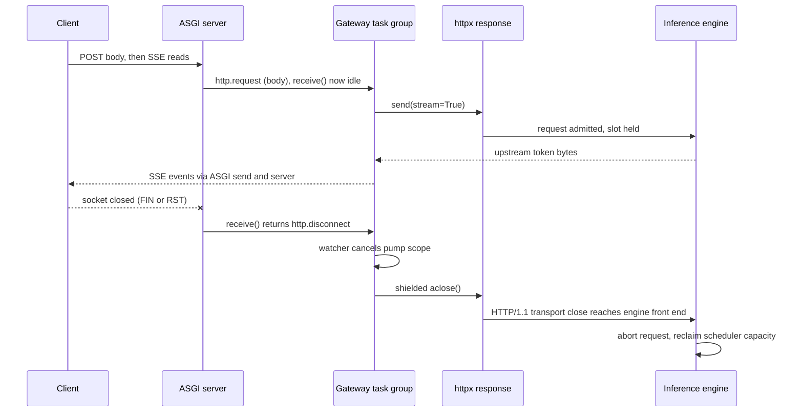

# Saving Compute on Abandoned Requests: Detecting ASGI http.disconnect During SSE Streaming and Cancelling Upstream httpx / GPU Inference Streams Immediately

> [!summary] Claim
> Watch for ASGI `http.disconnect` alongside the token pump so an abandoned SSE request can trigger shielded upstream cleanup even during queueing or prefill, then verify that the upstream close actually reaches the inference scheduler.

Part of [AI and LLM API Engineering](README.md) in [API Engineering](../README.md).

## TL;DR

- Run the token pump and the `http.disconnect` watcher in one `anyio` task group, cancel the surviving task, and shield the pump's upstream cleanup.
- Give one task ownership of `receive()` at a time, and finish reading or rejecting the body before handing that channel to the watcher.
- Starlette 1.10.0 with ASGI `spec_version >= 2.4` detects a closed connection when `send()` fails, which can leave a queued or prefilling request running until an attempted write.
- An early response close in `httpcore` 1.0.9 closes the HTTP/1.1 transport, while the HTTP/2 path can leave the request active at the peer without `RST_STREAM`.
- For work that must outlive the connection, use a durable job with explicit cancellation and a result store as in [[Batch-and-Asynchronous-Inference-APIs-JSONL-Uploads-and-LRO-Completion]].

## Mental model



The gateway starts a pump that reads the upstream response and forwards SSE events through `send()`, and a watcher that waits for `http.disconnect` on `receive()`.
When the HTTP/1.1 client socket closes, the server's connection-lost callback wakes `receive()`, and the watcher cancels the group's pump at its next cancellation checkpoint.
For the partial HTTP/1.1 response shown, the shielded `httpx` close tears down the gateway's connection to the engine front end.
The engine front end must observe that close, deliver an abort to its scheduler, and reclaim capacity.
An intermediary can keep its upstream request open after losing its downstream client, so observe each transition independently.

## How it works

### What the client's departure looks like on the wire

For browser SSE, `EventSource.close()` aborts the underlying fetch and sets `readyState` to `CLOSED`; ordinary connection loss can instead lead to a reconnect (HTML Standard Sections 9.2.2 and 9.2.3).
For a streaming `POST` made with `fetch()`, pass an `AbortSignal` and call `AbortController.abort()` when abandoning the response (Fetch Standard, `fetch(input, init)` and HTTP-network fetch).
The Fetch Standard's HTTP/2 abort path sends `RST_STREAM`, so a browser can leave one SSE request while other requests on the same connection continue.

HTTP/1.1 has no cancel message.
When the client closes a connection, the server observes EOF from a TCP `FIN` or an error such as a connection reset, and RFC 9112 Section 9.5 calls for continuously monitoring connections for closure.
RFC 9112 Section 9.6 says a client half-close neither delimits the request nor indicates lost interest in the response.
A chunked response without its terminal zero-size chunk is incomplete, even if the client already received some complete SSE events (RFC 9112 Section 8).
A silent path failure can leave the server with no immediate EOF or reset, so an independent engine deadline bounds work when the watcher has no event to observe.

HTTP/2 does have a cancel: `RST_STREAM` (type 0x03) "allows for immediate termination of a stream" and the error code `CANCEL` (0x08) means "the stream is no longer needed" (RFC 9113 Section 6.4, Section 7).
For stream 1, an `RST_STREAM(CANCEL)` frame is `00 00 04 03 00 00 00 00 01 00 00 00 08`.
The 9-octet frame header encodes the payload length, type, flags, reserved bit, and stream identifier; the 4-octet payload is the unsigned error code (RFC 9113 Sections 4.1 and 6.4).
After sending it the sender must still tolerate frames already in flight, and the receiver must not send more frames on that stream except `PRIORITY`.
The same RFC defines the opposite direction: a server that has finished its response may send `RST_STREAM` with `NO_ERROR` to ask the client to stop uploading, and the client must not discard the response because of it (RFC 9113 Section 8.1).
So an HTTP/2 front end cancels a single request without losing the connection, whereas an HTTP/1.1 front end must close the whole connection.

HTTP/3 maps a request to one bidirectional QUIC stream.
After the request upload has finished, a client abandoning the response sends `STOP_SENDING` on the still-open receive side with `H3_REQUEST_CANCELLED` (`0x010c`); if the request's send side is still open, the client also resets it with `RESET_STREAM` (RFC 9114 Sections 4.1 and 4.1.1 and Section 8.1; RFC 9000 Sections 2.4, 19.4, and 19.5).
QUIC carries the stream identifier and application error code as variable-length integers, and `RESET_STREAM` also carries the final size.
An ordinary request end leaves the response direction usable on HTTP/2 and HTTP/3, so tie cancellation to the reset or stop signal the adapter actually handles.

### What ASGI exposes

ASGI delivers `http.disconnect` on `receive()` after connection closure or response completion, and concurrent calls to `send()` can fail before the receive event arrives (ASGI HTTP spec, Disconnect - receive event).
Spec version 2.4 added the expectation that `send()` on a closed connection raises a server-specific `OSError` subclass (ASGI HTTP spec, Spec Versions and Disconnected Client - send exception).
A blocked `receive()` can wake even when the application sends nothing; `send()` can only report the error on a write attempt.
Treat the terminal `http.response.body` with `more_body=False` as the application-side completion boundary for SSE, and give completion precedence if a normal response-finished `http.disconnect` follows it.
For servers that silently drop writes after closure, the return from `send()` alone cannot distinguish acceptance from a drop, so retain the observed disconnect and the engine's completion as independent evidence.
Even a successful body write only puts bytes into the server's send buffer, and `http.response.start` may be held until the first body message (ASGI HTTP spec, Response Start and Response Body - send events).

### How servers synthesize the event

Uvicorn 0.54.0 builds the scope with `"asgi": {"version": ..., "spec_version": "2.3"}` (uvicorn 0.54.0 `uvicorn/protocols/http/httptools_impl.py`, `HttpToolsProtocol.on_message_begin`; `uvicorn/protocols/http/h11_impl.py`, `H11Protocol.handle_events`).
Its `connection_lost` sets `cycle.disconnected = True` when the response is not complete, sets the cycle's `message_event`, and resumes writing so a blocked `send()` can proceed (`HttpToolsProtocol.connection_lost`, `H11Protocol.connection_lost`).
`RequestResponseCycle.receive` awaits `message_event` and then returns `{"type": "http.disconnect"}` when `disconnected` or `response_complete` is set (`httptools_impl.py`, `RequestResponseCycle.receive`).
`RequestResponseCycle.send` returns silently when `disconnected` is set (uvicorn 0.54.0 `uvicorn/protocols/http/httptools_impl.py` and `uvicorn/protocols/http/h11_impl.py`, `RequestResponseCycle.send`).
Both protocols leave `eof_received` empty, so the callback returns `None` and the asyncio selector transport closes and invokes `connection_lost` (CPython 3.14.6 `Lib/asyncio/selector_events.py`, `_SelectorSocketTransport._read_ready__on_eof`; Python 3.14 docs, `Protocol.eof_received`).
The lab observes both parsers translating a client half-close to `http.disconnect` on CPython's asyncio selector loop.

Hypercorn 0.18.0 advertises `spec_version` `2.1` for HTTP scopes and emits `http.disconnect` when its stream handler receives a `StreamClosed` event (hypercorn 0.18.0 `hypercorn/protocol/http_stream.py`, `HTTPStream.handle`).
For HTTP/1.1, a transport `Closed` event dispatches `StreamClosed` to the active stream (hypercorn 0.18.0 `hypercorn/protocol/h11.py`, `H11Protocol.handle` and `_close_stream`).
For HTTP/2, `h2.events.StreamReset` dispatches `StreamClosed` to the reset stream while sibling streams remain active (hypercorn 0.18.0 `hypercorn/protocol/h2.py`, `H2Protocol._handle_events` and `_close_stream`).
Hypercorn 0.18.0's HTTP/3 adapter runs QUIC events through `H3Connection.handle_event` and handles HTTP headers and body data, with no HTTP/2-style per-stream reset dispatch in that handler (hypercorn 0.18.0 `hypercorn/protocol/quic.py`, `QuicProtocol._handle_events`; `hypercorn/protocol/h3.py`, `H3Protocol.handle`).
Validate HTTP/3 cancellation using a request reset on the actual server and watch for an ASGI event before relying on that adapter for resource reclamation.

Granian 2.8.7 builds its HTTP scope in Rust with `"spec_version": "2.3"` (granian 2.8.7 `src/asgi/utils.rs`, `build_scope_common!` and `ASGI_VERSION`).
Once the body is exhausted, `ASGIHTTPProtocol::receive` waits in a `tokio::select!` on response completion or the disconnect guard and returns `http.disconnect` (granian 2.8.7 `src/asgi/io.rs`, `ASGIHTTPProtocol::receive`).
Dropping an unfinished `GuardedReceiver` or the `ResponseBodyStream` signals the guard (granian 2.8.7 `src/utils.rs`, `GuardedReceiver::drop`; `src/asgi/callbacks.rs`, `call_http`; `src/asgi/io.rs`, `ResponseBodyStream::drop`).
Granian logs a closed body channel and returns without raising (granian 2.8.7 `src/asgi/io.rs`, `ASGIHTTPProtocol::send_body`).

### What Starlette does with it

`StreamingResponse.__call__` branches on the scope's `spec_version` (starlette 1.10.0 `starlette/responses.py`, `StreamingResponse.__call__`).
For `spec_version >= (2, 4)` it awaits `stream_response(send)` directly and converts an `OSError` into `ClientDisconnect`; there is no listener.
The exception handler covers the whole stream operation, so an `OSError` from the body iterator can also be classified as `ClientDisconnect`.
For older servers it opens an `anyio` task group (`create_collapsing_task_group`, from `starlette/_utils.py`), starts `stream_response` as a child task, and awaits `listen_for_disconnect` in the host task; both run through a `wrap` helper that cancels the group's scope when its function returns, so whichever finishes first cancels the other.
`stream_response` iterates `self.body_iterator` with a plain `async for`, so cancelling a pump blocked in `send()` can leave the generator suspended at its `yield`.
When the generator is eventually collected, the async-generator finalizer can schedule `aclose()` (PEP 525, Finalization; starlette 1.10.0 `starlette/responses.py`, `StreamingResponse.stream_response`).
`Request.is_disconnected` is a poll: it calls `receive()` under a cancelled `anyio.CancelScope` and reports `True` only if a disconnect message was immediately available, so it only observes disconnects between the points where the handler chooses to ask (starlette 1.10.0 `starlette/requests.py`, `Request.is_disconnected`).
`Request.stream` raises `ClientDisconnect` when `http.disconnect` arrives during body upload (`starlette/requests.py`, `Request.stream`).

`sse-starlette` 3.6.0 documents a deliberate divergence: its `EventSourceResponse` does not adopt the spec 2.4 fast path, because its `_listen_for_disconnect` invokes `client_close_handler_callable` and flips `self.active = False` so keep-alive pings and shutdown grace loops stop (sse-starlette 3.6.0 `sse_starlette/sse.py`, module docstring item 1 and `EventSourceResponse._listen_for_disconnect`).
Its `__call__` runs the stream, a ping task, an exit-signal listener, and the disconnect listener in one task group with `cancel_on_finish` wrappers.
Heartbeat and mid-stream error framing belong to [[Streaming-LLM-Token-APIs-SSE-Framing-Heartbeats-and-Mid-Stream-Errors]]; the response-class mechanics are in [[Starlette-Responses-StreamingResponse-FileResponse-and-Background-Execution]] and [[Server-Sent-Events-SSE-Protocol-Last-Event-ID-and-SSE-Starlette]].

### Closing the upstream: httpx and httpcore

`httpx.AsyncClient.stream` is an async context manager whose `finally` awaits `response.aclose()` (httpx 0.28.1 `httpx/_client.py`, `AsyncClient.stream`).
`Response.aclose` closes the underlying byte stream once (httpx 0.28.1 `httpx/_models.py`, `Response.aclose`).
For both HTTP versions, `PoolByteStream.aclose` runs `self._stream.aclose()` inside `AsyncShieldCancellation()` and then releases the request from the pool (httpcore 1.0.9 `httpcore/_async/connection_pool.py`, `PoolByteStream.aclose`).
The response-complete hook `AsyncHTTP11Connection._response_closed` returns the connection to the idle state only if both h11 states are `DONE`; otherwise it calls `aclose()` and closes the socket (httpcore 1.0.9 `httpcore/_async/http11.py`, `AsyncHTTP11Connection._response_closed`).
An early close of a half-read streaming response is the second case, so the TCP connection to the engine is closed, which is the cancel signal the engine front end observes.

For HTTP/2 upstreams, `HTTP2ConnectionByteStream.aclose` calls `_response_closed(stream_id)`, which releases the stream semaphore and deletes the local event queue without emitting `RST_STREAM` (httpcore 1.0.9 `httpcore/_async/http2.py`, `HTTP2ConnectionByteStream.aclose` and `AsyncHTTP2Connection._response_closed`).
The lab's `h2` 4.4.1 peer receives no reset after the client closes a response partway through stream 1, sends further data and `END_STREAM` on stream 1, and serves stream 3 on the same connection.
This establishes the peer-visible transport behavior for the tested release pair and a partially consumed response.
In the same `httpcore` 1.0.9 file, `_receive_events` discards events for streams with no local queue, and `_receive_response_body` acknowledges flow-controlled octets when it consumes `DataReceived` from a live queue.
This can consume connection-level credit as well as the abandoned stream's credit (RFC 9113 Section 6.9.1), so the impact can extend to other streams if enough abandoned data arrives.
The engine can keep generating until its own completion or deadline if it has no separate abort signal and its scheduler continues working when the response writer stalls.
Use HTTP/1.1 to the engine, verify that an HTTP/2 client actually sends `RST_STREAM(CANCEL)`, or call an explicit abort RPC.
Closing a shared HTTP/2 client to force a transport disconnect interrupts other requests using the same connection.
Pick the upstream protocol on its own hop, independently of the client's negotiated HTTP version, and verify the protocol at every proxy that terminates and re-originates a connection.

`httpx.ASGITransport` buffers the response body and its `receive` returns `http.disconnect` only after `response_complete`, so it cannot simulate a client leaving midstream (httpx 0.28.1 `httpx/_transports/asgi.py`, `ASGITransport.handle_async_request`).
The lab drives the ASGI callable directly or over Uvicorn and uses `httpx.MockTransport` to exercise the real `Response.aclose()` path with a fake engine.
Separate socket-free tests sit below `httpx`, drive the actual `httpcore` HTTP/1.1 and HTTP/2 state machines, and observe the network-stream close and HTTP/2 frames respectively.

### What the engine does with the cancel

The last hop is the engine front end.
vLLM v0.11.0 ships `with_cancellation`, a handler decorator that races the handler task against a disconnect listener and cancels the loser (vllm v0.11.0 `vllm/entrypoints/utils.py`, `with_cancellation` and `listen_for_disconnect`).
Its listener consumes all messages until `http.disconnect`, so its documented precondition is that the handler already has the request body.
For streamed chat completions, `create_chat_completion` returns a `StreamingResponse` and the decorator hands off disconnect handling to it (vllm v0.11.0 `vllm/entrypoints/openai/api_server.py`, `create_chat_completion`).
With Starlette 1.10.0, that listener runs on Uvicorn 0.54.0's `2.3` scope, and the send-error detection path applies on scopes advertising `2.4` or later.
Inside the engine front end, `AsyncLLM.generate` catches `(asyncio.CancelledError, GeneratorExit)`, awaits `self.abort(request_id)`, and re-raises (vllm v0.11.0 `vllm/v1/engine/async_llm.py`, `AsyncLLM.generate`).
`AsyncLLM.abort` calls `self.output_processor.abort_requests` and then `await self.engine_core.abort_requests_async` (`AsyncLLM.abort`).
The synchronous `output_processor.abort_requests` runs first, and a blocking `await` in the subsequent IPC path can be interrupted under level-triggered cancellation.
For the single-engine multiprocess path, `AsyncMPClient.abort_requests_async` awaits a ZeroMQ send of `ABORT`; that await reports local send completion and provides no scheduler acknowledgement (vllm v0.11.0 `vllm/v1/engine/core_client.py`, `AsyncMPClient.abort_requests_async`, `_send_input`, and `_send_input_message`).
The engine core drains pending client requests before each engine step, and dispatches `ABORT` to `EngineCore.abort_requests` (vllm v0.11.0 `vllm/v1/engine/core.py`, `EngineCoreProc.run_busy_loop`, `EngineCoreProc._process_input_queue`, and `EngineCore.abort_requests`).
`Scheduler.finish_requests(..., RequestStatus.FINISHED_ABORTED)` removes the request from the running or waiting queue and frees its KV cache blocks through `_free_request` and `_free_blocks` unless a KV connector delays release (vllm v0.11.0 `vllm/v1/core/sched/scheduler.py`, `Scheduler.finish_requests` and `_free_request`).
Once the core dequeues the abort, the scheduler stops including the request in subsequent scheduling decisions.
Already submitted GPU work can finish, and reclaiming the request's scheduler capacity and releasing its KV blocks can occur at different times.

### Cancellation semantics that decide correctness

An `asyncio.Task.cancel()` delivers a `CancelledError` at a cancellation opportunity, and cleanup can await until another cancel request arrives (AnyIO cancellation documentation, Differences between asyncio and AnyIO cancellation semantics).
An `anyio` cancel scope is level-triggered: the asyncio backend retries cancellation of eligible tasks with `call_soon` and skips nested shielded scopes (anyio 4.16.0 `anyio/_backends/_asyncio.py`, `CancelScope._deliver_cancellation`).
In the task-group paths of Starlette and `sse-starlette`, an unshielded cleanup that suspends inside a cancelled scope can be cancelled again.
When `aclose()` resumes a generator suspended at a `yield`, Python injects `GeneratorExit` there so the generator can execute its `finally` block (Python Language Reference, Asynchronous generator-iterator methods).
The lab shields `response.aclose()` in `stream_upstream_tokens` and explicitly closes the generator in `closing_tokens` when the pump exits while the iterator is suspended.
The lab's unshielded control shows the failure: with a close that checkpoints once, an unshielded close is interrupted, the upstream stays open, and in the blocked-`send()` case the engine never learns of the abort and keeps its slot.
The deeper treatment of cancel scopes is [[Cancellation-Semantics-CancelledError-Swallowing-and-Shielded-Cleanup]] and [[AnyIO-Structured-Concurrency-TaskGroups-CancelScopes-and-ExceptionGroups]].

### Backpressure and the blocked send

`send()` can block: Uvicorn's `RequestResponseCycle.send` awaits `flow.drain()` while the transport's write buffer is paused (`httptools_impl.py`, `RequestResponseCycle.send`, `uvicorn/protocols/http/flow_control.py`, `FlowControl.drain`).
A slow reader can fill the downstream write buffer and stall `send()`, at which point the pump stops pulling and an independently producing engine can build a backlog (see [[End-to-End-Backpressure-TCP-Windows-ASGI-Send-Await-and-Bounded-Queues]]).
A disconnect during that blocked write lands in `await send(...)` while the upstream generator is suspended at `yield`, so the owner must explicitly call `aclose()` to run the generator's cleanup.

### The decision order inside a gateway

1. Read and validate a bounded request body, and return before admission if `http.disconnect` arrives during the upload.
2. Start the pump and watcher together before starting upstream work so cancellation covers pool acquisition, connect, request upload, time to first byte, and downstream backpressure.
3. If upstream status determines downstream status, check the upstream response before sending `http.response.start`, and handle downstream errors from the header and body writes at their respective `send()` calls.
4. On pump exit, cancel the watcher, and on disconnect, cancel the pump.
5. Explicitly close the generator and any acquired response under a short, bounded shield; if ownership may already have crossed the process boundary, follow the engine's abort contract.
6. Classify downstream send errors at the `send()` call, preserve upstream failures, and reconcile reservations using engine usage as in [[Token-Aware-Rate-Limiting-Pre-Flight-Reservation-and-Post-Stream-Reconciliation]].

Cancellation during `client.send(..., stream=True)` can occur before the gateway has a response to release even though the engine has received the request.
Allocate an attempt ID before upstream dispatch so an ambiguous admission can be cancelled by ID, and make abort idempotent across already-finished, in-flight, and repeated requests.
If admit and abort travel over different channels, serialize them at the engine or retain a short-lived cancellation record so a late admit cannot resurrect an abandoned request.
After streaming starts, frame a recoverable upstream failure as the API's SSE error event while the downstream is writable, and preserve the upstream failure classification if the error event also fails to send.
Use an overall deadline in addition to HTTPX's per-operation limits, because its read timeout measures the wait for a data chunk and a steady trickle of bytes can keep a stream alive (HTTPX documentation, Timeouts).
Check endpoint scope before using an abort RPC.
In vLLM v0.11.0, `POST /v1/responses/{response_id}/cancel` accepts stored responses in `queued` or `in_progress` state and cancels their background task when present (vllm v0.11.0 `vllm/entrypoints/openai/api_server.py`, `cancel_responses`, and `vllm/entrypoints/openai/serving_responses.py`, `OpenAIServingResponses.cancel_responses`).
With provider fallback or hedging, cancel every losing attempt and prevent a disconnected interaction from launching a new attempt ([[AI-Gateway-Engineering-Semantic-Caching-Provider-Fallbacks-and-Guardrail-Pipelines]]).

## Numbers and limits

| Quantity | Value | Source or measurement |
|---|---|---|
| In-process: disconnect to fake engine abort | 0.088 ms | single lab capture below, CPython 3.14.6, Mac15,7, macOS 27.3 arm64 (Darwin 27.3.0), 2026-11-26 |
| In-process: disconnect to `httpx` stream close | 0.119 ms | same run |
| Real Uvicorn 0.54.0, `h11`, client `close()`, to engine done | 0.24 ms | same run, loopback socket |
| Real Uvicorn 0.54.0, `httptools`, client `close()` | 0.21 ms | same run |
| Real Uvicorn 0.54.0, `h11`, client `write_eof()` (half-close) | 0.24 ms | same run |
| Real Uvicorn 0.54.0, `httptools`, client `write_eof()` | 0.25 ms | same run |
| Decode steps after a disconnect on the watching gateway | 0 (`steps == 3` after three tokens) | asserted for the permit-controlled fake engine, along with abort and slot release |
| Extra steps in the Starlette spec 2.4 control | 1 | lab gates the fourth step and asserts `steps == 4` after the failed write |
| Total steps in the abandoned buffering control | 20 of 20 | lab asserts the producer reaches its cap and the client receives fewer chunks |
| Hang guard in tests | 2.0 s | constant `HANG_GUARD_SECONDS`, not a latency bound |
| ASGI spec version that added `OSError` on `send()` after close | 2.4 | ASGI HTTP spec, Spec Versions |
| `spec_version` advertised by Uvicorn 0.54.0 HTTP | `2.3` | uvicorn 0.54.0 source, read (as of 2026-11) |
| `spec_version` advertised by Hypercorn 0.18.0 HTTP | `2.1` | hypercorn 0.18.0 source, read (as of 2026-11) |
| `spec_version` advertised by Granian 2.8.7 HTTP | `2.3` | granian 2.8.7 `src/asgi/utils.rs`, read at the release tag (as of 2026-11) |
| `RST_STREAM` frame length | 9-octet header and 4-octet payload, error code `CANCEL` = `0x08` | RFC 9113 Sections 4.1, 6.4, and 7 (June 2022) |
| QUIC stream cancellation frames | `RESET_STREAM` = `0x04`, `STOP_SENDING` = `0x05` | RFC 9000 Sections 19.4 and 19.5 (May 2021) |
| nginx `proxy_ignore_client_abort` default | `off` | nginx `ngx_http_proxy_module` documentation (as of 2026-11) |

All six timing observations in this capture were below the seed's 10 ms target.
The lab uses a 2 s hang guard so scheduler load cannot turn the seed target into a flaky assertion.
These single-run observations on a fake engine establish the sequence and give an example of its local overhead.
An end-to-end budget also includes transport detection, proxy propagation, gateway cleanup, engine abort delivery, and scheduler or KV-release delay.

## Portability

| Dimension | Value | Evidence |
|---|---|---|
| CPython 3.14.6 (macOS 27.3 arm64) | all 21 lab tests pass | single lab capture in Worked example (2026-11-26) |
| CPython matrix targets `3.12.16`, `3.13.18`, `3.14.10`, `3.15.2`, `3.15.2t` (free-threaded) | `aclose()` injects `GeneratorExit` at the suspended generator | PEP 525, Finalization, and Python Language Reference, Asynchronous generator-iterator methods |
| Starlette 1.10.0 spec 2.3 path | cancels via `listen_for_disconnect` | lab test `test_starlette_streaming_response_cancels_upstream_on_spec_2_3` plus source |
| Starlette 1.10.0 spec 2.4 path | detects only on failing `send()` | lab test `test_starlette_spec_2_4_misses_a_disconnect_while_upstream_is_silent` plus source |
| `sse-starlette` 3.6.0 | keeps the listener on every spec version | `sse_starlette/sse.py`, `EventSourceResponse.__call__` |
| Uvicorn 0.54.0 `h11` and `httptools` | `close()` and half-close both abort the engine | lab socket tests, both parsers, loopback |
| Uvicorn 0.54.0 `send()` after close | silent drop | `h11_impl.py` and `httptools_impl.py`, `RequestResponseCycle.send` |
| Hypercorn 0.18.0 HTTP/1.1 and HTTP/2 | `StreamClosed` produces `http.disconnect`, and HTTP/2 `RST_STREAM` is routed to one stream | `hypercorn/protocol/http_stream.py`, `HTTPStream.handle`; `hypercorn/protocol/h11.py`, `H11Protocol.handle`; `hypercorn/protocol/h2.py`, `H2Protocol._handle_events` |
| Granian 2.8.7 | spec `2.3`, disconnect delivered via a dropped response guard, closed body channel logged | `src/asgi/utils.rs`, `build_scope_common!`; `src/asgi/io.rs`, `ASGIHTTPProtocol::receive` and `send_body`; `src/utils.rs`, `GuardedReceiver::drop` |
| HTTP/1.1 upstream via `httpcore` 1.0.9 | early response close closes the network stream | lab test `test_httpcore_http11_early_close_closes_the_network_stream` and `httpcore/_async/http11.py`, `AsyncHTTP11Connection._response_closed` |
| HTTP/2 upstream via `httpcore` 1.0.9 | early close leaves the peer stream open, and another stream can use the same connection | lab test `test_httpcore_http2_early_close_leaves_the_peer_stream_open` with `h2` 4.4.1 and `httpcore/_async/http2.py`, `AsyncHTTP2Connection._response_closed` |
| HTTP/3 over QUIC | `H3_REQUEST_CANCELLED` (`0x010c`) aborts the still-open request-stream directions | RFC 9114 Sections 4.1.1 and 8.1, RFC 9000 Section 2.4 |
| Hypercorn 0.18.0 HTTP/3 | HTTP/2's reset-to-ASGI mapping cannot be assumed for this adapter | source inspection of `hypercorn/protocol/quic.py`, `QuicProtocol._handle_events`, and `hypercorn/protocol/h3.py`, `H3Protocol.handle` |
| Debian Trixie and Alpine musl | container runs paused | matrix legs specified in the note contract |

Hypercorn and Granian entries describe pinned source behavior, and the HTTP/3 entry describes the RFC transport contract.
The captured runtime evidence covers the in-process HTTP/2 peer and Uvicorn HTTP/1.1 loopback on CPython's asyncio selector loop.
Dependency, scheduling, and timing checks were paused on all five CPython matrix targets.

## Worked example

The [implementation](../labs/src/api_labs/f21_ai_and_llm_api_engineering/abandoned_request_cancellation.py) and [test module](../labs/tests/f21_ai_and_llm_api_engineering/test_propagating_client_disconnects_to_cancel_upstream_gpu_inference.py) are runnable in the lab workspace.
`FakeGPUEngine` models scheduler admission and records abort, `EngineByteStream` exposes its events through `httpx.MockTransport`, and `ASGIConnection` lets tests control the downstream connection.
The fake engine emits single-line `data:` events, and the watching gateway sends `200 OK` before starting its task group because the mock upstream always returns that status.
Preserve complete SSE records in a gateway, including multiline `data:`, event IDs, and comments when relevant to the client contract (HTML Standard Sections 9.2.5 and 9.2.6).

The production ordering above also puts the response-start write inside the watcher race and maps upstream status before sending it when required by the API contract.

Simplified excerpt of the upstream side, which releases the `httpx` response under a shield:

```python
async def stream_upstream_tokens(
    client: httpx.AsyncClient, *, shield_close: bool = True
) -> AsyncGenerator[bytes, None]:
    request = client.build_request("POST", UPSTREAM_URL, json={"prompt": "hi", "stream": True})
    response = await client.send(request, stream=True)
    try:
        async for line in response.aiter_lines():
            if line.startswith("data: "):
                yield f"{line}\n\n".encode("ascii")
    finally:
        if shield_close:
            with anyio.CancelScope(shield=True):
                await response.aclose()
        else:
            await response.aclose()
```

Simplified excerpt of the race between the pump and the watcher:

```python
async def send_body(body: bytes, *, more_body: bool) -> bool:
    nonlocal disconnected
    try:
        await send({"type": "http.response.body", "body": body, "more_body": more_body})
    except OSError:
        disconnected = True
        return False
    return True

async with anyio.create_task_group() as group:

    async def pump() -> None:
        nonlocal chunks, completed
        try:
            async with closing_tokens(tokens, shield=shield_close) as events:
                async for event in events:
                    if not await send_body(event, more_body=True):
                        return
                    chunks += 1
            completed = await send_body(b"", more_body=False)
        finally:
            group.cancel_scope.cancel()

    async def watch() -> None:
        nonlocal disconnected
        await wait_for_disconnect(receive)
        disconnected = True
        group.cancel_scope.cancel()

    group.start_soon(pump)
    group.start_soon(watch)
```

The core test releases three decode steps, waits for the client to receive three events, disconnects, and asserts that the engine aborted with `steps == 3`, the slot was freed, and the `httpx` response was closed.
The buffering control reaches 20 of 20 steps despite the disconnect, and Starlette on spec 2.4 spends a fourth step before noticing.
The real-server tests start Uvicorn 0.54.0 on `127.0.0.1:0` with each HTTP parser, send a raw `POST`, read three `data: ` events, then `close()` or `write_eof()` the client socket.
The wire tests compare early response close in HTTP/1.1 and HTTP/2, and a separate assertion verifies that an upstream `OSError` propagates to the caller.

The command ran from `labs/` on CPython 3.14.6, Mac15,7, macOS 27.3 arm64 (Darwin 27.3.0), on 2026-11-26.
`TMPDIR="$PWD/.." PYTHONDONTWRITEBYTECODE=1 uv run --frozen --no-sync --offline --no-cache python -m pytest tests/f21_ai_and_llm_api_engineering/test_propagating_client_disconnects_to_cancel_upstream_gpu_inference.py -v -rP -p no:cacheprovider`

Timing lines and summary from the existing finish-pass capture, with intervening pytest output omitted.

```text
in-process abort latency 0.088 ms, httpx close latency 0.119 ms
uvicorn 0.54.0 h11 close: engine abort after 0.24 ms
uvicorn 0.54.0 httptools close: engine abort after 0.21 ms
uvicorn 0.54.0 h11 half-close: engine abort after 0.24 ms
uvicorn 0.54.0 httptools half-close: engine abort after 0.25 ms
============================== 21 passed in 1.05s ==============================
```

The `unshielded-send-blocked` control finishes the gateway task with `upstream_closed is False`, `aborted is False`, and `slots_in_use == 1`.
The corresponding shielded test waits on a blocked-send signal before disconnecting, then checks that the response closes and the engine releases its slot.

## Pitfalls

> [!warning] The spec 2.4 blind spot
> Trigger: the server advertises ASGI `spec_version` 2.4 or later and the handler returns a Starlette `StreamingResponse` over an upstream that is queued or in prefill.
> Symptom: the client is gone but no `send()` happens, so no `OSError` is raised; the request holds its GPU slot until the first token is produced and fails to send (one wasted step in the lab, but the wait can be as long as the queue).
> Fix: keep a concurrent `receive()` watcher as `sse-starlette` does on every spec version; do not depend on `send()` failing.
> A vLLM v0.11.0 front end can inherit the gap because `with_cancellation` stops listening once the handler returns a `StreamingResponse`.
> Uvicorn 0.54.0 advertises 2.3 today, so the gap appears when you move to a server that advertises 2.4 (as of 2026-11).

> [!warning] A producer decoupled from the response
> Trigger: a detached producer fills an `asyncio.Queue`, or the handler buffers the whole completion with `await client.post(...)` outside the disconnect race.
> Symptom: the client receives only a prefix, but the independent producer continues to its token cap.
> Fix: put the producer and the watcher under the same task group, bound the queue, and shield only release operations.

> [!warning] Unshielded cleanup under an anyio cancel scope
> Trigger: the pump's `finally` or `aclose()` awaits something that suspends (a network close, an abort RPC) inside a scope that was cancelled.
> Symptom: the close is interrupted at its first checkpoint, the connection to the engine stays open, and the slot leaks; in the blocked-`send()` case the engine never learns of the abort.
> Fix: wrap the release in `anyio.CancelScope(shield=True)` the way `httpcore` does with `AsyncShieldCancellation`, and keep the shielded section short and bounded by its own timeout.

> [!warning] Consuming `receive()` before the body is read
> Trigger: starting the disconnect watcher while the request body is still unread.
> Symptom: the watcher eats `http.request` messages, the handler never sees its prompt, or the stream is cut off; vLLM's `with_cancellation` documents that it "will consume and throw away all incoming messages" and is safe only after the body is parsed.
> Fix: read the body to `more_body: false` first; if `http.disconnect` appears during upload, return before any upstream call (test: `test_disconnect_before_request_body_completes_never_touches_the_engine`).

> [!warning] Polling `is_disconnected()` only between tokens
> Trigger: checking `await request.is_disconnected()` once per generated token.
> Symptom: the same silent-period gap as above, plus extra `receive()` calls per token; behind `BaseHTTPMiddleware` the receive channel may not be the server's (see [[Why-BaseHTTPMiddleware-Hurts-Performance-Streaming-and-ContextVars]]).
> A vLLM user reported generation continuing after disconnect when `BaseHTTPMiddleware` was present. [vLLM issue 10087](https://github.com/vllm-project/vllm/issues/10087)
> Fix: use a concurrent listener task rather than a poll.

> [!warning] Closing the gateway side but not the proxy side
> Trigger: an nginx or other reverse proxy in front of the gateway with `proxy_ignore_client_abort on`.
> Symptom: nginx can keep the proxied connection open after the downstream client closes, so the gateway receives no immediate disconnect from that hop.
> The default is `off`, and `proxy_buffering` controls response buffering separately; `X-Accel-Buffering: no` can disable it unless nginx is configured to ignore the header (nginx `ngx_http_proxy_module`, as of 2026-11).
> Fix: audit every hop's client-abort setting and its response buffering, and verify with a test that kills the client and watches the engine's abort counter; see [[Proxy-and-Application-Timeout-and-Retry-Interaction-Hazards]] and [[Keep-Alive-Timeout-Races-Between-Reverse-Proxies-and-Origins]].

> [!warning] Assuming half-close means "still waiting"
> Trigger: a client that sends its request and then `shutdown(SHUT_WR)`, expecting to read the response.
> Symptom: Uvicorn 0.54.0 with either tested parser treats EOF as a full close and the lab's `write_eof()` tests show the engine being aborted, even though RFC 9112 Section 9.6 permits the client to keep reading a response after half-close.
> Fix: keep the socket fully open until the response has been read.

> [!warning] Aborting an HTTP/2 upstream by dropping the response
> Trigger: an `httpx` client with HTTP/2 enabled to the engine.
> Symptom: the `httpcore` 1.0.9 lab peer can still send on the abandoned stream because it received no reset.
> An earlier first-hand report described the same symptom with `httpx` 0.27.2. [HTTPX discussion 3603](https://github.com/encode/httpx/discussions/3603)
> Fix: use an HTTP/1.1 connection per streamed completion, or an explicit cancel endpoint, and test the abort counter end to end.

> [!warning] An upstream error misclassified as a disconnect
> Trigger: the pump catches `OSError` around both the upstream iterator and the downstream `send()`.
> Symptom: an upstream failure looks like a client departure in logs and accounting, and an already-started SSE stream ends without its protocol's error event.
> Fix: catch the closed-connection exception at the downstream send boundary and keep upstream failures visible.

## Security and robustness

- Slow reads and abandoned requests can occupy inference capacity with little client effort (OWASP API Security Top 10 2023, API4:2023 Unrestricted Resource Consumption).
- Cloudflare's incident report for HTTP/2 Rapid Reset (`CVE-2023-44487`) shows why connection and concurrent-stream limits alone are insufficient against bursts of cancelled requests, so separately rate-limit admission to costly inference work. [Cloudflare incident report](https://blog.cloudflare.com/technical-breakdown-http2-rapid-reset-ddos-attack/)
- Cancellation shortens abandoned requests after a visible disconnect, while model limits and an engine deadline bound work if the client stays connected or a proxy never forwards the close.
- For slow readers who remain connected, combine a downstream write deadline, bounded queues, per-tenant concurrency, and a server-side `max_tokens` ceiling ([[Token-Aware-Rate-Limiting-Pre-Flight-Reservation-and-Post-Stream-Reconciliation]]).
- Enforce the request byte limit as chunks arrive, including requests without `Content-Length`, and validate the model, prompt limit, and `max_tokens` before GPU admission.
- Scope explicit abort requests to the authorized tenant and a server-assigned attempt ID, and make retries idempotent so a late abort cannot cancel a newer attempt.
- Reconcile the usage reservation once per attempt with authoritative engine counts; a successful `send()` is only evidence that the local server accepted bytes, and generated and delivered tokens can diverge.
- Record the attempt ID, generated token count, and disconnect reason while keeping prompts out of the disconnect logs.
- Propagate an overall request deadline as well as per-operation timeouts (see [[Timeout-Taxonomy-Connect-Read-Write-Pool-and-Deadline-Propagation]]) and enforce a deadline in the engine if the gateway disappears.
- Bound shielded cleanup with `anyio.move_on_after(..., shield=True)` and record expirations separately from acknowledged aborts (AnyIO cancellation documentation, Shielding).
- On shutdown, stop admitting work, drain within the configured window, and cancel remaining requests while preserving a distinct shutdown outcome ([[Graceful-Shutdown-SIGTERM-Drain-Windows-and-Kubernetes-PreStop-Hooks]]).

## The principal's view

Assign cancellation ownership at each hop to the component that receives the downstream disconnect and owns the next upstream request.
Give the platform team ownership of a shared pure-ASGI watcher and require endpoint owners to supply status mapping, abort policy, and accounting ([[Pure-ASGI-Middleware-Onion-Architecture-and-Send-Receive-Wrapping]]).
Specify per endpoint whether a connection owns the inference attempt or subscribes to a durable job.
For resumable SSE, `Last-Event-ID` lets a reconnecting subscriber name its last event, and the service still needs a retained event log and a policy for inference while subscribers are absent (HTML Standard Section 9.2.4).
If the provider owns the engine, require a documented abort contract with a known transport mapping or an authenticated request-ID cancellation operation.
When both sides are service-owned, a gRPC streaming hop gives the service an RPC cancellation signal and a deadline, with propagation capabilities that vary by language (gRPC guides, Cancellation and Deadlines).
The handler still owns stopping inference and cancelling any outgoing RPCs that the library leaves to the application.
Record downstream disconnect, upstream close, engine abort dispatch, scheduler removal, and KV release as distinct events linked by attempt ID.
Measure local intervals with monotonic clocks and use correlated spans for cross-host diagnosis, since subtracting timestamps from different hosts can turn clock skew into apparent cancellation latency.
Track engine steps after abort dispatch and count ordinary completion after an observed disconnect, with a separate outcome for an abort whose final state could not be confirmed.
`max_tokens` minus generated tokens is unused budget; actual compute savings require comparison with an equivalent run that completes or a controlled baseline.
Use the end-to-end test to cover a client that leaves before headers, while the engine is silent, and while a downstream write is blocked, then check that healthy sibling HTTP/2 streams continue.

## Interview questions

> [!question] L5: What does a server do when a client closes an SSE connection, and how does an ASGI app find out?
>
> > [!success]- Answer
> > The server sees EOF or an error on the socket and marks the request cycle disconnected.
> > The next `receive()` call returns `{"type": "http.disconnect"}`.
> > A spec 2.4 server may also make `send()` raise an `OSError` subclass, but older servers such as Uvicorn 0.54.0 silently drop the send.
> >
> > Follow-up: why can't the app rely on `send()` failing?

> [!question] L5: Why must the request body be fully read before starting a disconnect watcher?
>
> > [!success]- Answer
> > `receive()` is one queue of events: request body chunks come first, then the disconnect.
> > A watcher that loops on `receive()` discards `http.request` messages it was not looking for.
> > So the handler reads until `more_body` is false, and only then starts the watcher.
> >
> > Follow-up: what should the gateway do if `http.disconnect` arrives during the upload?

> [!question] L6: Predict the output when a client leaves a Starlette `StreamingResponse` on a spec 2.4 server after three tokens and the test calls `engine.release(1)`.
> What are `engine.steps` and `engine.aborted` before and after the release?
>
> > [!success]- Answer
> > Before the release `steps == 3` and `aborted` is `False`: nothing was sent, so no `send()` raised.
> > After the release the engine produces token four, `send()` raises `ConnectionClosed`, and Starlette exits with `ClientDisconnect`.
> > The test waits for the generator's cleanup, after which `steps == 4` and `aborted` is `True`.
> > The lab asserts exactly this in `test_starlette_spec_2_4_misses_a_disconnect_while_upstream_is_silent`.
> >
> > Follow-up: how long can the gap last if the engine is queued behind a long prefill?

> [!question] L6: Debug this API when the client leaves but the GPU request continues.
>
> Simplified excerpt of `buffering_gateway` with its terminal send and error handler omitted.
>
> ```python
> queue: asyncio.Queue[bytes | None] = asyncio.Queue()
>
> async def producer() -> None:
>     async for event in stream_upstream_tokens(client):
>         queue.put_nowait(event)
>     queue.put_nowait(None)
>
> task = asyncio.create_task(producer())
> await start_sse(send)
> try:
>     while (event := await queue.get()) is not None:
>         await send({"type": "http.response.body", "body": event, "more_body": True})
> finally:
>     await asyncio.shield(task)
> ```
>
> > [!success]- Answer
> > The producer runs independently of the response and the handler shields the producer task itself, so it can decode to `max_tokens` after the client leaves.
> > Put the producer and a `receive()` watcher in one task group, and shield only cleanup that must run after cancellation.
> > Control test: `test_buffering_gateway_keeps_decoding_after_disconnect` shows 20 of 20 steps.
> >
> > Follow-up: what operation belongs inside the shield once the producer shares the watcher task group?

> [!question] L6: Why does `httpcore` wrap its close in `AsyncShieldCancellation`, and what happens in your gateway if you omit the equivalent?
>
> > [!success]- Answer
> > An `anyio` cancel scope re-delivers cancellation at every checkpoint inside the cancelled region, so an `await` in cleanup is cancelled again.
> > `AsyncShieldCancellation` protects the close from an enclosing cancellation, and cleanup failures can still propagate.
> > Without a shield the upstream response is not closed, the connection to the engine stays open, and the slot leaks; the lab's `unshielded-send-blocked` case shows `upstream_closed is False` and `slots_in_use == 1`.
> >
> > Follow-up: how do you bound the shielded section so a stuck upstream cannot hang the gateway?

> [!question] L6: Why is polling `request.is_disconnected()` between tokens worse than a concurrent watcher?
>
> > [!success]- Answer
> > It observes a disconnect only when the handler asks, so it has the same blind spot while the engine is silent in queue or prefill.
> > `is_disconnected` calls `receive()` under an already-cancelled scope and returns `True` only if a message was immediately available.
> > A concurrent watcher blocks on `receive()` and reacts the moment the server delivers the event.
> >
> > Follow-up: what breaks when the handler sits behind `BaseHTTPMiddleware`?

> [!question] L7+: Design the cancellation chain for browser -> CDN -> nginx -> gateway -> vLLM, and state how you would prove each hop propagates the close.
>
> > [!success]- Answer
> > Trace the browser abort at the CDN, the upstream cancellation at nginx, the ASGI event and upstream close at the gateway, and the engine's abort processing.
> > For streamed vLLM v0.11.0 responses, Starlette 1.10.0 listens on ASGI versions below 2.4 and relies on send failures on newer scopes, so the silent-engine case needs an explicit test at the vLLM hop.
> > A permit-controlled engine can assert exactly `steps == N` after `N` events.
> > On a GPU, check scheduler removal within the abort budget and track in-flight work separately.
> > Watch for buffering proxies that read ahead and for HTTP/2 hops that drop a response without `RST_STREAM`.
> >
> > Follow-up: which hop would you test first when the abandoned-token metric is nonzero?

> [!question] L7+: A client sends a request, half-closes its write side, and waits for the response, and Uvicorn aborts the engine: who is right, and what do you do?
>
> > [!success]- Answer
> > RFC 9112 Section 9.6 says a client half-close does not imply that the client is no longer interested in a response, so the client is within the specification.
> > Uvicorn 0.54.0's `eof_received` is `pass`, so asyncio closes the transport on EOF and the app sees `http.disconnect`; the lab confirms this for both parsers.
> > If half-close clients are part of the contract, verify the behavior of the server and any proxy, or require the client to keep the socket open.
> >
> > Follow-up: what does RFC 9113 define for HTTP/2 that makes this question moot there?

> [!question] L7+: Your pump aborts the upstream on disconnect but usage is still billed for the full `max_tokens`: where does the accounting go wrong and how do you reconcile?
>
> > [!success]- Answer
> > Pre-flight reservation charges for the worst case, and nothing refunds it on the abort path, because the abort path does not record how many tokens were produced.
> > Record actual token usage from the engine, release the unused reservation, and emit a distinct outcome such as `client_disconnect`.
> > The post-stream reconciliation in [[Token-Aware-Rate-Limiting-Pre-Flight-Reservation-and-Post-Stream-Reconciliation]] must run in a shielded `finally`, for the same reason as the upstream close.
> >
> > Follow-up: how do you avoid double refunds when a retry races the abort?

> [!question] L7+: The gateway cancels an HTTP/2 request before response headers arrive, and the engine's admission status is unknown.
> How can it bound the cost and avoid cancelling another request?
>
> > [!success]- Answer
> > Allocate a unique attempt ID before dispatch and use the upstream's documented cancellation operation for that ID.
> > If cancellation can arrive before admission, the engine must order both operations or remember the cancellation until the admission window closes.
> > Enforce an engine-side deadline so an undelivered abort cannot hold capacity indefinitely.
> >
> > Follow-up: which observed event proves the scheduler stopped including the attempt in future batches?

## Related

Prerequisites: [[Streaming-LLM-Token-APIs-SSE-Framing-Heartbeats-and-Mid-Stream-Errors]]

Next: [[Token-Aware-Rate-Limiting-Pre-Flight-Reservation-and-Post-Stream-Reconciliation]]

See also: [[02-Programming-Languages/Python/Python-Backend-Interview-Prep/04-FastAPI]], [[02-Programming-Languages/Python/Python-Backend-Interview-Prep/16-Asyncio-Deep-Dive]], [[ASGI-HTTP-and-Disconnect-Event-Lifecycle]], [[Cancellation-Semantics-CancelledError-Swallowing-and-Shielded-Cleanup]], [[AnyIO-Structured-Concurrency-TaskGroups-CancelScopes-and-ExceptionGroups]], [[Starlette-Responses-StreamingResponse-FileResponse-and-Background-Execution]], [[Uvicorn-Internals-Server-Lifecycle-Protocols-and-Flow-Control]], [[Hypercorn-Internals-HTTP-2-HTTP-3-QUIC-and-AnyIO-Trio-Workers]], [[HTTP-2-Binary-Framing-and-Stream-State-Machine]], [[AI-Gateway-Engineering-Semantic-Caching-Provider-Fallbacks-and-Guardrail-Pipelines]]

- Lab: `labs/tests/f21_ai_and_llm_api_engineering/test_propagating_client_disconnects_to_cancel_upstream_gpu_inference.py`

## Further reading

- Persistent connections need closure monitoring, and a client's half-close still permits a response. [RFC 9112 Sections 9.5 and 9.6](https://www.rfc-editor.org/rfc/rfc9112.html)
- HTTP/2 defines the `RST_STREAM` frame and its `CANCEL` error code. [RFC 9113 Sections 6.4 and 7](https://www.rfc-editor.org/rfc/rfc9113.html)
- HTTP/3 defines how to cancel the still-open directions of a QUIC request stream. [RFC 9114 Section 4.1.1](https://www.rfc-editor.org/rfc/rfc9114.html)
- The ASGI contract defines `http.disconnect` and when `send()` signals closure. [ASGI HTTP spec](https://asgi.readthedocs.io/en/latest/specs/www.html)
- The browser contract defines explicit close, reconnection, event parsing, and `Last-Event-ID`. [WHATWG HTML Standard, server-sent events](https://html.spec.whatwg.org/multipage/server-sent-events.html)
- Async-generator finalization explains why explicit `aclose()` matters after cancellation at a yield. [PEP 525](https://peps.python.org/pep-0525/)
- The language reference specifies the `GeneratorExit` raised at the suspension point. [Python asynchronous generator-iterator methods](https://docs.python.org/3/reference/expressions.html#asynchronous-generator-iterator-methods)
- The spec 2.4 branch switches `StreamingResponse` to send-error detection. [Starlette 1.10.0 response implementation](https://raw.githubusercontent.com/encode/starlette/1.10.0/starlette/responses.py)
- The protocol callback and request cycle connect transport closure to `http.disconnect`. [Uvicorn 0.54.0 httptools implementation](https://raw.githubusercontent.com/encode/uvicorn/0.54.0/uvicorn/protocols/http/httptools_impl.py)
- Response cleanup releases the local stream queue and semaphore. [httpcore 1.0.9 HTTP/2 implementation](https://raw.githubusercontent.com/encode/httpcore/1.0.9/httpcore/_async/http2.py)
- Level cancellation and shielding govern bounded async cleanup. [AnyIO cancellation and timeouts](https://anyio.readthedocs.io/en/stable/cancellation.html)
- Read timeouts bound waits for individual chunks, which is why the gateway also needs an overall deadline. [HTTPX timeouts](https://www.python-httpx.org/advanced/timeouts/)
- The vLLM decorator documents the disconnect race and its body-read precondition. [vLLM v0.11.0 endpoint utilities](https://raw.githubusercontent.com/vllm-project/vllm/v0.11.0/vllm/entrypoints/utils.py)
- The engine front end translates cancellation to `abort`. [vLLM v0.11.0 async engine](https://raw.githubusercontent.com/vllm-project/vllm/v0.11.0/vllm/v1/engine/async_llm.py)
- The scheduler removes aborted requests and can defer KV block reclamation. [vLLM v0.11.0 scheduler](https://raw.githubusercontent.com/vllm-project/vllm/v0.11.0/vllm/v1/core/sched/scheduler.py)
- Client-abort forwarding and buffering are separate proxy settings. [nginx proxy module](https://nginx.org/en/docs/http/ngx_http_proxy_module.html)
- RPC cancellation is cooperative at the server handler. [gRPC cancellation guide](https://grpc.io/docs/guides/cancellation/)
- Deadline expiry cancels an RPC and deadline propagation varies by language. [gRPC deadlines guide](https://grpc.io/docs/guides/deadlines/)
