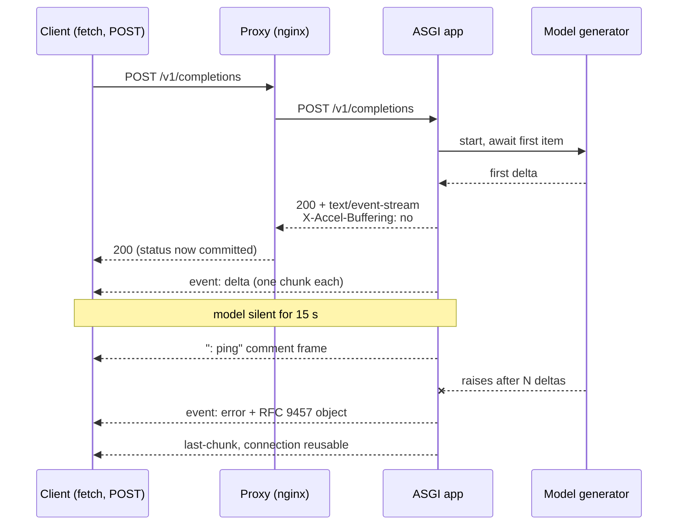

# Designing Streaming Token Generation APIs over SSE: Delta Chunk Framing, Proxy Buffering Disabling (X-Accel-Buffering: no), Heartbeat Comments, and Error Events After 200 OK

> [!summary] Claim
> A streaming token API is a contract of four independent promises: every delta is one self-contained single-line frame flushed on its own, no intermediary may hold bytes back, the stream stays visibly alive while the model is silent, and the stream ends with exactly one terminal frame (`done` or `error`) because the `200 OK` status was committed with the first byte and a closed connection proves nothing.

Part of [AI and LLM API Engineering](README.md) in [API Engineering](../README.md).

## TL;DR

- Mechanism: one `event:` line plus one `data:` line of compact JSON per delta, one ASGI `http.response.body` message per frame, so the server flushes (ASGI spec 2.5) and HTTP/1.1 sends one chunk per frame (RFC 9112 Section 7.1).
- Contract rule: decide the commit point; fail before the first byte with a real status and `application/problem+json`, fail after it with a terminal `event: error` frame whose `data:` is an RFC 9457 object, and never end a stream without `done` or `error`.
- Trap: heartbeating with `asyncio.wait_for(gen.__anext__(), t)` cancels the generator at the first timeout and the stream then ends silently with no terminal frame; own the generator in a producer task and time out on a queue instead.
- Portability: the frame bytes are identical on HTTP/1.1, HTTP/2, and HTTP/3, but chunked framing, `Connection: keep-alive`, and the abrupt-close signal are HTTP/1.1 details (RFC 9113 Sections 8.1 and 8.2.2, RFC 9114 Sections 4.1 and 4.2); the lab proves the wire behavior on Uvicorn 0.54.0 with both the `h11` and `httptools` protocols and on CPython 3.14.6 only.
- Not for: bidirectional or binary traffic, or generations that must survive a client reconnect; use WebSockets (see [[Multimodal-API-Design-Chunked-Audio-WebSockets-and-Content-Addressed-Blobs]]) or the batch pattern in [[Batch-and-Asynchronous-Inference-APIs-JSONL-Uploads-and-LRO-Completion]].

## Mental model



The handler awaits the first item before it sends headers, which is the last moment a failure can still be a `503` or `429`; the first delta commits `200`.
From then on each delta is a frame written as its own ASGI message, and a proxy that honors `X-Accel-Buffering: no` passes it on instead of filling a buffer.
While the model is silent the server writes a comment frame so that idle timers on every hop see bytes; the client's parser ignores it.
A failure after the commit cannot change the status, so it travels as data: the `error` frame is the last thing on the wire, followed by a clean end of the chunked body, and the client classifies the stream by that frame.

## How it works

### Why the wire is SSE over `POST`

Server-Sent Events are a framing, not a transport: `text/event-stream` is the MIME type of the format and the stream grammar is the `stream` production in HTML 9.2.5 (HTML Living Standard, Section 9.2.5, read 2026-11-26).
The browser `EventSource` class is a poor fit for completions because its constructor takes a URL and one option, `withCredentials` (HTML 9.2.2), so it cannot choose a method, a body, or request headers and sends a default `GET`, while a prompt is a large `POST` body that travels with an `Authorization` header.
LLM APIs therefore use the SSE grammar over a plain `POST` that the client reads with `fetch` and a stream reader, as the Anthropic Messages API and the OpenAI APIs do `(as of 2026-11)`, and the Gemini REST API selects the same framing with the `alt=sse` query parameter `(ai.google.dev text-generation guide, REST example for /v1beta/interactions?alt=sse, as of 2026-11)`.
FastAPI 0.162.0 supports this directly: `EventSourceResponse` "Works with any HTTP method" and the docstring names MCP streaming SSE over `POST` `(fastapi 0.162.0 fastapi/sse.py, EventSourceResponse)`.
Two `EventSource` behaviors still matter if you also serve a `GET` variant.
A `200` body that ends normally makes the browser reconnect (HTML 9.2.2, `processEventSourceEndOfBody`: "if res is not a network error, then reestablish the connection"), so a `done` frame must be followed by a client-side `close()` or the browser re-issues the request and a second generation begins.
A non-`200` status or a `Content-Type` other than `text/event-stream` fails the connection for good (HTML 9.2.2 and 9.2.3), which is why a pre-commit failure with a real status is the correct way to stop an `EventSource` from retrying.
The protocol itself, `Last-Event-ID`, `retry:`, and the parser rules are the subject of [[Server-Sent-Events-SSE-Protocol-Last-Event-ID-and-SSE-Starlette]] and are not repeated here.

### Delta chunk framing

The lab's frame is `event: <name>\ndata: <compact JSON>\n\n`.
A frame is complete only at its blank line: the HTML parser dispatches on the empty line and "once the end of the file is reached, any pending data must be discarded", so a frame cut before its final `\n` is lost (HTML 9.2.6, as described in [[Server-Sent-Events-SSE-Protocol-Last-Event-ID-and-SSE-Starlette]]; the lab test `test_a_frame_cut_before_its_blank_line_is_discarded` shows it).
Putting the whole payload on one `data:` line is the safe default.
`json.dumps` always escapes CR and LF inside strings, and the SSE line terminators are only LF, CR, and CRLF, so token text containing `\n`, `\r\n`, or U+2028 cannot split a frame; `test_line_breaks_in_token_text_cannot_split_a_frame` feeds all three and asserts exactly three LF bytes in the frame.
The event name is the one field the caller controls that is not JSON-escaped, so `encode_frame` accepts only `[a-z][a-z_]*`; `test_event_name_cannot_inject_a_second_field` shows that `"delta\ndata: {}"` is rejected instead of forging a second field.
The providers made three different framing choices, and the choice leaks into every client:

| Provider (as of 2026-11) | SSE `event:` name | Discriminator in the JSON | Terminal signal | Heartbeat | Source |
|---|---|---|---|---|---|
| Anthropic Messages | yes: `message_start`, `content_block_start`, `content_block_delta`, `content_block_stop`, `message_delta`, `message_stop`, `error` | yes: `"type"` repeats the event name | `message_stop` | `event: ping` with `{"type": "ping"}` (a data event, not a comment) | platform.claude.com streaming guide, "Event types" |
| OpenAI Chat Completions | no (data-only) | `object: "chat.completion.chunk"` and `choices[].delta` | `data: [DONE]`, preceded by a usage chunk with empty `choices` if `stream_options.include_usage` is set | not documented in the API reference read | platform.openai.com chat-streaming reference |
| OpenAI Responses | typed by `type` (for example `response.output_text.delta`, `response.completed`, `response.failed`, `response.incomplete`, `error`) | yes, plus a `sequence_number` on every event | `response.completed`, `response.failed`, or `response.incomplete` | not documented in the reference read | platform.openai.com responses-streaming reference |
| Gemini Interactions REST (`alt=sse`) | yes: `interaction.created`, `interaction.status_update`, `step.start`, `step.delta`, `step.stop`, `interaction.completed`, `error` | yes: `event_type` repeats the event name | `interaction.completed`, then `event: done` with `data: [DONE]` in the guide's raw example; or `error` | not documented in the streaming guide read | ai.google.dev streaming guide, "Event types" |

Anthropic states the rule a client should copy: "Each event uses an SSE event name ... and includes the matching event type in its data", and "new event types may be added, and your code should handle unknown event types gracefully" (platform.claude.com streaming guide, "Event types" and "Other events").
Repeating the type in the JSON makes a frame self-describing once it leaves SSE (a log line, a queue message, a `fetch` reader that drops the `event:` line), at the cost of a few bytes per frame.
The lab chooses the event name as the only discriminator and keeps `data:` a plain payload, because that makes the `error` frame a pure RFC 9457 object; the collision is real, since RFC 9457 already owns a `type` member (RFC 9457 Section 3.1.1) and a payload cannot use `type` for both jobs.
Anthropic resolves the same collision by nesting: the error frame is `{"type": "error", "error": {"type": "overloaded_error", "message": "Overloaded"}}`.
The delta body also depends on content type.
Text deltas are `{"type": "text_delta", "text": "..."}`, and tool-call deltas are partial JSON strings, `input_json_delta` with a `partial_json` member, that "you can accumulate ... and parse the JSON once you receive a `content_block_stop` event" (platform.claude.com streaming guide, "Input JSON delta"); validating that partial JSON incrementally is the subject of [[Streaming-Partial-JSON-Validation-in-Pydantic-v2-Experimental-Allow-Partial]], and the schema it must satisfy is in [[Structured-Output-Contracts-JSON-Schema-Subsets-for-Constrained-Decoding]].
A `delta` frame in the lab carries `seq`, a per-stream counter from `0`, so that a client or a log can detect a gap or a duplicate; OpenAI's Responses events carry `sequence_number` for the same reason.
The lab does not put an SSE `id:` on deltas.
An `id:` invites a `Last-Event-ID` reconnect, and a generation cannot be resumed by replaying a cursor: the model is not deterministic and the server holds no log, so promising resumption would be a lie the client discovers during an outage.
Anthropic's recovery guidance accepts this: the client saves the partial text and sends a new request that continues from it (an assistant message for Claude 4.5 and earlier, a user message instructing continuation for 4.6 and later), and "tool use and thinking blocks cannot be partially recovered" (platform.claude.com streaming guide, "Error recovery").
Where resumption is genuinely required, the pattern is a durable event log with monotonic ids, as in the sibling note.
Text must be valid Unicode before it is framed.
`json.dumps(..., ensure_ascii=False)` followed by `.encode()` raises `UnicodeEncodeError` for a lone surrogate (measured: `"\ud800".encode()` raises "surrogates not allowed"), which is what a byte-level tokenizer produces if you decode each token independently and split a multi-byte character; use an incremental UTF-8 decoder in the detokenizer.
Escaping instead (`ensure_ascii=True`) never fails but doubles the cost of non-ASCII text: two CJK characters are 46 bytes of frame raw and 52 escaped (measured, see Numbers).
One privacy detail is part of the framing: OpenAI adds a random `obfuscation` string to every Chat Completions delta by default, "to normalize the size of streamed chunks as a mitigation to certain side-channel attacks", and `stream_options.include_obfuscation: false` removes it to save bandwidth (platform.openai.com chat-streaming reference).
The side channel is that chunk sizes on an encrypted connection reveal token lengths.

### Flushing: from an ASGI message to a chunk

The ASGI HTTP specification (version 2.5) makes the flush a server obligation: "Protocol servers must flush any data passed to them into the send buffer before returning from a send call" (asgi.readthedocs.io, HTTP & WebSocket ASGI Message Format, "Response Body - send event", read 2026-11-26).
Starlette's `StreamingResponse` turns every item its iterator yields into one `{"type": "http.response.body", "body": chunk, "more_body": True}` message and finishes with an empty `more_body: False` message `(starlette 1.10.0 starlette/responses.py, StreamingResponse.stream_response)`.
The lab's generator therefore yields one frame per iteration, and `test_every_delta_is_flushed_as_its_own_asgi_body_message` asserts that `more_body` is `[True, True, True, True, False]` for three deltas plus `done` and that each of the first three bodies holds exactly one blank line.
Batching several deltas per message is a legitimate optimization when the model emits faster than the client can render; it trades inter-token latency for fewer syscalls and fewer chunk headers, and it must never be done by accident.
Uvicorn writes each body as an HTTP/1.1 chunk: its `httptools` path does `content = [b"%x\r\n" % len(body), body, b"\r\n"]` and appends `b"0\r\n\r\n"` when `more_body` is false `(uvicorn 0.54.0 uvicorn/protocols/http/httptools_impl.py, HttpToolsProtocol.send)`, and `h11 0.16.0` writes the same chunk in `ChunkedWriter.send_data` and the last-chunk (`0\r\n` plus the trailer section and its closing CRLF) in `ChunkedWriter.send_eom`; `send_data` returns without writing when `data` is empty, because "if we encoded 0-length data in the naive way, it would look like an end-of-message" `(h11 0.16.0 h11/_writers.py, ChunkedWriter.send_data and ChunkedWriter.send_eom)`.
A zero-length body message is thus not a chunk and not a heartbeat: a heartbeat must be a non-empty frame.
There is no `Content-Length`, so on HTTP/1.1 the body is chunked: "Chunked enables content streams of unknown size to be transferred as a sequence of length-delimited buffers" and the coding is complete "when a chunk with a chunk-size of zero is received" (RFC 9112 Section 7.1).
This is the raw response the lab's Uvicorn 0.54.0 (`h11` protocol) produced on loopback for a two-token completion (captured on 2026-11-26, `Date` and `Server` kept as sent):

```text
HTTP/1.1 200 OK
date: Thu, 26 Nov 2026 16:05:48 GMT
server: uvicorn
cache-control: no-cache, no-transform
x-accel-buffering: no
content-type: text/event-stream; charset=utf-8
Transfer-Encoding: chunked
Connection: close

2b
event: delta
data: {"seq":0,"text":"Hel"}

2a
event: delta
data: {"seq":1,"text":"lo"}

37
event: done
data: {"finish_reason":"stop","deltas":2}

0

```

(Line endings in the real capture are CRLF around the chunk-size lines and the headers and a bare LF inside each frame; `Connection: close` appears because the test client asked for it.)
The chunk sizes `2b`, `2a`, and `37` are the frame lengths 43, 42, and 55 in hex, and the final `0` plus an empty line is the last-chunk that a client uses to prove the body is complete.
The `Content-Type` on the wire is `text/event-stream; charset=utf-8` because Starlette appends a charset to any `text/` media type that lacks one `(starlette 1.10.0 starlette/responses.py, Response.init_headers)`; the SSE parser ignores the parameter because "event streams are always decoded as UTF-8" and "there is no way to specify another character encoding" (HTML 9.2.1, Introduction).
On HTTP/2 and HTTP/3 there is no chunked coding: "The chunked transfer encoding defined in Section 7.1 of [HTTP/1.1] cannot be used in HTTP/2" and the stream ends with a frame that carries `END_STREAM` (RFC 9113 Sections 8.1 and 8.2.2), and in HTTP/3 "Transfer codings ... are not defined for HTTP/3" and the content is "a series of DATA frames" (RFC 9114 Section 4.1), so each frame becomes `DATA` frames and the end marker is structural; the frame bytes inside are unchanged.

### Headers that tell intermediaries to get out of the way

The lab sets exactly two response headers beyond the media type, `Cache-Control: no-cache, no-transform` and `X-Accel-Buffering: no`, and sets no `Content-Length` and no `Connection`.
`no-transform` is a directive that "an intermediary (regardless of whether it implements a cache) MUST NOT transform the content" (RFC 9111 Section 5.2.2.6); compression and re-chunking are transformations that hold bytes back.
`X-Accel-Buffering` is nginx's per-response switch.
The `proxy_buffering` documentation says "Buffering can also be enabled or disabled by passing 'yes' or 'no' in the 'X-Accel-Buffering' response header field".
It adds that "This capability can be disabled using the `proxy_ignore_headers` directive" (nginx `ngx_http_proxy_module`, `proxy_buffering`, read 2026-11-26).
The directive's default is `proxy_buffering on`, and with buffering on nginx "receives a response from the proxied server as soon as possible, saving it into the buffers set by the `proxy_buffer_size` and `proxy_buffers` directives", spilling to a temporary file when the response does not fit (default `proxy_buffers 8 4k|8k`, `proxy_max_temp_file_size 1024m`); with buffering off "the response is passed to a client synchronously, immediately as it is received".
The consequence for tokens is that a 45-byte frame arrives in a buffer sized in kilobytes, so a buffering proxy delivers the response in bursts or all at once at the end, and the user sees no streaming.
Two conditions make the header ineffective: the origin must send it, and no layer between the origin and nginx may strip it; and an operator may have set `proxy_ignore_headers X-Accel-Buffering`, in which case only `proxy_buffering off` in the location works.
`gzip` is the second buffer: nginx's `gzip_types` default is `text/html` only, so `text/event-stream` is not compressed unless an operator widens the list (the doc says `*` matches any type), and `gzip_proxied` defaults to `off`; Starlette's own `GZipMiddleware` excludes `text/event-stream` by default, as shown in [[Server-Sent-Events-SSE-Protocol-Last-Event-ID-and-SSE-Starlette]].
`Cache-Control: no-cache` versus `no-store` is a judgment call.
FastAPI 0.162.0 sends `no-cache` plus `X-Accel-Buffering: no` and no `Connection` header `(fastapi 0.162.0 fastapi/routing.py, the SSE branch of the route handler)`, while sse-starlette 3.6.0 sends `no-store` by default and also `Connection: keep-alive` and `X-Accel-Buffering: no` `(sse-starlette 3.6.0 sse_starlette/sse.py, EventSourceResponse.__init__, lines 322 to 325 in the installed wheel)`.
"Responses to POST requests are only cacheable when they include explicit freshness information" and a matching `Content-Location` (RFC 9110 Section 9.3.3), and a stream sends neither, so the caching directive here exists mostly for `no-transform`, which neither framework sends.
The `Connection` header is dead weight on HTTP/1.1, because connections persist by default, and illegal on HTTP/2: "An endpoint MUST NOT generate an HTTP/2 message containing connection-specific header fields" (RFC 9113 Section 8.2.2); the lab test `test_headers_disable_proxy_buffering_and_transforms_and_never_promise_a_length` asserts that neither `connection` nor `content-length` is present.
Other layers buffer or time out in their own way, and each one is a separate configuration:

- API Gateway REST APIs: "By default, API Gateway waits to receive the complete response before beginning transmission" (`BUFFERED`); streaming requires the integration's response transfer mode `STREAM`, and a stream can last up to 15 minutes with an idle timeout of 5 minutes on Regional or private endpoints and 30 seconds on edge-optimized endpoints (AWS API Gateway developer guide, "Stream the integration response for your proxy integrations", read 2026-11-26).
- Application Load Balancer: the default idle timeout is 60 seconds and AWS advises that you "send at least 1 byte of data before each idle timeout period elapses" (AWS ELB user guide, "Connection idle timeout"), which is the heartbeat requirement stated by the vendor.
- CloudFront: the origin response timeout defaults to 30 seconds and applies both to the first response and to the wait "after receiving a packet of a response from the origin and before receiving the next packet", while the separate response completion timeout bounds the whole response when it is set ("If you don't set a value for the response completion timeout, CloudFront doesn't enforce a maximum value") (AWS CloudFront developer guide, "Response timeout" and "Response completion timeout", read 2026-11-26).
- Cloudflare: error `524` means the origin "did not provide an HTTP response before the default 125 seconds Proxy Read Timeout" (Cloudflare support docs, Error 524), and the connection limits page lists Proxy Read Timeout 125 s (status `524`, configurable for Enterprise zones) and defines it as the time a proxy "waits for a response from the origin server" (Cloudflare connection limits, read 2026-11-26); neither page, nor the Proxy Idle Timeout row (900 s, status `520`, which the page ties to reusing a connection between requests), says whether bytes inside an already started body reset the read timer; the connection limits page also lists a Proxy Write Timeout, defined as the time a proxy "allows for sending data to the client", which also says nothing about an idle body; I read three Cloudflare pages in total and found no statement either way, so keep heartbeats well under 125 s rather than relying on any reading.

### Heartbeats: comment frames and the cancellation trap

The specification's only timing guidance is an authoring note in HTML 9.2.7.
It says "Legacy proxy servers are known to, in certain cases, drop HTTP connections after a short timeout".
Against them "authors can include a comment line (one starting with a ':' character) every 15 seconds or so".
The lab sends the 8-byte frame `: ping\n\n`, which the parser ignores because a line that starts with `:` is a comment (`test_heartbeat_comment_dispatches_no_event`), and sends it only when the stream has been idle for the interval, not on a fixed clock.
Two designs exist for what the heartbeat is.
A comment frame is invisible to `EventSource` and to any conformant parser, so no client needs to know about it, but a client that reads raw lines through `fetch` sees it and must ignore lines starting with `:`.
A data event, Anthropic's `event: ping` with `{"type": "ping"}`, is visible to the application, which lets a client implement its own liveness timer and which survives intermediaries that strip comment lines, at the price of a schema entry that every client must handle forever.
FastAPI 0.162.0 chose the comment: `KEEPALIVE_COMMENT = b": ping\n\n"` with `_PING_INTERVAL: float = 15.0`, "Private but importable so tests can monkeypatch it" `(fastapi 0.162.0 fastapi/sse.py, KEEPALIVE_COMMENT and _PING_INTERVAL)`.
The hard part is the timer, not the frame.
The obvious code is `await asyncio.wait_for(it.__anext__(), interval)` in a loop that yields a heartbeat on `TimeoutError`.
`wait_for` "cancels aw and raises `TimeoutError`" when the timeout expires (Python documentation, `asyncio.wait_for`, read 2026-11-26), and cancelling `__anext__` throws `CancelledError` into the generator at its current `await`, which ends the generator.
The next `__anext__` then raises `StopAsyncIteration`, the loop returns, and the response completes normally with no `done` and no `error`: the client sees a clean end of body and an incomplete answer.
The lab keeps this as a runnable anti-pattern, `naive_heartbeat_frames`, and `test_wait_for_on_anext_cancels_the_generator_and_ends_the_stream_silently` asserts that the generator observed the cancellation and that the output is one delta, one heartbeat, then nothing.
The fix is structural: one task owns the generator and pushes items into a queue of size 1, and the heartbeat loop times out on `queue.get()`, which can be cancelled without consequence.
FastAPI 0.162.0 reached the same design and says why in a source comment: a producer task "decouple[s] generator iteration from the keepalive timer", so that `anyio.fail_after` "never wraps the generator's `__anext__` directly - avoiding CancelledError that would finalize the generator and also working for sync generators running in a thread pool" `(fastapi 0.162.0 fastapi/routing.py, _sse_producer_cm and _keepalive_inserter)`.
The one-slot queue is also the backpressure path: when the client reads slowly, `send` blocks, the consumer stops calling `get`, the producer blocks on `put`, and the model is not asked for tokens that nobody will read (see [[End-to-End-Backpressure-TCP-Windows-ASGI-Send-Await-and-Bounded-Queues]]).
Choosing the interval is arithmetic against the smallest idle timer on the path: it must be well under the minimum of the proxy and load balancer idle timeouts (nginx `proxy_read_timeout` 60 s, ALB 60 s, CloudFront 30 s `(as of 2026-11)`), and a heartbeat does nothing for an absolute cap such as CloudFront's response completion timeout or API Gateway's 15-minute stream limit.
Heartbeat code is also where libraries have shipped bugs: sse-starlette's `ping=0` ran `anyio.sleep(0)` in a loop and flooded clients (issue 206, opened 2026-08-14, closed 2026-09-03), and a ping racing the final `more_body: False` raised an exception (pull request 55, merged 2023-05-03).

### The commit point and errors after `200 OK`

A response is a status line, then headers, then a body: `HTTP-message = start-line CRLF *( field-line CRLF ) CRLF [ message-body ]` (RFC 9112 Section 2.1).
The first body byte can only follow the status line, so the moment the server sends its first chunk the status code is fixed, and a later failure has no status left to carry it.
That makes the order of operations an API-design decision.
The lab's handler, by default, starts the generator and awaits its first item before it builds the response; if that first item is a failure, the client gets a real status, `Content-Type: application/problem+json`, and a `Retry-After` header (`test_failure_before_the_first_token_is_a_real_status_with_problem_json`).
Admission failures belong here: a full queue, a model at capacity, an exhausted quota, an invalid request (`422` before any generator starts, `test_invalid_request_is_rejected_before_any_streaming_starts`).
The cost is that time to first byte now includes queueing and prefill, so no header and no heartbeat can leave until the first token exists, and a proxy header timeout sees silence; the flag `commit_after_first_item=False` commits headers at once, shows what that changes (`test_committing_headers_early_turns_the_same_failure_into_200_plus_error_frame`: the same overload becomes `200` plus an `error` frame, and `Retry-After` is gone from the headers), and is right only when the first token routinely takes longer than the shortest header timeout.
Anthropic documents the in-band variant in its "Error events" section: "The API might occasionally send errors in the event stream" (platform.claude.com streaming guide).
Its example is an `overloaded_error`, "which would normally correspond to an HTTP 529 in a non-streaming context".
The OpenAI Responses stream has an `error` event with `code`, `message`, and `param`, plus `response.failed` and `response.incomplete` terminal events (platform.openai.com responses-streaming reference).
After the commit, the lab turns any exception from the generator into one terminal frame:

```text
event: error
data: {"type":"https://api.example.com/problems/overloaded","title":"Model overloaded","status":503,"detail":"At capacity.","instance":"/v1/requests/req-1","retry_after":5}

```

The payload is an RFC 9457 problem details object: `type`, `title`, `status`, `detail`, `instance` (RFC 9457 Sections 3.1.1 to 3.1.5) plus an extension member, `retry_after` (RFC 9457 Section 3.2), which replaces the `Retry-After` header that can no longer be sent.
Embedding the object in a `200` response bends one rule, and the note should say so: RFC 9457 Section 3.1.2 says "Generators MUST use the same status code in the actual HTTP response, to assure that generic HTTP software that does not understand this format still behaves correctly".
Inside a stream the HTTP status is `200` and the member says `503`, so `status` becomes purely advisory; the RFC itself names a use that fits ("when a message's content is persisted without HTTP information") and warns that the two values can disagree (RFC 9457 Sections 3.1.2 and 5).
The consequence is that no generic HTTP software (a proxy that retries on `503`, a metrics pipeline that counts `5xx`) will notice the failure, so the server must count mid-stream errors itself; see [[Problem-Details-for-HTTP-APIs-RFC-9457]] and [[Mapping-Pydantic-Validation-Errors-to-RFC-9457-Problem-Details]].
The lab's `problem_for` maps only `GenerationError` text to the client and gives every other exception a fixed generic `detail`, which implements the RFC's advice that `detail` "ought to focus on helping the client correct the problem, rather than giving debugging information" (RFC 9457 Section 3.1.4) and avoids the leak it warns about in Section 5; `test_unexpected_exception_text_never_reaches_the_client` raises an exception whose message contains a password and an address and asserts that neither appears on the wire.
A generator exception is only one mid-stream failure: a model timeout, a moderation block (the OpenAI chat-streaming reference documents a moderation error object with `code`, `message`, and `type: "error"`), and a quota exhaustion each need their own `type` URI, so that clients branch on `type`, the "primary identifier" (RFC 9457 Section 3.1.1), and never on `detail`.

### Terminal frames, truncation, and what the server does when it does not catch

A client cannot infer success from the connection ending.
A chunked body is "incomplete if the zero-sized chunk that terminates the encoding has not been received", and a client "that receives an incomplete response message ... MUST record the message as incomplete" (RFC 9112 Section 8); a response that is close-delimited "is considered complete unless an error was indicated by the underlying connection" (RFC 9112 Section 8).
So there are three ways a stream can end, and the lab's `consume` function separates them:

| Wire ends with | `Outcome` | What it means | Client action |
|---|---|---|---|
| a `done` frame | `COMPLETE` | the model finished; `finish_reason` says why | accept the text, record usage |
| an `error` frame | `FAILED` | the server caught a failure after committing `200` | read `type` and `retry_after`; retry only if the problem type is retryable |
| neither (last-chunk present or not) | `TRUNCATED` | a proxy timeout, a crash, a deploy, a cut socket, or a server that forgot the terminal frame | treat as incomplete; resume from the partial text or retry |

OpenAI documents the same ambiguity for usage accounting: "If the stream is interrupted or cancelled, you may not receive the final usage chunk which contains the total token usage for the request" (platform.openai.com chat-streaming reference), which is why billing and rate-limit reconciliation must not depend on the last frame arriving; see [[Token-Aware-Rate-Limiting-Pre-Flight-Reservation-and-Post-Stream-Reconciliation]].
Without a handler, the server's behavior decides what the client sees.
In Uvicorn 0.54.0 an exception that escapes the application after `http.response.start` is logged as "Exception in ASGI application" and then `self.transport.close()` is called, because the code path, condensed to one line, is `if not self.response_started: await self.send_500_response() else: self.transport.close()` `(uvicorn 0.54.0 uvicorn/protocols/http/h11_impl.py and httptools_impl.py, run_asgi)`.
The status line `200 OK` is already on the wire and the last-chunk was never written, so the body is incomplete in the sense of RFC 9112 Section 8: the lab's `test_unhandled_failure_closes_the_connection_with_no_last_chunk` runs a real Uvicorn on loopback for both the `h11` and `httptools` protocols and asserts the status line is `HTTP/1.1 200 OK`, the body does not end with `0\r\n\r\n`, and `consume` classifies the result `TRUNCATED` with the two tokens that arrived.
The handled path ends differently: `test_handled_failure_over_the_wire_still_ends_with_a_clean_last_chunk` shows the same failure producing an `error` frame followed by `0\r\n\r\n`, so the connection can be reused and the client gets a machine-readable reason.
On HTTP/2 the equivalent signals are `END_STREAM` for completion and `RST_STREAM` (for example with `INTERNAL_ERROR`, code `0x02`) for an abort (RFC 9113 Sections 6.4, 7, and 8.1); I did not run an HTTP/2 server in this lab, so the lab claims for abrupt termination are HTTP/1.1 only.
Trailers could in principle carry a final status, since chunked bodies allow a trailer section (RFC 9112 Section 7.1.2) and HTTP/2 allows a trailing `HEADERS` frame (RFC 9113 Section 8.1), and gRPC uses that route; browsers' `fetch` and most SSE client libraries do not expose trailers, which is why LLM APIs put the outcome in the body.

### What the lab implements

The module has five parts, each isolated so a test can break it: `encode_frame` (framing and escaping), `TokenPump` and `frame_stream` (heartbeat and terminal frames), `problem_for` (error mapping), `create_app` (commit point and headers), and `consume` plus `decode_chunked` (the client's judgment).
`TokenPump.aclose` cancels the producer and waits for it with `asyncio.wait`, not with `await task` inside `contextlib.suppress(asyncio.CancelledError)`, because the suppress form would also swallow a cancellation aimed at the closing task.
`test_closing_the_stream_early_cancels_the_producer_and_closes_upstream` asserts that after `aclose()` the upstream generator's `finally` ran, the pump is done, and the event loop has no other tasks.
Detecting that the client went away, and cancelling expensive GPU work when it does, is the subject of [[Propagating-Client-Disconnects-to-Cancel-Upstream-GPU-Inference]]; here it matters only that the producer task cannot outlive the stream.

## Numbers and limits

Measured values come from `labs/.venv/bin/python` (CPython 3.14.6) on macOS 27.3 (Darwin 27.3.0, arm64), 2026-11-26, using `encode_frame` and a loopback Uvicorn 0.54.0 `h11` capture; the fact-check re-ran every row with a one-off script calling `encode_frame` and `problem_for` and reproduced all of them except the `error` frame size, which is corrected below; the arithmetic is deterministic, not a timing benchmark.

| Quantity | Value | Basis |
|---|---|---|
| `delta` frame, 1-character text, `seq` 0 | 41 bytes | measured (`encode_frame("delta", {"seq": 0, "text": "a"})`) |
| `delta` frame, 4 and 5 character text | 44 and 45 bytes | measured |
| `delta` frame, `seq` 1234 and 1-character text | 44 bytes | measured |
| HTTP/1.1 chunk framing per frame | `len(hex(size)) + 4` bytes: 6 for a 41 to 45 byte frame, 5 for the 8-byte heartbeat | RFC 9112 Section 7.1, verified by `test_http11_wire_is_chunked_with_one_chunk_per_frame_and_a_last_chunk` |
| Delta frame on the wire including chunk framing | 47, 50, and 51 bytes for the 1, 4, and 5 character texts | measured |
| Heartbeat `: ping\n\n` | 8 bytes, 13 bytes as a chunk | measured |
| `done` frame with `deltas` 128 | 57 bytes | measured |
| `error` frame with the 32-hex request id and `retry_after` 5 | 214 bytes (187 bytes with the 5-character id `req-1`) | measured (`encode_frame("error", problem_for(GenerationError("overloaded", "Model overloaded", 503, "At capacity.", retry_after=5), uuid.uuid4().hex).to_json())`; the id is random but fixed-length) |
| last-chunk | 5 bytes: `0\r\n\r\n` | RFC 9112 Section 7.1 |
| Two CJK characters in a delta frame | 46 bytes unescaped, 52 escaped (3 bytes versus 6 per character) | measured and asserted in `test_cjk_costs_three_bytes_per_character_unescaped_and_six_escaped` |
| Overhead ratio | a 5-character token costs 51 wire bytes, about 10 wire bytes per payload byte | computed from the rows above |
| Heartbeat interval | HTML 9.2.7 "every 15 seconds or so"; FastAPI 0.162.0 `_PING_INTERVAL = 15.0`; sse-starlette 3.6.0 `DEFAULT_PING_INTERVAL = 15` | spec text and installed source |
| nginx `proxy_buffering` default | `on`; `proxy_buffer_size` `4k\|8k`; `proxy_buffers` `8 4k\|8k`; `proxy_max_temp_file_size` `1024m` | nginx proxy module docs, read 2026-11-26 |
| nginx `proxy_read_timeout` | `60s`, measured between two successive reads, "not for the transmission of the whole response" | nginx proxy module docs |
| nginx `proxy_http_version` | `1.1` by default since 1.29.7, `1.0` before | nginx proxy module docs, read 2026-11-26 |
| nginx `gzip_types` default | `text/html` only | nginx gzip module docs |
| ALB idle timeout | 60 s default | AWS ELB docs, read 2026-11-26 |
| CloudFront origin response timeout | 30 s default; the completion timeout is separate and not enforced unless set | AWS CloudFront docs, read 2026-11-26 |
| API Gateway streaming | `BUFFERED` default; up to 15 min; idle 5 min Regional, 30 s edge-optimized | AWS API Gateway docs, read 2026-11-26 |
| Cloudflare `524` | default Proxy Read Timeout 125 s; Proxy Idle Timeout 900 s (`520`) | Cloudflare Error 524 page and connection limits page, read 2026-11-26 |

The roughly 10x ratio of wire bytes to payload bytes is the argument for batching when throughput matters: sending one token per frame is right for the first tokens (latency) and often wrong for a 4,000-token answer rendered by a client that redraws at 60 Hz.

## Portability

I ran the lab on CPython 3.14.6 only, on the workspace virtual environment; the brief for this draft paused the multi-interpreter matrix, so the rows for 3.12, 3.13, 3.15, and 3.15t are not proven by a run.
The code uses `asyncio.timeout` in tests and `asyncio.wait_for` raising the builtin `TimeoutError` and `asyncio.Task.cancelling()` in the module, all of which exist from 3.11 (Python documentation, `asyncio.timeout` and `asyncio.Task.cancelling`, "Added in version 3.11"), but that is a reading, not a run.

| Axis | Status | Proof |
|---|---|---|
| CPython 3.14.6, macOS arm64 | 27 tests pass | ran, see Worked example |
| CPython 3.12.16, 3.13.18, 3.14.10, 3.15.2, 3.15.2t | NOT RUN | matrix paused by the user's instruction of 2026-11-11 |
| Uvicorn 0.54.0, `h11` protocol | chunk per frame, last-chunk on completion, no last-chunk after an unhandled exception | ran (3 tests, each parametrized over both protocols) |
| Uvicorn 0.54.0, `httptools` protocol | same three behaviors | ran (same tests, parametrized) |
| Hypercorn 0.18.0 (source read, not run) | same chunking, since it delegates to `h11`: each non-empty body message is one `h11.Data`, `more_body: False` is `h11.EndOfMessage`, and an empty body is not sent; after an app exception it logs, sends `StreamClosed` with no `EndBody`, and `_maybe_recycle` sees `our_state` is not `DONE` and closes the connection, so no last-chunk | `hypercorn/protocol/http_stream.py, HTTPStream.app_send`; `hypercorn/protocol/h11.py, H11Protocol.stream_send and _maybe_recycle`; `hypercorn/asyncio/task_group.py, _handle` |
| Granian 2.8.7 | NOT RUN, source not read | the wheel ships the HTTP layer as a compiled Rust extension (`granian/_granian.cpython-314-darwin.so`), so no Python source to cite; no behavior is claimed |
| HTTP/1.1 | chunked framing, abrupt close signals incompleteness | ran on loopback; RFC 9112 Sections 7.1 and 8 |
| HTTP/2 | no chunked coding, no `Connection` header, completion by `END_STREAM` | RFC 9113 Sections 8.1 and 8.2.2; the lab sends no `Connection` header and asserts that at the ASGI level; Hypercorn's `H2Protocol._send_data` (`hypercorn/protocol/h2.py`) calls `connection.send_data` per buffered chunk and `connection.end_stream` once the stream buffer is complete; no HTTP/2 server was run |
| HTTP/3 | no transfer codings (`Transfer-Encoding` "MUST NOT be used"), content as `DATA` frames, no connection-specific fields | RFC 9114 Sections 4.1 and 4.2, read; no HTTP/3 server was run |
| Starlette 1.10.0 | `StreamingResponse` sends one body message per yielded item | source read and asserted |
| FastAPI 0.162.0 native SSE | comment heartbeat every 15 s via a producer task and `anyio.fail_after` | source read; not run |
| sse-starlette 3.6.0 | `no-store`, `Connection: keep-alive`, `X-Accel-Buffering: no` headers; `DEFAULT_PING_INTERVAL = 15` | installed source read; header behavior covered in the sibling note |
| httpx 0.28.1 `ASGITransport` | collects all body parts and returns when the response completes, so it cannot observe incremental delivery | source read (`httpx/_transports/asgi.py`, `body_parts`); the lab uses a raw ASGI peer for flush tests |
| Browsers (`EventSource`) | `GET` only, reconnects on normal end of body, stops on non-200 | HTML 9.2.2 and 9.2.3, read; no browser run |

That last-but-one row is a testing constraint worth knowing: an in-process test through `httpx.ASGITransport` cannot tell a flushed stream from a buffered one, because the transport accumulates every body part before it returns; the lab's `Peer` records each `send` as it happens, which is what lets `test_heartbeats_flow_while_the_generator_is_blocked_and_no_token_is_lost` observe heartbeats before the generator finishes.

## Worked example

The implementation is [implementation](../labs/src/api_labs/f21_ai_and_llm_api_engineering/llm_token_stream.py) and the test is [test](../labs/tests/f21_ai_and_llm_api_engineering/test_streaming_llm_token_apis_sse_framing_heartbeats_and_mid_stream_errors.py).
The excerpts below are simplified excerpts (docstrings trimmed); the files are authoritative.

Framing and the problem object (simplified excerpt):

```python
def encode_frame(event: str, data: Mapping[str, object]) -> bytes:
    if _EVENT_NAME.fullmatch(event) is None:
        raise ValueError(f"invalid SSE event name: {event!r}")
    payload = json.dumps(data, separators=(",", ":"), ensure_ascii=False)
    return f"event: {event}\ndata: {payload}\n\n".encode()


def problem_for(exc: Exception, request_id: str) -> Problem:
    instance = "/v1/requests/" + quote(request_id, safe="")
    if isinstance(exc, GenerationError):
        return Problem(
            PROBLEM_BASE + exc.slug, exc.title, exc.status, exc.detail, instance, exc.retry_after
        )
    return Problem(
        PROBLEM_BASE + "internal-error",
        "Generation failed",
        500,
        "The server failed while generating; quote the instance when reporting it.",
        instance,
    )
```

The producer task and the frame loop (simplified excerpt):

```python
class TokenPump:
    def __init__(self, tokens: AsyncGenerator[str, None]) -> None:
        self._tokens = tokens
        self._queue: asyncio.Queue[Item] = asyncio.Queue(maxsize=1)
        self._task = asyncio.get_running_loop().create_task(self._run())

    async def _run(self) -> None:
        try:
            async for text in self._tokens:
                await self._queue.put(Token(text))
            await self._queue.put(End())
        except asyncio.CancelledError:
            task = asyncio.current_task()
            if task is not None and task.cancelling():
                raise  # the consumer cancelled us: honour it
            await self._queue.put(Failed(RuntimeError("upstream generator was cancelled")))
        except Exception as exc:
            await self._queue.put(Failed(exc))
        finally:
            await self._tokens.aclose()

    async def get(self, idle_s: float | None = None) -> Item | None:
        try:
            return await asyncio.wait_for(self._queue.get(), idle_s)
        except TimeoutError:
            return None


async def frame_stream(pump, *, request_id, heartbeat_interval=HEARTBEAT_INTERVAL_S, head=None):
    seq = 0
    pending = head
    try:
        while True:
            item = pending if pending is not None else await pump.get(heartbeat_interval)
            pending = None
            if item is None:
                yield HEARTBEAT_FRAME
            elif isinstance(item, Token):
                try:
                    frame = encode_frame("delta", {"seq": seq, "text": item.text})
                except UnicodeEncodeError as exc:  # a lone surrogate from a bad detokenizer
                    yield encode_frame("error", problem_for(exc, request_id).to_json())
                    return
                yield frame
                seq += 1
            elif isinstance(item, End):
                yield encode_frame("done", {"finish_reason": "stop", "deltas": seq})
                return
            else:
                yield encode_frame("error", problem_for(item.error, request_id).to_json())
                return
    finally:
        await pump.aclose()
```

`wait_for(self._queue.get(), idle_s)` is safe where `wait_for(gen.__anext__(), idle_s)` is not: a timed-out `Queue.get` only abandons a wait (CPython 3.14.6 `Lib/asyncio/queues.py`, `Queue.get`: on cancellation the getter future is removed from `_getters` and `get_nowait` runs only after the wait succeeded, so no item is taken; the lab test shows no token lost across heartbeats), while a timed-out `__anext__` finalizes the generator.
The client half (simplified excerpt):

```python
def consume(wire: bytes) -> StreamResult:
    parser = EventStreamParser()  # the WHATWG parser from the sibling lab
    parsed = parser.feed(wire) + parser.close()
    ...
    for message in parsed:
        names.append(message.type)
        payload: dict[str, Any] = json.loads(message.data)
        if message.type == "delta":
            text.append(str(payload["text"]))
        elif message.type == "done":
            outcome = Outcome.COMPLETE
            break
        elif message.type == "error":
            outcome, problem = Outcome.FAILED, payload
            break
    return StreamResult(outcome, "".join(text), tuple(names), problem, heartbeats)
```

The test module collects 27 items: 21 `unit` tests in process (a raw ASGI peer for flush and heartbeat timing, `httpx.AsyncClient` with `httpx.ASGITransport` for complete bodies) and 6 `socket` items, which are 3 tests parametrized over the `h11` and `httptools` Uvicorn protocols and bind `127.0.0.1:0`.
The heartbeat test is deterministic without sleeping for a wall-clock time: the generator waits on an `asyncio.Event`, the test waits until three heartbeat messages have arrived, then sets the event, so the assertion does not depend on a race.

Captured output: command `uv run --frozen pytest tests/f21_ai_and_llm_api_engineering/test_streaming_llm_token_apis_sse_framing_heartbeats_and_mid_stream_errors.py -v -p no:cacheprovider` from `labs/`, CPython 3.14.6, pytest 9.2.0, pytest-asyncio 1.4.1.post1, macOS 27.3 (Darwin 27.3.0) arm64, 2026-11-26, run once after the finish pass added the last two unit tests (`T` abbreviates the test file path; the session header lines are omitted):

```text
collected 27 items

T::test_delta_frame_wire_bytes_are_exact PASSED [  3%]
T::test_line_breaks_in_token_text_cannot_split_a_frame PASSED [  7%]
T::test_event_name_cannot_inject_a_second_field PASSED [ 11%]
T::test_heartbeat_comment_dispatches_no_event PASSED [ 14%]
T::test_cjk_costs_three_bytes_per_character_unescaped_and_six_escaped PASSED [ 18%]
T::test_headers_disable_proxy_buffering_and_transforms_and_never_promise_a_length PASSED [ 22%]
T::test_every_delta_is_flushed_as_its_own_asgi_body_message PASSED [ 25%]
T::test_complete_stream_ends_with_a_done_frame PASSED [ 29%]
T::test_mid_stream_failure_keeps_status_200_and_ends_with_a_problem_frame PASSED [ 33%]
T::test_unexpected_exception_text_never_reaches_the_client PASSED [ 37%]
T::test_failure_before_the_first_token_is_a_real_status_with_problem_json PASSED [ 40%]
T::test_committing_headers_early_turns_the_same_failure_into_200_plus_error_frame PASSED [ 44%]
T::test_invalid_request_is_rejected_before_any_streaming_starts PASSED [ 48%]
T::test_a_stream_with_no_terminal_frame_is_truncated_not_complete PASSED [ 51%]
T::test_a_frame_cut_before_its_blank_line_is_discarded PASSED [ 55%]
T::test_decode_chunked_distinguishes_a_last_chunk_from_a_cut_connection PASSED [ 59%]
T::test_heartbeats_flow_while_the_generator_is_blocked_and_no_token_is_lost PASSED [ 62%]
T::test_wait_for_on_anext_cancels_the_generator_and_ends_the_stream_silently PASSED [ 66%]
T::test_closing_the_stream_early_cancels_the_producer_and_closes_upstream PASSED [ 70%]
T::test_a_lone_surrogate_becomes_an_error_frame_not_an_abrupt_close PASSED [ 74%]
T::test_an_upstream_cancelled_error_ends_in_an_error_frame_instead_of_hanging PASSED [ 77%]
T::test_http11_wire_is_chunked_with_one_chunk_per_frame_and_a_last_chunk[h11] PASSED [ 81%]
T::test_http11_wire_is_chunked_with_one_chunk_per_frame_and_a_last_chunk[httptools] PASSED [ 85%]
T::test_handled_failure_over_the_wire_still_ends_with_a_clean_last_chunk[h11] PASSED [ 88%]
T::test_handled_failure_over_the_wire_still_ends_with_a_clean_last_chunk[httptools] PASSED [ 92%]
T::test_unhandled_failure_closes_the_connection_with_no_last_chunk[h11] PASSED [ 96%]
T::test_unhandled_failure_closes_the_connection_with_no_last_chunk[httptools] PASSED [100%]

============================== 27 passed in 1.53s ==============================
```

An earlier run of the same file during drafting had one failing test, `test_cjk_costs_three_bytes_per_character_unescaped_and_six_escaped`, because my test compared a default `json.dumps` (which adds a space after `:` and `,`) with the compact frame; the test was wrong, not the module, and I fixed the test.
The finish pass closed the two gaps the draft listed (a lone surrogate in a delta and an upstream `CancelledError`) with a code change and one test each, and ran the file once.
No mutation testing, `ruff`, `mypy`, or `pyright` was run on the changed files (paused by the instruction of 2026-11-11), so the claim that each test is discriminating rests on reading, with one exception: `naive_heartbeat_frames` is a real broken implementation of the heartbeat mechanism that a test runs and that behaves differently from the correct one.

## Pitfalls

> [!warning] Heartbeat by `wait_for(anext())` ends the stream silently
> Trigger: a heartbeat loop of the form `await asyncio.wait_for(it.__anext__(), interval)` that yields a ping on `TimeoutError`.
> Symptom: after the first quiet interval the generator is cancelled, the next `__anext__` raises `StopAsyncIteration`, and the response ends with `200`, a clean last-chunk, and a truncated answer with no `done` and no `error`; the lab's `test_wait_for_on_anext_cancels_the_generator_and_ends_the_stream_silently` reproduces it.
> Fix: a producer task and a queue (`TokenPump`), as FastAPI 0.162.0 does; never wrap `__anext__` in a timeout.

> [!warning] A buffering proxy turns a stream into one blob
> Trigger: nginx with the default `proxy_buffering on` in front of the app, no `X-Accel-Buffering: no`, or a layer that strips the header, or `proxy_ignore_headers X-Accel-Buffering`.
> Symptom: the client sees nothing for the whole generation and then everything, or sees bursts at buffer boundaries (`proxy_buffers 8 4k|8k` is tens of kilobytes); the origin's own logs show healthy streaming.
> Fix: send the header from the origin and also set `proxy_buffering off` on the streaming location; test through the real proxy with `curl -N`, because an in-process test cannot see it.

> [!warning] The browser reconnects after a normal `done`
> Trigger: a `GET`-based `EventSource` client that does not call `close()` when it receives the terminal frame.
> Symptom: the server's response ends normally, the browser "reestablishes the connection" (HTML 9.2.2), and a second, billed generation starts.
> Fix: close the `EventSource` in the `done` and `error` handlers, or use `fetch` with `POST` so there is no automatic reconnect.

> [!warning] Success is inferred from the connection closing
> Trigger: a client or SDK wrapper that returns the accumulated text when the body ends.
> Symptom: a deploy, an ALB idle timeout, or an unhandled server exception ends the body early; Uvicorn closes the transport without the last-chunk (`uvicorn 0.54.0 run_asgi`), and a client that does not check for `done` stores half an answer as complete.
> Fix: classify by the terminal frame as `consume` does, treat everything else as `TRUNCATED`, and record the outcome per request on the server side too.

> [!warning] The error frame leaks the exception
> Trigger: `detail: str(exc)` in the problem object, as a convenience.
> Symptom: database errors, internal hostnames, and upstream error bodies reach every client; RFC 9457 Section 5 warns that "the details given must also be scrutinized".
> Fix: map known failures to a catalogue of problem types and give everything else a fixed message plus an `instance` that correlates to server logs, as `problem_for` does.

> [!warning] A mid-stream failure is invisible to HTTP-level monitoring
> Trigger: dashboards and retry policies keyed on status codes.
> Symptom: error rate reads zero while clients receive `error` frames, because every one of these responses is `200`.
> Fix: emit a server-side metric and log per terminal outcome (`complete`, `failed`, `truncated` as observed by the server when the send fails), and alert on the ratio, not on `5xx`.

> [!warning] Heartbeat bugs in libraries
> Trigger: a `ping=0` configured to mean "disabled" in sse-starlette before the fix, or a ping task racing the closing message.
> Symptom: a busy loop flooding the client with comments (issue 206), or an exception from a `send` after the response completed (pull request 55).
> Fix: pin the library and test the zero and shutdown cases; the lab's pump has no timer task at all, so neither of those two defects can occur in it, but it has an edge of its own (below).

> [!warning] Lone surrogates and token boundaries
> Trigger: decoding each token's bytes on its own with `errors="surrogateescape"` or similar.
> Symptom: `UnicodeEncodeError` when framing (measured: surrogates not allowed in UTF-8), raised inside the stream after `200` and therefore after the commit, so a server with no handler closes the connection abruptly and the client sees a truncation.
> Fix: an incremental decoder in the detokenizer so that only complete characters are emitted, and a guard in the frame loop: the lab turns a `UnicodeEncodeError` from `encode_frame` for a `delta` into a terminal `error` frame with the generic `internal-error` problem (`test_a_lone_surrogate_becomes_an_error_frame_not_an_abrupt_close` asserts `FAILED`, the text before the bad token, and that the codec message is not on the wire).

Every pump design has one more edge: the upstream generator itself raising `CancelledError` while nobody cancelled the consumer.
`CancelledError` is a `BaseException`, so a bare `except Exception` in `_run` lets it escape and the consumer's `get` waits forever.
The lab's `_run` catches it and asks the task whether the cancellation is its own: `asyncio.Task.cancelling()` (Python documentation, `asyncio.Task.cancelling`, added in 3.11, and documented as used by asyncio's internals rather than expected in end-user code) is non-zero when a consumer called `cancel` or `aclose`, and then the exception is re-raised; otherwise the pump queues a `Failed` item and the stream ends with an `error` frame (`test_an_upstream_cancelled_error_ends_in_an_error_frame_instead_of_hanging`, which runs under `asyncio.timeout(5)` so a regression fails instead of hanging).

## Security and robustness

- OWASP API4:2023 Unrestricted Resource Consumption is the threat that matters most (OWASP API Security Top 10 2023, API4).
  A stream pins a connection, a producer task, and GPU time for as long as the client keeps reading, and a client that reads one byte per second keeps all three pinned cheaply.
  Bound the stream duration, the total bytes, the number of concurrent streams per principal, and the time a `send` may block.
  The one-slot queue bounds buffered memory per stream to one item.
- Authorize once, at the start, and bind the stream to that decision; frames carry no credentials, and a long stream outlives token lifetimes, so decide whether a token that expires mid-stream ends the stream with an `error` frame of a dedicated problem type.
- Never put request-controlled text in the event name or in an `id:` field: the lab restricts the event name to `[a-z][a-z_]*` and never emits `id:`; request ids go only inside JSON (escaped) and are cut to 64 characters, and the `instance` value is percent-encoded with `urllib.parse.quote`.
- Treat the `error` frame as untrusted by clients too: a client must cap frame size and total size, as the sibling note's parser does, because a hostile or buggy server can send an unterminated frame forever.
- Chunk sizes leak token lengths on an encrypted connection, and OpenAI's `obfuscation` field pads Chat Completions deltas for that reason (platform.openai.com chat-streaming reference).
  If your content is sensitive, pad frames to a bucket size or batch tokens, and say so in the threat model.
- Output moderation must choose between holding tokens back until a window has been checked and streaming optimistically, then retracting with a terminal `error`.
  The second choice leaks the blocked text to the client before it is withdrawn; guardrail placement is covered in [[AI-Gateway-Engineering-Semantic-Caching-Provider-Fallbacks-and-Guardrail-Pipelines]].
- Log the terminal outcome and the `instance` for every stream so that a client's quoted `instance` finds the server-side exception.
- Shutdown is a robustness case of its own: a deploy that drops every connection produces a wave of `TRUNCATED` outcomes unless the server finishes streams or sends a final `error` frame during the drain; see [[Graceful-Shutdown-SIGTERM-Drain-Windows-and-Kubernetes-PreStop-Hooks]].

## The principal's view

The decision is where to put the commit point and what the contract says about the stream's end, because those two choices are expensive to change once SDKs and customer code depend on them.
Committing late (await the first token) gives honest statuses for admission failures and keeps every dashboard and retry middleware working, and costs time to first byte under load; committing early gives the fastest first byte and moves all failure into the body, where nothing generic can see it.
The defensible default is late commit with a hard first-token deadline, then a documented terminal frame set (`done`, `error`) and an explicit rule that anything else is a truncation.
The organizational cost is that the error taxonomy becomes a public contract: every problem `type` you emit mid-stream will be switched on by customers, so the catalogue needs an owner, a registry, and a deprecation process like any other API surface (see [[Problem-Details-for-HTTP-APIs-RFC-9457]]).
Choose the schema style once.
A data-only stream with a `type` member (OpenAI Chat) is the easiest to adopt from any language; named events (Anthropic) fit `EventSource` listeners and make proxies' logs readable; a typed event with a sequence number (OpenAI Responses) supports resumption features later.
Do not offer resumption you cannot keep; if a customer needs a generation to survive a disconnect, the answer is a background job with a retrievable result, not a smarter cursor.
Choose a different protocol when the client must talk back mid-generation (WebSockets or bidirectional gRPC streaming, see [[Real-Time-Push-Protocols-Compared-WebSockets-vs-SSE-vs-HTTP-2-3-Streaming-vs-Long-Polling]]), when the payload is binary audio (see [[Multimodal-API-Design-Chunked-Audio-WebSockets-and-Content-Addressed-Blobs]]), or when latency does not matter and a polled batch is cheaper (see [[Batch-and-Asynchronous-Inference-APIs-JSONL-Uploads-and-LRO-Completion]]).
Staff-level trade-off to name in the design review: SSE is the lowest common denominator that survives corporate proxies and every language's HTTP client, and its price is a text framing that costs about ten wire bytes per payload byte for single-token frames, and a one-way channel; that is almost always the right price for token streams.

## Interview questions

> [!question] L5: Why does a streaming completions endpoint send `X-Accel-Buffering: no`, and what happens if it does not?
>
> > [!success]- Answer
> > nginx defaults to `proxy_buffering on`, so it reads the upstream response into buffers sized in kilobytes and forwards it when they fill or the response ends.
> > Each token frame is tens of bytes, so the client sees nothing and then everything, or bursts at buffer boundaries.
> > The `X-Accel-Buffering: no` response header switches buffering off for that one response, unless an operator set `proxy_ignore_headers X-Accel-Buffering`.
> > The origin sends the header, and the operator should also disable buffering on the streaming location, because one stripped header reintroduces the problem.
> >
> > Follow-up: Why can an in-process `httpx.ASGITransport` test not catch this regression?

> [!question] L5: A client gets `200 OK` and text that stops mid-sentence with no error, so what are three causes and how could the client have known?
>
> > [!success]- Answer
> > A proxy or load balancer idle timeout, a server crash or deploy, and an unhandled exception after the response started all end the body early.
> > Uvicorn closes the transport after such an exception without writing the last-chunk, so the response is incomplete under RFC 9112 Section 8, but many clients treat the end of the body as success.
> > A client knows only if the protocol has a terminal frame: `done` for success and `error` for a handled failure; anything else is truncation.
> >
> > Follow-up: What does the same truncation look like on HTTP/2, where there is no chunked coding?

> [!question] L6: Predict the output: what bytes does Uvicorn write for the frame `event: delta\ndata: {"seq":0,"text":"a"}\n\n`, and what follows the last frame?
>
> > [!success]- Answer
> > The frame is 41 bytes, which is `29` in hex, so the chunk is `29\r\n`, then the 41 frame bytes, then `\r\n`: 47 bytes on the wire.
> > After the last frame the server writes `0\r\n\r\n`, five bytes, which is the last-chunk (RFC 9112 Section 7.1).
> > The lab measured 41 bytes for this frame and asserts the framing arithmetic `len(hex) + 4` per chunk on both Uvicorn protocols.
> >
> > Follow-up: Why is an empty ASGI body message not a heartbeat?

> [!question] L6: Debug this API: the stream ends with `200` and no terminal frame after the first idle interval, and the loop is `try: text = await asyncio.wait_for(it.__anext__(), 15) except TimeoutError: yield b": ping\n\n"`, so what is wrong and how do you fix it?
>
> > [!success]- Answer
> > `wait_for` cancels the awaitable on timeout, which throws `CancelledError` into the async generator at its `await` and terminates it.
> > The next `__anext__` raises `StopAsyncIteration`, so the loop exits normally and the response completes with no `done`.
> > Fix it by giving one task ownership of the generator and a one-slot queue, and time out on `queue.get()`, which can be cancelled safely; FastAPI 0.162.0 and the lab's `TokenPump` both do this.
> >
> > Follow-up: Why is `asyncio.shield` a poor fix here?

> [!question] L6: The model fails after 200 tokens on a response that is already `200`, so what does the client receive and what must the server never do?
>
> > [!success]- Answer
> > The server sends a terminal `event: error` frame whose `data:` is an RFC 9457 object with `type`, `title`, `status`, `detail`, `instance`, and extensions such as `retry_after`, then ends the chunked body cleanly.
> > The `status` member is advisory here, because RFC 9457 Section 3.1.2 requires it to match the HTTP status and the HTTP status is `200`.
> > The server must not put `str(exc)` in `detail`, must not send `done` after `error`, and must not rely on a status-code-based monitor to notice the failure.
> >
> > Follow-up: How would you keep the failure visible on dashboards?

> [!question] L6: When should the handler await the first token before sending headers, and what does that cost?
>
> > [!success]- Answer
> > Await it when admission failures (capacity, quota, validation) are common enough that clients and retry middleware should see real `503`, `429`, and `422` statuses with `Retry-After`.
> > It costs time to first byte under load, because neither headers nor heartbeats can be sent until a token exists, and a proxy header timeout sees silence.
> > Commit early only if the first token routinely takes longer than the shortest header timeout on the path, and accept that every failure then moves into the body.
> >
> > Follow-up: What do you tell a customer whose client retries only on `5xx`?

> [!question] L7+: Why does the lab not emit SSE `id:` fields on deltas, and when would you add them?
>
> > [!success]- Answer
> > An `id:` signals that the client may reconnect with `Last-Event-ID` and continue, and a generation cannot be continued from a cursor unless the server persists the event log, which it does not.
> > Providers recover by resending the partial text in a new request (Anthropic documents this) or by running the generation as a background job.
> > Add ids and a replay log only if you retain the output for a window, then follow the subscribe-then-snapshot pattern in the sibling SSE note and make ids unique per stream.
> >
> > Follow-up: What breaks if two replicas serve the same stream id?

> [!question] L7+: Design the error taxonomy and the retry contract for a streaming API used by a billing-sensitive customer.
>
> > [!success]- Answer
> > Split failures by when they can occur: before the commit they are real statuses (`4xx` for the caller, `429` and `503` with `Retry-After`), after it they are `error` frames with stable `type` URIs, each marked retryable or not in an extension member.
> > Classify the client's view as `COMPLETE`, `FAILED`, or `TRUNCATED`, and define that `TRUNCATED` may have consumed tokens, so retries need an idempotency key and the server must reconcile usage independently of the last frame (OpenAI notes the usage chunk may never arrive).
> > Publish the catalogue, version it, and emit server-side metrics per terminal outcome, because HTTP monitoring sees only `200`.
> >
> > Follow-up: How does the design change if the same endpoint is also served through an AI gateway that fails over to a second provider?

> [!question] L7+: Name every layer that can silently buffer, time out, or transform an SSE response between the model and the browser, and the control for each.
>
> > [!success]- Answer
> > nginx buffers (`proxy_buffering`, `X-Accel-Buffering`), compresses (`gzip_types`), and times out between reads (`proxy_read_timeout` 60 s); API Gateway is `BUFFERED` unless the integration uses `STREAM`, with idle timeouts of 5 minutes Regional and 30 seconds edge-optimized; an ALB closes idle connections after 60 s by default; CloudFront drops the connection when the origin pauses more than its 30 s response timeout and can enforce a separate completion timeout if one is set; Cloudflare reports `524` at its read timeout.
> > Heartbeats address idle timers only, `X-Accel-Buffering` and `no-transform` address buffering and transformation, and no heartbeat helps against an absolute duration cap, so the design needs a maximum stream length and a resume-by-new-request path.
> > Verify end to end with `curl -N` through the production path, since each layer is configured by a different team.
> >
> > Follow-up: Which of these would you test in CI and which in a staging environment?

## Related

Prerequisites: [[Architectural-Paradigm-Selection-REST-vs-gRPC-vs-GraphQL-vs-JSON-RPC-vs-Events]]

Next: [[Propagating-Client-Disconnects-to-Cancel-Upstream-GPU-Inference]]

See also: [[02-Programming-Languages/Python/Python-Backend-Interview-Prep/04-FastAPI]], [[Server-Sent-Events-SSE-Protocol-Last-Event-ID-and-SSE-Starlette]], [[Problem-Details-for-HTTP-APIs-RFC-9457]], [[Mapping-Pydantic-Validation-Errors-to-RFC-9457-Problem-Details]], [[HTTP-1-1-Framing-Keep-Alive-and-Chunked-Encoding]], [[Keep-Alive-Timeout-Races-Between-Reverse-Proxies-and-Origins]], [[End-to-End-Backpressure-TCP-Windows-ASGI-Send-Await-and-Bounded-Queues]], [[Graceful-Shutdown-SIGTERM-Drain-Windows-and-Kubernetes-PreStop-Hooks]], [[Real-Time-Push-Protocols-Compared-WebSockets-vs-SSE-vs-HTTP-2-3-Streaming-vs-Long-Polling]], [[Streaming-Partial-JSON-Validation-in-Pydantic-v2-Experimental-Allow-Partial]], [[Structured-Output-Contracts-JSON-Schema-Subsets-for-Constrained-Decoding]], [[Token-Aware-Rate-Limiting-Pre-Flight-Reservation-and-Post-Stream-Reconciliation]], [[AI-Gateway-Engineering-Semantic-Caching-Provider-Fallbacks-and-Guardrail-Pipelines]], [[Batch-and-Asynchronous-Inference-APIs-JSONL-Uploads-and-LRO-Completion]], [[Multimodal-API-Design-Chunked-Audio-WebSockets-and-Content-Addressed-Blobs]], [[Model-Context-Protocol-MCP-Architecture-JSON-RPC-Transports-and-Tool-Contracts]], [[Designing-Agent-Friendly-APIs-AXI-Principles-Token-Efficiency-and-Next-Step-Hints]]

- Lab: `labs/tests/f21_ai_and_llm_api_engineering/test_streaming_llm_token_apis_sse_framing_heartbeats_and_mid_stream_errors.py`

## Further reading

- [RFC 9112 Sections 2.1, 7.1, 7.1.2, and 8](https://www.rfc-editor.org/rfc/rfc9112.html): message grammar, chunked coding and trailers, and the rule that a missing last-chunk means an incomplete message.
- [RFC 9113 Sections 6.4, 8.1, and 8.2.2](https://www.rfc-editor.org/rfc/rfc9113.html): `RST_STREAM`, message framing with `END_STREAM`, and the ban on connection-specific headers in HTTP/2.
- [RFC 9111 Section 5.2.2.6](https://www.rfc-editor.org/rfc/rfc9111.html): the `no-transform` directive that binds every intermediary.
- [RFC 9457](https://www.rfc-editor.org/rfc/rfc9457.html): problem details members, the status-matching rule, extension members, and the security considerations for `detail`.
- [HTML Living Standard, Server-sent events](https://html.spec.whatwg.org/multipage/server-sent-events.html): the stream grammar, the `EventSource` connection and reconnection rules, and the 15-second comment advice in the authoring notes.
- [ASGI HTTP and WebSocket message format](https://asgi.readthedocs.io/en/latest/specs/www.html): the flush obligation on `http.response.body`.
- [Python `asyncio.wait_for`](https://docs.python.org/3/library/asyncio-task.html): the cancel-on-timeout semantics behind the heartbeat trap.
- [nginx `ngx_http_proxy_module`](https://nginx.org/en/docs/http/ngx_http_proxy_module.html): `proxy_buffering`, `X-Accel-Buffering`, `proxy_ignore_headers`, and the buffer and timeout defaults.
- [Anthropic Messages streaming guide](https://platform.claude.com/docs/en/build-with-claude/streaming): the named event flow, `ping` events, in-stream `error` events, and error recovery.
- [OpenAI chat streaming reference](https://platform.openai.com/docs/api-reference/chat-streaming) and [Responses streaming events](https://platform.openai.com/docs/api-reference/responses-streaming): `[DONE]`, the usage chunk, obfuscation, and the typed terminal events.
- [AWS API Gateway response streaming](https://docs.aws.amazon.com/apigateway/latest/developerguide/response-transfer-mode.html), [ALB idle timeout](https://docs.aws.amazon.com/elasticloadbalancing/latest/application/edit-load-balancer-attributes.html), and [CloudFront origin timeouts](https://docs.aws.amazon.com/AmazonCloudFront/latest/DeveloperGuide/DownloadDistValuesOrigin.html): the numbers that bound a heartbeat interval.
- [OWASP API4:2023 Unrestricted Resource Consumption](https://owasp.org/API-Security/editions/2023/en/0xa4-unrestricted-resource-consumption/): the threat model for long-lived streams.
- [sse-starlette issue 206](https://github.com/sysid/sse-starlette/issues/206) and [pull request 55](https://github.com/sysid/sse-starlette/pull/55): two real heartbeat defects and their fixes.
