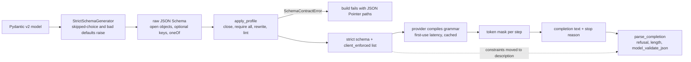

# Structured Output Contracts for LLM APIs: Compiling Pydantic v2 Models into Strict Constrained-Decoding JSON Schemas (additionalProperties: false, Supported Keywords)

> [!summary] Claim
> A Pydantic model is not a constrained-decoding contract until a compile step closes every object, requires every property, rewrites or rejects every keyword the decoder cannot enforce, and the client re-validates whatever the decoder was never told.

Part of [AI and LLM API Engineering](README.md) in [API Engineering](../README.md).

## TL;DR

- Mechanism: a constrained decoder compiles the JSON Schema into an automaton or grammar and masks the vocabulary at every step, so only schemas whose language it can compile are accepted, and only the keywords it compiles are enforced.
- Contract rule: send `additionalProperties: false` on every object and list every property in `required`, because an open object has no finite next-key mask and an optional key makes the state space depend on which keys were already emitted.
- Trap: a keyword the backend does not understand is either rejected with a `400`, silently ignored (JSON Schema says unknown keywords are annotations), or rewritten into the description by an SDK, and only the Pydantic model on the client enforces it in the last two cases.
- Portability fact: the keyword subset, the limits, and the treatment of unsupported keywords differ per backend `(as of 2026-11)`, so compile against an explicit `SchemaProfile` per target and fail the build on a violation instead of trusting the vendor to say no.
- When not to use it: open-ended maps, deep or unbounded recursion, per-request dynamic schemas that bust the compile cache, and business rules a schema cannot express; use a validate-and-repair loop or plain tool calls there.

## Mental model



The model feeds a Pydantic generator subclass that refuses to degrade silently, producing a raw schema that is valid JSON Schema but not a strict contract (open objects, optional keys, `oneOf` plus an OpenAPI `discriminator`).
`apply_profile` is the compile step: it closes objects, requires every property, rewrites what it can, and collects a `Violation` with a JSON Pointer for what it cannot, failing the build before any request is sent.
The surviving schema goes to the provider, which compiles it to a grammar once (first-use latency, then cached) and applies a token mask at every decoding step.
The decoder can only enforce what it was given, so the dotted arrow carries the constraints the compile step moved into a description to the client, and `parse_completion` checks the stop reason first and then re-validates the whole text against the original Pydantic model.

## How it works

### Why the decoder needs a subset

Constrained decoding masks the logits of tokens that would leave the target language, which means the language must be compiled into something a per-token step can query cheaply.
The Outlines paper reformulates guided generation as "transitions between the states of a finite-state machine" for "regular expressions and context-free grammars", built on "an index over a language model's vocabulary", and says it "adds little overhead to the token sequence generation process" (arXiv 2307.09702, abstract); JSON Schema support is a library feature layered on that regex path, not a claim of the abstract.
XGrammar executes a context-free grammar instead: it splits the vocabulary into "context-independent tokens that can be prechecked and context-dependent tokens that need to be interpreted during runtime" and keeps a persistent stack for the latter, claiming "up to 100x speedup over existing solutions" (arXiv 2411.15100, abstract; the benchmark is the authors' own).
Both designs make the same demand of a schema: the structure must compile to a finite machine or a grammar, and every keyword must have an automaton form.
Regex backreferences have no such form, because the language they describe is not regular.
Lookaround and `\b`/`\B` are a different case: they do not leave the regular languages in theory, but the documented subsets exclude them anyway (Anthropic lists backreferences, lookahead/lookbehind, and `\b`/`\B` as unsupported, and llguidance says "lookarounds not supported"), so treat them as unsupported in practice.
Unbounded structures (open maps, free recursion) are either unsupported or expensive.

JSON Schema itself gives a decoder no obligation to enforce anything.
"Unknown keywords SHOULD be treated as annotations" (JSON Schema 2020-12 core Section 4.3.1) and "Implementations SHOULD treat keywords they do not support as annotations" (core Section 6.5), so an engine that ignores `minimum` is conformant.
`format` is an annotation by default: "Implementing support for the Format-Assertion vocabulary is OPTIONAL" (validation Section 7.1), and under the Format-Annotation vocabulary an implementation that also asserts `format` "MUST provide options to enable and disable such evaluation and MUST be disabled by default" (validation Section 7.2.1).
`pattern` "SHOULD be a valid regular expression, according to the ECMA-262 regular expression dialect", and "regular expressions are not implicitly anchored" (validation Section 6.3.3).
The json-schema.org pages for `2020-12` serve draft-bhutton-json-schema-01 and draft-bhutton-json-schema-validation-01 (both published 16 June 2022, the 2020-12 patch release), and the section numbers and quotes here are from that text.

### The strict shape: closed objects, every property required

A decoder that emits an object must decide, after each value, which key may come next.
With `additionalProperties: false` and a fixed property list the next-key set is finite and known, and `allowed_next_keys` models exactly that (below).
With the keyword absent, any extra property is valid, so the next key is an arbitrary string and no finite mask exists; the lab shows the raw Pydantic schema accepting `{"extra": 1}` while the compiled one rejects it.
llguidance states the ordering rule outright: "`properties` - order of properties is fixed to the order in schema" (llguidance docs/json_schema.md), OpenAI says "outputs will be produced in the same order as the ordering of keys in the schema" (OpenAI structured outputs guide, "Key ordering"), and llguidance enforces uniqueness only for keys listed in `properties`: "for properties specified with `additionalProperties` or `patternProperties`, the grammar does not enforce unique keys".
RFC 8259 only says "The names within an object SHOULD be unique" and "When the names within an object are not unique, the behavior of software that receives such an object is unpredictable" (RFC 8259 Section 4), so a closed key set also removes a duplicate-key ambiguity.

"Every property required" is the OpenAI rule: "all fields or function parameters must be specified as `required`", optional fields are emulated "by using a union type with `null`", and "`additionalProperties: false` must always be set in objects" (OpenAI structured outputs guide, supported schemas).
Anthropic requires `additionalProperties` "must be set to `false` for objects" and its SDK adds it "to all objects" (Anthropic structured outputs docs, "JSON Schema limitations" and "How SDK transformation works"), but it does not require every property: it allows 24 optional parameters per request and warns that "Each optional parameter roughly doubles a portion of the grammar's state space".
Gemini accepts open objects (`additionalProperties` "Can be a boolean or a schema") and says "Optional properties, `enum` values, and `anyOf` branches multiply the branching paths in the output grammar" (Gemini structured output docs, "Simplifying complex schemas").
llguidance documents a related constraint: `minProperties` and `maxProperties` are "only supported when everything defined in `properties` is `required`" (llguidance docs/json_schema.md), which is the same lesson: a fully required object is the cheapest object to compile.

Consequence for the declaration order of a model: because the order is fixed to schema order, the field order in the Pydantic class is the order in which the model must produce the values.
Anthropic documents one exception that only the required-all shape removes: "required properties appear first, followed by optional properties", and "If property order in the output is important to your application, mark all properties as required" (Anthropic structured outputs docs, "Property ordering").
Put a short `evidence` or `rationale` field before the `verdict` field it supports; a verdict declared first is committed before any supporting text is generated.
Keep that field short and factual: Anthropic warns that "A property that asks for the model's thinking or step-by-step reasoning might lead to a `reasoning_extraction` refusal" and says to "Ask for a short explanation instead" (Anthropic structured outputs docs, "Refusals"), so a field named and described as chain-of-thought is a refusal trigger there, not a quality lever.
Pydantic preserves field declaration order in `properties` because `GenerateJsonSchema.sort` skips sorting when `parent_key` is `properties` or `default` (pydantic 2.14.3 pydantic/json_schema.py, GenerateJsonSchema.sort).

### What Pydantic emits and where the gaps are

All of the following was read in the pinned release, pydantic 2.14.3 with pydantic-core 2.50.4.

- `required` comes from `GenerateJsonSchema.field_is_required`: in validation mode a model field is required unless its core schema type is `default` (`field['schema']['type'] != 'default'`; pydantic/json_schema.py, GenerateJsonSchema.field_is_required), so every field with a default is optional in the raw schema and carries a `default` key from `GenerateJsonSchema.default_schema`.
- `_named_required_fields_schema` emits `required` only when at least one field is required, so an all-default model has no `required` key.
- `additionalProperties` is set only from `ConfigDict(extra=...)`: `forbid` gives `false`, `allow` gives `true`, and the default `ignore` leaves the key absent (pydantic/json_schema.py, GenerateJsonSchema._update_class_schema).
- A `dict[str, int]` field becomes `{"type": "object", "additionalProperties": {"type": "integer"}}`, and `dict[str, Any]` becomes `additionalProperties: true` (pydantic/json_schema.py, GenerateJsonSchema._common_dict_schema, which `dict_schema` delegates to), an open map that a strict profile cannot accept.
- A discriminated union becomes `oneOf` plus an OpenAPI `discriminator` object with `propertyName` and `mapping` (pydantic/json_schema.py, GenerateJsonSchema.tagged_union_schema); the source comment calls the `discriminator` key "OpenAPI stuff".
- `Optional[T]` becomes `anyOf: [T, {"type": "null"}]` (pydantic/json_schema.py, GenerateJsonSchema.nullable_schema), or `{"type": [..., "null"]}` when `union_format='primitive_type_array'` and every member is a bare `{"type": ...}` primitive with no other key, not even a `title` (GenerateJsonSchema.get_union_of_schemas).
- `ignored_warning_kinds` defaults to `{'skipped-choice'}`, so a union member with no JSON Schema form is dropped without a warning (`union_schema` and `tagged_union_schema` call `emit_warning('skipped-choice', ...)`); a non-JSON-serializable default emits a `non-serializable-default` `PydanticJsonSchemaWarning` and the `default` is omitted (GenerateJsonSchema.default_schema, emit_warning, render_warning_message).
  The third kind in `JsonSchemaWarningKind` is `skipped-discriminator`.
- The default `regex_engine` is `rust-regex`, "non-backtracking" and without all regex features (pydantic/config.py, ConfigDict.regex_engine), and in the lab a lookahead `pattern` under that engine fails at class creation with `error: look-around, including look-ahead and look-behind, is not supported`.
- `model_json_schema(by_alias, ref_template, schema_generator, mode, union_format=...)` accepts the generator class, which is how the compile step substitutes its subclass (pydantic/main.py, BaseModel.model_json_schema).

The `skipped-choice` case is the sharp one.
In the lab, `action: int | Callable[[int], int]` produces `{"title": "Action", "type": "integer"}` from plain `model_json_schema()` under `warnings.simplefilter("error")` with no warning raised, so the decoder would be told the field is only an integer while the Pydantic model still accepts a callable.
`StrictSchemaGenerator` clears `ignored_warning_kinds` and turns `emit_warning` into a `SchemaContractError`, so both that case and the non-serializable default fail the build.

### The compile pass, keyword by keyword

`apply_profile` rebuilds the schema bottom-up through `iter_subschemas`, which visits only schema-valued keywords (`items`, `additionalProperties`, `anyOf`, `properties` values, `$defs` values and so on).
That detail matters: `enum`, `const`, `default`, and the names inside `properties` are data, so a model with fields called `title`, `default`, `minimum`, and `pattern` must compile unchanged, and the lab test `test_fields_named_like_keywords_are_not_treated_as_keywords` pins this.

Each keyword gets one of three treatments from the `SchemaProfile`:

| Treatment | Effect on the wire schema | Who enforces it | Source of the pattern |
|---|---|---|---|
| `keep` | Left in place | The backend decoder | Backends that compile the keyword |
| `describe` | Removed, appended to `description` as `(constraints: maximum=5, minimum=1)` | The client, via the Pydantic model | Anthropic SDK transform: unsupported constraints are removed and added to the field description (Anthropic structured outputs docs) |
| `reject` | Kept, and a `constraint-rejected` `Violation` is raised | Nobody; the build fails | Strictest choice for an unknown backend |

Structural rewrites that do not depend on a profile's treatment table:

- `oneOf` becomes `anyOf` when `convert_one_of` is set; llguidance converts `oneOf` to `anyOf` "only when provably equivalent" and offers `coerce_one_of` otherwise (llguidance docs/json_schema.md), and the Anthropic page lists "`oneOf` (use `anyOf` instead)" as not supported.
  The rewrite is exact for a discriminated union, whose branches are disjoint on the tag, and widens the language when branches overlap (`anyOf` accepts an instance matching several branches, `oneOf` does not), so review it for hand-written `oneOf` schemas.
- The OpenAPI-only `discriminator` is dropped, since it is not a JSON Schema keyword and no decoder compiles it.
- `default` is dropped because the field is now required and the model must emit a value; a default cannot make a required property optional.
- `additionalProperties: false` is added to any object with `properties` and no explicit value, and any other value (`true`, or a schema from a `dict` field or `extra='allow'`) is an `open-object` violation, never a silent rewrite, because closing an object the model author declared open changes what the client accepts.
- `required` is set to `list(properties)`, preserving declaration order.
- A `type: object` node without `properties` (a bare `dict`) is an `open-object` violation.

Checks on the whole document, after the rewrite:

- Reference cycles through `#/$defs/Name` or `#` (`find_ref_cycle`) raise `recursive-ref` unless the profile allows recursion; a `$ref` that is not `#` or `#/$defs/...` raises `unresolved-ref`.
- `root_must_be_object` requires the (reference-resolved) root to have `type: object` and not be `anyOf`.
- Budgets: total property count, object nesting depth (references expanded once per path), and total enum values, each against the profile.
- Regex scan: `unsupported_regex_features` flags lookahead, lookbehind, backreferences, and `\b`/`\B`, skipping escaped characters and character classes; the list is exactly the Anthropic "Not supported" regex list, and only the backreference is non-regular in theory.
- `format` outside the profile's allow-list raises `unsupported-format`; pydantic emits `format: binary` for `bytes`, which is not on any list read here.

### What the three vendors and one engine documented

The table records what each source says `(as of 2026-11)`; every cell was checked against the full page text (the OpenAI and Anthropic `.md` renderings, the Gemini page source, and the raw llguidance Markdown).

| Topic | OpenAI | Anthropic | Gemini | llguidance |
|---|---|---|---|---|
| Entry point | `text.format` with `type: "json_schema"`, `strict: true`, `schema` (Responses API) | `output_config.format` with `type: "json_schema"`; `client.messages.parse(..., output_format=Model)` in Python | `client.interactions.create(..., response_format={"type": "text", "mime_type": "application/json", "schema": Model.model_json_schema()})` | Grammar built from a schema by the converter |
| All properties required | Yes; optional via a union with `null`; `additionalProperties: false` on every object | `additionalProperties` must be `false`; optional properties allowed, 24 per request | Not required; `additionalProperties` may be a boolean or a schema | Not required; order is `properties`, then `required`, then `additionalProperties` keys |
| Constraint keywords | `pattern`, nine `format` values, `minimum`/`maximum`/`exclusive*`/`multipleOf`, `minItems`/`maxItems`; `allOf`, `not`, `if`/`then`/`else`, `dependent*` unsupported, and an unsupported schema with `strict: true` returns an error; `uniqueItems` not mentioned | `minimum`, `maximum`, `multipleOf`, `minLength`, `maxLength` unsupported (`400`), SDK moves them to the description; `pattern` without backreferences, lookaround, `\b`/`\B`; `minItems` only 0 or 1 | `minLength`, `maxLength`, `minProperties`, `maxProperties`, `uniqueItems`, `contains` "strips and ignores" rather than rejecting; `minItems`/`maxItems` enforced | `pattern` "lookarounds not supported"; `minProperties`/`maxProperties` only when all properties are required |
| Recursion | Supported, `"$ref": "#"` and `$defs` | "Recursive schemas" not supported | Make the recursive reference optional or nullable | "external/remote refs unsupported" |
| Compile cost | "the first request you make with any schema will have additional latency" | First-use latency; grammars "cached for 24 hours from last use"; 180 s compilation timeout | Compiled to a state machine with limits on "total states, branching paths, and nesting depth"; `400 INVALID_ARGUMENT` when exceeded | "successfully processed schemas up to 4 MB in size" |

### Failure channels after the mask

A mask guarantees syntax and schema membership of the tokens it governs, and nothing else.
OpenAI states the boundary: "Structured Outputs constrains completed, non-refusal model output to your supplied JSON Schema", and "Your application still needs to handle refusals, incomplete responses, and API errors, and validate any business rules that the schema does not express" (OpenAI structured outputs guide, introduction).
The same page says a mismatch "can happen in the case of a refusal" or "if for example you reach a max tokens limit and the response is incomplete", and its TypeScript sample checks `response.incomplete_details?.reason === "max_output_tokens"` and a content item with `type === "refusal"`.
The Anthropic equivalents are `stop_reason: "refusal"` (a `200`, billed, and "The output might not match your schema because the refusal message takes precedence over schema constraints") and `stop_reason: "max_tokens"` ("The output might be incomplete and not match your schema").
Anthropic adds a channel that has no stop reason at all: "Structured outputs don't guarantee the capitalization of string `enum` and `const` values", and such a response "completes normally, with no error and no special `stop_reason`" (Anthropic structured outputs docs, "Invalid outputs").
`parse_completion` therefore checks the normalized stop reason first and only then calls `model_validate_json`, so a truncated body that happens to be valid JSON is still reported as truncation.

## Numbers and limits

| Number | Value | Source and confidence |
|---|---|---|
| Object properties across a schema (OpenAI) | 5,000 | OpenAI guide: "up to 5000 object properties total, with up to 10 levels of nesting", `(as of 2026-11)` |
| Nesting depth (OpenAI) | 10 levels | Same sentence |
| Total string length of property names, definition names, enum values, and const values (OpenAI) | 120,000 characters | OpenAI guide, limits |
| Enum values across a schema (OpenAI) | 1,000 | OpenAI guide: "up to 1000 enum values across all enum properties" |
| Total enum string length for one string enum with more than 250 values (OpenAI) | 15,000 characters | OpenAI guide, limits |
| Strict tools per request (Anthropic) | 20 | Anthropic docs, complexity limits table; non-strict tools do not count |
| Optional parameters per request (Anthropic) | 24 | Same table: "across all strict tool schemas and JSON output schemas" |
| Parameters with union types (Anthropic) | 16 | Same table: `anyOf` or type arrays such as `["string", "null"]`, "especially expensive because they create exponential compilation cost" |
| Compilation timeout (Anthropic) | 180 seconds | Anthropic docs, complexity limits; above internal grammar-size limits a `400` "Schema is too complex for compilation" |
| Compiled-grammar cache lifetime (Anthropic) | 24 hours from last use | Anthropic docs, "Grammar compilation and caching" |
| Largest schema llguidance reports processing | 4 MB | llguidance docs/json_schema.md |
| Right-recursive grammar rules hit parser item limits | "after 100-1000 repetitions" | llguidance docs/syntax.md, "Recursive rules"; a rough threshold, not a hard limit |
| XGrammar claimed speedup over prior engines | up to 100x | arXiv 2411.15100 abstract, authors' own benchmark |
| Lab: tests, wall time | 37 passed in 0.39 s | Measured by the reviewer: `uv run --frozen pytest ...` from `labs/`, CPython 3.14.6, macOS 27.3 arm64 (Darwin 27.3.0); the drafter's run showed 0.32 s, so treat wall time as noise |
| Lab: example schema size, raw / `OPENAI_STYLE` / `ANTHROPIC_STYLE` | 882 / 859 / 773 bytes | Measured with a throwaway script (not part of the lab): `len(json.dumps(schema, separators=(",", ":")))` of the `Ticket` schemas below, same machine; reproduced exactly by the reviewer |

All vendor figures are `(as of 2026-11)`.
Provider limits change often, and none of the vendor numbers above should be copied into code as constants without reading the current page.
The profile limits in the lab (`max_properties=5000`, `max_depth=10`, `max_enum_values=1000`) match the OpenAI guide `(as of 2026-11)`; they demonstrate the checks, and the lab does not model the 120,000 and 15,000 character limits.
The profiles simplify in two places: `OPENAI_STYLE` keeps `minLength` and `maxLength`, which the OpenAI guide's supported string list omits (it names only `pattern` and `format`) while its "For fine-tuned models, we additionally do not support" list names them and its base-model unsupported list names only composition keywords (re-read 2026-11-26), so a schema carrying them is accepted but the page never says the mask enforces the bound, which makes the profile an assumption to confirm per model; and `ANTHROPIC_STYLE` moves `pattern` into the description although the Anthropic API supports simple patterns.

## Portability

| Axis | Cell | Proof |
|---|---|---|
| CPython 3.14 | Lab passes: 37 tests | Reviewer ran pytest on CPython 3.14.6 (the workspace interpreter, `labs/.python-version` = `3.14`), macOS 27.3 arm64, not the matrix's 3.14.10; ruff, mypy, and pyright were clean in the drafter's run, and the reviewer reran only ruff on the lab file after a comment-only edit |
| CPython 3.12.16, 3.13.18, 3.15.2, 3.15.2t | Not run | Cross-version lab runs were paused by the user's instruction of 2026-11-11; the only version-dependent syntax is PEP 695 `def parse_completion[M: BaseModel]`, valid from 3.12 and the floor in `labs/pyproject.toml` (`requires-python = ">=3.12,<3.16"`) |
| pydantic 2.14.3 and pydantic-core 2.50.4 | Behavior in this note | Source read in the installed release and exercised by the lab |
| Other pydantic point releases | Not checked | `skipped-choice` default and `default_schema` behavior may differ; rerun the lab on upgrade |
| Pydantic `regex_engine` | `rust-regex` default rejects lookaround at class creation | pydantic/config.py, ConfigDict.regex_engine; lab test `test_pattern_violation_is_reported_at_the_field_pointer` opts into `python-re` |
| Anthropic, OpenAI, Gemini keyword subsets | Differ; see the vendor table | Vendor docs read in full text `(as of 2026-11)` |
| llguidance, XGrammar, Outlines | Different compile strategies (grammar with token mask, FSM index, CFG with persistent stack) | Papers and docs cited above |
| Uvicorn, Hypercorn, Granian; HTTP/1.1, HTTP/2, HTTP/3 | Not applicable | The lab has no HTTP surface and opens no sockets; the contract is a data structure |

## Worked example

The implementation is [implementation](../labs/src/api_labs/f21_ai_and_llm_api_engineering/structured_output_contracts.py) and the test is [test](../labs/tests/f21_ai_and_llm_api_engineering/test_structured_output_contracts_json_schema_subsets_for_constrained_decoding.py).
The lab models the documented rules as `SchemaProfile` values (`ANTHROPIC_STYLE`, `OPENAI_STYLE`, `CONSERVATIVE`); it is not a provider client and sends nothing.

Simplified excerpt of the generator, the part that turns silent degradation into a build failure:

```python
class StrictSchemaGenerator(GenerateJsonSchema):
    ignored_warning_kinds: set[JsonSchemaWarningKind] = set()  # noqa: RUF012

    def emit_warning(self, kind: JsonSchemaWarningKind, detail: str) -> None:
        raise SchemaContractError([Violation("", kind, detail)])
```

Simplified excerpt of the object pass, which closes objects and requires every property but refuses to close an object the author declared open:

```python
def shape(self, node: JsonObject, path: tuple[str, ...]) -> None:
    extra = node.get("additionalProperties", None)
    if node.get("type") == "object" and "properties" not in node:
        self.flag(path, "open-object", "object without 'properties' is an open map")
    if "properties" in node:
        if "additionalProperties" not in node:
            node["additionalProperties"] = False
        elif extra is not False:
            self.flag(path, "open-object", "additionalProperties must be false")
        names = list(node["properties"])
        if node.get("required") != names:
            node["required"] = names
```

The entry point and the client half, as they appear in the file:

```python
def compile_strict_schema(model: type[BaseModel], profile: SchemaProfile) -> CompiledSchema:
    """Generate the validation-mode schema for ``model`` and rewrite it into ``profile``."""
    raw = model.model_json_schema(schema_generator=StrictSchemaGenerator, mode="validation")
    return apply_profile(raw, profile)


def parse_completion[M: BaseModel](model: type[M], completion: Completion) -> M:
    """Trust a completion only after the stop reason and the full Pydantic model agree."""
    if completion.finish == "refusal":
        raise RefusalError("model refused; text is not schema-bound")
    if completion.finish == "length":
        raise TruncatedError("generation hit the token limit")
    try:
        return model.model_validate_json(completion.text)
    except ValidationError as exc:
        raise ContractViolationError([e["type"] for e in exc.errors()]) from exc
```

The model used for the captured output below (`Dog`, `Cat`, and `Ticket` are defined in the test file; the demo script was a throwaway):

```python
class Ticket(BaseModel):
    title: str = Field(min_length=1, max_length=80)
    priority: int = Field(default=3, ge=1, le=5)
    pet: Annotated[Dog | Cat, Field(discriminator="kind")]
    note: str | None = None
```

Excerpt of the output of one execution of a throwaway script on CPython 3.14.6, macOS 27.3 arm64 (Darwin 27.3.0), pydantic 2.14.3, reproduced line for line by the reviewer's own run:

```text
RAW required: ['title', 'pet'] | top-level additionalProperties: <absent>
OPENAI required: ['title', 'priority', 'pet', 'note'] | additionalProperties: False
OPENAI rewrites:
   /properties/priority: dropped 'default' (field is required)
   /properties/pet: dropped OpenAPI-only 'discriminator'
   /properties/pet: oneOf -> anyOf
   /properties/note: dropped 'default' (field is required)
   /$defs/Cat: added additionalProperties: false
   /$defs/Dog/properties/kind: dropped 'default' (field is required)
   /$defs/Dog: added additionalProperties: false
   /$defs/Dog: required = all properties
   : added additionalProperties: false
   : required = all properties
ANTHROPIC priority: {"type": "integer", "description": "(constraints: maximum=5, minimum=1)"}
Node/anthropic: [('', 'recursive-ref', 'Node -> Node')]
Handler: [('skipped-choice', 'Cannot generate a JsonSchema for core_schema.CallableSchema')]
['backreference', 'lookahead']
[] -> frozenset({'title'})
['title'] -> frozenset({'priority'})
['title', 'priority', 'pet', 'note'] -> frozenset()
raw -> None
```

The test command and its captured result, from `labs/` with `uv run --frozen`:

```text
$ uv run --frozen pytest tests/f21_ai_and_llm_api_engineering/test_structured_output_contracts_json_schema_subsets_for_constrained_decoding.py -q
.....................................                                    [100%]
37 passed in 0.39s
```

The 37 tests include a parametrized regex table of 12 cases.
Mutation testing of the tests was not run (lab checks paused by the user's instruction of 2026-11-11), so the claim that each test fails when its mechanism is removed is by construction and not demonstrated.

## Pitfalls

> [!warning] Sending `Model.model_json_schema()` straight to a strict endpoint
> Trigger: the raw schema is passed as the strict `json_schema`.
> Symptom: a `400` for a missing `additionalProperties: false`, or, on a lenient backend, open objects and optional keys (the lab's raw `Ticket` schema accepts `{"extra": 1}` and omits `priority`).
> Fix: compile with `compile_strict_schema` and send `CompiledSchema.schema`; assert in CI that no strict-endpoint call site bypasses it.

> [!warning] A union member that vanishes
> Trigger: `int | Callable[[int], int]`, or any union member Pydantic cannot express as JSON Schema.
> Symptom: the generated `anyOf` loses the branch with no warning because `skipped-choice` is ignored by default, so the decoder constrains the field to the remaining branches.
> Fix: use `StrictSchemaGenerator`, which raises on `skipped-choice` and `non-serializable-default`.
> No production incident is cited here; the failure is demonstrated in the lab, not reported from a postmortem.

> [!warning] A keyword the backend ignores
> Trigger: `Field(ge=1, le=5)` or `max_length` against a backend that ignores or strips that keyword.
> Symptom: output of `priority: 9` arrives with `stop` and valid JSON; the lab's `test_describe_treatment_moves_constraints_and_the_client_still_enforces_them` shows `model_validate_json` raising `less_than_equal` because the decoder was never told.
> Fix: always run `parse_completion` (full Pydantic validation) and treat `client_enforced` as the list of rules the decoder does not carry.
> Gemini documents exactly this: when `minLength`, `maxLength`, `minProperties`, `maxProperties`, `uniqueItems`, or `contains` are "emitted automatically by Pydantic's `Field(min_length=...)`", "the API automatically strips and ignores them during request normalization rather than returning an error" (Gemini structured output docs, "Limitations").

> [!warning] Open maps
> Trigger: a `dict[str, T]` field.
> Symptom: Pydantic emits `additionalProperties: {schema}`, the strict profile reports `open-object`, and the Anthropic docs warn that an SDK-sent `dict` field becomes an object with empty `properties` so "Claude can only return `{}` for it" (Anthropic structured outputs docs, Python SDK tab).
> Fix: model the map as `list[Entry]` with an explicit `key` and `value` pair, or a nested model when the keys are known.

> [!warning] Required means emitted
> Trigger: making a defaulted field required to satisfy the strict shape.
> Symptom: the model must produce a value for every field, so a rarely meaningful field costs tokens on every call and invites invented values.
> Fix: keep genuinely optional data as `T | None` (already `anyOf` with `null`, and emitted as `null`), and drop fields the task does not need; a default cannot make a field omittable in a required-only schema.
> On Anthropic every `T | None` field counts toward the 16 "Parameters with union types" per request, and every property left out of `required` counts toward the 24 optional parameters, so a wide model of nullable fields can hit a limit that neither OpenAI's rule nor the lab's profile models.

> [!warning] Field order is generation order
> Trigger: declaring `answer` before `reasoning`.
> Symptom: the answer token sequence is committed before any reasoning is generated, because properties are emitted in schema order (llguidance docs/json_schema.md; OpenAI guide, "Key ordering").
> Fix: declare a short supporting field first and make it required; the lab proves schema order equals declaration order, OpenAI and llguidance document emission in schema order, Anthropic keeps schema order except that "required properties appear first, followed by optional properties" (so an optional field declared first is emitted after every required one), and the Gemini page states no ordering rule.
> On Anthropic, name and describe it as a brief explanation, not step-by-step thinking, which "might lead to a `reasoning_extraction` refusal" (Anthropic structured outputs docs, "Refusals").

> [!warning] A discriminated union at the root
> Trigger: a root `Annotated[Dog | Cat, Field(discriminator=...)]` or a Zod discriminated union.
> Symptom: the root is a union (`oneOf` from Pydantic, `anyOf` after the rewrite), which the OpenAI-style profile rejects as `root-any-of`, mirroring the OpenAI rule "the root level object of a schema must be an object, and not use `anyOf`" (OpenAI structured outputs guide); the lab test proves the profile check, not the vendor's runtime behavior.
> Fix: wrap it in a root object with one field holding the union.

> [!warning] Dynamic schemas and the compile cache
> Trigger: building the schema per request, for example a per-tenant `Literal` of user-defined labels.
> Symptom: the OpenAI page says "the first request you make with any schema will have additional latency", and Anthropic caches compiled grammars "for 24 hours from last use" and invalidates the cache "if you change the JSON schema structure", so a schema that changes per request pays the compile cost every time.
> Fix: keep schemas static, key any cache on `structural_fingerprint` (it ignores `title` and `description`, never property names), and bound the number of distinct schemas per tenant.
> The fingerprint ignores descriptions for cache-keying only; a changed description changes model behavior, so do not treat it as a no-op rollout.

## Security and robustness

- Schema membership is not truth: a field typed `enum` can still carry the wrong member, and free-form strings reach downstream SQL, HTML, or shell sinks, which is OWASP API10:2023 unsafe consumption; see [[Improper-Inventory-Management-API9-2023-and-Unsafe-Consumption-of-APIs-API10-2023]].
- A closed object also keeps the model from emitting fields you never declared, the output-side analogue of mass assignment; see [[Defeating-BOPLA-and-Mass-Assignment-API3-2023-Strict-Input-Output-Schemas]].
- Accepting a client-supplied schema (an "extract into my schema" product) hands the caller control over compile cost, so lint it with `apply_profile` first and cap properties, depth, enum values, and bytes; see [[Unrestricted-Resource-Consumption-API4-2023-Payload-Depth-and-Limit-Guards]].
- llguidance allows any whitespace inside objects by default (`whitespace_flexible` defaults to `true`) and offers `whitespace_flexible: false` for compact JSON (llguidance docs/json_schema.md); a decoder that may emit unbounded whitespace can spend a token budget on it until `max_tokens`, which is an inference from that default, not a measured result.
- Always set `max_tokens` and handle `length`: a truncated body is not a smaller valid object, and `parse_completion` raises `TruncatedError` before parsing.
- Treat a refusal body as untrusted text that need not match the schema (OpenAI and Anthropic both say so), and redact it before logging; see [[Structured-Log-Redaction-and-Preventing-PII-and-Token-Leaks]].
- Duplicate keys are the parser's decision (RFC 8259 Section 4), so validate with the same parser the service uses everywhere; `model_validate_json` is a single-pass parse and validate, see [[Single-Pass-JSON-Validation-Model-Validate-JSON-vs-JSON-Loads]].
- Make the client model as strict as the schema: `ConfigDict(extra="forbid")` on the Pydantic model, because the lab shows a default-config `Ticket` silently accepting an extra key that the compiled schema forbids.
- Prompt injection can steer values within the schema; constrained decoding does not defend against it, see [[AI-Gateway-Engineering-Semantic-Caching-Provider-Fallbacks-and-Guardrail-Pipelines]].

## The principal's view

Make the Pydantic model the single source of truth for three artifacts: the provider schema, the client validator, and the OpenAPI component, and put the compile step in CI so a model change that no longer fits a target profile fails a pull request with a JSON Pointer, not a production `400`.
Own the profiles in a platform library, because the keyword subsets and limits are vendor facts that change on the vendor's schedule `(as of 2026-11)`, and keep one profile per supported backend so a gateway can compile the same model for each (see [[AI-Gateway-Engineering-Semantic-Caching-Provider-Fallbacks-and-Guardrail-Pipelines]]).
Check the compiled schema and its `structural_fingerprint` into the repository and diff it in review with the same tooling as any other contract; see [[Breaking-Change-Detection-and-Semantic-OpenAPI-Diffing]].

The trade-off is lock-in to a lowest-common-denominator schema: the strict shape drops numeric bounds, recursion, and open maps that the model class could express, and each dropped rule moves to client validation and a retry path that costs tokens and latency.
Choose a different mechanism when the structure is open-ended or deeply recursive, when a rule must hold before the response is returned and cannot be retried, or when schemas are generated per request; then use tool calls with a validator and a bounded repair loop, or a grammar-capable self-hosted engine where you control the keyword set.
Name the failure ownership explicitly: the decoder guarantees syntax and schema membership, the client guarantees business rules, and the gateway guarantees refusal and truncation handling, so no layer assumes another did its job.

## Interview questions

> [!question] L5: Why do strict structured-output endpoints require `additionalProperties: false` and every property in `required`?
>
> > [!success]- Answer
> > The decoder masks the vocabulary at each step, so it needs a finite, known set of allowed next keys.
> > With the keyword absent, any extra property is valid and the next key is an arbitrary string, so no finite mask exists.
> > A fixed property list in schema order with every key required makes the object a simple sequence of states.
> > OpenAI states both rules ("all fields or function parameters must be specified as `required`" and "`additionalProperties: false` must always be set in objects"), llguidance documents the fixed order, and Anthropic requires `additionalProperties: false` but allows up to 24 optional properties, each of which "roughly doubles a portion of the grammar's state space".
> >
> > Follow-up: How do you represent a field that may be absent under this rule?

> [!question] L5: When a field is `priority: int = Field(ge=1, le=5)`, the backend strips numeric bounds, and the model returns `priority: 9`, does your service accept it?
>
> > [!success]- Answer
> > It must not, and it will not if you call `model_validate_json` on the original Pydantic model.
> > The decoder was never told the bound, so the output is valid JSON for the sent schema.
> > The lab's `describe` treatment records `(constraints: maximum=5, minimum=1)` in the description and lists the pointer in `client_enforced`, and `parse_completion` raises `ContractViolationError` with `less_than_equal`.
> >
> > Follow-up: What do you do on that error: retry, repair, or fail?

> [!question] L5: What does Pydantic do with `action: int | Callable[[int], int]` when generating a JSON Schema, and why is that dangerous here?
>
> > [!success]- Answer
> > It drops the `Callable` branch and returns `{"title": "Action", "type": "integer"}` without a warning, because `GenerateJsonSchema.ignored_warning_kinds` defaults to `{'skipped-choice'}`.
> > The decoder is then told the field is an integer while the model type still accepts the dropped branch.
> > `StrictSchemaGenerator` clears the ignore set and raises on `emit_warning`.
> >
> > Follow-up: Which other generator warning kind can silently change the schema?

> [!question] L6: Predict the output of `unsupported_regex_features(r"(?=a)(a)\1")` and explain each element.
>
> > [!success]- Answer
> > It returns `['backreference', 'lookahead']`.
> > `(?=a)` is a lookahead and `\1` is a backreference; the backreference describes a non-regular language, and the lookahead, though regular in theory, is outside what DFA-style engines and the documented vendor subsets accept (Anthropic lists both as not supported).
> > The scan is escape-aware and skips character classes, so `[(?=]` and `\\1` (an escaped backslash then `1`) return `[]`.
> > The result is sorted and deduplicated, which is why the order is alphabetical and not by position.
> >
> > Follow-up: Why does a `Field(pattern=r"(?=A)\w+")` model fail at class creation in Pydantic unless you set `regex_engine="python-re"`?

> [!question] L6: Debug this API: a service passes `Ticket.model_json_schema()` as a strict `json_schema` and gets a `400` (or, on a lenient provider, responses that omit `priority` and carry extra keys), so what is wrong and how do you fix it?
>
> > [!success]- Answer
> > The raw schema has no `additionalProperties` (default `extra='ignore'` leaves it absent), `required` lists only `title` and `pet` because defaulted fields are optional, `priority` and `note` carry `default`, and `pet` is `oneOf` plus an OpenAPI `discriminator`.
> > OpenAI requires `additionalProperties: false` on every object and every field in `required`, and returns an error for an unsupported schema under `strict: true`; Anthropic also returns a `400` for `oneOf`; a lenient validator accepts `{"extra": 1}` and a missing `priority`.
> > Compile with `compile_strict_schema(Ticket, profile)`, which closes objects, requires all four properties, drops `default` and `discriminator`, and turns `oneOf` into `anyOf`.
> > Also set `extra="forbid"` on the model so the client matches.
> >
> > Follow-up: Which rewrites would you refuse to do automatically, and why?

> [!question] L6: Why is the field order in a Pydantic model part of the API contract for structured output?
>
> > [!success]- Answer
> > Pydantic keeps declaration order in `properties` and `required`, llguidance fixes property order to schema order, and OpenAI says "outputs will be produced in the same order as the ordering of keys in the schema".
> > The model therefore generates fields in declaration order, so a verdict declared before its rationale is committed before the rationale exists.
> > Anthropic emits required properties before optional ones, so the order guarantee there holds only when every property is required.
> > Reordering fields changes behavior with no type change, so treat it as a contract change and review it.
> >
> > Follow-up: How would you test that an order change is caught in CI?

> [!question] L7: Design the compile step for a gateway that serves the same model to three providers with different keyword subsets.
>
> > [!success]- Answer
> > Keep one `SchemaProfile` per backend with an allowed-keyword set, a per-keyword treatment (`keep`, `describe`, `reject`), and budgets, and compile the same Pydantic model once per profile at build time.
> > Fail the build on any `Violation`, check in the compiled schema and its structural fingerprint, and diff them in review.
> > At runtime route by profile, always run full Pydantic validation, and map `refusal` and `length` stop reasons to typed errors before parsing.
> > Keep vendor limits as data, dated `(as of 2026-11)`, and re-verify them against the vendor page when they change.
> >
> > Follow-up: How do you detect that a vendor changed its subset without a deploy failing?

> [!question] L7: When the decoder accepted your schema and the response is `stop` with valid JSON yet the data is wrong, which failure channels remain?
>
> > [!success]- Answer
> > Constraints that were stripped or ignored and never re-validated, business rules a schema cannot express, enum members that are valid but wrong, and values steered by prompt injection.
> > Refusals and truncation are the other two channels, and both can produce text that is not schema-bound, so check the stop reason before parsing.
> > Enum casing is not guaranteed on at least one backend: Anthropic says it may return a value "that differs from your schema only in capitalization" with "no special `stop_reason`", and advises comparing enum values case-insensitively and avoiding values that differ only in capitalization.
> >
> > Follow-up: Where do you put the business-rule validation so it is shared with the non-LLM code path?

> [!question] L7: What is right and what is wrong with keying the compile cache on a schema hash that ignores `description` changes?
>
> > [!success]- Answer
> > Ignoring `title` and `description` is right for a backend that caches by structure, as Anthropic does ("invalidated if you change the JSON schema structure"; "Changing only `name` or `description` fields does not invalidate the cache"), and it avoids cold-compile storms from wording edits.
> > It is wrong to treat a description edit as behavior-neutral, because descriptions are model-visible and the Anthropic SDK moves constraints into them; rollouts of description changes still need evals.
> > The lab's `structural_fingerprint` strips annotations only from schema nodes, so a property named `description` still changes the hash, which a naive recursive strip would get wrong.
> >
> > Follow-up: What do you do about per-tenant schemas that make the cache hit rate near zero?

## Related

Prerequisites: [[Token-Aware-Rate-Limiting-Pre-Flight-Reservation-and-Post-Stream-Reconciliation]]

Next: [[Streaming-Partial-JSON-Validation-in-Pydantic-v2-Experimental-Allow-Partial]]

See also: [[JSON-Schema-Generation-Internals-and-GenerateJsonSchema]], [[JSON-Schema-2020-12-Core-and-Validation-Vocabularies]], [[JSON-Schema-Composition-AllOf-AnyOf-OneOf-and-UnevaluatedProperties]], [[Polymorphism-and-Discriminators-in-OpenAPI-and-JSON-Schema]], [[Recursive-Models-Forward-References-and-Cyclic-Reference-Guard]], [[Annotated-Constraints-Field-Metadata-and-Custom-Types]], [[Discriminated-Unions-Tag-and-Callable-Discriminator-Dispatch]], [[Single-Pass-JSON-Validation-Model-Validate-JSON-vs-JSON-Loads]], [[Model-Context-Protocol-MCP-Architecture-JSON-RPC-Transports-and-Tool-Contracts]], [[Designing-Agent-Friendly-APIs-AXI-Principles-Token-Efficiency-and-Next-Step-Hints]], [[Streaming-LLM-Token-APIs-SSE-Framing-Heartbeats-and-Mid-Stream-Errors]], [[AI-Gateway-Engineering-Semantic-Caching-Provider-Fallbacks-and-Guardrail-Pipelines]], [[Batch-and-Asynchronous-Inference-APIs-JSONL-Uploads-and-LRO-Completion]], [[Breaking-Change-Detection-and-Semantic-OpenAPI-Diffing]]

- Lab: `labs/tests/f21_ai_and_llm_api_engineering/test_structured_output_contracts_json_schema_subsets_for_constrained_decoding.py`

## Further reading

- [OpenAI structured outputs guide](https://developers.openai.com/api/docs/guides/structured-outputs): the strict-mode contract, refusal and incomplete-response handling, and first-request schema latency.
- [Anthropic structured outputs](https://platform.claude.com/docs/en/build-with-claude/structured-outputs): `output_config.format`, and the SDK transform that moves unsupported constraints into descriptions.
- [Gemini structured output](https://aistudio.google.com/docs/structured-output): a third subset, with the guidance to make recursive references optional.
- [llguidance JSON Schema support](https://raw.githubusercontent.com/guidance-ai/llguidance/main/docs/json_schema.md): the most explicit statement of which keywords a grammar-based engine compiles, and the fixed property order.
- [llguidance grammar syntax](https://github.com/guidance-ai/llguidance/blob/main/docs/syntax.md): recursion, repetition, and rollback costs of grammar execution.
- [XGrammar paper, arXiv 2411.15100](https://arxiv.org/abs/2411.15100): context-independent token precheck and the persistent stack.
- [Outlines paper, arXiv 2307.09702](https://arxiv.org/abs/2307.09702): the finite-state-machine vocabulary index behind guided generation.
- [JSON Schema 2020-12 core](https://json-schema.org/draft/2020-12/json-schema-core): unknown keywords as annotations, `$ref`, and `$defs`.
- [JSON Schema 2020-12 validation](https://json-schema.org/draft/2020-12/json-schema-validation): `required`, `pattern`, and `format` semantics.
- [RFC 8259](https://www.rfc-editor.org/rfc/rfc8259.html): JSON grammar, string escaping, and the unique-names caveat.
