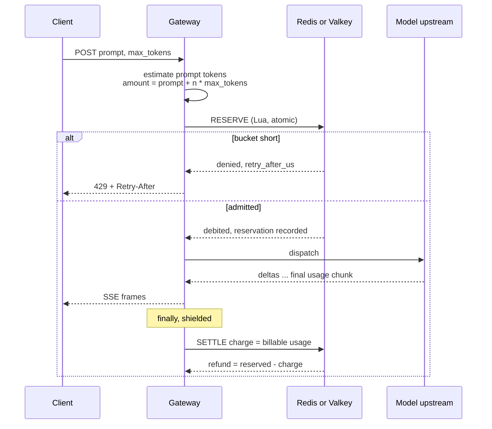

# Token-Per-Minute (TPM) Rate Limiting for AI APIs: Pre-Flight max_tokens Reservation and Post-Stream Actual Usage Reconciliation in Redis/Valkey

> [!summary] Claim
> An LLM gateway cannot know what a request costs until the model has finished, so the only limiter that is both safe and fair debits the worst case (`prompt estimate + max_tokens`) atomically before dispatch and settles to the provider's real usage on every exit path of the stream, including the ones where the client is already gone.

Part of [AI and LLM API Engineering](README.md) in [API Engineering](../README.md).

## TL;DR

- Mechanism: one Lua script per phase against one token bucket per tenant; `RESERVE` debits `prompt estimate + n * max_tokens` and writes a reservation record keyed by request id, and `SETTLE` deletes that record and returns `reserved - charge` to the bucket, where `charge` is the provider's final usage (or what was observed if no usage arrived).
- Contract rule: a request that does not fit right now is `429` with `Retry-After` as integer seconds rounded up (RFC 9110 Section 10.2.3), a request larger than the whole bucket can never succeed and must be a non-retryable `4xx`, and every `x-ratelimit-*` header sent with a stream is stale the moment `http.response.start` is written.
- Trap: settling inside the body generator's `finally` defers it to garbage collection, and awaiting the settle inside a cancelled scope can lose it, leaving the reservation charged in full until it expires; settle in the frame that owns the request, under a shielded cancel scope, and make `SETTLE` idempotent.
- Portability fact: the scripts use only Lua 5.1 features that Redis and Valkey share, declare both keys in `KEYS`, and put them in one hash slot with a `{tenant}` tag; Lua numbers come back as truncated integers, so the scripts keep every value an integer below 2^53 (micro-tokens).
- When not to use: when the upstream provider already enforces your quota and you only need to propagate its `429`, when cost is flat per request, or when the real bottleneck is concurrency (GPU slots, KV cache), where a concurrency limit is the right tool and tokens are a proxy.

## Mental model



The gateway turns an unknowable cost into a bounded one: before any GPU time is spent it takes the maximum the request could consume out of the tenant's bucket, so concurrent requests cannot jointly overdraw it.
It then runs the stream and, in a `finally` that no cancellation can interrupt, tells the store what was really consumed, and the unused part of the reservation flows back into the bucket.
The two arrows into Redis are two separate atomic scripts, not a transaction: between them the tokens are "in flight", the reservation record is the only proof that they are owed back, and its TTL is what bounds the damage when the second arrow never happens.

## How it works

### Why two phases

Three things are known at three different times.
The prompt is known before dispatch, but only as an estimate unless the gateway runs the model's tokenizer.
The completion length is unknown until the stream ends, but it is bounded above by `max_tokens`, which the client sent.
The exact usage is known only when the provider says so, in a final usage chunk or at the end of a non-streaming body.

A limiter that counts only after the response (post-hoc) is blind while requests are in flight.
Kong's AI Rate Limiting Advanced plugin documents exactly this: "Because token usage is only known after the model responds, concurrent requests can exceed the configured limit" and "The cost for the AI Proxy or AI Proxy Advanced is only reflected during the next request" (Kong plugin documentation, Known limitations, as of 2026-11).
A limiter that only debits the maximum and never gives it back (pre-flight only) is safe but unfair: a client that asks for `max_tokens: 4096` and receives 40 tokens pays for 4096, which is why OpenAI's guide says "Try to set the `max_tokens` value as close to your expected response size as possible" (OpenAI rate limit guide, Reduce the `max_tokens` to match the size of your completions, as of 2026-11).
Reserve-then-reconcile keeps the safety of the first and the fairness of the second.
LiteLLM states the same design in one sentence: "TPM limits are enforced by reserving tokens before the call and reconciling against real usage after it" (LiteLLM proxy docs, Estimated Output Tokens, as of 2026-11).

### What the providers and gateways actually do (as of 2026-11)

The vendors disagree, and the disagreement is the main reason a gateway needs its own limiter instead of assuming the upstream's numbers apply to its tenants.

| System | Pre-request charge | Post-request correction | Source |
|---|---|---|---|
| Anthropic Messages API | input tokens estimated at the start of the request, adjusted during it; `max_tokens` "does not factor into OTPM" | output tokens "evaluated in real time as output tokens are produced"; cache reads do not count toward ITPM | Anthropic rate limits page, Cache-aware ITPM |
| OpenAI API | "Your rate limit is calculated as the maximum of `max_tokens` and the estimated number of tokens based on the character count of your request" | the guide does not describe a refund | OpenAI rate limit guide, Reduce the `max_tokens` to match the size of your completions |
| Azure OpenAI quota | none documented: "Token rate-limit calculations use actual input and generated tokens rather than the maximum output-token value" | "Setting a higher output-token limit doesn't reserve that number of tokens against the TPM limit" | Azure quota page, Understanding rate limits |
| Azure API Management `llm-token-limit` | `estimate-prompt-tokens="true"` estimates prompt tokens in advance; with `false`, "Prompts may be sent to the backend even when the limit is exceeded" | for `stream: true`, "prompt tokens are always estimated" and "Completion tokens are also estimated" | APIM `llm-token-limit` policy page |
| LiteLLM proxy | reserves `max_tokens` or `default_estimated_output_tokens` or a static built-in estimate | reconciles to real usage; "post-request accounting stays best effort" | LiteLLM proxy docs |
| Kong AI Rate Limiting Advanced | none by default (a request prompt function can count at request level) | counts provider-returned tokens; next request is blocked | Kong plugin docs |
| Envoy global rate limit | `hits_addend` on the descriptor | `apply_on_stream_done`: "fire-and-forget", "the current request won't be blocked ... but the budget will be updated for the subsequent requests" | Envoy `route_components.proto`, `RateLimit` |

Two conclusions follow.
First, "TPM" is not one algorithm: Anthropic charges input up front and output as it is produced, OpenAI charges `max(max_tokens, estimate)` up front, Azure documents actual tokens only, and gateways such as Kong and Envoy's `apply_on_stream_done` charge after the fact and therefore cannot deny the request that overdraws (they deny the next one).
Second, a gateway that fronts several providers must build its own accounting in one unit it controls and map each provider's rule onto it; the rest of this note builds that unit.

Envoy's rate limit service shows what the correction half looks like at the Redis layer: its README states that when a descriptor sets `is_negative_hits`, "the descriptor's `hits_addend` is subtracted from the rate limit counter instead of being added to it" and that "Redis performs the decrement-and-floor atomically via a Lua script" (envoyproxy/ratelimit README, Request Fields, Negative hits, as of 2026-11).
That is a refund primitive without a reservation record, so it cannot tell a duplicate refund from a real one; the lab's reservation record exists to make the refund idempotent.

### The bucket in integer micro-tokens

The state is a hash `{micro, ts}` under `tpm:{tenant}:bucket`, where `micro` is the balance in millionths of a token and `ts` is the last update in microseconds.
A policy of `capacity` tokens and `refill_per_minute` tokens per minute gains `floor(elapsed_us * refill_per_minute / 60)` micro-tokens, because `refill_per_minute / 60` tokens per second equals `refill_per_minute / 60` micro-tokens per microsecond.
Integer micro-tokens avoid two failure modes at once: float drift in the balance, and the Lua-to-RESP2 conversion, which "convert[s] Lua numbers into integer replies, removing the decimal part of the number, if any" so that "If you want to return a Lua float, it should be returned as a string" (Redis docs, Lua API, Lua to RESP2 type conversion).
Every reply field in the scripts is wrapped in `math.floor` or `math.ceil` so the truncation is a choice, not an accident.
Lua 5.1 numbers are IEEE doubles, which hold integers exactly up to 2^53 = 9,007,199,254,740,992; with `capacity * 1,000,000` as the largest balance, the stored balance is exact for capacities below about 9.0 billion tokens, and a microsecond timestamp stays exact until about the year 2255 (derived, not measured).
The binding limit is lower: at the `-capacity` debt floor the intermediate products `(need - micro) * 60` and `elapsed * rate` reach about `1.21e8 * capacity` (a deficit of `2 * capacity * 1e6` micro-tokens, and a key TTL of that refill time plus one second), so every step of the arithmetic is guaranteed exact only for capacities below about 74 million tokens; above that, the products can round before the `floor` or `ceil` (derived, not measured).

A missing bucket is a full bucket, and a bucket that refills to full is deleted (`DEL`) instead of stored, so an idle tenant costs no memory; a non-full bucket gets `PEXPIRE` of the time to refill plus one second.
That TTL interacts with in-flight work: if the bucket key expires while a request is in flight, `SETTLE` re-creates a full bucket and the refund clamps at capacity, which is the correct answer because the bucket would have been full anyway.

`ts` never moves backwards (`ts = max(ts, now)`).
Without that line, a clock that steps back by Delta and then forward would count Delta of elapsed time twice and mint tokens; the lab test `test_clock_stepping_backwards_mints_no_tokens` encodes the scenario.
With the default `clock=None`, the scripts read `TIME` from the server, so all gateway instances share one clock; Redis allows `TIME` before writes because effects replication is the default since Redis 5.0 and the only mode since 7.0 ("You can, for example, use the TIME or SRANDMEMBER commands inside your scripts freely at any place", Redis eval-intro, Script replication).

### Phase 1: RESERVE

`RESERVE` runs three checks in a fixed order and returns `{status, balance_tokens, retry_after_us}`.

1. Replay: if the reservation key for this request id already exists, return status `2` without a second debit.
   This makes a gateway-internal retry of the same `RESERVE` (a lost reply, a reconnect) safe.
2. Never fits: if `amount * 1e6 > capacity * 1e6`, return `-1`: no amount of waiting helps, so there is no `retry_after_us`.
3. Short: if the balance is below the amount, return `0` and `ceil((need - micro) * 60 / rate)` microseconds, which is the exact time until the refill covers the deficit.
   Nothing is written on this path: the bucket and reservations are untouched, so a denied request costs the tenant nothing.

Otherwise it debits, saves, and records `{amount, deadline}` under the reservation key with `PEXPIRE` of the policy's `reservation_ttl_ms`.
The `deadline` is stored in the same clock as `now`, so the settle's expiry decision does not depend on whether the key's own TTL has fired yet.

### Phase 2: SETTLE

`SETTLE` reads the reservation with `HMGET`, deletes it, and applies `reserved - charge` to the refilled bucket.
Its reply is `{status, delta, balance}` with status `1` settled, `0` no such reservation, and `3` expired.

- Idempotence: the `DEL` and the refund are in one script, so of two concurrent or repeated settles exactly one sees the record; the other gets status `0` and changes nothing.
- Over-run: if `charge > reserved` (the prompt estimate was low), `delta` is negative and the bucket goes into debt, which blocks the tenant's next requests until refill pays it off.
  Debt is floored at `-capacity` so a single wildly wrong settle cannot lock a tenant out for more than one bucket-refill of time.
- Clamp: a refund is clamped at `+capacity`; the bucket never holds more than a full minute of quota.
- Expiry: if `now > deadline`, the settle is a no-op that deletes the record and reports status `3`.
  The reservation therefore stays fully charged.
  This is a deliberate fail-safe: when the gateway cannot prove what happened, charging the worst case over-counts a little, while refunding blindly could under-count without bound.
  The consequence is that `reservation_ttl_ms` must exceed the longest legitimate stream (the default `120_000` is a lab value); a stream longer than the TTL gets no refund.

The charge itself follows a hierarchy.
The provider's final usage is authoritative: OpenAI documents that with `stream_options.include_usage` "an additional chunk will be streamed before the `data: [DONE]` message", whose `choices` is "always an empty array", and warns "If the stream is interrupted, you may not receive the final usage chunk" (OpenAI Chat API reference, `stream_options`).
Anthropic's `message_delta` carries `usage`, and "The token counts shown in the `usage` field of the `message_delta` event are *cumulative*" (Anthropic streaming docs, Event types); its example is `"usage": {"output_tokens": 15}`.
Without a usage event (client gone, upstream died), the lab charges the prompt estimate plus the tokens observed so far.
Cached prompt tokens are billed at zero, matching Anthropic's rule that "`cache_read_input_tokens` ... Do NOT count toward ITPM" while `cache_creation_input_tokens` do (Anthropic rate limits page, Cache-aware ITPM).

### Settling on every exit path

The settle is only as reliable as the code path that calls it, and the exit paths of a streaming response are not symmetrical.

- Normal end: the usage chunk arrived, `charge = usage.billable`.
- Upstream error mid-stream: the exception propagates out of the body iterator; settle with what was observed, then re-raise.
- Client disconnect, ASGI `spec_version < 2.4`: `StreamingResponse.__call__` runs `stream_response` and `listen_for_disconnect` in a task group, and when `http.disconnect` arrives it cancels the stream task, after which `__call__` returns normally and runs any `background` task (starlette 1.10.0 starlette/responses.py, `StreamingResponse.__call__`).
  Uvicorn 0.54.0's HTTP/1.1 protocol advertises `"spec_version": "2.3"` (uvicorn 0.54.0 uvicorn/protocols/http/h11_impl.py, `H11Protocol.handle_events`), and its `RequestResponseCycle.send` returns silently once `self.disconnected` is set, so under uvicorn on h11 the disconnect is seen through `receive`, not through a failing `send`.
- Client disconnect, ASGI `spec_version >= 2.4`: Starlette calls `stream_response` directly and translates `OSError` from `send` into `ClientDisconnect`; `background` is skipped because the exception leaves `__call__` before it (starlette 1.10.0 starlette/responses.py, `StreamingResponse.__call__`).
  The body iterator is left suspended at its `yield`, never resumed by Starlette.
- Outer cancellation: a request deadline (`anyio.fail_after`), a server shutdown, or an enclosing middleware cancels the whole request task.
  The cancellation reaches the `await` inside the stream, and the `finally` that follows runs inside the cancelled scope.

Three design rules come out of this table.

1. Do not put the settle in the body generator's `finally`.
   A generator's `finally` runs only if someone resumes it, throws into it, or closes it.
   In the `spec_version >= 2.4` path nobody does, so the settle waits for garbage collection: "When an asynchronous generator is about to be garbage collected, it calls its cached _finalizer_", and asyncio's finalizer schedules the generator's `aclose()`, which "throws a `GeneratorExit` exception into the generator" (PEP 525, Finalization and Asynchronous Generator Object).
   The settle then runs in a task other than the request's, at a time set by reference counting and the garbage collector, and not at all while anything (a stored traceback, for example) still references the generator; the lab does not exercise this path.
   The lab keeps the counters in a `StreamMeter` owned by the request frame and settles in a `try/finally` around `await response(scope, receive, send)`.
2. Do not rely on `BackgroundTask` for the settle.
   It runs only on the paths where `__call__` returns normally.
3. Shield the settle: `with anyio.CancelScope(shield=True)`.
   Code inside an anyio cancel scope uses "level cancellation": a cancelled task "will get hit with a cancellation exception any time it hits a yield point", and a shielded block "will be exempt from cancellation except when the shielded block itself is being cancelled" (anyio documentation, Cancellation and timeouts, Differences between asyncio and AnyIO cancellation semantics and Shielding), so an unshielded `await` in the `finally` can be interrupted before the Redis round trip completes.
   The lab did not demonstrate this by removing the shield: mutation checks were paused by instruction.
   The shield must wrap only the settle, because it also suppresses the deadline for the duration of the call; a settle against a hung store needs its own bounded timeout inside the shield.

A crash of the gateway process (`SIGKILL`, OOM) skips all of this.
The reservation record then expires and the tokens stay charged until the bucket refills them, which is the same fail-safe as the `EXPIRED` status; the loss is bounded by `reserved` per crashed request.

### Mapping a verdict to HTTP

- Short bucket: `429` (RFC 6585 Section 4: "The 429 status code indicates that the user has sent too many requests in a given amount of time"; the response "MAY include a Retry-After header"; "Responses with the 429 status code MUST NOT be stored by a cache").
- `Retry-After`: `delay-seconds = 1*DIGIT`, "a non-negative decimal integer, representing time in seconds" (RFC 9110 Section 10.2.3), so the lab rounds the microsecond wait up to whole seconds and never below `1`.
- Never fits: the lab returns `400` without `Retry-After`, consistent with the cost-tier rule in [[Multi-Tier-Rate-Limiting-Quotas-Concurrency-Limits-and-Cost-Budgets]].
  `413 Content Too Large` (RFC 9110 Section 15.5.14: "the request content is larger than the server is willing or able to process") is defensible when the prompt itself is too big, but `max_tokens` is not content, and the status the client sees decides whether its SDK retries, so choose one and document it.
- Store unreachable and fail-closed: `503` with `Retry-After` is defined by RFC 9110 Section 15.6.4 ("temporary overload or scheduled maintenance"); LiteLLM's hard mode documents the same choice: "a request whose counters cannot be verified against Redis is rejected with a `503`" (LiteLLM proxy docs, Hard rate limit enforcement).
  The lab's `TpmLimiter` returns a `DENIED` verdict with no retry hint in that case, and the caller picks the status.

Headers are a contract of their own.
OpenAI sends `x-ratelimit-limit-tokens`, `x-ratelimit-remaining-tokens`, and `x-ratelimit-reset-tokens` with sample values `150000`, `149984`, and `6m0s` (OpenAI rate limit guide, Rate limits in headers); Anthropic sends `anthropic-ratelimit-tokens-*`, `anthropic-ratelimit-input-tokens-*`, `anthropic-ratelimit-output-tokens-*`, and `retry-after`, with resets "in RFC 3339 format" and the `tokens` family showing "the most restrictive limit currently in effect" (Anthropic rate limits page, Response headers).
The IETF draft `draft-ietf-httpapi-ratelimit-headers-12` (dated 2026-11-20, a working group document in IESG state "I-D Exists", expires 2027-05-24 on the datatracker page, as of 2026-11) defines `RateLimit-Policy` and `RateLimit` as Structured Fields Lists, with the parameters `q` (quota), `qu` (quota unit), `w` (window seconds), `pk` (partition key) on the policy (Section 2) and `a` (available quota), `w`, `pk`, `c` (cost) on `RateLimit` (Section 3); it defines three quota units (`requests`, `content-bytes`, `concurrent-requests`) and a registry for more (Section 2.1.2), so a token unit would need registration (see [[Standard-RateLimit-Headers-IETF-Draft-and-429-Retry-After-Semantics]]).
The lab's headers (`x-ratelimit-limit-tokens`, `x-ratelimit-remaining-tokens`) follow the OpenAI names.

A header cannot report the settled balance of the request that carries it: headers leave at `http.response.start`, before the stream runs.
The lab test shows `x-ratelimit-remaining-tokens: 9400` on a request whose settled balance is `9900`.
Clients should treat `remaining` on a stream as a lower bound that is corrected by the next response's headers.

### Estimating the prompt

The estimate decides how much slack the reservation has.
The lab uses `ceil(utf8_bytes / 4)`, a heuristic that is wrong in both directions: dense code and non-Latin text produce more tokens per byte, and long natural-language words produce fewer.
OpenAI's own limiter estimates from "the character count of your request" (OpenAI rate limit guide), which is the same trade: cheap and approximate, never a tokenizer call on the hot path.
Options, in increasing cost:

- Byte length as a hard upper bound.
  For byte-level BPE tokenizers a token covers at least one byte, so `len(body_bytes)` over-estimates and the refund returns the slack (reasoning from the tokenizer structure, not tested in the lab).
  The cost is a temporary over-charge that hurts only when many large requests are in flight at once.
- A calibrated ratio per model family, measured from the provider's returned `usage` against request bytes; the settle's `delta` stream is exactly the data for that calibration.
- The real tokenizer, run off the event loop, when the prompt is large enough to matter.

Other terms in the amount:

- `n` choices: the lab reserves `prompt + n * max_tokens`; OpenAI documents for `n` that "you are billed for generated tokens across all choices" (OpenAI Chat API reference); whether its rate limiter counts `n` was not stated in the pages read, so the lab's rule is a conservative choice, not a copy.
- An omitted `max_tokens`: reserve a policy default.
  LiteLLM resolves the reserved output budget from the request, then a key or team `default_estimated_output_tokens`, then "a single static estimate shared by every key, team and model" (LiteLLM proxy docs, Estimated Output Tokens).
  The lab clamps to `DEFAULT_MAX_TOKENS = 256` and rejects values above `MAX_ALLOWED_MAX_TOKENS = 8192` with `400`.
- Cached prefix: billable input excludes cache reads when the provider says so (Anthropic), which is why the reservation can only be corrected after the first usage event.
  Anthropic's `message_start` already carries `input_tokens` (the docs' example shows `"usage": {"input_tokens": 25, "output_tokens": 1}`), so a refinement of the prompt half before the first output token is possible; the lab does not implement it.

### Redis and Valkey specifics

- Atomicity: "Redis guarantees the script's atomic execution" and "all server activities are blocked during its entire runtime" (Redis eval-intro); Valkey's page says the same ("Valkey guarantees the script's atomic execution") and documents Lua 5.1.
  Both scripts do a handful of hash operations, so the blocking is microseconds; the maximum execution time defaults to "five seconds" and then the server replies `BUSY` to normal commands, and only `SCRIPT KILL`, `FUNCTION KILL`, and `SHUTDOWN NOSAVE` are accepted (Redis programmability page, Maximum execution time).
- Keys: "all names of keys that a script accesses must be explicitly provided as input key arguments" (Redis eval-intro, Script parameterization).
  In a cluster, "the cluster's key space is split into 16384 slots" with `HASH_SLOT = CRC16(key) mod 16384`, and "If the key contains a `{...}` pattern only the substring between `{` and `}` is hashed" (Redis cluster specification, Key distribution model and Hash tags); scripts "are not able to run commands accessing keys of different hash slots" (Redis Lua API, Script flags).
  The lab's `{tenant}` tag puts the bucket and every reservation of a tenant in one slot; the price is that one tenant's traffic lands on one shard, which is fine for per-tenant limits and a hot spot for a single global bucket.
- Script cache: "The Redis script cache is **always volatile**" and a missing digest is an error (`NOSCRIPT`) (Redis eval-intro, Cache volatility); "Applications that use scripts should always call EVALSHA".
  redis-py's `AsyncScript.__call__` calls `evalsha`, and on `NoScriptError` loads the script and retries (redis-py 8.1.0 redis/commands/core.py, `AsyncScript.__call__`), which is why the limiter uses `register_script`.
  Eviction differs by server: Redis 7.4 "evicts scripts loaded with `EVAL` or `EVAL_RO` from the script cache when the cache reaches a certain size" (Redis EVAL command page), and Valkey 8.0 keeps `EVAL` scripts "in an LRU cache of at most 500 scripts" while `SCRIPT LOAD` scripts are never evicted (Valkey eval-intro).
  `evalsha` through `register_script` is robust to both.
- Replication: effects replication means replicas apply the `HSET`, `PEXPIRE`, and `DEL` effects, not the script (Redis eval-intro, Script replication).
  Replication is asynchronous, so a failover can lose the latest debits and briefly under-count; limiter state is soft state and the lab does not try to harden it (reasoning, not sourced).
- Naming: Valkey's scripts call commands "via server.call() or server.pcall()" (Valkey eval-intro), and "Valkey also exposes a `redis` top-level object, that exposes the exact same set of APIs as the `server` object" and "does not intend to drop compatibility for this `redis` API" (Valkey Lua API, The `server` singleton), so the lab's `redis.call` is portable by documentation; the lab never ran against a real Valkey server.

### Failure of the limiter itself

Stripe's request limiter documents the choice in one comment: "Fail open. We don't want a hard dependency on Redis to allow traffic" (Stripe, Scaling your API with rate limiters, gist).
LiteLLM offers the opposite as an option (503 when counters cannot be verified) while keeping settle best effort: "a request that was already admitted is never failed after the fact" (LiteLLM proxy docs).
The lab encodes both: `fail_open` chooses `BYPASSED` (admitted, nothing reserved, nothing to settle) or `DENIED` at reserve time, and a failed `SETTLE` returns `SettleStatus.UNAVAILABLE` instead of raising, because the settle runs in a `finally` and an exception there would replace the real error (the stream's exception or the cancellation) with a Redis error.
The decision is per product: a limiter that protects a bill should fail closed on a paid path, a limiter that protects fairness can fail open.
Either way the unavailable settle must be counted in a metric, since each one is a reservation that will expire fully charged.

### Composition and what is out of lane

- RPM, concurrency, and token limits are separate tiers evaluated together; charge all tiers or none, as in [[Multi-Tier-Rate-Limiting-Quotas-Concurrency-Limits-and-Cost-Budgets]].
- Anthropic keeps input and output tokens in separate buckets with different timing (input estimated up front, output in real time); the lab uses a single total-token bucket, which matches LiteLLM's default ("TPM (tokens per minute) rate limits count **total tokens** (input + output)", LiteLLM proxy docs).
  Splitting into two buckets means two reservations in one script and `max_tokens` charged only to the output bucket.
- Batch jobs have their own accounting: OpenAI's batch limit "caps the total input tokens queued for a model" and counts them "at submission" (OpenAI rate limit guide), and Anthropic's Message Batches API "has its own set of rate limits" (Anthropic rate limits page); see [[Batch-and-Asynchronous-Inference-APIs-JSONL-Uploads-and-LRO-Completion]].
- Detecting the disconnect and cancelling upstream GPU work is [[Propagating-Client-Disconnects-to-Cancel-Upstream-GPU-Inference]]; this note only guarantees that the cancellation leaves the bucket correct.
- SSE framing and error events after `200 OK` are [[Streaming-LLM-Token-APIs-SSE-Framing-Heartbeats-and-Mid-Stream-Errors]].
- Multi-provider routing, fallbacks, and cost attribution built on these counters are [[AI-Gateway-Engineering-Semantic-Caching-Provider-Fallbacks-and-Guardrail-Pipelines]].
- The bucket-versus-GCRA choice for the underlying algorithm is [[GCRA-Generic-Cell-Rate-Algorithm-and-Atomic-Redis-Valkey-Lua-Limiters]] and [[Rate-Limiting-Algorithms-Token-Bucket-Leaky-Bucket-and-Sliding-Window]]; this note adds the reservation and refund protocol on top of a token bucket.

## Numbers and limits

| Quantity | Value | Source or measurement |
|---|---|---|
| Anthropic Claude Sonnet 5.5, Start tier | 4,000 RPM, 2,000,000 ITPM, 400,000 OTPM | Anthropic rate limits page, as read 2026-11-26 (the page shows no date) |
| Anthropic Claude Sonnet 5.5, Build tier | 10,000 RPM, 5,000,000 ITPM, 1,000,000 OTPM | same |
| Anthropic Claude Sonnet 5.5, Scale tier | 13,000 RPM, 10,000,000 ITPM, 2,000,000 OTPM | same |
| Anthropic limiter algorithm | token bucket, capacity "continuously replenished up to your maximum limit, rather than being reset at fixed intervals" | same, Rate limits |
| Anthropic short-interval enforcement | "a rate of 60 requests per minute (RPM) might be enforced as 1 request per second" | same, About rate limits |
| Azure OpenAI evaluation window | "typically 1 or 10 seconds" | Azure quota page, Understanding rate limits |
| Azure OpenAI older chat models, 1 quota unit | 6 RPM and 1,000 TPM | Azure quota page, Introduction to quota |
| OpenAI header sample | `x-ratelimit-limit-tokens: 150000`, `x-ratelimit-remaining-tokens: 149984`, `x-ratelimit-reset-tokens: 6m0s` | OpenAI rate limit guide, Rate limits in headers |
| `Retry-After` grammar | `HTTP-date / delay-seconds`, `delay-seconds = 1*DIGIT` | RFC 9110 Section 10.2.3 |
| Cluster hash slots | 16384, `CRC16(key) mod 16384` | Redis cluster specification |
| Script maximum execution time | five seconds by default, then `BUSY` | Redis programmability page |
| Valkey `EVAL` script cache | LRU of at most 500 scripts (from Valkey 8.0) | Valkey eval-intro |
| Exact integer range of a Lua double | up to 2^53 = 9,007,199,254,740,992 | derived (IEEE 754 binary64) |
| Lab bucket exactness | balance: `capacity * 1_000_000 < 2^53`, capacity < about 9.0e9 tokens; every intermediate product: `1.21e8 * capacity < 2^53`, capacity < about 7.4e7 tokens | derived |
| Lab refill, 6000 tokens per minute | 100 tokens per second; 1000 tokens refill in exactly 10 s | lab test `test_refill_is_exact_and_retry_after_is_the_exact_wait` |
| Lab wait for a 300-token deficit at 1000 per minute | 18,000,000 us; 17,999,999 us later still denied | lab test `test_underestimated_prompt_goes_into_debt_with_exact_retry_after` |
| Lab header versus settled balance | header `9400`, settled `9900` after reserving 600 and using 100 | lab test `test_stream_reconciles_to_provider_usage_with_cache_discount` |
| Lab atomicity | 20 concurrent reserves of 100 against 1000: 10 admitted by the Lua limiter, 20 by GET/SET | lab test `test_concurrent_reservations_never_exceed_capacity_but_get_set_does` |
| Lab suite | 25 tests passed in 1.25 s (re-measured by the fact-check run, 2026-11-26) | `uv run --frozen pytest ... -v -p no:cacheprovider` from `labs/`, CPython 3.14.6, macOS 27.3 (Darwin 27.3.0) arm64, fakeredis 2.40.0 |

No latency or throughput figure against a real Redis or Valkey server is claimed: the lab runs on fakeredis and measures behavior, not speed.

## Portability

| Axis | Cell | Evidence |
|---|---|---|
| CPython 3.14.6 | all 25 tests pass | ran here: `uv run --frozen pytest` on the workspace interpreter, macOS arm64 |
| CPython 3.12, 3.13, 3.15, 3.15t | not run | the 2026-11-11 instruction paused the multi-interpreter matrix; no claim is made for them |
| Contract matrix pins (3.12.16, 3.13.18, 3.14.10, 3.15.2, 3.15.2t) | not run | the workspace interpreter here is 3.14.6, not the pinned 3.14.10 |
| fakeredis 2.40.0 Lua runtime | Lua 5.1 by default | `LUA_VERSION = os.getenv("FAKEREDIS_LUA_VERSION", "5.1")` (fakeredis 2.40.0 fakeredis/commands_mixins/scripting_mixin.py) |
| Real Redis 7 or 8, real Valkey | not run | docs only: both document Lua 5.1 and atomic scripts (Redis and Valkey eval-intro pages) |
| Redis Cluster | not run | keys share a slot by construction, checked with `redis.crc.key_slot` in `test_bucket_and_reservation_keys_share_a_cluster_slot`; CROSSSLOT behavior is not tested |
| Starlette 1.10.0 `StreamingResponse` | both disconnect paths read in source; `spec_version` 2.4 path exercised by test, `< 2.4` path exercised by the deadline test | source read plus `test_failed_send_on_spec_2_4_still_settles_in_the_request_frame` and `test_cancelled_stream_still_settles_what_was_generated` |
| Uvicorn 0.54.0 (h11) | advertises `spec_version` "2.3"; `send` is a no-op after disconnect | source read only; no server was started |
| Hypercorn, Granian, uvicorn with httptools | not read, not run | no claim |
| HTTP/1.1, HTTP/2, HTTP/3 | limiter is transport-independent | by construction: the limiter sees a request id and token counts, not framing; no HTTP/2 or HTTP/3 server was run |
| redis-py 8.1.0 | `AsyncScript.__call__` falls back from `evalsha` to `script_load` on `NoScriptError` | source read |
| anyio 4.16.0 | `CancelScope(shield=True)` and `move_on_after` on the asyncio backend | used by the passing tests; trio backend not run |

A portability caveat specific to this lab: fakeredis awaits do not suspend the event loop (a probe showed another ready task did not run across one `await client.get(...)`), so the tests subclass the client and insert `anyio.lowlevel.checkpoint()` before `evalsha`, as a real network round trip would; without it, the concurrency and cancellation tests would pass for the wrong reason.

## Worked example

The [implementation](../labs/src/api_labs/f21_ai_and_llm_api_engineering/token_aware_rate_limiting.py) is one module: the policy and usage types, two Lua scripts, a `TpmLimiter`, a `StreamMeter`, a deterministic `scripted_upstream`, and a pure ASGI `CompletionsApp`.
The [test](../labs/tests/f21_ai_and_llm_api_engineering/test_token_aware_rate_limiting_pre_flight_reservation_and_post_stream_reconciliation.py) drives it on fakeredis with a manual clock.

The two scripts, as simplified excerpts of the module (the shared prelude that sets `now`, `rate`, `cap`, `micro`, `ts`, and `save()` is omitted):

```lua
-- RESERVE: KEYS bucket, reservation. ARGV now_us or '', refill/min, capacity, amount, ttl_ms.
local amount = tonumber(ARGV[4])
local ttl_ms = tonumber(ARGV[5])
if redis.call('EXISTS', KEYS[2]) == 1 then
  return {2, math.floor(micro / 1000000), 0}
end
local need = amount * 1000000
if need > cap then
  return {-1, math.floor(micro / 1000000), 0}
end
if micro < need then
  return {0, math.floor(micro / 1000000), math.ceil((need - micro) * 60 / rate)}
end
micro = micro - need
save()
redis.call('HSET', KEYS[2], 'amount', amount, 'deadline', now + ttl_ms * 1000)
redis.call('PEXPIRE', KEYS[2], ttl_ms)
return {1, math.floor(micro / 1000000), 0}
```

```lua
-- SETTLE: KEYS bucket, reservation. ARGV now_us or '', refill/min, capacity, charge.
local charge = tonumber(ARGV[4])
local rec = redis.call('HMGET', KEYS[2], 'amount', 'deadline')
if not rec[1] then
  return {0, 0, math.floor(micro / 1000000)}
end
redis.call('DEL', KEYS[2])
if now > tonumber(rec[2]) then
  return {3, 0, math.floor(micro / 1000000)}
end
local delta = tonumber(rec[1]) - charge
micro = math.max(-cap, math.min(cap, micro + delta * 1000000))
save()
return {1, delta, math.floor(micro / 1000000)}
```

The endpoint is where the exit-path rules live (simplified excerpt; validation and the `400` and `429` branches are in the module):

```python
class StreamMeter:
    prompt_estimate: int
    observed_tokens: int = 0
    usage: Usage | None = None

    @property
    def charge(self) -> int:
        if self.usage is not None:
            return self.usage.billable
        return self.prompt_estimate + self.observed_tokens


class CompletionsApp:
    async def __call__(self, scope: Scope, receive: Receive, send: Send) -> None:
        ...  # parse body, amount = reservation_amount(prompt_estimate, max_tokens, choices)
        admission = await self._limiter.reserve(tenant, request_id, amount)
        ...  # 400 if TOO_LARGE, 429 + retry-after if DENIED
        meter = StreamMeter(prompt_estimate)
        response = StreamingResponse(
            meter.frames(self._upstream(prompt_estimate, max_tokens * choices)),
            media_type="text/event-stream",
            headers={"x-ratelimit-remaining-tokens": str(admission.balance)},
        )
        try:
            await response(scope, receive, send)
        finally:
            with anyio.CancelScope(shield=True):
                self.settlements.append(await self._limiter.settle(admission, meter.charge))
```

The cancellation test is the one that earns the shield (simplified excerpt; `post` and `app_client` are small helpers in the test module, and the client subclass adds a checkpoint before every `evalsha`):

```python
async def stalls_after_three(_prompt: int, _max: int) -> AsyncIterator[UpstreamChunk]:
    for _ in range(3):
        yield UpstreamChunk(tokens=1)
    await anyio.sleep(30)  # the model stops answering; the request deadline fires first
    yield UpstreamChunk(tokens=1)

app = CompletionsApp(limiter, stalls_after_three)
async with app_client(app) as http:
    with anyio.move_on_after(0.05) as scope:
        await post(http, {"prompt": "x" * 400, "max_tokens": 500})
assert scope.cancelled_caught
# No usage chunk arrived: charge = 100 estimated prompt + 3 observed tokens.
assert [(s.status, s.delta, s.balance) for s in app.settlements] == [(SettleStatus.SETTLED, 497, 9897)]
```

What the other tests pin, one mechanism each:

- Arithmetic: reserving `500 + 1000` from a 6000 bucket leaves `4500`; settling at `300 + 400` billable refunds `800` and leaves `5300`.
- Idempotence: a second settle returns `UNKNOWN`; a replayed reserve with the same request id debits once.
- Debt: reserving 600, then settling at 1200 from a 1000 bucket gives `delta -600` and balance `-200`; the next 100-token reserve is denied with `retry_after_us == 18_000_000`, still denied 1 us early, admitted on time; debt cannot go below `-capacity`.
- Clamp and refill: a refund after an hour is clamped at `6000`; refill is exact to the microsecond; a clock stepped back mints nothing.
- Expiry: with a 1 s reservation TTL, a settle at 2 s returns `EXPIRED` and the balance is `3200` (3000 left plus 200 refilled), not `6000`.
- Atomicity: 20 concurrent reserves of 100 against 1000 admit exactly 10; the GET/SET anti-pattern admits all 20, because every caller read `1000` before any wrote.
- Failure modes: with the store down, fail-closed returns `DENIED`, fail-open returns `BYPASSED`, and a settle returns `UNAVAILABLE` without raising and succeeds once the store is back.
- HTTP: the happy path returns `200` with `x-ratelimit-remaining-tokens: 9400` and settles to `9900` using provider usage with `40` cached prompt tokens; `n=3` reserves `3 * max_tokens`; an over-limit request gets `429` with `retry-after: 12` and leaves no reservation; a request above capacity or an out-of-range `max_tokens` gets `400` and never touches the bucket.
- Exit paths: an upstream failure after 4 chunks settles to `9896` and still raises `UpstreamError`; a `send` that raises `OSError` on `spec_version` 2.4 raises `ClientDisconnect` and still settles to `9897`.

Output captured by running `uv run --frozen pytest tests/f21_ai_and_llm_api_engineering/test_token_aware_rate_limiting_pre_flight_reservation_and_post_stream_reconciliation.py -v -p no:cacheprovider` from `labs/` on CPython 3.14.6, macOS 27.3 (Darwin 27.3.0) arm64, during the fact-check on 2026-11-26 (the repeated file path in each line is shortened to `...`):

```text
collected 25 items
...::test_estimator_rounds_up_by_utf8_bytes_and_reservation_counts_every_choice PASSED [  4%]
...::test_cached_prompt_tokens_are_billed_at_zero PASSED [  8%]
...::test_reserve_debits_prompt_plus_max_tokens_exactly PASSED [ 12%]
...::test_settle_refunds_the_unused_part_of_the_reservation PASSED [ 16%]
...::test_settling_twice_refunds_once PASSED [ 20%]
...::test_replayed_reserve_with_same_request_id_debits_once PASSED [ 24%]
...::test_underestimated_prompt_goes_into_debt_with_exact_retry_after PASSED [ 28%]
...::test_debt_is_floored_at_minus_capacity PASSED [ 32%]
...::test_refund_cannot_push_the_bucket_above_capacity PASSED [ 36%]
...::test_denied_reserve_leaves_bucket_and_reservations_untouched PASSED [ 40%]
...::test_request_larger_than_capacity_can_never_be_admitted PASSED [ 44%]
...::test_refill_is_exact_and_retry_after_is_the_exact_wait PASSED [ 48%]
...::test_clock_stepping_backwards_mints_no_tokens PASSED [ 52%]
...::test_reservation_that_expires_before_settle_stays_fully_charged PASSED [ 56%]
...::test_tenants_have_independent_buckets PASSED [ 60%]
...::test_bucket_and_reservation_keys_share_a_cluster_slot PASSED [ 64%]
...::test_concurrent_reservations_never_exceed_capacity_but_get_set_does PASSED [ 68%]
...::test_unreachable_store_follows_fail_mode_and_settle_never_raises PASSED [ 72%]
...::test_stream_reconciles_to_provider_usage_with_cache_discount PASSED [ 76%]
...::test_n_choices_multiply_the_reservation PASSED [ 80%]
...::test_over_limit_request_gets_429_with_exact_retry_after_and_no_reservation PASSED [ 84%]
...::test_never_admittable_or_invalid_max_tokens_is_400_and_touches_nothing PASSED [ 88%]
...::test_cancelled_stream_still_settles_what_was_generated PASSED [ 92%]
...::test_upstream_failure_mid_stream_settles_observed_tokens_and_propagates PASSED [ 96%]
...::test_failed_send_on_spec_2_4_still_settles_in_the_request_frame PASSED [100%]

============================== 25 passed in 1.25s ==============================
```

Mutation checks were not run (the 2026-11-11 instruction paused them), so the claim that each test fails when its mechanism is removed is by construction and review, not by demonstration.
The least certain of these is the shield: the tests are written so that an unshielded settle hits a real checkpoint inside a cancelled scope, but that behavior was not shown by removing the shield.

## Pitfalls

> [!warning] Settling in the body generator's `finally`
> Trigger: the settle sits in `finally` of the async generator that yields SSE frames.
> Symptom: after a client disconnect on a server that advertises ASGI `spec_version >= 2.4`, Starlette's `send` raises, the generator is left suspended, and the reservation stays charged until its TTL; the tenant is throttled for tokens it never used.
> Fix: counters in a request-owned meter, settle in a `try/finally` around the response call (starlette 1.10.0 starlette/responses.py, `StreamingResponse.__call__`).
> The generator-finalization half follows PEP 525 (Finalization) and is not exercised in the lab; the Starlette control flow is read from source and the failed-`send` path is tested.

> [!warning] An unshielded settle in a cancelled scope
> Trigger: a request deadline, graceful shutdown, or middleware cancels the request task while the stream is mid-flight.
> Symptom: the `await` in `finally` is cancelled again before it reaches Redis, no refund happens, and the log shows a `CancelledError` instead of the settle result.
> Fix: `anyio.CancelScope(shield=True)` around only the settle, with its own timeout.

> [!warning] Counting after the response and calling it a limit
> Trigger: a plugin or filter that adds tokens to a counter only when the response completes, such as Envoy's `apply_on_stream_done` or Kong's default token strategies.
> Symptom: a burst of concurrent requests all pass while the counter reads low; Kong documents "concurrent requests can exceed the configured limit", and Envoy documents that the stream-done update does not block "the current request".
> Fix: reserve before dispatch; use post-hoc counting only for reporting or as the reconcile half.

> [!warning] Header and body disagree about "remaining"
> Trigger: sending `x-ratelimit-remaining-tokens` with a stream.
> Symptom: the client sees `9400` while the settled balance is `9900`, and a client that schedules by the header under-uses its quota by the reservation slack.
> Fix: document `remaining` on streams as a lower bound, or return it only on non-streaming responses; the next request's header carries the settled value.

> [!warning] Retrying inside the limit
> Trigger: a client retry loop that resends immediately after `429`.
> Symptom: OpenAI's cookbook states "unsuccessful requests contribute to your per-minute limit, so continuously resending a request won't work"; with a reservation limiter, every retry that is admitted holds a reservation too.
> Fix: honor `Retry-After`, add jitter, and bound retries (see [[Retry-Budgets-and-Preventing-Cascading-Retry-Amplification-Storms]]); OpenAI's guide says to treat `Retry-After` "as a minimum" and add "a small random delay".

> [!warning] Reservation TTL shorter than the longest stream
> Trigger: `reservation_ttl_ms` of 120 s with a model that can stream for 5 minutes.
> Symptom: every long stream settles as `EXPIRED`, the refund is lost, and tenants who use long generations see their effective quota shrink to the worst case.
> Fix: TTL above the request deadline plus the settle timeout; alert on the ratio of `EXPIRED` to `SETTLED`.

> [!warning] A low prompt estimate
> Trigger: a heuristic that under-counts dense input such as code or non-Latin text.
> Symptom: debt after settle, then `429` for a tenant that stayed within its quota by its own accounting.
> Fix: calibrate the estimate from settle deltas, use a byte-length upper bound, and keep the `-capacity` debt floor so one bad estimate cannot lock a tenant out for long.

Vendor documentation is the evidence for the failure modes above; no public postmortem of a token limiter was fetched for this note, so none is cited.

## Security and robustness

- Identity: the lab reads `x-tenant` and `x-request-id` from headers for convenience.
  In production the bucket key must come from the authenticated principal, never from a client-controlled header, or a client rotates the tenant header to get a fresh bucket each time (OWASP API Security Top 10 2023, `API4:2023 Unrestricted Resource Consumption`; see [[OWASP-API-Security-Top-10-2023-Complete-Threat-Model|OWASP API Security Top 10 2023 Complete Threat Model]]).
- Replay is a bypass if the id is client-chosen: `RESERVE` returns "admitted, no second debit" for an existing request id, so a client that repeats one id could stream repeatedly while paying once.
  Generate the request id on the server (a UUID per request) and use the replay path only for the gateway's own retries of the same `RESERVE` call.
- Max-tokens inflation: a client can ask for `max_tokens` up to the bucket capacity, reserving the entire minute for one request.
  Clamp `max_tokens` per model and per plan (the lab's `MAX_ALLOWED_MAX_TOKENS`), and size the bucket so a single maximal request is a small fraction of it.
- Shared buckets are a noisy-neighbor channel: if several API keys share one organization bucket, one key can starve the rest.
  Add a per-key sub-bucket evaluated together with the organization bucket (all-or-nothing, as in [[Multi-Tier-Rate-Limiting-Quotas-Concurrency-Limits-and-Cost-Budgets]]).
- Memory: one reservation hash per in-flight request, each with a TTL, so memory is bounded by `requests per second * reservation_ttl`; a flood of unique ids at the edge is bounded because `RESERVE` fails before writing when the bucket is short, and a denied request writes nothing.
- Estimator cost: tokenizing a multi-megabyte body is CPU work an attacker controls; cap the body size first, estimate by bytes, and tokenize only after the cheap checks pass.
- Script safety: the scripts take no user-controlled code; user-controlled values are the tenant (inside a key), the request id (inside a key), and integers; reject tenant and request ids containing `{` or `}` so a client cannot inject its own hash tag and land the key in another tenant's slot.
- Integer bounds: every stored value must stay below 2^53; validate `capacity` and `refill_per_minute` at policy construction (`TpmPolicy` requires `>= 1`; an upper bound of about 7.4e7 tokens, where the scripts' intermediate products stay below 2^53, is a sensible production addition).
- Observability without leakage: log request ids, reserved, charge, delta, and status; never log prompts.
  Alert on `EXPIRED`, `UNAVAILABLE`, and debt events, and chart `charge / reserved` per model (reservation efficiency); a ratio near `1.0` means clients set `max_tokens` well, a ratio near `0.05` means the limiter is charging users for headroom they never use.

## The principal's view

The decision is where authoritative accounting lives.
Keep two systems: a fast, soft limiter (this note) that protects capacity and fairness in real time, and a slow, durable usage ledger fed by the provider's reported `usage` that bills customers.
The limiter can be wrong by a reservation or two after a failover or a crash; the ledger cannot, so never derive invoices from Redis counters.

The second decision is whether to charge `max_tokens` at all.
Anthropic does not count it toward OTPM and Azure documents actual tokens, which is friendlier to customers; OpenAI counts the larger of `max_tokens` and an estimate.
For a multi-tenant gateway reselling shared capacity, reserve-and-reconcile is the rule that cannot be gamed by omitting or inflating `max_tokens`, at the price of an up-front charge customers must understand, and that charge becomes a public contract: client code budgets against it, so change it with the care of an API version (see [[Multi-Tier-Rate-Limiting-Quotas-Concurrency-Limits-and-Cost-Budgets]]).

Choose a different mechanism when tokens are the wrong unit.
For self-hosted inference the scarce resources are GPU slots and KV-cache memory, and a concurrency limit with load shedding ([[Load-Shedding-Priority-Traffic-Classes-and-LIFO-Queue-Management]], [[Adaptive-Concurrency-Limits-Littles-Law-Vegas-and-Gradient2]]) protects them directly, with a token budget layered on top for fairness and cost.
When the only constraint is the upstream provider's own limit, the cheapest correct design is to forward its `429` and `Retry-After` with a retry budget, and add your own limiter only when you must shape or meter your tenants.
Organizationally, assign one owner to the unit definition (what a token is, what is free, how cache reads count) and one to the store, because the two change at different speeds.

## Interview questions

> [!question] L5: Why reserve `prompt + max_tokens` before the call instead of counting tokens after the response?
>
> > [!success]- Answer
> > The completion length is unknown until the stream ends, so a post-hoc counter is blind while requests are in flight.
> > Concurrent requests all pass while the counter reads low, which Kong documents as "concurrent requests can exceed the configured limit".
> > Debiting the worst case before dispatch makes admission safe, and the settle step returns the slack so the tenant pays for real usage.
> >
> > Follow-up: What is the cost of reserving `max_tokens` for a client that always sets it to 4096 but uses 40?

> [!question] L5: What HTTP status and headers do you return when the bucket is short, and when the request can never fit?
>
> > [!success]- Answer
> > A short bucket returns `429` with `Retry-After` in integer seconds rounded up (RFC 6585 Section 4, RFC 9110 Section 10.2.3).
> > A request larger than the whole bucket must not be retryable, so it gets a `4xx` such as `400` with no `Retry-After`; `413` is also defensible but means "content too large" in RFC 9110 Section 15.5.14.
> > The point is that the status decides whether client SDKs retry.
> >
> > Follow-up: Why is rounding `Retry-After` down to 0 a bug?

> [!question] L6: Predict the output.
> A bucket has `capacity=1000` and `refill_per_minute=1000`, the clock is frozen, and the calls run in order:
> `a = reserve("t", "r1", 600)`, `s = settle(a, 1200)`, `d = reserve("t", "r2", 100)`.
> What are `s.delta`, `s.balance`, `d.verdict`, and `d.retry_after_us`?
>
> > [!success]- Answer
> > `s.delta` is `-600` (reserved 600, charged 1200) and `s.balance` is `-200`, because the bucket held 400 after the reserve and the over-run takes it into debt.
> > `d.verdict` is `DENIED`, and the wait covers the deficit of 300 tokens (100 needed plus 200 of debt) at 1000 tokens per minute, which is 18 seconds: `d.retry_after_us == 18_000_000`.
> > The lab test `test_underestimated_prompt_goes_into_debt_with_exact_retry_after` asserts exactly these values.
> >
> > Follow-up: What changes if the debt floor were removed and the settle charged 5000?

> [!question] L6: Debug this API. A gateway reserves tokens, streams through an async generator with `try: ... finally: await limiter.settle(...)`, and works in tests.
> In production, when mobile clients drop their connection mid-stream, tenants complain about `429`s for about two minutes even though they sent little traffic.
> Where is the bug?
>
> > [!success]- Answer
> > The settle lives in the generator's `finally`, which runs only if something resumes or closes the generator.
> > On a server that advertises ASGI `spec_version >= 2.4`, Starlette's `StreamingResponse` lets `OSError` from `send` become `ClientDisconnect` and leaves the generator suspended, so the settle is delayed or lost; the reservation then stays charged until its TTL (two minutes here).
> > The generator's `finally` then runs only when garbage collection finalizes it through `aclose()` (PEP 525, Finalization), in another task and at no guaranteed time; the lab does not exercise this half, but the Starlette control flow is in its source.
> > Fix: keep the counters in a request-owned meter and settle in a `try/finally` around `await response(scope, receive, send)`, under `anyio.CancelScope(shield=True)`.
> >
> > Follow-up: Why is a `BackgroundTask` not a safe place for the settle?

> [!question] L6: Why must `SETTLE` be one Lua script that both deletes the reservation and updates the bucket?
>
> > [!success]- Answer
> > Because the delete is the idempotence guard: of two concurrent or repeated settles, exactly one finds the record, so the refund applies once.
> > Separate `HMGET`, `DEL`, and `HSET` commands from the app would let two settlers both read the record before either deletes it and double-refund.
> > A Redis script is atomic ("all server activities are blocked during its entire runtime"), and the settle's work is a few hash operations.
> >
> > Follow-up: What happens to a refund if the bucket key expired while the request was in flight?

> [!question] L6: Why does the lab store `ts = max(ts, now)`?
>
> > [!success]- Answer
> > If the clock steps backwards and the script stored the earlier time, a later normal reading would measure elapsed time from the earlier timestamp and refill the same interval twice.
> > With the max, a backwards step mints nothing and `elapsed` is treated as zero until the clock catches up.
> > Reading `TIME` from the server inside the script removes cross-host skew but not a step of the server's own clock.
> >
> > Follow-up: How does GCRA handle the same hazard?

> [!question] L7+: Design TPM limiting for a gateway that fronts three providers with different counting rules (Anthropic, OpenAI, Azure).
>
> > [!success]- Answer
> > Define one internal unit that you control and map each provider's rule onto it at the gateway edge, then reserve and reconcile in that unit.
> > Anthropic splits input and output buckets and ignores `max_tokens` for output; OpenAI uses the larger of `max_tokens` and an estimate; Azure documents actual tokens only.
> > The gateway limiter should be at least as strict as the strictest upstream for the same tenant traffic, plus a separate ledger for billing from provider `usage`.
> > Keep per-provider upstream limiters (or propagate their `429`) so one provider's quota exhaustion does not drain tenants' buckets for traffic that never ran.
> >
> > Follow-up: Where do you handle the case where the provider returns no usage chunk because the stream was interrupted?

> [!question] L7+: A bucket key lives on one Cluster shard.
> What breaks at scale, and what are your options?
>
> > [!success]- Answer
> > The `{tenant}` hash tag keeps bucket and reservations in one slot, which a multi-key script requires, but one very hot tenant pins one shard's single-threaded script execution.
> > Options: split the tenant into sub-buckets with a small local lease from a central allowance (local token caches that refill from Redis in blocks), accept approximate global enforcement, or move large tenants to dedicated shards.
> > Each option trades exactness for throughput, and the reconcile protocol must then operate on the sub-bucket that holds the reservation.
> >
> > Follow-up: How would you size a block so that over-admission is bounded by a known fraction of the limit?

> [!question] L7+: The limiter's Redis fails over and loses the last second of writes.
> What is the effect and what do you do about it?
>
> > [!success]- Answer
> > Debits made in the lost window are forgotten, so the limiter briefly under-counts, and some reservations disappear, so their settles return `UNKNOWN` and change nothing (which is safe).
> > Over-admission is bounded by the lost writes, which is acceptable for a soft limiter; invoices come from the ledger, not from Redis.
> > Monitor `UNKNOWN` settles as a failover signal, and keep the fail-open versus fail-closed choice explicit for the window when the store is unreachable.
> >
> > Follow-up: When would you refuse to accept that and require synchronous replication instead?

## Related

Prerequisites: [[Propagating-Client-Disconnects-to-Cancel-Upstream-GPU-Inference]]

Next: [[Structured-Output-Contracts-JSON-Schema-Subsets-for-Constrained-Decoding]]

See also: [[API-Fundamentals]], [[Streaming-LLM-Token-APIs-SSE-Framing-Heartbeats-and-Mid-Stream-Errors]], [[AI-Gateway-Engineering-Semantic-Caching-Provider-Fallbacks-and-Guardrail-Pipelines]], [[Batch-and-Asynchronous-Inference-APIs-JSONL-Uploads-and-LRO-Completion]], [[GCRA-Generic-Cell-Rate-Algorithm-and-Atomic-Redis-Valkey-Lua-Limiters]], [[Rate-Limiting-Algorithms-Token-Bucket-Leaky-Bucket-and-Sliding-Window]], [[Multi-Tier-Rate-Limiting-Quotas-Concurrency-Limits-and-Cost-Budgets]], [[Standard-RateLimit-Headers-IETF-Draft-and-429-Retry-After-Semantics]], [[Retry-Budgets-and-Preventing-Cascading-Retry-Amplification-Storms]], [[Load-Shedding-Priority-Traffic-Classes-and-LIFO-Queue-Management]], [[Adaptive-Concurrency-Limits-Littles-Law-Vegas-and-Gradient2]]

- Lab: `labs/tests/f21_ai_and_llm_api_engineering/test_token_aware_rate_limiting_pre_flight_reservation_and_post_stream_reconciliation.py`

## Further reading

- RFC 6585 Section 4, `429 Too Many Requests`: the status, the optional `Retry-After`, and the "MUST NOT be stored by a cache" rule.
- RFC 9110 Section 10.2.3 (`Retry-After`), Section 15.5.14 (`413`), and Section 15.6.4 (`503`): the grammar and status semantics behind the contract.
- `draft-ietf-httpapi-ratelimit-headers-12`: the `RateLimit-Policy` and `RateLimit` fields, quota units, and the registry a token unit would join.
- Anthropic API rate limits page: ITPM and OTPM semantics, cache-aware counting, and the `anthropic-ratelimit-*` headers.
- Anthropic streaming documentation: `message_start` and cumulative `message_delta` usage.
- OpenAI rate limits guide and Chat API reference: the `max_tokens` rule, `x-ratelimit-*` headers, and `stream_options.include_usage`.
- Azure OpenAI quota page and the API Management `llm-token-limit` policy: the contrasting actual-token rule and the estimate toggle.
- LiteLLM proxy documentation, Set Rate Limits: a documented reserve-and-reconcile implementation with fail-closed mode.
- Envoy `route_components.proto` `RateLimit` (`hits_addend`, `apply_on_stream_done`) and the `envoyproxy/ratelimit` README: post-stream hits and negative hits in a Redis-backed limiter.
- Redis eval-intro, Lua API, and cluster specification (and the Valkey eval-intro): atomicity, number conversion, key declaration, hash tags, script cache.
- Stripe, Scaling your API with rate limiters (gist): the original Redis Lua token bucket and its fail-open comment.
- starlette 1.10.0 `starlette/responses.py` (`StreamingResponse`) and uvicorn 0.54.0 `uvicorn/protocols/http/h11_impl.py`: where disconnect handling actually happens.
