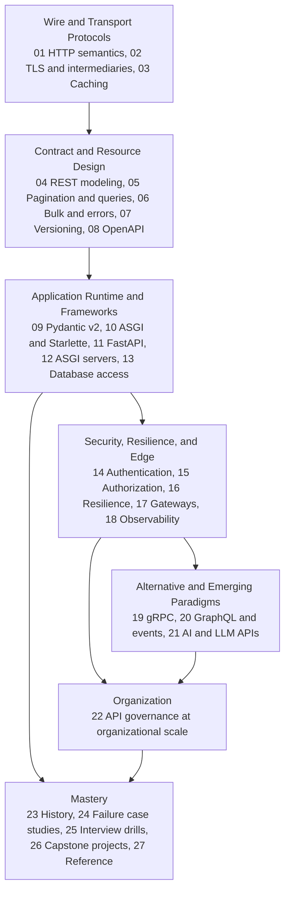

# API Engineering

An atomic-notes knowledge base for API engineering, the HTTP message abstractions beneath it, the ASGI server runtime around it, and every layer across the network, wire, and database boundary.
The bar is the level of an engineer who could design internet-scale API architectures, audit low-level HTTP wire framing and kernel socket state machines, review any endpoint for strict security and concurrency invariants, and set API guidelines for an enterprise.
For any API endpoint, the notes let you trace a request from raw TCP and TLS handshakes through reverse proxies, ASGI lifespan scopes, dependency resolution, validation engines, and SQL transaction isolation, and prove its behavior with an executable lab.

> [!summary] How to use this section
> Pick a folder, read its notes in the folder's Learning order, and run each note's lab.
> Every note links its prerequisite and the next note, so you can also walk the graph from any starting point.

This book builds upon and deepens material from several separate books across the vault.
It shares wire protocols, transport diagnostics, and structured data with [[19-Shell-and-Unix-Engineering/README|Shell and Unix Engineering]], while advancing the high-level trade-offs in [[04-System-Design/04-APIs-and-Protocols/README|APIs and Protocols]] in System Design into exhaustive RFC-grounded specifications and production edge architectures.
It also grounds the interview patterns from the Python Backend interview series at [[02-Programming-Languages/Python/Python-Backend-Interview-Prep/README|Python Backend Interview Prep]] in CPython runtime mechanics, ASGI server internals, and deterministic verification suites.

## Concept map

The map is the dependency order between groups of folders, not a runtime dependency.
Inside a folder, the Learning order list in its README is the order to read.

## Folders

| Folder | Notes | What it covers |
|---|---:|---|
| [01 HTTP Semantics and Wire Protocols](01-HTTP-Semantics-and-Wire-Protocols/README.md) | 18 | RFC 9110 message abstraction, HTTP/1.1 chunked framing, HTTP/2 binary framing and streams, HPACK, HTTP/3 over QUIC, QPACK, request smuggling |
| [02 TLS Connections and Intermediaries](02-TLS-Connections-and-Intermediaries/README.md) | 14 | TLS 1.3, 0-RTT replay, certificates, mTLS, connection pooling, proxy races, Forwarded header, client IP spoofing, 100-continue, trailers |
| [03 HTTP Caching and Conditional Requests](03-HTTP-Caching-and-Conditional-Requests/README.md) | 14 | RFC 9111 caching model, Cache-Control, strong and weak ETags, 304 revalidation, 412 preconditions, Vary header, surrogate keys, stampede prevention |
| [04 REST and Resource Modeling](04-REST-and-Resource-Modeling/README.md) | 16 | Fielding constraints, Richardson maturity, URI design, UUIDv7, method safety and idempotency, HTTP QUERY, status codes, JSON Patch, field masks |
| [05 Pagination Filtering and Query Patterns](05-Pagination-Filtering-and-Query-Patterns/README.md) | 13 | Offset versus keyset seek pagination, composite indexes, opaque cursors, filtering ASTs, multi-field sorting, sparse fieldsets, total counts |
| [06 Bulk Long Running and Error Contracts](06-Bulk-Long-Running-and-Error-Contracts/README.md) | 14 | RFC 9457 Problem Details, Google AIP-193 errors, batch operations, 207 Multi-Status, AIP-151 long-running operations, resumable uploads, dry-run |
| [07 Versioning Evolution and API Guidelines](07-Versioning-Evolution-and-API-Guidelines/README.md) | 14 | Wire and semantic compatibility, URI versus header versioning, Stripe date-based evolution, RFC 9745 Deprecation, RFC 8594 Sunset, AIP style guide |
| [08 OpenAPI JSON Schema and Contracts](08-OpenAPI-JSON-Schema-and-Contracts/README.md) | 16 | JSON Schema 2020-12, OpenAPI 3.1 and 3.2, schema composition, vacuum and Spectral linting, SDK generation, consumer-driven contracts, Schemathesis fuzzing |
| [09 Pydantic v2 Internals and Validation](09-Pydantic-v2-Internals-and-Validation/README.md) | 18 | pydantic-core Rust execution engine, CoreSchema, zero-copy validation, TypeAdapter, discriminated unions, PEP 695 generics, pydantic-settings |
| [10 ASGI and Starlette Internals](10-ASGI-and-Starlette-Internals/README.md) | 15 | ASGI 3.0 specification, scope-receive-send contract, Starlette routing and requests, pure ASGI middleware versus BaseHTTPMiddleware traps, SSE |
| [11 FastAPI Internals and Patterns](11-FastAPI-Internals-and-Patterns/README.md) | 18 | Dependant tree, dependency DAG resolution, per-request caching, yield cleanup scopes, sync threadpool versus async endpoints, testing overrides |
| [12 ASGI Servers and Async Runtime](12-ASGI-Servers-and-Async-Runtime/README.md) | 16 | Uvicorn, uvloop, Granian, Hypercorn, Gunicorn, CPython event loop, AnyIO structured concurrency, task cancellation, backpressure, SIGTERM shutdown |
| [13 Database Access and Transactions for APIs](13-Database-Access-and-Transactions-for-APIs/README.md) | 16 | SQLAlchemy 2.x async, asyncpg, psycopg, Unit of Work, greenlet_spawn, connection pooling, isolation anomalies, row locks, zero-downtime migrations |
| [14 API Authentication and Identity](14-API-Authentication-and-Identity/README.md) | 16 | Prefixed API keys, OAuth 2.0 and 2.1, RFC 9700 BCP, RFC 10017 BFF, OIDC, JWT RFC 8725 hardening, JWKS, DPoP RFC 9449, mTLS binding, Token Exchange |
| [15 API Authorization and OWASP Security](15-API-Authorization-and-OWASP-Security/README.md) | 16 | Scopes, RBAC, ABAC, Zanzibar ReBAC, OWASP API Security Top 10, BOLA elimination, BOPLA prevention, SSRF transport guards, CORS, security headers |
| [16 Resilience Rate Limiting and Idempotency](16-Resilience-Rate-Limiting-and-Idempotency/README.md) | 16 | Token bucket, leaky bucket, GCRA Lua limiters, IETF RateLimit headers, Idempotency-Key draft-08, deadline budgets, retry storms, circuit breakers |
| [17 API Gateways Proxies and Edge Architecture](17-API-Gateways-Proxies-and-Edge-Architecture/README.md) | 13 | L4 versus L7 routing, Envoy Proxy v1.40.2 internals, filters, ext_authz, BFF pattern, service mesh, retry multiplication, timeout misalignment |
| [18 Observability Profiling and Operations](18-Observability-Profiling-and-Operations/README.md) | 14 | OpenTelemetry distributed tracing, W3C Trace Context, high-cardinality metrics, structlog, Prometheus histograms, Locust load testing, SLO error budgets |
| [19 gRPC and Protocol Buffers](19-gRPC-and-Protocol-Buffers/README.md) | 13 | Protobuf Editions 2023 and 2024, TLV varint wire encoding, buf linting, gRPC 5-byte framing over HTTP/2, streaming modes, deadline propagation, grpc.aio |
| [20 GraphQL JSON RPC and Event APIs](20-GraphQL-JSON-RPC-and-Event-APIs/README.md) | 14 | GraphQL 2025 spec, strawberry-graphql, DataLoader N+1 batching, query depth and complexity DoS, JSON-RPC 2.0, AsyncAPI 3.1, CloudEvents, protocol selection |
| [21 AI and LLM API Engineering](21-AI-and-LLM-API-Engineering/README.md) | 10 | Streaming token SSE, disconnect cancellation, token-bucket rate limiting, structured outputs JSON Schema, Model Context Protocol (MCP), AXI CLI design |
| [22 API Governance at Organizational Scale](22-API-Governance-at-Organizational-Scale/README.md) | 10 | API catalog discovery RFC 9727, zombie APIs, API design review boards, automated Spectral and buf lint gates, golden paths, SDK maintenance, deprecation |
| [23 History and Primary Sources](23-History-and-Primary-Sources/README.md) | 10 | Fielding dissertation, HTTP RFC evolution, CORBA and SOAP demise, JSON and OpenAPI emergence, Python CGI to WSGI and ASGI, FastAPI history |
| [24 API Failure Case Studies](24-API-Failure-Case-Studies/README.md) | 12 | HTTP/2 Rapid Reset CVE-2023-44487, retry storms, threadpool starvation, JWT key confusion, BOLA breaches, GraphQL complexity bombs, cache poisoning |
| [25 Interview Drills and Design Reviews](25-Interview-Drills-and-Design-Reviews/README.md) | 12 | Life of an HTTP request, predict-the-output on Pydantic and asyncio, debug-this-API drills, OpenAPI contract critiques, staff system design reviews |
| [26 Capstone Projects](26-Capstone-Projects/README.md) | 6 | Production-grade capstones: RFC HTTP server, OpenAPI engine, async gateway, zero-trust OAuth resource server, event broker, resilience proxy |
| [27 Reference](27-Reference/README.md) | 10 | Glossary, RFC index, latency and throughput cost models, HTTP status and header maps, OWASP checklist, decision matrices, study plans |

## Paths by track

- SDE (L4-L6): 01, 03, 04, 05, 06, 08, 09, 10, 11, 13, 14, 15, 16, then 25.
- AI engineering: 01, 04, 06, 08, 09, 10, 11, 14, 16, and 21, alongside [[13-Agentic-AI/Agentic-Harness/README|Agentic Harness]].
- Distinguished and principal: everything, with particular weight on 01 and 02 (wire framing and TLS), 12 (runtime concurrency), 16 and 17 (resilience and edge architecture), 22 (organizational governance), 24 (failure postmortems), and at least two capstones.

## How the notes are verified

HTTP and API behavior is checkable in software, so these notes check it.
Every worked example is a lab under [labs/](labs/README.md) with an automated pytest suite, Ruff formatted and linted, and type-checked under strict Mypy and Pyright.
Runtime and portability claims are proven across the CPython matrix (3.12, 3.13, 3.14, 3.15, and 3.15t free-threaded) and container images on Debian and Alpine (musl libc).
Each note is drafted from primary sources and then fact-checked by an independent reviewer before it is marked `solid`; [STYLE.md](STYLE.md) is the contract.
`python3 tools/check_api_labs.py` gates the labs in CI on every change.

## Conventions

One concept per note, hyphenated file names, unique across the vault, so a bare [[HTTP-Message-Abstraction-RFC-9110]] link resolves.
Every note ends with Related links (`Prerequisites:`, `Next:`, and `See also:`) and primary-source further reading.
Code, headers, and HTTP syntax in prose are always in backticks, and wikilink aliases inside tables are written as [[Note\|Alias]].

## Related in this vault

- [Operating Systems](../01-CS-Foundations/Operating-Systems/README.md) for socket buffers, file descriptors, and kernel I/O under folders 01, 02, and 12.
- [System Design](../04-System-Design/README.md) for broad distributed systems trade-offs and protocol selection.
- [Security and Cryptography](../11-Security-And-Cryptography/README.md) for TLS handshakes, cipher suites, and cryptographic tokens behind folders 02, 14, and 15.
- [Performance Engineering](../12-Performance-Engineering/README.md) for latency histograms, profiling, and benchmarking methodology in folder 18.
- [Developer Toolchain](../18-Developer-Toolchain/README.md) for build sandboxing, packaging, and CI pipelines.
- [Shell and Unix Engineering](../19-Shell-and-Unix-Engineering/README.md) for network utilities, curl diagnostics, and Unix process supervisors.
